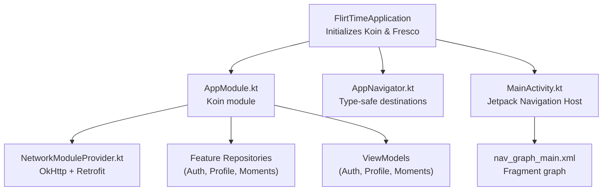
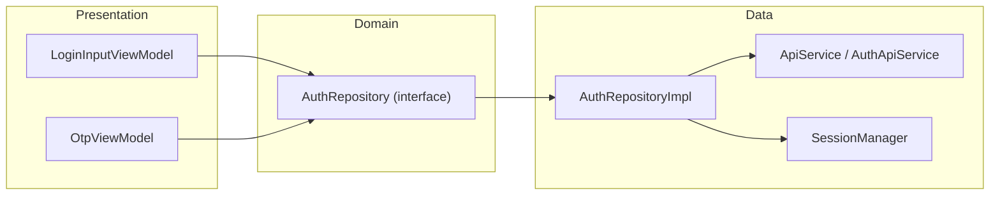
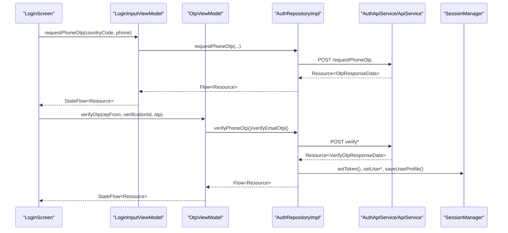
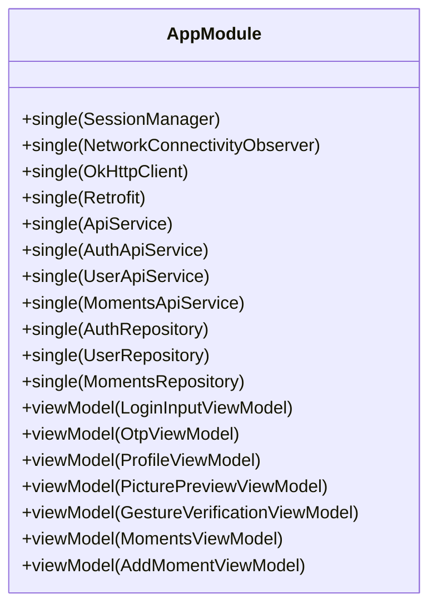
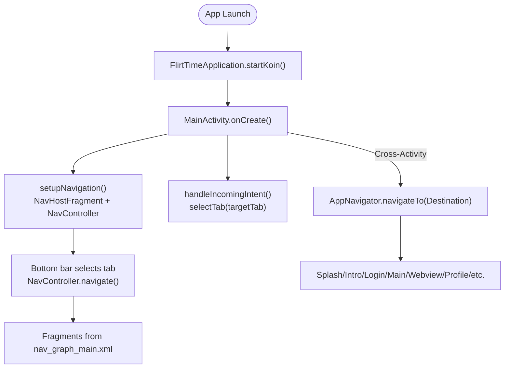
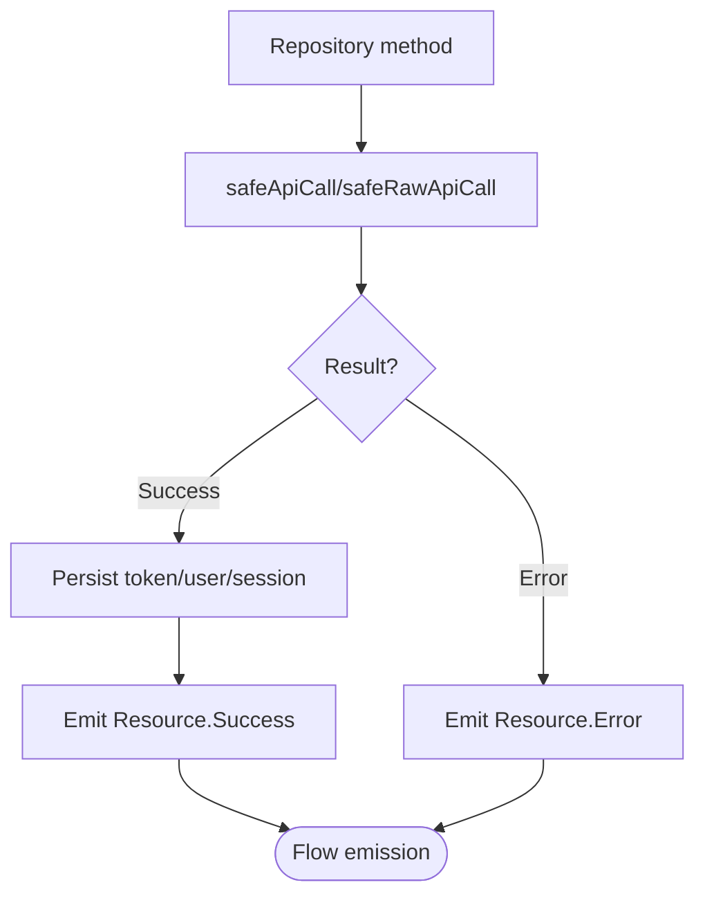
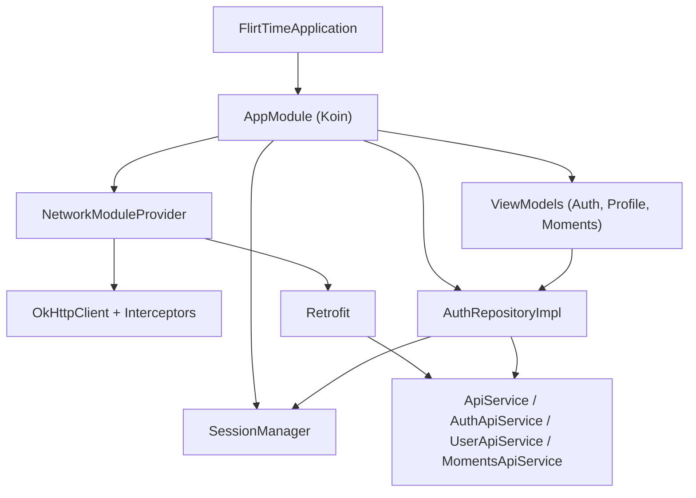

# Architecture Overview

<cite>
**Referenced Files in This Document**
- [FlirtTimeApplication.kt](file://app/src/main/java/com/flirttime/FlirtTimeApplication.kt)
- [AppModule.kt](file://app/src/main/java/com/flirttime/di/AppModule.kt)
- [AppNavigator.kt](file://app/src/main/java/com/flirttime/core/navigation/AppNavigator.kt)
- [MainActivity.kt](file://app/src/main/java/com/flirttime/MainActivity.kt)
- [nav_graph_main.xml](file://app/src/main/res/navigation/nav_graph_main.xml)
- [LoginInputViewModel.kt](file://app/src/main/java/com/flirttime/feature/auth/presentation/login/LoginInputViewModel.kt)
- [OtpViewModel.kt](file://app/src/main/java/com/flirttime/feature/auth/presentation/otp/OtpViewModel.kt)
- [AuthRepositoryImpl.kt](file://app/src/main/java/com/flirttime/feature/auth/data/repository/AuthRepositoryImpl.kt)
- [AuthRepository.kt](file://app/src/main/java/com/flirttime/feature/auth/domain/repository/AuthRepository.kt)
- [NetworkModuleProvider.kt](file://app/src/main/java/com/flirttime/core/network/NetworkModuleProvider.kt)
- [ApiService.kt](file://app/src/main/java/com/flirttime/core/network/ApiService.kt)
- [SessionManager.kt](file://app/src/main/java/com/flirttime/core/database/SessionManager.kt)
- [Resource.kt](file://app/src/main/java/com/flirttime/Resource.kt)
</cite>

## Table of Contents
1. Introduction
2. Project Structure
3. Core Components
4. Architecture Overview
5. Detailed Component Analysis
6. Dependency Analysis
7. Performance Considerations
8. Troubleshooting Guide
9. Conclusion

## Introduction
This document explains the architecture of the Flirttime-Otp-Android application with a focus on Clean Architecture, MVVM, dependency injection via Koin, and navigation using Jetpack Navigation. It details how presentation, domain, and data layers are separated; how ViewModels manage UI state; how repositories encapsulate data operations; and how modules interact across feature boundaries.

## Project Structure
The app follows a feature-based modularization under com.flirttime.feature.<feature>, each containing data, domain, and presentation subpackages. Shared infrastructure lives under com.flirttime.core (networking, storage, navigation helpers). The app entry point initializes DI and image loading.

**Diagram sources**
- [FlirtTimeApplication.kt:10-22](file://app/src/main/java/com/flirttime/FlirtTimeApplication.kt#L10-L22)
- [AppModule.kt:27-57](file://app/src/main/java/com/flirttime/di/AppModule.kt#L27-L57)
- [NetworkModuleProvider.kt:17-85](file://app/src/main/java/com/flirttime/core/network/NetworkModuleProvider.kt#L17-L85)
- [AppNavigator.kt:19-56](file://app/src/main/java/com/flirttime/core/navigation/AppNavigator.kt#L19-L56)
- [MainActivity.kt:18-52](file://app/src/main/java/com/flirttime/MainActivity.kt#L18-L52)
- [nav_graph_main.xml:1-38](file://app/src/main/res/navigation/nav_graph_main.xml#L1-L38)

**Section sources**
- [FlirtTimeApplication.kt:10-22](file://app/src/main/java/com/flirttime/FlirtTimeApplication.kt#L10-L22)
- [AppModule.kt:27-57](file://app/src/main/java/com/flirttime/di/AppModule.kt#L27-L57)
- [MainActivity.kt:18-52](file://app/src/main/java/com/flirttime/MainActivity.kt#L18-L52)
- [nav_graph_main.xml:1-38](file://app/src/main/res/navigation/nav_graph_main.xml#L1-L38)

## Core Components
- Application bootstrap: Initializes Koin with appModule and sets up Fresco for image loading.
- Dependency Injection (Koin): Centralized module wiring singletons (network, session), feature repositories, and ViewModels.
- Networking: OkHttp client configured with auth, logging, offline cache; Retrofit API interfaces.
- Storage: DataStore-backed SessionManager exposing typed flows and cached token access.
- Navigation: Type-safe Destination sealed class and AppNavigator utility for Activity routing; Jetpack Navigation for Fragment tabs.
- Domain/Data separation: Feature-specific repository interfaces in domain and implementations in data.
- UI State: ViewModels expose StateFlow<Resource<T>> to drive UI updates.

**Section sources**
- [FlirtTimeApplication.kt:10-22](file://app/src/main/java/com/flirttime/FlirtTimeApplication.kt#L10-L22)
- [AppModule.kt:27-57](file://app/src/main/java/com/flirttime/di/AppModule.kt#L27-L57)
- [NetworkModuleProvider.kt:17-85](file://app/src/main/java/com/flirttime/core/network/NetworkModuleProvider.kt#L17-L85)
- [ApiService.kt:9-22](file://app/src/main/java/com/flirttime/core/network/ApiService.kt#L9-L22)
- [SessionManager.kt:22-222](file://app/src/main/java/com/flirttime/core/database/SessionManager.kt#L22-L222)
- [AppNavigator.kt:19-136](file://app/src/main/java/com/flirttime/core/navigation/AppNavigator.kt#L19-L136)
- [Resource.kt:1-20](file://app/src/main/java/com/flirttime/Resource.kt#L1-L20)

## Architecture Overview
The app implements Clean Architecture with clear layering:
- Presentation: Activities/Fragments and ViewModels that observe StateFlow and react to Resource states.
- Domain: Repository interfaces defining use cases per feature.
- Data: Repository implementations orchestrating network calls, local storage, and mapping responses.

**Diagram sources**
- [LoginInputViewModel.kt:17-58](file://app/src/main/java/com/flirttime/feature/auth/presentation/login/LoginInputViewModel.kt#L17-L58)
- [OtpViewModel.kt:14-57](file://app/src/main/java/com/flirttime/feature/auth/presentation/otp/OtpViewModel.kt#L14-L57)
- [AuthRepository.kt:10-52](file://app/src/main/java/com/flirttime/feature/auth/domain/repository/AuthRepository.kt#L10-L52)
- [AuthRepositoryImpl.kt:23-217](file://app/src/main/java/com/flirttime/feature/auth/data/repository/AuthRepositoryImpl.kt#L23-L217)
- [ApiService.kt:9-22](file://app/src/main/java/com/flirttime/core/network/ApiService.kt#L9-L22)
- [SessionManager.kt:22-222](file://app/src/main/java/com/flirttime/core/database/SessionManager.kt#L22-L222)

## Detailed Component Analysis

### Authentication Flow (Phone/Email OTP)
This flow demonstrates MVVM and Clean Architecture:
- LoginInputViewModel requests country list and triggers OTP send.
- OtpViewModel verifies or resends OTP based on source (phone/email).
- AuthRepositoryImpl performs network calls via AuthApiService/ApiService and persists tokens/user info in SessionManager.
- All I/O is wrapped with safeApiCall/safeRawApiCall returning Resource<T>.

**Diagram sources**
- [LoginInputViewModel.kt:31-53](file://app/src/main/java/com/flirttime/feature/auth/presentation/login/LoginInputViewModel.kt#L31-L53)
- [OtpViewModel.kt:24-47](file://app/src/main/java/com/flirttime/feature/auth/presentation/otp/OtpViewModel.kt#L24-L47)
- [AuthRepositoryImpl.kt:29-132](file://app/src/main/java/com/flirttime/feature/auth/data/repository/AuthRepositoryImpl.kt#L29-L132)
- [ApiService.kt:9-22](file://app/src/main/java/com/flirttime/core/network/ApiService.kt#L9-L22)
- [SessionManager.kt:136-195](file://app/src/main/java/com/flirttime/core/database/SessionManager.kt#L136-L195)

**Section sources**
- [LoginInputViewModel.kt:17-58](file://app/src/main/java/com/flirttime/feature/auth/presentation/login/LoginInputViewModel.kt#L17-L58)
- [OtpViewModel.kt:14-57](file://app/src/main/java/com/flirttime/feature/auth/presentation/otp/OtpViewModel.kt#L14-L57)
- [AuthRepositoryImpl.kt:23-217](file://app/src/main/java/com/flirttime/feature/auth/data/repository/AuthRepositoryImpl.kt#L23-L217)
- [AuthRepository.kt:10-52](file://app/src/main/java/com/flirttime/feature/auth/domain/repository/AuthRepository.kt#L10-L52)

### Dependency Injection Strategy (Koin)
- Application-level initialization starts Koin and registers appModule.
- appModule wires:
  - Singletons: SessionManager, NetworkConnectivityObserver, OkHttpClient, Retrofit, ApiService, feature ApiServices.
  - Feature repositories: AuthRepository, UserRepository, MomentsRepository.
  - ViewModels: LoginInputViewModel, OtpViewModel, ProfileViewModel, PicturePreviewViewModel, GestureVerificationViewModel, MomentsViewModel, AddMomentViewModel.

**Diagram sources**
- [AppModule.kt:27-57](file://app/src/main/java/com/flirttime/di/AppModule.kt#L27-L57)
- [FlirtTimeApplication.kt:10-22](file://app/src/main/java/com/flirttime/FlirtTimeApplication.kt#L10-L22)

**Section sources**
- [AppModule.kt:27-57](file://app/src/main/java/com/flirttime/di/AppModule.kt#L27-L57)
- [FlirtTimeApplication.kt:10-22](file://app/src/main/java/com/flirttime/FlirtTimeApplication.kt#L10-L22)

### Navigation Architecture
- Activity-level navigation uses Jetpack Navigation with a NavHostFragment and nav_graph_main.xml for tabbed fragments (Moments, Explore, Matches, Chat, Profile).
- Cross-Activity navigation uses AppNavigator with a sealed Destination hierarchy providing type-safe arguments and Intent extras mapping.

**Diagram sources**
- [FlirtTimeApplication.kt:10-22](file://app/src/main/java/com/flirttime/FlirtTimeApplication.kt#L10-L22)
- [MainActivity.kt:24-52](file://app/src/main/java/com/flirttime/MainActivity.kt#L24-L52)
- [MainActivity.kt:54-113](file://app/src/main/java/com/flirttime/MainActivity.kt#L54-L113)
- [MainActivity.kt:172-184](file://app/src/main/java/com/flirttime/MainActivity.kt#L172-L184)
- [AppNavigator.kt:73-135](file://app/src/main/java/com/flirttime/core/navigation/AppNavigator.kt#L73-L135)
- [nav_graph_main.xml:1-38](file://app/src/main/res/navigation/nav_graph_main.xml#L1-L38)

**Section sources**
- [MainActivity.kt:24-113](file://app/src/main/java/com/flirttime/MainActivity.kt#L24-L113)
- [MainActivity.kt:172-184](file://app/src/main/java/com/flirttime/MainActivity.kt#L172-L184)
- [AppNavigator.kt:19-136](file://app/src/main/java/com/flirttime/core/navigation/AppNavigator.kt#L19-L136)
- [nav_graph_main.xml:1-38](file://app/src/main/res/navigation/nav_graph_main.xml#L1-L38)

### Data Layer and Error Handling
- Network calls are wrapped with safeApiCall/safeRawApiCall, producing Resource.Success/Error/Loading.
- AuthRepositoryImpl persists authentication artifacts (token, user profile, flags) into SessionManager upon successful verification/login.
- SessionManager exposes typed flows and a non-blocking cached token for interceptors.

**Diagram sources**
- [AuthRepositoryImpl.kt:29-132](file://app/src/main/java/com/flirttime/feature/auth/data/repository/AuthRepositoryImpl.kt#L29-L132)
- [SessionManager.kt:136-195](file://app/src/main/java/com/flirttime/core/database/SessionManager.kt#L136-L195)
- [Resource.kt:1-20](file://app/src/main/java/com/flirttime/Resource.kt#L1-L20)

**Section sources**
- [AuthRepositoryImpl.kt:23-217](file://app/src/main/java/com/flirttime/feature/auth/data/repository/AuthRepositoryImpl.kt#L23-L217)
- [SessionManager.kt:22-222](file://app/src/main/java/com/flirttime/core/database/SessionManager.kt#L22-L222)
- [Resource.kt:1-20](file://app/src/main/java/com/flirttime/Resource.kt#L1-L20)

## Dependency Analysis
High-level dependencies between components:

**Diagram sources**
- [FlirtTimeApplication.kt:10-22](file://app/src/main/java/com/flirttime/FlirtTimeApplication.kt#L10-L22)
- [AppModule.kt:27-57](file://app/src/main/java/com/flirttime/di/AppModule.kt#L27-L57)
- [NetworkModuleProvider.kt:17-85](file://app/src/main/java/com/flirttime/core/network/NetworkModuleProvider.kt#L17-L85)
- [ApiService.kt:9-22](file://app/src/main/java/com/flirttime/core/network/ApiService.kt#L9-L22)
- [AuthRepositoryImpl.kt:23-217](file://app/src/main/java/com/flirttime/feature/auth/data/repository/AuthRepositoryImpl.kt#L23-L217)

**Section sources**
- [AppModule.kt:27-57](file://app/src/main/java/com/flirttime/di/AppModule.kt#L27-L57)
- [NetworkModuleProvider.kt:17-85](file://app/src/main/java/com/flirttime/core/network/NetworkModuleProvider.kt#L17-L85)
- [AuthRepositoryImpl.kt:23-217](file://app/src/main/java/com/flirttime/feature/auth/data/repository/AuthRepositoryImpl.kt#L23-L217)

## Performance Considerations
- Network caching: OkHttp cache enabled; offline interceptor forces cached-only requests when no connectivity.
- Timeouts: Connect/read/write timeouts configured to avoid long hangs.
- Logging: HTTP logging disabled in release builds; sensitive headers redacted.
- Token caching: SessionManager maintains an in-memory cached token for fast interceptor reads.
- Coroutines: Repository methods run on Dispatchers.IO; ViewModels use viewModelScope for lifecycle-aware flows.

[No sources needed since this section provides general guidance]

## Troubleshooting Guide
- Network errors: safeApiCall/safeRawApiCall map exceptions to Resource.Error with messages and codes; check logs and errorBody where available.
- Offline behavior: When offline, requests fall back to cache; ensure server responses include appropriate cache headers if relying on offline mode.
- Auth failures: Verify token presence and format; SessionManager adds Authorization header automatically.
- Navigation issues: Validate Destination types and extra keys; ensure target Activity/Fragment handles extras correctly.

**Section sources**
- [AuthRepositoryImpl.kt:29-132](file://app/src/main/java/com/flirttime/feature/auth/data/repository/AuthRepositoryImpl.kt#L29-L132)
- [NetworkModuleProvider.kt:22-75](file://app/src/main/java/com/flirttime/core/network/NetworkModuleProvider.kt#L22-L75)
- [AppNavigator.kt:73-135](file://app/src/main/java/com/flirttime/core/navigation/AppNavigator.kt#L73-L135)

## Conclusion
The Flirttime-Otp-Android app applies Clean Architecture with clear separation of concerns, MVVM-driven UI state management, and Koin-based dependency injection. Feature modules encapsulate their own data and domain layers while sharing core infrastructure. Navigation combines Jetpack Navigation for in-app fragments and a type-safe router for cross-Activity flows. The design supports scalability through modular features, explicit repository contracts, and robust networking/error handling.