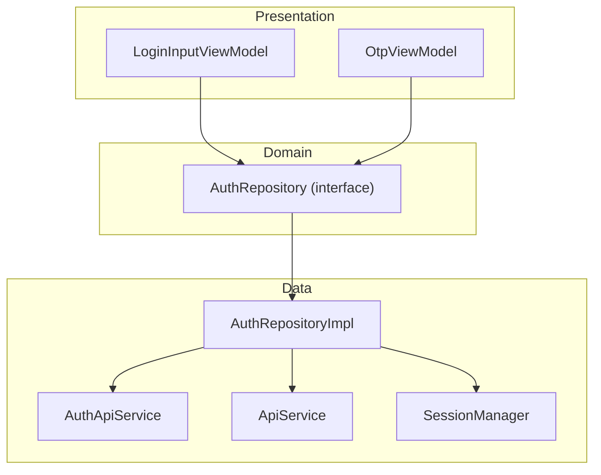
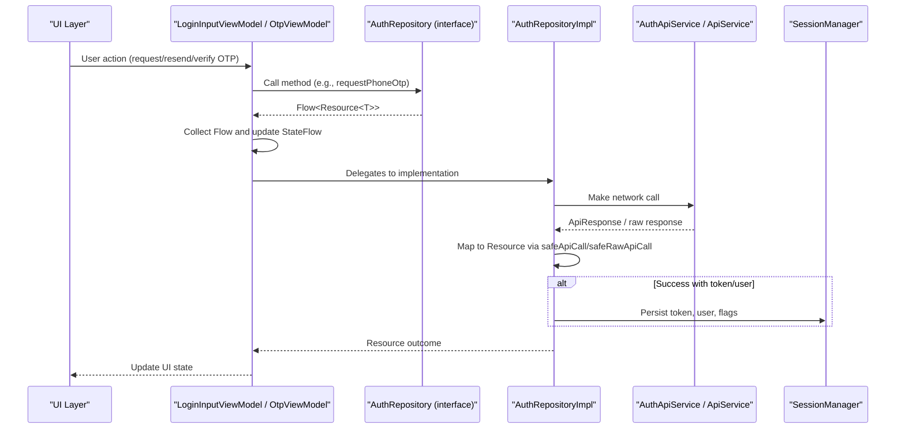
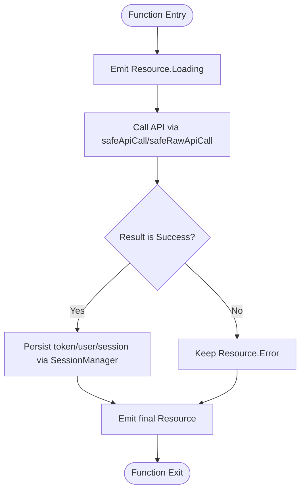
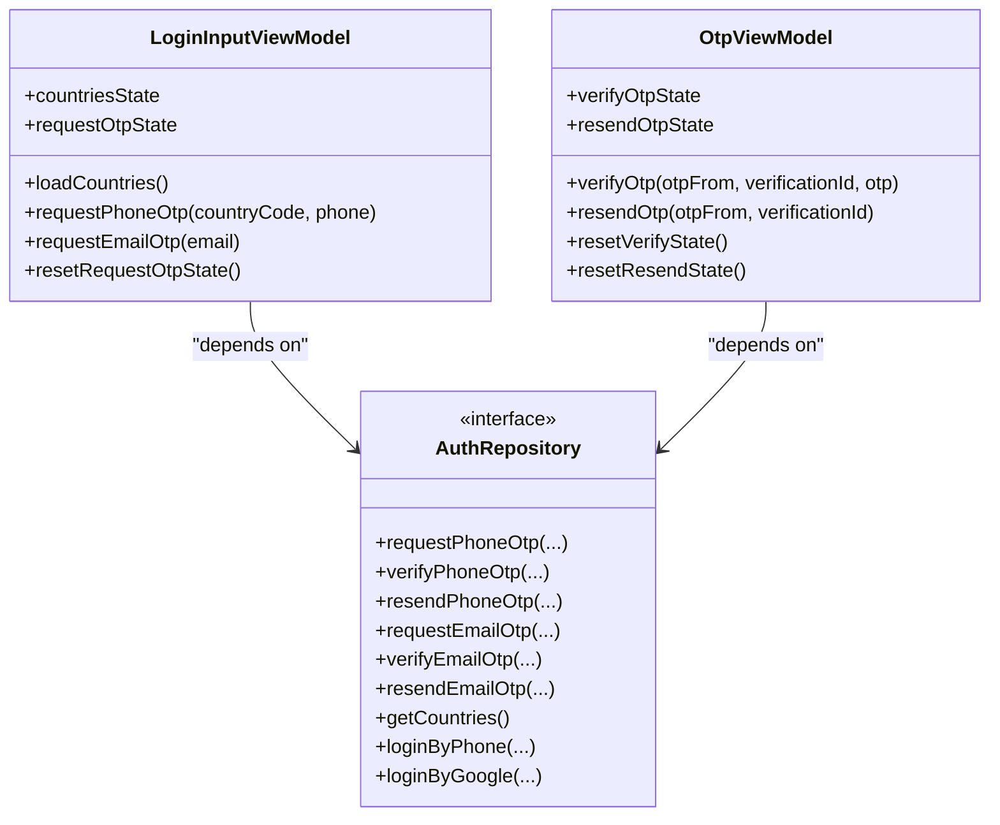
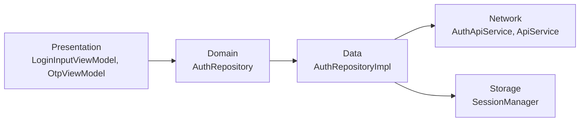

# Clean Architecture Implementation

<cite>
**Referenced Files in This Document**
- [AuthRepository.kt](file://app/src/main/java/com/flirttime/feature/auth/domain/repository/AuthRepository.kt)
- [AuthRepositoryImpl.kt](file://app/src/main/java/com/flirttime/feature/auth/data/repository/AuthRepositoryImpl.kt)
- [LoginInputViewModel.kt](file://app/src/main/java/com/flirttime/feature/auth/presentation/login/LoginInputViewModel.kt)
- [OtpViewModel.kt](file://app/src/main/java/com/flirttime/feature/auth/presentation/otp/OtpViewModel.kt)
- [ApiService.kt](file://app/src/main/java/com/flirttime/core/network/ApiService.kt)
- [AuthApiService.kt](file://app/src/main/java/com/flirttime/feature/auth/data/network/AuthApiService.kt)
- [SafeApiCall.kt](file://app/src/main/java/com/flirttime/core/network/SafeApiCall.kt)
- [Resource.kt](file://app/src/main/java/com/flirttime/Resource.kt)
- [SessionManager.kt](file://app/src/main/java/com/flirttime/core/database/SessionManager.kt)
</cite>

## Table of Contents
1. [Introduction](#introduction)
2. [Project Structure](#project-structure)
3. [Core Components](#core-components)
4. [Architecture Overview](#architecture-overview)
5. [Detailed Component Analysis](#detailed-component-analysis)
6. [Dependency Analysis](#dependency-analysis)
7. [Performance Considerations](#performance-considerations)
8. [Troubleshooting Guide](#troubleshooting-guide)
9. [Guidelines for Adding New Features](#guidelines-for-adding-new-features)
10. [Conclusion](#conclusion)

## Introduction
This document explains the Clean Architecture implementation in Flirt-Otp-Android, focusing on the three-layer separation: presentation (Activities/Fragments and ViewModels), domain (repository interfaces and business contracts), and data (repository implementations and API services). It uses the authentication feature as a concrete example to show how AuthRepository defines contracts while AuthRepositoryImpl handles actual data operations. The goal is to demonstrate testability, maintainability, and clear separation of concerns, and to provide guidelines for adding new features following this pattern.

## Project Structure
The authentication feature follows a layered structure:
- Presentation layer: Activities and ViewModels that observe UI state and trigger user actions.
- Domain layer: Repository interfaces that define use-case boundaries without network or storage details.
- Data layer: Repository implementations that call Retrofit services and persist session data.

**Diagram sources**
- [LoginInputViewModel.kt:17-58](file://app/src/main/java/com/flirttime/feature/auth/presentation/login/LoginInputViewModel.kt#L17-L58)
- [OtpViewModel.kt:14-57](file://app/src/main/java/com/flirttime/feature/auth/presentation/otp/OtpViewModel.kt#L14-L57)
- [AuthRepository.kt:10-52](file://app/src/main/java/com/flirttime/feature/auth/domain/repository/AuthRepository.kt#L10-L52)
- [AuthRepositoryImpl.kt:23-217](file://app/src/main/java/com/flirttime/feature/auth/data/repository/AuthRepositoryImpl.kt#L23-L217)
- [AuthApiService.kt:13-46](file://app/src/main/java/com/flirttime/feature/auth/data/network/AuthApiService.kt#L13-L46)
- [ApiService.kt:9-22](file://app/src/main/java/com/flirttime/core/network/ApiService.kt#L9-L22)
- [SessionManager.kt:22-222](file://app/src/main/java/com/flirttime/core/database/SessionManager.kt#L22-L222)

**Section sources**
- [LoginInputViewModel.kt:17-58](file://app/src/main/java/com/flirttime/feature/auth/presentation/login/LoginInputViewModel.kt#L17-L58)
- [OtpViewModel.kt:14-57](file://app/src/main/java/com/flirttime/feature/auth/presentation/otp/OtpViewModel.kt#L14-L57)
- [AuthRepository.kt:10-52](file://app/src/main/java/com/flirttime/feature/auth/domain/repository/AuthRepository.kt#L10-L52)
- [AuthRepositoryImpl.kt:23-217](file://app/src/main/java/com/flirttime/feature/auth/data/repository/AuthRepositoryImpl.kt#L23-L217)
- [AuthApiService.kt:13-46](file://app/src/main/java/com/flirttime/feature/auth/data/network/AuthApiService.kt#L13-L46)
- [ApiService.kt:9-22](file://app/src/main/java/com/flirttime/core/network/ApiService.kt#L9-L22)
- [SessionManager.kt:22-222](file://app/src/main/java/com/flirttime/core/database/SessionManager.kt#L22-L222)

## Core Components
- Resource sealed class: Represents Loading, Success, and Error states used across layers to propagate results.
- Safe API helpers: Wrap Retrofit calls into Resource outcomes with robust error handling.
- SessionManager: Persists tokens, user info, and flags using DataStore; provides flows and synchronous snapshots.
- AuthRepository interface: Defines all auth-related use cases (phone/email OTP, resend, login by phone/email/google).
- AuthRepositoryImpl: Implements AuthRepository, orchestrates API calls, maps responses to Resource, and persists session data.
- ViewModels: Observe repository flows and expose StateFlow to UI.

Key responsibilities:
- Presentation: React to user input, collect Flow results, update UI state.
- Domain: Define stable contracts independent of network/storage.
- Data: Implement contracts, handle errors, manage persistence.

**Section sources**
- [Resource.kt:1-20](file://app/src/main/java/com/flirttime/Resource.kt#L1-L20)
- [SafeApiCall.kt:14-107](file://app/src/main/java/com/flirttime/core/network/SafeApiCall.kt#L14-L107)
- [SessionManager.kt:22-222](file://app/src/main/java/com/flirttime/core/database/SessionManager.kt#L22-L222)
- [AuthRepository.kt:10-52](file://app/src/main/java/com/flirttime/feature/auth/domain/repository/AuthRepository.kt#L10-L52)
- [AuthRepositoryImpl.kt:23-217](file://app/src/main/java/com/flirttime/feature/auth/data/repository/AuthRepositoryImpl.kt#L23-L217)
- [LoginInputViewModel.kt:17-58](file://app/src/main/java/com/flirttime/feature/auth/presentation/login/LoginInputViewModel.kt#L17-L58)
- [OtpViewModel.kt:14-57](file://app/src/main/java/com/flirttime/feature/auth/presentation/otp/OtpViewModel.kt#L14-L57)

## Architecture Overview
The authentication flow demonstrates clean separation:
- ViewModels depend only on AuthRepository interface.
- AuthRepositoryImpl depends on AuthApiService, ApiService, and SessionManager.
- Network calls are wrapped with safeApiCall/safeRawApiCall to produce Resource outcomes.
- Successful auth responses persist tokens and user data via SessionManager.

**Diagram sources**
- [LoginInputViewModel.kt:31-53](file://app/src/main/java/com/flirttime/feature/auth/presentation/login/LoginInputViewModel.kt#L31-L53)
- [OtpViewModel.kt:24-47](file://app/src/main/java/com/flirttime/feature/auth/presentation/otp/OtpViewModel.kt#L24-L47)
- [AuthRepository.kt:10-52](file://app/src/main/java/com/flirttime/feature/auth/domain/repository/AuthRepository.kt#L10-L52)
- [AuthRepositoryImpl.kt:29-154](file://app/src/main/java/com/flirttime/feature/auth/data/repository/AuthRepositoryImpl.kt#L29-L154)
- [AuthApiService.kt:13-46](file://app/src/main/java/com/flirttime/feature/auth/data/network/AuthApiService.kt#L13-L46)
- [ApiService.kt:9-22](file://app/src/main/java/com/flirttime/core/network/ApiService.kt#L9-L22)
- [SessionManager.kt:136-195](file://app/src/main/java/com/flirttime/core/database/SessionManager.kt#L136-L195)

## Detailed Component Analysis

### Domain Layer: AuthRepository Interface
- Purpose: Define stable contracts for authentication use cases.
- Responsibilities:
  - Phone OTP: request, verify, resend.
  - Email OTP: request, verify, resend.
  - Legacy/social: get countries, login by phone, login by Google.
- Communication: Returns Kotlin Flows of Resource<T>, enabling reactive streams to the presentation layer.

Benefits:
- Decouples UI from data source specifics.
- Enables easy mocking for tests.
- Centralizes contract evolution.

**Section sources**
- [AuthRepository.kt:10-52](file://app/src/main/java/com/flirttime/feature/auth/domain/repository/AuthRepository.kt#L10-L52)

### Data Layer: AuthRepositoryImpl
- Purpose: Implement AuthRepository and orchestrate data operations.
- Responsibilities:
  - Call AuthApiService for OTP endpoints and ApiService for legacy endpoints.
  - Wrap calls with safeApiCall/safeRawApiCall to convert to Resource.
  - On success, persist token, user profile, verification flags, and redirect page via SessionManager.
  - Run IO-bound work on Dispatchers.IO.

Key patterns:
- Flow-based emission of Resource.Loading before network call, then final result.
- Conditional persistence only when Resource.Success contains expected fields.

**Diagram sources**
- [AuthRepositoryImpl.kt:29-75](file://app/src/main/java/com/flirttime/feature/auth/data/repository/AuthRepositoryImpl.kt#L29-L75)
- [AuthRepositoryImpl.kt:97-132](file://app/src/main/java/com/flirttime/feature/auth/data/repository/AuthRepositoryImpl.kt#L97-L132)
- [SafeApiCall.kt:14-65](file://app/src/main/java/com/flirttime/core/network/SafeApiCall.kt#L14-L65)
- [SessionManager.kt:136-195](file://app/src/main/java/com/flirttime/core/database/SessionManager.kt#L136-L195)

**Section sources**
- [AuthRepositoryImpl.kt:23-217](file://app/src/main/java/com/flirttime/feature/auth/data/repository/AuthRepositoryImpl.kt#L23-L217)
- [SafeApiCall.kt:14-107](file://app/src/main/java/com/flirttime/core/network/SafeApiCall.kt#L14-L107)
- [SessionManager.kt:22-222](file://app/src/main/java/com/flirttime/core/database/SessionManager.kt#L22-L222)

### Presentation Layer: ViewModels
- LoginInputViewModel:
  - Loads country list via getCountries().
  - Triggers phone/email OTP requests and exposes StateFlow for UI binding.
- OtpViewModel:
  - Verifies OTP (phone/email) and resends OTP based on otpFrom parameter.
  - Exposes StateFlow for verify and resend states.

Both ViewModels:
- Depend only on AuthRepository interface.
- Use viewModelScope to launch coroutines and collect Flow results.
- Provide reset methods to clear transient UI states.

**Diagram sources**
- [LoginInputViewModel.kt:17-58](file://app/src/main/java/com/flirttime/feature/auth/presentation/login/LoginInputViewModel.kt#L17-L58)
- [OtpViewModel.kt:14-57](file://app/src/main/java/com/flirttime/feature/auth/presentation/otp/OtpViewModel.kt#L14-L57)
- [AuthRepository.kt:10-52](file://app/src/main/java/com/flirttime/feature/auth/domain/repository/AuthRepository.kt#L10-L52)

**Section sources**
- [LoginInputViewModel.kt:17-58](file://app/src/main/java/com/flirttime/feature/auth/presentation/login/LoginInputViewModel.kt#L17-L58)
- [OtpViewModel.kt:14-57](file://app/src/main/java/com/flirttime/feature/auth/presentation/otp/OtpViewModel.kt#L14-L57)

### Network Layer: API Services
- AuthApiService: Declares OTP endpoints for phone and email with typed request/response models.
- ApiService: Declares legacy endpoints like get-countries and login-by-phone/email/google.

These interfaces isolate Retrofit annotations and types from business logic.

**Section sources**
- [AuthApiService.kt:13-46](file://app/src/main/java/com/flirttime/feature/auth/data/network/AuthApiService.kt#L13-L46)
- [ApiService.kt:9-22](file://app/src/main/java/com/flirttime/core/network/ApiService.kt#L9-L22)

### State and Error Handling
- Resource: Sealed class representing Loading, Success, and Error states with helper properties.
- SafeApiCall: Wraps API calls to return Resource, parsing HTTP errors and network exceptions consistently.

This ensures consistent UI feedback and simplifies error handling across layers.

**Section sources**
- [Resource.kt:1-20](file://app/src/main/java/com/flirttime/Resource.kt#L1-L20)
- [SafeApiCall.kt:14-107](file://app/src/main/java/com/flirttime/core/network/SafeApiCall.kt#L14-L107)

## Dependency Analysis
The dependency direction strictly follows Clean Architecture principles:
- Presentation depends on Domain (interfaces only).
- Domain has no dependencies on Data or Presentation.
- Data depends on Network and Storage abstractions.

**Diagram sources**
- [LoginInputViewModel.kt:17-58](file://app/src/main/java/com/flirttime/feature/auth/presentation/login/LoginInputViewModel.kt#L17-L58)
- [OtpViewModel.kt:14-57](file://app/src/main/java/com/flirttime/feature/auth/presentation/otp/OtpViewModel.kt#L14-L57)
- [AuthRepository.kt:10-52](file://app/src/main/java/com/flirttime/feature/auth/domain/repository/AuthRepository.kt#L10-L52)
- [AuthRepositoryImpl.kt:23-217](file://app/src/main/java/com/flirttime/feature/auth/data/repository/AuthRepositoryImpl.kt#L23-L217)
- [AuthApiService.kt:13-46](file://app/src/main/java/com/flirttime/feature/auth/data/network/AuthApiService.kt#L13-L46)
- [ApiService.kt:9-22](file://app/src/main/java/com/flirttime/core/network/ApiService.kt#L9-L22)
- [SessionManager.kt:22-222](file://app/src/main/java/com/flirttime/core/database/SessionManager.kt#L22-L222)

**Section sources**
- [AuthRepository.kt:10-52](file://app/src/main/java/com/flirttime/feature/auth/domain/repository/AuthRepository.kt#L10-L52)
- [AuthRepositoryImpl.kt:23-217](file://app/src/main/java/com/flirttime/feature/auth/data/repository/AuthRepositoryImpl.kt#L23-L217)

## Performance Considerations
- Coroutines and Flow: All repository methods emit Flow<Resource<T>> and run on Dispatchers.IO to avoid blocking the main thread.
- Reactive UI: ViewModels collect flows and update StateFlow, enabling efficient UI recomposition.
- Caching: SessionManager maintains a volatile cached token for fast access by network interceptors while exposing flows for updates.
- Minimal allocations: Resource sealed classes reduce overhead compared to nullable wrappers.

[No sources needed since this section provides general guidance]

## Troubleshooting Guide
Common issues and resolutions:
- Network errors: safeApiCall/safeRawApiCall map HttpException, SocketTimeoutException, UnknownHostException, IOException to Resource.Error with user-friendly messages.
- Empty data payloads: When response.success but data is null, Resource.Success(Unit) is returned; ensure callers handle Unit appropriately.
- Persistence failures: SessionManager wraps DataStore operations with catch(IOError) to emit empty preferences; ensure proper initialization and permissions.
- State not updating: Verify that ViewModels collect flows within viewModelScope and that UI observes StateFlow correctly.

**Section sources**
- [SafeApiCall.kt:33-64](file://app/src/main/java/com/flirttime/core/network/SafeApiCall.kt#L33-L64)
- [SafeApiCall.kt:75-106](file://app/src/main/java/com/flirttime/core/network/SafeApiCall.kt#L75-L106)
- [SessionManager.kt:42-112](file://app/src/main/java/com/flirttime/core/database/SessionManager.kt#L42-L112)

## Guidelines for Adding New Features
Follow these steps to add a new feature using Clean Architecture:

1. Define domain contracts
   - Create an interface under domain/repository that declares use cases for the feature.
   - Return Flow<Resource<T>> to keep UI decoupled from data sources.

2. Implement data layer
   - Create a repository implementation under data/repository.
   - Add Retrofit service interfaces under data/network if needed.
   - Use safeApiCall/safeRawApiCall to wrap network calls and map to Resource.
   - Persist relevant data via SessionManager when appropriate.

3. Integrate presentation layer
   - Inject the repository interface into your ViewModel.
   - Expose StateFlow for UI state and collect repository flows in viewModelScope.
   - Provide reset methods to clear transient states after navigation or lifecycle events.

4. Ensure testability
   - Write unit tests for ViewModels using mock repository implementations.
   - Test repository implementations with fake network responses or mock APIs.
   - Validate Resource mapping and persistence behavior.

5. Maintain separation of concerns
   - Keep UI code free of network/storage logic.
   - Keep domain interfaces free of Android-specific dependencies.
   - Keep data implementations focused on orchestration and persistence.

**Section sources**
- [AuthRepository.kt:10-52](file://app/src/main/java/com/flirttime/feature/auth/domain/repository/AuthRepository.kt#L10-L52)
- [AuthRepositoryImpl.kt:23-217](file://app/src/main/java/com/flirttime/feature/auth/data/repository/AuthRepositoryImpl.kt#L23-L217)
- [LoginInputViewModel.kt:17-58](file://app/src/main/java/com/flirttime/feature/auth/presentation/login/LoginInputViewModel.kt#L17-L58)
- [OtpViewModel.kt:14-57](file://app/src/main/java/com/flirttime/feature/auth/presentation/otp/OtpViewModel.kt#L14-L57)

## Conclusion
Flirt-Otp-Android’s authentication feature exemplifies Clean Architecture:
- Clear separation between presentation, domain, and data layers.
- Stable domain contracts via repository interfaces.
- Robust data handling through safe API wrappers and consistent Resource states.
- Improved testability, maintainability, and scalability.

Adhering to these patterns enables teams to evolve features independently, swap data sources, and write reliable tests without coupling to UI or infrastructure details.