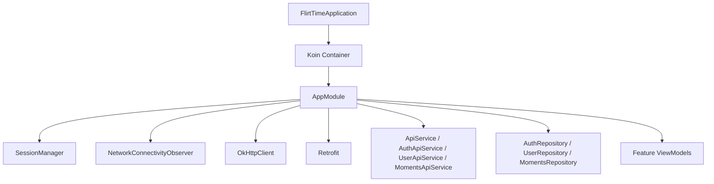
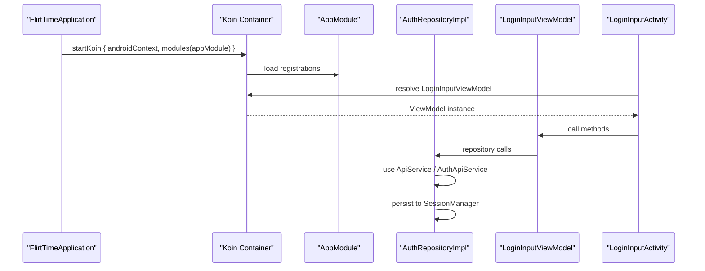
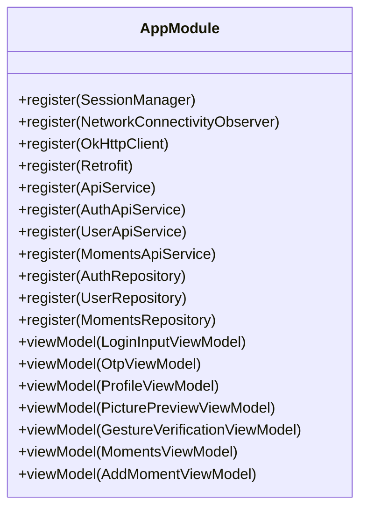
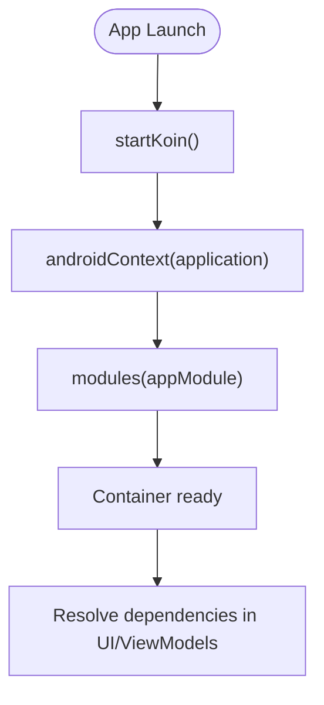
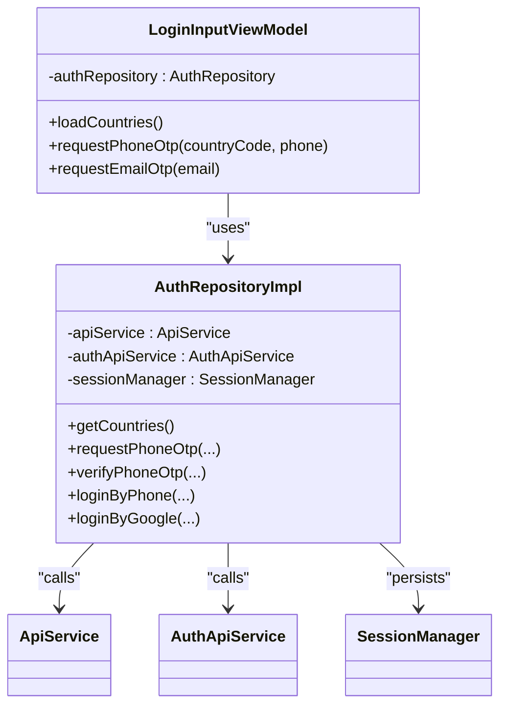
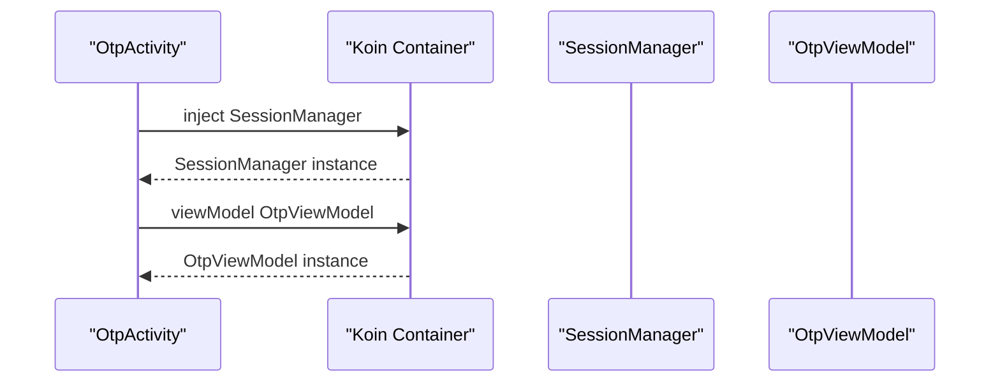
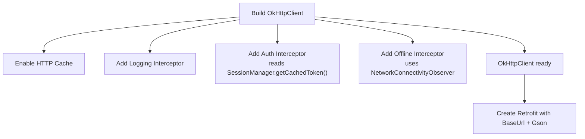
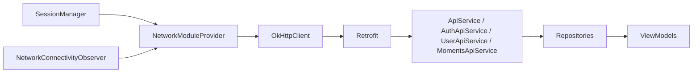

# Dependency Injection with Koin

<cite>
**Referenced Files in This Document**
- [AppModule.kt](file://app/src/main/java/com/flirttime/di/AppModule.kt)
- [FlirtTimeApplication.kt](file://app/src/main/java/com/flirttime/FlirtTimeApplication.kt)
- [NetworkConnectivityObserver.kt](file://app/src/main/java/com/flirttime/core/common/NetworkConnectivityObserver.kt)
- [SessionManager.kt](file://app/src/main/java/com/flirttime/core/database/SessionManager.kt)
- [ApiService.kt](file://app/src/main/java/com/flirttime/core/network/ApiService.kt)
- [NetworkModuleProvider.kt](file://app/src/main/java/com/flirttime/core/network/NetworkModuleProvider.kt)
- [AuthRepositoryImpl.kt](file://app/src/main/java/com/flirttime/feature/auth/data/repository/AuthRepositoryImpl.kt)
- [LoginInputViewModel.kt](file://app/src/main/java/com/flirttime/feature/auth/presentation/login/LoginInputViewModel.kt)
- [OtpActivity.kt](file://app/src/main/java/com/flirttime/feature/auth/presentation/otp/OtpActivity.kt)
</cite>

## Table of Contents
1. [Introduction](#introduction)
2. [Project Structure](#project-structure)
3. [Core Components](#core-components)
4. [Architecture Overview](#architecture-overview)
5. [Detailed Component Analysis](#detailed-component-analysis)
6. [Dependency Analysis](#dependency-analysis)
7. [Performance Considerations](#performance-considerations)
8. [Troubleshooting Guide](#troubleshooting-guide)
9. [Conclusion](#conclusion)

## Introduction
This document explains how the Flirttime-Otp-Android application uses Koin for dependency injection (DI). It covers module configuration, singleton and ViewModel registration, service wiring, feature-scoped dependencies, lifecycle integration, and best practices for testing and avoiding circular dependencies.

## Project Structure
The DI setup is centralized in a single app-wide module that registers:
- Core services (session storage, connectivity observer)
- Network stack (OkHttp, Retrofit, API interfaces)
- Feature repositories and ViewModels

**Diagram sources**
- [FlirtTimeApplication.kt:10-22](file://app/src/main/java/com/flirttime/FlirtTimeApplication.kt#L10-L22)
- [AppModule.kt:27-57](file://app/src/main/java/com/flirttime/di/AppModule.kt#L27-L57)

**Section sources**
- [FlirtTimeApplication.kt:10-22](file://app/src/main/java/com/flirttime/FlirtTimeApplication.kt#L10-L22)
- [AppModule.kt:27-57](file://app/src/main/java/com/flirttime/di/AppModule.kt#L27-L57)

## Core Components
- AppModule: Central DI registry using Koin DSL. Registers core services as singletons, constructs network clients, wires feature repositories, and declares ViewModels.
- FlirtTimeApplication: Initializes Koin at app startup, provides Android context, and enables logging.
- SessionManager: DataStore-backed session store exposing Flow-based state and synchronous helpers; used by network interceptors and repositories.
- NetworkConnectivityObserver: Reactive network availability observer via ConnectivityManager and Flow.
- NetworkModuleProvider: Builds OkHttpClient and Retrofit with caching, auth interceptor, offline fallback, and logging.
- ApiService and feature-specific API services: Retrofit interfaces consumed by repositories.
- Feature repositories: Implement domain contracts and orchestrate API calls and session persistence.
- ViewModels: Injected via Koin’s viewModelOf and accessed in UI components.

**Section sources**
- [AppModule.kt:27-57](file://app/src/main/java/com/flirttime/di/AppModule.kt#L27-L57)
- [FlirtTimeApplication.kt:10-22](file://app/src/main/java/com/flirttime/FlirtTimeApplication.kt#L10-L22)
- [SessionManager.kt:22-222](file://app/src/main/java/com/flirttime/core/database/SessionManager.kt#L22-L222)
- [NetworkConnectivityObserver.kt:13-48](file://app/src/main/java/com/flirttime/core/common/NetworkConnectivityObserver.kt#L13-L48)
- [NetworkModuleProvider.kt:17-85](file://app/src/main/java/com/flirttime/core/network/NetworkModuleProvider.kt#L17-L85)
- [ApiService.kt:9-22](file://app/src/main/java/com/flirttime/core/network/ApiService.kt#L9-L22)

## Architecture Overview
At runtime, Koin resolves dependencies from AppModule. The Application class starts Koin once, making it available to Activities, Fragments, and ViewModels. Repositories depend on API services and SessionManager; ViewModels depend on repositories.

**Diagram sources**
- [FlirtTimeApplication.kt:15-19](file://app/src/main/java/com/flirttime/FlirtTimeApplication.kt#L15-L19)
- [AppModule.kt:27-57](file://app/src/main/java/com/flirttime/di/AppModule.kt#L27-L57)
- [LoginInputViewModel.kt:17-58](file://app/src/main/java/com/flirttime/feature/auth/presentation/login/LoginInputViewModel.kt#L17-L58)
- [AuthRepositoryImpl.kt:23-217](file://app/src/main/java/com/flirttime/feature/auth/data/repository/AuthRepositoryImpl.kt#L23-L217)

## Detailed Component Analysis

### AppModule Configuration
- Singletons:
  - SessionManager
  - NetworkConnectivityObserver
  - OkHttpClient and Retrofit via NetworkModuleProvider
  - All Retrofit API interfaces (ApiService, AuthApiService, UserApiService, MomentsApiService)
  - Feature repositories (AuthRepository, UserRepository, MomentsRepository)
- ViewModels:
  - Declared via viewModelOf for each feature’s ViewModels

**Diagram sources**
- [AppModule.kt:27-57](file://app/src/main/java/com/flirttime/di/AppModule.kt#L27-L57)

**Section sources**
- [AppModule.kt:27-57](file://app/src/main/java/com/flirttime/di/AppModule.kt#L27-L57)

### Service Wiring and Lifecycle Integration
- FlirtTimeApplication initializes Koin with Android context and logs errors.
- Koin integrates with Android lifecycle through Koin Android extensions used in Activities and ViewModels.

**Diagram sources**
- [FlirtTimeApplication.kt:15-19](file://app/src/main/java/com/flirttime/FlirtTimeApplication.kt#L15-L19)

**Section sources**
- [FlirtTimeApplication.kt:10-22](file://app/src/main/java/com/flirttime/FlirtTimeApplication.kt#L10-L22)

### Repository-to-ViewModel Injection Example
- LoginInputViewModel depends on AuthRepository.
- AuthRepositoryImpl depends on ApiService, AuthApiService, and SessionManager.
- Koin resolves these automatically based on AppModule registrations.

**Diagram sources**
- [LoginInputViewModel.kt:17-58](file://app/src/main/java/com/flirttime/feature/auth/presentation/login/LoginInputViewModel.kt#L17-L58)
- [AuthRepositoryImpl.kt:23-217](file://app/src/main/java/com/flirttime/feature/auth/data/repository/AuthRepositoryImpl.kt#L23-L217)
- [ApiService.kt:9-22](file://app/src/main/java/com/flirttime/core/network/ApiService.kt#L9-L22)
- [SessionManager.kt:22-222](file://app/src/main/java/com/flirttime/core/database/SessionManager.kt#L22-L222)

**Section sources**
- [LoginInputViewModel.kt:17-58](file://app/src/main/java/com/flirttime/feature/auth/presentation/login/LoginInputViewModel.kt#L17-L58)
- [AuthRepositoryImpl.kt:23-217](file://app/src/main/java/com/flirttime/feature/auth/data/repository/AuthRepositoryImpl.kt#L23-L217)

### Activity-Level Injection Example
- OtpActivity injects SessionManager and obtains its ViewModel via Koin Android extensions.

**Diagram sources**
- [OtpActivity.kt:45-49](file://app/src/main/java/com/flirttime/feature/auth/presentation/otp/OtpActivity.kt#L45-L49)
- [AppModule.kt:43-45](file://app/src/main/java/com/flirttime/di/AppModule.kt#L43-L45)

**Section sources**
- [OtpActivity.kt:45-49](file://app/src/main/java/com/flirttime/feature/auth/presentation/otp/OtpActivity.kt#L45-L49)
- [AppModule.kt:43-45](file://app/src/main/java/com/flirttime/di/AppModule.kt#L43-L45)

### Network Stack and Interceptors
- NetworkModuleProvider builds OkHttpClient with:
  - HTTP cache
  - Logging interceptor (debug-only)
  - Authorization interceptor reading cached token from SessionManager
  - Offline cache interceptor using NetworkConnectivityObserver
- Retrofit is created with base URL and Gson converter.

**Diagram sources**
- [NetworkModuleProvider.kt:22-85](file://app/src/main/java/com/flirttime/core/network/NetworkModuleProvider.kt#L22-L85)
- [SessionManager.kt:22-222](file://app/src/main/java/com/flirttime/core/database/SessionManager.kt#L22-L222)
- [NetworkConnectivityObserver.kt:13-48](file://app/src/main/java/com/flirttime/core/common/NetworkConnectivityObserver.kt#L13-L48)

**Section sources**
- [NetworkModuleProvider.kt:22-85](file://app/src/main/java/com/flirttime/core/network/NetworkModuleProvider.kt#L22-L85)

### Module Organization Strategy
- AppModule centralizes all registrations for simplicity in this codebase.
- Feature boundaries are clear:
  - Auth feature: repository and ViewModels registered together
  - Profile feature: repository and ViewModels registered together
  - Moments feature: repository and ViewModels registered together
- As the app grows, consider splitting into feature modules (e.g., authModule, profileModule, momentsModule) and composing them in AppModule.

**Section sources**
- [AppModule.kt:42-56](file://app/src/main/java/com/flirttime/di/AppModule.kt#L42-L56)

## Dependency Analysis
Key relationships between DI-registered components:

**Diagram sources**
- [AppModule.kt:27-57](file://app/src/main/java/com/flirttime/di/AppModule.kt#L27-L57)
- [NetworkModuleProvider.kt:22-85](file://app/src/main/java/com/flirttime/core/network/NetworkModuleProvider.kt#L22-L85)

**Section sources**
- [AppModule.kt:27-57](file://app/src/main/java/com/flirttime/di/AppModule.kt#L27-L57)
- [NetworkModuleProvider.kt:22-85](file://app/src/main/java/com/flirttime/core/network/NetworkModuleProvider.kt#L22-L85)

## Performance Considerations
- Use singletons for expensive or shared objects (OkHttpClient, Retrofit, repositories).
- Avoid heavy initialization in constructors; defer work to lazy or coroutine scopes where possible.
- Keep ViewModels lightweight; delegate business logic to repositories.
- Prefer Flow-based APIs for reactive data streams to minimize redundant work.

[No sources needed since this section provides general guidance]

## Troubleshooting Guide
Common issues and resolutions:
- Missing Android context: Ensure FlirtTimeApplication calls androidContext before loading modules.
- Circular dependencies: If two singletons depend on each other, refactor to introduce an intermediary or break the cycle.
- Unresolved types: Verify that every type used in constructor injection is registered in AppModule.
- Testing with mocks: Replace real implementations with test doubles by registering mock singletons in a test module and loading it instead of the production module.

Best practices:
- Register interfaces with their implementations in AppModule.
- Use viewModelOf for ViewModels to align with Android lifecycle.
- For unit tests, create a TestModule that overrides singletons with fakes/mocks and pass it to startKoin.

**Section sources**
- [FlirtTimeApplication.kt:15-19](file://app/src/main/java/com/flirttime/FlirtTimeApplication.kt#L15-L19)
- [AppModule.kt:27-57](file://app/src/main/java/com/flirttime/di/AppModule.kt#L27-L57)

## Conclusion
The Flirttime-Otp-Android app uses Koin to centralize dependency management. AppModule defines all singletons and ViewModels, while FlirtTimeApplication bootstraps Koin with Android context. Services like SessionManager and NetworkConnectivityObserver are wired into the network stack and feature layers. Following the patterns shown here ensures clean separation of concerns, testability, and maintainable architecture.

[No sources needed since this section summarizes without analyzing specific files]