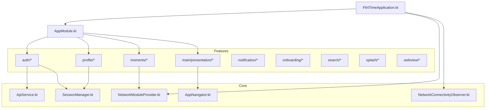
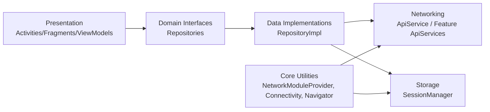
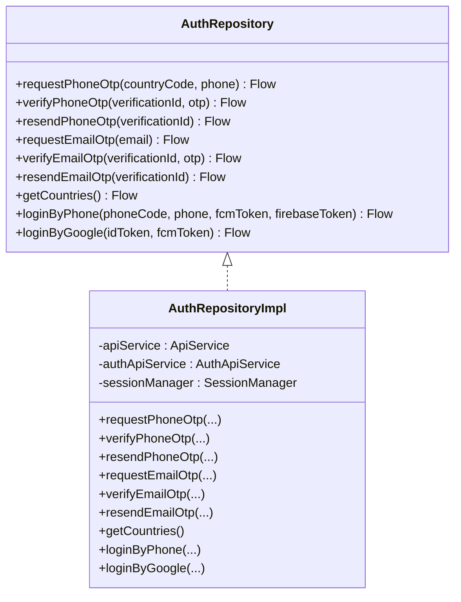
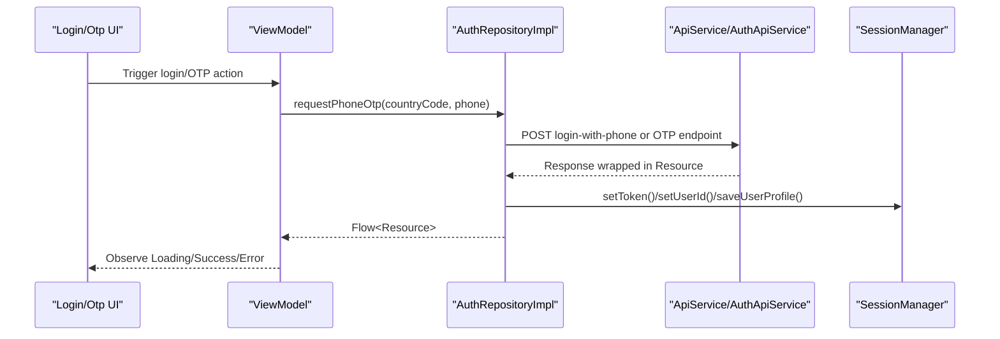
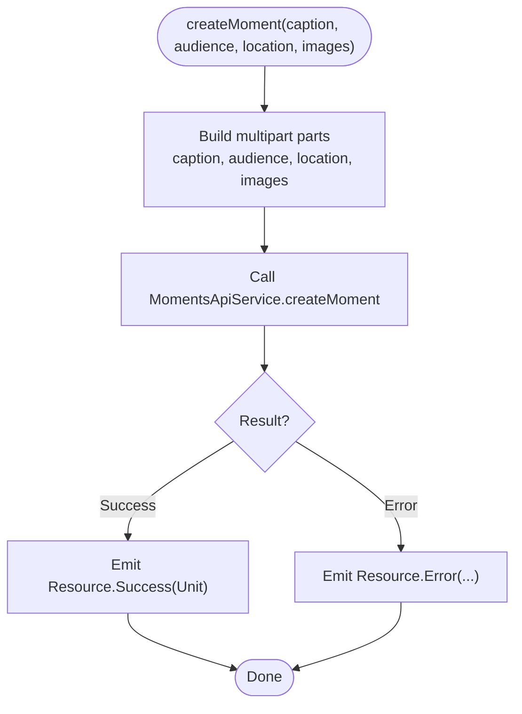
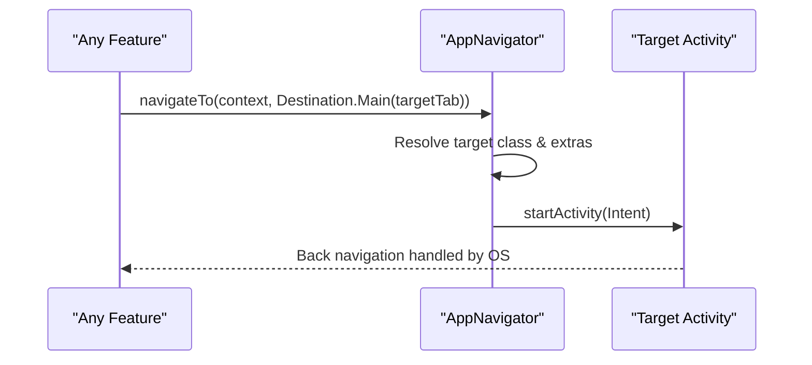
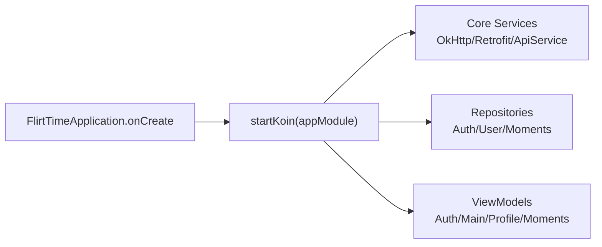
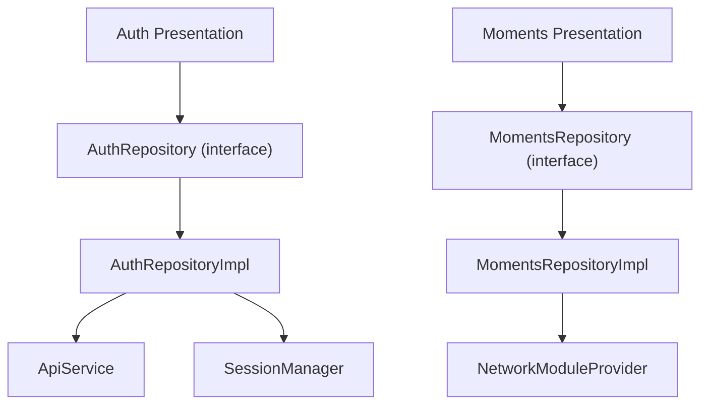

# Feature-Based Modularization

<cite>
**Referenced Files in This Document**
- [FlirtTimeApplication.kt](file://app/src/main/java/com/flirttime/FlirtTimeApplication.kt)
- [AppModule.kt](file://app/src/main/java/com/flirttime/di/AppModule.kt)
- [ApiService.kt](file://app/src/main/java/com/flirttime/core/network/ApiService.kt)
- [NetworkModuleProvider.kt](file://app/src/main/java/com/flirttime/core/network/NetworkModuleProvider.kt)
- [SessionManager.kt](file://app/src/main/java/com/flirttime/core/database/SessionManager.kt)
- [NetworkConnectivityObserver.kt](file://app/src/main/java/com/flirttime/core/common/NetworkConnectivityObserver.kt)
- [AppNavigator.kt](file://app/src/main/java/com/flirttime/core/navigation/AppNavigator.kt)
- [AuthRepository.kt](file://app/src/main/java/com/flirttime/feature/auth/domain/repository/AuthRepository.kt)
- [AuthRepositoryImpl.kt](file://app/src/main/java/com/flirttime/feature/auth/data/repository/AuthRepositoryImpl.kt)
- [MomentsRepository.kt](file://app/src/main/java/com/flirttime/feature/moments/domain/repository/MomentsRepository.kt)
- [MomentsRepositoryImpl.kt](file://app/src/main/java/com/flirttime/feature/moments/data/repository/MomentsRepositoryImpl.kt)
- [build.gradle.kts](file://app/build.gradle.kts)
- [settings.gradle.kts](file://settings.gradle.kts)
</cite>

## Table of Contents
1. [Introduction](#introduction)
2. [Project Structure](#project-structure)
3. [Core Components](#core-components)
4. [Architecture Overview](#architecture-overview)
5. [Detailed Component Analysis](#detailed-component-analysis)
6. [Dependency Analysis](#dependency-analysis)
7. [Performance Considerations](#performance-considerations)
8. [Troubleshooting Guide](#troubleshooting-guide)
9. [Conclusion](#conclusion)
10. [Appendices](#appendices)

## Introduction
This document explains the feature-based modularization strategy used in Flirttime-Otp-Android. The codebase is organized into logical feature packages under a shared app module, with clear separation between core utilities and feature-specific code. Features communicate through well-defined interfaces (repositories), avoiding tight coupling. We also cover build configuration, shared dependency management, cross-module communication patterns, and how to structure new features following the established pattern.

## Project Structure
The project uses a single Android application module that contains:
- Core utilities and shared infrastructure under com.flirttime.core (networking, storage, navigation, common helpers).
- Feature modules under com.flirttime.feature (auth, profile, moments, main, notification, onboarding, search, splash, webview).
- Dependency injection wiring via Koin in a central AppModule.

**Diagram sources**
- [FlirtTimeApplication.kt:10-22](file://app/src/main/java/com/flirttime/FlirtTimeApplication.kt#L10-L22)
- [AppModule.kt:27-57](file://app/src/main/java/com/flirttime/di/AppModule.kt#L27-L57)
- [ApiService.kt:9-22](file://app/src/main/java/com/flirttime/core/network/ApiService.kt#L9-L22)
- [NetworkModuleProvider.kt:17-85](file://app/src/main/java/com/flirttime/core/network/NetworkModuleProvider.kt#L17-L85)
- [SessionManager.kt:22-222](file://app/src/main/java/com/flirttime/core/database/SessionManager.kt#L22-L222)
- [NetworkConnectivityObserver.kt:13-48](file://app/src/main/java/com/flirttime/core/common/NetworkConnectivityObserver.kt#L13-L48)
- [AppNavigator.kt:19-136](file://app/src/main/java/com/flirttime/core/navigation/AppNavigator.kt#L19-L136)

**Section sources**
- [FlirtTimeApplication.kt:10-22](file://app/src/main/java/com/flirttime/FlirtTimeApplication.kt#L10-L22)
- [AppModule.kt:27-57](file://app/src/main/java/com/flirttime/di/AppModule.kt#L27-L57)
- [settings.gradle.kts:17-26](file://settings.gradle.kts#L17-L26)

## Core Components
Core components provide reusable capabilities for all features:
- Networking: Retrofit + OkHttp configured via NetworkModuleProvider; typed API contracts via ApiService and per-feature services.
- Storage: SessionManager using DataStore for tokens, user info, and flags.
- Connectivity: NetworkConnectivityObserver exposing a Flow<Boolean> for online/offline state.
- Navigation: AppNavigator providing type-safe destinations and Intent extras handling.

Key responsibilities:
- Centralize shared dependencies (Retrofit, OkHttp, DataStore) to avoid duplication.
- Expose stable interfaces for features to consume without leaking implementation details.
- Provide consistent error and resource wrappers across network calls.

**Section sources**
- [NetworkModuleProvider.kt:17-85](file://app/src/main/java/com/flirttime/core/network/NetworkModuleProvider.kt#L17-L85)
- [ApiService.kt:9-22](file://app/src/main/java/com/flirttime/core/network/ApiService.kt#L9-L22)
- [SessionManager.kt:22-222](file://app/src/main/java/com/flirttime/core/database/SessionManager.kt#L22-L222)
- [NetworkConnectivityObserver.kt:13-48](file://app/src/main/java/com/flirttime/core/common/NetworkConnectivityObserver.kt#L13-L48)
- [AppNavigator.kt:19-136](file://app/src/main/java/com/flirttime/core/navigation/AppNavigator.kt#L19-L136)

## Architecture Overview
The app follows a layered architecture within each feature:
- Presentation layer (Activities/Fragments/ViewModels) depends on domain interfaces.
- Domain layer defines repository interfaces.
- Data layer implements repositories and interacts with remote APIs and local storage.

Cross-cutting concerns (network, storage, connectivity, navigation) live in core and are injected via Koin.

**Diagram sources**
- [AppModule.kt:27-57](file://app/src/main/java/com/flirttime/di/AppModule.kt#L27-L57)
- [AuthRepository.kt:10-52](file://app/src/main/java/com/flirttime/feature/auth/domain/repository/AuthRepository.kt#L10-L52)
- [AuthRepositoryImpl.kt:23-217](file://app/src/main/java/com/flirttime/feature/auth/data/repository/AuthRepositoryImpl.kt#L23-L217)
- [MomentsRepository.kt:8-17](file://app/src/main/java/com/flirttime/feature/moments/domain/repository/MomentsRepository.kt#L8-L17)
- [MomentsRepositoryImpl.kt:17-88](file://app/src/main/java/com/flirttime/feature/moments/data/repository/MomentsRepositoryImpl.kt#L17-L88)

## Detailed Component Analysis

### Authentication Feature
- Domain interface AuthRepository defines phone/email OTP flows, resend, country list, and login methods returning Flow<Resource<T>>.
- Data implementation AuthRepositoryImpl orchestrates API calls via ApiService and AuthApiService, persists session data via SessionManager, and maps responses to Resource states.

**Diagram sources**
- [AuthRepository.kt:10-52](file://app/src/main/java/com/flirttime/feature/auth/domain/repository/AuthRepository.kt#L10-L52)
- [AuthRepositoryImpl.kt:23-217](file://app/src/main/java/com/flirttime/feature/auth/data/repository/AuthRepositoryImpl.kt#L23-L217)

**Section sources**
- [AuthRepository.kt:10-52](file://app/src/main/java/com/flirttime/feature/auth/domain/repository/AuthRepository.kt#L10-L52)
- [AuthRepositoryImpl.kt:23-217](file://app/src/main/java/com/flirttime/feature/auth/data/repository/AuthRepositoryImpl.kt#L23-L217)

#### Authentication Flow Sequence

**Diagram sources**
- [AuthRepositoryImpl.kt:29-75](file://app/src/main/java/com/flirttime/feature/auth/data/repository/AuthRepositoryImpl.kt#L29-L75)
- [ApiService.kt:9-22](file://app/src/main/java/com/flirttime/core/network/ApiService.kt#L9-L22)
- [SessionManager.kt:136-177](file://app/src/main/java/com/flirttime/core/database/SessionManager.kt#L136-L177)

### Moments Feature
- Domain interface MomentsRepository exposes feed retrieval, like toggling, and creation.
- Data implementation MomentsRepositoryImpl handles pagination mapping, multipart uploads via MultipartHelper, and returns Flow<Resource>.

**Diagram sources**
- [MomentsRepositoryImpl.kt:61-87](file://app/src/main/java/com/flirttime/feature/moments/data/repository/MomentsRepositoryImpl.kt#L61-L87)

**Section sources**
- [MomentsRepository.kt:8-17](file://app/src/main/java/com/flirttime/feature/moments/domain/repository/MomentsRepository.kt#L8-L17)
- [MomentsRepositoryImpl.kt:17-88](file://app/src/main/java/com/flirttime/feature/moments/data/repository/MomentsRepositoryImpl.kt#L17-L88)

### Navigation and Cross-Feature Communication
- AppNavigator centralizes destination types and Intent extras, ensuring compile-time safety and reducing string-based routing errors.
- Features navigate to other screens by passing Destination objects; the navigator resolves target classes and extras.

**Diagram sources**
- [AppNavigator.kt:73-135](file://app/src/main/java/com/flirttime/core/navigation/AppNavigator.kt#L73-L135)

**Section sources**
- [AppNavigator.kt:19-136](file://app/src/main/java/com/flirttime/core/navigation/AppNavigator.kt#L19-L136)

### Dependency Injection and Wiring
- Koin’s AppModule wires core services (OkHttpClient, Retrofit, ApiService, feature ApiServices), repositories, and ViewModels.
- Application initializes Koin and Fresco at startup.

**Diagram sources**
- [FlirtTimeApplication.kt:12-22](file://app/src/main/java/com/flirttime/FlirtTimeApplication.kt#L12-L22)
- [AppModule.kt:27-57](file://app/src/main/java/com/flirttime/di/AppModule.kt#L27-L57)

**Section sources**
- [FlirtTimeApplication.kt:12-22](file://app/src/main/java/com/flirttime/FlirtTimeApplication.kt#L12-L22)
- [AppModule.kt:27-57](file://app/src/main/java/com/flirttime/di/AppModule.kt#L27-L57)

## Dependency Analysis
- Features depend only on domain interfaces and core utilities.
- Data implementations depend on networking and storage layers.
- Koin decouples concrete implementations from consumers.

**Diagram sources**
- [AuthRepository.kt:10-52](file://app/src/main/java/com/flirttime/feature/auth/domain/repository/AuthRepository.kt#L10-L52)
- [AuthRepositoryImpl.kt:23-217](file://app/src/main/java/com/flirttime/feature/auth/data/repository/AuthRepositoryImpl.kt#L23-L217)
- [MomentsRepository.kt:8-17](file://app/src/main/java/com/flirttime/feature/moments/domain/repository/MomentsRepository.kt#L8-L17)
- [MomentsRepositoryImpl.kt:17-88](file://app/src/main/java/com/flirttime/feature/moments/data/repository/MomentsRepositoryImpl.kt#L17-L88)
- [NetworkModuleProvider.kt:17-85](file://app/src/main/java/com/flirttime/core/network/NetworkModuleProvider.kt#L17-L85)

**Section sources**
- [AppModule.kt:27-57](file://app/src/main/java/com/flirttime/di/AppModule.kt#L27-L57)

## Performance Considerations
- Network caching: OkHttp cache enabled with size limits and offline fallback via CacheControl.
- Timeouts: Connect/read/write timeouts configured centrally.
- Dispatchers: Repository operations run on IO dispatcher to avoid blocking UI thread.
- Image loading: Fresco initialized at app start for efficient image rendering.

[No sources needed since this section provides general guidance]

## Troubleshooting Guide
- Network issues:
  - Verify base URL and interceptors in NetworkModuleProvider.
  - Check authentication token presence and format; SessionManager caches token for interceptors.
- Offline behavior:
  - Ensure offline cache interceptor applies when network unavailable.
- Session persistence:
  - Confirm SessionManager writes/reads correct keys and preserves intro state on clear.
- Navigation problems:
  - Use AppNavigator destinations to avoid missing extras or wrong activity targets.

**Section sources**
- [NetworkModuleProvider.kt:22-75](file://app/src/main/java/com/flirttime/core/network/NetworkModuleProvider.kt#L22-L75)
- [SessionManager.kt:197-205](file://app/src/main/java/com/flirttime/core/database/SessionManager.kt#L197-L205)
- [AppNavigator.kt:73-135](file://app/src/main/java/com/flirttime/core/navigation/AppNavigator.kt#L73-L135)

## Conclusion
The feature-based modularization in Flirttime-Otp-Android separates concerns cleanly: core utilities provide shared capabilities, while features encapsulate their own domain logic behind interfaces. Koin manages dependencies, enabling loose coupling and testability. This structure improves code organization, simplifies testing, and supports team collaboration by isolating changes to specific features.

[No sources needed since this section summarizes without analyzing specific files]

## Appendices

### How to Add a New Feature
Follow the established pattern:
- Create a new package under com.flirttime.feature.<your_feature>.
- Define domain interfaces under domain/repository.
- Implement data layer under data/{model,network,repository}.
- Add presentation layer under presentation/{activities,fragments,viewmodels}.
- Register dependencies in AppModule (repositories, ViewModels, ApiServices).
- If the feature needs navigation, add a Destination entry in AppNavigator.

Example structure:
- feature/<your_feature>/domain/repository/<YourRepository>.kt
- feature/<your_feature>/data/model/*.kt
- feature/<your_feature>/data/network/<YourApiService>.kt
- feature/<your_feature>/data/repository/<YourRepositoryImpl>.kt
- feature/<your_feature>/presentation/*

**Section sources**
- [AppModule.kt:27-57](file://app/src/main/java/com/flirttime/di/AppModule.kt#L27-L57)
- [AppNavigator.kt:19-56](file://app/src/main/java/com/flirttime/core/navigation/AppNavigator.kt#L19-L56)

### Build Configuration and Shared Dependencies
- Centralized dependency versions via Gradle version catalog (libs.versions.toml).
- Single application module includes all features and core libraries.
- Key dependencies include Coroutines, Lifecycle, Koin, Retrofit, OkHttp, Lottie, Fresco, Shimmer, DataStore, SDP/SSP.

**Section sources**
- [build.gradle.kts:43-91](file://app/build.gradle.kts#L43-L91)
- [settings.gradle.kts:17-26](file://settings.gradle.kts#L17-L26)