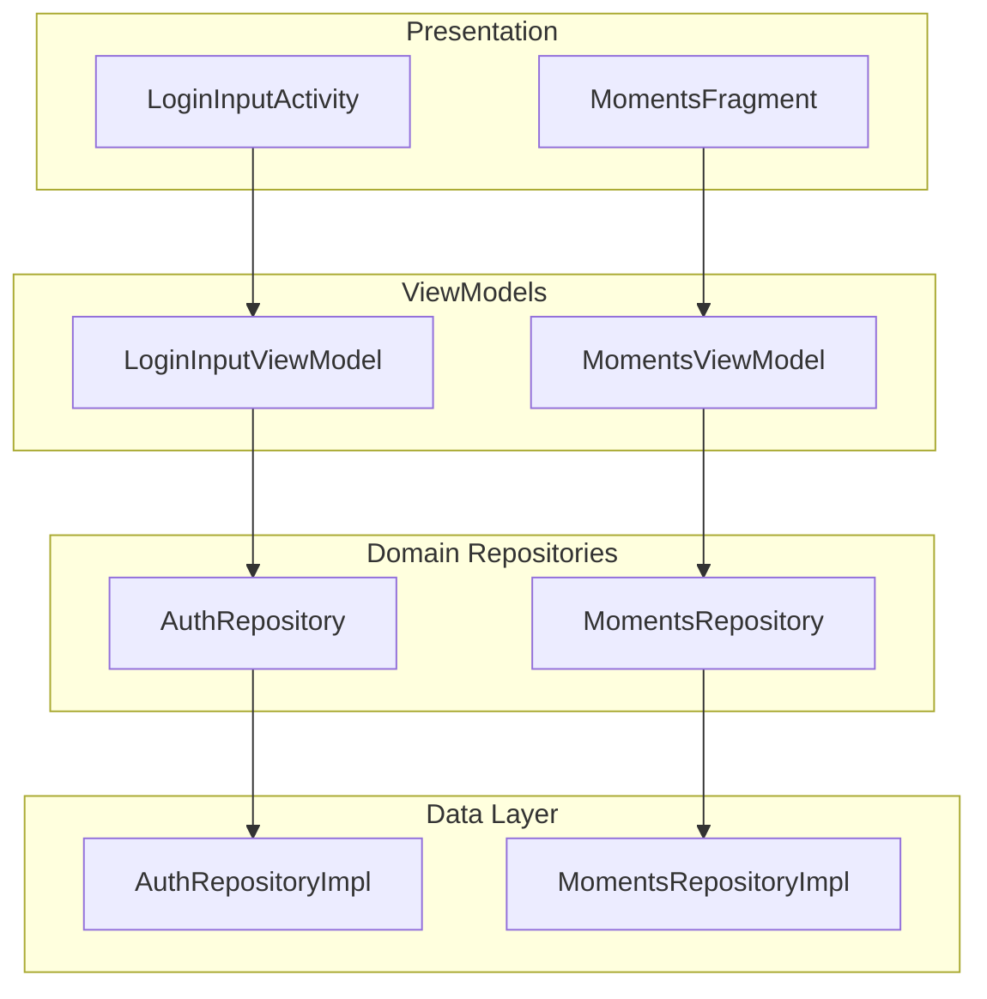
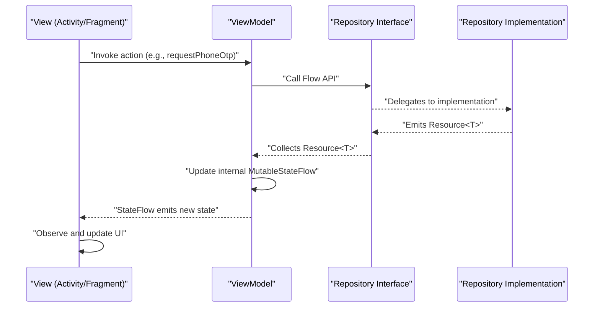
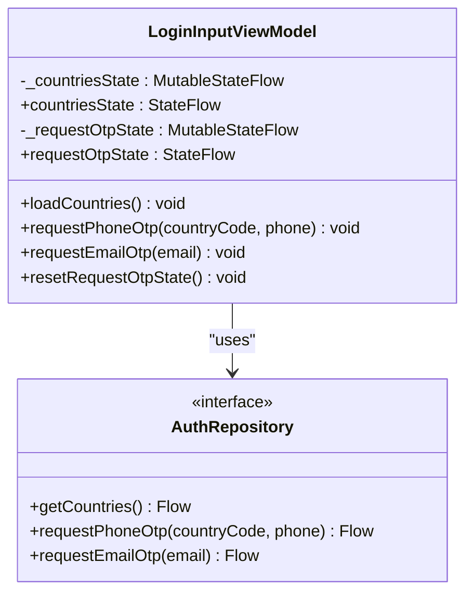
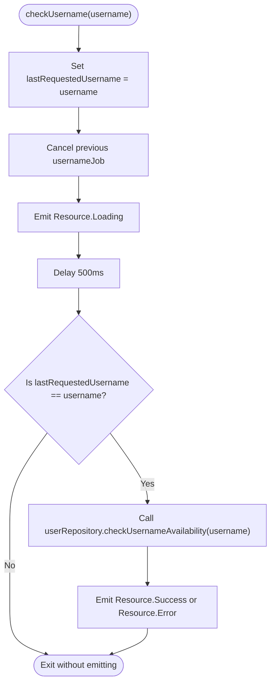
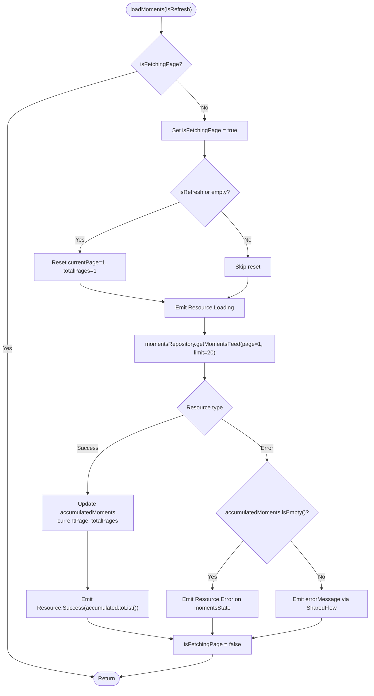
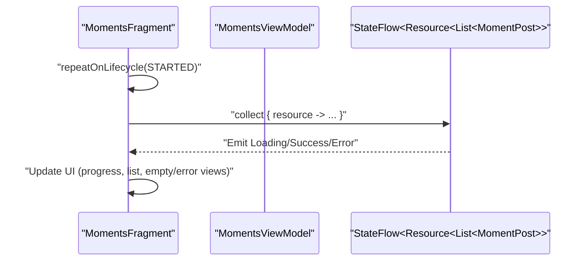
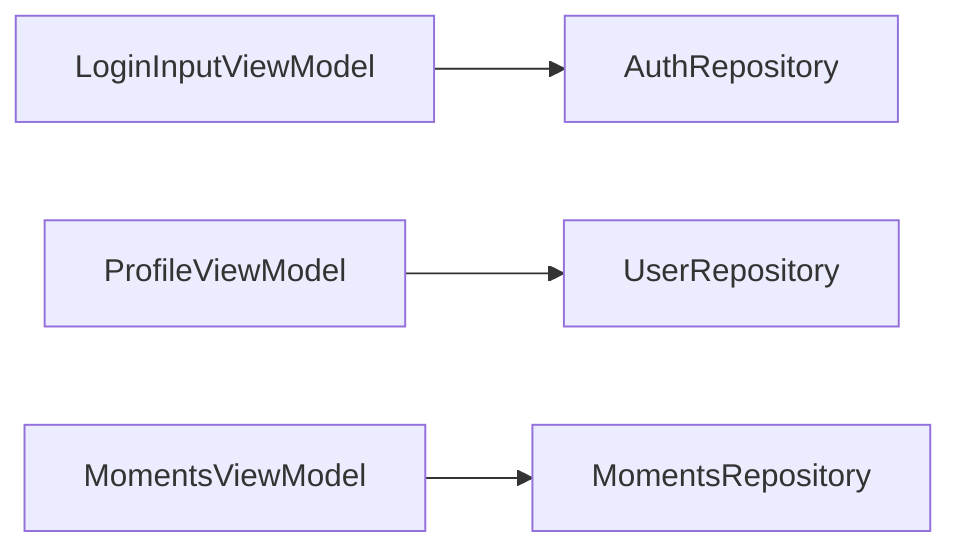

# MVVM Pattern Usage

<cite>
**Referenced Files in This Document**
- [LoginInputViewModel.kt](file://app/src/main/java/com/flirttime/feature/auth/presentation/login/LoginInputViewModel.kt)
- [ProfileViewModel.kt](file://app/src/main/java/com/flirttime/feature/profile/presentation/intro/ProfileViewModel.kt)
- [MomentsViewModel.kt](file://app/src/main/java/com/flirttime/feature/main/presentation/moments/MomentsViewModel.kt)
- [Resource.kt](file://app/src/main/java/com/flirttime/Resource.kt)
- [AuthRepository.kt](file://app/src/main/java/com/flirttime/feature/auth/domain/repository/AuthRepository.kt)
- [UserRepository.kt](file://app/src/main/java/com/flirttime/feature/profile/domain/repository/UserRepository.kt)
- [MomentsRepository.kt](file://app/src/main/java/com/flirttime/feature/moments/domain/repository/MomentsRepository.kt)
- [MomentsFragment.kt](file://app/src/main/java/com/flirttime/feature/main/presentation/moments/MomentsFragment.kt)
</cite>

## Table of Contents
1. [Introduction](#introduction)
2. [Project Structure](#project-structure)
3. [Core Components](#core-components)
4. [Architecture Overview](#architecture-overview)
5. [Detailed Component Analysis](#detailed-component-analysis)
6. [Dependency Analysis](#dependency-analysis)
7. [Performance Considerations](#performance-considerations)
8. [Troubleshooting Guide](#troubleshooting-guide)
9. [Conclusion](#conclusion)

## Introduction
This document explains how the MVVM (Model-View-ViewModel) pattern is implemented across the Flirttime-Otp-Android codebase, focusing on ViewModels that manage UI state using StateFlow and Flow, encapsulate business logic, and communicate with repository layers. It provides concrete examples from LoginInputViewModel, ProfileViewModel, and MomentsViewModel to illustrate state management patterns, error handling, and data binding. It also documents how Activities/Fragments observe state changes, lifecycle considerations, memory management practices, and testing strategies for ViewModels.

## Project Structure
The app follows a feature-based architecture:
- Presentation layer: Activities and Fragments (Views)
- ViewModel layer: UI state holders and orchestrators
- Domain layer: Repository interfaces defining contracts
- Data layer: Implementations behind repositories (not included here)

**Diagram sources**
- [LoginInputViewModel.kt:17-58](file://app/src/main/java/com/flirttime/feature/auth/presentation/login/LoginInputViewModel.kt#L17-L58)
- [MomentsViewModel.kt:15-124](file://app/src/main/java/com/flirttime/feature/main/presentation/moments/MomentsViewModel.kt#L15-L124)
- [AuthRepository.kt:10-52](file://app/src/main/java/com/flirttime/feature/auth/domain/repository/AuthRepository.kt#L10-L52)
- [MomentsRepository.kt:8-17](file://app/src/main/java/com/flirttime/feature/moments/domain/repository/MomentsRepository.kt#L8-L17)

**Section sources**
- [LoginInputViewModel.kt:17-58](file://app/src/main/java/com/flirttime/feature/auth/presentation/login/LoginInputViewModel.kt#L17-L58)
- [MomentsViewModel.kt:15-124](file://app/src/main/java/com/flirttime/feature/main/presentation/moments/MomentsViewModel.kt#L15-L124)
- [AuthRepository.kt:10-52](file://app/src/main/java/com/flirttime/feature/auth/domain/repository/AuthRepository.kt#L10-L52)
- [MomentsRepository.kt:8-17](file://app/src/main/java/com/flirttime/feature/moments/domain/repository/MomentsRepository.kt#L8-L17)

## Core Components
- Resource sealed class: Unified representation of Loading, Success, and Error states used by ViewModels and repositories.
- Repository interfaces: Define Flow-based APIs for network/data operations.
- ViewModels: Manage UI state via StateFlow, handle business logic, and coordinate with repositories.

Key responsibilities:
- ViewModels expose immutable StateFlow properties for UI state.
- Business logic is centralized in ViewModels (e.g., debouncing username checks, pagination).
- Repositories return Flow<Resource<T>> streams enabling reactive updates.

**Section sources**
- [Resource.kt:3-19](file://app/src/main/java/com/flirttime/Resource.kt#L3-L19)
- [AuthRepository.kt:10-52](file://app/src/main/java/com/flirttime/feature/auth/domain/repository/AuthRepository.kt#L10-L52)
- [UserRepository.kt:10-20](file://app/src/main/java/com/flirttime/feature/profile/domain/repository/UserRepository.kt#L10-L20)
- [MomentsRepository.kt:8-17](file://app/src/main/java/com/flirttime/feature/moments/domain/repository/MomentsRepository.kt#L8-L17)

## Architecture Overview
The MVVM flow in this app uses Kotlin coroutines and Flow to propagate state from repositories through ViewModels to Views.

**Diagram sources**
- [LoginInputViewModel.kt:31-53](file://app/src/main/java/com/flirttime/feature/auth/presentation/login/LoginInputViewModel.kt#L31-L53)
- [MomentsViewModel.kt:41-79](file://app/src/main/java/com/flirttime/feature/main/presentation/moments/MomentsViewModel.kt#L41-L79)
- [MomentsFragment.kt:131-152](file://app/src/main/java/com/flirttime/feature/main/presentation/moments/MomentsFragment.kt#L131-L152)

## Detailed Component Analysis

### LoginInputViewModel
Responsibilities:
- Loads country list and exposes it via StateFlow<Resource<List<CountryItem>>>
- Requests OTP for phone or email and exposes result via StateFlow<Resource<OtpResponseData>?>
- Provides reset method to clear transient OTP request state

State management:
- Uses MutableStateFlow internally and exposes immutable StateFlow
- Wraps all external data in Resource sealed class for consistent UI state handling

Business logic:
- Delegates network calls to AuthRepository
- Launches coroutine flows within viewModelScope for lifecycle safety

Error handling:
- Errors are propagated via Resource.Error; UI observes and renders accordingly

Lifecycle and memory:
- All flows are collected inside viewModelScope, preventing leaks
- No long-lived references beyond ViewModel scope

**Diagram sources**
- [LoginInputViewModel.kt:17-58](file://app/src/main/java/com/flirttime/feature/auth/presentation/login/LoginInputViewModel.kt#L17-L58)
- [AuthRepository.kt:10-52](file://app/src/main/java/com/flirttime/feature/auth/domain/repository/AuthRepository.kt#L10-L52)

**Section sources**
- [LoginInputViewModel.kt:17-58](file://app/src/main/java/com/flirttime/feature/auth/presentation/login/LoginInputViewModel.kt#L17-L58)
- [AuthRepository.kt:10-52](file://app/src/main/java/com/flirttime/feature/auth/domain/repository/AuthRepository.kt#L10-L52)

### ProfileViewModel
Responsibilities:
- Updates user profile and exposes result via StateFlow<Resource<AuthUserDto>?>
- Debounces username availability checks to avoid excessive network calls
- Formats date-of-birth input into backend-required format

State management:
- Uses MutableStateFlow for updateProfileState and usernameCheckState
- Exposes immutable StateFlow to observers

Business logic:
- Normalizes inputs (trimming, gender normalization)
- Debounces username check with delay and cancellation of previous jobs
- Converts UI date formats to strict YYYY-MM-DD

Error handling:
- Emits Resource.Loading during operations
- Propagates Resource.Error to UI

Lifecycle and memory:
- Uses viewModelScope for coroutines
- Cancels pending username job when new input arrives or when cancelUsernameCheck is called

**Diagram sources**
- [ProfileViewModel.kt:60-78](file://app/src/main/java/com/flirttime/feature/profile/presentation/intro/ProfileViewModel.kt#L60-L78)

**Section sources**
- [ProfileViewModel.kt:18-116](file://app/src/main/java/com/flirttime/feature/profile/presentation/intro/ProfileViewModel.kt#L18-L116)
- [UserRepository.kt:10-20](file://app/src/main/java/com/flirttime/feature/profile/domain/repository/UserRepository.kt#L10-L20)

### MomentsViewModel
Responsibilities:
- Loads moments feed with pagination support
- Manages loading more items and distinct accumulation of moments
- Emits errors via SharedFlow for non-fatal cases while preserving existing data

State management:
- Exposes momentsState as StateFlow<Resource<List<MomentPost>>>
- Exposes isLoadingMore as StateFlow<Boolean>
- Emits errorMessage via SharedFlow<String> for transient errors

Business logic:
- Maintains currentPage and totalPages
- Prevents concurrent fetches with isFetchingPage flag
- Appends only distinct moments to avoid duplicates

Error handling:
- If initial load fails, sets Resource.Error on momentsState
- For subsequent pages, emits errorMessage via SharedFlow instead of overwriting existing data

Lifecycle and memory:
- Collects repository flows within viewModelScope
- Uses mutable collections scoped to ViewModel instance

**Diagram sources**
- [MomentsViewModel.kt:41-79](file://app/src/main/java/com/flirttime/feature/main/presentation/moments/MomentsViewModel.kt#L41-L79)

**Section sources**
- [MomentsViewModel.kt:15-124](file://app/src/main/java/com/flirttime/feature/main/presentation/moments/MomentsViewModel.kt#L15-L124)
- [MomentsRepository.kt:8-17](file://app/src/main/java/com/flirttime/feature/moments/domain/repository/MomentsRepository.kt#L8-L17)

### View Observation and Data Binding
- MomentsFragment observes momentsState using repeatOnLifecycle(Lifecycle.State.STARTED) to ensure collection only when the fragment is visible.
- The fragment updates UI based on Resource states: shows progress on Loading, binds data on Success, and handles empty/error states appropriately.

**Diagram sources**
- [MomentsFragment.kt:131-152](file://app/src/main/java/com/flirttime/feature/main/presentation/moments/MomentsFragment.kt#L131-L152)

**Section sources**
- [MomentsFragment.kt:131-152](file://app/src/main/java/com/flirttime/feature/main/presentation/moments/MomentsFragment.kt#L131-L152)

## Dependency Analysis
The following diagram maps dependencies between ViewModels and repository interfaces.

**Diagram sources**
- [LoginInputViewModel.kt:17-58](file://app/src/main/java/com/flirttime/feature/auth/presentation/login/LoginInputViewModel.kt#L17-L58)
- [ProfileViewModel.kt:18-116](file://app/src/main/java/com/flirttime/feature/profile/presentation/intro/ProfileViewModel.kt#L18-L116)
- [MomentsViewModel.kt:15-124](file://app/src/main/java/com/flirttime/feature/main/presentation/moments/MomentsViewModel.kt#L15-L124)
- [AuthRepository.kt:10-52](file://app/src/main/java/com/flirttime/feature/auth/domain/repository/AuthRepository.kt#L10-L52)
- [UserRepository.kt:10-20](file://app/src/main/java/com/flirttime/feature/profile/domain/repository/UserRepository.kt#L10-L20)
- [MomentsRepository.kt:8-17](file://app/src/main/java/com/flirttime/feature/moments/domain/repository/MomentsRepository.kt#L8-L17)

**Section sources**
- [LoginInputViewModel.kt:17-58](file://app/src/main/java/com/flirttime/feature/auth/presentation/login/LoginInputViewModel.kt#L17-L58)
- [ProfileViewModel.kt:18-116](file://app/src/main/java/com/flirttime/feature/profile/presentation/intro/ProfileViewModel.kt#L18-L116)
- [MomentsViewModel.kt:15-124](file://app/src/main/java/com/flirttime/feature/main/presentation/moments/MomentsViewModel.kt#L15-L124)
- [AuthRepository.kt:10-52](file://app/src/main/java/com/flirttime/feature/auth/domain/repository/AuthRepository.kt#L10-L52)
- [UserRepository.kt:10-20](file://app/src/main/java/com/flirttime/feature/profile/domain/repository/UserRepository.kt#L10-L20)
- [MomentsRepository.kt:8-17](file://app/src/main/java/com/flirttime/feature/moments/domain/repository/MomentsRepository.kt#L8-L17)

## Performance Considerations
- Use StateFlow for hot streams that should be observed by multiple collectors; use SharedFlow for one-off events like error messages.
- Debounce expensive operations (e.g., username checks) to reduce network overhead.
- Avoid redundant work by guarding against concurrent fetches (e.g., isFetchingPage flag).
- Prefer collecting flows within viewModelScope to leverage automatic lifecycle management.
- Minimize object allocations by reusing lists where appropriate and avoiding unnecessary copies.

[No sources needed since this section provides general guidance]

## Troubleshooting Guide
Common issues and resolutions:
- UI not updating: Ensure the View collects StateFlow within an appropriate lifecycle scope (e.g., repeatOnLifecycle STARTED).
- Memory leaks: Confirm that all flows are collected inside viewModelScope and no long-lived references are held outside the ViewModel.
- Duplicate items in lists: Verify that pagination logic filters duplicates before appending to accumulated lists.
- Stale username checks: Ensure previous jobs are canceled and lastRequestedUsername is validated before emitting results.

**Section sources**
- [MomentsFragment.kt:131-152](file://app/src/main/java/com/flirttime/feature/main/presentation/moments/MomentsFragment.kt#L131-L152)
- [ProfileViewModel.kt:60-78](file://app/src/main/java/com/flirttime/feature/profile/presentation/intro/ProfileViewModel.kt#L60-L78)
- [MomentsViewModel.kt:82-115](file://app/src/main/java/com/flirttime/feature/main/presentation/moments/MomentsViewModel.kt#L82-L115)

## Conclusion
The Flirttime-Otp-Android codebase implements MVVM with a clear separation of concerns:
- ViewModels encapsulate UI state and business logic using StateFlow and Flow.
- Repository interfaces define reactive contracts for data operations.
- Views observe state changes safely within lifecycle-aware scopes.
This approach yields predictable state transitions, robust error handling, and efficient performance. Following the patterns shown in LoginInputViewModel, ProfileViewModel, and MomentsViewModel will help maintain consistency and reliability across features.

[No sources needed since this section summarizes without analyzing specific files]