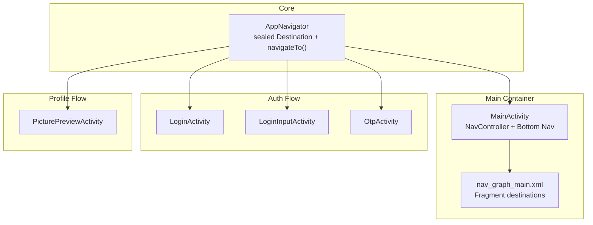
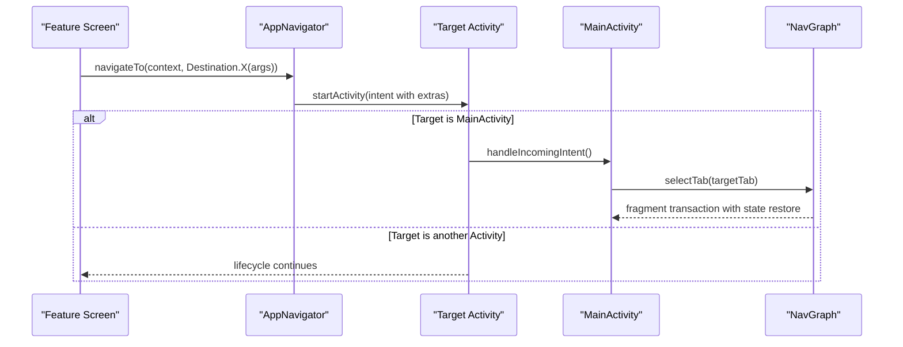
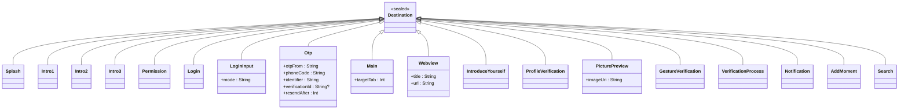
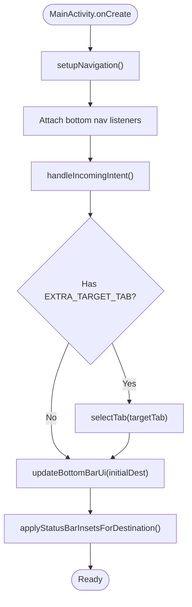
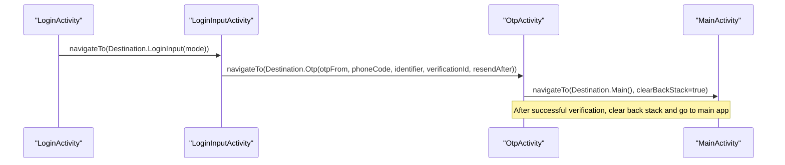
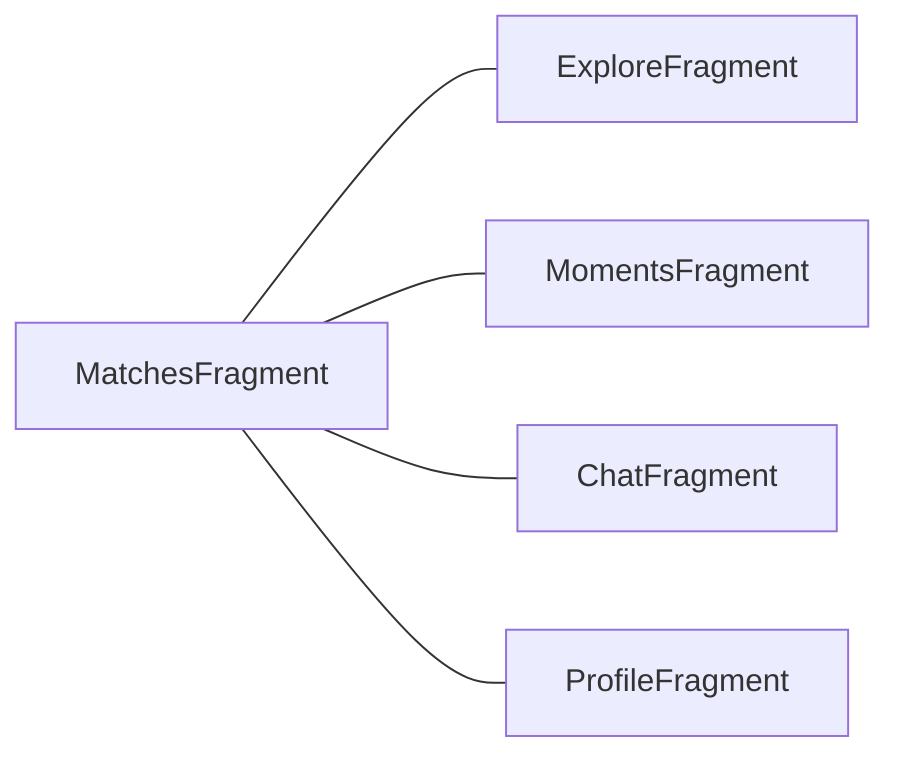
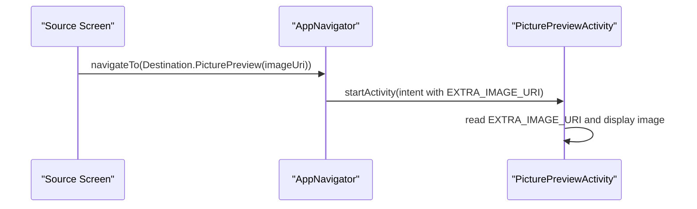
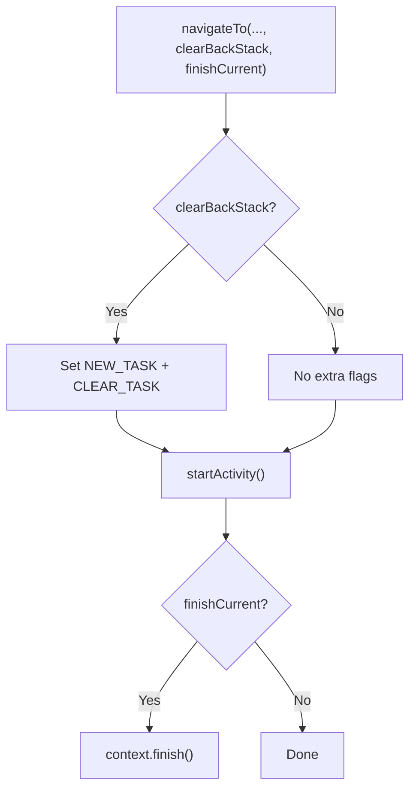
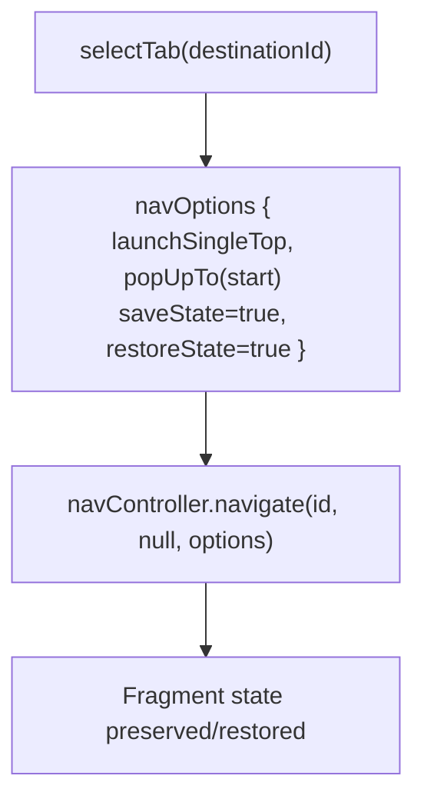
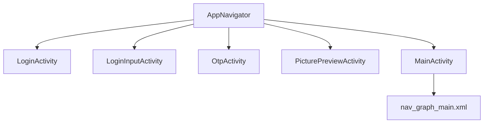

# Navigation Architecture

<cite>
**Referenced Files in This Document**
- [AppNavigator.kt](file://app/src/main/java/com/flirttime/core/navigation/AppNavigator.kt)
- [MainActivity.kt](file://app/src/main/java/com/flirttime/MainActivity.kt)
- [nav_graph_main.xml](file://app/src/main/res/navigation/nav_graph_main.xml)
- [LoginActivity.kt](file://app/src/main/java/com/flirttime/feature/auth/presentation/login/LoginActivity.kt)
- [LoginInputActivity.kt](file://app/src/main/java/com/flirttime/feature/auth/presentation/login/LoginInputActivity.kt)
- [OtpActivity.kt](file://app/src/main/java/com/flirttime/feature/auth/presentation/otp/OtpActivity.kt)
- [PicturePreviewActivity.kt](file://app/src/main/java/com/flirttime/feature/profile/presentation/preview/PicturePreviewActivity.kt)
- [AndroidManifest.xml](file://app/src/main/AndroidManifest.xml)
</cite>

## Table of Contents
1. [Introduction](#introduction)
2. [Project Structure](#project-structure)
3. [Core Components](#core-components)
4. [Architecture Overview](#architecture-overview)
5. [Detailed Component Analysis](#detailed-component-analysis)
6. [Dependency Analysis](#dependency-analysis)
7. [Performance Considerations](#performance-considerations)
8. [Troubleshooting Guide](#troubleshooting-guide)
9. [Conclusion](#conclusion)

## Introduction
This document explains the navigation architecture in Flirttime-Otp-Android. It focuses on:
- The type-safe navigation router implemented with sealed classes in AppNavigator
- How MainActivity manages bottom navigation and fragment transactions using Jetpack Navigation
- Integration with XML-based navigation graphs
- Examples across auth flow, main app screens, and profile management
- Deep linking support, argument passing, back stack behavior, state preservation, and animation configuration

The goal is to make the navigation model clear for both new contributors and experienced developers.

## Project Structure
Navigation-related code is organized into a small core module and feature-specific activities and fragments:
- Core navigation router: sealed destinations and centralized navigation entry point
- Main container activity: hosts fragments via Jetpack Navigation and manages bottom navigation UI
- Feature flows: login, OTP verification, and profile preview demonstrate typed arguments and navigation patterns
- Navigation graph: XML definition of the main tab fragments

**Diagram sources**
- [AppNavigator.kt:19-135](file://app/src/main/java/com/flirttime/core/navigation/AppNavigator.kt#L19-L135)
- [MainActivity.kt:54-113](file://app/src/main/java/com/flirttime/MainActivity.kt#L54-L113)
- [nav_graph_main.xml:1-39](file://app/src/main/res/navigation/nav_graph_main.xml#L1-L39)
- [LoginActivity.kt:130-158](file://app/src/main/java/com/flirttime/feature/auth/presentation/login/LoginActivity.kt#L130-L158)
- [LoginInputActivity.kt:302-395](file://app/src/main/java/com/flirttime/feature/auth/presentation/login/LoginInputActivity.kt#L302-L395)
- [OtpActivity.kt:346-375](file://app/src/main/java/com/flirttime/feature/auth/presentation/otp/OtpActivity.kt#L346-L375)
- [PicturePreviewActivity.kt:85-98](file://app/src/main/java/com/flirttime/feature/profile/presentation/preview/PicturePreviewActivity.kt#L85-L98)

**Section sources**
- [AppNavigator.kt:19-135](file://app/src/main/java/com/flirttime/core/navigation/AppNavigator.kt#L19-L135)
- [MainActivity.kt:54-113](file://app/src/main/java/com/flirttime/MainActivity.kt#L54-L113)
- [nav_graph_main.xml:1-39](file://app/src/main/res/navigation/nav_graph_main.xml#L1-L39)

## Core Components
- Sealed destination model: All navigable targets are represented as sealed subclasses of a common base. Each destination carries its required parameters as strongly-typed properties.
- Centralized router: A single object exposes a navigateTo function that maps each destination to an Activity class and attaches Intent extras based on the destination type.
- Main container: MainActivity uses a NavController bound to a NavHostFragment and an XML-defined navigation graph to manage bottom tabs and fragment transactions.

Key responsibilities:
- AppNavigator: compile-time safe routing, argument mapping, optional back stack clearing, and finishing current screen when needed.
- MainActivity: bottom navigation selection, window insets handling, incoming intent handling (e.g., target tab), and per-destination status bar styling.
- nav_graph_main.xml: declares the five main fragments and sets the start destination.

**Section sources**
- [AppNavigator.kt:19-135](file://app/src/main/java/com/flirttime/core/navigation/AppNavigator.kt#L19-L135)
- [MainActivity.kt:54-113](file://app/src/main/java/com/flirttime/MainActivity.kt#L54-L113)
- [nav_graph_main.xml:1-39](file://app/src/main/res/navigation/nav_graph_main.xml#L1-L39)

## Architecture Overview
The application uses two complementary navigation strategies:
- Activity-level navigation for full-screen flows (auth, onboarding, profile steps, web view, search, notifications). These are driven by AppNavigator and sealed destinations.
- Fragment-level navigation within MainActivity for the main app tabs (Moments, Explore, Matches, Chat, Profile), driven by Jetpack Navigation and an XML graph.

**Diagram sources**
- [AppNavigator.kt:73-135](file://app/src/main/java/com/flirttime/core/navigation/AppNavigator.kt#L73-L135)
- [MainActivity.kt:172-184](file://app/src/main/java/com/flirttime/MainActivity.kt#L172-L184)
- [MainActivity.kt:102-113](file://app/src/main/java/com/flirttime/MainActivity.kt#L102-L113)
- [nav_graph_main.xml:1-39](file://app/src/main/res/navigation/nav_graph_main.xml#L1-L39)

## Detailed Component Analysis

### Type-Safe Navigation Router (AppNavigator)
AppNavigator defines a sealed hierarchy of destinations. Each destination is either a data object or a data class carrying required arguments. The router’s navigateTo method:
- Maps each destination to a concrete Activity class
- Attaches Intent extras according to the destination type
- Optionally clears the task stack and finishes the current activity

Benefits:
- Compile-time safety: only valid destinations and arguments can be constructed
- Centralized mapping: all Activity-to-extra mappings live in one place
- Consistent behavior: flags and finish semantics are uniform

**Diagram sources**
- [AppNavigator.kt:19-56](file://app/src/main/java/com/flirttime/core/navigation/AppNavigator.kt#L19-L56)

**Section sources**
- [AppNavigator.kt:19-135](file://app/src/main/java/com/flirttime/core/navigation/AppNavigator.kt#L19-L135)

### MainActivity: Bottom Navigation and Fragment Transactions
MainActivity integrates Jetpack Navigation:
- Finds the NavHostFragment and binds the NavController
- Sets click listeners on bottom navigation elements to call selectTab
- Uses navOptions to launch single top, pop up to start destination while saving state, and restore state
- Handles incoming intents from AppNavigator to open a specific tab
- Applies edge-to-edge insets and adjusts status bar appearance per destination

**Diagram sources**
- [MainActivity.kt:24-52](file://app/src/main/java/com/flirttime/MainActivity.kt#L24-L52)
- [MainActivity.kt:54-87](file://app/src/main/java/com/flirttime/MainActivity.kt#L54-L87)
- [MainActivity.kt:102-113](file://app/src/main/java/com/flirttime/MainActivity.kt#L102-L113)
- [MainActivity.kt:172-184](file://app/src/main/java/com/flirttime/MainActivity.kt#L172-L184)

**Section sources**
- [MainActivity.kt:24-184](file://app/src/main/java/com/flirttime/MainActivity.kt#L24-L184)

### Auth Flow: Login, Input, and OTP
The authentication flow demonstrates typed argument passing and navigation between Activities:
- LoginActivity routes to LoginInputActivity with a typed mode parameter
- LoginInputActivity requests OTP and navigates to OtpActivity with a fully-typed Otp destination
- OtpActivity reads typed extras, verifies OTP, then navigates to either the main app or profile introduction

**Diagram sources**
- [LoginActivity.kt:130-158](file://app/src/main/java/com/flirttime/feature/auth/presentation/login/LoginActivity.kt#L130-L158)
- [LoginInputActivity.kt:302-395](file://app/src/main/java/com/flirttime/feature/auth/presentation/login/LoginInputActivity.kt#L302-L395)
- [OtpActivity.kt:346-375](file://app/src/main/java/com/flirttime/feature/auth/presentation/otp/OtpActivity.kt#L346-L375)

**Section sources**
- [LoginActivity.kt:130-158](file://app/src/main/java/com/flirttime/feature/auth/presentation/login/LoginActivity.kt#L130-L158)
- [LoginInputActivity.kt:302-395](file://app/src/main/java/com/flirttime/feature/auth/presentation/login/LoginInputActivity.kt#L302-L395)
- [OtpActivity.kt:346-375](file://app/src/main/java/com/flirttime/feature/auth/presentation/otp/OtpActivity.kt#L346-L375)

### Main App Screens: Jetpack Navigation Graph
The main app uses a single Activity hosting multiple fragments through an XML navigation graph. The graph declares:
- Start destination
- Fragments for Moments, Explore, Matches, Chat, and Profile

MainActivity selects tabs programmatically and preserves/restores fragment state using navOptions.

**Diagram sources**
- [nav_graph_main.xml:1-39](file://app/src/main/res/navigation/nav_graph_main.xml#L1-L39)

**Section sources**
- [nav_graph_main.xml:1-39](file://app/src/main/res/navigation/nav_graph_main.xml#L1-L39)
- [MainActivity.kt:102-113](file://app/src/main/java/com/flirttime/MainActivity.kt#L102-L113)

### Profile Management: Typed Arguments Example
Profile-related screens use AppNavigator to pass typed arguments. For example, PicturePreviewActivity receives an image URI string via a typed Destination.PicturePreview and reads it from Intent extras.

**Diagram sources**
- [AppNavigator.kt:119-121](file://app/src/main/java/com/flirttime/core/navigation/AppNavigator.kt#L119-L121)
- [PicturePreviewActivity.kt:85-98](file://app/src/main/java/com/flirttime/feature/profile/presentation/preview/PicturePreviewActivity.kt#L85-L98)

**Section sources**
- [PicturePreviewActivity.kt:85-98](file://app/src/main/java/com/flirttime/feature/profile/presentation/preview/PicturePreviewActivity.kt#L85-L98)
- [AppNavigator.kt:119-121](file://app/src/main/java/com/flirttime/core/navigation/AppNavigator.kt#L119-L121)

### Deep Linking Support
Deep linking is not configured in the analyzed files. There are no deepLink entries in AndroidManifest.xml and no deep links defined in the navigation graph. If deep links are required in the future, add:
- AndroidManifest.xml: declare deepLink for exported Activities
- Navigation graph: define <deepLink> elements for fragment destinations

Current state:
- No deep links present in the repository snapshot reviewed.

**Section sources**
- [AndroidManifest.xml:126-159](file://app/src/main/AndroidManifest.xml#L126-L159)
- [nav_graph_main.xml:1-39](file://app/src/main/res/navigation/nav_graph_main.xml#L1-L39)

### Navigation Arguments Passing
Arguments are passed using Intent extras mapped from typed destinations:
- LoginInputActivity receives login mode via EXTRA_LOGIN_MODE
- OtpActivity receives otpFrom, phoneCode, identifier, verificationId, and resendAfter
- MainActivity receives target tab index via EXTRA_TARGET_TAB
- PicturePreviewActivity receives image URI via EXTRA_IMAGE_URI

Best practices demonstrated:
- Use typed data classes for destinations
- Map extras centrally in AppNavigator
- Read extras consistently in target Activities

**Section sources**
- [AppNavigator.kt:60-71](file://app/src/main/java/com/flirttime/core/navigation/AppNavigator.kt#L60-L71)
- [AppNavigator.kt:100-123](file://app/src/main/java/com/flirttime/core/navigation/AppNavigator.kt#L100-L123)
- [LoginInputActivity.kt:90-93](file://app/src/main/java/com/flirttime/feature/auth/presentation/login/LoginInputActivity.kt#L90-L93)
- [OtpActivity.kt:80-86](file://app/src/main/java/com/flirttime/feature/auth/presentation/otp/OtpActivity.kt#L80-L86)
- [MainActivity.kt:172-184](file://app/src/main/java/com/flirttime/MainActivity.kt#L172-L184)
- [PicturePreviewActivity.kt:85-98](file://app/src/main/java/com/flirttime/feature/profile/presentation/preview/PicturePreviewActivity.kt#L85-L98)

### Back Stack Management
Back stack control is handled at the Activity level:
- clearBackStack flag in AppNavigator sets Intent.FLAG_ACTIVITY_NEW_TASK | FLAG_ACTIVITY_CLEAR_TASK
- finishCurrent flag finishes the calling Activity after navigation

Examples:
- OtpActivity navigates to MainActivity with clearBackStack = true after successful verification
- OtpActivity navigates to profile introduction with finishCurrent = true

**Diagram sources**
- [AppNavigator.kt:125-134](file://app/src/main/java/com/flirttime/core/navigation/AppNavigator.kt#L125-L134)
- [OtpActivity.kt:363-375](file://app/src/main/java/com/flirttime/feature/auth/presentation/otp/OtpActivity.kt#L363-L375)

**Section sources**
- [AppNavigator.kt:125-134](file://app/src/main/java/com/flirttime/core/navigation/AppNavigator.kt#L125-L134)
- [OtpActivity.kt:363-375](file://app/src/main/java/com/flirttime/feature/auth/presentation/otp/OtpActivity.kt#L363-L375)

### Navigation State Preservation and Animations
Fragment state preservation:
- MainActivity uses navOptions with saveState = true and restoreState = true when selecting tabs
- This ensures fragment instances retain their state across tab switches

Animations:
- No explicit custom animations are configured in the analyzed navigation code
- Default fragment transitions apply unless overridden elsewhere

**Diagram sources**
- [MainActivity.kt:102-113](file://app/src/main/java/com/flirttime/MainActivity.kt#L102-L113)

**Section sources**
- [MainActivity.kt:102-113](file://app/src/main/java/com/flirttime/MainActivity.kt#L102-L113)

## Dependency Analysis
The navigation dependencies are straightforward:
- Feature Activities depend on AppNavigator for routing
- MainActivity depends on Jetpack Navigation components and the XML graph
- PicturePreviewActivity depends on AppNavigator constants for reading extras

**Diagram sources**
- [AppNavigator.kt:79-98](file://app/src/main/java/com/flirttime/core/navigation/AppNavigator.kt#L79-L98)
- [MainActivity.kt:54-57](file://app/src/main/java/com/flirttime/MainActivity.kt#L54-L57)
- [nav_graph_main.xml:1-39](file://app/src/main/res/navigation/nav_graph_main.xml#L1-L39)

**Section sources**
- [AppNavigator.kt:79-98](file://app/src/main/java/com/flirttime/core/navigation/AppNavigator.kt#L79-L98)
- [MainActivity.kt:54-57](file://app/src/main/java/com/flirttime/MainActivity.kt#L54-L57)
- [nav_graph_main.xml:1-39](file://app/src/main/res/navigation/nav_graph_main.xml#L1-L39)

## Performance Considerations
- Centralized routing reduces duplicated Intent construction logic and minimizes risk of mismatched extras
- Using sealed destinations avoids runtime crashes due to missing or misnamed extras
- Fragment state preservation prevents reinitialization overhead when switching tabs
- Avoid unnecessary Activity launches; prefer fragment navigation within MainActivity where appropriate

[No sources needed since this section provides general guidance]

## Troubleshooting Guide
Common issues and resolutions:
- Missing extras in target Activity: ensure the destination type matches the extra mapping in AppNavigator and that the target reads the correct constant
- Unexpected back stack behavior: verify clearBackStack and finishCurrent flags are set appropriately in navigateTo calls
- Tab not opening: confirm EXTRA_TARGET_TAB is present and map it correctly in handleIncomingIntent
- Fragment state lost: ensure navOptions include saveState = true and restoreState = true when navigating between tabs

**Section sources**
- [AppNavigator.kt:100-123](file://app/src/main/java/com/flirttime/core/navigation/AppNavigator.kt#L100-L123)
- [MainActivity.kt:172-184](file://app/src/main/java/com/flirttime/MainActivity.kt#L172-L184)
- [MainActivity.kt:102-113](file://app/src/main/java/com/flirttime/MainActivity.kt#L102-L113)

## Conclusion
Flirttime-Otp-Android implements a robust, type-safe navigation strategy:
- Sealed destinations centralize routing and enforce compile-time correctness
- MainActivity leverages Jetpack Navigation for efficient fragment-based tabbed experiences
- Auth and profile flows demonstrate clean argument passing and controlled back stack behavior
- Deep linking is not currently configured but can be added via manifest and navigation graph

This approach improves reliability, maintainability, and developer experience while providing a clear path for extending navigation features.

[No sources needed since this section summarizes without analyzing specific files]