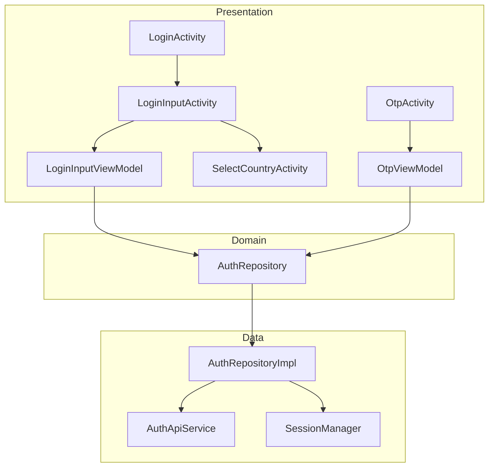
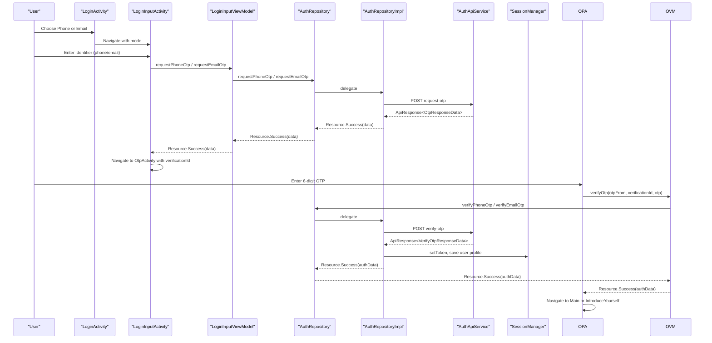
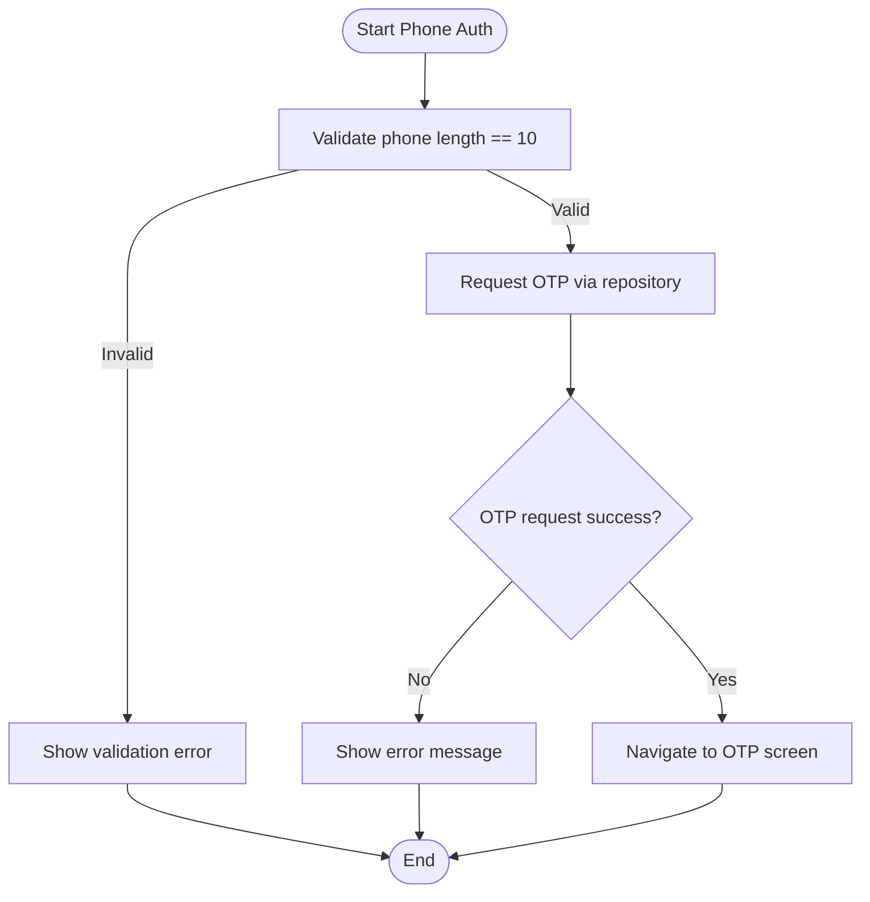
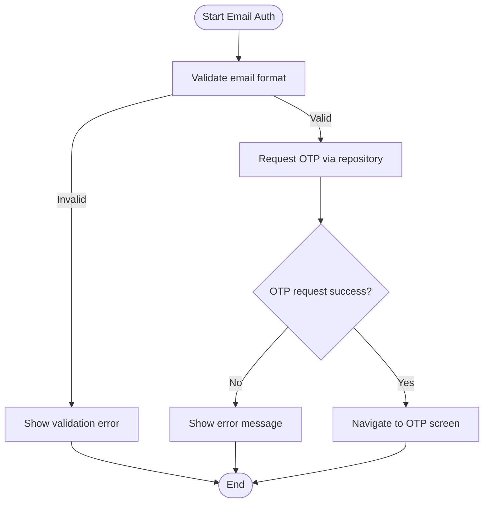
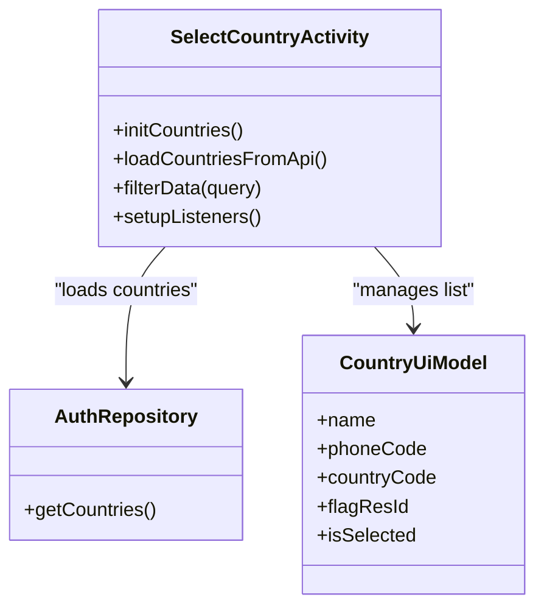
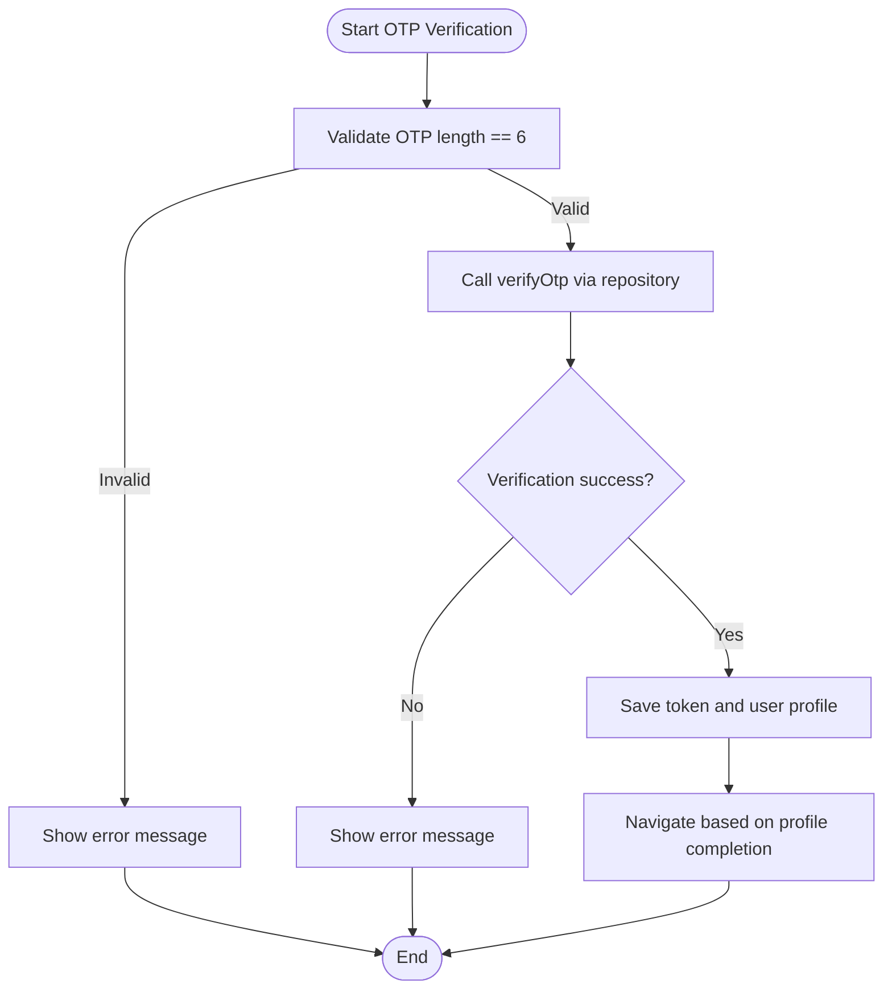
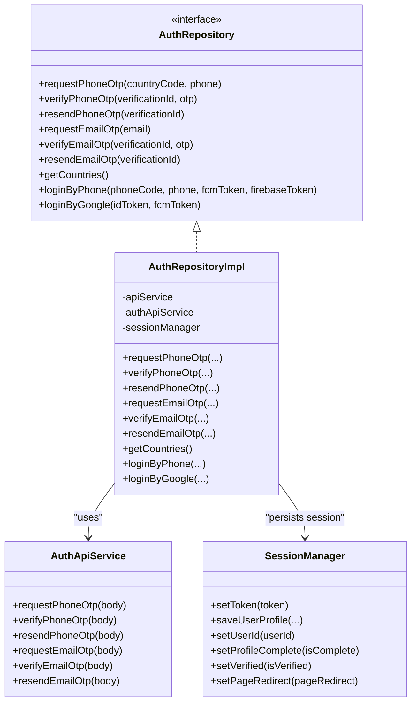
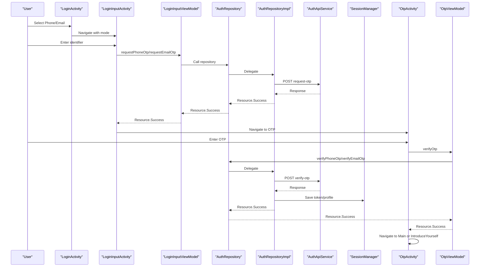
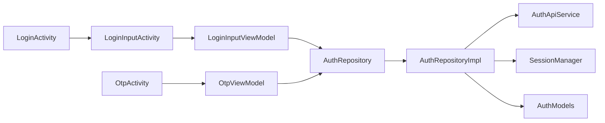

# Authentication System

<cite>
**Referenced Files in This Document**
- [LoginActivity.kt](file://app/src/main/java/com/flirttime/feature/auth/presentation/login/LoginActivity.kt)
- [LoginInputActivity.kt](file://app/src/main/java/com/flirttime/feature/auth/presentation/login/LoginInputActivity.kt)
- [LoginInputViewModel.kt](file://app/src/main/java/com/flirttime/feature/auth/presentation/login/LoginInputViewModel.kt)
- [OtpActivity.kt](file://app/src/main/java/com/flirttime/feature/auth/presentation/otp/OtpActivity.kt)
- [OtpViewModel.kt](file://app/src/main/java/com/flirttime/feature/auth/presentation/otp/OtpViewModel.kt)
- [AuthRepository.kt](file://app/src/main/java/com/flirttime/feature/auth/domain/repository/AuthRepository.kt)
- [AuthRepositoryImpl.kt](file://app/src/main/java/com/flirttime/feature/auth/data/repository/AuthRepositoryImpl.kt)
- [AuthApiService.kt](file://app/src/main/java/com/flirttime/feature/auth/data/network/AuthApiService.kt)
- [AuthModels.kt](file://app/src/main/java/com/flirttime/feature/auth/data/model/AuthModels.kt)
- [SelectCountryActivity.kt](file://app/src/main/java/com/flirttime/feature/auth/presentation/country/SelectCountryActivity.kt)
- [SessionManager.kt](file://app/src/main/java/com/flirttime/core/database/SessionManager.kt)
</cite>

## Table of Contents
1. [Introduction](#introduction)
2. [Project Structure](#project-structure)
3. [Core Components](#core-components)
4. [Architecture Overview](#architecture-overview)
5. [Detailed Component Analysis](#detailed-component-analysis)
6. [Dependency Analysis](#dependency-analysis)
7. [Performance Considerations](#performance-considerations)
8. [Troubleshooting Guide](#troubleshooting-guide)
9. [Security Considerations](#security-considerations)
10. [Extensibility and Additional Providers](#extensibility-and-additional-providers)
11. [Conclusion](#conclusion)

## Introduction
This document explains the authentication system in Flirttime-Otp-Android. It covers phone number and email authentication flows with OTP verification, country code selection for international support, input validation, timer management, security measures, repository implementation, API integration patterns, and the end-to-end login workflow from user input through verification to session establishment. It also provides guidance on extending authentication methods and integrating additional providers.

## Project Structure
The authentication feature follows a layered architecture:
- Presentation layer: Activities and ViewModels handle UI, user interactions, and state observation.
- Domain layer: Repository interface defines use cases for OTP operations and legacy auth.
- Data layer: Repository implementation integrates Retrofit APIs and local session storage.
- Models: Data classes represent request/response payloads.

**Diagram sources**
- [LoginActivity.kt:130-147](file://app/src/main/java/com/flirttime/feature/auth/presentation/login/LoginActivity.kt#L130-L147)
- [LoginInputActivity.kt:285-339](file://app/src/main/java/com/flirttime/feature/auth/presentation/login/LoginInputActivity.kt#L285-L339)
- [OtpActivity.kt:315-344](file://app/src/main/java/com/flirttime/feature/auth/presentation/otp/OtpActivity.kt#L315-L344)
- [LoginInputViewModel.kt:39-53](file://app/src/main/java/com/flirttime/feature/auth/presentation/login/LoginInputViewModel.kt#L39-L53)
- [OtpViewModel.kt:24-48](file://app/src/main/java/com/flirttime/feature/auth/presentation/otp/OtpViewModel.kt#L24-L48)
- [AuthRepository.kt:10-52](file://app/src/main/java/com/flirttime/feature/auth/domain/repository/AuthRepository.kt#L10-L52)
- [AuthRepositoryImpl.kt:23-27](file://app/src/main/java/com/flirttime/feature/auth/data/repository/AuthRepositoryImpl.kt#L23-L27)
- [AuthApiService.kt:13-46](file://app/src/main/java/com/flirttime/feature/auth/data/network/AuthApiService.kt#L13-L46)
- [SessionManager.kt:22-40](file://app/src/main/java/com/flirttime/core/database/SessionManager.kt#L22-L40)

**Section sources**
- [LoginActivity.kt:26-159](file://app/src/main/java/com/flirttime/feature/auth/presentation/login/LoginActivity.kt#L26-L159)
- [LoginInputActivity.kt:45-405](file://app/src/main/java/com/flirttime/feature/auth/presentation/login/LoginInputActivity.kt#L45-L405)
- [OtpActivity.kt:45-419](file://app/src/main/java/com/flirttime/feature/auth/presentation/otp/OtpActivity.kt#L45-L419)
- [AuthRepository.kt:10-52](file://app/src/main/java/com/flirttime/feature/auth/domain/repository/AuthRepository.kt#L10-L52)
- [AuthRepositoryImpl.kt:23-218](file://app/src/main/java/com/flirttime/feature/auth/data/repository/AuthRepositoryImpl.kt#L23-L218)
- [AuthApiService.kt:13-46](file://app/src/main/java/com/flirttime/feature/auth/data/network/AuthApiService.kt#L13-L46)
- [AuthModels.kt:6-103](file://app/src/main/java/com/flirttime/feature/auth/data/model/AuthModels.kt#L6-L103)
- [SelectCountryActivity.kt:23-222](file://app/src/main/java/com/flirttime/feature/auth/presentation/country/SelectCountryActivity.kt#L23-L222)
- [SessionManager.kt:22-223](file://app/src/main/java/com/flirttime/core/database/SessionManager.kt#L22-L223)

## Core Components
- Login options screen: Entry point to choose phone or email authentication.
- Unified input screen: Handles both phone and email modes with inline validation and privacy policy link.
- Country selector: International support with search and default list fallback.
- OTP screen: Input validation, countdown timer, resend logic, and navigation after successful verification.
- ViewModels: Coordinate UI state and repository calls using StateFlow.
- Repository: Exposes Flow-based APIs for OTP requests, verifications, resends, countries, and legacy login paths.
- API service: Retrofit endpoints for phone/email OTP lifecycle.
- Session manager: Persists tokens, user profile data, and flags using DataStore.

**Section sources**
- [LoginActivity.kt:130-147](file://app/src/main/java/com/flirttime/feature/auth/presentation/login/LoginActivity.kt#L130-L147)
- [LoginInputActivity.kt:190-224](file://app/src/main/java/com/flirttime/feature/auth/presentation/login/LoginInputActivity.kt#L190-L224)
- [SelectCountryActivity.kt:88-173](file://app/src/main/java/com/flirttime/feature/auth/presentation/country/SelectCountryActivity.kt#L88-L173)
- [OtpActivity.kt:200-249](file://app/src/main/java/com/flirttime/feature/auth/presentation/otp/OtpActivity.kt#L200-L249)
- [LoginInputViewModel.kt:17-58](file://app/src/main/java/com/flirttime/feature/auth/presentation/login/LoginInputViewModel.kt#L17-L58)
- [OtpViewModel.kt:14-57](file://app/src/main/java/com/flirttime/feature/auth/presentation/otp/OtpViewModel.kt#L14-L57)
- [AuthRepository.kt:10-52](file://app/src/main/java/com/flirttime/feature/auth/domain/repository/AuthRepository.kt#L10-L52)
- [AuthApiService.kt:13-46](file://app/src/main/java/com/flirttime/feature/auth/data/network/AuthApiService.kt#L13-L46)
- [SessionManager.kt:136-195](file://app/src/main/java/com/flirttime/core/database/SessionManager.kt#L136-L195)

## Architecture Overview
The authentication flow uses a clean separation between presentation, domain, and data layers. The UI triggers actions via ViewModels, which call repository functions returning Kotlin Flows. The repository performs network calls through Retrofit and persists session data when authentication succeeds.

**Diagram sources**
- [LoginActivity.kt:130-147](file://app/src/main/java/com/flirttime/feature/auth/presentation/login/LoginActivity.kt#L130-L147)
- [LoginInputActivity.kt:312-368](file://app/src/main/java/com/flirttime/feature/auth/presentation/login/LoginInputActivity.kt#L312-L368)
- [LoginInputViewModel.kt:39-53](file://app/src/main/java/com/flirttime/feature/auth/presentation/login/LoginInputViewModel.kt#L39-L53)
- [AuthRepository.kt:12-38](file://app/src/main/java/com/flirttime/feature/auth/domain/repository/AuthRepository.kt#L12-L38)
- [AuthRepositoryImpl.kt:29-75](file://app/src/main/java/com/flirttime/feature/auth/data/repository/AuthRepositoryImpl.kt#L29-L75)
- [AuthApiService.kt:15-29](file://app/src/main/java/com/flirttime/feature/auth/data/network/AuthApiService.kt#L15-L29)
- [OtpActivity.kt:315-375](file://app/src/main/java/com/flirttime/feature/auth/presentation/otp/OtpActivity.kt#L315-L375)
- [OtpViewModel.kt:24-35](file://app/src/main/java/com/flirttime/feature/auth/presentation/otp/OtpViewModel.kt#L24-L35)
- [SessionManager.kt:136-195](file://app/src/main/java/com/flirttime/core/database/SessionManager.kt#L136-L195)

## Detailed Component Analysis

### Phone Number Authentication Flow
- Entry: User selects phone mode on the login options screen.
- Input validation: Phone must be exactly 10 digits; otherwise, an error is shown.
- Request OTP: ViewModel calls repository to send OTP to the selected country code and phone number.
- Navigation: On success, navigate to OTP screen with verificationId and resendAfter.

**Diagram sources**
- [LoginInputActivity.kt:204-224](file://app/src/main/java/com/flirttime/feature/auth/presentation/login/LoginInputActivity.kt#L204-L224)
- [LoginInputActivity.kt:312-339](file://app/src/main/java/com/flirttime/feature/auth/presentation/login/LoginInputActivity.kt#L312-L339)
- [LoginInputViewModel.kt:39-45](file://app/src/main/java/com/flirttime/feature/auth/presentation/login/LoginInputViewModel.kt#L39-L45)
- [AuthRepositoryImpl.kt:29-38](file://app/src/main/java/com/flirttime/feature/auth/data/repository/AuthRepositoryImpl.kt#L29-L38)

**Section sources**
- [LoginInputActivity.kt:204-224](file://app/src/main/java/com/flirttime/feature/auth/presentation/login/LoginInputActivity.kt#L204-L224)
- [LoginInputActivity.kt:312-339](file://app/src/main/java/com/flirttime/feature/auth/presentation/login/LoginInputActivity.kt#L312-L339)
- [LoginInputViewModel.kt:39-45](file://app/src/main/java/com/flirttime/feature/auth/presentation/login/LoginInputViewModel.kt#L39-L45)
- [AuthRepositoryImpl.kt:29-38](file://app/src/main/java/com/flirttime/feature/auth/data/repository/AuthRepositoryImpl.kt#L29-L38)

### Email Authentication Flow
- Entry: User selects email mode on the login options screen.
- Input validation: Email must be non-empty and match standard email pattern.
- Request OTP: ViewModel calls repository to send OTP to the provided email.
- Navigation: On success, navigate to OTP screen with verificationId and resendAfter.

**Diagram sources**
- [LoginInputActivity.kt:204-224](file://app/src/main/java/com/flirttime/feature/auth/presentation/login/LoginInputActivity.kt#L204-L224)
- [LoginInputActivity.kt:336-338](file://app/src/main/java/com/flirttime/feature/auth/presentation/login/LoginInputActivity.kt#L336-L338)
- [LoginInputViewModel.kt:47-53](file://app/src/main/java/com/flirttime/feature/auth/presentation/login/LoginInputViewModel.kt#L47-L53)
- [AuthRepositoryImpl.kt:87-95](file://app/src/main/java/com/flirttime/feature/auth/data/repository/AuthRepositoryImpl.kt#L87-L95)

**Section sources**
- [LoginInputActivity.kt:204-224](file://app/src/main/java/com/flirttime/feature/auth/presentation/login/LoginInputActivity.kt#L204-L224)
- [LoginInputActivity.kt:336-338](file://app/src/main/java/com/flirttime/feature/auth/presentation/login/LoginInputActivity.kt#L336-L338)
- [LoginInputViewModel.kt:47-53](file://app/src/main/java/com/flirttime/feature/auth/presentation/login/LoginInputViewModel.kt#L47-L53)
- [AuthRepositoryImpl.kt:87-95](file://app/src/main/java/com/flirttime/feature/auth/data/repository/AuthRepositoryImpl.kt#L87-L95)

### Country Code Selection Mechanism
- Default list: Provides common countries with phone codes and optional flag resources.
- API override: If the server returns a country list, it replaces defaults while preserving current selection.
- Search: Filters by country name or phone code.
- Result: Returns selected country’s name, phone code, and optional flag resource back to the caller.

**Diagram sources**
- [SelectCountryActivity.kt:88-173](file://app/src/main/java/com/flirttime/feature/auth/presentation/country/SelectCountryActivity.kt#L88-L173)
- [SelectCountryActivity.kt:175-206](file://app/src/main/java/com/flirttime/feature/auth/presentation/country/SelectCountryActivity.kt#L175-L206)
- [SelectCountryActivity.kt:208-221](file://app/src/main/java/com/flirttime/feature/auth/presentation/country/SelectCountryActivity.kt#L208-L221)
- [AuthRepository.kt:41-41](file://app/src/main/java/com/flirttime/feature/auth/domain/repository/AuthRepository.kt#L41-L41)

**Section sources**
- [SelectCountryActivity.kt:88-173](file://app/src/main/java/com/flirttime/feature/auth/presentation/country/SelectCountryActivity.kt#L88-L173)
- [SelectCountryActivity.kt:175-206](file://app/src/main/java/com/flirttime/feature/auth/presentation/country/SelectCountryActivity.kt#L175-L206)
- [SelectCountryActivity.kt:208-221](file://app/src/main/java/com/flirttime/feature/auth/presentation/country/SelectCountryActivity.kt#L208-L221)
- [AuthRepository.kt:41-41](file://app/src/main/java/com/flirttime/feature/auth/domain/repository/AuthRepository.kt#L41-L41)

### OTP Verification Process
- Input validation: OTP must be exactly 6 characters; otherwise, show an error.
- Timer management: Countdown timer disables resend until duration expires; updates UI accordingly.
- Security measures: Uses verificationId tied to the backend; resets states after success; stores token and user profile securely.
- Resend flow: Updates verificationId and resendAfter from response; restarts timer.

**Diagram sources**
- [OtpActivity.kt:200-223](file://app/src/main/java/com/flirttime/feature/auth/presentation/otp/OtpActivity.kt#L200-L223)
- [OtpActivity.kt:315-344](file://app/src/main/java/com/flirttime/feature/auth/presentation/otp/OtpActivity.kt#L315-L344)
- [OtpViewModel.kt:24-35](file://app/src/main/java/com/flirttime/feature/auth/presentation/otp/OtpViewModel.kt#L24-L35)
- [AuthRepositoryImpl.kt:40-75](file://app/src/main/java/com/flirttime/feature/auth/data/repository/AuthRepositoryImpl.kt#L40-L75)

**Section sources**
- [OtpActivity.kt:200-223](file://app/src/main/java/com/flirttime/feature/auth/presentation/otp/OtpActivity.kt#L200-L223)
- [OtpActivity.kt:225-249](file://app/src/main/java/com/flirttime/feature/auth/presentation/otp/OtpActivity.kt#L225-L249)
- [OtpActivity.kt:315-344](file://app/src/main/java/com/flirttime/feature/auth/presentation/otp/OtpActivity.kt#L315-L344)
- [OtpViewModel.kt:24-35](file://app/src/main/java/com/flirttime/feature/auth/presentation/otp/OtpViewModel.kt#L24-L35)
- [AuthRepositoryImpl.kt:40-75](file://app/src/main/java/com/flirttime/feature/auth/data/repository/AuthRepositoryImpl.kt#L40-L75)

### Authentication Repository Implementation and API Integration
- Repository interface: Defines Flow-based methods for OTP lifecycle and legacy login paths.
- Implementation: Wraps Retrofit calls with safeApiCall/safeRawApiCall, emits Resource states, and persists session data on success.
- API service: Declares endpoints for phone/email OTP request, verify, and resend.

**Diagram sources**
- [AuthRepository.kt:10-52](file://app/src/main/java/com/flirttime/feature/auth/domain/repository/AuthRepository.kt#L10-L52)
- [AuthRepositoryImpl.kt:23-218](file://app/src/main/java/com/flirttime/feature/auth/data/repository/AuthRepositoryImpl.kt#L23-L218)
- [AuthApiService.kt:13-46](file://app/src/main/java/com/flirttime/feature/auth/data/network/AuthApiService.kt#L13-L46)
- [SessionManager.kt:136-195](file://app/src/main/java/com/flirttime/core/database/SessionManager.kt#L136-L195)

**Section sources**
- [AuthRepository.kt:10-52](file://app/src/main/java/com/flirttime/feature/auth/domain/repository/AuthRepository.kt#L10-L52)
- [AuthRepositoryImpl.kt:23-218](file://app/src/main/java/com/flirttime/feature/auth/data/repository/AuthRepositoryImpl.kt#L23-L218)
- [AuthApiService.kt:13-46](file://app/src/main/java/com/flirttime/feature/auth/data/network/AuthApiService.kt#L13-L46)
- [SessionManager.kt:136-195](file://app/src/main/java/com/flirttime/core/database/SessionManager.kt#L136-L195)

### Login Workflow Summary
- User chooses phone or email.
- Input validated locally.
- OTP requested via repository; success navigates to OTP screen.
- OTP verified; token and user profile saved; navigation depends on profile completeness.

**Diagram sources**
- [LoginActivity.kt:130-147](file://app/src/main/java/com/flirttime/feature/auth/presentation/login/LoginActivity.kt#L130-L147)
- [LoginInputActivity.kt:312-368](file://app/src/main/java/com/flirttime/feature/auth/presentation/login/LoginInputActivity.kt#L312-L368)
- [LoginInputViewModel.kt:39-53](file://app/src/main/java/com/flirttime/feature/auth/presentation/login/LoginInputViewModel.kt#L39-L53)
- [AuthRepository.kt:12-38](file://app/src/main/java/com/flirttime/feature/auth/domain/repository/AuthRepository.kt#L12-L38)
- [AuthRepositoryImpl.kt:29-75](file://app/src/main/java/com/flirttime/feature/auth/data/repository/AuthRepositoryImpl.kt#L29-L75)
- [AuthApiService.kt:15-29](file://app/src/main/java/com/flirttime/feature/auth/data/network/AuthApiService.kt#L15-L29)
- [OtpActivity.kt:315-375](file://app/src/main/java/com/flirttime/feature/auth/presentation/otp/OtpActivity.kt#L315-L375)
- [OtpViewModel.kt:24-35](file://app/src/main/java/com/flirttime/feature/auth/presentation/otp/OtpViewModel.kt#L24-L35)
- [SessionManager.kt:136-195](file://app/src/main/java/com/flirttime/core/database/SessionManager.kt#L136-L195)

## Dependency Analysis
- Presentation components depend on ViewModels for state and business coordination.
- ViewModels depend on the repository interface for decoupled data access.
- Repository implementation depends on core ApiService, AuthApiService, and SessionManager.
- Models define contract boundaries between UI and network layers.

**Diagram sources**
- [LoginActivity.kt:130-147](file://app/src/main/java/com/flirttime/feature/auth/presentation/login/LoginActivity.kt#L130-L147)
- [LoginInputActivity.kt:312-368](file://app/src/main/java/com/flirttime/feature/auth/presentation/login/LoginInputActivity.kt#L312-L368)
- [OtpActivity.kt:315-375](file://app/src/main/java/com/flirttime/feature/auth/presentation/otp/OtpActivity.kt#L315-L375)
- [LoginInputViewModel.kt:39-53](file://app/src/main/java/com/flirttime/feature/auth/presentation/login/LoginInputViewModel.kt#L39-L53)
- [OtpViewModel.kt:24-48](file://app/src/main/java/com/flirttime/feature/auth/presentation/otp/OtpViewModel.kt#L24-L48)
- [AuthRepository.kt:10-52](file://app/src/main/java/com/flirttime/feature/auth/domain/repository/AuthRepository.kt#L10-L52)
- [AuthRepositoryImpl.kt:23-218](file://app/src/main/java/com/flirttime/feature/auth/data/repository/AuthRepositoryImpl.kt#L23-L218)
- [AuthApiService.kt:13-46](file://app/src/main/java/com/flirttime/feature/auth/data/network/AuthApiService.kt#L13-L46)
- [AuthModels.kt:6-103](file://app/src/main/java/com/flirttime/feature/auth/data/model/AuthModels.kt#L6-L103)

**Section sources**
- [LoginActivity.kt:130-147](file://app/src/main/java/com/flirttime/feature/auth/presentation/login/LoginActivity.kt#L130-L147)
- [LoginInputActivity.kt:312-368](file://app/src/main/java/com/flirttime/feature/auth/presentation/login/LoginInputActivity.kt#L312-L368)
- [OtpActivity.kt:315-375](file://app/src/main/java/com/flirttime/feature/auth/presentation/otp/OtpActivity.kt#L315-L375)
- [LoginInputViewModel.kt:39-53](file://app/src/main/java/com/flirttime/feature/auth/presentation/login/LoginInputViewModel.kt#L39-L53)
- [OtpViewModel.kt:24-48](file://app/src/main/java/com/flirttime/feature/auth/presentation/otp/OtpViewModel.kt#L24-L48)
- [AuthRepository.kt:10-52](file://app/src/main/java/com/flirttime/feature/auth/domain/repository/AuthRepository.kt#L10-L52)
- [AuthRepositoryImpl.kt:23-218](file://app/src/main/java/com/flirttime/feature/auth/data/repository/AuthRepositoryImpl.kt#L23-L218)
- [AuthApiService.kt:13-46](file://app/src/main/java/com/flirttime/feature/auth/data/network/AuthApiService.kt#L13-L46)
- [AuthModels.kt:6-103](file://app/src/main/java/com/flirttime/feature/auth/data/model/AuthModels.kt#L6-L103)

## Performance Considerations
- Use Flow for asynchronous streams to avoid blocking UI threads.
- Dispatch network operations to IO dispatcher within repository.
- Avoid heavy computations in UI thread; keep validation lightweight.
- Reuse views and minimize layout changes during keyboard events.

[No sources needed since this section provides general guidance]

## Troubleshooting Guide
- Invalid phone number: Ensure exactly 10 digits are entered before requesting OTP.
- Invalid email: Confirm email matches standard format before proceeding.
- OTP length mismatch: Require exactly 6 characters before verification.
- Resend disabled: Check countdown timer state; ensure resendAfter is updated from server response.
- Network errors: Observe Resource.Error states and display user-friendly messages.
- Session not persisted: Verify that token and user profile fields are saved upon successful verification.

**Section sources**
- [LoginInputActivity.kt:204-224](file://app/src/main/java/com/flirttime/feature/auth/presentation/login/LoginInputActivity.kt#L204-L224)
- [LoginInputActivity.kt:312-339](file://app/src/main/java/com/flirttime/feature/auth/presentation/login/LoginInputActivity.kt#L312-L339)
- [OtpActivity.kt:200-223](file://app/src/main/java/com/flirttime/feature/auth/presentation/otp/OtpActivity.kt#L200-L223)
- [OtpActivity.kt:225-249](file://app/src/main/java/com/flirttime/feature/auth/presentation/otp/OtpActivity.kt#L225-L249)
- [OtpActivity.kt:315-344](file://app/src/main/java/com/flirttime/feature/auth/presentation/otp/OtpActivity.kt#L315-L344)
- [AuthRepositoryImpl.kt:40-75](file://app/src/main/java/com/flirttime/feature/auth/data/repository/AuthRepositoryImpl.kt#L40-L75)

## Security Considerations
- Token handling: Store only the effective token returned by the backend; prefer secure storage mechanisms.
- VerificationId usage: Always pass verificationId from the server to prevent replay attacks.
- Input sanitization: Validate phone and email formats locally before sending requests.
- Privacy links: Provide clear privacy policy access to inform users about data handling.
- Session persistence: Persist minimal necessary user data; avoid storing sensitive information unnecessarily.

**Section sources**
- [AuthModels.kt:30-37](file://app/src/main/java/com/flirttime/feature/auth/data/model/AuthModels.kt#L30-L37)
- [AuthRepositoryImpl.kt:40-75](file://app/src/main/java/com/flirttime/feature/auth/data/repository/AuthRepositoryImpl.kt#L40-L75)
- [LoginInputActivity.kt:204-224](file://app/src/main/java/com/flirttime/feature/auth/presentation/login/LoginInputActivity.kt#L204-L224)
- [OtpActivity.kt:315-344](file://app/src/main/java/com/flirttime/feature/auth/presentation/otp/OtpActivity.kt#L315-L344)
- [SessionManager.kt:136-195](file://app/src/main/java/com/flirttime/core/database/SessionManager.kt#L136-L195)

## Extensibility and Additional Providers
- Adding new OTP providers: Extend AuthRepository with new methods and implement them in AuthRepositoryImpl; expose corresponding endpoints in AuthApiService.
- Integrating social providers: Implement loginByGoogle and similar methods; update UI to trigger provider-specific flows and handle responses.
- Country list extension: Allow dynamic loading of additional countries from server; maintain fallback defaults for offline scenarios.
- UI extensions: Add new entry points on LoginActivity and route to appropriate input screens.

**Section sources**
- [AuthRepository.kt:40-52](file://app/src/main/java/com/flirttime/feature/auth/domain/repository/AuthRepository.kt#L40-L52)
- [AuthRepositoryImpl.kt:156-216](file://app/src/main/java/com/flirttime/feature/auth/data/repository/AuthRepositoryImpl.kt#L156-L216)
- [AuthApiService.kt:13-46](file://app/src/main/java/com/flirttime/feature/auth/data/network/AuthApiService.kt#L13-L46)
- [LoginActivity.kt:145-147](file://app/src/main/java/com/flirttime/feature/auth/presentation/login/LoginActivity.kt#L145-L147)
- [SelectCountryActivity.kt:142-173](file://app/src/main/java/com/flirttime/feature/auth/presentation/country/SelectCountryActivity.kt#L142-L173)

## Conclusion
The authentication system in Flirttime-Otp-Android implements a robust, layered approach supporting phone and email OTP verification with international country code selection. It emphasizes input validation, secure session handling, and clear user feedback. The design allows easy extension for additional authentication providers and enhances user experience through responsive UI and reliable error handling.