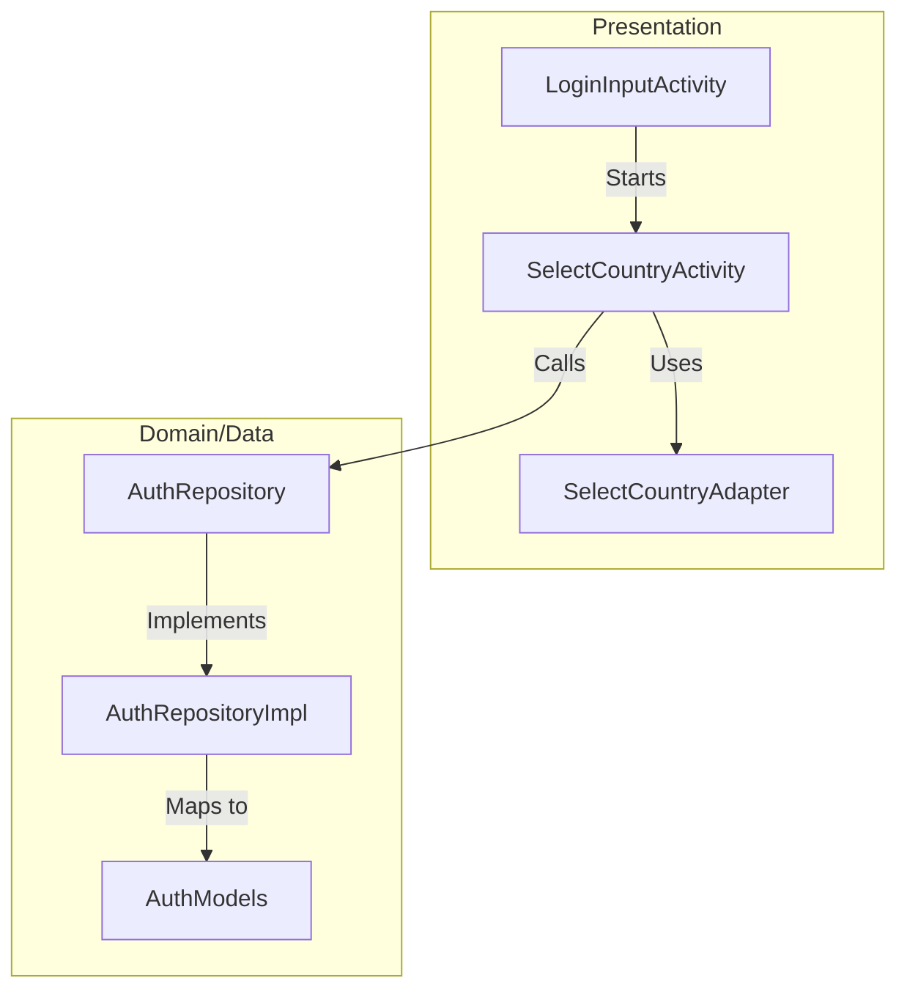
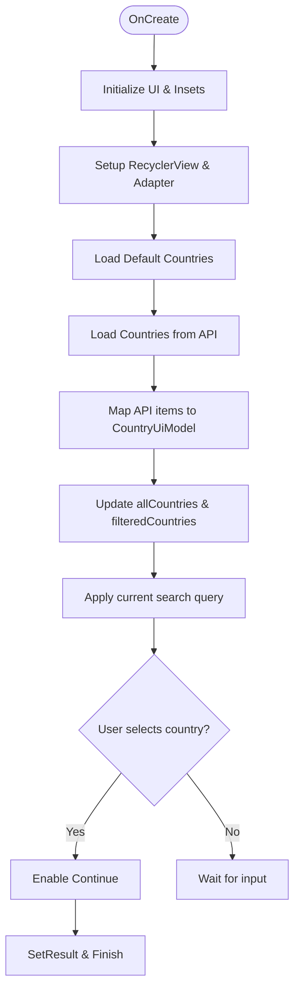
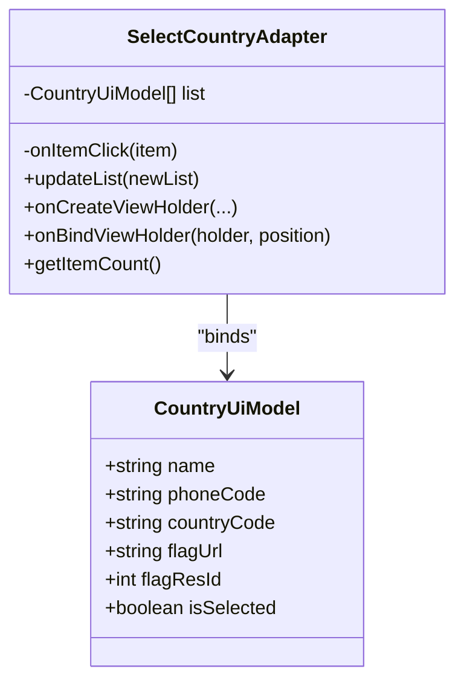
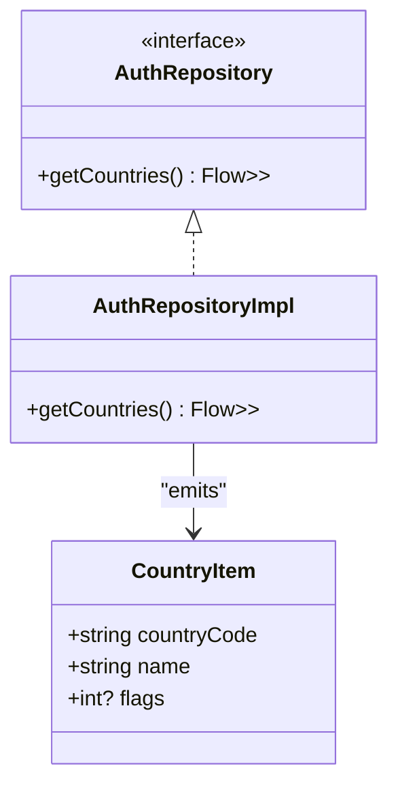
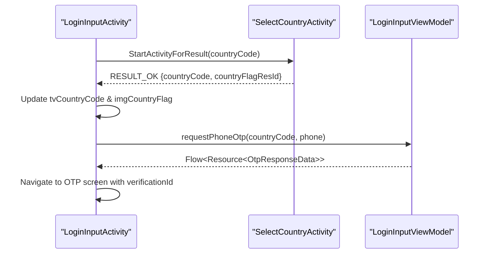
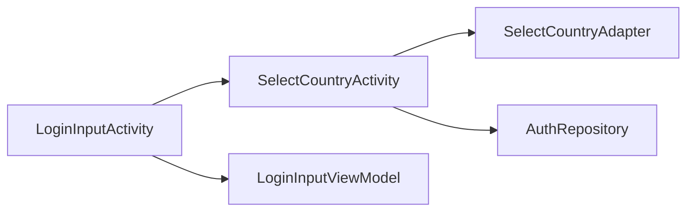

# Country Code Selection

<cite>
**Referenced Files in This Document**
- [SelectCountryActivity.kt](file://app/src/main/java/com/flirttime/feature/auth/presentation/country/SelectCountryActivity.kt)
- [SelectCountryAdapter.kt](file://app/src/main/java/com/flirttime/feature/auth/presentation/country/SelectCountryAdapter.kt)
- [LoginInputActivity.kt](file://app/src/main/java/com/flirttime/feature/auth/presentation/login/LoginInputActivity.kt)
- [AuthRepository.kt](file://app/src/main/java/com/flirttime/feature/auth/domain/repository/AuthRepository.kt)
- [AuthRepositoryImpl.kt](file://app/src/main/java/com/flirttime/feature/auth/data/repository/AuthRepositoryImpl.kt)
- [AuthModels.kt](file://app/src/main/java/com/flirttime/feature/auth/data/model/AuthModels.kt)
- [activity_select_country.xml](file://app/src/main/res/layout/activity_select_country.xml)
- [rv_searchcountry.xml](file://app/src/main/res/layout/rv_searchcountry.xml)
- [strings.xml](file://app/src/main/res/values/strings.xml)
</cite>

## Table of Contents
1. [Introduction](#introduction)
2. [Project Structure](#project-structure)
3. [Core Components](#core-components)
4. [Architecture Overview](#architecture-overview)
5. [Detailed Component Analysis](#detailed-component-analysis)
6. [Dependency Analysis](#dependency-analysis)
7. [Performance Considerations](#performance-considerations)
8. [Troubleshooting Guide](#troubleshooting-guide)
9. [Conclusion](#conclusion)

## Introduction
This document explains the country code selection system used during phone authentication in Flirttime-Otp-Android. It covers the country picker activity, data management for countries (local defaults and API), search filtering, flag image handling, adapter implementation, result passing back to the login screen, and integration with phone number formatting and OTP flows. It also addresses internationalization and accessibility considerations present in the UI.

## Project Structure
The country selection feature spans presentation and data layers:
- Presentation layer: SelectCountryActivity and SelectCountryAdapter handle the UI, user interactions, and list rendering.
- Data layer: AuthRepository and its implementation provide a Flow of country data from the network; models define the server payload structure.
- Integration: LoginInputActivity launches the country picker via Activity Result APIs and uses the selected country code to request an OTP.

**Diagram sources**
- [LoginInputActivity.kt:286-290](file://app/src/main/java/com/flirttime/feature/auth/presentation/login/LoginInputActivity.kt#L286-L290)
- [SelectCountryActivity.kt:142-173](file://app/src/main/java/com/flirttime/feature/auth/presentation/country/SelectCountryActivity.kt#L142-L173)
- [AuthRepository.kt:40-47](file://app/src/main/java/com/flirttime/feature/auth/domain/repository/AuthRepository.kt#L40-L47)
- [AuthRepositoryImpl.kt:144-154](file://app/src/main/java/com/flirttime/feature/auth/data/repository/AuthRepositoryImpl.kt#L144-L154)
- [AuthModels.kt:67-77](file://app/src/main/java/com/flirttime/feature/auth/data/model/AuthModels.kt#L67-L77)

**Section sources**
- [SelectCountryActivity.kt:23-50](file://app/src/main/java/com/flirttime/feature/auth/presentation/country/SelectCountryActivity.kt#L23-L50)
- [LoginInputActivity.kt:69-82](file://app/src/main/java/com/flirttime/feature/auth/presentation/login/LoginInputActivity.kt#L69-L82)

## Core Components
- SelectCountryActivity: Hosts the country list, search input, and confirmation button. It initializes default countries, loads remote countries, filters on search, and returns the selected country to the caller.
- SelectCountryAdapter: Displays each country with name, dialing code, optional flag resource, and selection indicator.
- AuthRepository / AuthRepositoryImpl: Exposes getCountries() as a Flow<Resource<List<CountryItem>>> and maps server responses into domain-friendly structures.
- AuthModels: Defines CountryItem and related DTOs for API payloads.
- LoginInputActivity: Launches the country picker, receives results, updates the displayed country code and flag, and proceeds to request OTP using the selected code.

Key responsibilities:
- Country data management: local defaults + remote API fallback.
- Search filtering: by country name or dialing code.
- Flag handling: prefer provided resource ID; otherwise show placeholder.
- Result passing: Intent extras with country name, code, and optional flag info.
- Integration: LoginInputActivity consumes the result and uses it for OTP requests.

**Section sources**
- [SelectCountryActivity.kt:78-140](file://app/src/main/java/com/flirttime/feature/auth/presentation/country/SelectCountryActivity.kt#L78-L140)
- [SelectCountryAdapter.kt:9-61](file://app/src/main/java/com/flirttime/feature/auth/presentation/country/SelectCountryAdapter.kt#L9-L61)
- [AuthRepository.kt:40-47](file://app/src/main/java/com/flirttime/feature/auth/domain/repository/AuthRepository.kt#L40-L47)
- [AuthRepositoryImpl.kt:144-154](file://app/src/main/java/com/flirttime/feature/auth/data/repository/AuthRepositoryImpl.kt#L144-L154)
- [AuthModels.kt:67-77](file://app/src/main/java/com/flirttime/feature/auth/data/model/AuthModels.kt#L67-L77)
- [LoginInputActivity.kt:286-339](file://app/src/main/java/com/flirttime/feature/auth/presentation/login/LoginInputActivity.kt#L286-L339)

## Architecture Overview
The flow begins at the login screen, which opens the country picker. The picker shows a default set immediately and then refreshes with remote data when available. Users can search by name or dialing code. On confirmation, the picker returns the selected country to the login screen, which then triggers the OTP request with the chosen country code.

```mermaid
sequenceDiagram
participant Caller as "LoginInputActivity"
participant Picker as "SelectCountryActivity"
participant Repo as "AuthRepository"
participant Impl as "AuthRepositoryImpl"
participant Model as "AuthModels.CountryItem"
Caller->>Picker : StartActivityForResult(countryCode)
Picker->>Picker : initCountries()
Picker->>Repo : getCountries()
Repo->>Impl : getCountries()
Impl-->>Repo : Flow<Resource<List<CountryItem>>
Repo-->>Picker : Resource.Success(data)
Picker->>Picker : map to CountryUiModel<br/>update lists & filter
Picker-->>Caller : setResult(countryName, countryCode, flags)
Caller->>Caller : update UI & continue OTP flow
```

**Diagram sources**
- [LoginInputActivity.kt:286-290](file://app/src/main/java/com/flirttime/feature/auth/presentation/login/LoginInputActivity.kt#L286-L290)
- [SelectCountryActivity.kt:88-173](file://app/src/main/java/com/flirttime/feature/auth/presentation/country/SelectCountryActivity.kt#L88-L173)
- [AuthRepository.kt:40-47](file://app/src/main/java/com/flirttime/feature/auth/domain/repository/AuthRepository.kt#L40-L47)
- [AuthRepositoryImpl.kt:144-154](file://app/src/main/java/com/flirttime/feature/auth/data/repository/AuthRepositoryImpl.kt#L144-L154)
- [AuthModels.kt:67-77](file://app/src/main/java/com/flirttime/feature/auth/data/model/AuthModels.kt#L67-L77)

## Detailed Component Analysis

### SelectCountryActivity
Responsibilities:
- Initialize UI and edge-to-edge insets.
- Set up RecyclerView and adapter.
- Populate initial default countries and mark the one matching the incoming countryCode.
- Load remote countries via repository and replace the list while preserving selection state.
- Provide real-time search filtering by country name or dialing code.
- Return selected country via Intent extras.

Key behaviors:
- Default initialization sets a curated list and selects based on the passed countryCode.
- Remote data mapping ensures phoneCode always starts with “+” and assigns a flag resource when available or falls back to a conditional default.
- Search toggles visibility between the list and a placeholder when no matches are found.
- Continue button is enabled only after a selection is made.

**Diagram sources**
- [SelectCountryActivity.kt:33-50](file://app/src/main/java/com/flirttime/feature/auth/presentation/country/SelectCountryActivity.kt#L33-L50)
- [SelectCountryActivity.kt:70-86](file://app/src/main/java/com/flirttime/feature/auth/presentation/country/SelectCountryActivity.kt#L70-L86)
- [SelectCountryActivity.kt:88-173](file://app/src/main/java/com/flirttime/feature/auth/presentation/country/SelectCountryActivity.kt#L88-L173)
- [SelectCountryActivity.kt:175-206](file://app/src/main/java/com/flirttime/feature/auth/presentation/country/SelectCountryActivity.kt#L175-L206)
- [SelectCountryActivity.kt:208-221](file://app/src/main/java/com/flirttime/feature/auth/presentation/country/SelectCountryActivity.kt#L208-L221)

**Section sources**
- [SelectCountryActivity.kt:33-50](file://app/src/main/java/com/flirttime/feature/auth/presentation/country/SelectCountryActivity.kt#L33-L50)
- [SelectCountryActivity.kt:70-86](file://app/src/main/java/com/flirttime/feature/auth/presentation/country/SelectCountryActivity.kt#L70-L86)
- [SelectCountryActivity.kt:88-173](file://app/src/main/java/com/flirttime/feature/auth/presentation/country/SelectCountryActivity.kt#L88-L173)
- [SelectCountryActivity.kt:175-206](file://app/src/main/java/com/flirttime/feature/auth/presentation/country/SelectCountryActivity.kt#L175-L206)
- [SelectCountryActivity.kt:208-221](file://app/src/main/java/com/flirttime/feature/auth/presentation/country/SelectCountryActivity.kt#L208-L221)

### SelectCountryAdapter and CountryUiModel
Responsibilities:
- Render each country row with name and dialing code.
- Display a flag image if available; otherwise use a placeholder.
- Show a selection indicator based on isSelected.
- Forward click events to the activity.

Data model:
- CountryUiModel includes display name, phoneCode, countryCode, optional flagUrl, optional flagResId, and isSelected.

**Diagram sources**
- [SelectCountryAdapter.kt:9-16](file://app/src/main/java/com/flirttime/feature/auth/presentation/country/SelectCountryAdapter.kt#L9-L16)
- [SelectCountryAdapter.kt:18-61](file://app/src/main/java/com/flirttime/feature/auth/presentation/country/SelectCountryAdapter.kt#L18-L61)

**Section sources**
- [SelectCountryAdapter.kt:9-61](file://app/src/main/java/com/flirttime/feature/auth/presentation/country/SelectCountryAdapter.kt#L9-L61)

### Data Layer: AuthRepository and Models
Responsibilities:
- AuthRepository exposes getCountries() returning a Flow of Resource-wrapped list of CountryItem.
- AuthRepositoryImpl performs the network call and emits Loading/Success/Error states.
- AuthModels defines CountryItem with fields for country_code, name, and flags resource id.

**Diagram sources**
- [AuthRepository.kt:40-47](file://app/src/main/java/com/flirttime/feature/auth/domain/repository/AuthRepository.kt#L40-L47)
- [AuthRepositoryImpl.kt:144-154](file://app/src/main/java/com/flirttime/feature/auth/data/repository/AuthRepositoryImpl.kt#L144-L154)
- [AuthModels.kt:67-77](file://app/src/main/java/com/flirttime/feature/auth/data/model/AuthModels.kt#L67-L77)

**Section sources**
- [AuthRepository.kt:40-47](file://app/src/main/java/com/flirttime/feature/auth/domain/repository/AuthRepository.kt#L40-L47)
- [AuthRepositoryImpl.kt:144-154](file://app/src/main/java/com/flirttime/feature/auth/data/repository/AuthRepositoryImpl.kt#L144-L154)
- [AuthModels.kt:67-77](file://app/src/main/java/com/flirttime/feature/auth/data/model/AuthModels.kt#L67-L77)

### Integration with Login Input and Phone Authentication
Responsibilities:
- LoginInputActivity launches SelectCountryActivity with the current countryCode.
- It handles the result to update the displayed country code and flag image.
- When continuing, it calls the ViewModel to request an OTP using the selected countryCode and phone number.

**Diagram sources**
- [LoginInputActivity.kt:69-82](file://app/src/main/java/com/flirttime/feature/auth/presentation/login/LoginInputActivity.kt#L69-L82)
- [LoginInputActivity.kt:286-339](file://app/src/main/java/com/flirttime/feature/auth/presentation/login/LoginInputActivity.kt#L286-L339)
- [LoginInputActivity.kt:342-384](file://app/src/main/java/com/flirttime/feature/auth/presentation/login/LoginInputActivity.kt#L342-L384)

**Section sources**
- [LoginInputActivity.kt:69-82](file://app/src/main/java/com/flirttime/feature/auth/presentation/login/LoginInputActivity.kt#L69-L82)
- [LoginInputActivity.kt:286-339](file://app/src/main/java/com/flirttime/feature/auth/presentation/login/LoginInputActivity.kt#L286-L339)
- [LoginInputActivity.kt:342-384](file://app/src/main/java/com/flirttime/feature/auth/presentation/login/LoginInputActivity.kt#L342-L384)

### UI Layouts and Internationalization
- activity_select_country.xml: Contains search container, RecyclerView, placeholder, and Continue button.
- rv_searchcountry.xml: Row layout with flag image, country text, and selection indicator.
- strings.xml: Provides localized strings such as search hint and country names.

Accessibility notes:
- Images use contentDescription="@null" where they are decorative.
- Text elements are readable and sized appropriately.
- Focus and keyboard behavior are handled by the parent login screen.

**Section sources**
- [activity_select_country.xml:1-78](file://app/src/main/res/layout/activity_select_country.xml#L1-L78)
- [rv_searchcountry.xml:1-56](file://app/src/main/res/layout/rv_searchcountry.xml#L1-L56)
- [strings.xml:33-35](file://app/src/main/res/values/strings.xml#L33-L35)

## Dependency Analysis
- SelectCountryActivity depends on:
  - SelectCountryAdapter for list rendering.
  - AuthRepository for fetching countries.
  - AndroidX lifecycle and coroutines for asynchronous operations.
- LoginInputActivity depends on:
  - SelectCountryActivity via Activity Result contracts.
  - LoginInputViewModel for OTP requests.

**Diagram sources**
- [SelectCountryActivity.kt:18-21](file://app/src/main/java/com/flirttime/feature/auth/presentation/country/SelectCountryActivity.kt#L18-L21)
- [LoginInputActivity.kt:40-43](file://app/src/main/java/com/flirttime/feature/auth/presentation/login/LoginInputActivity.kt#L40-L43)

**Section sources**
- [SelectCountryActivity.kt:18-21](file://app/src/main/java/com/flirttime/feature/auth/presentation/country/SelectCountryActivity.kt#L18-L21)
- [LoginInputActivity.kt:40-43](file://app/src/main/java/com/flirttime/feature/auth/presentation/login/LoginInputActivity.kt#L40-L43)

## Performance Considerations
- Filtering strategy: Current implementation rebuilds filteredCountries on every keystroke. For large datasets, consider debouncing the search input and using stable IDs with DiffUtil to minimize RecyclerView churn.
- List updates: notifyDataSetChanged is used in the adapter; replacing with DiffUtil would improve performance by animating changes and reducing redraws.
- Image loading: If flagUrl is ever used, implement lazy loading with caching to avoid main-thread I/O.
- Network flow: Repository already uses Dispatchers.IO; ensure UI thread usage remains minimal in the activity.

[No sources needed since this section provides general guidance]

## Troubleshooting Guide
Common issues and resolutions:
- No countries shown after API load:
  - Verify that getCountries emits Resource.Success with non-empty data.
  - Ensure mapping logic adds a leading “+” to phoneCode when missing.
- Placeholder visible unexpectedly:
  - Check filterData logic; empty query should restore allCountries.
- Continue button not enabling:
  - Confirm selectCountryItem sets selectedCountry and enables the button.
- Flag not displaying:
  - Adapter falls back to placeholder when flagResId is null; verify mapping assigns flagResId when available.

**Section sources**
- [SelectCountryActivity.kt:142-173](file://app/src/main/java/com/flirttime/feature/auth/presentation/country/SelectCountryActivity.kt#L142-L173)
- [SelectCountryActivity.kt:185-206](file://app/src/main/java/com/flirttime/feature/auth/presentation/country/SelectCountryActivity.kt#L185-L206)
- [SelectCountryActivity.kt:78-86](file://app/src/main/java/com/flirttime/feature/auth/presentation/country/SelectCountryActivity.kt#L78-L86)
- [SelectCountryAdapter.kt:37-55](file://app/src/main/java/com/flirttime/feature/auth/presentation/country/SelectCountryAdapter.kt#L37-L55)

## Conclusion
The country code selection system combines a responsive UI with robust data handling. It presents a curated default list, enriches it with remote data, supports fast search, and integrates cleanly with the login and OTP flows. With minor enhancements—debounced search, DiffUtil-based adapter updates, and improved error feedback—the system can scale efficiently while maintaining a smooth user experience.