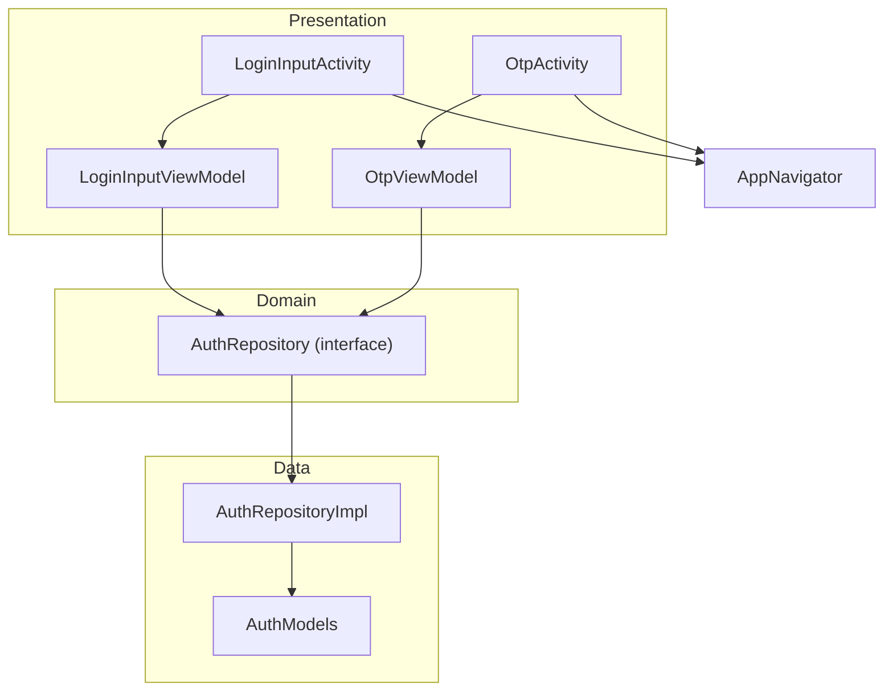
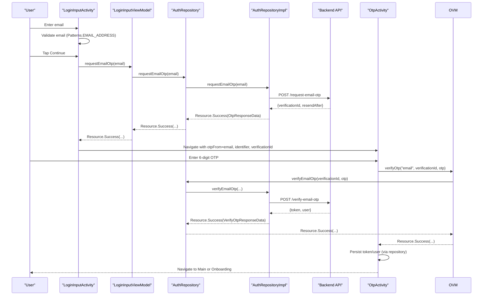
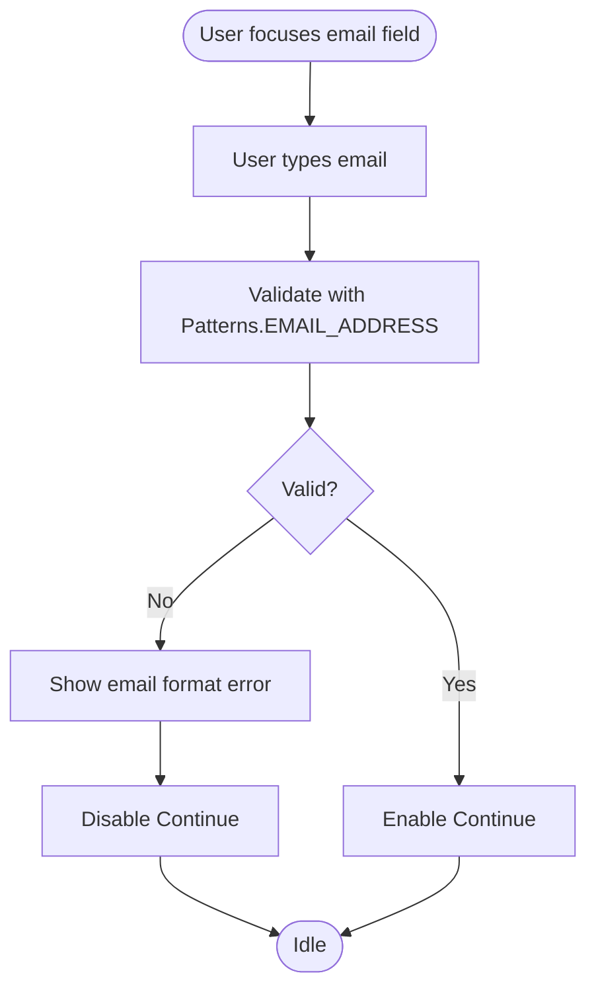
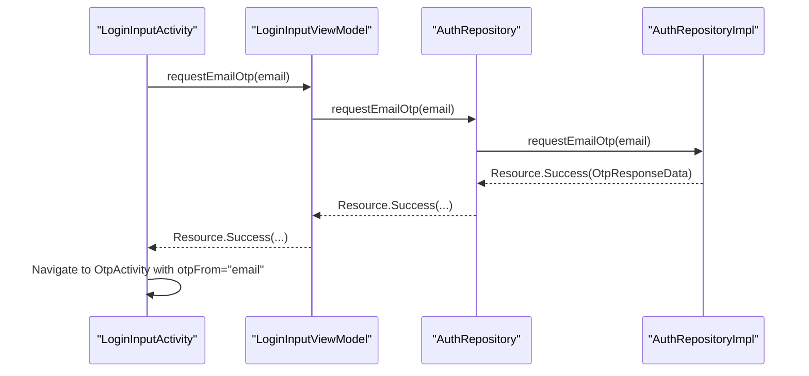
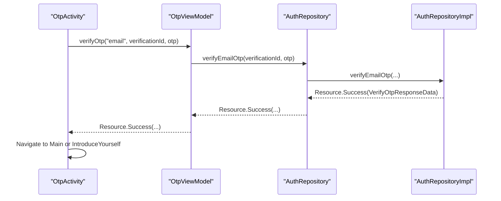
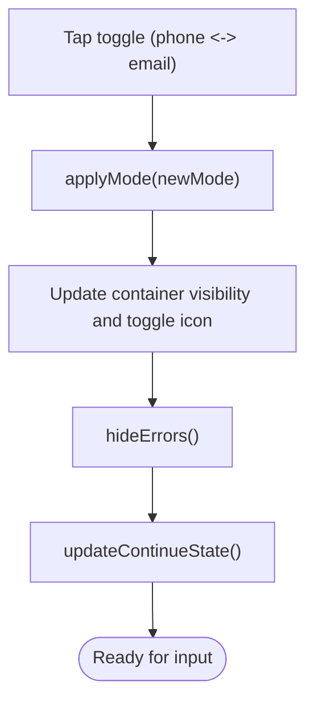
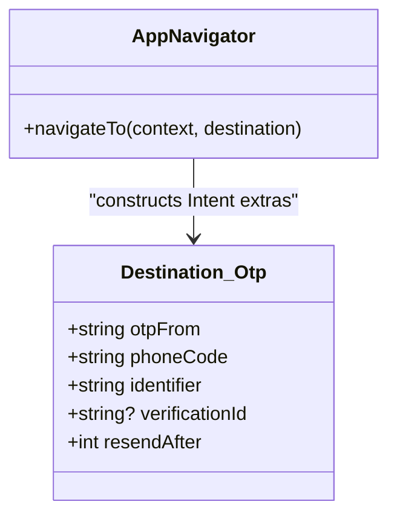
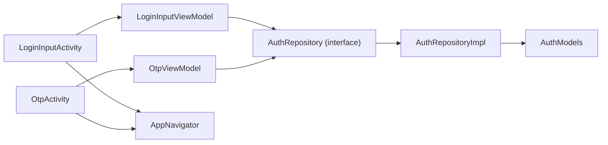

# Email Authentication

<cite>
**Referenced Files in This Document**
- [LoginInputActivity.kt](file://app/src/main/java/com/flirttime/feature/auth/presentation/login/LoginInputActivity.kt)
- [LoginInputViewModel.kt](file://app/src/main/java/com/flirttime/feature/auth/presentation/login/LoginInputViewModel.kt)
- [OtpActivity.kt](file://app/src/main/java/com/flirttime/feature/auth/presentation/otp/OtpActivity.kt)
- [OtpViewModel.kt](file://app/src/main/java/com/flirttime/feature/auth/presentation/otp/OtpViewModel.kt)
- [AuthRepository.kt](file://app/src/main/java/com/flirttime/feature/auth/domain/repository/AuthRepository.kt)
- [AuthRepositoryImpl.kt](file://app/src/main/java/com/flirttime/feature/auth/data/repository/AuthRepositoryImpl.kt)
- [AuthModels.kt](file://app/src/main/java/com/flirttime/feature/auth/data/model/AuthModels.kt)
- [AppNavigator.kt](file://app/src/main/java/com/flirttime/core/navigation/AppNavigator.kt)
</cite>

## Table of Contents
1. [Introduction](#introduction)
2. [Project Structure](#project-structure)
3. [Core Components](#core-components)
4. [Architecture Overview](#architecture-overview)
5. [Detailed Component Analysis](#detailed-component-analysis)
6. [Dependency Analysis](#dependency-analysis)
7. [Performance Considerations](#performance-considerations)
8. [Troubleshooting Guide](#troubleshooting-guide)
9. [Conclusion](#conclusion)

## Introduction
This document explains the email authentication flow in Flirttime-Otp-Android, focusing on:
- Unified login screen with phone/email toggle
- Email input validation using Android’s built-in pattern matching
- OTP request and verification for email addresses
- UI state management during mode switching and OTP verification
- Security considerations and accessibility features

The implementation follows a clean architecture with presentation (Activities + ViewModels), domain repository interface, and data repository implementation.

## Project Structure
The email authentication spans two main screens:
- LoginInputActivity: unified entry for phone or email, including validation and OTP request
- OtpActivity: OTP entry, resend timer, and verification flow

**Diagram sources**
- [LoginInputActivity.kt:45-103](file://app/src/main/java/com/flirttime/feature/auth/presentation/login/LoginInputActivity.kt#L45-L103)
- [LoginInputViewModel.kt:14-58](file://app/src/main/java/com/flirttime/feature/auth/presentation/login/LoginInputViewModel.kt#L14-L58)
- [OtpActivity.kt:45-78](file://app/src/main/java/com/flirttime/feature/auth/presentation/otp/OtpActivity.kt#L45-L78)
- [OtpViewModel.kt:14-57](file://app/src/main/java/com/flirttime/feature/auth/presentation/otp/OtpViewModel.kt#L14-L57)
- [AuthRepository.kt:10-52](file://app/src/main/java/com/flirttime/feature/auth/domain/repository/AuthRepository.kt#L10-L52)
- [AuthRepositoryImpl.kt:23-142](file://app/src/main/java/com/flirttime/feature/auth/data/repository/AuthRepositoryImpl.kt#L23-L142)
- [AuthModels.kt:6-37](file://app/src/main/java/com/flirttime/feature/auth/data/model/AuthModels.kt#L6-L37)
- [AppNavigator.kt:19-56](file://app/src/main/java/com/flirttime/core/navigation/AppNavigator.kt#L19-L56)

**Section sources**
- [LoginInputActivity.kt:45-103](file://app/src/main/java/com/flirttime/feature/auth/presentation/login/LoginInputActivity.kt#L45-L103)
- [OtpActivity.kt:45-78](file://app/src/main/java/com/flirttime/feature/auth/presentation/otp/OtpActivity.kt#L45-L78)
- [AppNavigator.kt:19-56](file://app/src/main/java/com/flirttime/core/navigation/AppNavigator.kt#L19-L56)

## Core Components
- LoginInputActivity: Unified phone/email entry screen; handles input validation, mode toggle, privacy policy link, and triggers OTP requests via ViewModel.
- LoginInputViewModel: Exposes StateFlow for OTP request results and delegates to AuthRepository.
- OtpActivity: OTP entry screen; supports resend timer, error handling, and navigates to app after successful verification.
- OtpViewModel: Delegates verify/resend operations to AuthRepository based on otpFrom (email or phone).
- AuthRepository (interface): Defines contract for OTP request, verify, resend for both phone and email.
- AuthRepositoryImpl: Implements network calls and persists tokens/user info on success.
- AuthModels: Data classes for OTP requests/responses and user data.
- AppNavigator: Centralized navigation with typed destinations and extras.

Key responsibilities:
- Email validation uses Android Patterns.EMAIL_ADDRESS.
- Mode toggle switches between phone and email fields and updates UI state.
- OTP request flows from Activity -> ViewModel -> Repository -> API -> back to UI via StateFlow.

**Section sources**
- [LoginInputActivity.kt:163-211](file://app/src/main/java/com/flirttime/feature/auth/presentation/login/LoginInputActivity.kt#L163-L211)
- [LoginInputViewModel.kt:39-57](file://app/src/main/java/com/flirttime/feature/auth/presentation/login/LoginInputViewModel.kt#L39-L57)
- [OtpActivity.kt:142-153](file://app/src/main/java/com/flirttime/feature/auth/presentation/otp/OtpActivity.kt#L142-L153)
- [OtpViewModel.kt:24-47](file://app/src/main/java/com/flirttime/feature/auth/presentation/otp/OtpViewModel.kt#L24-L47)
- [AuthRepository.kt:10-52](file://app/src/main/java/com/flirttime/feature/auth/domain/repository/AuthRepository.kt#L10-L52)
- [AuthRepositoryImpl.kt:87-142](file://app/src/main/java/com/flirttime/feature/auth/data/repository/AuthRepositoryImpl.kt#L87-L142)
- [AuthModels.kt:6-37](file://app/src/main/java/com/flirttime/feature/auth/data/model/AuthModels.kt#L6-L37)
- [AppNavigator.kt:31-37](file://app/src/main/java/com/flirttime/core/navigation/AppNavigator.kt#L31-L37)

## Architecture Overview
The email authentication flow is layered:
- Presentation layer (Activities) manage UI state and user interactions.
- ViewModels encapsulate business logic and expose StateFlow for UI observation.
- Domain layer defines repository contracts.
- Data layer implements repository and performs network calls, returning Resource-wrapped Flow.

**Diagram sources**
- [LoginInputActivity.kt:312-339](file://app/src/main/java/com/flirttime/feature/auth/presentation/login/LoginInputActivity.kt#L312-L339)
- [LoginInputActivity.kt:342-385](file://app/src/main/java/com/flirttime/feature/auth/presentation/login/LoginInputActivity.kt#L342-L385)
- [LoginInputViewModel.kt:47-53](file://app/src/main/java/com/flirttime/feature/auth/presentation/login/LoginInputViewModel.kt#L47-L53)
- [AuthRepositoryImpl.kt:87-95](file://app/src/main/java/com/flirttime/feature/auth/data/repository/AuthRepositoryImpl.kt#L87-L95)
- [AuthRepositoryImpl.kt:97-132](file://app/src/main/java/com/flirttime/feature/auth/data/repository/AuthRepositoryImpl.kt#L97-L132)
- [OtpActivity.kt:315-343](file://app/src/main/java/com/flirttime/feature/auth/presentation/otp/OtpActivity.kt#L315-L343)
- [OtpActivity.kt:346-413](file://app/src/main/java/com/flirttime/feature/auth/presentation/otp/OtpActivity.kt#L346-L413)
- [OtpViewModel.kt:24-47](file://app/src/main/java/com/flirttime/feature/auth/presentation/otp/OtpViewModel.kt#L24-L47)

## Detailed Component Analysis

### Email Input Validation and Toggle Mechanism
- The unified screen toggles between phone and email modes.
- Email validation uses Android’s Patterns.EMAIL_ADDRESS matcher.
- Continue button is enabled only when the current input is valid and no request is in progress.
- Error messages are shown inline per mode.

**Diagram sources**
- [LoginInputActivity.kt:168-188](file://app/src/main/java/com/flirttime/feature/auth/presentation/login/LoginInputActivity.kt#L168-L188)
- [LoginInputActivity.kt:204-217](file://app/src/main/java/com/flirttime/feature/auth/presentation/login/LoginInputActivity.kt#L204-L217)
- [LoginInputActivity.kt:226-241](file://app/src/main/java/com/flirttime/feature/auth/presentation/login/LoginInputActivity.kt#L226-L241)

**Section sources**
- [LoginInputActivity.kt:190-211](file://app/src/main/java/com/flirttime/feature/auth/presentation/login/LoginInputActivity.kt#L190-L211)
- [LoginInputActivity.kt:213-241](file://app/src/main/java/com/flirttime/feature/auth/presentation/login/LoginInputActivity.kt#L213-L241)

### OTP Request Process for Email Addresses
- When Continue is tapped with a valid email, the Activity calls ViewModel.requestEmailOtp.
- ViewModel emits Resource states via StateFlow.
- On success, the Activity navigates to OtpActivity with otpFrom="email".

**Diagram sources**
- [LoginInputActivity.kt:312-339](file://app/src/main/java/com/flirttime/feature/auth/presentation/login/LoginInputActivity.kt#L312-L339)
- [LoginInputActivity.kt:342-385](file://app/src/main/java/com/flirttime/feature/auth/presentation/login/LoginInputActivity.kt#L342-L385)
- [LoginInputViewModel.kt:47-53](file://app/src/main/java/com/flirttime/feature/auth/presentation/login/LoginInputViewModel.kt#L47-L53)
- [AuthRepositoryImpl.kt:87-95](file://app/src/main/java/com/flirttime/feature/auth/data/repository/AuthRepositoryImpl.kt#L87-L95)

**Section sources**
- [LoginInputActivity.kt:312-385](file://app/src/main/java/com/flirttime/feature/auth/presentation/login/LoginInputActivity.kt#L312-L385)
- [LoginInputViewModel.kt:47-53](file://app/src/main/java/com/flirttime/feature/auth/presentation/login/LoginInputViewModel.kt#L47-L53)
- [AuthRepositoryImpl.kt:87-95](file://app/src/main/java/com/flirttime/feature/auth/data/repository/AuthRepositoryImpl.kt#L87-L95)

### OTP Verification for Email Addresses
- OtpActivity reads otpFrom="email" and displays appropriate messaging.
- On OTP complete, it calls OtpViewModel.verifyOtp which routes to verifyEmailOtp.
- On success, token and user data are persisted by the repository and navigation proceeds.

**Diagram sources**
- [OtpActivity.kt:315-343](file://app/src/main/java/com/flirttime/feature/auth/presentation/otp/OtpActivity.kt#L315-L343)
- [OtpActivity.kt:346-413](file://app/src/main/java/com/flirttime/feature/auth/presentation/otp/OtpActivity.kt#L346-L413)
- [OtpViewModel.kt:24-47](file://app/src/main/java/com/flirttime/feature/auth/presentation/otp/OtpViewModel.kt#L24-L47)
- [AuthRepositoryImpl.kt:97-132](file://app/src/main/java/com/flirttime/feature/auth/data/repository/AuthRepositoryImpl.kt#L97-L132)

**Section sources**
- [OtpActivity.kt:142-153](file://app/src/main/java/com/flirttime/feature/auth/presentation/otp/OtpActivity.kt#L142-L153)
- [OtpActivity.kt:315-413](file://app/src/main/java/com/flirttime/feature/auth/presentation/otp/OtpActivity.kt#L315-L413)
- [OtpViewModel.kt:24-47](file://app/src/main/java/com/flirttime/feature/auth/presentation/otp/OtpViewModel.kt#L24-L47)
- [AuthRepositoryImpl.kt:97-132](file://app/src/main/java/com/flirttime/feature/auth/data/repository/AuthRepositoryImpl.kt#L97-L132)

### UI State Management During Mode Switching
- applyMode toggles visibility of phone/email containers and updates the toggle icon.
- hideErrors clears previous errors when switching modes.
- updateContinueState disables Continue while a request is in progress.

**Diagram sources**
- [LoginInputActivity.kt:190-202](file://app/src/main/java/com/flirttime/feature/auth/presentation/login/LoginInputActivity.kt#L190-L202)
- [LoginInputActivity.kt:213-224](file://app/src/main/java/com/flirttime/feature/auth/presentation/login/LoginInputActivity.kt#L213-L224)
- [LoginInputActivity.kt:226-241](file://app/src/main/java/com/flirttime/feature/auth/presentation/login/LoginInputActivity.kt#L226-L241)

**Section sources**
- [LoginInputActivity.kt:190-241](file://app/src/main/java/com/flirttime/feature/auth/presentation/login/LoginInputActivity.kt#L190-L241)

### Integration with Unified Login Interface
- Navigation to OtpActivity uses AppNavigator.Destination.Otp with otpFrom set to "email" or "mobile".
- Intent extras include phoneCode, identifier, verificationId, and resendAfter.

**Diagram sources**
- [AppNavigator.kt:31-37](file://app/src/main/java/com/flirttime/core/navigation/AppNavigator.kt#L31-L37)
- [AppNavigator.kt:105-111](file://app/src/main/java/com/flirttime/core/navigation/AppNavigator.kt#L105-L111)

**Section sources**
- [AppNavigator.kt:31-37](file://app/src/main/java/com/flirttime/core/navigation/AppNavigator.kt#L31-L37)
- [AppNavigator.kt:105-111](file://app/src/main/java/com/flirttime/core/navigation/AppNavigator.kt#L105-L111)

## Dependency Analysis
The following diagram shows how components depend on each other across layers.

**Diagram sources**
- [LoginInputActivity.kt:45-103](file://app/src/main/java/com/flirttime/feature/auth/presentation/login/LoginInputActivity.kt#L45-L103)
- [LoginInputViewModel.kt:14-58](file://app/src/main/java/com/flirttime/feature/auth/presentation/login/LoginInputViewModel.kt#L14-L58)
- [OtpActivity.kt:45-78](file://app/src/main/java/com/flirttime/feature/auth/presentation/otp/OtpActivity.kt#L45-L78)
- [OtpViewModel.kt:14-57](file://app/src/main/java/com/flirttime/feature/auth/presentation/otp/OtpViewModel.kt#L14-L57)
- [AuthRepository.kt:10-52](file://app/src/main/java/com/flirttime/feature/auth/domain/repository/AuthRepository.kt#L10-L52)
- [AuthRepositoryImpl.kt:23-142](file://app/src/main/java/com/flirttime/feature/auth/data/repository/AuthRepositoryImpl.kt#L23-L142)
- [AuthModels.kt:6-37](file://app/src/main/java/com/flirttime/feature/auth/data/model/AuthModels.kt#L6-L37)
- [AppNavigator.kt:19-56](file://app/src/main/java/com/flirttime/core/navigation/AppNavigator.kt#L19-L56)

**Section sources**
- [AuthRepository.kt:10-52](file://app/src/main/java/com/flirttime/feature/auth/domain/repository/AuthRepository.kt#L10-L52)
- [AuthRepositoryImpl.kt:23-142](file://app/src/main/java/com/flirttime/feature/auth/data/repository/AuthRepositoryImpl.kt#L23-L142)

## Performance Considerations
- Network I/O runs on Dispatchers.IO within repository methods to avoid blocking the main thread.
- UI observes StateFlow under Lifecycle.State.STARTED to minimize unnecessary work.
- Resend timer uses CountDownTimer and resets on activity lifecycle changes.

[No sources needed since this section provides general guidance]

## Troubleshooting Guide
Common issues and resolutions:
- Invalid email format: Ensure the input matches Android’s EMAIL_ADDRESS pattern before requesting OTP.
- Continue disabled: Check that the input is valid and no request is in progress.
- OTP verification fails: Verify the entered OTP length is 6 digits and retry; check server response message.
- Resend not available: Wait until the countdown timer completes before tapping resend.

**Section sources**
- [LoginInputActivity.kt:204-241](file://app/src/main/java/com/flirttime/feature/auth/presentation/login/LoginInputActivity.kt#L204-L241)
- [OtpActivity.kt:308-343](file://app/src/main/java/com/flirttime/feature/auth/presentation/otp/OtpActivity.kt#L308-L343)
- [OtpActivity.kt:346-413](file://app/src/main/java/com/flirttime/feature/auth/presentation/otp/OtpActivity.kt#L346-L413)

## Conclusion
The email authentication flow in Flirttime-Otp-Android provides a seamless experience:
- Robust email validation using Android’s built-in pattern matcher
- Clean toggle between phone and email modes with consistent UI state
- Secure OTP request and verification with proper resource management
- Clear navigation integration through AppNavigator
- Thoughtful error handling and user feedback throughout the process

[No sources needed since this section summarizes without analyzing specific files]