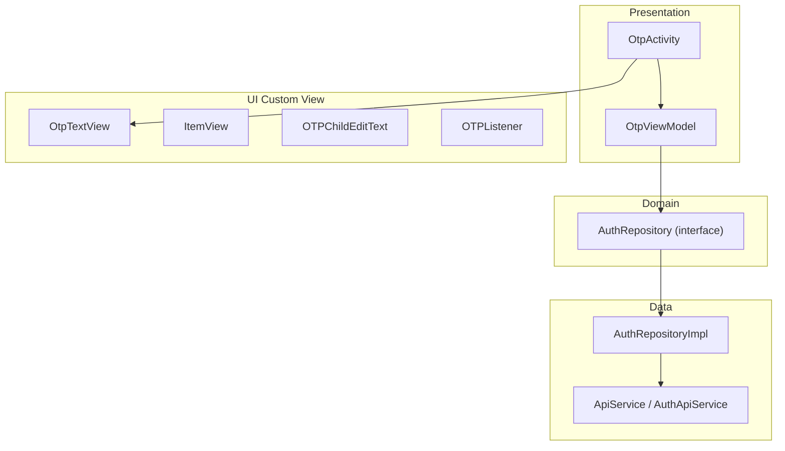
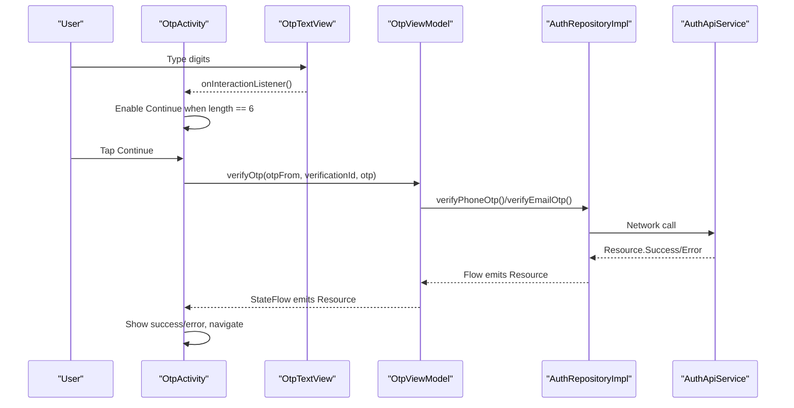
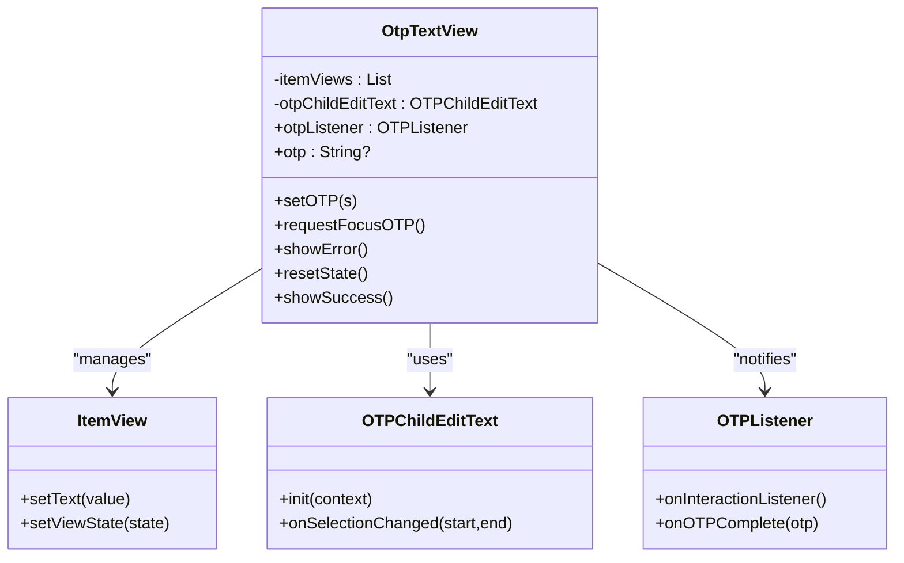
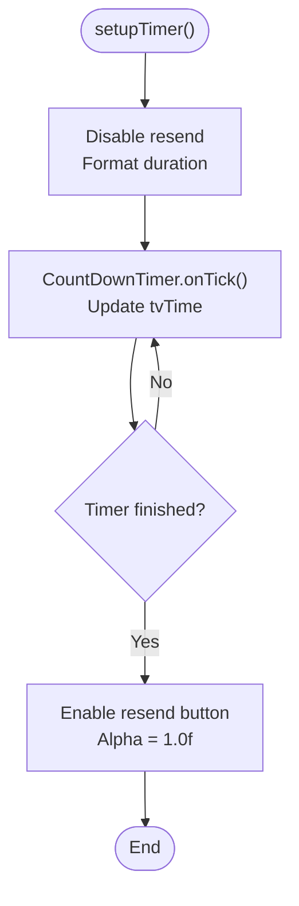
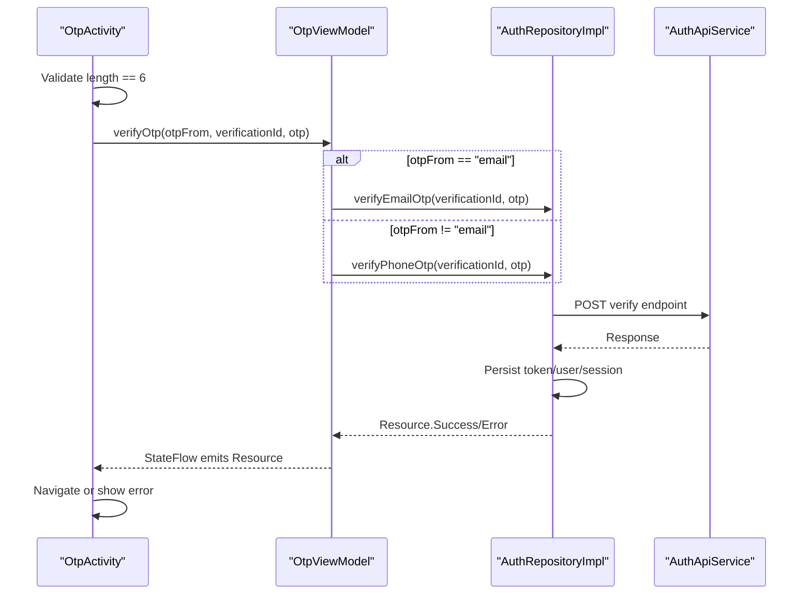
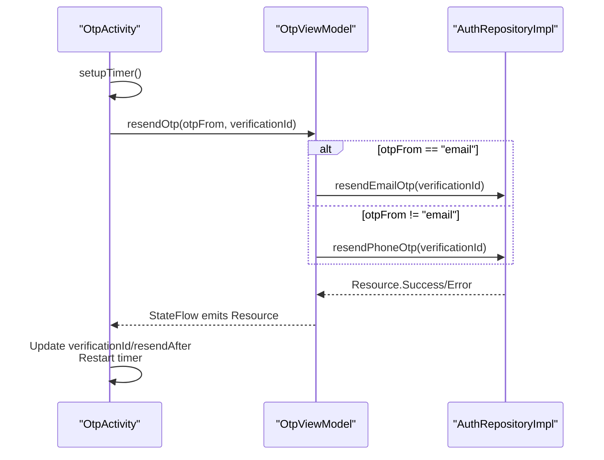
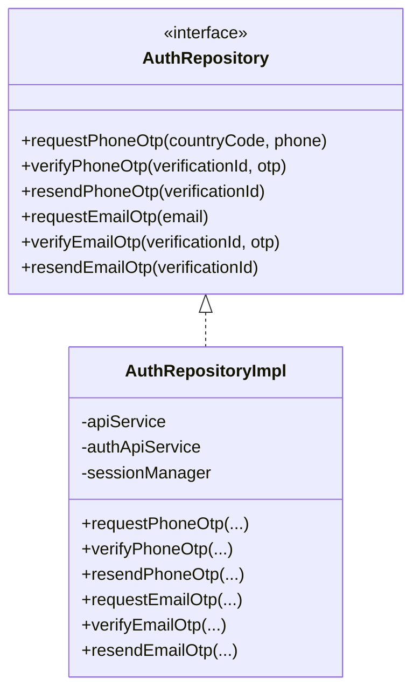
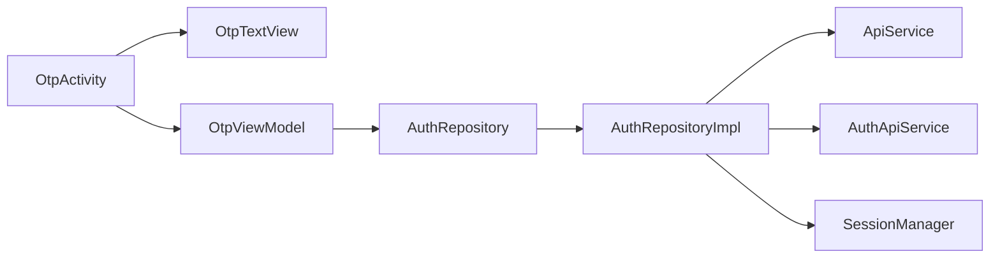

# OTP Verification

<cite>
**Referenced Files in This Document**
- [OtpTextView.kt](file://app/src/main/java/com/flirttime/core/ui/otpview/OtpTextView.kt)
- [ItemView.kt](file://app/src/main/java/com/flirttime/core/ui/otpview/ItemView.kt)
- [OTPChildEditText.kt](file://app/src/main/java/com/flirttime/core/ui/otpview/OTPChildEditText.kt)
- [OTPListener.kt](file://app/src/main/java/com/flirttime/core/ui/otpview/OTPListener.kt)
- [Utils.kt](file://app/src/main/java/com/flirttime/core/ui/otpview/Utils.kt)
- [OtpActivity.kt](file://app/src/main/java/com/flirttime/feature/auth/presentation/otp/OtpActivity.kt)
- [OtpViewModel.kt](file://app/src/main/java/com/flirttime/feature/auth/presentation/otp/OtpViewModel.kt)
- [AuthRepository.kt](file://app/src/main/java/com/flirttime/feature/auth/domain/repository/AuthRepository.kt)
- [AuthRepositoryImpl.kt](file://app/src/main/java/com/flirttime/feature/auth/data/repository/AuthRepositoryImpl.kt)
</cite>

## Table of Contents
1. [Introduction](#introduction)
2. [Project Structure](#project-structure)
3. [Core Components](#core-components)
4. [Architecture Overview](#architecture-overview)
5. [Detailed Component Analysis](#detailed-component-analysis)
6. [Dependency Analysis](#dependency-analysis)
7. [Performance Considerations](#performance-considerations)
8. [Troubleshooting Guide](#troubleshooting-guide)
9. [Conclusion](#conclusion)

## Introduction
This document explains the OTP verification system in Flirttime-Otp-Android, focusing on:
- The custom OTP input component (OtpTextView) and its behavior
- OTP code validation and auto-focus management
- Timer management for resend functionality
- Verification API integration via ViewModel and Repository
- Error handling for invalid codes and success navigation
- Security measures and user experience optimizations

The implementation supports both phone and email OTP flows with a consistent UI and robust state handling.

## Project Structure
The OTP feature spans three layers:
- Presentation layer: Activity and ViewModel
- Domain layer: Repository interface
- Data layer: Repository implementation and network calls

**Diagram sources**
- [OtpActivity.kt:45-78](file://app/src/main/java/com/flirttime/feature/auth/presentation/otp/OtpActivity.kt#L45-L78)
- [OtpViewModel.kt:14-48](file://app/src/main/java/com/flirttime/feature/auth/presentation/otp/OtpViewModel.kt#L14-L48)
- [AuthRepository.kt:10-51](file://app/src/main/java/com/flirttime/feature/auth/domain/repository/AuthRepository.kt#L10-L51)
- [AuthRepositoryImpl.kt:23-142](file://app/src/main/java/com/flirttime/feature/auth/data/repository/AuthRepositoryImpl.kt#L23-L142)
- [OtpTextView.kt:19-46](file://app/src/main/java/com/flirttime/core/ui/otpview/OtpTextView.kt#L19-L46)

**Section sources**
- [OtpActivity.kt:45-78](file://app/src/main/java/com/flirttime/feature/auth/presentation/otp/OtpActivity.kt#L45-L78)
- [OtpViewModel.kt:14-48](file://app/src/main/java/com/flirttime/feature/auth/presentation/otp/OtpViewModel.kt#L14-L48)
- [AuthRepository.kt:10-51](file://app/src/main/java/com/flirttime/feature/auth/domain/repository/AuthRepository.kt#L10-L51)
- [AuthRepositoryImpl.kt:23-142](file://app/src/main/java/com/flirttime/feature/auth/data/repository/AuthRepositoryImpl.kt#L23-L142)

## Core Components
- OtpTextView: Custom multi-digit OTP input with visual states, input filtering, focus management, and listener callbacks.
- ItemView: Visual representation of each OTP digit box with active/inactive/error/success states.
- OTPChildEditText: Hidden numeric input that captures keystrokes and enforces selection at the end.
- OTPListener: Callback interface for OTP interaction and completion events.
- Utils: Density conversion helpers used by the view.
- OtpActivity: Orchestrates UI, timer, and user actions; integrates with ViewModel.
- OtpViewModel: Manages verification and resend flows using StateFlow and repository methods.
- AuthRepository/AuthRepositoryImpl: Defines and implements OTP operations, persisting session data upon successful verification.

**Section sources**
- [OtpTextView.kt:19-308](file://app/src/main/java/com/flirttime/core/ui/otpview/OtpTextView.kt#L19-L308)
- [ItemView.kt:16-229](file://app/src/main/java/com/flirttime/core/ui/otpview/ItemView.kt#L16-L229)
- [OTPChildEditText.kt:8-46](file://app/src/main/java/com/flirttime/core/ui/otpview/OTPChildEditText.kt#L8-L46)
- [OTPListener.kt:3-13](file://app/src/main/java/com/flirttime/core/ui/otpview/OTPListener.kt#L3-L13)
- [Utils.kt:6-29](file://app/src/main/java/com/flirttime/core/ui/otpview/Utils.kt#L6-L29)
- [OtpActivity.kt:45-418](file://app/src/main/java/com/flirttime/feature/auth/presentation/otp/OtpActivity.kt#L45-L418)
- [OtpViewModel.kt:14-57](file://app/src/main/java/com/flirttime/feature/auth/presentation/otp/OtpViewModel.kt#L14-L57)
- [AuthRepository.kt:10-51](file://app/src/main/java/com/flirttime/feature/auth/domain/repository/AuthRepository.kt#L10-L51)
- [AuthRepositoryImpl.kt:23-142](file://app/src/main/java/com/flirttime/feature/auth/data/repository/AuthRepositoryImpl.kt#L23-L142)

## Architecture Overview
The OTP flow follows a layered architecture:
- UI (OtpActivity) collects OTP input via OtpTextView and triggers verification or resend.
- ViewModel (OtpViewModel) switches between phone/email flows and exposes StateFlow for UI observation.
- Repository (AuthRepositoryImpl) performs network calls and persists session data on success.

**Diagram sources**
- [OtpActivity.kt:200-223](file://app/src/main/java/com/flirttime/feature/auth/presentation/otp/OtpActivity.kt#L200-L223)
- [OtpActivity.kt:315-330](file://app/src/main/java/com/flirttime/feature/auth/presentation/otp/OtpActivity.kt#L315-L330)
- [OtpViewModel.kt:24-35](file://app/src/main/java/com/flirttime/feature/auth/presentation/otp/OtpViewModel.kt#L24-L35)
- [AuthRepositoryImpl.kt:40-75](file://app/src/main/java/com/flirttime/feature/auth/data/repository/AuthRepositoryImpl.kt#L40-L75)
- [AuthRepositoryImpl.kt:97-132](file://app/src/main/java/com/flirttime/feature/auth/data/repository/AuthRepositoryImpl.kt#L97-L132)

## Detailed Component Analysis

### Custom OTP Input Component (OtpTextView)
OtpTextView composes multiple ItemView boxes and a hidden OTPChildEditText to capture input. It provides:
- Configurable length and styling via attributes
- Numeric-only input filtering
- Auto-focus management across boxes
- Visual states: inactive, active, error, success
- Listener callbacks for interaction and completion

Key behaviors:
- Input filtering ensures only digits are accepted.
- TextWatcher updates the visual state and notifies listeners.
- Focus detection highlights the current field and manages next-field activation.
- Methods exist to set OTP programmatically, show error/success, and reset state.

**Diagram sources**
- [OtpTextView.kt:19-308](file://app/src/main/java/com/flirttime/core/ui/otpview/OtpTextView.kt#L19-L308)
- [ItemView.kt:16-229](file://app/src/main/java/com/flirttime/core/ui/otpview/ItemView.kt#L16-L229)
- [OTPChildEditText.kt:8-46](file://app/src/main/java/com/flirttime/core/ui/otpview/OTPChildEditText.kt#L8-L46)
- [OTPListener.kt:3-13](file://app/src/main/java/com/flirttime/core/ui/otpview/OTPListener.kt#L3-L13)

**Section sources**
- [OtpTextView.kt:27-45](file://app/src/main/java/com/flirttime/core/ui/otpview/OtpTextView.kt#L27-L45)
- [OtpTextView.kt:153-186](file://app/src/main/java/com/flirttime/core/ui/otpview/OtpTextView.kt#L153-L186)
- [OtpTextView.kt:191-246](file://app/src/main/java/com/flirttime/core/ui/otpview/OtpTextView.kt#L191-L246)
- [OtpTextView.kt:248-288](file://app/src/main/java/com/flirttime/core/ui/otpview/OtpTextView.kt#L248-L288)
- [ItemView.kt:178-218](file://app/src/main/java/com/flirttime/core/ui/otpview/ItemView.kt#L178-L218)
- [OTPChildEditText.kt:26-46](file://app/src/main/java/com/flirttime/core/ui/otpview/OTPChildEditText.kt#L26-L46)

### OTP Code Validation and Auto-Focus Management
Validation and UX:
- Only numeric characters are allowed via an InputFilter pattern.
- Length is enforced by a LengthFilter matching the configured OTP length.
- Auto-focus moves to the next box as the user types and highlights the active field.
- When focus returns to the EditText, the active box reflects the current cursor position.

Auto-focus logic:
- If only the next field should be active, it highlights exactly the current index.
- Otherwise, all fields after the current index become active to indicate remaining slots.

**Section sources**
- [OtpTextView.kt:27-41](file://app/src/main/java/com/flirttime/core/ui/otpview/OtpTextView.kt#L27-L41)
- [OtpTextView.kt:122-126](file://app/src/main/java/com/flirttime/core/ui/otpview/OtpTextView.kt#L122-L126)
- [OtpTextView.kt:191-246](file://app/src/main/java/com/flirttime/core/ui/otpview/OtpTextView.kt#L191-L246)

### Timer Management for Resend Functionality
The activity manages a countdown timer for resending OTPs:
- On start, disables the resend button and formats the initial time.
- Updates the displayed time every second.
- Enables the resend button when the timer finishes.
- Resets the timer when a new OTP is resent.

**Diagram sources**
- [OtpActivity.kt:225-249](file://app/src/main/java/com/flirttime/feature/auth/presentation/otp/OtpActivity.kt#L225-L249)

**Section sources**
- [OtpActivity.kt:225-249](file://app/src/main/java/com/flirttime/feature/auth/presentation/otp/OtpActivity.kt#L225-L249)

### Verification Process Flow
The verification process:
- Activity listens for OTP completion and enables the Continue button when the length equals six.
- On Continue, hides the keyboard, validates length, and calls ViewModel.verifyOtp.
- ViewModel selects phone or email verification based on otpFrom and emits results via StateFlow.
- Repository performs the network call and persists session data on success.
- Activity observes StateFlow to handle loading, success, and error states.

**Diagram sources**
- [OtpActivity.kt:315-330](file://app/src/main/java/com/flirttime/feature/auth/presentation/otp/OtpActivity.kt#L315-L330)
- [OtpViewModel.kt:24-35](file://app/src/main/java/com/flirttime/feature/auth/presentation/otp/OtpViewModel.kt#L24-L35)
- [AuthRepositoryImpl.kt:40-75](file://app/src/main/java/com/flirttime/feature/auth/data/repository/AuthRepositoryImpl.kt#L40-L75)
- [AuthRepositoryImpl.kt:97-132](file://app/src/main/java/com/flirttime/feature/auth/data/repository/AuthRepositoryImpl.kt#L97-L132)

**Section sources**
- [OtpActivity.kt:315-330](file://app/src/main/java/com/flirttime/feature/auth/presentation/otp/OtpActivity.kt#L315-L330)
- [OtpViewModel.kt:24-35](file://app/src/main/java/com/flirttime/feature/auth/presentation/otp/OtpViewModel.kt#L24-L35)
- [AuthRepositoryImpl.kt:40-75](file://app/src/main/java/com/flirttime/feature/auth/data/repository/AuthRepositoryImpl.kt#L40-L75)
- [AuthRepositoryImpl.kt:97-132](file://app/src/main/java/com/flirttime/feature/auth/data/repository/AuthRepositoryImpl.kt#L97-L132)

### Resend OTP Functionality
Resend flow:
- Activity sets up a countdown timer and disables the resend button until the timer completes.
- On resend click, calls ViewModel.resendOtp which delegates to the appropriate repository method.
- On success, updates verificationId and resendAfter, shows a toast, resets state, and restarts the timer.
- On error, re-enables the resend button and displays an error message.

**Diagram sources**
- [OtpActivity.kt:225-249](file://app/src/main/java/com/flirttime/feature/auth/presentation/otp/OtpActivity.kt#L225-L249)
- [OtpActivity.kt:332-338](file://app/src/main/java/com/flirttime/feature/auth/presentation/otp/OtpActivity.kt#L332-L338)
- [OtpViewModel.kt:37-48](file://app/src/main/java/com/flirttime/feature/auth/presentation/otp/OtpViewModel.kt#L37-L48)
- [AuthRepositoryImpl.kt:77-85](file://app/src/main/java/com/flirttime/feature/auth/data/repository/AuthRepositoryImpl.kt#L77-L85)
- [AuthRepositoryImpl.kt:134-142](file://app/src/main/java/com/flirttime/feature/auth/data/repository/AuthRepositoryImpl.kt#L134-L142)

**Section sources**
- [OtpActivity.kt:225-249](file://app/src/main/java/com/flirttime/feature/auth/presentation/otp/OtpActivity.kt#L225-L249)
- [OtpActivity.kt:332-338](file://app/src/main/java/com/flirttime/feature/auth/presentation/otp/OtpActivity.kt#L332-L338)
- [OtpViewModel.kt:37-48](file://app/src/main/java/com/flirttime/feature/auth/presentation/otp/OtpViewModel.kt#L37-L48)
- [AuthRepositoryImpl.kt:77-85](file://app/src/main/java/com/flirttime/feature/auth/data/repository/AuthRepositoryImpl.kt#L77-L85)
- [AuthRepositoryImpl.kt:134-142](file://app/src/main/java/com/flirttime/feature/auth/data/repository/AuthRepositoryImpl.kt#L134-L142)

### Success Navigation and Error Handling
- On successful verification, the activity shows a toast, resets state, and navigates based on profile completeness:
  - Complete profile: navigate to main screen
  - Incomplete profile: navigate to introduce-yourself flow
- On error, the activity displays an error view with a message and keeps the Continue button enabled.

**Section sources**
- [OtpActivity.kt:346-384](file://app/src/main/java/com/flirttime/feature/auth/presentation/otp/OtpActivity.kt#L346-L384)
- [OtpActivity.kt:308-313](file://app/src/main/java/com/flirttime/feature/auth/presentation/otp/OtpActivity.kt#L308-L313)

### Integration with Authentication Repository
- The repository interface defines phone and email OTP request, verification, and resend methods returning Flow<Resource>.
- The implementation uses safeApiCall wrappers and persists session data (token, user info, profile flags) on successful verification.

**Diagram sources**
- [AuthRepository.kt:10-51](file://app/src/main/java/com/flirttime/feature/auth/domain/repository/AuthRepository.kt#L10-L51)
- [AuthRepositoryImpl.kt:23-142](file://app/src/main/java/com/flirttime/feature/auth/data/repository/AuthRepositoryImpl.kt#L23-L142)

**Section sources**
- [AuthRepository.kt:10-51](file://app/src/main/java/com/flirttime/feature/auth/domain/repository/AuthRepository.kt#L10-L51)
- [AuthRepositoryImpl.kt:23-142](file://app/src/main/java/com/flirttime/feature/auth/data/repository/AuthRepositoryImpl.kt#L23-L142)

## Dependency Analysis
- OtpActivity depends on:
  - OtpTextView for input collection
  - OtpViewModel for business logic and state
  - SessionManager and AppNavigator for persistence and navigation
- OtpViewModel depends on:
  - AuthRepository interface for OTP operations
- AuthRepositoryImpl depends on:
  - ApiService and AuthApiService for network calls
  - SessionManager for persisting authentication state

**Diagram sources**
- [OtpActivity.kt:45-78](file://app/src/main/java/com/flirttime/feature/auth/presentation/otp/OtpActivity.kt#L45-L78)
- [OtpViewModel.kt:14-48](file://app/src/main/java/com/flirttime/feature/auth/presentation/otp/OtpViewModel.kt#L14-L48)
- [AuthRepositoryImpl.kt:23-142](file://app/src/main/java/com/flirttime/feature/auth/data/repository/AuthRepositoryImpl.kt#L23-L142)

**Section sources**
- [OtpActivity.kt:45-78](file://app/src/main/java/com/flirttime/feature/auth/presentation/otp/OtpActivity.kt#L45-L78)
- [OtpViewModel.kt:14-48](file://app/src/main/java/com/flirttime/feature/auth/presentation/otp/OtpViewModel.kt#L14-L48)
- [AuthRepositoryImpl.kt:23-142](file://app/src/main/java/com/flirttime/feature/auth/data/repository/AuthRepositoryImpl.kt#L23-L142)

## Performance Considerations
- Input filtering and text watchers run on the UI thread; keep operations lightweight to avoid jank.
- Use CountDownTimer for timers; ensure cancellation in onDestroy to prevent leaks.
- Repository flows run on Dispatchers.IO to avoid blocking the UI thread during network calls.
- Avoid unnecessary recomposition by resetting StateFlow values after handling success/error.

[No sources needed since this section provides general guidance]

## Troubleshooting Guide
Common issues and resolutions:
- OTP not advancing automatically:
  - Ensure the length matches the configured OTP length and that the InputFilter allows digits.
  - Check that setFocus is called on text changes and focus events.
- Resend button remains disabled:
  - Verify the timer initialization and onFinish enabling the button.
  - Confirm that resend success updates resendAfter and restarts the timer.
- Verification fails repeatedly:
  - Inspect error messages from the repository and display them in the error view.
  - Ensure verificationId and otpFrom are correctly passed from intent extras.
- Keyboard overlaps content:
  - Edge-to-edge setup adjusts padding and artwork visibility based on IME insets.

**Section sources**
- [OtpTextView.kt:153-186](file://app/src/main/java/com/flirttime/core/ui/otpview/OtpTextView.kt#L153-L186)
- [OtpActivity.kt:108-129](file://app/src/main/java/com/flirttime/feature/auth/presentation/otp/OtpActivity.kt#L108-L129)
- [OtpActivity.kt:225-249](file://app/src/main/java/com/flirttime/feature/auth/presentation/otp/OtpActivity.kt#L225-L249)
- [OtpActivity.kt:346-384](file://app/src/main/java/com/flirttime/feature/auth/presentation/otp/OtpActivity.kt#L346-L384)

## Conclusion
The OTP verification system in Flirttime-Otp-Android combines a flexible custom input component with a clean MVVM architecture. OtpTextView provides robust input handling and visual feedback, while OtpActivity orchestrates timers and user interactions. OtpViewModel coordinates verification and resend flows through the AuthRepository, ensuring secure session persistence and smooth navigation. The design emphasizes usability, clear error handling, and maintainable separation of concerns.

[No sources needed since this section summarizes without analyzing specific files]