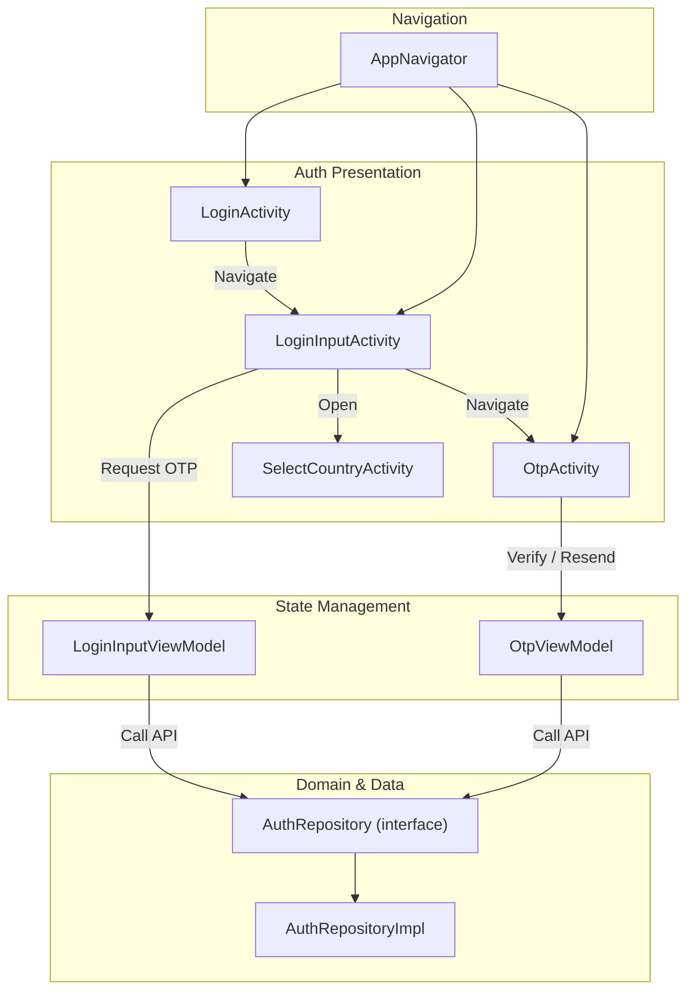
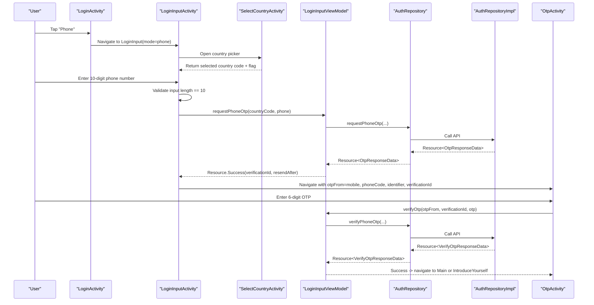
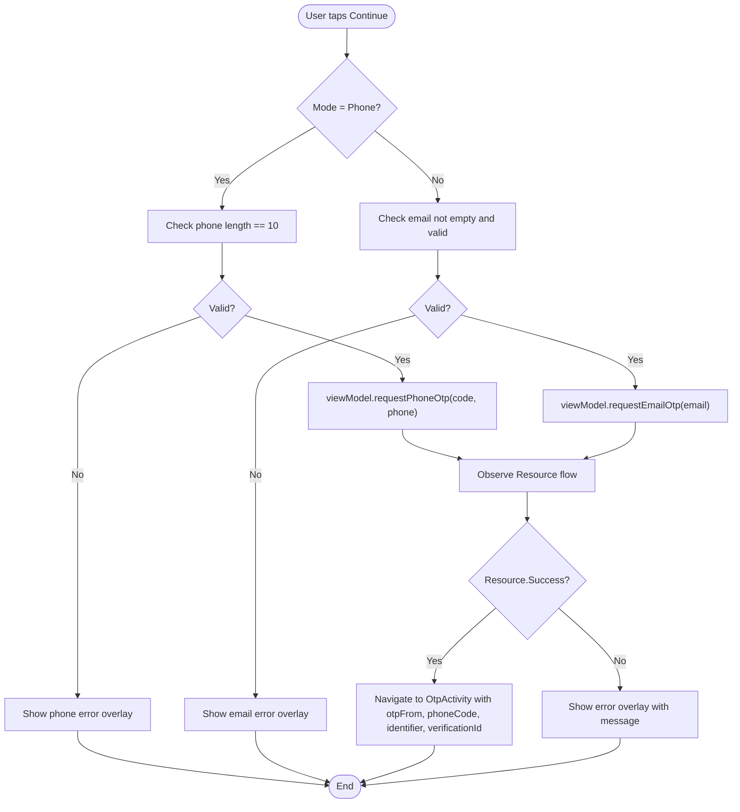
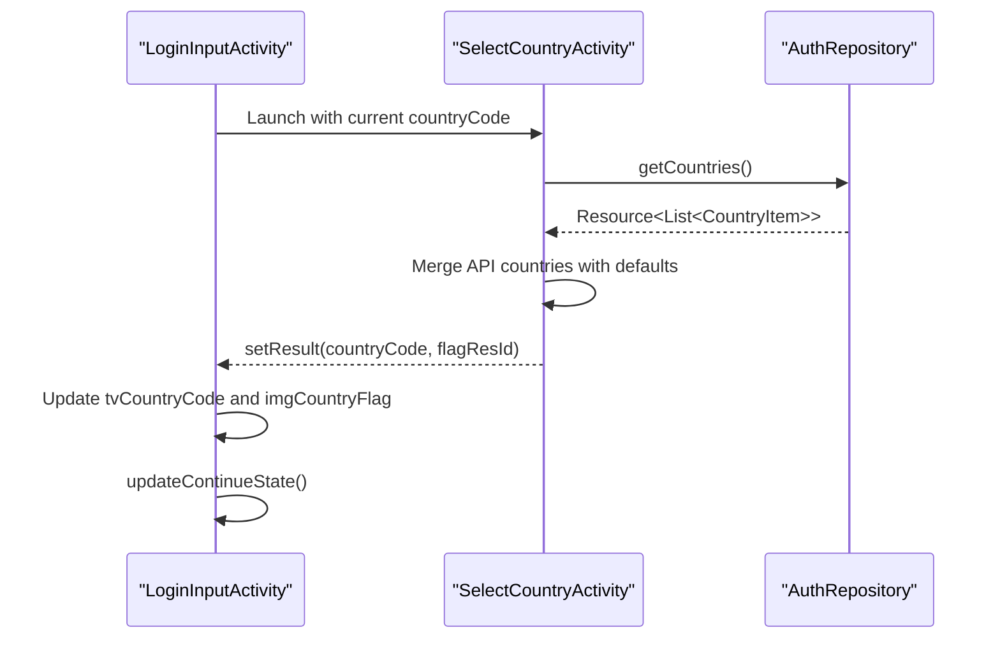
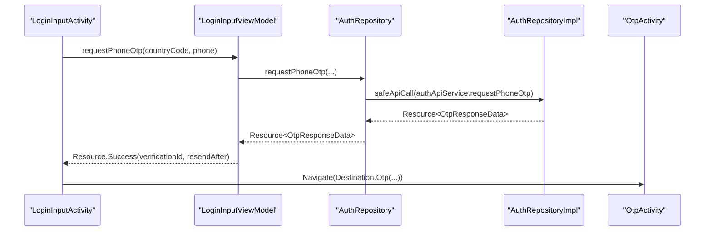
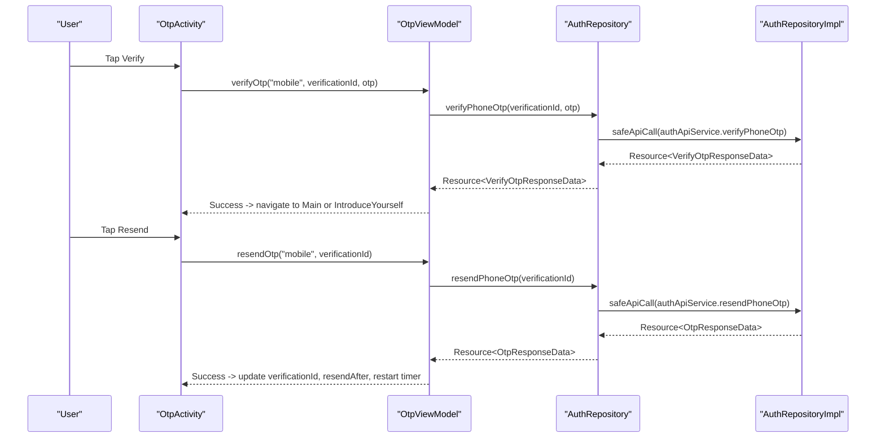
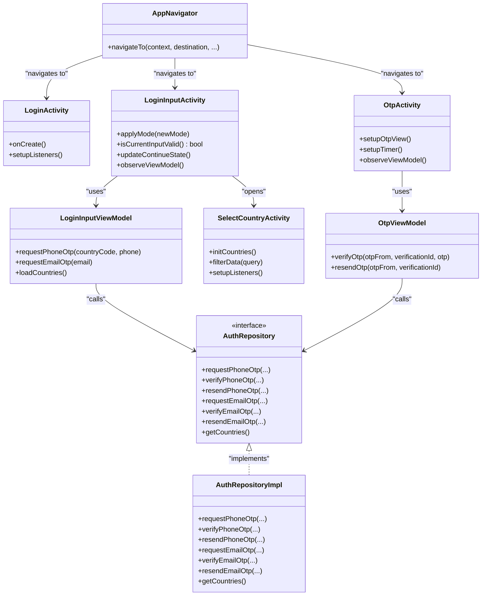

# Phone Authentication

<cite>
**Referenced Files in This Document**
- [LoginActivity.kt](file://app/src/main/java/com/flirttime/feature/auth/presentation/login/LoginActivity.kt)
- [LoginInputActivity.kt](file://app/src/main/java/com/flirttime/feature/auth/presentation/login/LoginInputActivity.kt)
- [LoginInputViewModel.kt](file://app/src/main/java/com/flirttime/feature/auth/presentation/login/LoginInputViewModel.kt)
- [OtpActivity.kt](file://app/src/main/java/com/flirttime/feature/auth/presentation/otp/OtpActivity.kt)
- [OtpViewModel.kt](file://app/src/main/java/com/flirttime/feature/auth/presentation/otp/OtpViewModel.kt)
- [SelectCountryActivity.kt](file://app/src/main/java/com/flirttime/feature/auth/presentation/country/SelectCountryActivity.kt)
- [AuthRepository.kt](file://app/src/main/java/com/flirttime/feature/auth/domain/repository/AuthRepository.kt)
- [AuthRepositoryImpl.kt](file://app/src/main/java/com/flirttime/feature/auth/data/repository/AuthRepositoryImpl.kt)
- [AppNavigator.kt](file://app/src/main/java/com/flirttime/core/navigation/AppNavigator.kt)
- [activity_login_input.xml](file://app/src/main/res/layout/activity_login_input.xml)
- [activity_otpactivity.xml](file://app/src/main/res/layout/activity_otpactivity.xml)
</cite>

## Table of Contents
1. [Introduction](#introduction)
2. [Project Structure](#project-structure)
3. [Core Components](#core-components)
4. [Architecture Overview](#architecture-overview)
5. [Detailed Component Analysis](#detailed-component-analysis)
6. [Dependency Analysis](#dependency-analysis)
7. [Performance Considerations](#performance-considerations)
8. [Troubleshooting Guide](#troubleshooting-guide)
9. [Security Considerations](#security-considerations)
10. [Conclusion](#conclusion)

## Introduction
This document explains the phone authentication flow in Flirttime-Otp-Android. It covers:
- Phone number input validation, including the 10-digit requirement and international country code selection.
- The unified login screen that supports both phone and email modes.
- OTP request, verification, and resend flows.
- UI components for the login and OTP screens.
- Error handling patterns and user experience considerations.
- Security aspects relevant to phone-based authentication.

## Project Structure
The phone authentication feature is implemented under the auth presentation layer with clear separation between UI (Activities), state management (ViewModels), domain repository interface, and data repository implementation. Navigation between screens uses a centralized navigator.

**Diagram sources**
- [LoginActivity.kt:130-147](file://app/src/main/java/com/flirttime/feature/auth/presentation/login/LoginActivity.kt#L130-L147)
- [LoginInputActivity.kt:285-339](file://app/src/main/java/com/flirttime/feature/auth/presentation/login/LoginInputActivity.kt#L285-L339)
- [LoginInputViewModel.kt:39-53](file://app/src/main/java/com/flirttime/feature/auth/presentation/login/LoginInputViewModel.kt#L39-L53)
- [OtpActivity.kt:315-338](file://app/src/main/java/com/flirttime/feature/auth/presentation/otp/OtpActivity.kt#L315-L338)
- [OtpViewModel.kt:24-47](file://app/src/main/java/com/flirttime/feature/auth/presentation/otp/OtpViewModel.kt#L24-L47)
- [AuthRepository.kt:10-51](file://app/src/main/java/com/flirttime/feature/auth/domain/repository/AuthRepository.kt#L10-L51)
- [AuthRepositoryImpl.kt:29-154](file://app/src/main/java/com/flirttime/feature/auth/data/repository/AuthRepositoryImpl.kt#L29-L154)
- [AppNavigator.kt:73-135](file://app/src/main/java/com/flirttime/core/navigation/AppNavigator.kt#L73-L135)

**Section sources**
- [LoginActivity.kt:26-159](file://app/src/main/java/com/flirttime/feature/auth/presentation/login/LoginActivity.kt#L26-L159)
- [LoginInputActivity.kt:45-103](file://app/src/main/java/com/flirttime/feature/auth/presentation/login/LoginInputActivity.kt#L45-L103)
- [OtpActivity.kt:45-78](file://app/src/main/java/com/flirttime/feature/auth/presentation/otp/OtpActivity.kt#L45-L78)
- [AppNavigator.kt:15-56](file://app/src/main/java/com/flirttime/core/navigation/AppNavigator.kt#L15-L56)

## Core Components
- Login options screen: entry point to choose phone or email mode.
- Unified login screen: handles phone and email inputs, country code selection, validation, and OTP request.
- Country selector: allows choosing an international dialing code and flag.
- OTP screen: collects a 6-digit code, verifies it, and supports resending.
- ViewModels: manage request states and call repository methods.
- Repository: exposes Flow-based APIs for OTP requests, verifications, and resend operations.
- Navigator: type-safe routing between activities with typed parameters.

Key responsibilities:
- Input validation: phone must be exactly 10 digits; email validated via Android pattern.
- International support: country code selected from a list and passed with the phone number.
- OTP lifecycle: request -> verify -> success -> navigate to main or profile setup.
- Error handling: inline error views for invalid inputs and backend errors.

**Section sources**
- [LoginInputActivity.kt:204-217](file://app/src/main/java/com/flirttime/feature/auth/presentation/login/LoginInputActivity.kt#L204-L217)
- [LoginInputActivity.kt:285-339](file://app/src/main/java/com/flirttime/feature/auth/presentation/login/LoginInputActivity.kt#L285-L339)
- [OtpActivity.kt:200-249](file://app/src/main/java/com/flirttime/feature/auth/presentation/otp/OtpActivity.kt#L200-L249)
- [LoginInputViewModel.kt:39-53](file://app/src/main/java/com/flirttime/feature/auth/presentation/login/LoginInputViewModel.kt#L39-L53)
- [OtpViewModel.kt:24-47](file://app/src/main/java/com/flirttime/feature/auth/presentation/otp/OtpViewModel.kt#L24-L47)
- [AuthRepository.kt:10-51](file://app/src/main/java/com/flirttime/feature/auth/domain/repository/AuthRepository.kt#L10-L51)

## Architecture Overview
The phone authentication flow follows a layered architecture:
- Presentation layer (Activities) manages UI, user interactions, and navigation.
- ViewModel layer holds UI state and orchestrates repository calls.
- Domain layer defines repository contracts.
- Data layer implements network calls and persists session data on successful verification.

**Diagram sources**
- [LoginActivity.kt:130-147](file://app/src/main/java/com/flirttime/feature/auth/presentation/login/LoginActivity.kt#L130-L147)
- [LoginInputActivity.kt:285-339](file://app/src/main/java/com/flirttime/feature/auth/presentation/login/LoginInputActivity.kt#L285-L339)
- [LoginInputActivity.kt:342-384](file://app/src/main/java/com/flirttime/feature/auth/presentation/login/LoginInputActivity.kt#L342-L384)
- [LoginInputViewModel.kt:39-53](file://app/src/main/java/com/flirttime/feature/auth/presentation/login/LoginInputViewModel.kt#L39-L53)
- [AuthRepositoryImpl.kt:29-38](file://app/src/main/java/com/flirttime/feature/auth/data/repository/AuthRepositoryImpl.kt#L29-L38)
- [OtpActivity.kt:315-338](file://app/src/main/java/com/flirttime/feature/auth/presentation/otp/OtpActivity.kt#L315-L338)
- [OtpViewModel.kt:24-34](file://app/src/main/java/com/flirttime/feature/auth/presentation/otp/OtpViewModel.kt#L24-L34)

## Detailed Component Analysis

### Unified Login Screen (Phone and Email Modes)
The unified login screen provides:
- A toggle between phone and email modes.
- Inline country code selector for phone mode.
- Real-time validation and Continue button enablement.
- Error overlays per mode.
- Transition to OTP screen upon successful OTP request.

Validation rules:
- Phone mode: exactly 10 digits.
- Email mode: non-empty and matches Android’s email pattern.

Country code integration:
- Opens SelectCountryActivity.
- Receives selected country code and flag resource ID.
- Updates displayed code and flag, then re-evaluates Continue state.

OTP request:
- Calls LoginInputViewModel.requestPhoneOtp with countryCode and phone.
- Observes Resource flow and navigates to OtpActivity with required extras.

**Diagram sources**
- [LoginInputActivity.kt:204-217](file://app/src/main/java/com/flirttime/feature/auth/presentation/login/LoginInputActivity.kt#L204-L217)
- [LoginInputActivity.kt:312-339](file://app/src/main/java/com/flirttime/feature/auth/presentation/login/LoginInputActivity.kt#L312-L339)
- [LoginInputActivity.kt:342-384](file://app/src/main/java/com/flirttime/feature/auth/presentation/login/LoginInputActivity.kt#L342-L384)

UI structure highlights:
- Phone field includes a clickable country selector and a numeric EditText limited to 10 characters.
- Email field includes an email-type EditText.
- Continue button disabled until input is valid.
- Privacy policy text with clickable link.

**Section sources**
- [LoginInputActivity.kt:163-217](file://app/src/main/java/com/flirttime/feature/auth/presentation/login/LoginInputActivity.kt#L163-L217)
- [LoginInputActivity.kt:285-339](file://app/src/main/java/com/flirttime/feature/auth/presentation/login/LoginInputActivity.kt#L285-L339)
- [activity_login_input.xml:47-172](file://app/src/main/res/layout/activity_login_input.xml#L47-L172)
- [activity_login_input.xml:174-295](file://app/src/main/res/layout/activity_login_input.xml#L174-L295)
- [activity_login_input.xml:297-384](file://app/src/main/res/layout/activity_login_input.xml#L297-L384)

### Country Code Selection Integration
The country selector:
- Loads default countries and optionally merges API-provided countries.
- Supports search by name or phone code.
- Returns selected country code and flag resource ID back to LoginInputActivity.

Integration points:
- LoginInputActivity opens SelectCountryActivity with current code.
- On result, updates displayed code and flag, then recalculates Continue state.

**Diagram sources**
- [LoginInputActivity.kt:69-82](file://app/src/main/java/com/flirttime/feature/auth/presentation/login/LoginInputActivity.kt#L69-L82)
- [SelectCountryActivity.kt:142-172](file://app/src/main/java/com/flirttime/feature/auth/presentation/country/SelectCountryActivity.kt#L142-L172)
- [SelectCountryActivity.kt:208-220](file://app/src/main/java/com/flirttime/feature/auth/presentation/country/SelectCountryActivity.kt#L208-L220)

**Section sources**
- [SelectCountryActivity.kt:78-140](file://app/src/main/java/com/flirttime/feature/auth/presentation/country/SelectCountryActivity.kt#L78-L140)
- [SelectCountryActivity.kt:175-206](file://app/src/main/java/com/flirttime/feature/auth/presentation/country/SelectCountryActivity.kt#L175-L206)
- [SelectCountryActivity.kt:208-220](file://app/src/main/java/com/flirttime/feature/auth/presentation/country/SelectCountryActivity.kt#L208-L220)

### OTP Request Process
When the user submits a valid phone number:
- LoginInputActivity calls LoginInputViewModel.requestPhoneOtp with the selected country code and the 10-digit phone number.
- ViewModel emits Resource.Loading, then Resource.Success containing verificationId and resendAfter.
- Activity navigates to OtpActivity with otpFrom="mobile", phoneCode, identifier (phone), verificationId, and resendAfter.

**Diagram sources**
- [LoginInputActivity.kt:312-339](file://app/src/main/java/com/flirttime/feature/auth/presentation/login/LoginInputActivity.kt#L312-L339)
- [LoginInputViewModel.kt:39-45](file://app/src/main/java/com/flirttime/feature/auth/presentation/login/LoginInputViewModel.kt#L39-L45)
- [AuthRepositoryImpl.kt:29-38](file://app/src/main/java/com/flirttime/feature/auth/data/repository/AuthRepositoryImpl.kt#L29-L38)

**Section sources**
- [LoginInputActivity.kt:312-339](file://app/src/main/java/com/flirttime/feature/auth/presentation/login/LoginInputActivity.kt#L312-L339)
- [LoginInputViewModel.kt:39-45](file://app/src/main/java/com/flirttime/feature/auth/presentation/login/LoginInputViewModel.kt#L39-L45)
- [AuthRepositoryImpl.kt:29-38](file://app/src/main/java/com/flirttime/feature/auth/data/repository/AuthRepositoryImpl.kt#L29-L38)

### OTP Verification and Resend
On the OTP screen:
- The user enters a 6-digit code.
- Verify button triggers OtpViewModel.verifyOtp with otpFrom="mobile", verificationId, and entered OTP.
- On success, the app navigates to MainActivity if profile is complete, otherwise to IntroduceYourself.
- Resend button triggers OtpViewModel.resendOtp, updates verificationId and resendAfter, and restarts the timer.

**Diagram sources**
- [OtpActivity.kt:315-338](file://app/src/main/java/com/flirttime/feature/auth/presentation/otp/OtpActivity.kt#L315-L338)
- [OtpActivity.kt:346-412](file://app/src/main/java/com/flirttime/feature/auth/presentation/otp/OtpActivity.kt#L346-L412)
- [OtpViewModel.kt:24-47](file://app/src/main/java/com/flirttime/feature/auth/presentation/otp/OtpViewModel.kt#L24-L47)
- [AuthRepositoryImpl.kt:40-85](file://app/src/main/java/com/flirttime/feature/auth/data/repository/AuthRepositoryImpl.kt#L40-L85)

**Section sources**
- [OtpActivity.kt:200-249](file://app/src/main/java/com/flirttime/feature/auth/presentation/otp/OtpActivity.kt#L200-L249)
- [OtpActivity.kt:315-338](file://app/src/main/java/com/flirttime/feature/auth/presentation/otp/OtpActivity.kt#L315-L338)
- [OtpActivity.kt:346-412](file://app/src/main/java/com/flirttime/feature/auth/presentation/otp/OtpActivity.kt#L346-L412)
- [OtpViewModel.kt:24-47](file://app/src/main/java/com/flirttime/feature/auth/presentation/otp/OtpViewModel.kt#L24-L47)

### UI Components and Layouts
- Unified login layout:
  - Top artwork and bottom sheet design.
  - Phone section with country selector and numeric input constrained to 10 digits.
  - Email section with email input and informational text.
  - Continue button and social sign-in placeholders.
  - Privacy policy footer with clickable link.
- OTP layout:
  - Custom OTP view configured for 6 fields.
  - Code sent message row showing phone number or email context.
  - Verify button and resend controls with countdown timer.
  - Privacy policy footer.

**Section sources**
- [activity_login_input.xml:1-391](file://app/src/main/res/layout/activity_login_input.xml#L1-L391)
- [activity_otpactivity.xml:1-275](file://app/src/main/res/layout/activity_otpactivity.xml#L1-L275)

## Dependency Analysis
The phone authentication feature depends on:
- AuthRepository interface for OTP operations.
- AuthRepositoryImpl for actual API calls and session persistence.
- AppNavigator for type-safe navigation.
- SelectCountryActivity for country selection.

**Diagram sources**
- [LoginActivity.kt:130-147](file://app/src/main/java/com/flirttime/feature/auth/presentation/login/LoginActivity.kt#L130-L147)
- [LoginInputActivity.kt:204-217](file://app/src/main/java/com/flirttime/feature/auth/presentation/login/LoginInputActivity.kt#L204-L217)
- [LoginInputViewModel.kt:39-53](file://app/src/main/java/com/flirttime/feature/auth/presentation/login/LoginInputViewModel.kt#L39-L53)
- [OtpActivity.kt:315-338](file://app/src/main/java/com/flirttime/feature/auth/presentation/otp/OtpActivity.kt#L315-L338)
- [OtpViewModel.kt:24-47](file://app/src/main/java/com/flirttime/feature/auth/presentation/otp/OtpViewModel.kt#L24-L47)
- [AuthRepository.kt:10-51](file://app/src/main/java/com/flirttime/feature/auth/domain/repository/AuthRepository.kt#L10-L51)
- [AuthRepositoryImpl.kt:29-154](file://app/src/main/java/com/flirttime/feature/auth/data/repository/AuthRepositoryImpl.kt#L29-L154)
- [AppNavigator.kt:73-135](file://app/src/main/java/com/flirttime/core/navigation/AppNavigator.kt#L73-L135)
- [SelectCountryActivity.kt:78-140](file://app/src/main/java/com/flirttime/feature/auth/presentation/country/SelectCountryActivity.kt#L78-L140)

**Section sources**
- [AuthRepository.kt:10-51](file://app/src/main/java/com/flirttime/feature/auth/domain/repository/AuthRepository.kt#L10-L51)
- [AuthRepositoryImpl.kt:29-154](file://app/src/main/java/com/flirttime/feature/auth/data/repository/AuthRepositoryImpl.kt#L29-L154)
- [AppNavigator.kt:73-135](file://app/src/main/java/com/flirttime/core/navigation/AppNavigator.kt#L73-L135)

## Performance Considerations
- Network calls are executed on IO dispatchers within repository implementations to avoid blocking the UI thread.
- StateFlow emissions are observed using lifecycle-aware coroutines to prevent leaks and unnecessary recompositions.
- Timer-based UI updates in OTP screen use CountDownTimer with minimal overhead.
- Avoid heavy computations during input changes; validation is simple length checks and regex matching.

[No sources needed since this section provides general guidance]

## Troubleshooting Guide
Common issues and resolutions:
- Continue button remains disabled:
  - Ensure phone input is exactly 10 digits.
  - Ensure email input is non-empty and matches email pattern.
- Error overlay appears after tapping Continue:
  - Check network connectivity and server response.
  - Review Resource.Error messages emitted by repository.
- OTP verification fails:
  - Confirm the entered OTP is exactly 6 digits.
  - If expired, tap Resend and wait for new verificationId and resendAfter.
- Country code not updating:
  - Verify SelectCountryActivity returns a valid countryCode and flag resource ID.
  - Confirm LoginInputActivity updates tvCountryCode and imgCountryFlag.

**Section sources**
- [LoginInputActivity.kt:204-217](file://app/src/main/java/com/flirttime/feature/auth/presentation/login/LoginInputActivity.kt#L204-L217)
- [LoginInputActivity.kt:312-339](file://app/src/main/java/com/flirttime/feature/auth/presentation/login/LoginInputActivity.kt#L312-L339)
- [OtpActivity.kt:315-338](file://app/src/main/java/com/flirttime/feature/auth/presentation/otp/OtpActivity.kt#L315-L338)
- [OtpActivity.kt:346-412](file://app/src/main/java/com/flirttime/feature/auth/presentation/otp/OtpActivity.kt#L346-L412)

## Security Considerations
- Phone numbers and OTPs are sensitive identifiers; ensure they are transmitted over secure channels (HTTPS).
- Do not log or persist raw OTP values beyond necessary verification steps.
- Store authentication tokens securely using the provided SessionManager only after successful verification.
- Validate inputs on the client side but enforce stricter rules on the server side.
- Limit OTP resend attempts and implement rate limiting on the backend to prevent abuse.
- Display privacy policy links prominently to inform users about data usage.

[No sources needed since this section provides general guidance]

## Conclusion
The phone authentication flow in Flirttime-Otp-Android is structured around a unified login screen supporting both phone and email modes, integrated with a country code selector and a robust OTP verification process. Validation ensures correct input formats, while ViewModels and Repositories manage state and network operations cleanly. The design emphasizes clear user feedback, secure handling of credentials, and smooth transitions to the main application or profile completion.

[No sources needed since this section summarizes without analyzing specific files]