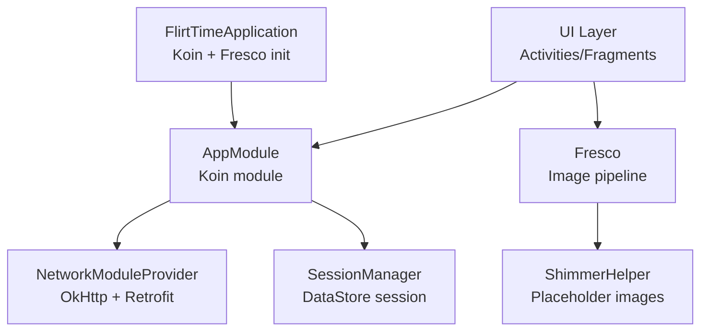
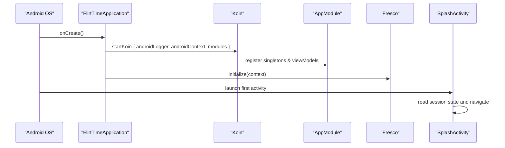
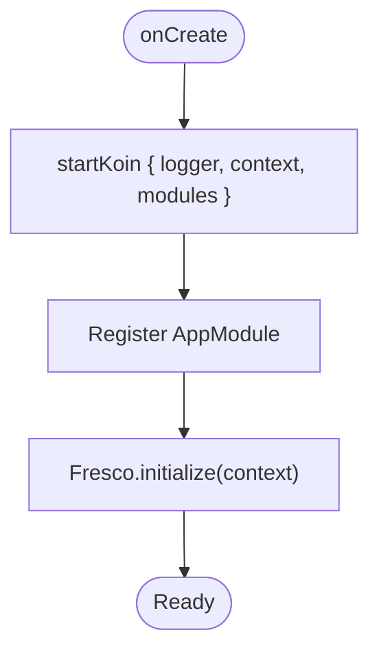
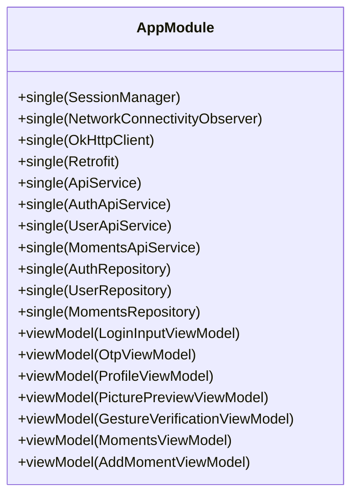
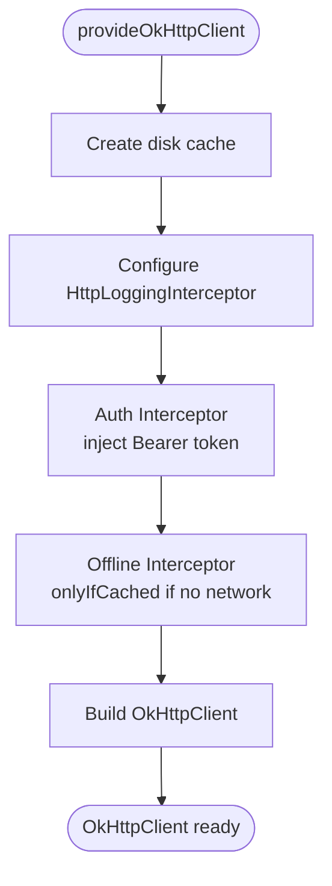
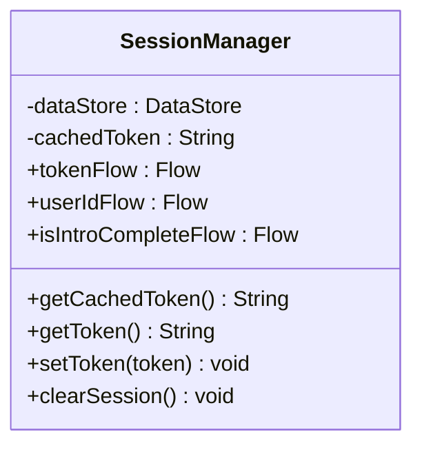
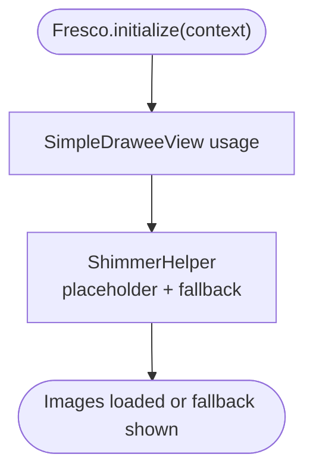
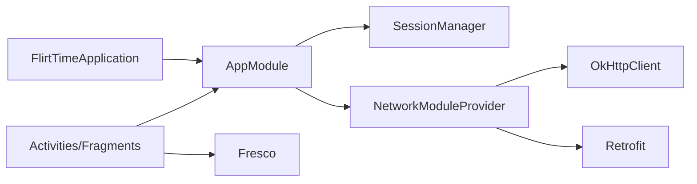

# Application Initialization

<cite>
**Referenced Files in This Document**
- [FlirtTimeApplication.kt](file://app/src/main/java/com/flirttime/FlirtTimeApplication.kt)
- [AppModule.kt](file://app/src/main/java/com/flirttime/di/AppModule.kt)
- [NetworkModuleProvider.kt](file://app/src/main/java/com/flirttime/core/network/NetworkModuleProvider.kt)
- [SessionManager.kt](file://app/src/main/java/com/flirttime/core/database/SessionManager.kt)
- [ShimmerHelper.kt](file://app/src/main/java/com/flirttime/core/common/ShimmerHelper.kt)
</cite>

## Table of Contents
1. [Introduction](#introduction)
2. [Project Structure](#project-structure)
3. [Core Components](#core-components)
4. [Architecture Overview](#architecture-overview)
5. [Detailed Component Analysis](#detailed-component-analysis)
6. [Dependency Analysis](#dependency-analysis)
7. [Performance Considerations](#performance-considerations)
8. [Troubleshooting Guide](#troubleshooting-guide)
9. [Conclusion](#conclusion)
10. [Appendices](#appendices)

## Introduction
This document explains how FlirtTimeApplication bootstraps the app at process start, focusing on:
- Koin dependency injection setup and module registration
- Logging configuration for Koin
- Fresco image loader initialization and its role in the application lifecycle
- Startup sequence and error handling during initialization
- Extension points for adding new global services
- Best practices for managing application-wide resources

The goal is to help you understand where and how core services are initialized, and how to safely extend the startup flow with custom logic.

## Project Structure
At a high level, the application bootstrap is centered around:
- FlirtTimeApplication: Android Application subclass that initializes Koin and Fresco
- AppModule: Central Koin module declaring singletons and ViewModel providers
- NetworkModuleProvider: Factory for OkHttpClient and Retrofit instances
- SessionManager: DataStore-backed session storage used by network interceptors
- ShimmerHelper: Utility using Fresco’s DraweeView for placeholder images

**Diagram sources**
- [FlirtTimeApplication.kt:10-22](file://app/src/main/java/com/flirttime/FlirtTimeApplication.kt#L10-L22)
- [AppModule.kt:27-57](file://app/src/main/java/com/flirttime/di/AppModule.kt#L27-L57)
- [NetworkModuleProvider.kt:17-85](file://app/src/main/java/com/flirttime/core/network/NetworkModuleProvider.kt#L17-L85)
- [SessionManager.kt:22-40](file://app/src/main/java/com/flirttime/core/database/SessionManager.kt#L22-L40)
- [ShimmerHelper.kt:14-72](file://app/src/main/java/com/flirttime/core/common/ShimmerHelper.kt#L14-L72)

**Section sources**
- [FlirtTimeApplication.kt:10-22](file://app/src/main/java/com/flirttime/FlirtTimeApplication.kt#L10-L22)
- [AppModule.kt:27-57](file://app/src/main/java/com/flirttime/di/AppModule.kt#L27-L57)

## Core Components
- FlirtTimeApplication
  - Initializes Koin with Android context, sets logging level, and registers modules
  - Initializes Fresco image pipeline
- AppModule
  - Declares singletons for networking (OkHttp, Retrofit, API clients), repository implementations, and ViewModel providers
  - Wires SessionManager and connectivity observer
- NetworkModuleProvider
  - Builds OkHttpClient with cache, timeouts, auth and logging interceptors
  - Builds Retrofit instance with base URL and Gson converter
- SessionManager
  - Provides flows and cached token access backed by DataStore
  - Supplies bearer token to OkHttp interceptor
- ShimmerHelper
  - Uses Fresco’s SimpleDraweeView to show shimmer placeholders while loading images

**Section sources**
- [FlirtTimeApplication.kt:10-22](file://app/src/main/java/com/flirttime/FlirtTimeApplication.kt#L10-L22)
- [AppModule.kt:27-57](file://app/src/main/java/com/flirttime/di/AppModule.kt#L27-L57)
- [NetworkModuleProvider.kt:17-85](file://app/src/main/java/com/flirttime/core/network/NetworkModuleProvider.kt#L17-L85)
- [SessionManager.kt:22-40](file://app/src/main/java/com/flirttime/core/database/SessionManager.kt#L22-L40)
- [ShimmerHelper.kt:14-72](file://app/src/main/java/com/flirttime/core/common/ShimmerHelper.kt#L14-L72)

## Architecture Overview
The application startup follows a clear sequence:
1. Android creates FlirtTimeApplication
2. Koin is started with Android context, logging configured, and modules registered
3. Fresco is initialized for image loading across the app
4. First Activity (e.g., SplashActivity) reads session state and navigates accordingly

**Diagram sources**
- [FlirtTimeApplication.kt:12-22](file://app/src/main/java/com/flirttime/FlirtTimeApplication.kt#L12-L22)
- [AppModule.kt:27-57](file://app/src/main/java/com/flirttime/di/AppModule.kt#L27-L57)

## Detailed Component Analysis

### FlirtTimeApplication: Bootstrap Entry Point
Responsibilities:
- Start Koin with Android context and error-level logging
- Register the central AppModule
- Initialize Fresco image pipeline

Key behaviors:
- Koin logging is set to ERROR to reduce noise in production
- Modules are provided via appModule which wires all core services
- Fresco.initialize runs after Koin setup so image loading is available early

**Diagram sources**
- [FlirtTimeApplication.kt:12-22](file://app/src/main/java/com/flirttime/FlirtTimeApplication.kt#L12-L22)

**Section sources**
- [FlirtTimeApplication.kt:10-22](file://app/src/main/java/com/flirttime/FlirtTimeApplication.kt#L10-L22)

### AppModule: Dependency Graph
Responsibilities:
- Provide singletons for data layer (SessionManager, repositories)
- Provide network stack (OkHttpClient, Retrofit, API services)
- Provide ViewModels for feature screens

Highlights:
- Singletons ensure one shared instance per app lifetime
- ViewModel providers enable scoped lifecycles per screen

**Diagram sources**
- [AppModule.kt:27-57](file://app/src/main/java/com/flirttime/di/AppModule.kt#L27-L57)

**Section sources**
- [AppModule.kt:27-57](file://app/src/main/java/com/flirttime/di/AppModule.kt#L27-L57)

### NetworkModuleProvider: Networking Stack
Responsibilities:
- Build OkHttpClient with:
  - Disk cache
  - Timeouts
  - Interceptors: offline caching, auth header injection, logging
- Build Retrofit with base URL and Gson converter

Key details:
- Auth interceptor injects Authorization header from SessionManager
- Offline mode uses only-if-cached responses when no network is available
- Logging enabled in debug builds; sensitive headers redacted

**Diagram sources**
- [NetworkModuleProvider.kt:22-75](file://app/src/main/java/com/flirttime/core/network/NetworkModuleProvider.kt#L22-L75)

**Section sources**
- [NetworkModuleProvider.kt:17-85](file://app/src/main/java/com/flirttime/core/network/NetworkModuleProvider.kt#L17-L85)

### SessionManager: Persistent Session State
Responsibilities:
- Store and observe user session data via DataStore
- Expose Flow-based APIs and a fast in-memory cached token for interceptors
- Provide helpers to check login status and profile completion

Key details:
- IO exceptions from DataStore are handled gracefully by emitting defaults
- Cached token is updated asynchronously and read synchronously by interceptors

**Diagram sources**
- [SessionManager.kt:22-40](file://app/src/main/java/com/flirttime/core/database/SessionManager.kt#L22-L40)
- [SessionManager.kt:136-141](file://app/src/main/java/com/flirttime/core/database/SessionManager.kt#L136-L141)
- [SessionManager.kt:197-205](file://app/src/main/java/com/flirttime/core/database/SessionManager.kt#L197-L205)

**Section sources**
- [SessionManager.kt:22-40](file://app/src/main/java/com/flirttime/core/database/SessionManager.kt#L22-L40)
- [SessionManager.kt:136-141](file://app/src/main/java/com/flirttime/core/database/SessionManager.kt#L136-L141)
- [SessionManager.kt:197-205](file://app/src/main/java/com/flirttime/core/database/SessionManager.kt#L197-L205)

### Fresco Integration and Image Loading
- Fresco is initialized once in FlirtTimeApplication
- UI components use Fresco’s SimpleDraweeView for efficient image loading
- ShimmerHelper demonstrates placeholder shimmer animations and fallback behavior

**Diagram sources**
- [FlirtTimeApplication.kt:21-22](file://app/src/main/java/com/flirttime/FlirtTimeApplication.kt#L21-L22)
- [ShimmerHelper.kt:14-72](file://app/src/main/java/com/flirttime/core/common/ShimmerHelper.kt#L14-L72)

**Section sources**
- [FlirtTimeApplication.kt:21-22](file://app/src/main/java/com/flirttime/FlirtTimeApplication.kt#L21-L22)
- [ShimmerHelper.kt:14-72](file://app/src/main/java/com/flirttime/core/common/ShimmerHelper.kt#L14-L72)

## Dependency Analysis
High-level dependencies among core components:

**Diagram sources**
- [FlirtTimeApplication.kt:10-22](file://app/src/main/java/com/flirttime/FlirtTimeApplication.kt#L10-L22)
- [AppModule.kt:27-57](file://app/src/main/java/com/flirttime/di/AppModule.kt#L27-L57)
- [NetworkModuleProvider.kt:17-85](file://app/src/main/java/com/flirttime/core/network/NetworkModuleProvider.kt#L17-L85)
- [SessionManager.kt:22-40](file://app/src/main/java/com/flirttime/core/database/SessionManager.kt#L22-L40)

**Section sources**
- [FlirtTimeApplication.kt:10-22](file://app/src/main/java/com/flirttime/FlirtTimeApplication.kt#L10-L22)
- [AppModule.kt:27-57](file://app/src/main/java/com/flirttime/di/AppModule.kt#L27-L57)
- [NetworkModuleProvider.kt:17-85](file://app/src/main/java/com/flirttime/core/network/NetworkModuleProvider.kt#L17-L85)
- [SessionManager.kt:22-40](file://app/src/main/java/com/flirttime/core/database/SessionManager.kt#L22-L40)

## Performance Considerations
- Koin initialization is lightweight; keep module registrations minimal and lazy where possible
- Fresco initialization should run once at app start; avoid re-initialization
- OkHttpClient cache size and timeouts are tuned for typical mobile networks; adjust based on app needs
- Avoid heavy work in Application.onCreate; defer expensive tasks to background scopes or first-screen initialization

[No sources needed since this section provides general guidance]

## Troubleshooting Guide
Common issues and mitigations during initialization:
- Koin not injecting dependencies
  - Ensure startKoin is called before any component requests dependencies
  - Verify modules are registered correctly in AppModule
- Fresco not loading images
  - Confirm Fresco.initialize is called in Application.onCreate
  - Check that SimpleDraweeView is used instead of ImageView for network images
- Network errors during startup
  - Inspect OkHttp logging in debug builds
  - Validate base URL and authentication token presence
- Session data inconsistencies
  - Ensure SessionManager flows are observed properly
  - Handle IOExceptions from DataStore gracefully

**Section sources**
- [FlirtTimeApplication.kt:12-22](file://app/src/main/java/com/flirttime/FlirtTimeApplication.kt#L12-L22)
- [NetworkModuleProvider.kt:22-75](file://app/src/main/java/com/flirttime/core/network/NetworkModuleProvider.kt#L22-L75)
- [SessionManager.kt:42-48](file://app/src/main/java/com/flirttime/core/database/SessionManager.kt#L42-L48)

## Conclusion
FlirtTimeApplication provides a concise bootstrap:
- Koin is configured with Android context and error logging, and AppModule wires the dependency graph
- Fresco is initialized to support efficient image loading across the app
- The network stack is built with robust interceptors for auth, caching, and logging
- SessionManager offers reliable, observable session state used throughout the app

To extend the app:
- Add new global services in AppModule as singletons
- Initialize third-party SDKs in FlirtTimeApplication.onCreate after Koin and before Fresco if they require Application context
- Keep initialization code minimal and non-blocking to preserve startup performance

[No sources needed since this section summarizes without analyzing specific files]

## Appendices

### How to Add Custom Initialization Logic
- Create a dedicated initializer function (e.g., initMySdk())
- Call it inside FlirtTimeApplication.onCreate after Koin.startKoin and before Fresco.initialize
- If it depends on Context, pass the Application context explicitly
- Wrap in try/catch and log errors to avoid blocking app startup

Best practices:
- Defer heavy work off the main thread
- Make initializers idempotent
- Avoid holding long-lived references in Application unless necessary

[No sources needed since this section provides general guidance]