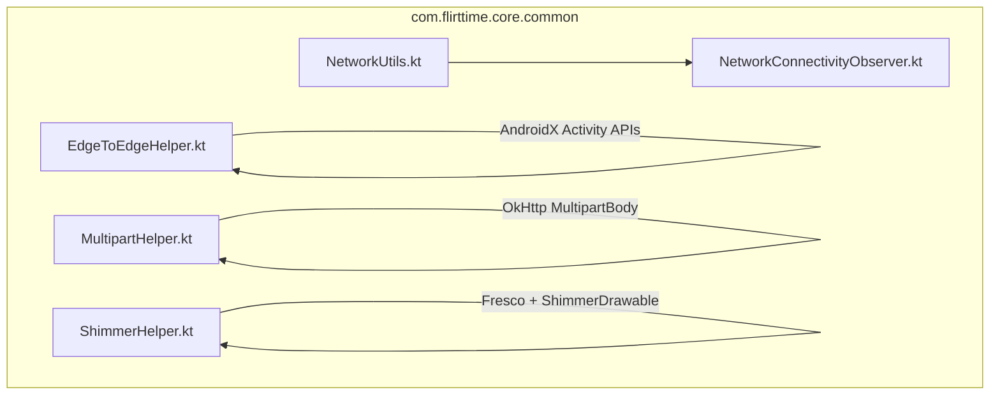
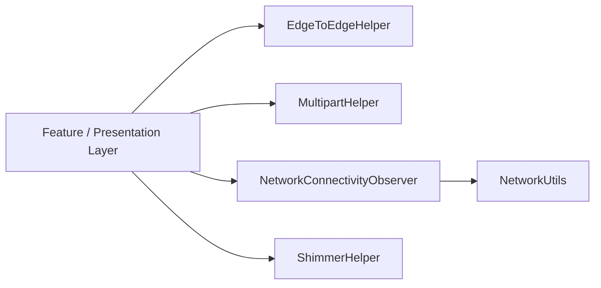
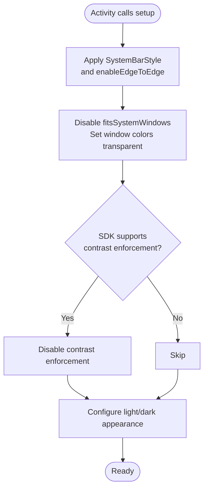
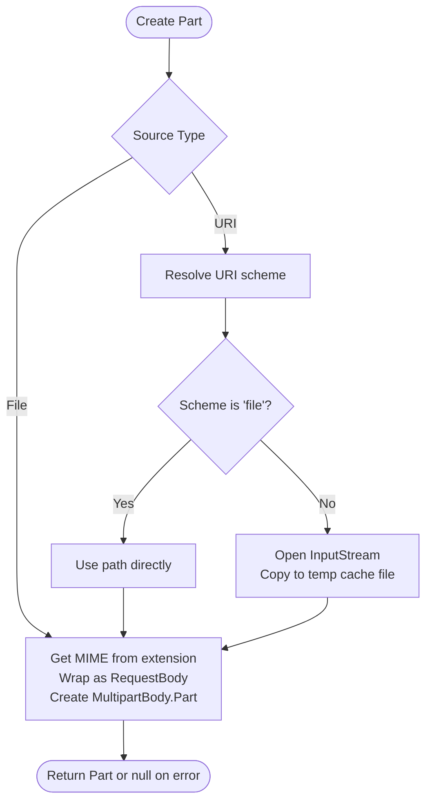
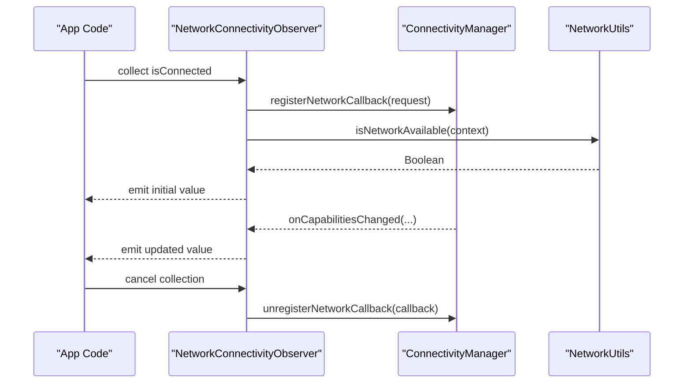
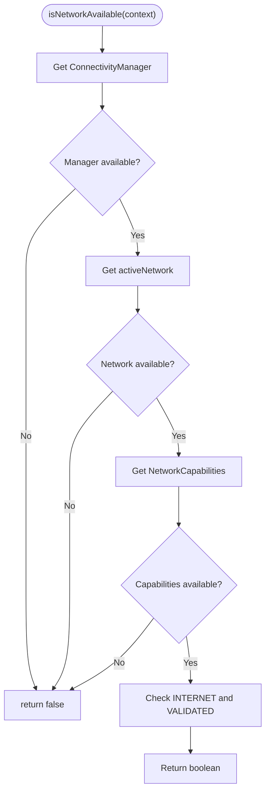
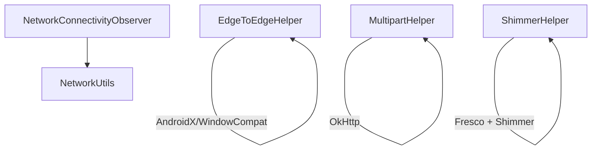

# Common Utilities

<cite>
**Referenced Files in This Document**
- [EdgeToEdgeHelper.kt](file://app/src/main/java/com/flirttime/core/common/EdgeToEdgeHelper.kt)
- [MultipartHelper.kt](file://app/src/main/java/com/flirttime/core/common/MultipartHelper.kt)
- [NetworkConnectivityObserver.kt](file://app/src/main/java/com/flirttime/core/common/NetworkConnectivityObserver.kt)
- [NetworkUtils.kt](file://app/src/main/java/com/flirttime/core/common/NetworkUtils.kt)
- [ShimmerHelper.kt](file://app/src/main/java/com/flirttime/core/common/ShimmerHelper.kt)
</cite>

## Table of Contents
1. [Introduction](#introduction)
2. [Project Structure](#project-structure)
3. [Core Components](#core-components)
4. [Architecture Overview](#architecture-overview)
5. [Detailed Component Analysis](#detailed-component-analysis)
6. [Dependency Analysis](#dependency-analysis)
7. [Performance Considerations](#performance-considerations)
8. [Troubleshooting Guide](#troubleshooting-guide)
9. [Conclusion](#conclusion)
10. [Appendices](#appendices)

## Introduction
This document describes the shared utility classes and helper functions used across the application, focusing on:
- Edge-to-edge display handling
- Multipart file upload utilities
- Network connectivity monitoring
- Network utility functions
- Shimmer loading effect and common UI helpers

These utilities are located under the core/common package and provide reusable building blocks for UI setup, networking, and user experience enhancements.

## Project Structure
The utilities discussed here reside in a single cohesive package:
- com.flirttime.core.common
  - EdgeToEdgeHelper.kt
  - MultipartHelper.kt
  - NetworkConnectivityObserver.kt
  - NetworkUtils.kt
  - ShimmerHelper.kt

**Diagram sources**
- [EdgeToEdgeHelper.kt:1-56](file://app/src/main/java/com/flirttime/core/common/EdgeToEdgeHelper.kt#L1-L56)
- [MultipartHelper.kt:1-61](file://app/src/main/java/com/flirttime/core/common/MultipartHelper.kt#L1-L61)
- [NetworkConnectivityObserver.kt:1-49](file://app/src/main/java/com/flirttime/core/common/NetworkConnectivityObserver.kt#L1-L49)
- [NetworkUtils.kt:1-17](file://app/src/main/java/com/flirttime/core/common/NetworkUtils.kt#L1-L17)
- [ShimmerHelper.kt:1-74](file://app/src/main/java/com/flirttime/core/common/ShimmerHelper.kt#L1-L74)

**Section sources**
- [EdgeToEdgeHelper.kt:1-56](file://app/src/main/java/com/flirttime/core/common/EdgeToEdgeHelper.kt#L1-L56)
- [MultipartHelper.kt:1-61](file://app/src/main/java/com/flirttime/core/common/MultipartHelper.kt#L1-L61)
- [NetworkConnectivityObserver.kt:1-49](file://app/src/main/java/com/flirttime/core/common/NetworkConnectivityObserver.kt#L1-L49)
- [NetworkUtils.kt:1-17](file://app/src/main/java/com/flirttime/core/common/NetworkUtils.kt#L1-L17)
- [ShimmerHelper.kt:1-74](file://app/src/main/java/com/flirttime/core/common/ShimmerHelper.kt#L1-L74)

## Core Components
- EdgeToEdgeHelper: Centralizes edge-to-edge configuration for Activities, including transparent system bars and light/dark icon styles.
- MultipartHelper: Simplifies creating multipart form parts from files or URIs and text fields for network requests.
- NetworkConnectivityObserver: Exposes a Flow<Boolean> that emits current internet availability based on system callbacks.
- NetworkUtils: Provides a simple synchronous check for available internet connectivity.
- ShimmerHelper: Creates shimmer placeholders and integrates them with Fresco’s SimpleDraweeView for smooth image loading UX.

**Section sources**
- [EdgeToEdgeHelper.kt:9-54](file://app/src/main/java/com/flirttime/core/common/EdgeToEdgeHelper.kt#L9-L54)
- [MultipartHelper.kt:15-59](file://app/src/main/java/com/flirttime/core/common/MultipartHelper.kt#L15-L59)
- [NetworkConnectivityObserver.kt:13-47](file://app/src/main/java/com/flirttime/core/common/NetworkConnectivityObserver.kt#L13-L47)
- [NetworkUtils.kt:7-15](file://app/src/main/java/com/flirttime/core/common/NetworkUtils.kt#L7-L15)
- [ShimmerHelper.kt:14-72](file://app/src/main/java/com/flirttime/core/common/ShimmerHelper.kt#L14-L72)

## Architecture Overview
The utilities are independent and designed to be reused by features and presentation layers. Connectivity checks are centralized via NetworkUtils and exposed reactively through NetworkConnectivityObserver. UI polish is provided by ShimmerHelper, while EdgeToEdgeHelper ensures consistent system bar behavior. File uploads are streamlined via MultipartHelper.

**Diagram sources**
- [EdgeToEdgeHelper.kt:1-56](file://app/src/main/java/com/flirttime/core/common/EdgeToEdgeHelper.kt#L1-L56)
- [MultipartHelper.kt:1-61](file://app/src/main/java/com/flirttime/core/common/MultipartHelper.kt#L1-L61)
- [NetworkConnectivityObserver.kt:1-49](file://app/src/main/java/com/flirttime/core/common/NetworkConnectivityObserver.kt#L1-L49)
- [NetworkUtils.kt:1-17](file://app/src/main/java/com/flirttime/core/common/NetworkUtils.kt#L1-L17)
- [ShimmerHelper.kt:1-74](file://app/src/main/java/com/flirttime/core/common/ShimmerHelper.kt#L1-L74)

## Detailed Component Analysis

### Edge-to-Edge Display Handling (EdgeToEdgeHelper)
Purpose:
- Configure Activities to render behind system bars with full transparency.
- Set appropriate light/dark appearance for status and navigation icons.
- Disable contrast enforcement where supported to avoid unwanted scrims.

Key behaviors:
- Uses AndroidX enableEdgeToEdge with SystemBarStyle for both status and navigation bars.
- Disables decor fitsSystemWindows to allow content to extend into system insets.
- Sets window colors to transparent and disables contrast enforcement on supported versions.
- Configures appearance flags for light/dark system icons.

Usage example:
- Call the setup method from an Activity’s lifecycle after setContentView to apply consistent edge-to-edge behavior.

Extensibility guidelines:
- Add parameters to toggle specific behaviors (e.g., always disable scrim).
- Provide theme-aware defaults for light/dark modes.

**Diagram sources**
- [EdgeToEdgeHelper.kt:17-54](file://app/src/main/java/com/flirttime/core/common/EdgeToEdgeHelper.kt#L17-L54)

**Section sources**
- [EdgeToEdgeHelper.kt:9-54](file://app/src/main/java/com/flirttime/core/common/EdgeToEdgeHelper.kt#L9-L54)

### Multipart File Upload Utilities (MultipartHelper)
Purpose:
- Create OkHttp MultipartBody.Part instances from local files or Content URIs.
- Convert strings to RequestBody for form fields.

Key behaviors:
- Detects MIME type from file extension; defaults to a safe image type if unknown.
- For non-file URIs, copies content to a temporary cache file before creating the part.
- Returns null when URI conversion fails.

Usage example:
- Build a MultipartBody using createPartFromFile or createPartFromUri for images/videos.
- Use createTextPart for additional string fields.

Extensibility guidelines:
- Add support for custom MIME mapping strategies.
- Introduce streaming to avoid temp files for large URIs.

**Diagram sources**
- [MultipartHelper.kt:17-59](file://app/src/main/java/com/flirttime/core/common/MultipartHelper.kt#L17-L59)

**Section sources**
- [MultipartHelper.kt:15-59](file://app/src/main/java/com/flirttime/core/common/MultipartHelper.kt#L15-L59)

### Network Connectivity Monitoring (NetworkConnectivityObserver)
Purpose:
- Provide a reactive stream of connectivity state (connected/disconnected) based on system network events.

Key behaviors:
- Registers a ConnectivityManager.NetworkCallback for network availability and capability changes.
- Emits true only when both INTERNET and VALIDATED capabilities are present.
- Emits an initial value using NetworkUtils.isNetworkAvailable.
- Unregisters the callback when the Flow is closed.

Usage example:
- Collect isConnected in a ViewModel or Presenter to show online/offline indicators or gate network operations.

Extensibility guidelines:
- Expose detailed network info (type, metered) via a data class Flow.
- Add retry/backoff policies for failed requests based on connectivity.

**Diagram sources**
- [NetworkConnectivityObserver.kt:13-47](file://app/src/main/java/com/flirttime/core/common/NetworkConnectivityObserver.kt#L13-L47)
- [NetworkUtils.kt:7-15](file://app/src/main/java/com/flirttime/core/common/NetworkUtils.kt#L7-L15)

**Section sources**
- [NetworkConnectivityObserver.kt:13-47](file://app/src/main/java/com/flirttime/core/common/NetworkConnectivityObserver.kt#L13-L47)
- [NetworkUtils.kt:7-15](file://app/src/main/java/com/flirttime/core/common/NetworkUtils.kt#L7-L15)

### Network Utility Functions (NetworkUtils)
Purpose:
- Provide a simple synchronous check for whether the device has validated internet access.

Key behaviors:
- Retrieves active network and validates capabilities INTERNET and VALIDATED.
- Returns false if any required component is unavailable.

Usage example:
- Use before initiating network requests to fail fast when offline.

Extensibility guidelines:
- Add methods to detect network type (WiFi/mobile), metered status, or signal strength.

**Diagram sources**
- [NetworkUtils.kt:7-15](file://app/src/main/java/com/flirttime/core/common/NetworkUtils.kt#L7-L15)

**Section sources**
- [NetworkUtils.kt:7-15](file://app/src/main/java/com/flirttime/core/common/NetworkUtils.kt#L7-L15)

### Shimmer Loading Effect and UI Helpers (ShimmerHelper)
Purpose:
- Provide a consistent shimmer placeholder for image views during loading.
- Integrate seamlessly with Fresco’s SimpleDraweeView.

Key behaviors:
- Creates a ShimmerDrawable with subtle base/highlight colors and auto-start animation.
- Sets the shimmer as a placeholder image.
- Stops shimmer when the final image is set or on failure, optionally showing a fallback resource.

Usage example:
- Replace direct image loading with loadWithShimmer to show shimmer while images load.

Extensibility guidelines:
- Allow customization of shimmer colors, duration, and direction via parameters.
- Support other image libraries beyond Fresco.

```mermaid
flowchart TD
Start(["loadWithShimmer(view, url, fallback)"]) --> CreateShimmer["createShimmerDrawable()"]
CreateShimmer --> SetPlaceholder["Set placeholder on view"]
SetPlaceholder --> UrlCheck{"URL empty?"}
UrlCheck --> |Yes| FallbackCheck{"Fallback provided?"}
FallbackCheck --> |Yes| ShowFallback["Show fallback resource"]
FallbackCheck --> |No| StopShimmer["Stop shimmer"]
UrlCheck --> |No| LoadImage["Build Fresco controller<br/>Attach listener"]
LoadImage --> OnSuccess["onFinalImageSet -> stop shimmer"]
LoadImage --> OnFailure["onFailure -> stop shimmer<br/>show fallback if any"]
ShowFallback --> End(["Done"])
StopShimmer --> End
OnSuccess --> End
OnFailure --> End
```

**Diagram sources**
- [ShimmerHelper.kt:19-72](file://app/src/main/java/com/flirttime/core/common/ShimmerHelper.kt#L19-L72)

**Section sources**
- [ShimmerHelper.kt:14-72](file://app/src/main/java/com/flirttime/core/common/ShimmerHelper.kt#L14-L72)

## Dependency Analysis
- EdgeToEdgeHelper depends on AndroidX Activity APIs and WindowCompat for system bar configuration.
- MultipartHelper depends on OkHttp types (MultipartBody, RequestBody) and Android Uri/File APIs.
- NetworkConnectivityObserver depends on ConnectivityManager and uses NetworkUtils for the initial state.
- ShimmerHelper depends on Fresco and ShimmerDrawable for placeholder animations.

**Diagram sources**
- [EdgeToEdgeHelper.kt:1-56](file://app/src/main/java/com/flirttime/core/common/EdgeToEdgeHelper.kt#L1-L56)
- [MultipartHelper.kt:1-61](file://app/src/main/java/com/flirttime/core/common/MultipartHelper.kt#L1-L61)
- [NetworkConnectivityObserver.kt:1-49](file://app/src/main/java/com/flirttime/core/common/NetworkConnectivityObserver.kt#L1-L49)
- [NetworkUtils.kt:1-17](file://app/src/main/java/com/flirttime/core/common/NetworkUtils.kt#L1-L17)
- [ShimmerHelper.kt:1-74](file://app/src/main/java/com/flirttime/core/common/ShimmerHelper.kt#L1-L74)

**Section sources**
- [EdgeToEdgeHelper.kt:1-56](file://app/src/main/java/com/flirttime/core/common/EdgeToEdgeHelper.kt#L1-L56)
- [MultipartHelper.kt:1-61](file://app/src/main/java/com/flirttime/core/common/MultipartHelper.kt#L1-L61)
- [NetworkConnectivityObserver.kt:1-49](file://app/src/main/java/com/flirttime/core/common/NetworkConnectivityObserver.kt#L1-L49)
- [NetworkUtils.kt:1-17](file://app/src/main/java/com/flirttime/core/common/NetworkUtils.kt#L1-L17)
- [ShimmerHelper.kt:1-74](file://app/src/main/java/com/flirttime/core/common/ShimmerHelper.kt#L1-L74)

## Performance Considerations
- Edge-to-edge: Avoid excessive recomposition by applying once per Activity; ensure content padding accounts for system insets.
- Multipart uploads: For very large URIs, consider streaming to reduce memory pressure; monitor cache directory usage.
- Connectivity observer: Ensure collectors are properly disposed to prevent leaks; use distinctUntilChanged to avoid redundant updates.
- Shimmer: Reuse ShimmerDrawable instances where possible; stop shimmer promptly on success/failure to free resources.

[No sources needed since this section provides general guidance]

## Troubleshooting Guide
- Edge-to-edge not applied:
  - Verify setup is called after setting content view.
  - Confirm SDK version checks do not skip critical steps on your target devices.
- Multipart part creation returns null:
  - Inspect URI scheme and permissions; ensure the app can read the content.
  - Check MIME detection and fallback logic for unexpected types.
- Connectivity flow not emitting:
  - Ensure the Flow collector remains active; verify no early cancellation.
  - Confirm the app has necessary network state permissions.
- Shimmer not stopping:
  - Confirm listeners are attached and not overridden.
  - Validate URL parsing and Fresco initialization.

**Section sources**
- [EdgeToEdgeHelper.kt:17-54](file://app/src/main/java/com/flirttime/core/common/EdgeToEdgeHelper.kt#L17-L54)
- [MultipartHelper.kt:32-59](file://app/src/main/java/com/flirttime/core/common/MultipartHelper.kt#L32-L59)
- [NetworkConnectivityObserver.kt:18-47](file://app/src/main/java/com/flirttime/core/common/NetworkConnectivityObserver.kt#L18-L47)
- [ShimmerHelper.kt:54-72](file://app/src/main/java/com/flirttime/core/common/ShimmerHelper.kt#L54-L72)

## Conclusion
These utilities provide a solid foundation for consistent UI behavior, robust file uploads, reactive connectivity monitoring, and polished loading states. By centralizing these concerns, the codebase maintains clarity and reusability across features. Extend them thoughtfully to meet evolving requirements while preserving simplicity and performance.

[No sources needed since this section summarizes without analyzing specific files]

## Appendices

### Usage Examples Summary
- Edge-to-edge:
  - Initialize in Activity after layout to achieve transparent system bars and correct icon themes.
- Multipart uploads:
  - Build MultipartBody using createPartFromFile/createPartFromUri and add text fields via createTextPart.
- Connectivity monitoring:
  - Collect isConnected in a lifecycle-aware scope to update UI or guard network calls.
- Shimmer loading:
  - Use loadWithShimmer to replace direct image loads and improve perceived performance.

[No sources needed since this section provides general guidance]

### Guidelines for Extending the Utility Library
- Keep each utility focused on a single responsibility.
- Prefer immutable inputs and explicit outputs; avoid hidden side effects.
- Provide sensible defaults but allow customization via parameters.
- Document expected preconditions (permissions, context validity).
- Add unit tests for pure logic and integration tests for platform-dependent behavior.
- Version breaking changes and maintain backward compatibility where feasible.

[No sources needed since this section provides general guidance]