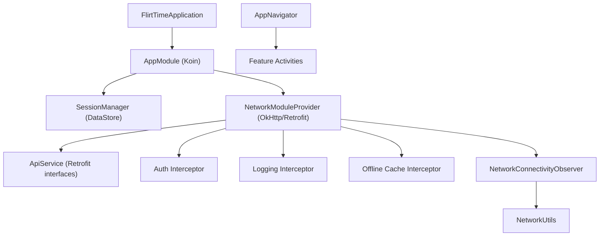
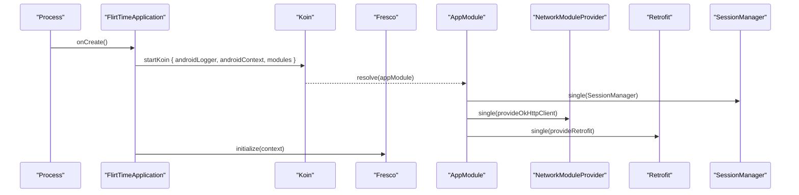
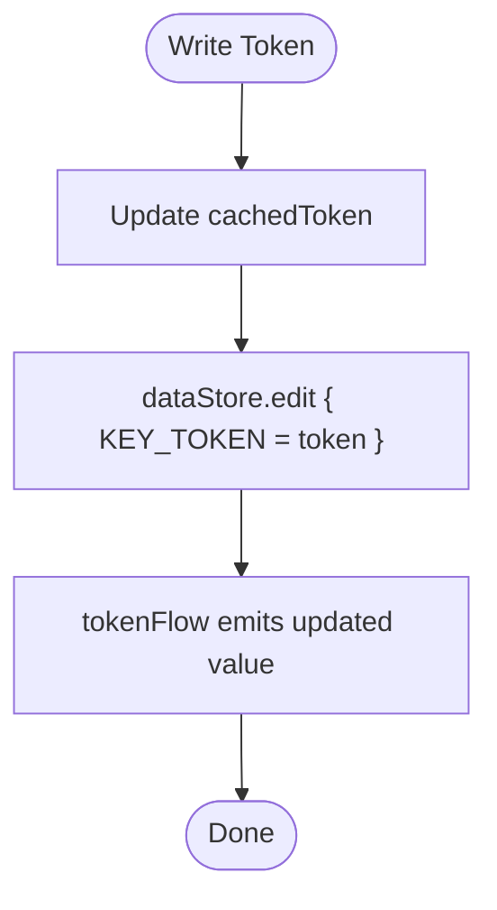
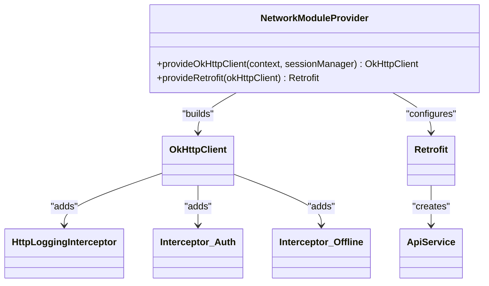
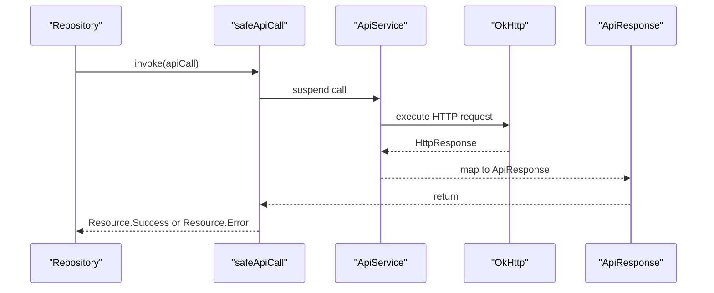
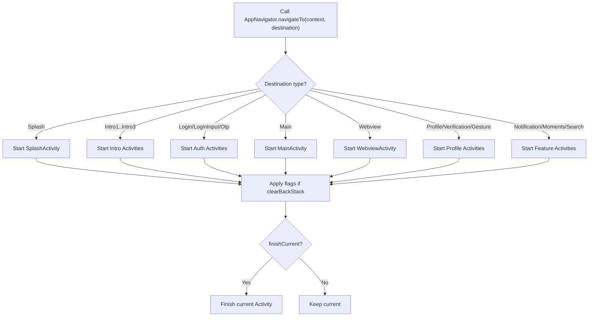
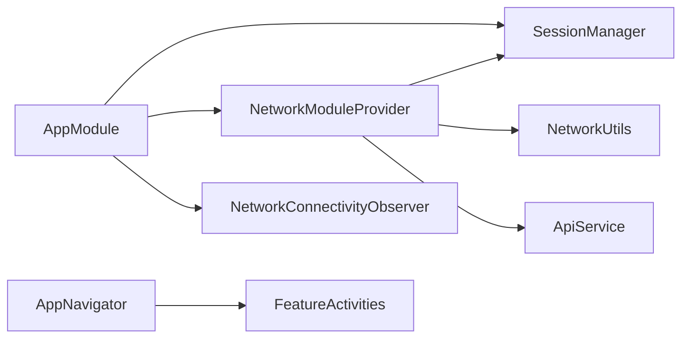

# Core Infrastructure

<cite>
**Referenced Files in This Document**
- [FlirtTimeApplication.kt](file://app/src/main/java/com/flirttime/FlirtTimeApplication.kt)
- [AppModule.kt](file://app/src/main/java/com/flirttime/di/AppModule.kt)
- [SessionManager.kt](file://app/src/main/java/com/flirttime/core/database/SessionManager.kt)
- [NetworkModuleProvider.kt](file://app/src/main/java/com/flirttime/core/network/NetworkModuleProvider.kt)
- [ApiService.kt](file://app/src/main/java/com/flirttime/core/network/ApiService.kt)
- [SafeApiCall.kt](file://app/src/main/java/com/flirttime/core/network/SafeApiCall.kt)
- [NetworkConnectivityObserver.kt](file://app/src/main/java/com/flirttime/core/common/NetworkConnectivityObserver.kt)
- [NetworkUtils.kt](file://app/src/main/java/com/flirttime/core/common/NetworkUtils.kt)
- [AppNavigator.kt](file://app/src/main/java/com/flirttime/core/navigation/AppNavigator.kt)
</cite>

## Table of Contents
1. [Introduction](#introduction)
2. [Project Structure](#project-structure)
3. [Core Components](#core-components)
4. [Architecture Overview](#architecture-overview)
5. [Detailed Component Analysis](#detailed-component-analysis)
6. [Dependency Analysis](#dependency-analysis)
7. [Performance Considerations](#performance-considerations)
8. [Troubleshooting Guide](#troubleshooting-guide)
9. [Conclusion](#conclusion)
10. [Appendices](#appendices)

## Introduction
This document explains the core infrastructure of the Flirttime-Otp-Android application, focusing on:
- Application initialization with Koin dependency injection and Fresco image loader setup
- Global error handling patterns for network calls
- Session management using DataStore for persistent user data and token storage
- Network layer architecture with Retrofit configuration, OkHttp interceptors, and centralized error handling
- Navigation system implementation and utility classes used across the app
- Configuration options, extension points, and best practices for adding new core services

## Project Structure
The core infrastructure is organized into focused modules under the core package:
- Application bootstrap and DI wiring
- Database/session persistence via DataStore
- Networking stack (Retrofit + OkHttp)
- Common utilities (connectivity observer and helpers)
- Navigation abstraction over Activities and Intents

**Diagram sources**
- [FlirtTimeApplication.kt:10-22](file://app/src/main/java/com/flirttime/FlirtTimeApplication.kt#L10-L22)
- [AppModule.kt:27-57](file://app/src/main/java/com/flirttime/di/AppModule.kt#L27-L57)
- [NetworkModuleProvider.kt:22-84](file://app/src/main/java/com/flirttime/core/network/NetworkModuleProvider.kt#L22-L84)
- [NetworkConnectivityObserver.kt:13-47](file://app/src/main/java/com/flirttime/core/common/NetworkConnectivityObserver.kt#L13-L47)
- [NetworkUtils.kt:7-15](file://app/src/main/java/com/flirttime/core/common/NetworkUtils.kt#L7-L15)
- [AppNavigator.kt:19-56](file://app/src/main/java/com/flirttime/core/navigation/AppNavigator.kt#L19-L56)

**Section sources**
- [FlirtTimeApplication.kt:10-22](file://app/src/main/java/com/flirttime/FlirtTimeApplication.kt#L10-L22)
- [AppModule.kt:27-57](file://app/src/main/java/com/flirttime/di/AppModule.kt#L27-L57)

## Core Components
- Application bootstrap: Initializes Koin DI and Fresco image loader.
- Dependency Injection: Centralized module wiring for repositories, ViewModels, network clients, and session manager.
- Session Management: DataStore-backed persistence for tokens and user profile state with Flow-based reactive access and a cached token for interceptors.
- Network Layer: Retrofit client configured with OkHttp interceptors for logging, authentication, and offline caching; centralized error handling via safeApiCall wrappers.
- Connectivity Utilities: Reactive connectivity observer and helper to check internet availability.
- Navigation: Type-safe destination model and router for Activity navigation.

**Section sources**
- [FlirtTimeApplication.kt:10-22](file://app/src/main/java/com/flirttime/FlirtTimeApplication.kt#L10-L22)
- [AppModule.kt:27-57](file://app/src/main/java/com/flirttime/di/AppModule.kt#L27-L57)
- [SessionManager.kt:22-221](file://app/src/main/java/com/flirttime/core/database/SessionManager.kt#L22-L221)
- [NetworkModuleProvider.kt:22-84](file://app/src/main/java/com/flirttime/core/network/NetworkModuleProvider.kt#L22-L84)
- [SafeApiCall.kt:14-143](file://app/src/main/java/com/flirttime/core/network/SafeApiCall.kt#L14-L143)
- [NetworkConnectivityObserver.kt:13-47](file://app/src/main/java/com/flirttime/core/common/NetworkConnectivityObserver.kt#L13-L47)
- [NetworkUtils.kt:7-15](file://app/src/main/java/com/flirttime/core/common/NetworkUtils.kt#L7-L15)
- [AppNavigator.kt:19-136](file://app/src/main/java/com/flirttime/core/navigation/AppNavigator.kt#L19-L136)

## Architecture Overview
The application initializes at process start, sets up DI, and configures networking and persistence. Feature layers consume these core services through injected dependencies.

**Diagram sources**
- [FlirtTimeApplication.kt:12-22](file://app/src/main/java/com/flirttime/FlirtTimeApplication.kt#L12-L22)
- [AppModule.kt:27-40](file://app/src/main/java/com/flirttime/di/AppModule.kt#L27-L40)
- [NetworkModuleProvider.kt:22-84](file://app/src/main/java/com/flirttime/core/network/NetworkModuleProvider.kt#L22-L84)

## Detailed Component Analysis

### Application Initialization (FlirtTimeApplication)
Responsibilities:
- Start Koin with Android context and logger level.
- Register the app-wide DI module.
- Initialize Fresco for image loading.

Key behaviors:
- Koin initialization occurs before any feature code runs, ensuring all dependencies are available.
- Fresco initialization ensures image pipeline readiness.

Best practices:
- Keep initialization minimal and side-effect free beyond required bootstrapping.
- Avoid heavy work in Application.onCreate; defer to background tasks or lazy initialization where possible.

**Section sources**
- [FlirtTimeApplication.kt:10-22](file://app/src/main/java/com/flirttime/FlirtTimeApplication.kt#L10-L22)

### Dependency Injection (AppModule)
Responsibilities:
- Provide singletons for SessionManager, NetworkConnectivityObserver, OkHttpClient, Retrofit, and API service instances.
- Wire feature repositories and ViewModels.

Design highlights:
- Singletons ensure shared lifecycle-aware components like network clients and session manager.
- ViewModel bindings use Koin’s viewModelOf for scoped lifecycles.

Extension points:
- Add new repositories and ViewModels by registering them in appModule.
- Introduce new API services by creating Retrofit interface and binding it in AppModule.

**Section sources**
- [AppModule.kt:27-57](file://app/src/main/java/com/flirttime/di/AppModule.kt#L27-L57)

### Session Management (SessionManager)
Responsibilities:
- Persist user session data and profile fields using DataStore preferences.
- Expose reactive flows for token, user ID, page redirect flags, intro completion, profile fields, verification status, and profile completeness.
- Provide synchronous snapshot reads and write operations.
- Maintain an in-memory cached token for fast interceptor access.

Key behaviors:
- Flow-based reads handle IO exceptions gracefully by emitting empty defaults.
- clearSession preserves intro completion state while clearing other keys.
- getCachedToken returns the latest token without blocking.

Complexity considerations:
- Flow emissions are lightweight; first() snapshots are O(1) per call but may trigger IO once.
- Cached token avoids repeated DataStore reads in hot paths like network interceptors.

Error handling:
- IO exceptions during flow collection are caught and replaced with default values.

Usage patterns:
- Use flows for UI state updates and suspend functions for one-off reads in coroutines.
- Always update cached token when setting a new token to keep interceptors in sync.

**Diagram sources**
- [SessionManager.kt:136-141](file://app/src/main/java/com/flirttime/core/database/SessionManager.kt#L136-L141)
- [SessionManager.kt:26-35](file://app/src/main/java/com/flirttime/core/database/SessionManager.kt#L26-L35)

**Section sources**
- [SessionManager.kt:22-221](file://app/src/main/java/com/flirttime/core/database/SessionManager.kt#L22-L221)

### Network Layer Architecture
Components:
- OkHttpClient factory with interceptors:
  - Logging interceptor: logs request/response bodies in debug builds and redacts Authorization headers.
  - Authentication interceptor: attaches Bearer token from SessionManager and sets Accept header.
  - Offline cache interceptor: forces cached responses when offline with max staleness.
- Retrofit builder: base URL from BuildConfig, Gson converter, and custom OkHttpClient.
- ApiService: typed endpoints for auth-related operations.
- SafeApiCall: centralized error handling wrapping API calls into Resource states.

Interceptors order and responsibilities:
1. Offline cache interceptor decides whether to use cache-only requests based on connectivity.
2. Authentication interceptor injects Authorization header if token exists.
3. Logging interceptor records traffic in debug mode.

Centralized error handling:
- safeApiCall and safeRawApiCall convert exceptions and response payloads into Resource.Success or Resource.Error with parsed messages.
- parseErrorMessage extracts user-friendly messages from JSON error bodies.

**Diagram sources**
- [NetworkModuleProvider.kt:22-84](file://app/src/main/java/com/flirttime/core/network/NetworkModuleProvider.kt#L22-L84)
- [ApiService.kt:9-22](file://app/src/main/java/com/flirttime/core/network/ApiService.kt#L9-L22)

**Diagram sources**
- [SafeApiCall.kt:14-65](file://app/src/main/java/com/flirttime/core/network/SafeApiCall.kt#L14-L65)
- [ApiService.kt:9-22](file://app/src/main/java/com/flirttime/core/network/ApiService.kt#L9-L22)

Configuration options:
- Cache size: 20 MB.
- Timeouts: connect/read/write set to 30 seconds.
- Logging level: BODY in debug, NONE in release.
- Base URL: provided via BuildConfig.BASE_URL.

Best practices:
- Keep interceptors small and focused.
- Prefer safeApiCall wrappers to centralize error mapping and avoid try/catch duplication.
- Use Flow-based connectivity checks to adapt UI behavior.

**Section sources**
- [NetworkModuleProvider.kt:22-84](file://app/src/main/java/com/flirttime/core/network/NetworkModuleProvider.kt#L22-L84)
- [ApiService.kt:9-22](file://app/src/main/java/com/flirttime/core/network/ApiService.kt#L9-L22)
- [SafeApiCall.kt:14-143](file://app/src/main/java/com/flirttime/core/network/SafeApiCall.kt#L14-L143)

### Connectivity Observers and Utilities
Responsibilities:
- Observe network changes reactively via ConnectivityManager callbacks.
- Provide a simple utility to check current internet availability.

Behavior:
- isConnected Flow emits distinct connectivity states and initial state upon subscription.
- NetworkUtils.isNetworkAvailable performs a synchronous capability check.

Integration:
- Used by offline cache interceptor to decide cache-only requests.
- Can be consumed by features to show online/offline indicators.

**Section sources**
- [NetworkConnectivityObserver.kt:13-47](file://app/src/main/java/com/flirttime/core/common/NetworkConnectivityObserver.kt#L13-L47)
- [NetworkUtils.kt:7-15](file://app/src/main/java/com/flirttime/core/common/NetworkUtils.kt#L7-L15)

### Navigation System (AppNavigator)
Responsibilities:
- Define type-safe destinations for Activities with strongly-typed parameters.
- Provide a unified navigateTo function that maps destinations to target classes and Intent extras.

Highlights:
- Destination sealed class models all navigable screens with explicit parameters.
- Constants define Intent extra keys to avoid magic strings.
- Supports clearing backstack and finishing current activity after navigation.

Usage pattern:
- Call AppNavigator.navigateTo(context, Destination.Xxx(...)) from anywhere needing navigation.

**Diagram sources**
- [AppNavigator.kt:19-56](file://app/src/main/java/com/flirttime/core/navigation/AppNavigator.kt#L19-L56)
- [AppNavigator.kt:73-136](file://app/src/main/java/com/flirttime/core/navigation/AppNavigator.kt#L73-L136)

**Section sources**
- [AppNavigator.kt:19-136](file://app/src/main/java/com/flirttime/core/navigation/AppNavigator.kt#L19-L136)

## Dependency Analysis
High-level dependencies between core components:

**Diagram sources**
- [AppModule.kt:27-57](file://app/src/main/java/com/flirttime/di/AppModule.kt#L27-L57)
- [NetworkModuleProvider.kt:22-84](file://app/src/main/java/com/flirttime/core/network/NetworkModuleProvider.kt#L22-L84)
- [AppNavigator.kt:19-136](file://app/src/main/java/com/flirttime/core/navigation/AppNavigator.kt#L19-L136)

Coupling and cohesion:
- AppModule has high cohesion around DI wiring and low coupling to concrete implementations via interfaces.
- NetworkModuleProvider encapsulates OkHttp and Retrofit configuration, keeping networking concerns isolated.
- SessionManager abstracts DataStore details behind a clean API.

Potential circular dependencies:
- None observed among core components; DI resolves dependencies linearly.

External integrations:
- Koin for DI.
- Fresco for image loading.
- Retrofit + OkHttp for networking.
- DataStore Preferences for persistence.

**Section sources**
- [AppModule.kt:27-57](file://app/src/main/java/com/flirttime/di/AppModule.kt#L27-L57)
- [NetworkModuleProvider.kt:22-84](file://app/src/main/java/com/flirttime/core/network/NetworkModuleProvider.kt#L22-L84)
- [SessionManager.kt:22-221](file://app/src/main/java/com/flirttime/core/database/SessionManager.kt#L22-L221)

## Performance Considerations
- OkHttp cache: 20 MB disk cache improves performance under poor connectivity; consider tuning based on expected payload sizes.
- Timeouts: 30-second timeouts balance responsiveness and reliability; adjust per backend SLAs.
- Logging: Disabled in release to reduce overhead; only enabled in debug builds.
- DataStore flows: Efficient reactive streams; avoid excessive first() calls in tight loops.
- Cached token: Reduces DataStore reads in network interceptors, minimizing IO contention.

[No sources needed since this section provides general guidance]

## Troubleshooting Guide
Common issues and resolutions:
- No network connectivity:
  - Verify NetworkUtils.isNetworkAvailable and observe NetworkConnectivityObserver.isConnected.
  - Ensure device has internet capability validated by OS.
- Authentication failures:
  - Confirm SessionManager.getCachedToken returns a valid token.
  - Check Authorization header presence and format in logs.
- Unexpected errors in API calls:
  - Inspect Resource.Error.message and code from safeApiCall.
  - Validate server error body structure for message/error parsing.
- Offline behavior not working:
  - Confirm offline cache interceptor is active and cache contains eligible entries.
  - Check maxStale policy and cache directory permissions.

Operational tips:
- Enable detailed logs in debug builds to trace request/response cycles.
- Use Koin diagnostics to verify module resolution and singleton lifecycles.
- When clearing sessions, preserve intro completion state to avoid re-onboarding.

**Section sources**
- [SafeApiCall.kt:14-143](file://app/src/main/java/com/flirttime/core/network/SafeApiCall.kt#L14-L143)
- [NetworkModuleProvider.kt:22-84](file://app/src/main/java/com/flirttime/core/network/NetworkModuleProvider.kt#L22-L84)
- [SessionManager.kt:197-205](file://app/src/main/java/com/flirttime/core/database/SessionManager.kt#L197-L205)

## Conclusion
The core infrastructure of Flirttime-Otp-Android provides a robust foundation:
- Clean application bootstrap with Koin and Fresco.
- Centralized DI wiring for repositories, ViewModels, and network clients.
- Reliable session persistence with DataStore and reactive flows.
- Configurable networking with OkHttp interceptors and centralized error handling.
- Type-safe navigation abstraction for Activities.
Adhering to the documented patterns and extension points will help maintain consistency and scalability as new features are added.

[No sources needed since this section summarizes without analyzing specific files]

## Appendices

### Configuration Options Summary
- OkHttp cache size: 20 MB
- Timeouts: connect/read/write 30 seconds
- Logging: BODY in debug, NONE in release
- Base URL: BuildConfig.BASE_URL
- DataStore name: flirttime_preferences

**Section sources**
- [NetworkModuleProvider.kt:17-21](file://app/src/main/java/com/flirttime/core/network/NetworkModuleProvider.kt#L17-L21)
- [SessionManager.kt:20-20](file://app/src/main/java/com/flirttime/core/database/SessionManager.kt#L20-L20)

### Best Practices for Adding New Core Services
- Create a dedicated module or extend existing modules in AppModule for DI registration.
- For network services:
  - Define Retrofit interface in core.network.ApiService or feature-specific service.
  - Inject via Retrofit instance provided by NetworkModuleProvider.
  - Wrap calls with safeApiCall/safeRawApiCall for consistent error handling.
- For persistence:
  - Extend SessionManager with new DataStore keys and flows.
  - Ensure flows emit defaults on IO errors and keep cached values in sync.
- For navigation:
  - Add new Destination types and map them in AppNavigator.navigateTo.
  - Use constants for Intent extras to avoid magic strings.

**Section sources**
- [AppModule.kt:27-57](file://app/src/main/java/com/flirttime/di/AppModule.kt#L27-L57)
- [NetworkModuleProvider.kt:78-84](file://app/src/main/java/com/flirttime/core/network/NetworkModuleProvider.kt#L78-L84)
- [SafeApiCall.kt:14-143](file://app/src/main/java/com/flirttime/core/network/SafeApiCall.kt#L14-L143)
- [SessionManager.kt:207-221](file://app/src/main/java/com/flirttime/core/database/SessionManager.kt#L207-L221)
- [AppNavigator.kt:19-136](file://app/src/main/java/com/flirttime/core/navigation/AppNavigator.kt#L19-L136)