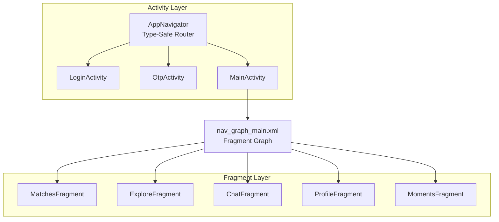
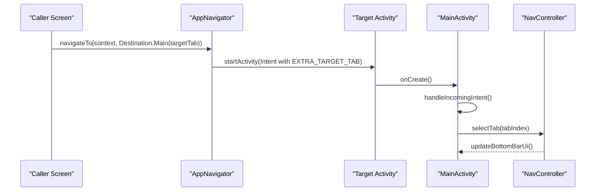
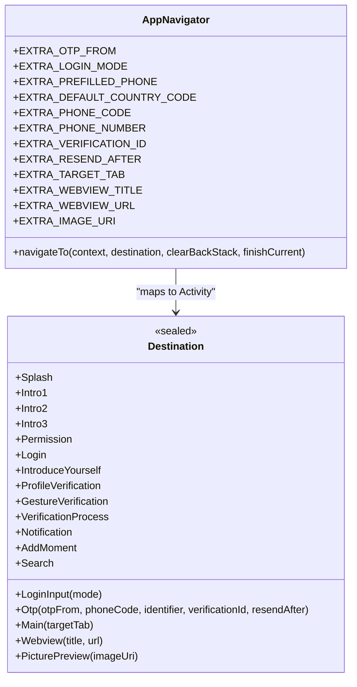
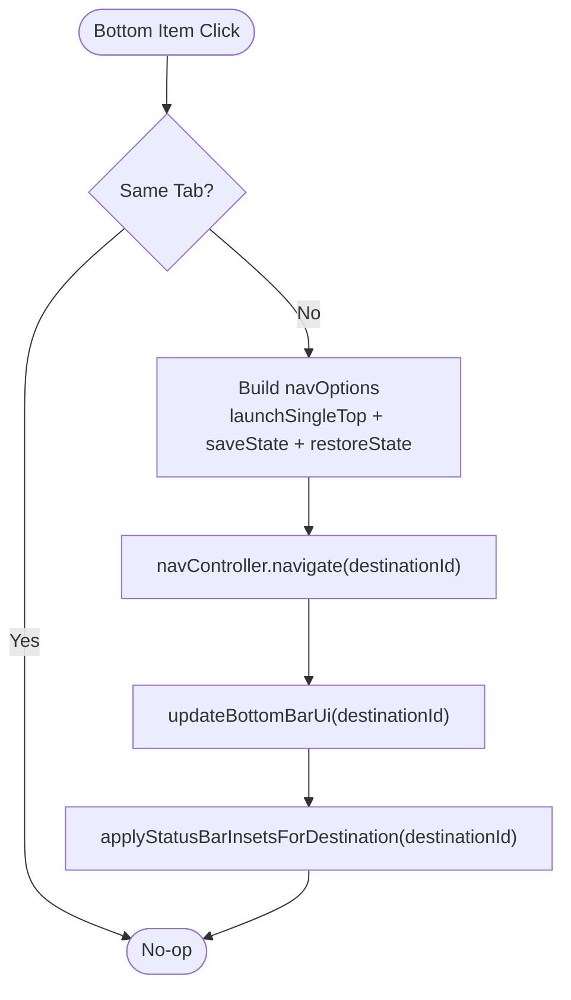
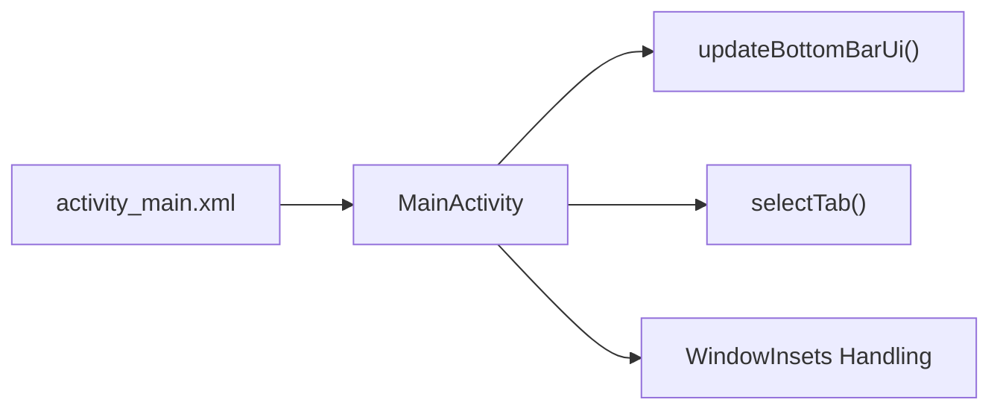
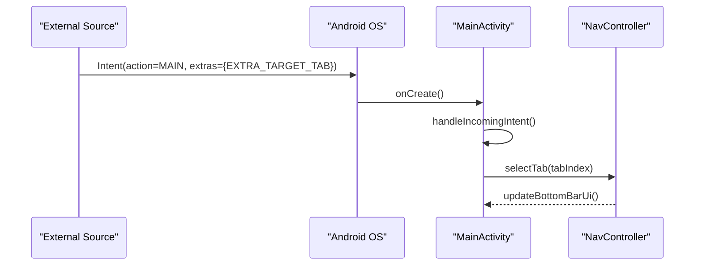
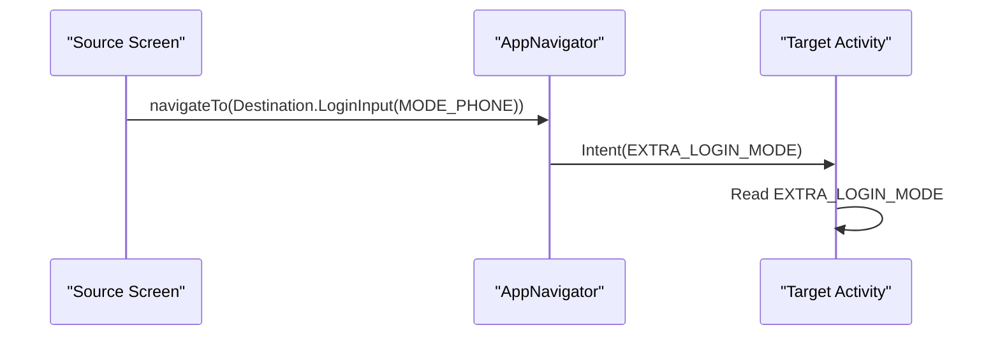
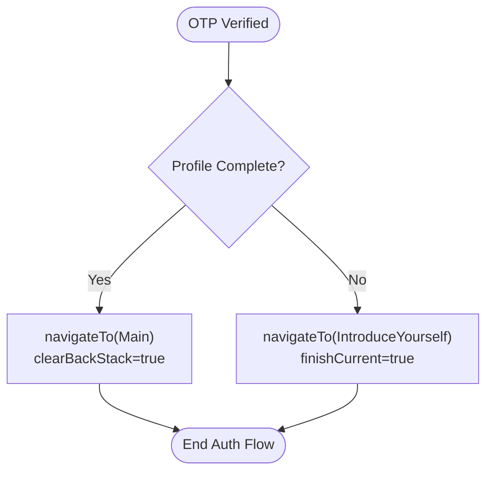
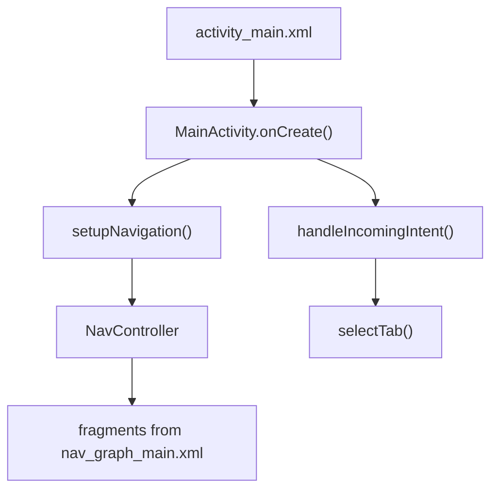
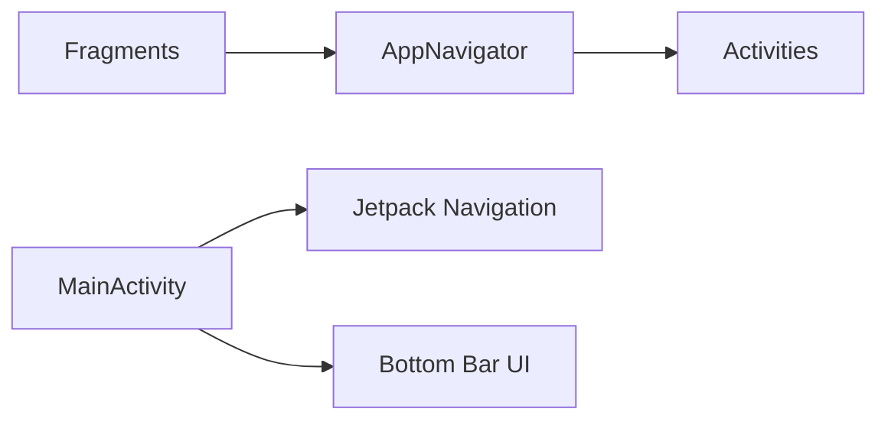

# Navigation System

<cite>
**Referenced Files in This Document**
- [AppNavigator.kt](file://app/src/main/java/com/flirttime/core/navigation/AppNavigator.kt)
- [MainActivity.kt](file://app/src/main/java/com/flirttime/MainActivity.kt)
- [nav_graph_main.xml](file://app/src/main/res/navigation/nav_graph_main.xml)
- [activity_main.xml](file://app/src/main/res/layout/activity_main.xml)
- [LoginActivity.kt](file://app/src/main/java/com/flirttime/feature/auth/presentation/login/LoginActivity.kt)
- [OtpActivity.kt](file://app/src/main/java/com/flirttime/feature/auth/presentation/otp/OtpActivity.kt)
- [MatchesFragment.kt](file://app/src/main/java/com/flirttime/feature/main/presentation/matches/MatchesFragment.kt)
</cite>

## Table of Contents
1. [Introduction](#introduction)
2. [Project Structure](#project-structure)
3. [Core Components](#core-components)
4. [Architecture Overview](#architecture-overview)
5. [Detailed Component Analysis](#detailed-component-analysis)
6. [Dependency Analysis](#dependency-analysis)
7. [Performance Considerations](#performance-considerations)
8. [Troubleshooting Guide](#troubleshooting-guide)
9. [Conclusion](#conclusion)

## Introduction
This document explains the navigation architecture and type-safe routing system used by the application. It focuses on:
- The sealed class design for destinations and parameters
- Fragment-based navigation inside a main activity
- Bottom navigation implementation
- Deep linking via explicit Intent extras
- Safe data passing between screens
- Back stack control and navigation state management

The goal is to make navigation predictable, type-safe, and easy to extend while keeping screen transitions consistent across the app.

## Project Structure
Navigation spans two layers:
- Activity-level routing: A centralized router maps typed destinations to Activities and attaches strongly-typed Intent extras.
- Fragment-level routing: Jetpack Navigation manages fragments within the main container.

**Diagram sources**
- [AppNavigator.kt:19-136](file://app/src/main/java/com/flirttime/core/navigation/AppNavigator.kt#L19-L136)
- [MainActivity.kt:54-87](file://app/src/main/java/com/flirttime/MainActivity.kt#L54-L87)
- [nav_graph_main.xml:1-39](file://app/src/main/res/navigation/nav_graph_main.xml#L1-L39)

**Section sources**
- [AppNavigator.kt:19-136](file://app/src/main/java/com/flirttime/core/navigation/AppNavigator.kt#L19-L136)
- [MainActivity.kt:18-52](file://app/src/main/java/com/flirttime/MainActivity.kt#L18-L52)
- [nav_graph_main.xml:1-39](file://app/src/main/res/navigation/nav_graph_main.xml#L1-L39)

## Core Components
- Destination sealed hierarchy: Declares all navigable destinations as compile-time types. Data classes carry required parameters; data objects represent parameterless destinations.
- AppNavigator object: Centralized router that converts a Destination into an Intent with properly named extras. Supports clearing back stacks and finishing the current screen after navigation.
- MainActivity: Hosts the fragment graph, implements bottom navigation UI, handles incoming deep links, and coordinates edge-to-edge insets per destination.
- nav_graph_main.xml: Defines the fragment destinations and start destination for the main feature area.

Key responsibilities:
- Type safety: All destinations and their parameters are defined once and enforced at compile time.
- Single source of truth: Intent extra keys are declared centrally and reused consistently.
- Predictable behavior: Back stack options and finish flags are explicit per navigation call.

**Section sources**
- [AppNavigator.kt:19-136](file://app/src/main/java/com/flirttime/core/navigation/AppNavigator.kt#L19-L136)
- [MainActivity.kt:18-52](file://app/src/main/java/com/flirttime/MainActivity.kt#L18-L52)
- [nav_graph_main.xml:1-39](file://app/src/main/res/navigation/nav_graph_main.xml#L1-L39)

## Architecture Overview
The navigation architecture separates concerns between Activity routing and Fragment routing:

- Activity routing (AppNavigator):
  - Maps each Destination variant to a concrete Activity class.
  - Attaches Intent extras using constant keys.
  - Optionally clears the task or finishes the current Activity.

- Fragment routing (Jetpack Navigation):
  - MainActivity hosts NavHostFragment bound to nav_graph_main.xml.
  - Bottom navigation triggers tab switching with single-top behavior and state preservation.
  - Incoming Intent extras can open a specific tab directly.

**Diagram sources**
- [AppNavigator.kt:73-135](file://app/src/main/java/com/flirttime/core/navigation/AppNavigator.kt#L73-L135)
- [MainActivity.kt:172-184](file://app/src/main/java/com/flirttime/MainActivity.kt#L172-L184)
- [MainActivity.kt:102-113](file://app/src/main/java/com/flirttime/MainActivity.kt#L102-L113)

## Detailed Component Analysis

### AppNavigator: Sealed Class Design and Type-Safe Routing
AppNavigator defines:
- A sealed class Destination with variants for every navigable screen.
- Data classes carrying required parameters (e.g., LoginInput.mode, Otp.identifier).
- Constants for Intent extra keys to avoid magic strings.
- A single navigateTo method that:
  - Resolves the target Activity class from the Destination.
  - Populates Intent extras based on the Destination variant.
  - Applies optional back stack clearing and finishing behavior.

Benefits:
- Compile-time validation of destinations and parameters.
- Centralized mapping reduces duplication and risk of typos.
- Consistent Intent extras across the app.

**Diagram sources**
- [AppNavigator.kt:19-136](file://app/src/main/java/com/flirttime/core/navigation/AppNavigator.kt#L19-L136)

**Section sources**
- [AppNavigator.kt:19-136](file://app/src/main/java/com/flirttime/core/navigation/AppNavigator.kt#L19-L136)

### Fragment Navigation Patterns
- MainActivity sets up a NavHostFragment and binds it to nav_graph_main.xml.
- Bottom navigation items trigger selectTab(destinationId), which uses navOptions to:
  - LaunchSingleTop to avoid duplicate fragments.
  - Preserve and restore state for tabs.
- DestinationChangedListener updates bottom bar visuals and status bar padding per destination.

**Diagram sources**
- [MainActivity.kt:102-113](file://app/src/main/java/com/flirttime/MainActivity.kt#L102-L113)
- [MainActivity.kt:83-86](file://app/src/main/java/com/flirttime/MainActivity.kt#L83-L86)
- [MainActivity.kt:89-100](file://app/src/main/java/com/flirttime/MainActivity.kt#L89-L100)

**Section sources**
- [MainActivity.kt:54-87](file://app/src/main/java/com/flirttime/MainActivity.kt#L54-L87)
- [MainActivity.kt:102-113](file://app/src/main/java/com/flirttime/MainActivity.kt#L102-L113)
- [MainActivity.kt:83-100](file://app/src/main/java/com/flirttime/MainActivity.kt#L83-L100)
- [nav_graph_main.xml:1-39](file://app/src/main/res/navigation/nav_graph_main.xml#L1-L39)

### Bottom Navigation Implementation
- Layout activity_main.xml defines a custom bottom bar with clickable sections and a floating center button.
- MainActivity wires click listeners to selectTab with corresponding destination IDs.
- updateBottomBarUi changes icons, text colors, and alpha levels based on the active destination.
- Edge-to-edge handling adjusts status bar insets depending on the destination (e.g., Profile extends behind the status bar).

**Diagram sources**
- [activity_main.xml:1-213](file://app/src/main/res/layout/activity_main.xml#L1-L213)
- [MainActivity.kt:54-87](file://app/src/main/java/com/flirttime/MainActivity.kt#L54-L87)
- [MainActivity.kt:115-170](file://app/src/main/java/com/flirttime/MainActivity.kt#L115-L170)
- [MainActivity.kt:32-52](file://app/src/main/java/com/flirttime/MainActivity.kt#L32-L52)

**Section sources**
- [activity_main.xml:1-213](file://app/src/main/res/layout/activity_main.xml#L1-L213)
- [MainActivity.kt:54-87](file://app/src/main/java/com/flirttime/MainActivity.kt#L54-L87)
- [MainActivity.kt:115-170](file://app/src/main/java/com/flirttime/MainActivity.kt#L115-L170)
- [MainActivity.kt:32-52](file://app/src/main/java/com/flirttime/MainActivity.kt#L32-L52)

### Deep Linking Support
Deep linking into the app is supported through explicit Intent extras:
- AppNavigator.EXTRA_TARGET_TAB carries the desired tab index when launching MainActivity.
- MainActivity.handleIncomingIntent reads this extra and selects the corresponding tab.

Usage example:
- From any screen, navigate to MainActivity with Destination.Main(targetTab = index).
- MainActivity will open the specified tab if launched externally.

**Diagram sources**
- [AppNavigator.kt:112-114](file://app/src/main/java/com/flirttime/core/navigation/AppNavigator.kt#L112-L114)
- [MainActivity.kt:172-184](file://app/src/main/java/com/flirttime/MainActivity.kt#L172-L184)

**Section sources**
- [AppNavigator.kt:112-114](file://app/src/main/java/com/flirttime/core/navigation/AppNavigator.kt#L112-L114)
- [MainActivity.kt:172-184](file://app/src/main/java/com/flirttime/MainActivity.kt#L172-L184)

### Passing Data Safely Between Screens
Data is passed using Destination data classes and Intent constants:
- LoginInput passes login mode.
- Otp passes otpFrom, phoneCode, identifier, verificationId, and resendAfter.
- Webview passes title and URL.
- PicturePreview passes image URI string.

Consumers read extras using the same constants to ensure consistency.

Examples:
- LoginActivity navigates to LoginInput with MODE_PHONE or MODE_EMAIL.
- OtpActivity reads OTP-related extras and navigates to Main or IntroduceYourself after verification.
- MatchesFragment navigates to Notification using Destination.Notification.

**Diagram sources**
- [AppNavigator.kt:101-123](file://app/src/main/java/com/flirttime/core/navigation/AppNavigator.kt#L101-L123)
- [LoginActivity.kt:131-143](file://app/src/main/java/com/flirttime/feature/auth/presentation/login/LoginActivity.kt#L131-L143)
- [OtpActivity.kt:80-86](file://app/src/main/java/com/flirttime/feature/auth/presentation/otp/OtpActivity.kt#L80-L86)

**Section sources**
- [AppNavigator.kt:101-123](file://app/src/main/java/com/flirttime/core/navigation/AppNavigator.kt#L101-L123)
- [LoginActivity.kt:131-143](file://app/src/main/java/com/flirttime/feature/auth/presentation/login/LoginActivity.kt#L131-L143)
- [OtpActivity.kt:80-86](file://app/src/main/java/com/flirttime/feature/auth/presentation/otp/OtpActivity.kt#L80-L86)
- [MatchesFragment.kt:46-51](file://app/src/main/java/com/flirttime/feature/main/presentation/matches/MatchesFragment.kt#L46-L51)

### Handling Navigation Back Stack
AppNavigator supports:
- clearBackStack: Clears the task and starts a new one.
- finishCurrent: Finishes the current Activity after starting the target.

Example flows:
- After successful OTP verification, navigate to Main with clearBackStack to reset the auth flow.
- Navigate to IntroduceYourself with finishCurrent to remove the OTP screen from the stack.

**Diagram sources**
- [OtpActivity.kt:363-375](file://app/src/main/java/com/flirttime/feature/auth/presentation/otp/OtpActivity.kt#L363-L375)
- [AppNavigator.kt:125-135](file://app/src/main/java/com/flirttime/core/navigation/AppNavigator.kt#L125-L135)

**Section sources**
- [OtpActivity.kt:363-375](file://app/src/main/java/com/flirttime/feature/auth/presentation/otp/OtpActivity.kt#L363-L375)
- [AppNavigator.kt:125-135](file://app/src/main/java/com/flirttime/core/navigation/AppNavigator.kt#L125-L135)

### Integration With Main Activity Layout
- activity_main.xml provides:
  - A FragmentContainerView hosting NavHostFragment and binding to nav_graph_main.xml.
  - A custom bottom navigation layout with clickable areas and a floating center button.
- MainActivity:
  - Finds NavHostFragment and initializes NavController.
  - Sets click listeners for bottom navigation items.
  - Updates UI and insets based on current destination.
  - Handles incoming deep link extras to open a specific tab.

**Diagram sources**
- [activity_main.xml:13-24](file://app/src/main/res/layout/activity_main.xml#L13-L24)
- [MainActivity.kt:54-87](file://app/src/main/java/com/flirttime/MainActivity.kt#L54-L87)
- [MainActivity.kt:172-184](file://app/src/main/java/com/flirttime/MainActivity.kt#L172-L184)

**Section sources**
- [activity_main.xml:13-24](file://app/src/main/res/layout/activity_main.xml#L13-L24)
- [MainActivity.kt:54-87](file://app/src/main/java/com/flirttime/MainActivity.kt#L54-L87)
- [MainActivity.kt:172-184](file://app/src/main/java/com/flirttime/MainActivity.kt#L172-L184)

## Dependency Analysis
- AppNavigator depends on:
  - Activity classes for each destination.
  - Intent constants for extras.
- MainActivity depends on:
  - Jetpack Navigation (NavController, NavHostFragment).
  - Bottom navigation UI elements.
  - WindowInsets handling for edge-to-edge behavior.
- Fragments depend on:
  - AppNavigator for cross-feature navigation (e.g., opening notifications or search).

**Diagram sources**
- [AppNavigator.kt:79-98](file://app/src/main/java/com/flirttime/core/navigation/AppNavigator.kt#L79-L98)
- [MainActivity.kt:54-87](file://app/src/main/java/com/flirttime/MainActivity.kt#L54-L87)
- [MatchesFragment.kt:46-51](file://app/src/main/java/com/flirttime/feature/main/presentation/matches/MatchesFragment.kt#L46-L51)

**Section sources**
- [AppNavigator.kt:79-98](file://app/src/main/java/com/flirttime/core/navigation/AppNavigator.kt#L79-L98)
- [MainActivity.kt:54-87](file://app/src/main/java/com/flirttime/MainActivity.kt#L54-L87)
- [MatchesFragment.kt:46-51](file://app/src/main/java/com/flirttime/feature/main/presentation/matches/MatchesFragment.kt#L46-L51)

## Performance Considerations
- Use launchSingleTop and state preservation for bottom tabs to avoid recreating fragments unnecessarily.
- Avoid heavy work during navigation; defer initialization until fragments become visible.
- Keep Intent extras minimal and primitive-friendly to reduce serialization overhead.
- Reuse constants for Intent extras to prevent accidental mismatches and debugging overhead.

[No sources needed since this section provides general guidance]

## Troubleshooting Guide
Common issues and resolutions:
- Wrong tab opens on deep link:
  - Verify EXTRA_TARGET_TAB value matches expected indices.
  - Ensure handleIncomingIntent runs before UI updates.
- Extras not received:
  - Confirm AppNavigator.putExtra calls match the consumer’s read keys.
  - Validate Destination variant matches the target Activity.
- Back stack anomalies:
  - Use clearBackStack for entry points like Main after authentication.
  - Use finishCurrent to remove intermediate screens like OTP.
- Bottom bar UI mismatch:
  - Ensure updateBottomBarUi is called on destination change.
  - Check destination IDs align with nav_graph_main.xml.

**Section sources**
- [MainActivity.kt:172-184](file://app/src/main/java/com/flirttime/MainActivity.kt#L172-L184)
- [AppNavigator.kt:101-123](file://app/src/main/java/com/flirttime/core/navigation/AppNavigator.kt#L101-L123)
- [OtpActivity.kt:363-375](file://app/src/main/java/com/flirttime/feature/auth/presentation/otp/OtpActivity.kt#L363-L375)
- [MainActivity.kt:83-86](file://app/src/main/java/com/flirttime/MainActivity.kt#L83-L86)

## Conclusion
The navigation system combines a type-safe Activity router with Jetpack Fragment navigation to deliver a robust, maintainable user experience:
- AppNavigator centralizes routing logic and enforces compile-time safety for destinations and parameters.
- MainActivity orchestrates fragment navigation, bottom bar UI, and deep linking.
- Fragments use AppNavigator for cross-feature navigation, ensuring consistent behavior.
- Clear back stack and finish flags provide precise control over navigation state.

This approach minimizes runtime errors, simplifies maintenance, and scales well as new features and screens are added.