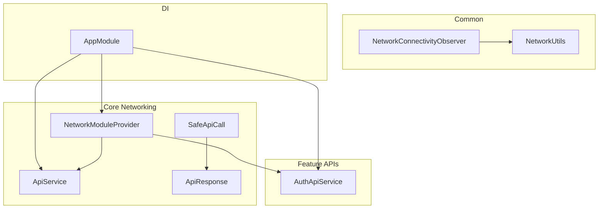
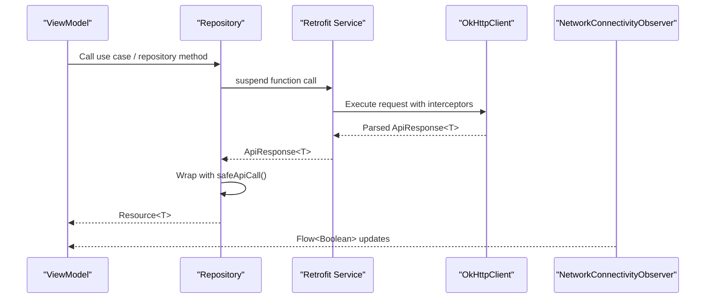
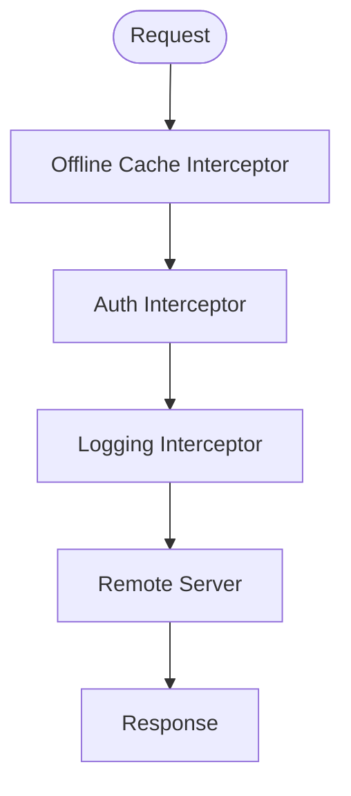
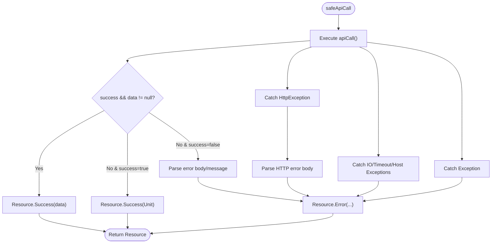
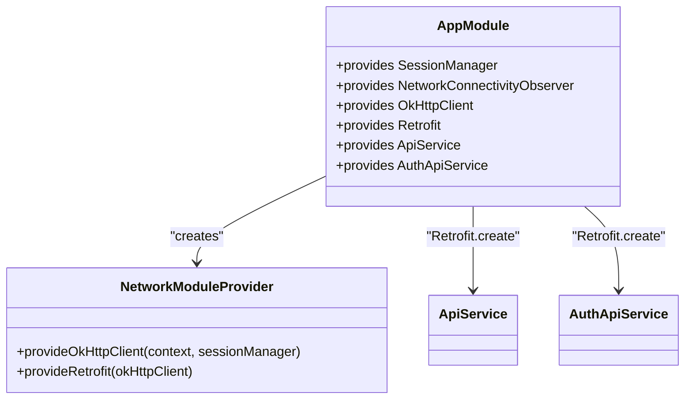

# Network Infrastructure

<cite>
**Referenced Files in This Document**
- [ApiService.kt](file://app/src/main/java/com/flirttime/core/network/ApiService.kt)
- [NetworkModuleProvider.kt](file://app/src/main/java/com/flirttime/core/network/NetworkModuleProvider.kt)
- [SafeApiCall.kt](file://app/src/main/java/com/flirttime/core/network/SafeApiCall.kt)
- [ApiResponse.kt](file://app/src/main/java/com/flirttime/core/network/model/ApiResponse.kt)
- [NetworkConnectivityObserver.kt](file://app/src/main/java/com/flirttime/core/common/NetworkConnectivityObserver.kt)
- [NetworkUtils.kt](file://app/src/main/java/com/flirttime/core/common/NetworkUtils.kt)
- [Resource.kt](file://app/src/main/java/com/flirttime/Resource.kt)
- [AppModule.kt](file://app/src/main/java/com/flirttime/di/AppModule.kt)
- [AuthApiService.kt](file://app/src/main/java/com/flirttime/feature/auth/data/network/AuthApiService.kt)
</cite>

## Table of Contents
1. [Introduction](#introduction)
2. [Project Structure](#project-structure)
3. [Core Components](#core-components)
4. [Architecture Overview](#architecture-overview)
5. [Detailed Component Analysis](#detailed-component-analysis)
6. [Dependency Analysis](#dependency-analysis)
7. [Performance Considerations](#performance-considerations)
8. [Troubleshooting Guide](#troubleshooting-guide)
9. [Conclusion](#conclusion)

## Introduction
This document explains the network infrastructure layer used across the application. It covers Retrofit client configuration, OkHttp interceptors chain, base API service interface, centralized error handling via SafeApiCall, request/response transformation, caching strategies, and network connectivity monitoring. It also provides guidance on making API calls, handling different response types, implementing custom interceptors, optimizing performance, and debugging network requests.

## Project Structure
The network layer is organized under core modules:
- Core networking: Retrofit client setup, interceptors, base API interfaces, and safe call wrappers
- Common utilities: Connectivity observer and network availability checks
- Dependency injection: Wiring of OkHttpClient, Retrofit, and API services
- Feature-specific API services: Domain-scoped endpoints that reuse the shared infrastructure

**Diagram sources**
- [NetworkModuleProvider.kt:17-85](file://app/src/main/java/com/flirttime/core/network/NetworkModuleProvider.kt#L17-L85)
- [ApiService.kt:9-22](file://app/src/main/java/com/flirttime/core/network/ApiService.kt#L9-L22)
- [SafeApiCall.kt:14-107](file://app/src/main/java/com/flirttime/core/network/SafeApiCall.kt#L14-L107)
- [ApiResponse.kt:5-11](file://app/src/main/java/com/flirttime/core/network/model/ApiResponse.kt#L5-L11)
- [NetworkConnectivityObserver.kt:13-48](file://app/src/main/java/com/flirttime/core/common/NetworkConnectivityObserver.kt#L13-L48)
- [NetworkUtils.kt:7-16](file://app/src/main/java/com/flirttime/core/common/NetworkUtils.kt#L7-L16)
- [AppModule.kt:27-40](file://app/src/main/java/com/flirttime/di/AppModule.kt#L27-L40)
- [AuthApiService.kt:13-46](file://app/src/main/java/com/flirttime/feature/auth/data/network/AuthApiService.kt#L13-L46)

**Section sources**
- [NetworkModuleProvider.kt:17-85](file://app/src/main/java/com/flirttime/core/network/NetworkModuleProvider.kt#L17-L85)
- [AppModule.kt:27-40](file://app/src/main/java/com/flirttime/di/AppModule.kt#L27-L40)

## Core Components
- Retrofit client and base API service: Centralized configuration for HTTP client, timeouts, caching, logging, and authentication; base API interface defines shared endpoints.
- Interceptors chain: Offline cache control, authorization header injection, and debug logging with sensitive header redaction.
- Response model: Generic ApiResponse envelope for success flag, message, data, and error fields.
- Safe API calls: Unified wrapper to convert API responses into a typed Resource state (Success/Error/Loading), parsing server errors and mapping exceptions.
- Connectivity monitoring: Flow-based observer for real-time network status and utility for one-off availability checks.

**Section sources**
- [ApiService.kt:9-22](file://app/src/main/java/com/flirttime/core/network/ApiService.kt#L9-L22)
- [NetworkModuleProvider.kt:22-75](file://app/src/main/java/com/flirttime/core/network/NetworkModuleProvider.kt#L22-L75)
- [ApiResponse.kt:5-11](file://app/src/main/java/com/flirttime/core/network/model/ApiResponse.kt#L5-L11)
- [SafeApiCall.kt:14-107](file://app/src/main/java/com/flirttime/core/network/SafeApiCall.kt#L14-L107)
- [NetworkConnectivityObserver.kt:13-48](file://app/src/main/java/com/flirttime/core/common/NetworkConnectivityObserver.kt#L13-L48)
- [NetworkUtils.kt:7-16](file://app/src/main/java/com/flirttime/core/common/NetworkUtils.kt#L7-L16)

## Architecture Overview
The system uses a layered approach:
- Presentation/ViewModels call feature API services or repositories
- Feature API services are Retrofit interfaces backed by a single OkHttpClient instance
- OkHttpClient is configured with interceptors for offline caching, auth headers, and logging
- SafeApiCall wraps suspend functions to return a consistent Resource type
- Connectivity observer streams network changes to UI layers

**Diagram sources**
- [AppModule.kt:34-40](file://app/src/main/java/com/flirttime/di/AppModule.kt#L34-L40)
- [NetworkModuleProvider.kt:67-84](file://app/src/main/java/com/flirttime/core/network/NetworkModuleProvider.kt#L67-L84)
- [SafeApiCall.kt:14-107](file://app/src/main/java/com/flirttime/core/network/SafeApiCall.kt#L14-L107)
- [NetworkConnectivityObserver.kt:18-47](file://app/src/main/java/com/flirttime/core/common/NetworkConnectivityObserver.kt#L18-L47)

## Detailed Component Analysis

### Retrofit Client Configuration and Interceptors
- Base URL: Provided via BuildConfig.BASE_URL.
- Gson converter: Used for JSON serialization/deserialization.
- Timeouts: Connect, read, and write set to a fixed timeout value.
- Cache: In-memory disk cache directory with a size limit.
- Interceptors order:
  1) Offline cache interceptor: Forces cached-only requests when offline with max stale policy.
  2) Auth interceptor: Adds Authorization header if token exists and sets Accept header.
  3) Logging interceptor: Logs request/response bodies in debug builds; redacts Authorization header.

**Diagram sources**
- [NetworkModuleProvider.kt:52-75](file://app/src/main/java/com/flirttime/core/network/NetworkModuleProvider.kt#L52-L75)

**Section sources**
- [NetworkModuleProvider.kt:17-85](file://app/src/main/java/com/flirttime/core/network/NetworkModuleProvider.kt#L17-L85)

### Base API Service Interface
- Defines shared endpoints such as country listing and login flows using suspend functions.
- Uses Map<String, String> for simple JSON bodies where appropriate.
- Returns domain models directly from the API layer.

Usage examples:
- GET countries
- POST login with phone/email/google

**Section sources**
- [ApiService.kt:9-22](file://app/src/main/java/com/flirttime/core/network/ApiService.kt#L9-L22)

### Centralized Error Handling with SafeApiCall
- Wraps any suspend API call and returns Resource<T>.
- Handles:
  - Successful ApiResponse with data or without data
  - HttpException: parses error body to extract user-friendly messages
  - SocketTimeoutException, UnknownHostException, IOException: maps to user-facing messages
  - Fallback generic exception handler
- Provides two variants:
  - safeApiCall: expects ApiResponse<T>
  - safeRawApiCall: wraps raw responses

**Diagram sources**
- [SafeApiCall.kt:14-107](file://app/src/main/java/com/flirttime/core/network/SafeApiCall.kt#L14-L107)

**Section sources**
- [SafeApiCall.kt:14-107](file://app/src/main/java/com/flirttime/core/network/SafeApiCall.kt#L14-L107)
- [Resource.kt:3-19](file://app/src/main/java/com/flirttime/Resource.kt#L3-L19)

### Request/Response Transformation
- Requests:
  - JSON bodies serialized via GsonConverterFactory
  - Headers added by interceptors (Authorization, Accept)
- Responses:
  - Deserialized into ApiResponse<T>
  - Transformed into Resource<T> by SafeApiCall

**Section sources**
- [NetworkModuleProvider.kt:78-84](file://app/src/main/java/com/flirttime/core/network/NetworkModuleProvider.kt#L78-L84)
- [ApiResponse.kt:5-11](file://app/src/main/java/com/flirttime/core/network/model/ApiResponse.kt#L5-L11)
- [SafeApiCall.kt:14-107](file://app/src/main/java/com/flirttime/core/network/SafeApiCall.kt#L14-L107)

### Caching Strategies
- Disk cache enabled with a fixed size limit.
- Offline mode:
  - When no network is available, requests are forced to use cached responses up to a maximum staleness threshold.
- Cache-Control usage:
  - onlyIfCached + maxStale(7 days) when offline.

Recommendations:
- For read-heavy endpoints, consider adding Cache-Control headers at the server level to leverage conditional requests (ETag/Last-Modified).
- Use separate cache directories per environment if needed.

**Section sources**
- [NetworkModuleProvider.kt:22-33](file://app/src/main/java/com/flirttime/core/network/NetworkModuleProvider.kt#L22-L33)
- [NetworkModuleProvider.kt:52-65](file://app/src/main/java/com/flirttime/core/network/NetworkModuleProvider.kt#L52-L65)

### Network Connectivity Monitoring
- NetworkConnectivityObserver exposes a Flow<Boolean> that emits connection state changes using ConnectivityManager callbacks.
- NetworkUtils provides a synchronous check for immediate availability.

Typical usage:
- Observe flow in ViewModel/UI to show online/offline banners or disable network actions.
- Use NetworkUtils.isNetworkAvailable before initiating background tasks.

**Section sources**
- [NetworkConnectivityObserver.kt:13-48](file://app/src/main/java/com/flirttime/core/common/NetworkConnectivityObserver.kt#L13-L48)
- [NetworkUtils.kt:7-16](file://app/src/main/java/com/flirttime/core/common/NetworkUtils.kt#L7-L16)

### Making API Calls and Handling Different Response Types
- Direct API calls:
  - Call suspend functions on ApiService or feature-specific services like AuthApiService.
- With SafeApiCall:
  - Wrap the API call to get Resource<T>, then handle Success/Error/Loading states in your UI layer.
- Raw responses:
  - Use safeRawApiCall when you need to process non-ApiResponse payloads directly.

Examples:
- Fetching countries via ApiService.getCountries()
- Authenticating via AuthApiService methods
- Handling Resource states in ViewModels

**Section sources**
- [ApiService.kt:9-22](file://app/src/main/java/com/flirttime/core/network/ApiService.kt#L9-L22)
- [AuthApiService.kt:13-46](file://app/src/main/java/com/flirttime/feature/auth/data/network/AuthApiService.kt#L13-L46)
- [SafeApiCall.kt:14-107](file://app/src/main/java/com/flirttime/core/network/SafeApiCall.kt#L14-L107)

### Implementing Custom Interceptors
To add custom behavior:
- Create an OkHttp Interceptor class.
- Insert it into the chain in provideOkHttpClient with the desired position.
- Examples:
  - Retry logic with exponential backoff
  - Request metrics and analytics
  - Custom headers or request mutation

Guidelines:
- Keep interceptors small and focused.
- Avoid heavy work inside interceptors; offload to coroutines if necessary.
- Ensure thread-safety and avoid blocking operations.

**Section sources**
- [NetworkModuleProvider.kt:35-50](file://app/src/main/java/com/flirttime/core/network/NetworkModuleProvider.kt#L35-L50)

## Dependency Analysis
The DI module wires the network stack:
- SessionManager is provided first (used by auth interceptor)
- OkHttpClient created via NetworkModuleProvider.provideOkHttpClient
- Retrofit created via NetworkModuleProvider.provideRetrofit
- ApiService and feature services instantiated from Retrofit

**Diagram sources**
- [AppModule.kt:27-40](file://app/src/main/java/com/flirttime/di/AppModule.kt#L27-L40)
- [NetworkModuleProvider.kt:22-84](file://app/src/main/java/com/flirttime/core/network/NetworkModuleProvider.kt#L22-L84)

**Section sources**
- [AppModule.kt:27-40](file://app/src/main/java/com/flirttime/di/AppModule.kt#L27-L40)

## Performance Considerations
- Connection pooling: OkHttpClient reuses connections; keep a single instance.
- Timeouts: Balanced connect/read/write timeouts prevent long hangs.
- Caching:
  - Enable disk cache for offline support and reduced latency.
  - Tune cache size based on app needs.
- Serialization: GsonConverterFactory is efficient; ensure models are minimal.
- Logging: Disable body logging in production to reduce overhead.
- Network requests:
  - Prefer suspend functions and coroutines to avoid blocking threads.
  - Batch related requests where possible.
- Observability:
  - Use structured logs and metrics in release builds without exposing sensitive data.

[No sources needed since this section provides general guidance]

## Troubleshooting Guide
Common issues and resolutions:
- Authentication failures:
  - Verify token presence and format; ensure Authorization header is set correctly.
- Network errors:
  - Handle UnknownHostException and IOException gracefully; prompt users to check connectivity.
- Timeouts:
  - Increase timeouts for slow networks or optimize payload sizes.
- Parsing errors:
  - Validate server response structure; ensure Gson mappings match API schema.
- Debugging:
  - Enable HttpLoggingInterceptor in debug builds; review redacted headers.
  - Inspect Resource.Error details including code and errorBody.

Operational tips:
- Use NetworkConnectivityObserver to adapt UI to offline states.
- Leverage safeApiCall to centralize error handling and avoid repetitive try/catch blocks.

**Section sources**
- [SafeApiCall.kt:33-63](file://app/src/main/java/com/flirttime/core/network/SafeApiCall.kt#L33-L63)
- [NetworkModuleProvider.kt:26-33](file://app/src/main/java/com/flirttime/core/network/NetworkModuleProvider.kt#L26-L33)

## Conclusion
The network infrastructure combines a well-configured Retrofit client, a clear interceptor chain, a unified error-handling wrapper, and robust connectivity monitoring. This design promotes consistency, maintainability, and resilience across features. By following the patterns outlined here—using SafeApiCall for all network calls, leveraging the provided interceptors, and observing connectivity—you can build reliable, performant, and debuggable network interactions throughout the application.