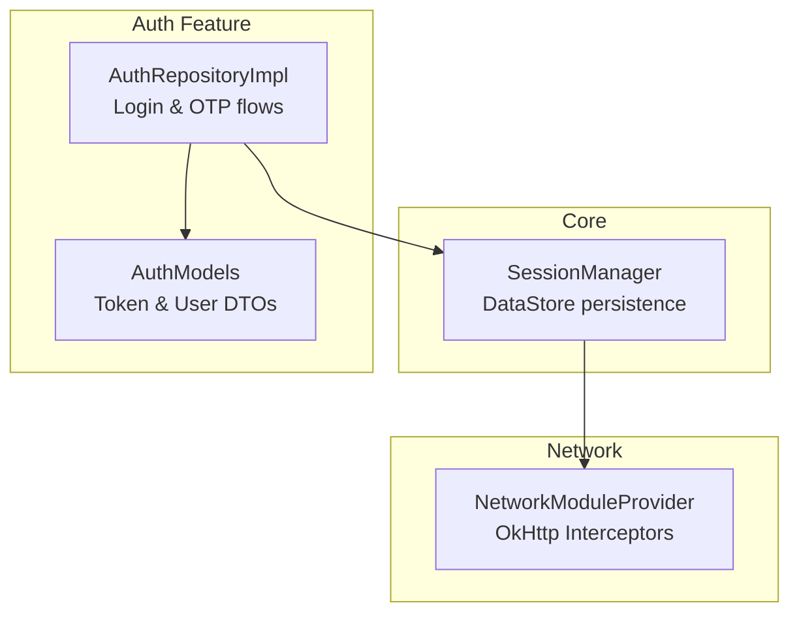
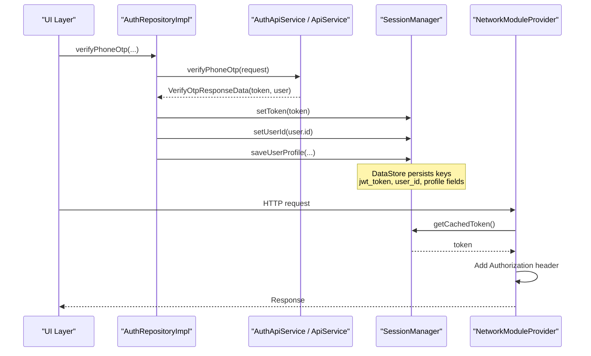
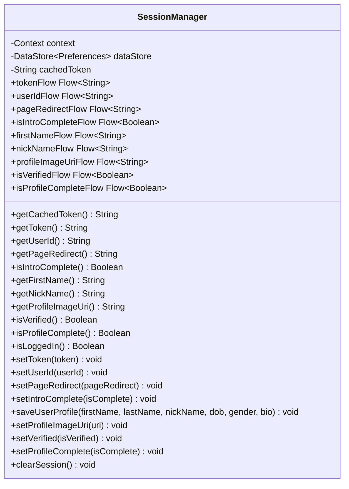
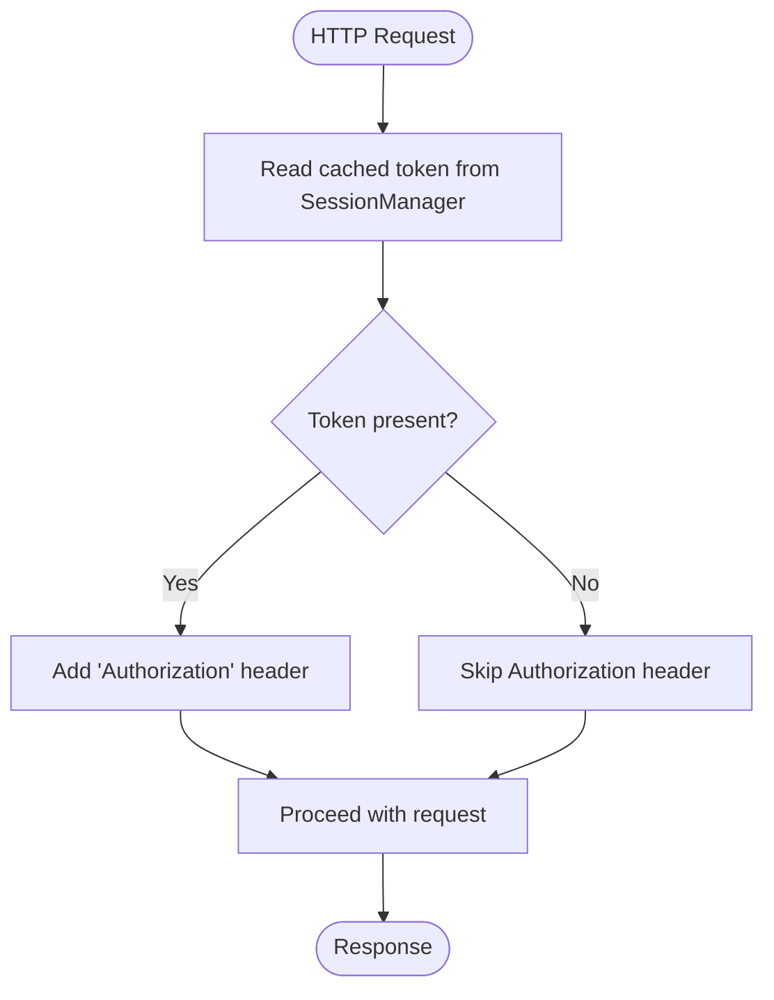
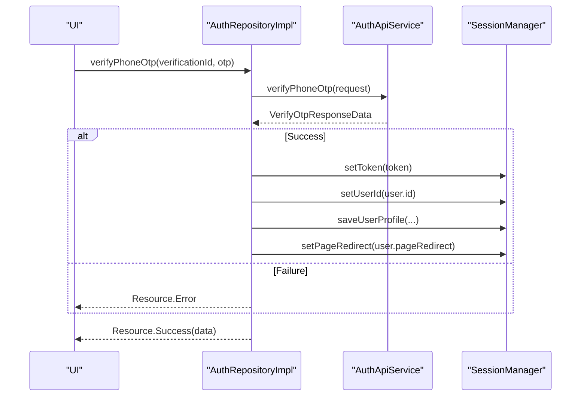
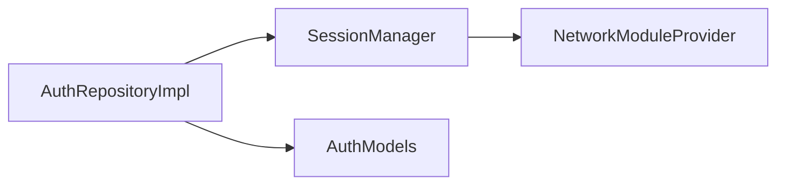

# Session Management

<cite>
**Referenced Files in This Document**
- [SessionManager.kt](file://app/src/main/java/com/flirttime/core/database/SessionManager.kt)
- [NetworkModuleProvider.kt](file://app/src/main/java/com/flirttime/core/network/NetworkModuleProvider.kt)
- [AuthRepositoryImpl.kt](file://app/src/main/java/com/flirttime/feature/auth/data/repository/AuthRepositoryImpl.kt)
- [AuthModels.kt](file://app/src/main/java/com/flirttime/feature/auth/data/model/AuthModels.kt)
- [backup_rules.xml](file://app/src/main/res/xml/backup_rules.xml)
- [data_extraction_rules.xml](file://app/src/main/res/xml/data_extraction_rules.xml)
</cite>

## Table of Contents
1. [Introduction](#introduction)
2. [Project Structure](#project-structure)
3. [Core Components](#core-components)
4. [Architecture Overview](#architecture-overview)
5. [Detailed Component Analysis](#detailed-component-analysis)
6. [Dependency Analysis](#dependency-analysis)
7. [Performance Considerations](#performance-considerations)
8. [Troubleshooting Guide](#troubleshooting-guide)
9. [Conclusion](#conclusion)
10. [Appendices](#appendices)

## Introduction
This document explains the session management system built with Android DataStore. It covers how authentication state is persisted, how tokens are stored and retrieved, and how the session lifecycle is managed across app components. It also documents the data structures used for user preferences, authentication tokens, and app settings; provides examples of read/write operations; and outlines secure storage practices, session expiration handling, data migration strategies, and backup/restore considerations.

## Project Structure
The session management spans three primary areas:
- Core persistence layer using DataStore (preferences)
- Network layer that injects authentication headers from cached tokens
- Authentication repository that writes session state after successful login flows

**Diagram sources**
- [SessionManager.kt:20-221](file://app/src/main/java/com/flirttime/core/database/SessionManager.kt#L20-L221)
- [NetworkModuleProvider.kt:22-75](file://app/src/main/java/com/flirttime/core/network/NetworkModuleProvider.kt#L22-L75)
- [AuthRepositoryImpl.kt:23-216](file://app/src/main/java/com/flirttime/feature/auth/data/repository/AuthRepositoryImpl.kt#L23-L216)
- [AuthModels.kt:30-64](file://app/src/main/java/com/flirttime/feature/auth/data/model/AuthModels.kt#L30-L64)

**Section sources**
- [SessionManager.kt:20-221](file://app/src/main/java/com/flirttime/core/database/SessionManager.kt#L20-L221)
- [NetworkModuleProvider.kt:22-75](file://app/src/main/java/com/flirttime/core/network/NetworkModuleProvider.kt#L22-L75)
- [AuthRepositoryImpl.kt:23-216](file://app/src/main/java/com/flirttime/feature/auth/data/repository/AuthRepositoryImpl.kt#L23-L216)
- [AuthModels.kt:30-64](file://app/src/main/java/com/flirttime/feature/auth/data/model/AuthModels.kt#L30-L64)

## Core Components
- SessionManager: Centralized DataStore-backed session store providing Flow-based reactive reads, synchronous snapshot reads, a hot-cached token for network interceptors, and session clearing logic.
- NetworkModuleProvider: OkHttp configuration with an Authorization interceptor that attaches the cached token to outgoing requests.
- AuthRepositoryImpl: Orchestrates authentication flows and persists tokens and user profile data into SessionManager upon success.
- AuthModels: Defines server response models including token fields and user data used by the repository to populate session state.

Key responsibilities:
- Persist and retrieve JWT token, user ID, page redirect, intro completion flag, and profile attributes.
- Provide reactive streams for UI or other layers to observe changes.
- Attach Authorization headers automatically via OkHttp interceptor.
- Clear sensitive session data while preserving non-sensitive onboarding state.

**Section sources**
- [SessionManager.kt:22-221](file://app/src/main/java/com/flirttime/core/database/SessionManager.kt#L22-L221)
- [NetworkModuleProvider.kt:22-75](file://app/src/main/java/com/flirttime/core/network/NetworkModuleProvider.kt#L22-L75)
- [AuthRepositoryImpl.kt:23-216](file://app/src/main/java/com/flirttime/feature/auth/data/repository/AuthRepositoryImpl.kt#L23-L216)
- [AuthModels.kt:30-64](file://app/src/main/java/com/flirttime/feature/auth/data/model/AuthModels.kt#L30-L64)

## Architecture Overview
The following sequence shows how a successful authentication flow updates the session and how subsequent API calls use the cached token.

**Diagram sources**
- [AuthRepositoryImpl.kt:40-75](file://app/src/main/java/com/flirttime/feature/auth/data/repository/AuthRepositoryImpl.kt#L40-L75)
- [SessionManager.kt:136-177](file://app/src/main/java/com/flirttime/core/database/SessionManager.kt#L136-L177)
- [NetworkModuleProvider.kt:35-50](file://app/src/main/java/com/flirttime/core/network/NetworkModuleProvider.kt#L35-L50)

## Detailed Component Analysis

### SessionManager
Responsibilities:
- DataStore initialization with a named preferences file.
- Reactive Flow accessors for token, user ID, page redirect, intro status, and profile fields.
- Synchronous snapshot helpers for coroutine contexts.
- Hot-cached token updated asynchronously for fast network interceptor reads.
- Write operations for all session-related keys.
- Session clear that preserves onboarding progress.

Data model overview (keys and types):
- jwt_token: String
- user_id: String
- page_redirect: String
- is_intro_complete: Boolean
- first_name, last_name, nick_name, dob, gender, bio: String
- profile_image_uri: String
- is_verified: Boolean
- is_profile_complete: Boolean

**Diagram sources**
- [SessionManager.kt:22-221](file://app/src/main/java/com/flirttime/core/database/SessionManager.kt#L22-L221)

Important behaviors:
- Token caching: A background collector keeps a volatile cachedToken in sync with tokenFlow for low-latency reads by the network interceptor.
- Error resilience: IO exceptions during DataStore reads are handled by emitting empty preferences so flows do not fail.
- Session clearing: Clears all preferences but restores the intro completion flag to avoid re-showing onboarding.

**Section sources**
- [SessionManager.kt:20-221](file://app/src/main/java/com/flirttime/core/database/SessionManager.kt#L20-L221)

### NetworkModuleProvider (Authorization Interceptor)
Responsibilities:
- Build OkHttpClient with logging, cache, timeouts, and interceptors.
- Attach Authorization header using the cached token from SessionManager.
- Redact Authorization header in logs to prevent accidental leaks.
- Provide offline fallback behavior using OkHttp cache when no network is available.

**Diagram sources**
- [NetworkModuleProvider.kt:35-50](file://app/src/main/java/com/flirttime/core/network/NetworkModuleProvider.kt#L35-L50)

Security notes:
- The Authorization header is redacted in debug logs.
- Tokens are never logged or printed.

**Section sources**
- [NetworkModuleProvider.kt:22-75](file://app/src/main/java/com/flirttime/core/network/NetworkModuleProvider.kt#L22-L75)

### AuthRepositoryImpl (Authentication Flows)
Responsibilities:
- Call auth APIs for phone/email OTP verification and login flows.
- On success, persist token, user ID, profile fields, and redirect target into SessionManager.
- Expose flows for UI to observe loading/success/error states.

**Diagram sources**
- [AuthRepositoryImpl.kt:40-75](file://app/src/main/java/com/flirttime/feature/auth/data/repository/AuthRepositoryImpl.kt#L40-L75)
- [AuthRepositoryImpl.kt:97-132](file://app/src/main/java/com/flirttime/feature/auth/data/repository/AuthRepositoryImpl.kt#L97-L132)
- [AuthRepositoryImpl.kt:156-188](file://app/src/main/java/com/flirttime/feature/auth/data/repository/AuthRepositoryImpl.kt#L156-L188)
- [AuthRepositoryImpl.kt:190-216](file://app/src/main/java/com/flirttime/feature/auth/data/repository/AuthRepositoryImpl.kt#L190-L216)

**Section sources**
- [AuthRepositoryImpl.kt:23-216](file://app/src/main/java/com/flirttime/feature/auth/data/repository/AuthRepositoryImpl.kt#L23-L216)
- [AuthModels.kt:30-64](file://app/src/main/java/com/flirttime/feature/auth/data/model/AuthModels.kt#L30-L64)

### AuthModels (Token and User DTOs)
Responsibilities:
- Define server payloads for OTP verification and login responses.
- Provide a helper to resolve the effective token field across different response shapes.

Key fields relevant to session:
- VerifyOtpResponseData.token or accessToken
- AuthUserDto.user fields mapped into SessionManager (id, profile fields, verification flags, redirect)

**Section sources**
- [AuthModels.kt:30-64](file://app/src/main/java/com/flirttime/feature/auth/data/model/AuthModels.kt#L30-L64)

## Dependency Analysis
- SessionManager depends on Android Context and DataStore Preferences.
- NetworkModuleProvider depends on SessionManager to obtain the cached token.
- AuthRepositoryImpl depends on SessionManager to persist session state and on AuthModels to parse server responses.

**Diagram sources**
- [SessionManager.kt:20-221](file://app/src/main/java/com/flirttime/core/database/SessionManager.kt#L20-L221)
- [NetworkModuleProvider.kt:22-75](file://app/src/main/java/com/flirttime/core/network/NetworkModuleProvider.kt#L22-L75)
- [AuthRepositoryImpl.kt:23-216](file://app/src/main/java/com/flirttime/feature/auth/data/repository/AuthRepositoryImpl.kt#L23-L216)
- [AuthModels.kt:30-64](file://app/src/main/java/com/flirttime/feature/auth/data/model/AuthModels.kt#L30-L64)

**Section sources**
- [SessionManager.kt:20-221](file://app/src/main/java/com/flirttime/core/database/SessionManager.kt#L20-L221)
- [NetworkModuleProvider.kt:22-75](file://app/src/main/java/com/flirttime/core/network/NetworkModuleProvider.kt#L22-L75)
- [AuthRepositoryImpl.kt:23-216](file://app/src/main/java/com/flirttime/feature/auth/data/repository/AuthRepositoryImpl.kt#L23-L216)
- [AuthModels.kt:30-64](file://app/src/main/java/com/flirttime/feature/auth/data/model/AuthModels.kt#L30-L64)

## Performance Considerations
- Hot-cached token: SessionManager maintains a volatile cachedToken updated by collecting tokenFlow, enabling fast, non-blocking reads in the OkHttp interceptor without hitting DataStore on every request.
- Reactive flows: All getters expose Flow streams to avoid polling and enable efficient UI updates.
- IO isolation: DataStore operations run off the main thread; collectors run on Dispatchers.IO.
- Network cache: OkHttp cache reduces redundant network calls; offline mode uses only-if-cached strategy with max stale policy.

Recommendations:
- Prefer Flow observers in UI for reactive updates.
- Use getCachedToken() in performance-sensitive paths like interceptors.
- Batch multiple preference writes within a single edit block to reduce I/O.

[No sources needed since this section provides general guidance]

## Troubleshooting Guide
Common issues and resolutions:
- Missing Authorization header: Ensure SessionManager.setToken was called after successful authentication and that getCachedToken returns a non-blank value.
- Token not applied: Confirm the interceptor adds the Authorization header and that the token does not require additional formatting (the interceptor supports both raw and Bearer-prefixed tokens).
- Session not cleared: Verify clearSession is invoked on logout; it clears all keys except the intro completion flag.
- DataStore read failures: IO exceptions are caught and replaced with empty preferences; flows will emit default values rather than crash.

Operational tips:
- Use isLoggedIn() to determine if a user has an active session.
- When debugging, ensure Authorization header redaction is enabled to avoid leaking secrets in logs.

**Section sources**
- [SessionManager.kt:197-205](file://app/src/main/java/com/flirttime/core/database/SessionManager.kt#L197-L205)
- [NetworkModuleProvider.kt:35-50](file://app/src/main/java/com/flirttime/core/network/NetworkModuleProvider.kt#L35-L50)

## Conclusion
The session management system leverages DataStore for reliable, reactive persistence of authentication tokens and user preferences. SessionManager centralizes all session state, NetworkModuleProvider ensures authenticated requests, and AuthRepositoryImpl orchestrates login flows and populates session data. The design emphasizes security (header redaction), performance (hot-cached token), and resilience (IO error handling). For production, consider adding explicit token expiration handling and enhancing backup/restore rules to exclude sensitive data.

[No sources needed since this section summarizes without analyzing specific files]

## Appendices

### Read/Write Examples (Conceptual)
- Read token: Observe tokenFlow or call getToken() in a coroutine.
- Write token: Call setToken(token) after successful authentication.
- Read user info: Observe userIdFlow, firstNameFlow, etc., or use corresponding suspend getters.
- Write profile: Call saveUserProfile(...) with user details.
- Logout: Call clearSession() to remove sensitive data while preserving onboarding state.

[No sources needed since this section provides general guidance]

### Handling Session Expiration
Current implementation does not include automatic token refresh or expiration checks. Recommended approach:
- Store token expiry timestamp alongside the token.
- Before each request, check expiry; if expired, trigger refresh flow or force re-login.
- Invalidate cached token and prompt user to re-authenticate when refresh fails.

[No sources needed since this section provides general guidance]

### Secure Storage Practices
- Do not log tokens or Authorization headers.
- Avoid storing long-lived credentials beyond what is necessary.
- Consider encrypting sensitive preferences at rest if required by compliance.
- Restrict backup/export of sensitive keys.

[No sources needed since this section provides general guidance]

### Data Migration Strategies
- Version your DataStore schema by introducing a version key and migrating older keys to new ones on app start.
- On migration failure, fall back to defaults and optionally wipe corrupted keys.
- Keep backward compatibility for existing keys where possible.

[No sources needed since this section provides general guidance]

### Backup and Restore
Android backup/extraction rules are present but currently commented out. To control what gets backed up:
- Exclude sensitive keys (e.g., jwt_token) from full-backup-content and cloud-backup sections.
- Include only non-sensitive preferences if desired.

Relevant files:
- [backup_rules.xml](file://app/src/main/res/xml/backup_rules.xml)
- [data_extraction_rules.xml](file://app/src/main/res/xml/data_extraction_rules.xml)

**Section sources**
- [backup_rules.xml:1-13](file://app/src/main/res/xml/backup_rules.xml#L1-L13)
- [data_extraction_rules.xml:1-19](file://app/src/main/res/xml/data_extraction_rules.xml#L1-L19)