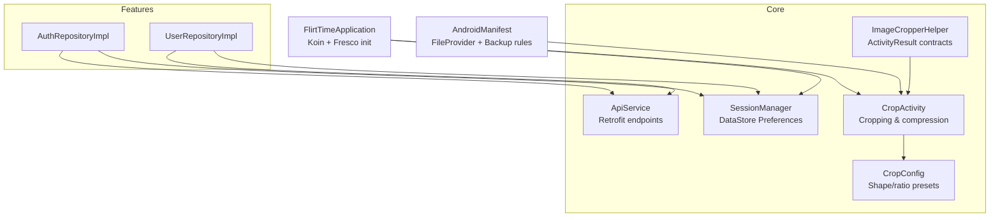
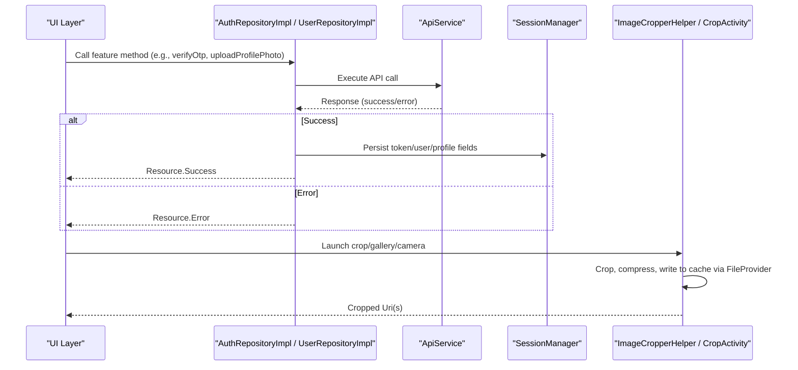
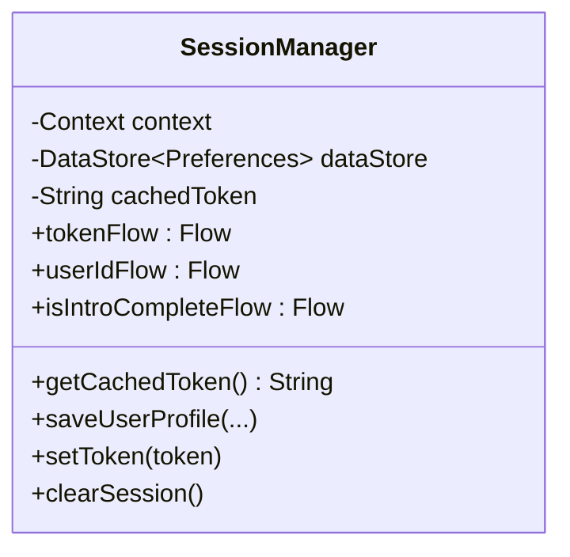
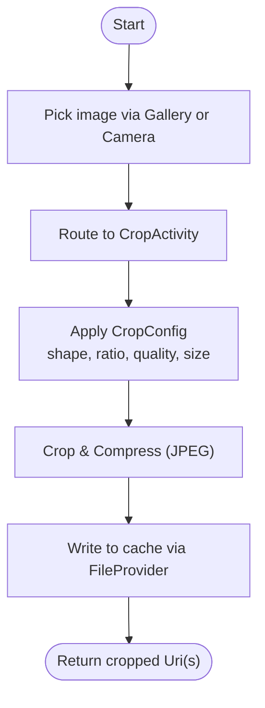
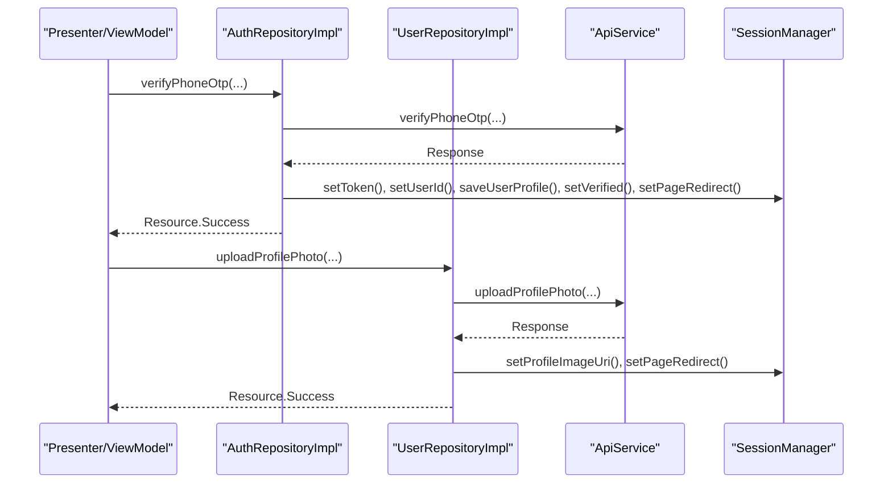
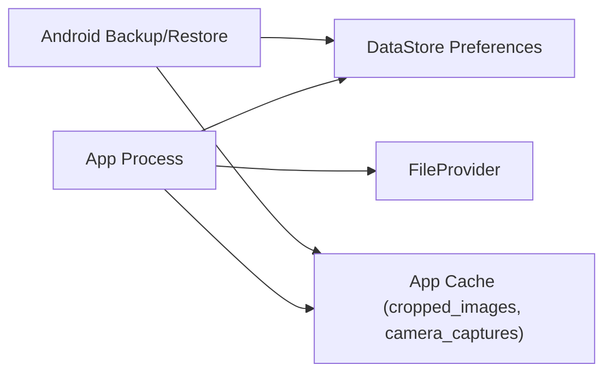
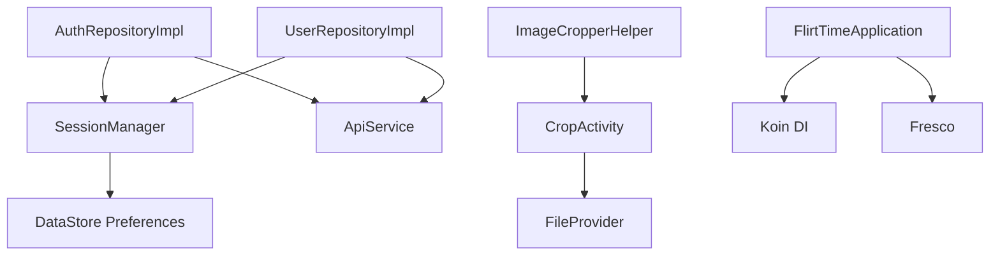

# Data Management

<cite>
**Referenced Files in This Document**
- [SessionManager.kt](file://app/src/main/java/com/flirttime/core/database/SessionManager.kt)
- [ImageCropperHelper.kt](file://app/src/main/java/com/flirttime/core/image/ImageCropperHelper.kt)
- [CropActivity.kt](file://app/src/main/java/com/flirttime/core/image/CropActivity.kt)
- [CropConfig.kt](file://app/src/main/java/com/flirttime/core/image/CropConfig.kt)
- [AuthRepositoryImpl.kt](file://app/src/main/java/com/flirttime/feature/auth/data/repository/AuthRepositoryImpl.kt)
- [UserRepositoryImpl.kt](file://app/src/main/java/com/flirttime/feature/profile/data/repository/UserRepositoryImpl.kt)
- [ApiService.kt](file://app/src/main/java/com/flirttime/core/network/ApiService.kt)
- [FlirtTimeApplication.kt](file://app/src/main/java/com/flirttime/FlirtTimeApplication.kt)
- [AndroidManifest.xml](file://app/src/main/AndroidManifest.xml)
- [backup_rules.xml](file://app/src/main/res/xml/backup_rules.xml)
- [data_extraction_rules.xml](file://app/src/main/res/xml/data_extraction_rules.xml)
</cite>

## Table of Contents
1. [Introduction](#introduction)
2. [Project Structure](#project-structure)
3. [Core Components](#core-components)
4. [Architecture Overview](#architecture-overview)
5. [Detailed Component Analysis](#detailed-component-analysis)
6. [Dependency Analysis](#dependency-analysis)
7. [Performance Considerations](#performance-considerations)
8. [Troubleshooting Guide](#troubleshooting-guide)
9. [Conclusion](#conclusion)

## Introduction
This document explains how Flirttime-Otp-Android manages data across local storage, image processing, and remote APIs. It focuses on:
- Local persistence using DataStore Preferences for user sessions and settings
- Image processing pipeline with cropping, compression, and caching via FileProvider and system libraries
- Synchronization patterns between repositories and network services
- Repository pattern usage to abstract data sources
- Backup and restore configuration, integrity considerations, and performance guidance for large datasets

## Project Structure
The data-related code is organized into clear layers:
- Core utilities: session management (DataStore), networking interfaces, and image handling
- Feature modules: authentication and profile features implement repository classes that coordinate API calls and local state updates
- Application bootstrap initializes dependency injection and image loading infrastructure

**Diagram sources**
- [SessionManager.kt:1-223](file://app/src/main/java/com/flirttime/core/database/SessionManager.kt#L1-L223)
- [ApiService.kt:1-23](file://app/src/main/java/com/flirttime/core/network/ApiService.kt#L1-L23)
- [ImageCropperHelper.kt:1-173](file://app/src/main/java/com/flirttime/core/image/ImageCropperHelper.kt#L1-L173)
- [CropActivity.kt:1-293](file://app/src/main/java/com/flirttime/core/image/CropActivity.kt#L1-L293)
- [CropConfig.kt:1-117](file://app/src/main/java/com/flirttime/core/image/CropConfig.kt#L1-L117)
- [AuthRepositoryImpl.kt:1-218](file://app/src/main/java/com/flirttime/feature/auth/data/repository/AuthRepositoryImpl.kt#L1-L218)
- [UserRepositoryImpl.kt:1-127](file://app/src/main/java/com/flirttime/feature/profile/data/repository/UserRepositoryImpl.kt#L1-L127)
- [FlirtTimeApplication.kt:1-23](file://app/src/main/java/com/flirttime/FlirtTimeApplication.kt#L1-L23)
- [AndroidManifest.xml:30-65](file://app/src/main/AndroidManifest.xml#L30-L65)

**Section sources**
- [FlirtTimeApplication.kt:10-22](file://app/src/main/java/com/flirttime/FlirtTimeApplication.kt#L10-L22)
- [AndroidManifest.xml:30-65](file://app/src/main/AndroidManifest.xml#L30-L65)

## Core Components
- SessionManager: Centralizes DataStore-backed preferences for tokens, user identifiers, profile flags, and UI state. Exposes Flow-based reactive reads and suspend functions for synchronous snapshots. Includes a volatile in-memory token cache for fast interceptor access.
- Repositories: AuthRepositoryImpl and UserRepositoryImpl orchestrate API calls and persist relevant results to SessionManager. They emit Resource flows to the presentation layer.
- Image Pipeline: ImageCropperHelper registers ActivityResultContracts for gallery and camera, routing to CropActivity which performs cropping, resizing, and JPEG compression. Output URIs are managed via FileProvider and app cache directories.
- Networking: ApiService defines Retrofit endpoints used by repositories. Network calls are wrapped with safe wrappers to normalize responses.

**Section sources**
- [SessionManager.kt:20-221](file://app/src/main/java/com/flirttime/core/database/SessionManager.kt#L20-L221)
- [AuthRepositoryImpl.kt:23-217](file://app/src/main/java/com/flirttime/feature/auth/data/repository/AuthRepositoryImpl.kt#L23-L217)
- [UserRepositoryImpl.kt:20-126](file://app/src/main/java/com/flirttime/feature/profile/data/repository/UserRepositoryImpl.kt#L20-L126)
- [ImageCropperHelper.kt:21-172](file://app/src/main/java/com/flirttime/core/image/ImageCropperHelper.kt#L21-L172)
- [CropActivity.kt:30-292](file://app/src/main/java/com/flirttime/core/image/CropActivity.kt#L30-L292)
- [CropConfig.kt:28-116](file://app/src/main/java/com/flirttime/core/image/CropConfig.kt#L28-L116)
- [ApiService.kt:9-22](file://app/src/main/java/com/flirttime/core/network/ApiService.kt#L9-L22)

## Architecture Overview
The application follows a layered architecture:
- Presentation observes Flow from repositories or SessionManager
- Repositories call network services and update SessionManager on success
- SessionManager persists key-value pairs using DataStore Preferences
- Image operations use ActivityResultContracts and CropActivity; output files are stored under app cache and shared via FileProvider

**Diagram sources**
- [AuthRepositoryImpl.kt:29-217](file://app/src/main/java/com/flirttime/feature/auth/data/repository/AuthRepositoryImpl.kt#L29-L217)
- [UserRepositoryImpl.kt:25-125](file://app/src/main/java/com/flirttime/feature/profile/data/repository/UserRepositoryImpl.kt#L25-L125)
- [SessionManager.kt:22-205](file://app/src/main/java/com/flirttime/core/database/SessionManager.kt#L22-L205)
- [ImageCropperHelper.kt:31-172](file://app/src/main/java/com/flirttime/core/image/ImageCropperHelper.kt#L31-L172)
- [CropActivity.kt:99-292](file://app/src/main/java/com/flirttime/core/image/CropActivity.kt#L99-L292)

## Detailed Component Analysis

### DataStore Session Manager
Responsibilities:
- Provide typed keys and Flow streams for token, user id, profile completeness, verification status, and other UI/session flags
- Offer suspend getters for one-shot reads and a cached token getter for interceptors
- Clear session while preserving intro completion state

Key behaviors:
- Reactive reads via Flow.map over DataStore.data with IOException fallback to empty preferences
- Atomic writes via DataStore.edit
- In-memory volatile token cache updated on Flow emission

**Diagram sources**
- [SessionManager.kt:22-205](file://app/src/main/java/com/flirttime/core/database/SessionManager.kt#L22-L205)

**Section sources**
- [SessionManager.kt:20-221](file://app/src/main/java/com/flirttime/core/database/SessionManager.kt#L20-L221)

### Image Processing Pipeline
Responsibilities:
- Unified entry points for gallery selection, camera capture, and direct URI cropping
- Lifecycle-safe registration of ActivityResultContracts
- Routing to CropActivity for cropping, resizing, and compression
- Storing cropped outputs in app cache and exposing them through FileProvider

Processing flow:
- Gallery or camera returns a source Uri
- CropActivity applies shape, aspect ratio, resize, and JPEG compression
- Output is written to cacheDir/cropped_images or a provided custom file path
- Result returned as Uri(s) to caller

**Diagram sources**
- [ImageCropperHelper.kt:31-172](file://app/src/main/java/com/flirttime/core/image/ImageCropperHelper.kt#L31-L172)
- [CropActivity.kt:99-292](file://app/src/main/java/com/flirttime/core/image/CropActivity.kt#L99-L292)
- [CropConfig.kt:28-116](file://app/src/main/java/com/flirttime/core/image/CropConfig.kt#L28-L116)

**Section sources**
- [ImageCropperHelper.kt:21-172](file://app/src/main/java/com/flirttime/core/image/ImageCropperHelper.kt#L21-L172)
- [CropActivity.kt:30-292](file://app/src/main/java/com/flirttime/core/image/CropActivity.kt#L30-L292)
- [CropConfig.kt:1-117](file://app/src/main/java/com/flirttime/core/image/CropConfig.kt#L1-L117)

### Repository Pattern and Data Synchronization
Repositories encapsulate business logic and coordinate between network and local storage:
- AuthRepositoryImpl:
  - Emits Resource flows for OTP requests, verifications, resend, country list, phone login, and Google login
  - On successful auth, persists token, user id, profile flags, profile picture URL, and redirect page into SessionManager
- UserRepositoryImpl:
  - Updates profile and persists name/gender/bio fields to SessionManager
  - Uploads profile photo and gesture selfie, updating SessionManager with new photo URL and verification status

**Diagram sources**
- [AuthRepositoryImpl.kt:29-217](file://app/src/main/java/com/flirttime/feature/auth/data/repository/AuthRepositoryImpl.kt#L29-L217)
- [UserRepositoryImpl.kt:25-125](file://app/src/main/java/com/flirttime/feature/profile/data/repository/UserRepositoryImpl.kt#L25-L125)
- [ApiService.kt:9-22](file://app/src/main/java/com/flirttime/core/network/ApiService.kt#L9-L22)
- [SessionManager.kt:136-205](file://app/src/main/java/com/flirttime/core/database/SessionManager.kt#L136-L205)

**Section sources**
- [AuthRepositoryImpl.kt:23-217](file://app/src/main/java/com/flirttime/feature/auth/data/repository/AuthRepositoryImpl.kt#L23-L217)
- [UserRepositoryImpl.kt:20-126](file://app/src/main/java/com/flirttime/feature/profile/data/repository/UserRepositoryImpl.kt#L20-L126)

### Backup, Restore, and Data Integrity
- Backup and restore are enabled at the manifest level, referencing backup_rules.xml and data_extraction_rules.xml.
- DataStore Preferences store small, critical values (tokens, IDs, flags). For robustness:
  - Use atomic edits (already done via DataStore.edit)
  - Preserve essential non-auth state (e.g., intro complete) when clearing session
  - Validate incoming data before writing to SessionManager
- FileProvider is configured for secure sharing of cropped images and camera captures.

**Diagram sources**
- [AndroidManifest.xml:37-57](file://app/src/main/AndroidManifest.xml#L37-L57)
- [backup_rules.xml](file://app/src/main/res/xml/backup_rules.xml)
- [data_extraction_rules.xml](file://app/src/main/res/xml/data_extraction_rules.xml)
- [SessionManager.kt:197-205](file://app/src/main/java/com/flirttime/core/database/SessionManager.kt#L197-L205)
- [CropActivity.kt:275-291](file://app/src/main/java/com/flirttime/core/image/CropActivity.kt#L275-L291)
- [ImageCropperHelper.kt:151-171](file://app/src/main/java/com/flirttime/core/image/ImageCropperHelper.kt#L151-L171)

**Section sources**
- [AndroidManifest.xml:37-57](file://app/src/main/AndroidManifest.xml#L37-L57)
- [backup_rules.xml](file://app/src/main/res/xml/backup_rules.xml)
- [data_extraction_rules.xml](file://app/src/main/res/xml/data_extraction_rules.xml)
- [SessionManager.kt:197-205](file://app/src/main/java/com/flirttime/core/database/SessionManager.kt#L197-L205)

## Dependency Analysis
- SessionManager depends on DataStore Preferences and Kotlin coroutines/Flow
- Repositories depend on ApiService and SessionManager
- ImageCropperHelper depends on ActivityResultContracts and CropActivity
- CropActivity depends on CropImageView (external library) and FileProvider
- Application initializes Koin and Fresco

**Diagram sources**
- [SessionManager.kt:20-221](file://app/src/main/java/com/flirttime/core/database/SessionManager.kt#L20-L221)
- [AuthRepositoryImpl.kt:23-217](file://app/src/main/java/com/flirttime/feature/auth/data/repository/AuthRepositoryImpl.kt#L23-L217)
- [UserRepositoryImpl.kt:20-126](file://app/src/main/java/com/flirttime/feature/profile/data/repository/UserRepositoryImpl.kt#L20-L126)
- [ApiService.kt:9-22](file://app/src/main/java/com/flirttime/core/network/ApiService.kt#L9-L22)
- [ImageCropperHelper.kt:31-172](file://app/src/main/java/com/flirttime/core/image/ImageCropperHelper.kt#L31-L172)
- [CropActivity.kt:99-292](file://app/src/main/java/com/flirttime/core/image/CropActivity.kt#L99-L292)
- [FlirtTimeApplication.kt:10-22](file://app/src/main/java/com/flirttime/FlirtTimeApplication.kt#L10-L22)

**Section sources**
- [ApiService.kt:9-22](file://app/src/main/java/com/flirttime/core/network/ApiService.kt#L9-L22)
- [FlirtTimeApplication.kt:10-22](file://app/src/main/java/com/flirttime/FlirtTimeApplication.kt#L10-L22)

## Performance Considerations
- DataStore Preferences:
  - Prefer Flow-based reads to avoid blocking the main thread
  - Use suspend getters only when necessary
  - Keep stored values small; avoid storing large strings or binary data
- Image Pipeline:
  - Use appropriate maxOutputWidth/Height and compressionQuality to balance quality and memory
  - Reuse CropConfig presets to avoid unnecessary allocations
  - Ensure cropped files are written to cacheDir and cleaned up periodically
- Coroutines:
  - All network and IO work runs on Dispatchers.IO
  - Avoid long-running tasks on the main thread
- Memory:
  - Do not hold references to large Bitmaps; rely on Uri-based pipelines
  - Fresco is initialized to manage image memory efficiently
- Large Datasets:
  - If adding lists to local storage, consider Room or efficient paging; currently, lists are fetched per request and not persisted locally

[No sources needed since this section provides general guidance]

## Troubleshooting Guide
Common issues and resolutions:
- DataStore read errors:
  - IOException is handled by emitting empty preferences; ensure keys exist before reading
  - Verify that clearSession preserves required flags (intro complete)
- Image cropping failures:
  - Check FileProvider authority and paths in manifest
  - Validate input Uri permissions and ensure target cache directory exists
- Network errors:
  - Repositories wrap calls with safe wrappers; handle Resource.Error states in UI
  - Confirm endpoint URLs and payloads match server expectations

**Section sources**
- [SessionManager.kt:42-104](file://app/src/main/java/com/flirttime/core/database/SessionManager.kt#L42-L104)
- [SessionManager.kt:197-205](file://app/src/main/java/com/flirttime/core/database/SessionManager.kt#L197-L205)
- [CropActivity.kt:275-291](file://app/src/main/java/com/flirttime/core/image/CropActivity.kt#L275-L291)
- [ImageCropperHelper.kt:151-171](file://app/src/main/java/com/flirttime/core/image/ImageCropperHelper.kt#L151-L171)
- [AuthRepositoryImpl.kt:144-154](file://app/src/main/java/com/flirttime/feature/auth/data/repository/AuthRepositoryImpl.kt#L144-L154)

## Conclusion
Flirttime-Otp-Android uses a clean separation of concerns:
- SessionManager centralizes lightweight persistent state via DataStore Preferences
- Repositories coordinate network calls and local state updates
- The image pipeline leverages ActivityResultContracts and CropActivity for consistent cropping and compression, with FileProvider ensuring secure file access
- Backup/restore is enabled at the manifest level, and DataStore’s atomic edits help maintain data integrity
Adhering to these patterns ensures reliable data synchronization, efficient memory usage, and scalable architecture for future enhancements.