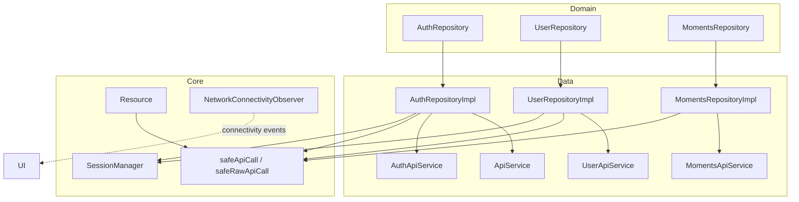
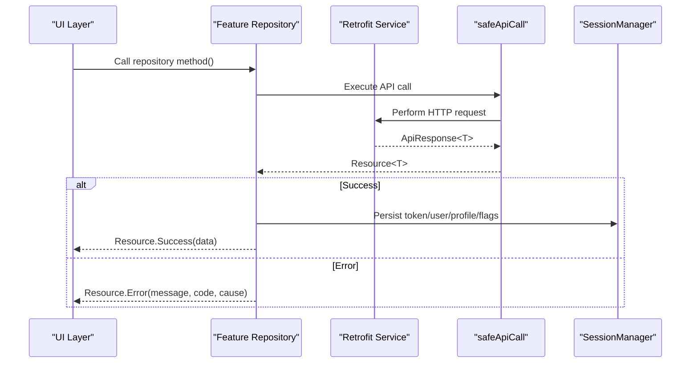
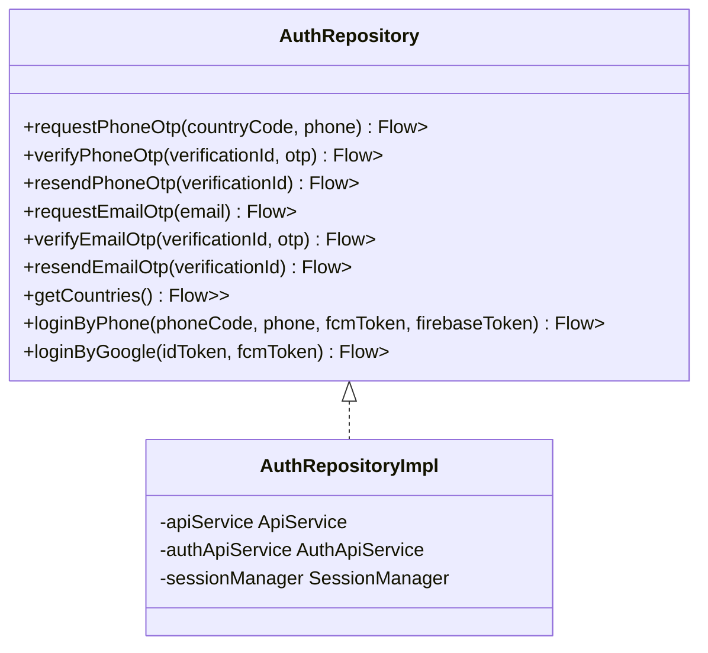
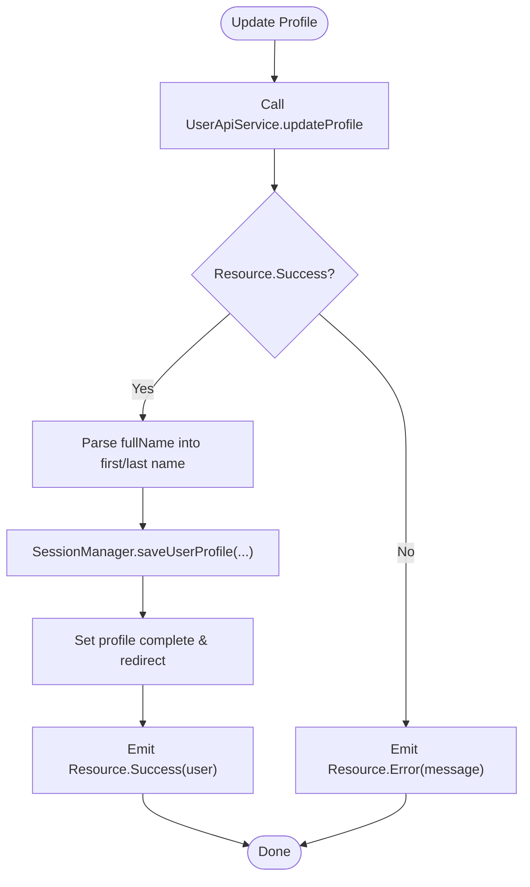
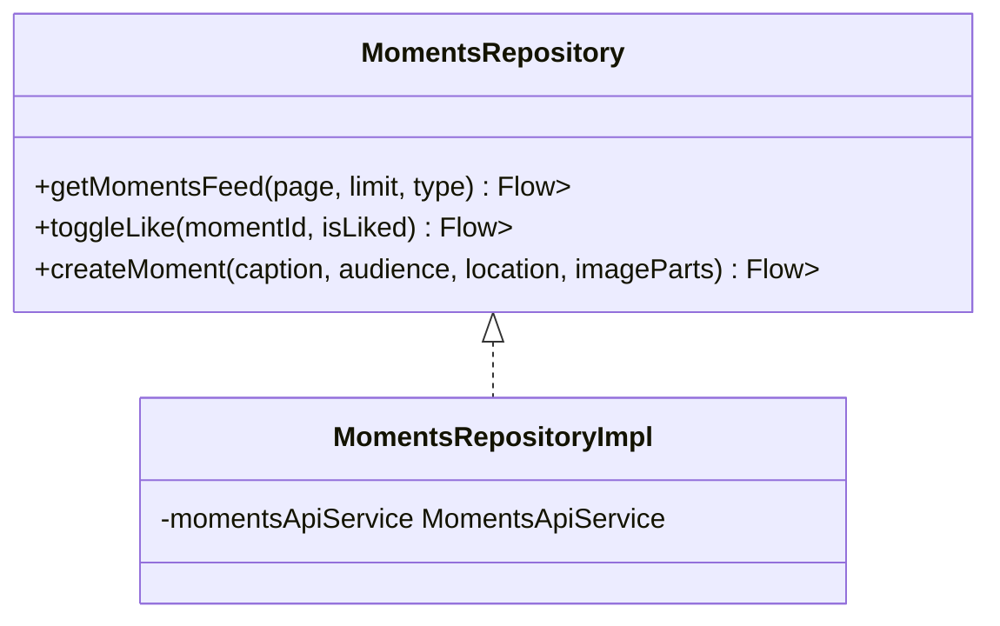
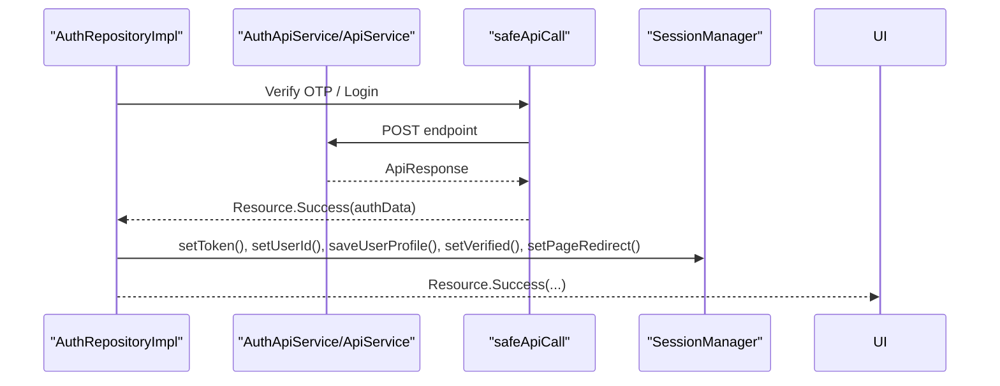
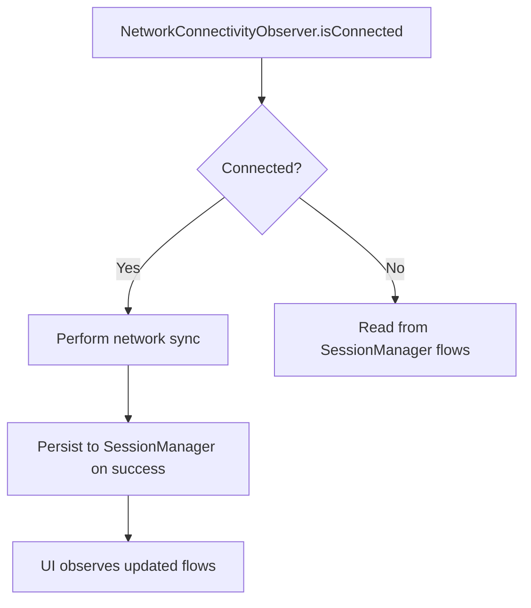
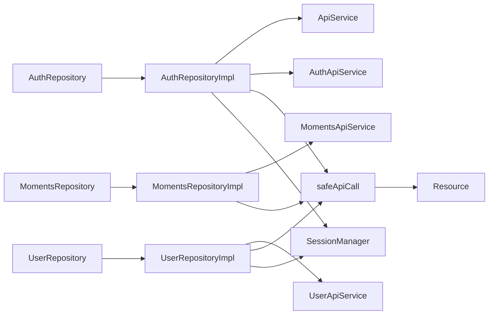

# Data Synchronization Patterns

<cite>
**Referenced Files in This Document**
- [ApiService.kt](file://app/src/main/java/com/flirttime/core/network/ApiService.kt)
- [SafeApiCall.kt](file://app/src/main/java/com/flirttime/core/network/SafeApiCall.kt)
- [ApiResponse.kt](file://app/src/main/java/com/flirttime/core/network/model/ApiResponse.kt)
- [NetworkConnectivityObserver.kt](file://app/src/main/java/com/flirttime/core/common/NetworkConnectivityObserver.kt)
- [SessionManager.kt](file://app/src/main/java/com/flirttime/core/database/SessionManager.kt)
- [Resource.kt](file://app/src/main/java/com/flirttime/Resource.kt)
- [AuthRepository.kt](file://app/src/main/java/com/flirttime/feature/auth/domain/repository/AuthRepository.kt)
- [AuthRepositoryImpl.kt](file://app/src/main/java/com/flirttime/feature/auth/data/repository/AuthRepositoryImpl.kt)
- [UserRepository.kt](file://app/src/main/java/com/flirttime/feature/profile/domain/repository/UserRepository.kt)
- [UserRepositoryImpl.kt](file://app/src/main/java/com/flirttime/feature/profile/data/repository/UserRepositoryImpl.kt)
- [MomentsRepository.kt](file://app/src/main/java/com/flirttime/feature/moments/domain/repository/MomentsRepository.kt)
- [MomentsRepositoryImpl.kt](file://app/src/main/java/com/flirttime/feature/moments/data/repository/MomentsRepositoryImpl.kt)
</cite>

## Table of Contents
1. [Introduction](#introduction)
2. [Project Structure](#project-structure)
3. [Core Components](#core-components)
4. [Architecture Overview](#architecture-overview)
5. [Detailed Component Analysis](#detailed-component-analysis)
6. [Dependency Analysis](#dependency-analysis)
7. [Performance Considerations](#performance-considerations)
8. [Troubleshooting Guide](#troubleshooting-guide)
9. [Conclusion](#conclusion)

## Introduction
This document explains the data synchronization patterns used across Flirttime-Otp-Android, focusing on how repositories abstract local storage and remote APIs. It covers:
- Repository pattern implementation for Auth, Profile, and Moments features
- Data flow from API responses to local storage updates
- Offline-first approach using DataStore-backed session state
- Error handling, retry guidance, and validation strategies
- Background sync considerations and performance optimization

## Project Structure
The app follows a layered architecture:
- Domain layer defines repository interfaces (AuthRepository, UserRepository, MomentsRepository)
- Data layer implements repositories and coordinates network calls via Retrofit services
- Core utilities provide safe API wrappers, resource modeling, and connectivity observation
- Local persistence is handled by SessionManager backed by AndroidX DataStore

**Diagram sources**
- [AuthRepository.kt:10-52](file://app/src/main/java/com/flirttime/feature/auth/domain/repository/AuthRepository.kt#L10-L52)
- [AuthRepositoryImpl.kt:23-217](file://app/src/main/java/com/flirttime/feature/auth/data/repository/AuthRepositoryImpl.kt#L23-L217)
- [UserRepository.kt:10-20](file://app/src/main/java/com/flirttime/feature/profile/domain/repository/UserRepository.kt#L10-L20)
- [UserRepositoryImpl.kt:20-126](file://app/src/main/java/com/flirttime/feature/profile/data/repository/UserRepositoryImpl.kt#L20-L126)
- [MomentsRepository.kt:8-17](file://app/src/main/java/com/flirttime/feature/moments/domain/repository/MomentsRepository.kt#L8-L17)
- [MomentsRepositoryImpl.kt:17-88](file://app/src/main/java/com/flirttime/feature/moments/data/repository/MomentsRepositoryImpl.kt#L17-L88)
- [ApiService.kt:9-22](file://app/src/main/java/com/flirttime/core/network/ApiService.kt#L9-L22)
- [SafeApiCall.kt:14-143](file://app/src/main/java/com/flirttime/core/network/SafeApiCall.kt#L14-L143)
- [Resource.kt:3-19](file://app/src/main/java/com/flirttime/Resource.kt#L3-L19)
- [SessionManager.kt:22-222](file://app/src/main/java/com/flirttime/core/database/SessionManager.kt#L22-L222)
- [NetworkConnectivityObserver.kt:13-48](file://app/src/main/java/com/flirttime/core/common/NetworkConnectivityObserver.kt#L13-L48)

**Section sources**
- [AuthRepository.kt:10-52](file://app/src/main/java/com/flirttime/feature/auth/domain/repository/AuthRepository.kt#L10-L52)
- [UserRepository.kt:10-20](file://app/src/main/java/com/flirttime/feature/profile/domain/repository/UserRepository.kt#L10-L20)
- [MomentsRepository.kt:8-17](file://app/src/main/java/com/flirttime/feature/moments/domain/repository/MomentsRepository.kt#L8-L17)
- [ApiService.kt:9-22](file://app/src/main/java/com/flirttime/core/network/ApiService.kt#L9-L22)
- [SafeApiCall.kt:14-143](file://app/src/main/java/com/flirttime/core/network/SafeApiCall.kt#L14-L143)
- [Resource.kt:3-19](file://app/src/main/java/com/flirttime/Resource.kt#L3-L19)
- [SessionManager.kt:22-222](file://app/src/main/java/com/flirttime/core/database/SessionManager.kt#L22-L222)
- [NetworkConnectivityObserver.kt:13-48](file://app/src/main/java/com/flirttime/core/common/NetworkConnectivityObserver.kt#L13-L48)

## Core Components
- Resource<T>: Unified result wrapper with Success, Error, and Loading states. Used consistently across repositories to propagate status to UI.
- Safe API Wrappers: safeApiCall and safeRawApiCall normalize HTTP errors, parse error bodies, and return Resource instances.
- SessionManager: DataStore-backed persistence for tokens, user profile fields, verification flags, and navigation hints. Provides both Flow-based reactive reads and suspend functions for one-off reads.
- NetworkConnectivityObserver: Emits connectivity changes as a Flow<Boolean>, enabling offline-aware behavior.

Key responsibilities:
- Repositories orchestrate API calls through Retrofit services and persist relevant state into SessionManager upon success.
- All network operations run on IO dispatcher via flowOn(Dispatchers.IO).
- UI observes Flow<Resource<T>> to render loading, success, or error states.

**Section sources**
- [Resource.kt:3-19](file://app/src/main/java/com/flirttime/Resource.kt#L3-L19)
- [SafeApiCall.kt:14-143](file://app/src/main/java/com/flirttime/core/network/SafeApiCall.kt#L14-L143)
- [SessionManager.kt:22-222](file://app/src/main/java/com/flirttime/core/database/SessionManager.kt#L22-L222)
- [NetworkConnectivityObserver.kt:13-48](file://app/src/main/java/com/flirttime/core/common/NetworkConnectivityObserver.kt#L13-L48)

## Architecture Overview
The system uses an offline-first design where:
- UI subscribes to repository Flow<Resource<T>>
- Repositories call Retrofit endpoints wrapped by safeApiCall/safeRawApiCall
- On successful responses, repositories update SessionManager (token, user profile, flags)
- Connectivity observer can be used to gate or schedule background sync tasks

**Diagram sources**
- [AuthRepositoryImpl.kt:29-75](file://app/src/main/java/com/flirttime/feature/auth/data/repository/AuthRepositoryImpl.kt#L29-L75)
- [UserRepositoryImpl.kt:25-46](file://app/src/main/java/com/flirttime/feature/profile/data/repository/UserRepositoryImpl.kt#L25-L46)
- [MomentsRepositoryImpl.kt:21-47](file://app/src/main/java/com/flirttime/feature/moments/data/repository/MomentsRepositoryImpl.kt#L21-L47)
- [SafeApiCall.kt:14-65](file://app/src/main/java/com/flirttime/core/network/SafeApiCall.kt#L14-L65)
- [SessionManager.kt:136-195](file://app/src/main/java/com/flirttime/core/database/SessionManager.kt#L136-L195)

## Detailed Component Analysis

### Authentication Repository Pattern
- Interface: AuthRepository defines OTP flows (phone/email), resend flows, legacy login, and social login.
- Implementation: AuthRepositoryImpl:
  - Uses safeApiCall for OTP endpoints and safeRawApiCall for raw login endpoints.
  - On successful verify/login, persists token, userId, profile completeness, face verification flag, profile image URI, and page redirect hint.
  - Emits Resource.Loading before each network call and final Resource after completion.

**Diagram sources**
- [AuthRepository.kt:10-52](file://app/src/main/java/com/flirttime/feature/auth/domain/repository/AuthRepository.kt#L10-L52)
- [AuthRepositoryImpl.kt:23-217](file://app/src/main/java/com/flirttime/feature/auth/data/repository/AuthRepositoryImpl.kt#L23-L217)

**Section sources**
- [AuthRepository.kt:10-52](file://app/src/main/java/com/flirttime/feature/auth/domain/repository/AuthRepository.kt#L10-L52)
- [AuthRepositoryImpl.kt:29-217](file://app/src/main/java/com/flirttime/feature/auth/data/repository/AuthRepositoryImpl.kt#L29-L217)

### Profile Repository Pattern
- Interface: UserRepository defines profile update, username availability check, and photo uploads.
- Implementation: UserRepositoryImpl:
  - Updates SessionManager with profile fields and flags on successful update.
  - Parses flexible availability response shapes into a boolean.
  - Uploads photos via multipart and updates profile image URI and verification state.

**Diagram sources**
- [UserRepositoryImpl.kt:25-46](file://app/src/main/java/com/flirttime/feature/profile/data/repository/UserRepositoryImpl.kt#L25-L46)
- [SessionManager.kt:161-195](file://app/src/main/java/com/flirttime/core/database/SessionManager.kt#L161-L195)

**Section sources**
- [UserRepository.kt:10-20](file://app/src/main/java/com/flirttime/feature/profile/domain/repository/UserRepository.kt#L10-L20)
- [UserRepositoryImpl.kt:25-126](file://app/src/main/java/com/flirttime/feature/profile/data/repository/UserRepositoryImpl.kt#L25-L126)

### Moments Repository Pattern
- Interface: MomentsRepository defines feed retrieval, like toggle, and moment creation.
- Implementation: MomentsRepositoryImpl:
  - Maps domain models to UI items and returns paginated results.
  - Handles multipart creation for images and optional location metadata.
  - Emits Resource states consistently.

**Diagram sources**
- [MomentsRepository.kt:8-17](file://app/src/main/java/com/flirttime/feature/moments/domain/repository/MomentsRepository.kt#L8-L17)
- [MomentsRepositoryImpl.kt:17-88](file://app/src/main/java/com/flirttime/feature/moments/data/repository/MomentsRepositoryImpl.kt#L17-L88)

**Section sources**
- [MomentsRepository.kt:8-17](file://app/src/main/java/com/flirttime/feature/moments/domain/repository/MomentsRepository.kt#L8-L17)
- [MomentsRepositoryImpl.kt:21-88](file://app/src/main/java/com/flirttime/feature/moments/data/repository/MomentsRepositoryImpl.kt#L21-L88)

### Data Flow From API to Local Storage
- Auth flows: On successful OTP verification or login, repositories persist JWT token, userId, profile completeness, verification flag, profile image URI, and redirect hint.
- Profile flows: On successful profile update or photo upload, repositories persist profile fields and flags.
- Moments flows: Currently do not write to SessionManager; they focus on feed and mutations.

**Diagram sources**
- [AuthRepositoryImpl.kt:40-75](file://app/src/main/java/com/flirttime/feature/auth/data/repository/AuthRepositoryImpl.kt#L40-L75)
- [AuthRepositoryImpl.kt:156-188](file://app/src/main/java/com/flirttime/feature/auth/data/repository/AuthRepositoryImpl.kt#L156-L188)
- [SessionManager.kt:136-195](file://app/src/main/java/com/flirttime/core/database/SessionManager.kt#L136-L195)

**Section sources**
- [AuthRepositoryImpl.kt:40-75](file://app/src/main/java/com/flirttime/feature/auth/data/repository/AuthRepositoryImpl.kt#L40-L75)
- [AuthRepositoryImpl.kt:156-188](file://app/src/main/java/com/flirttime/feature/auth/data/repository/AuthRepositoryImpl.kt#L156-L188)
- [SessionManager.kt:136-195](file://app/src/main/java/com/flirttime/core/database/SessionManager.kt#L136-L195)

### Offline-First Approach and Consistency
- Offline-first: UI can read from SessionManager flows even when offline. For example, getCachedToken provides non-blocking access for interceptors.
- Consistency: After successful writes, repositories update SessionManager synchronously within the same coroutine scope to ensure immediate consistency for subsequent reads.
- Connectivity awareness: NetworkConnectivityObserver emits connectivity changes that can be used to trigger refreshes or defer work.

**Diagram sources**
- [NetworkConnectivityObserver.kt:13-48](file://app/src/main/java/com/flirttime/core/common/NetworkConnectivityObserver.kt#L13-L48)
- [SessionManager.kt:22-40](file://app/src/main/java/com/flirttime/core/database/SessionManager.kt#L22-L40)

**Section sources**
- [NetworkConnectivityObserver.kt:13-48](file://app/src/main/java/com/flirttime/core/common/NetworkConnectivityObserver.kt#L13-L48)
- [SessionManager.kt:22-40](file://app/src/main/java/com/flirttime/core/database/SessionManager.kt#L22-L40)

### Background Synchronization Patterns
- Current implementation does not include a dedicated background scheduler. To implement background sync:
  - Use NetworkConnectivityObserver to detect connectivity changes.
  - Trigger repository methods from a background task (e.g., WorkManager) to fetch latest data and update SessionManager.
  - Ensure idempotent operations and avoid redundant writes.

[No sources needed since this section provides general guidance]

### Implementing New Repositories Following Established Patterns
Steps:
1. Define a domain interface exposing Flow<Resource<T>> methods.
2. Create a data implementation that:
   - Calls Retrofit service endpoints via safeApiCall or safeRawApiCall.
   - Emits Resource.Loading at start.
   - Persists relevant state to SessionManager on success.
   - Emits Resource.Success or Resource.Error at the end.
   - Runs on Dispatchers.IO using flowOn.
3. Map API models to domain/UI models inside the repository if needed.

Example skeleton path references:
- Domain interface: [AuthRepository.kt:10-52](file://app/src/main/java/com/flirttime/feature/auth/domain/repository/AuthRepository.kt#L10-L52)
- Data implementation: [AuthRepositoryImpl.kt:23-217](file://app/src/main/java/com/flirttime/feature/auth/data/repository/AuthRepositoryImpl.kt#L23-L217)
- Safe API usage: [SafeApiCall.kt:14-65](file://app/src/main/java/com/flirttime/core/network/SafeApiCall.kt#L14-L65)
- Persistence: [SessionManager.kt:136-195](file://app/src/main/java/com/flirttime/core/database/SessionManager.kt#L136-L195)

**Section sources**
- [AuthRepository.kt:10-52](file://app/src/main/java/com/flirttime/feature/auth/domain/repository/AuthRepository.kt#L10-L52)
- [AuthRepositoryImpl.kt:23-217](file://app/src/main/java/com/flirttime/feature/auth/data/repository/AuthRepositoryImpl.kt#L23-L217)
- [SafeApiCall.kt:14-65](file://app/src/main/java/com/flirttime/core/network/SafeApiCall.kt#L14-L65)
- [SessionManager.kt:136-195](file://app/src/main/java/com/flirttime/core/database/SessionManager.kt#L136-L195)

## Dependency Analysis
Repositories depend on:
- Retrofit services for network I/O
- Safe API wrappers for consistent error handling
- SessionManager for local persistence
- Resource sealed class for unified state representation

**Diagram sources**
- [AuthRepository.kt:10-52](file://app/src/main/java/com/flirttime/feature/auth/domain/repository/AuthRepository.kt#L10-L52)
- [AuthRepositoryImpl.kt:23-217](file://app/src/main/java/com/flirttime/feature/auth/data/repository/AuthRepositoryImpl.kt#L23-L217)
- [UserRepository.kt:10-20](file://app/src/main/java/com/flirttime/feature/profile/domain/repository/UserRepository.kt#L10-L20)
- [UserRepositoryImpl.kt:20-126](file://app/src/main/java/com/flirttime/feature/profile/data/repository/UserRepositoryImpl.kt#L20-L126)
- [MomentsRepository.kt:8-17](file://app/src/main/java/com/flirttime/feature/moments/domain/repository/MomentsRepository.kt#L8-L17)
- [MomentsRepositoryImpl.kt:17-88](file://app/src/main/java/com/flirttime/feature/moments/data/repository/MomentsRepositoryImpl.kt#L17-L88)
- [ApiService.kt:9-22](file://app/src/main/java/com/flirttime/core/network/ApiService.kt#L9-L22)
- [SafeApiCall.kt:14-143](file://app/src/main/java/com/flirttime/core/network/SafeApiCall.kt#L14-L143)
- [Resource.kt:3-19](file://app/src/main/java/com/flirttime/Resource.kt#L3-L19)
- [SessionManager.kt:22-222](file://app/src/main/java/com/flirttime/core/database/SessionManager.kt#L22-L222)

**Section sources**
- [AuthRepositoryImpl.kt:23-217](file://app/src/main/java/com/flirttime/feature/auth/data/repository/AuthRepositoryImpl.kt#L23-L217)
- [UserRepositoryImpl.kt:20-126](file://app/src/main/java/com/flirttime/feature/profile/data/repository/UserRepositoryImpl.kt#L20-L126)
- [MomentsRepositoryImpl.kt:17-88](file://app/src/main/java/com/flirttime/feature/moments/data/repository/MomentsRepositoryImpl.kt#L17-L88)
- [SafeApiCall.kt:14-143](file://app/src/main/java/com/flirttime/core/network/SafeApiCall.kt#L14-L143)
- [Resource.kt:3-19](file://app/src/main/java/com/flirttime/Resource.kt#L3-L19)
- [SessionManager.kt:22-222](file://app/src/main/java/com/flirttime/core/database/SessionManager.kt#L22-L222)

## Performance Considerations
- Dispatcher usage: All repository flows run on Dispatchers.IO to avoid blocking main thread.
- Caching strategy: SessionManager caches token in memory for fast access and exposes Flow-based reactive reads.
- Large datasets:
  - Paginate API responses (e.g., Moments feed) and map only necessary fields to UI models.
  - Avoid heavy transformations on the main thread; perform mapping in IO context.
- Battery optimization:
  - Defer network calls until connectivity is available using NetworkConnectivityObserver.
  - Batch updates to SessionManager to minimize DataStore writes.
  - Avoid frequent polling; prefer event-driven triggers (connectivity change, user action).

[No sources needed since this section provides general guidance]

## Troubleshooting Guide
Common issues and resolutions:
- Network failures:
  - safeApiCall/safeRawApiCall convert HttpException, SocketTimeoutException, UnknownHostException, and IOException into Resource.Error with user-friendly messages.
  - Inspect Resource.Error.code and errorBody for server diagnostics.
- Retry mechanisms:
  - Implement retry logic at the repository or use a higher-level orchestrator (e.g., WorkManager) with exponential backoff.
  - Use NetworkConnectivityObserver to resume failed operations when connectivity returns.
- Data validation:
  - Validate inputs before making requests (e.g., empty phone/email).
  - Handle flexible API responses gracefully (see username availability parsing in UserRepositoryImpl).

**Section sources**
- [SafeApiCall.kt:33-65](file://app/src/main/java/com/flirttime/core/network/SafeApiCall.kt#L33-L65)
- [SafeApiCall.kt:67-107](file://app/src/main/java/com/flirttime/core/network/SafeApiCall.kt#L67-L107)
- [UserRepositoryImpl.kt:48-78](file://app/src/main/java/com/flirttime/feature/profile/data/repository/UserRepositoryImpl.kt#L48-L78)
- [NetworkConnectivityObserver.kt:13-48](file://app/src/main/java/com/flirttime/core/common/NetworkConnectivityObserver.kt#L13-L48)

## Conclusion
Flirttime-Otp-Android employs a clean repository pattern that abstracts local storage and remote APIs, ensuring consistent data flow and robust error handling. The offline-first approach leverages DataStore-backed SessionManager for immediate availability of critical state, while safe API wrappers standardize error propagation. By following the established patterns, new features can integrate seamlessly, maintain consistency, and scale efficiently.

[No sources needed since this section summarizes without analyzing specific files]