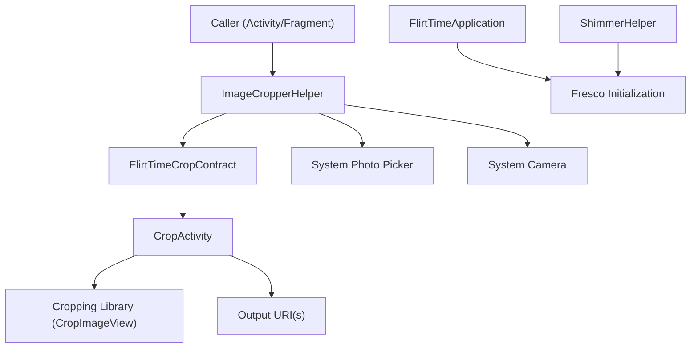
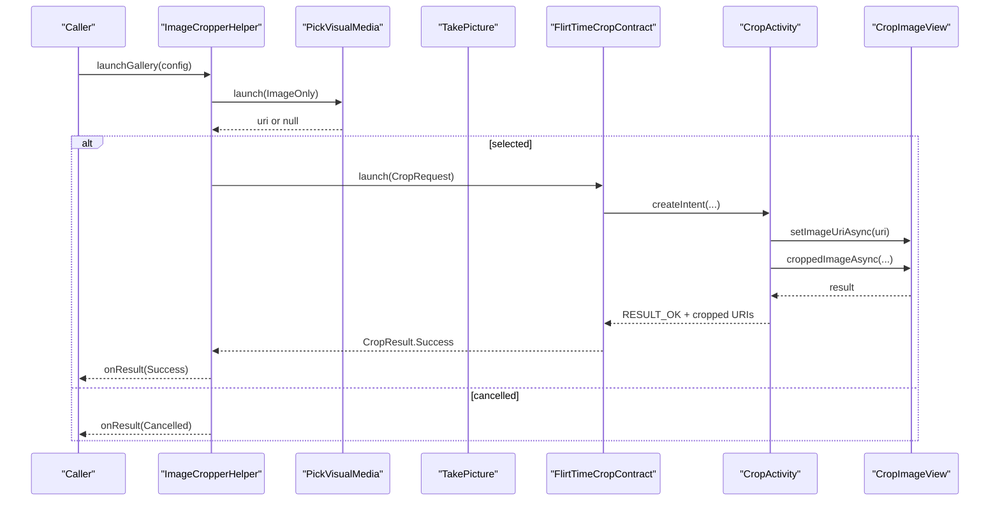
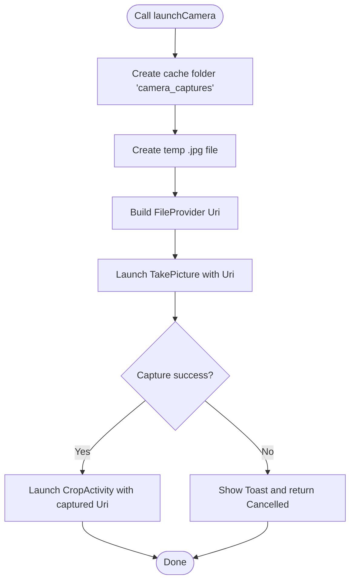
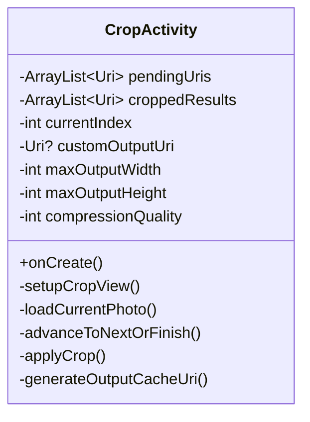
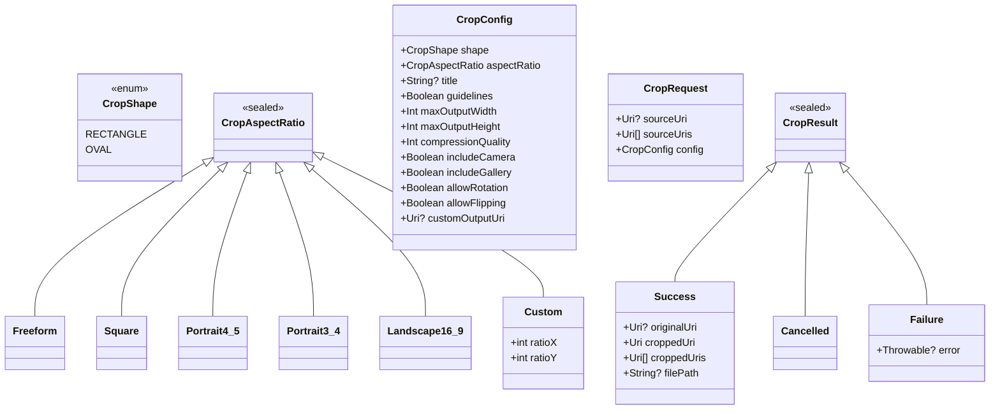
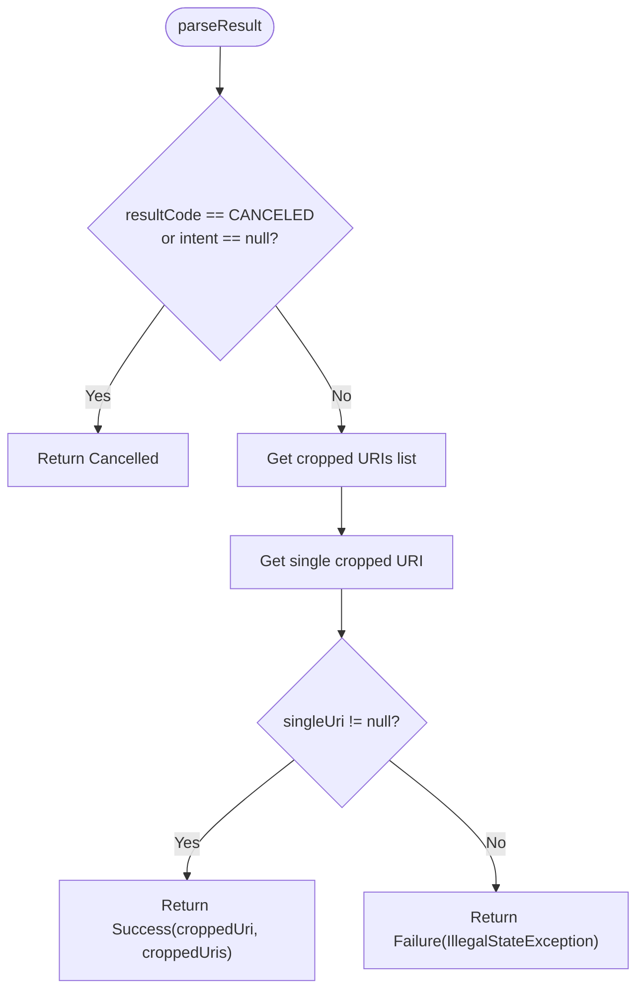
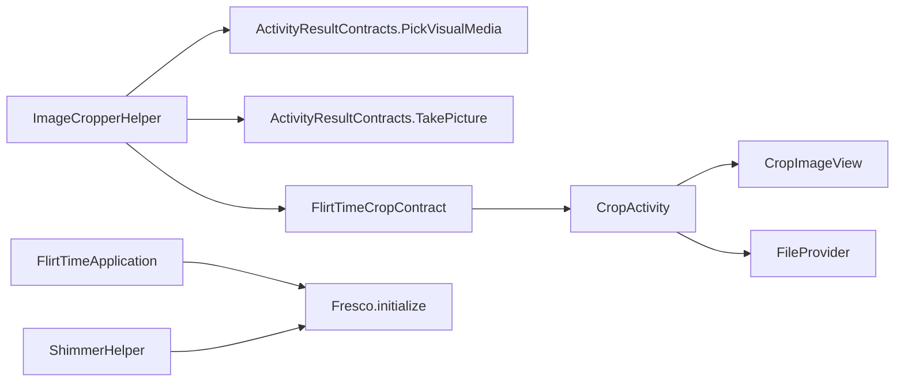

# Image Processing and Caching

<cite>
**Referenced Files in This Document**
- [ImageCropperHelper.kt](file://app/src/main/java/com/flirttime/core/image/ImageCropperHelper.kt)
- [CropActivity.kt](file://app/src/main/java/com/flirttime/core/image/CropActivity.kt)
- [CropConfig.kt](file://app/src/main/java/com/flirttime/core/image/CropConfig.kt)
- [FlirtTimeCropContract.kt](file://app/src/main/java/com/flirttime/core/image/FlirtTimeCropContract.kt)
- [ShimmerHelper.kt](file://app/src/main/java/com/flirttime/core/common/ShimmerHelper.kt)
- [FlirtTimeApplication.kt](file://app/src/main/java/com/flirttime/FlirtTimeApplication.kt)
- [file_paths.xml](file://app/src/main/res/xml/file_paths.xml)
</cite>

## Table of Contents
1. [Introduction](#introduction)
2. [Project Structure](#project-structure)
3. [Core Components](#core-components)
4. [Architecture Overview](#architecture-overview)
5. [Detailed Component Analysis](#detailed-component-analysis)
6. [Dependency Analysis](#dependency-analysis)
7. [Performance Considerations](#performance-considerations)
8. [Troubleshooting Guide](#troubleshooting-guide)
9. [Conclusion](#conclusion)

## Introduction
This document explains the image processing pipeline for cropping and preparing images in Flirttime-Otp-Android. It focuses on the activity-based workflow that integrates a dedicated cropping UI with a contract-based result model, and how it fits into the app’s broader image loading strategy using Fresco. You will learn:
- How to configure crop behavior (shape, aspect ratio, compression, output size).
- How to launch gallery or camera flows and process results safely.
- How to integrate crop results with ViewModel layers via sealed result types.
- How memory is managed during cropping and how Fresco is initialized and used elsewhere in the app.

## Project Structure
The image processing features are implemented under core.image, with supporting utilities in core.common. The key files are:
- ImageCropperHelper: lifecycle-safe helper to launch gallery/camera and crop workflows.
- CropActivity: dedicated cropping UI backed by a third-party cropping library.
- CropConfig: configuration model for shape, aspect ratios, compression, and output sizing.
- FlirtTimeCropContract: ActivityResultContract bridging requests and results between caller and CropActivity.
- ShimmerHelper and FlirtTimeApplication: demonstrate Fresco initialization and usage patterns across the app.
- file_paths.xml: FileProvider paths for sharing cache and files.

**Diagram sources**
- [ImageCropperHelper.kt:21-171](file://app/src/main/java/com/flirttime/core/image/ImageCropperHelper.kt#L21-L171)
- [FlirtTimeCropContract.kt:13-54](file://app/src/main/java/com/flirttime/core/image/FlirtTimeCropContract.kt#L13-L54)
- [CropActivity.kt:47-86](file://app/src/main/java/com/flirttime/core/image/CropActivity.kt#L47-L86)
- [FlirtTimeApplication.kt:21-22](file://app/src/main/java/com/flirttime/FlirtTimeApplication.kt#L21-L22)
- [ShimmerHelper.kt:54-71](file://app/src/main/java/com/flirttime/core/common/ShimmerHelper.kt#L54-L71)

**Section sources**
- [ImageCropperHelper.kt:14-26](file://app/src/main/java/com/flirttime/core/image/ImageCropperHelper.kt#L14-L26)
- [CropActivity.kt:19-29](file://app/src/main/java/com/flirttime/core/image/CropActivity.kt#L19-L29)
- [CropConfig.kt:25-41](file://app/src/main/java/com/flirttime/core/image/CropConfig.kt#L25-L41)
- [FlirtTimeCropContract.kt:9-12](file://app/src/main/java/com/flirttime/core/image/FlirtTimeCropContract.kt#L9-L12)

## Core Components
- ImageCropperHelper: Provides unified entry points to launch cropping directly from a URI, pick an image from the system photo picker, or capture via camera and then crop. It manages three ActivityResultLaunchers and stores pending configuration until the crop launcher is invoked.
- CropActivity: A full-screen cropping screen that configures the underlying cropping view based on passed-in parameters, supports sequential cropping of multiple images, and writes cropped outputs to a cache directory or a custom output URI.
- CropConfig: Defines crop shape, aspect ratio presets, title, guidelines, max output dimensions, compression quality, and optional custom output URI. Includes factory presets for common use cases.
- FlirtTimeCropContract: Bridges CropRequest and CropResult with CropActivity, ensuring safe parsing of single or multiple cropped URIs.

**Section sources**
- [ImageCropperHelper.kt:21-171](file://app/src/main/java/com/flirttime/core/image/ImageCropperHelper.kt#L21-L171)
- [CropActivity.kt:47-86](file://app/src/main/java/com/flirttime/core/image/CropActivity.kt#L47-L86)
- [CropConfig.kt:28-88](file://app/src/main/java/com/flirttime/core/image/CropConfig.kt#L28-L88)
- [FlirtTimeCropContract.kt:13-54](file://app/src/main/java/com/flirttime/core/image/FlirtTimeCropContract.kt#L13-L54)

## Architecture Overview
The pipeline follows a clear separation of concerns:
- Callers register the helper once and invoke high-level methods (gallery, camera, direct crop).
- The helper composes ActivityResultContracts for gallery and camera, then delegates to a custom contract for cropping.
- CropActivity consumes configuration, renders the cropping UI, and returns one or more cropped URIs.
- Results are modeled as a sealed class to represent success, cancellation, or failure.

**Diagram sources**
- [ImageCropperHelper.kt:46-67](file://app/src/main/java/com/flirttime/core/image/ImageCropperHelper.kt#L46-L67)
- [FlirtTimeCropContract.kt:15-24](file://app/src/main/java/com/flirttime/core/image/FlirtTimeCropContract.kt#L15-L24)
- [CropActivity.kt:157-193](file://app/src/main/java/com/flirttime/core/image/CropActivity.kt#L157-L193)
- [CropActivity.kt:238-273](file://app/src/main/java/com/flirttime/core/image/CropActivity.kt#L238-L273)

## Detailed Component Analysis

### ImageCropperHelper
Responsibilities:
- Register lifecycle-aware launchers for cropping, gallery picking, and camera capture.
- Provide simple APIs: launchCrop(sourceUri, config), launchGallery(config), launchCamera(config).
- Store pending configuration and camera output URI until the crop launcher runs.
- Handle camera capture by creating a temporary file in the app cache and generating a FileProvider URI.

Key behaviors:
- If gallery selection returns null, the helper reports a Cancelled result.
- If camera capture fails or no URI is available, the helper reports a Cancelled result.
- Errors launching the camera are caught and surfaced via a short Toast.

**Diagram sources**
- [ImageCropperHelper.kt:151-171](file://app/src/main/java/com/flirttime/core/image/ImageCropperHelper.kt#L151-L171)

**Section sources**
- [ImageCropperHelper.kt:21-171](file://app/src/main/java/com/flirttime/core/image/ImageCropperHelper.kt#L21-L171)

### CropActivity
Responsibilities:
- Parse intent extras for source URIs, crop shape, aspect ratio, title, max output size, compression quality, and optional custom output URI.
- Configure the underlying cropping view (shape, fixed aspect ratio, guidelines).
- Support sequential cropping when multiple images are provided.
- Write cropped images to a cache directory or a custom output URI, granting necessary permissions.
- Return either a single cropped URI or a list of cropped URIs.

Configuration mapping:
- Shape: rectangle or oval.
- Aspect ratio: freeform or fixed; if fixed, x/y values are applied.
- Title: customizable header text; defaults to “Crop photo” or “Crop photo N of M”.
- Max width/height: target output dimensions.
- Compression quality: JPEG quality percentage.

**Diagram sources**
- [CropActivity.kt:89-98](file://app/src/main/java/com/flirttime/core/image/CropActivity.kt#L89-L98)
- [CropActivity.kt:157-193](file://app/src/main/java/com/flirttime/core/image/CropActivity.kt#L157-L193)
- [CropActivity.kt:195-208](file://app/src/main/java/com/flirttime/core/image/CropActivity.kt#L195-L208)
- [CropActivity.kt:210-225](file://app/src/main/java/com/flirttime/core/image/CropActivity.kt#L210-L225)
- [CropActivity.kt:238-291](file://app/src/main/java/com/flirttime/core/image/CropActivity.kt#L238-L291)

**Section sources**
- [CropActivity.kt:47-86](file://app/src/main/java/com/flirttime/core/image/CropActivity.kt#L47-L86)
- [CropActivity.kt:157-193](file://app/src/main/java/com/flirttime/core/image/CropActivity.kt#L157-L193)
- [CropActivity.kt:238-291](file://app/src/main/java/com/flirttime/core/image/CropActivity.kt#L238-L291)

### CropConfig and Data Models
Responsibilities:
- Define crop shape (rectangle, oval).
- Define aspect ratio options (freeform, square, portrait 4:5, portrait 3:4, landscape 16:9, custom).
- Provide factory presets for profile avatars, moments posts, verification photos, and freeform crops.
- Model request and result types for the contract.

Notable fields:
- shape: CropShape.RECTANGLE or OVAL.
- aspectRatio: sealed interface with several data objects and a Custom variant.
- maxOutputWidth/maxOutputHeight: target output dimensions.
- compressionQuality: JPEG quality percentage.
- customOutputUri: optional destination URI for the cropped image.

**Diagram sources**
- [CropConfig.kt:8-23](file://app/src/main/java/com/flirttime/core/image/CropConfig.kt#L8-L23)
- [CropConfig.kt:28-88](file://app/src/main/java/com/flirttime/core/image/CropConfig.kt#L28-L88)
- [CropConfig.kt:94-116](file://app/src/main/java/com/flirttime/core/image/CropConfig.kt#L94-L116)

**Section sources**
- [CropConfig.kt:8-23](file://app/src/main/java/com/flirttime/core/image/CropConfig.kt#L8-L23)
- [CropConfig.kt:28-88](file://app/src/main/java/com/flirttime/core/image/CropConfig.kt#L28-L88)
- [CropConfig.kt:94-116](file://app/src/main/java/com/flirttime/core/image/CropConfig.kt#L94-L116)

### FlirtTimeCropContract
Responsibilities:
- Convert CropRequest into an Intent for CropActivity.
- Parse CropActivity results into CropResult, handling both single and multiple cropped URIs.
- Surface failures when no cropped URI is present.

Behavior highlights:
- Throws an exception if no source URI(s) are provided.
- Returns Cancelled for RESULT_CANCELED or null intent.
- Returns Success with a single URI and a list of URIs when available.
- Returns Failure with an IllegalStateException when the cropped URI is missing.

**Diagram sources**
- [FlirtTimeCropContract.kt:26-53](file://app/src/main/java/com/flirttime/core/image/FlirtTimeCropContract.kt#L26-L53)

**Section sources**
- [FlirtTimeCropContract.kt:13-54](file://app/src/main/java/com/flirttime/core/image/FlirtTimeCropContract.kt#L13-L54)

## Dependency Analysis
- ImageCropperHelper depends on:
  - ActivityResultContracts.PickVisualMedia for gallery selection.
  - ActivityResultContracts.TakePicture for camera capture.
  - FlirtTimeCropContract for invoking CropActivity.
  - FileProvider for generating content URIs for camera captures and cached outputs.
- CropActivity depends on:
  - The underlying cropping library (CropImageView) for rendering and exporting images.
  - FileProvider for writing cropped images to cache or custom output URIs.
- FlirtTimeApplication initializes Fresco globally.
- ShimmerHelper demonstrates typical Fresco usage with SimpleDraweeView and controller listeners.

**Diagram sources**
- [ImageCropperHelper.kt:46-67](file://app/src/main/java/com/flirttime/core/image/ImageCropperHelper.kt#L46-L67)
- [FlirtTimeCropContract.kt:15-24](file://app/src/main/java/com/flirttime/core/image/FlirtTimeCropContract.kt#L15-L24)
- [CropActivity.kt:238-291](file://app/src/main/java/com/flirttime/core/image/CropActivity.kt#L238-L291)
- [FlirtTimeApplication.kt:21-22](file://app/src/main/java/com/flirttime/FlirtTimeApplication.kt#L21-L22)
- [ShimmerHelper.kt:54-71](file://app/src/main/java/com/flirttime/core/common/ShimmerHelper.kt#L54-L71)

**Section sources**
- [ImageCropperHelper.kt:46-67](file://app/src/main/java/com/flirttime/core/image/ImageCropperHelper.kt#L46-L67)
- [CropActivity.kt:238-291](file://app/src/main/java/com/flirttime/core/image/CropActivity.kt#L238-L291)
- [FlirtTimeApplication.kt:21-22](file://app/src/main/java/com/flirttime/FlirtTimeApplication.kt#L21-L22)
- [ShimmerHelper.kt:54-71](file://app/src/main/java/com/flirttime/core/common/ShimmerHelper.kt#L54-L71)

## Performance Considerations
- Cropping output sizing: Use maxOutputWidth and maxOutputHeight to constrain output resolution. Larger sizes increase memory and I/O costs.
- Compression quality: Adjust compressionQuality to balance visual fidelity and file size. Lower values reduce upload bandwidth but may degrade quality.
- Sequential cropping: When cropping multiple images, CropActivity processes them one by one, which avoids holding all decoded bitmaps in memory at once.
- Temporary files: Camera captures and cropped images are written to cache directories. Ensure you periodically clean these directories to avoid storage growth.
- Fresco integration: While cropping uses the underlying library, other parts of the app use Fresco for efficient image loading and caching. Initialize Fresco once in the Application class and use SimpleDraweeView for network images.

[No sources needed since this section provides general guidance]

## Troubleshooting Guide
Common issues and resolutions:
- No image provided to crop:
  - Symptom: CropActivity shows a toast and finishes immediately.
  - Cause: Intent did not contain any source URIs.
  - Resolution: Ensure sourceUri or sourceUris are set before launching CropActivity.
- Failed to crop image:
  - Symptom: Toast with error message appears after attempting to crop.
  - Cause: Underlying cropping operation failed.
  - Resolution: Inspect the error message and verify input URI validity and permissions.
- Unable to launch camera:
  - Symptom: Toast indicating inability to launch camera.
  - Cause: Exception during file creation or URI generation.
  - Resolution: Verify FileProvider configuration and cache directory access.
- Missing cropped URI in result:
  - Symptom: CropResult.Failure with IllegalStateException.
  - Cause: CropActivity did not produce a cropped URI.
  - Resolution: Check cropping configuration and ensure the cropping library can write to the output location.

**Section sources**
- [CropActivity.kt:130-135](file://app/src/main/java/com/flirttime/core/image/CropActivity.kt#L130-L135)
- [CropActivity.kt:181-192](file://app/src/main/java/com/flirttime/core/image/CropActivity.kt#L181-L192)
- [ImageCropperHelper.kt:167-170](file://app/src/main/java/com/flirttime/core/image/ImageCropperHelper.kt#L167-L170)
- [FlirtTimeCropContract.kt:43-52](file://app/src/main/java/com/flirttime/core/image/FlirtTimeCropContract.kt#L43-L52)

## Conclusion
The image processing pipeline in Flirttime-Otp-Android centers around a lifecycle-safe helper that abstracts gallery and camera flows and delegates cropping to a dedicated activity. Configuration is encapsulated in a flexible model that supports various shapes, aspect ratios, and compression settings. Results are modeled as a sealed type to simplify handling in higher layers such as ViewModels. For efficient image loading elsewhere in the app, Fresco is initialized at application startup and used through SimpleDraweeView. Proper use of FileProvider, cache directories, and output sizing ensures predictable performance and manageable memory usage during image operations.

[No sources needed since this section summarizes without analyzing specific files]