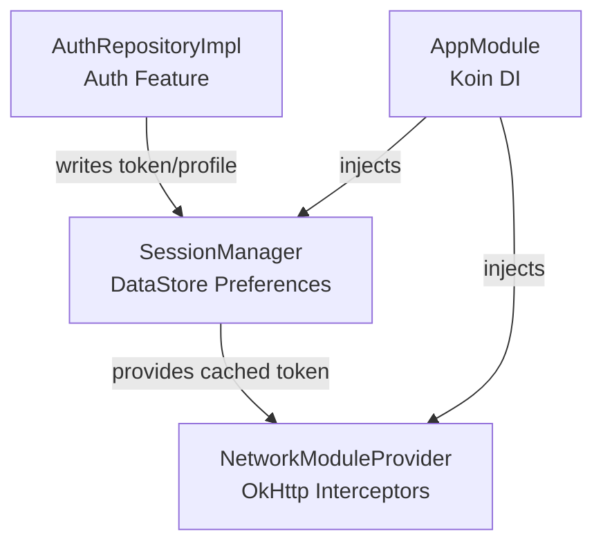
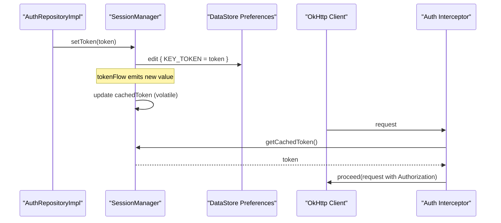
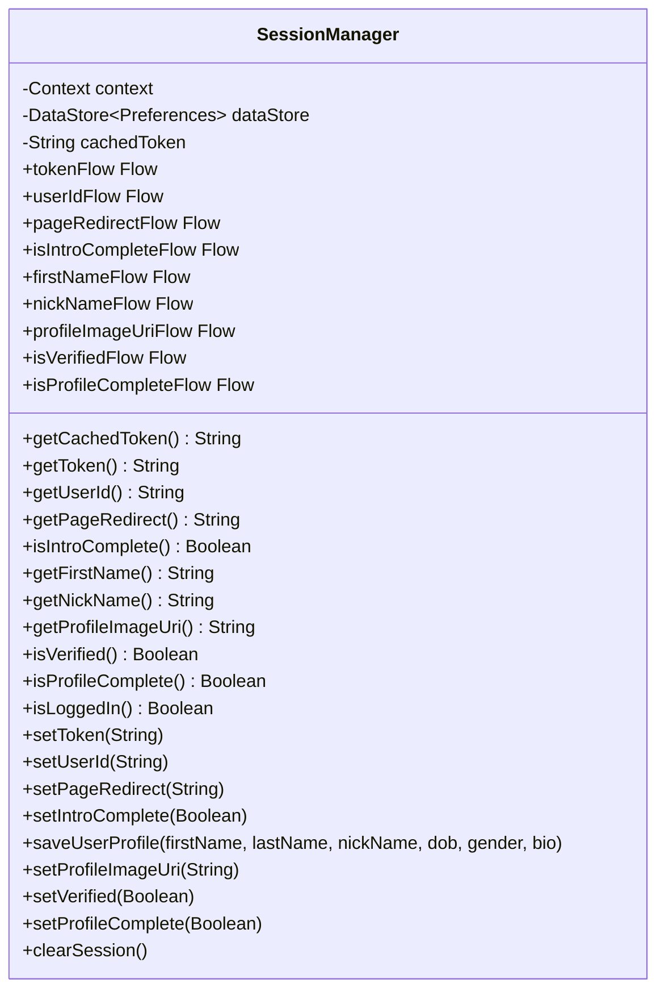
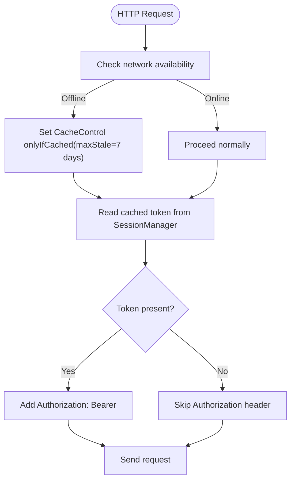
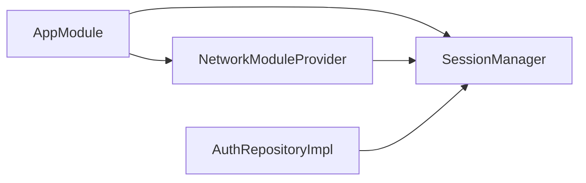

# Local Storage with DataStore

<cite>
**Referenced Files in This Document**
- [SessionManager.kt](file://app/src/main/java/com/flirttime/core/database/SessionManager.kt)
- [NetworkModuleProvider.kt](file://app/src/main/java/com/flirttime/core/network/NetworkModuleProvider.kt)
- [AppModule.kt](file://app/src/main/java/com/flirttime/di/AppModule.kt)
- [AuthRepositoryImpl.kt](file://app/src/main/java/com/flirttime/feature/auth/data/repository/AuthRepositoryImpl.kt)
- [ApiService.kt](file://app/src/main/java/com/flirttime/core/network/ApiService.kt)
- [NetworkUtils.kt](file://app/src/main/java/com/flirttime/core/common/NetworkUtils.kt)
</cite>

## Table of Contents
1. [Introduction](#introduction)
2. [Project Structure](#project-structure)
3. [Core Components](#core-components)
4. [Architecture Overview](#architecture-overview)
5. [Detailed Component Analysis](#detailed-component-analysis)
6. [Dependency Analysis](#dependency-analysis)
7. [Performance Considerations](#performance-considerations)
8. [Troubleshooting Guide](#troubleshooting-guide)
9. [Conclusion](#conclusion)

## Introduction
This document explains the local storage implementation using Android DataStore Preferences in Flirttime-Otp-Android, focusing on the SessionManager class. It details how reactive data access is provided via Kotlin Flow and suspend functions, documents all stored data types (authentication tokens, user profile information, app preferences, and session state), and describes the caching strategy for token management and its integration with network interceptors. It also includes examples of read/write operations, error handling patterns, coroutine-based asynchronous access, migration considerations, backup strategies, performance implications, memory management, and thread safety.

## Project Structure
The local storage layer centers around a single persistence abstraction:
- SessionManager: Encapsulates DataStore Preferences usage and exposes reactive flows and suspend functions for reading/writing session and profile data.
- NetworkModuleProvider: Integrates SessionManager into OkHttp to attach authentication headers automatically.
- AppModule: Wires SessionManager as a singleton via Koin DI.
- AuthRepositoryImpl: Persists authentication results and user profile data into SessionManager after successful API calls.

**Diagram sources**
- [SessionManager.kt:20-40](file://app/src/main/java/com/flirttime/core/database/SessionManager.kt#L20-L40)
- [NetworkModuleProvider.kt:22-50](file://app/src/main/java/com/flirttime/core/network/NetworkModuleProvider.kt#L22-L50)
- [AppModule.kt:27-36](file://app/src/main/java/com/flirttime/di/AppModule.kt#L27-L36)
- [AuthRepositoryImpl.kt:48-75](file://app/src/main/java/com/flirttime/feature/auth/data/repository/AuthRepositoryImpl.kt#L48-L75)

**Section sources**
- [SessionManager.kt:20-40](file://app/src/main/java/com/flirttime/core/database/SessionManager.kt#L20-L40)
- [NetworkModuleProvider.kt:22-50](file://app/src/main/java/com/flirttime/core/network/NetworkModuleProvider.kt#L22-L50)
- [AppModule.kt:27-36](file://app/src/main/java/com/flirttime/di/AppModule.kt#L27-L36)
- [AuthRepositoryImpl.kt:48-75](file://app/src/main/java/com/flirttime/feature/auth/data/repository/AuthRepositoryImpl.kt#L48-L75)

## Core Components
- SessionManager
  - Provides reactive streams (Flow) for all persisted keys and suspend functions for one-time reads.
  - Maintains an in-memory volatile token cache updated by collecting tokenFlow to support non-blocking interceptor access.
  - Exposes write APIs for tokens, user identifiers, profile fields, verification flags, and redirect targets.
  - Offers clearSession to reset most data while preserving onboarding completion status.
- NetworkModuleProvider
  - Builds OkHttpClient with interceptors:
    - Authentication interceptor reads the cached token from SessionManager and attaches Authorization header.
    - Offline cache interceptor forces cached responses when offline.
- AppModule
  - Registers SessionManager as a singleton and wires it into network and feature layers.
- AuthRepositoryImpl
  - On successful authentication, persists token, user id, profile completeness, verification status, profile image URI, and profile fields.

**Section sources**
- [SessionManager.kt:22-221](file://app/src/main/java/com/flirttime/core/database/SessionManager.kt#L22-L221)
- [NetworkModuleProvider.kt:22-76](file://app/src/main/java/com/flirttime/core/network/NetworkModuleProvider.kt#L22-L76)
- [AppModule.kt:27-36](file://app/src/main/java/com/flirttime/di/AppModule.kt#L27-L36)
- [AuthRepositoryImpl.kt:48-75](file://app/src/main/java/com/flirttime/feature/auth/data/repository/AuthRepositoryImpl.kt#L48-L75)

## Architecture Overview
The system uses DataStore Preferences for typed key-value persistence and Kotlin Flow for reactive updates. The network layer consumes the latest token without blocking, thanks to an in-memory cache synchronized with DataStore.

**Diagram sources**
- [AuthRepositoryImpl.kt:48-75](file://app/src/main/java/com/flirttime/feature/auth/data/repository/AuthRepositoryImpl.kt#L48-L75)
- [SessionManager.kt:26-48](file://app/src/main/java/com/flirttime/core/database/SessionManager.kt#L26-L48)
- [NetworkModuleProvider.kt:35-50](file://app/src/main/java/com/flirttime/core/network/NetworkModuleProvider.kt#L35-L50)

## Detailed Component Analysis

### SessionManager: Reactive Storage and Caching Strategy
Responsibilities:
- Reactive reads via Flow for token, userId, pageRedirect, introComplete, firstName, nickName, profileImageUri, verified, and profileComplete.
- Suspend reads for one-shot access using Flow.first().
- Writes via suspend functions that atomically update DataStore Preferences.
- In-memory token cache updated asynchronously to serve network interceptors without blocking.

Key behaviors:
- Error handling: Each Flow applies catch to handle IOException by emitting emptyPreferences, ensuring downstream mapping never fails due to IO issues.
- Thread safety: Token cache is volatile and updated in a background coroutine; readers (e.g., interceptors) get a consistent snapshot per call.
- Session clearing: Preserves onboarding completion flag while clearing other keys.

**Diagram sources**
- [SessionManager.kt:22-221](file://app/src/main/java/com/flirttime/core/database/SessionManager.kt#L22-L221)

**Section sources**
- [SessionManager.kt:22-221](file://app/src/main/java/com/flirttime/core/database/SessionManager.kt#L22-L221)

### Network Integration: Token Caching and Interceptors
Responsibilities:
- Attach Authorization header using the cached token from SessionManager.
- Normalize token format to ensure Bearer prefix.
- Provide offline behavior by forcing cached responses when network is unavailable.

**Diagram sources**
- [NetworkModuleProvider.kt:35-75](file://app/src/main/java/com/flirttime/core/network/NetworkModuleProvider.kt#L35-L75)
- [NetworkUtils.kt:7-15](file://app/src/main/java/com/flirttime/core/common/NetworkUtils.kt#L7-L15)

**Section sources**
- [NetworkModuleProvider.kt:22-76](file://app/src/main/java/com/flirttime/core/network/NetworkModuleProvider.kt#L22-L76)
- [NetworkUtils.kt:7-15](file://app/src/main/java/com/flirttime/core/common/NetworkUtils.kt#L7-L15)

### Data Types Stored in DataStore
Authentication and session:
- jwt_token (string): Access token used for authenticated requests.
- user_id (string): Unique user identifier.
- page_redirect (string): Target page after login.
- is_intro_complete (boolean): Onboarding completion flag preserved during session clear.

User profile:
- first_name (string)
- last_name (string)
- nick_name (string)
- dob (string)
- gender (string)
- bio (text)
- profile_image_uri (string)
- is_verified (boolean)
- is_profile_complete (boolean)

These are defined as typed keys and exposed through Flow and suspend functions.

**Section sources**
- [SessionManager.kt:207-221](file://app/src/main/java/com/flirttime/core/database/SessionManager.kt#L207-L221)

### Usage Examples

Reading data reactively:
- Observe token changes: collect tokenFlow in a lifecycle-aware scope.
- Observe profile fields: collect any of the *_Flow properties.

Reading once in coroutines:
- Use getToken(), getUserId(), isIntroComplete(), etc., which return Flow.first().

Writing data:
- setToken(token) writes the token and updates the in-memory cache.
- saveUserProfile(...) writes multiple profile fields atomically.
- setVerified(isVerified), setProfileComplete(isComplete), setProfileImageUri(uri).

Clearing session:
- clearSession() resets most keys but preserves is_intro_complete.

Integration points:
- AuthRepositoryImpl persists token and profile data upon successful authentication flows.

**Section sources**
- [SessionManager.kt:42-131](file://app/src/main/java/com/flirttime/core/database/SessionManager.kt#L42-L131)
- [SessionManager.kt:136-205](file://app/src/main/java/com/flirttime/core/database/SessionManager.kt#L136-L205)
- [AuthRepositoryImpl.kt:48-75](file://app/src/main/java/com/flirttime/feature/auth/data/repository/AuthRepositoryImpl.kt#L48-L75)

### Error Handling Patterns
- IO resilience: Each Flow catches IOException and emits emptyPreferences so consumers receive default values rather than exceptions.
- Network errors: Handled upstream in repository and API wrappers; SessionManager remains resilient to storage-level IO issues.

**Section sources**
- [SessionManager.kt:42-112](file://app/src/main/java/com/flirttime/core/database/SessionManager.kt#L42-L112)

### Coroutine-Based Asynchronous Access
- Reactive: Collect Flow instances in coroutines or lifecycle scopes.
- One-shot: Use suspend functions that internally call Flow.first().
- Background cache sync: A background coroutine collects tokenFlow to keep the volatile cachedToken up-to-date.

**Section sources**
- [SessionManager.kt:29-40](file://app/src/main/java/com/flirttime/core/database/SessionManager.kt#L29-L40)
- [SessionManager.kt:114-131](file://app/src/main/java/com/flirttime/core/database/SessionManager.kt#L114-L131)

### Data Migration Approach
- Current design uses simple string/boolean keys without explicit versioning.
- Recommended approach:
  - Introduce a schema version key and compare against current version.
  - Implement migration logic in a dedicated method invoked at startup to transform legacy keys to new ones.
  - Apply migrations before exposing reactive flows to avoid inconsistent states.

[No sources needed since this section provides general guidance]

### Backup Strategies
- DataStore Preferences are not included in standard Android backups by default.
- If you need to back up specific keys:
  - Use Android’s backup agent or cloud sync to export/import selected keys.
  - Avoid backing up sensitive tokens unless encrypted and securely transmitted.
- For app data preservation across reinstalls, consider server-side persistence for critical state and re-authentication flows.

[No sources needed since this section provides general guidance]

## Dependency Analysis
SessionManager is injected as a singleton and consumed by:
- NetworkModuleProvider for attaching Authorization headers.
- AuthRepositoryImpl for persisting authentication outcomes and profile data.
- Other features can observe reactive flows for UI state.

**Diagram sources**
- [AppModule.kt:27-36](file://app/src/main/java/com/flirttime/di/AppModule.kt#L27-L36)
- [NetworkModuleProvider.kt:22-50](file://app/src/main/java/com/flirttime/core/network/NetworkModuleProvider.kt#L22-L50)
- [AuthRepositoryImpl.kt:48-75](file://app/src/main/java/com/flirttime/feature/auth/data/repository/AuthRepositoryImpl.kt#L48-L75)

**Section sources**
- [AppModule.kt:27-36](file://app/src/main/java/com/flirttime/di/AppModule.kt#L27-L36)
- [NetworkModuleProvider.kt:22-50](file://app/src/main/java/com/flirttime/core/network/NetworkModuleProvider.kt#L22-L50)
- [AuthRepositoryImpl.kt:48-75](file://app/src/main/java/com/flirttime/feature/auth/data/repository/AuthRepositoryImpl.kt#L48-L75)

## Performance Considerations
- I/O scheduling: DataStore operations run off the main thread; Flow collectors should be scoped appropriately to avoid unnecessary recomposition.
- Memory: The in-memory token cache is a lightweight String; ensure it is cleared on logout to prevent leaks.
- Threading: The volatile cachedToken avoids synchronization overhead for frequent reads in interceptors.
- Network caching: OkHttp cache reduces redundant network calls; offline mode uses maxStale to serve stale responses.

[No sources needed since this section provides general guidance]

## Troubleshooting Guide
Common issues and resolutions:
- Missing Authorization header:
  - Ensure setToken was called successfully and cachedToken is updated.
  - Verify the auth interceptor order and that getCachedToken returns a non-blank token.
- Stale token observed:
  - Confirm tokenFlow collection is active and no long-lived collectors are leaking.
  - Re-check setToken calls and DataStore write success.
- IO exceptions on startup:
  - DataStore handles IOException by emitting defaults; verify that your UI handles empty/default values gracefully.
- Offline behavior:
  - Confirm NetworkUtils.isNetworkAvailable returns false and offline cache interceptor is applied.

**Section sources**
- [NetworkModuleProvider.kt:35-75](file://app/src/main/java/com/flirttime/core/network/NetworkModuleProvider.kt#L35-L75)
- [SessionManager.kt:42-48](file://app/src/main/java/com/flirttime/core/database/SessionManager.kt#L42-L48)
- [NetworkUtils.kt:7-15](file://app/src/main/java/com/flirttime/core/common/NetworkUtils.kt#L7-L15)

## Conclusion
SessionManager provides a robust, reactive, and thread-safe local storage layer using DataStore Preferences. It integrates seamlessly with the network layer to attach authentication headers without blocking, supports comprehensive user profile persistence, and offers safe error handling and session management. By following the recommended migration and backup strategies and adhering to the performance guidelines, the application maintains reliable state across sessions and configurations.