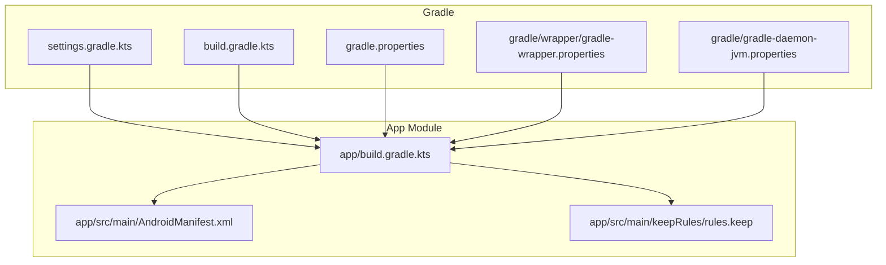
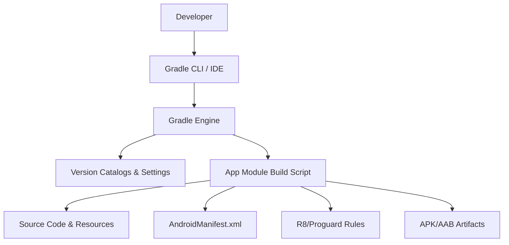
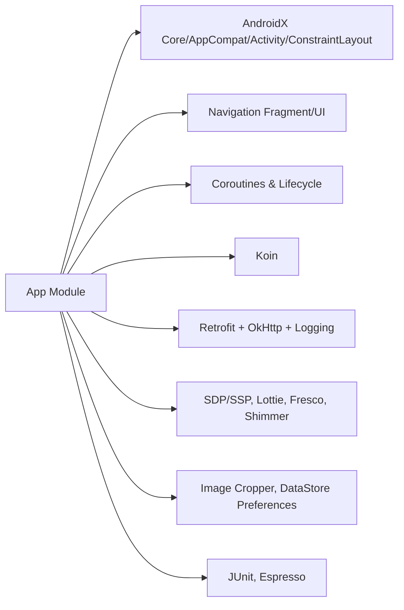

# Deployment Guide

<cite>
**Referenced Files in This Document**
- [app/build.gradle.kts](file://app/build.gradle.kts)
- [build.gradle.kts](file://build.gradle.kts)
- [settings.gradle.kts](file://settings.gradle.kts)
- [gradle.properties](file://gradle.properties)
- [gradle/wrapper/gradle-wrapper.properties](file://gradle/wrapper/gradle-wrapper.properties)
- [gradle/gradle-daemon-jvm.properties](file://gradle/gradle-daemon-jvm.properties)
- [local.properties](file://local.properties)
- [app/src/main/AndroidManifest.xml](file://app/src/main/AndroidManifest.xml)
- [app/src/main/keepRules/rules.keep](file://app/src/main/keepRules/rules.keep)
</cite>

## Table of Contents
1. Introduction
2. Project Structure
3. Core Components
4. Architecture Overview
5. Detailed Component Analysis
6. Dependency Analysis
7. Performance Considerations
8. Troubleshooting Guide
9. Conclusion
10. Appendices

## Introduction
This Deployment Guide explains how to build, sign, and release the Flirttime-Otp-Android application for production. It covers build configuration (signing, ProGuard/R8 rules, build variants), the end-to-end release process from development to production, Google Play Store submission steps, CI/CD setup guidance, environment-specific configuration, API key management, and production monitoring considerations.

## Project Structure
The project is a standard Android Gradle module with:
- A single app module under app/
- Centralized dependency versions via Gradle version catalogs
- Build configuration in app/build.gradle.kts
- Application manifest defining permissions, activities, and runtime behavior
- R8 keep rules under app/src/main/keepRules

**Diagram sources**
- [settings.gradle.kts:1-26](file://settings.gradle.kts#L1-L26)
- [build.gradle.kts:1-5](file://build.gradle.kts#L1-L5)
- [app/build.gradle.kts:1-92](file://app/build.gradle.kts#L1-L92)
- [app/src/main/AndroidManifest.xml:1-180](file://app/src/main/AndroidManifest.xml#L1-L180)
- [app/src/main/keepRules/rules.keep:1-12](file://app/src/main/keepRules/rules.keep#L1-L12)
- [gradle.properties:1-19](file://gradle.properties#L1-L19)
- [gradle/wrapper/gradle-wrapper.properties:1-9](file://gradle/wrapper/gradle-wrapper.properties#L1-L9)
- [gradle/gradle-daemon-jvm.properties:1-12](file://gradle/gradle-daemon-jvm.properties#L1-L12)

**Section sources**
- [settings.gradle.kts:1-26](file://settings.gradle.kts#L1-L26)
- [build.gradle.kts:1-5](file://build.gradle.kts#L1-L5)
- [app/build.gradle.kts:1-92](file://app/build.gradle.kts#L1-L92)
- [app/src/main/AndroidManifest.xml:1-180](file://app/src/main/AndroidManifest.xml#L1-L180)
- [app/src/main/keepRules/rules.keep:1-12](file://app/src/main/keepRules/rules.keep#L1-L12)
- [gradle.properties:1-19](file://gradle.properties#L1-L19)
- [gradle/wrapper/gradle-wrapper.properties:1-9](file://gradle/wrapper/gradle-wrapper.properties#L1-L9)
- [gradle/gradle-daemon-jvm.properties:1-12](file://gradle/gradle-daemon-jvm.properties#L1-L12)

## Core Components
- Build system: Gradle with Kotlin DSL, version catalogs, and toolchain resolver.
- App module: Single Android application module with view binding and BuildConfig generation.
- Manifest: Declares permissions, FileProvider, and launcher activity.
- R8 rules: Keep rules directory present; default optimization enabled.

Key build settings:
- compileSdk/targetSdk/minSdk configured
- applicationId set for debug/testing
- versionCode/versionName defined
- Base URL injected via BuildConfig
- Release build type with minification disabled by default and ProGuard files referenced
- Java 17 compatibility

Environment and toolchain:
- Gradle wrapper pinned to a specific distribution
- JVM args and configuration cache enabled
- Toolchain auto-resolver configured

Local SDK path is provided via local.properties.

**Section sources**
- [app/build.gradle.kts:5-40](file://app/build.gradle.kts#L5-L40)
- [gradle/wrapper/gradle-wrapper.properties:1-9](file://gradle/wrapper/gradle-wrapper.properties#L1-L9)
- [gradle.properties:1-19](file://gradle.properties#L1-L19)
- [gradle/gradle-daemon-jvm.properties:1-12](file://gradle/gradle-daemon-jvm.properties#L1-L12)
- [local.properties:1-8](file://local.properties#L1-L8)

## Architecture Overview
At build time, Gradle resolves dependencies, compiles Kotlin/Java sources, processes resources, and packages outputs. The app module depends on AndroidX, networking libraries, coroutines, UI components, and image loading libraries as declared in the module’s build script.

[No sources needed since this diagram shows conceptual workflow, not actual code structure]

## Detailed Component Analysis

### Build Configuration and Variants
- Compile and target SDKs are set in the app module.
- DefaultConfig defines applicationId, minSdk, targetSdk, versionCode, versionName, instrumentation runner, and a BASE_URL BuildConfig field.
- BuildFeatures enables ViewBinding and BuildConfig generation.
- BuildTypes includes a release variant with minification toggled off by default and ProGuard files referenced.

Recommendations:
- Enable minification and resource shrinking for release builds.
- Add signingConfigs for release builds using secure keystore management.
- Introduce productFlavors or buildType overrides for environment-specific configurations (e.g., dev/staging/prod).

**Section sources**
- [app/build.gradle.kts:11-36](file://app/build.gradle.kts#L11-L36)

### Signing Configuration
Current state:
- No signingConfigs block is present in the app module build script.

Required actions for release:
- Define signingConfigs with keystore file path, alias, and passwords sourced from environment variables or secret managers.
- Assign the signing config to the release buildType.
- Generate signed APKs and AABs for distribution.

Verification:
- Ensure the generated artifacts are signed and verifiable before upload.

**Section sources**
- [app/build.gradle.kts:28-36](file://app/build.gradle.kts#L28-L36)

### ProGuard/R8 Rules
Current state:
- Release build references ProGuard files but minification is disabled.
- Keep rules directory exists at app/src/main/keepRules with a placeholder comment.

Recommended actions:
- Enable minifyEnabled and shrinkResources for release.
- Review and add necessary keep rules for reflection, serialization, WebView JS interfaces, and third-party libraries.
- Validate that the app runs correctly after enabling R8.

**Section sources**
- [app/build.gradle.kts:28-36](file://app/build.gradle.kts#L28-L36)
- [app/src/main/keepRules/rules.keep:1-12](file://app/src/main/keepRules/rules.keep#L1-L12)

### Environment-Specific Configurations
Current state:
- BASE_URL is injected into BuildConfig for all builds.
- No flavors or additional build types are defined.

Recommended approach:
- Use productFlavors (e.g., dev, staging, prod) to vary BASE_URL and other endpoints.
- Alternatively, use buildType overrides or external configuration files managed securely.
- Avoid hardcoding secrets; prefer environment variables or secret stores.

**Section sources**
- [app/build.gradle.kts:11-21](file://app/build.gradle.kts#L11-L21)

### Android Manifest and Permissions
The manifest declares:
- Network and storage permissions
- Camera features
- Location permissions
- Notification permission for Android 13+
- FileProvider for sharing content
- Launcher activity and various feature activities

Production considerations:
- Ensure only required permissions are declared for production.
- Validate cleartext traffic usage and restrict if possible.
- Confirm FileProvider authority matches the final applicationId used in release.

**Section sources**
- [app/src/main/AndroidManifest.xml:1-180](file://app/src/main/AndroidManifest.xml#L1-L180)

### Version Management
Current state:
- versionCode and versionName are set in defaultConfig.

Recommended practices:
- Automate version bumping based on tags or semantic versioning.
- Align versionCode with Play Store requirements and ensure monotonic increments.
- Consider generating versionName from git tags or CI metadata.

**Section sources**
- [app/build.gradle.kts:11-16](file://app/build.gradle.kts#L11-L16)

## Dependency Analysis
The app module declares dependencies for UI, navigation, coroutines, Koin DI, Retrofit/OkHttp, SDP/SSP, Lottie, Fresco, Shimmer, Image Cropper, DataStore, and testing libraries.

**Diagram sources**
- [app/build.gradle.kts:43-92](file://app/build.gradle.kts#L43-L92)

**Section sources**
- [app/build.gradle.kts:43-92](file://app/build.gradle.kts#L43-L92)

## Performance Considerations
- Enable R8 minification and resource shrinking for release builds to reduce APK size and improve startup time.
- Use multidex only if needed; modern AGP handles large apps efficiently.
- Profile network calls and consider caching strategies where appropriate.
- Monitor memory usage and avoid heavy synchronous operations on the main thread.

[No sources needed since this section provides general guidance]

## Troubleshooting Guide
Common issues and resolutions:
- Build fails due to missing SDK path: verify local.properties contains sdk.dir pointing to your Android SDK installation.
- Gradle daemon or JVM errors: adjust org.gradle.jvmargs in gradle.properties and ensure compatible JDK toolchain.
- R8 obfuscation crashes: review keep rules and add necessary classes/methods to preserve reflection or serialization.
- Permission-related runtime failures: confirm runtime permission handling aligns with declared permissions in the manifest.
- Cleartext traffic blocked: either enable it explicitly (as currently configured) or switch to HTTPS endpoints.

**Section sources**
- [local.properties:1-8](file://local.properties#L1-L8)
- [gradle.properties:1-19](file://gradle.properties#L1-L19)
- [app/src/main/AndroidManifest.xml:1-180](file://app/src/main/AndroidManifest.xml#L1-L180)
- [app/src/main/keepRules/rules.keep:1-12](file://app/src/main/keepRules/rules.keep#L1-L12)

## Conclusion
To ship Flirttime-Otp-Android to production:
- Configure secure signing for release builds.
- Enable R8 minification and finalize keep rules.
- Introduce environment-specific configurations for different endpoints.
- Automate versioning and artifact generation.
- Prepare store listings and screenshots for Google Play.
- Set up CI/CD for automated builds, tests, and deployments.
- Implement production monitoring and error reporting.

[No sources needed since this section summarizes without analyzing specific files]

## Appendices

### A. End-to-End Release Process
Steps:
1. Finalize environment configuration (BASE_URL per environment).
2. Create and secure a release keystore; configure signingConfigs.
3. Enable minification and resource shrinking for release.
4. Run unit and instrumented tests locally.
5. Generate signed AAB (preferred) and/or APK for internal testing.
6. Validate artifacts with apksigner or jarsigner.
7. Upload to Google Play Console and manage rollout.

[No sources needed since this section provides general guidance]

### B. Google Play Store Submission Checklist
- Store listing: title, short description, full description, category, contact details.
- Screenshots for multiple device sizes and orientations.
- App icon and feature graphic.
- Privacy policy URL.
- Content rating questionnaire.
- App bundle (AAB) uploaded; optional APKs for internal testing.
- Staged rollout strategy and tracking metrics.

[No sources needed since this section provides general guidance]

### C. CI/CD Pipeline Setup
Recommended pipeline stages:
- Checkout code
- Cache Gradle dependencies
- Run unit tests
- Run instrumented tests (emulator/device matrix)
- Build release artifacts with secure signing
- Publish test artifacts and generate changelog
- Deploy to Google Play (internal/closed track first)
- Notify team and stakeholders

Security:
- Store keystore and credentials in CI secret vaults.
- Never commit secrets to repository.

[No sources needed since this section provides general guidance]

### D. Environment-Specific Configurations and API Key Management
- Use productFlavors or buildType overrides to inject environment-specific values.
- Manage API keys and tokens via environment variables or secret managers.
- Avoid committing secrets; validate presence of required secrets at build time.

[No sources needed since this section provides general guidance]

### E. Production Monitoring Setup
- Integrate crash reporting (e.g., Firebase Crashlytics).
- Enable performance monitoring and ANR detection.
- Instrument key user flows with analytics events.
- Set up alerts and dashboards for critical metrics.

[No sources needed since this section provides general guidance]