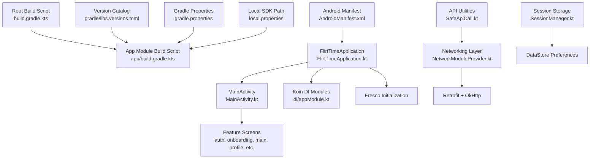
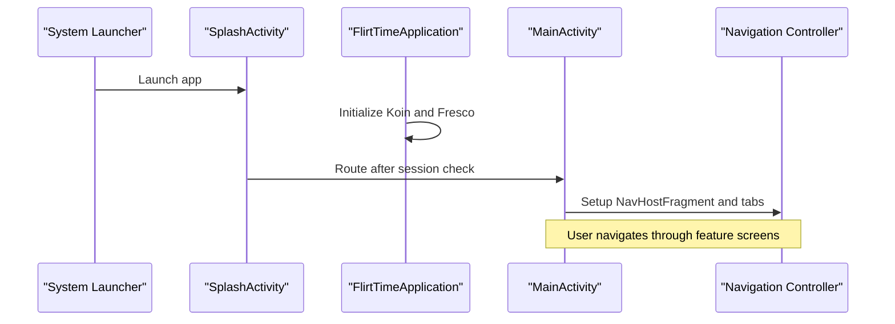
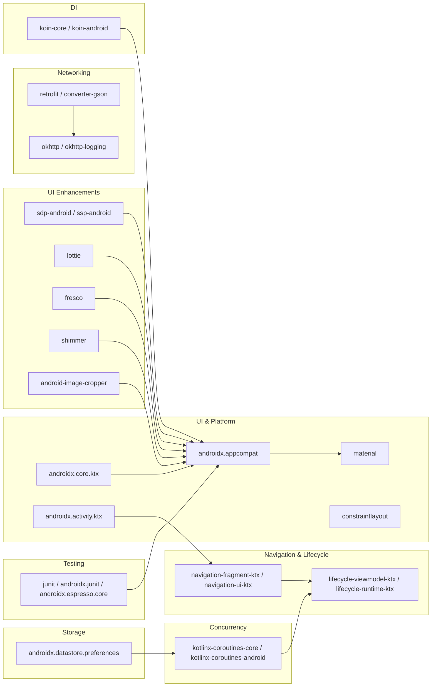

# Getting Started

<cite>
**Referenced Files in This Document**
- [app/build.gradle.kts](file://app/build.gradle.kts)
- [gradle/libs.versions.toml](file://gradle/libs.versions.toml)
- [build.gradle.kts](file://build.gradle.kts)
- [gradle.properties](file://gradle.properties)
- [local.properties](file://local.properties)
- [AndroidManifest.xml](file://app/src/main/AndroidManifest.xml)
- [FlirtTimeApplication.kt](file://app/src/main/java/com/flirttime/FlirtTimeApplication.kt)
- [MainActivity.kt](file://app/src/main/java/com/flirttime/MainActivity.kt)
- [NetworkModuleProvider.kt](file://app/src/main/java/com/flirttime/core/network/NetworkModuleProvider.kt)
- [SessionManager.kt](file://app/src/main/java/com/flirttime/core/database/SessionManager.kt)
- [SafeApiCall.kt](file://app/src/main/java/com/flirttime/core/network/SafeApiCall.kt)
- [ExampleInstrumentedTest.kt](file://app/src/androidTest/java/com/flirttime/ExampleInstrumentedTest.kt)
</cite>

## Table of Contents
1. [Introduction](#introduction)
2. [Project Structure](#project-structure)
3. [Core Components](#core-components)
4. [Architecture Overview](#architecture-overview)
5. [Detailed Component Analysis](#detailed-component-analysis)
6. [Dependency Analysis](#dependency-analysis)
7. [Performance Considerations](#performance-considerations)
8. [Troubleshooting Guide](#troubleshooting-guide)
9. [Conclusion](#conclusion)

## Introduction
This guide helps you set up, build, and run the Flirttime-Otp-Android project locally. It covers environment requirements, step-by-step installation, build configuration, API base URL setup, first-run flow, basic testing, and common troubleshooting. The app is a modern Android application using Kotlin, Jetpack Navigation, Coroutines, Koin for dependency injection, Retrofit/OkHttp for networking, and DataStore for local session storage.

## Project Structure
At a high level:
- Root Gradle files define shared plugins and version catalogs.
- The app module contains all UI, features, core utilities, and network layer.
- The manifest declares permissions, activities, and the launcher entry point.
- Application initialization sets up dependency injection and image loading libraries.

**Diagram sources**
- [build.gradle.kts:1-5](file://build.gradle.kts#L1-L5)
- [app/build.gradle.kts:1-41](file://app/build.gradle.kts#L1-L41)
- [gradle/libs.versions.toml:1-67](file://gradle/libs.versions.toml#L1-L67)
- [gradle.properties:1-19](file://gradle.properties#L1-L19)
- [local.properties:1-9](file://local.properties#L1-L9)
- [AndroidManifest.xml:37-69](file://app/src/main/AndroidManifest.xml#L37-L69)
- [FlirtTimeApplication.kt:10-23](file://app/src/main/java/com/flirttime/FlirtTimeApplication.kt#L10-L23)
- [MainActivity.kt:18-52](file://app/src/main/java/com/flirttime/MainActivity.kt#L18-L52)
- [NetworkModuleProvider.kt:17-85](file://app/src/main/java/com/flirttime/core/network/NetworkModuleProvider.kt#L17-L85)
- [SessionManager.kt:22-76](file://app/src/main/java/com/flirttime/core/database/SessionManager.kt#L22-L76)
- [SafeApiCall.kt:33-71](file://app/src/main/java/com/flirttime/core/network/SafeApiCall.kt#L33-L71)

**Section sources**
- [build.gradle.kts:1-5](file://build.gradle.kts#L1-L5)
- [app/build.gradle.kts:1-41](file://app/build.gradle.kts#L1-L41)
- [gradle/libs.versions.toml:1-67](file://gradle/libs.versions.toml#L1-L67)
- [gradle.properties:1-19](file://gradle.properties#L1-L19)
- [local.properties:1-9](file://local.properties#L1-L9)
- [AndroidManifest.xml:37-69](file://app/src/main/AndroidManifest.xml#L37-L69)
- [FlirtTimeApplication.kt:10-23](file://app/src/main/java/com/flirttime/FlirtTimeApplication.kt#L10-L23)
- [MainActivity.kt:18-52](file://app/src/main/java/com/flirttime/MainActivity.kt#L18-L52)

## Core Components
- Application bootstrap initializes Koin and Fresco.
- MainActivity hosts navigation and bottom tabs.
- Networking uses Retrofit with OkHttp interceptors for auth headers, logging, and offline caching.
- SessionManager persists tokens and user data via DataStore.
- SafeApiCall centralizes error handling for network calls.

Key responsibilities:
- Dependency Injection: Koin modules are started at app startup.
- UI Shell: MainActivity manages navigation and edge-to-edge layout.
- Network: Base URL comes from BuildConfig; Authorization header is injected automatically when present.
- Persistence: DataStore stores authentication token and other preferences.

**Section sources**
- [FlirtTimeApplication.kt:10-23](file://app/src/main/java/com/flirttime/FlirtTimeApplication.kt#L10-L23)
- [MainActivity.kt:18-52](file://app/src/main/java/com/flirttime/MainActivity.kt#L18-L52)
- [NetworkModuleProvider.kt:17-85](file://app/src/main/java/com/flirttime/core/network/NetworkModuleProvider.kt#L17-L85)
- [SessionManager.kt:22-76](file://app/src/main/java/com/flirttime/core/database/SessionManager.kt#L22-L76)
- [SafeApiCall.kt:33-71](file://app/src/main/java/com/flirttime/core/network/SafeApiCall.kt#L33-L71)

## Architecture Overview
The app follows a feature-based structure with a clear separation between presentation (Activities/Fragments), domain logic (ViewModels and repositories), and data access (network and local storage). The entry point is SplashActivity, which routes to onboarding or main screens based on session state.

**Diagram sources**
- [AndroidManifest.xml:59-69](file://app/src/main/AndroidManifest.xml#L59-L69)
- [FlirtTimeApplication.kt:10-23](file://app/src/main/java/com/flirttime/FlirtTimeApplication.kt#L10-L23)
- [MainActivity.kt:54-87](file://app/src/main/java/com/flirttime/MainActivity.kt#L54-L87)

## Detailed Component Analysis

### Development Environment Setup
- Android Studio: Use a recent stable version that supports AGP 9.x and Kotlin 2.3.x.
- JDK: Java 17 is required by compileOptions.
- Android SDK:
  - compileSdk: 36
  - targetSdk: 36
  - minSdk: 24
- Gradle: Version catalog defines AGP 9.3.3 and Kotlin 2.3.20.

Where these are defined:
- Java compatibility and SDK versions are configured in the app module build script.
- Plugin and library versions are centralized in the version catalog.

**Section sources**
- [app/build.gradle.kts:5-40](file://app/build.gradle.kts#L5-L40)
- [gradle/libs.versions.toml:1-24](file://gradle/libs.versions.toml#L1-L24)

### Step-by-Step Installation
1. Clone the repository.
2. Open the project root in Android Studio.
3. Allow Gradle sync to complete. If prompted, install missing SDK components (compileSdk 36, targetSdk 36, minSdk 24).
4. Ensure local.properties points to your Android SDK path. The file should contain sdk.dir pointing to your SDK location.
5. Sync again if you updated local.properties.

Notes:
- local.properties is not checked into version control and must exist locally.
- gradle.properties configures JVM args and enables configuration cache.

**Section sources**
- [local.properties:1-9](file://local.properties#L1-L9)
- [gradle.properties:1-19](file://gradle.properties#L1-L19)

### Build Configuration Instructions
- Application ID: com.flirttime.test
- Namespace: com.flirttime
- ViewBinding and BuildConfig are enabled.
- Release build disables minification by default.
- Test instrumentation runner is set to androidx.test.runner.AndroidJUnitRunner.

Build variants:
- Debug: Default variant used during development.
- Release: Minification disabled; ProGuard rules file included.

**Section sources**
- [app/build.gradle.kts:5-41](file://app/build.gradle.kts#L5-L41)

### Required API Keys and Base URL Setup
- Base URL: Defined as a buildConfigField BASE_URL in the app module.
- Runtime behavior: Retrofit uses BuildConfig.BASE_URL to configure the base endpoint.
- Authorization: An interceptor injects an Authorization header if a cached token exists.
- Logging: HTTP logging is enabled in debug builds and redacts sensitive headers.

To change the API endpoint:
- Update the BASE_URL value in the app module build script’s defaultConfig block.

To add new API keys:
- Add them as additional buildConfigField entries in defaultConfig.
- Access them via BuildConfig.<KEY_NAME> in code.

**Section sources**
- [app/build.gradle.kts:11-21](file://app/build.gradle.kts#L11-L21)
- [NetworkModuleProvider.kt:17-85](file://app/src/main/java/com/flirttime/core/network/NetworkModuleProvider.kt#L17-L85)

### First Run Instructions
- Install and launch the app on a device or emulator.
- The launcher activity is SplashActivity, which evaluates session state and routes accordingly.
- On first run, expect onboarding flows and permission prompts for camera, location, notifications, and media access.
- After onboarding, the app navigates to the main screen with bottom tabs.

Permissions declared include:
- Internet and network state
- Camera
- Location (fine/coarse)
- Notifications (Android 13+)
- Media read permissions

**Section sources**
- [AndroidManifest.xml:5-35](file://app/src/main/AndroidManifest.xml#L5-L35)
- [AndroidManifest.xml:59-69](file://app/src/main/AndroidManifest.xml#L59-L69)

### Basic Testing Procedures
- Unit tests: JUnit is included for unit testing.
- Instrumentation tests: ExampleInstrumentedTest demonstrates running tests on a device/emulator.
- To run tests:
  - From Android Studio: Use the “Run” or “Debug” actions next to test classes.
  - From command line: ./gradlew connectedAndroidTest for instrumentation tests.

**Section sources**
- [ExampleInstrumentedTest.kt:1-24](file://app/src/androidTest/java/com/flirttime/ExampleInstrumentedTest.kt#L1-L24)
- [app/build.gradle.kts:43-92](file://app/build.gradle.kts#L43-L92)

### Navigating the Codebase
- Feature modules under app/src/main/java/com/flirttime/feature/:
  - auth: Authentication flows (login, OTP, country selection).
  - onboarding: Intro screens and permission primer.
  - main: Home tabs (moments, explore, matches, chat, profile).
  - profile: Profile creation and verification steps.
  - moments: Moments feed and related features.
  - notification: Notification screen.
  - search: Search functionality.
  - webview: WebView usage.
- Core utilities under app/src/main/java/com/flirttime/core/:
  - common: Shared helpers (edge-to-edge, multipart, connectivity, shimmer).
  - database: SessionManager for DataStore-backed persistence.
  - image: Image cropping utilities.
  - navigation: Centralized navigation helpers.
  - network: Retrofit/OkHttp setup and safe API call wrappers.
  - ui: Reusable UI components (OTP view, multi-image gallery).
- Resources under app/src/main/res/:
  - layouts, drawables, colors, themes, navigation graph, and XML configs.

Tip: Start with AndroidManifest.xml to understand entry points and permissions, then follow the flow from SplashActivity to MainActivity and feature screens.

**Section sources**
- [AndroidManifest.xml:37-178](file://app/src/main/AndroidManifest.xml#L37-L178)
- [MainActivity.kt:18-87](file://app/src/main/java/com/flirttime/MainActivity.kt#L18-L87)

## Dependency Analysis
The app relies on a well-defined set of libraries managed via a version catalog. Key dependencies include:
- AndroidX Core, AppCompat, Material, Activity KTX, ConstraintLayout
- Navigation Component
- Kotlin Coroutines and Lifecycle
- Koin for dependency injection
- Retrofit and OkHttp for networking
- SDP/SSP for scalable dimensions
- Lottie for animations
- Fresco for image loading
- Shimmer for placeholder effects
- Android Image Cropper
- DataStore Preferences
- JUnit, AndroidX Test, Espresso for testing

**Diagram sources**
- [gradle/libs.versions.toml:25-67](file://gradle/libs.versions.toml#L25-L67)
- [app/build.gradle.kts:43-92](file://app/build.gradle.kts#L43-L92)

**Section sources**
- [gradle/libs.versions.toml:1-67](file://gradle/libs.versions.toml#L1-L67)
- [app/build.gradle.kts:43-92](file://app/build.gradle.kts#L43-L92)

## Performance Considerations
- Enable Gradle configuration cache to speed up builds.
- Use debug builds for verbose HTTP logging; release builds disable logging by default.
- Retrofit client includes timeouts and a small HTTP cache for offline scenarios.
- Fresco is initialized at app startup for efficient image loading.

[No sources needed since this section provides general guidance]

## Troubleshooting Guide
Common issues and resolutions:
- Gradle sync fails due to missing SDK:
  - Ensure compileSdk 36 and targetSdk 36 are installed in Android SDK Manager.
  - Verify local.properties contains a valid sdk.dir path.
- Java version mismatch:
  - Configure your project to use JDK 17 as required by compileOptions.
- Cannot connect to API:
  - Confirm BASE_URL is correct in the app module build script.
  - Check device internet connectivity and permissions (INTERNET, ACCESS_NETWORK_STATE).
- Permission denied errors:
  - Grant runtime permissions for camera, location, notifications, and media as prompted by the app.
- Tests fail on device:
  - Ensure the device/emulator has Google Play Services and required APIs installed.
  - Verify testInstrumentationRunner is correctly set.

**Section sources**
- [local.properties:1-9](file://local.properties#L1-L9)
- [app/build.gradle.kts:5-41](file://app/build.gradle.kts#L5-L41)
- [AndroidManifest.xml:5-35](file://app/src/main/AndroidManifest.xml#L5-L35)
- [NetworkModuleProvider.kt:17-85](file://app/src/main/java/com/flirttime/core/network/NetworkModuleProvider.kt#L17-L85)
- [SafeApiCall.kt:33-71](file://app/src/main/java/com/flirttime/core/network/SafeApiCall.kt#L33-L71)

## Conclusion
You now have everything needed to set up, build, and run Flirttime-Otp-Android locally. The project uses modern Android tooling and architecture patterns. For further development, start with the manifest and application bootstrap, then explore feature modules and core utilities. Adjust the base URL and any additional API keys via buildConfig fields as needed.

[No sources needed since this section summarizes without analyzing specific files]