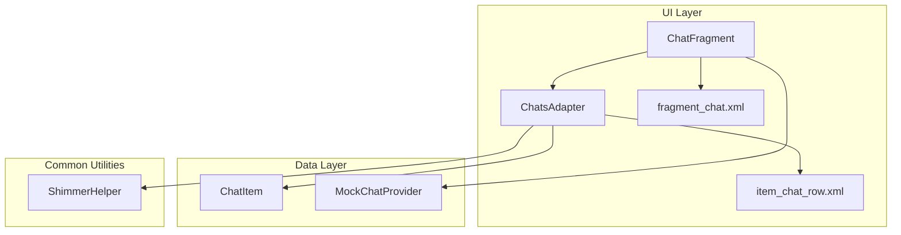
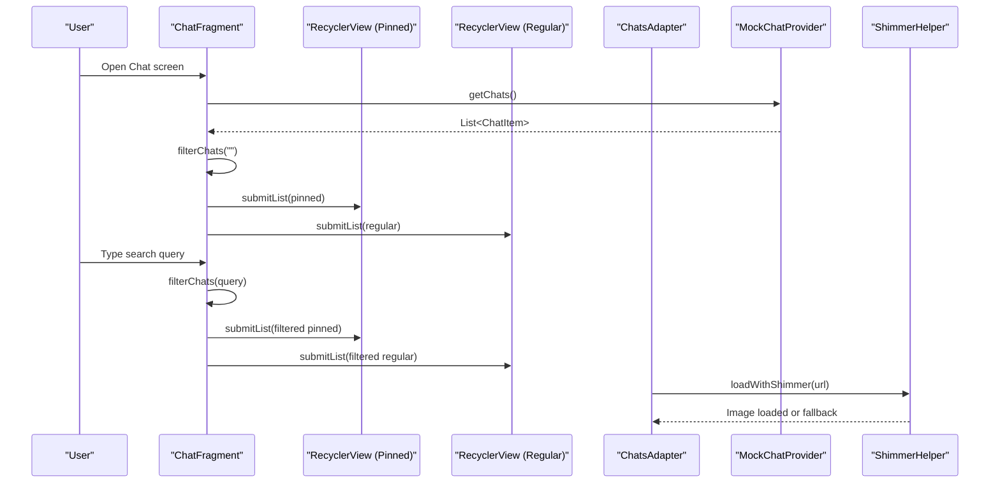
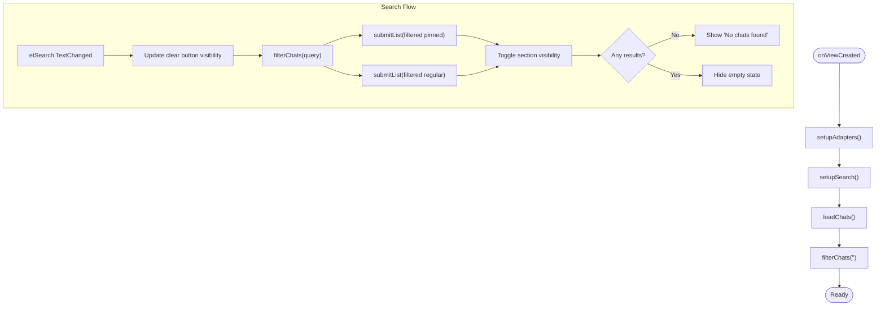
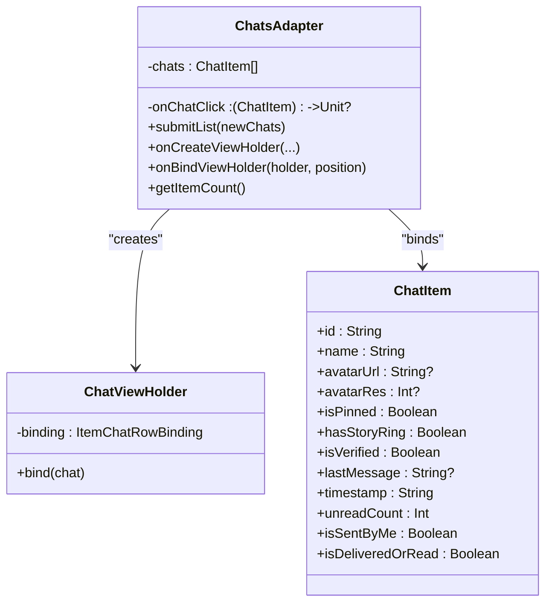
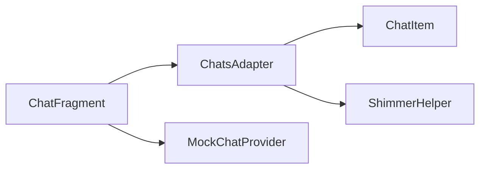

# Chat Interface

<cite>
**Referenced Files in This Document**
- [ChatFragment.kt](file://app/src/main/java/com/flirttime/feature/main/presentation/chat/ChatFragment.kt)
- [ChatsAdapter.kt](file://app/src/main/java/com/flirttime/feature/main/presentation/chat/ChatsAdapter.kt)
- [ChatItem.kt](file://app/src/main/java/com/flirttime/feature/main/presentation/chat/ChatItem.kt)
- [MockChatProvider.kt](file://app/src/main/java/com/flirttime/feature/main/presentation/chat/MockChatProvider.kt)
- [ShimmerHelper.kt](file://app/src/main/java/com/flirttime/core/common/ShimmerHelper.kt)
- [fragment_chat.xml](file://app/src/main/res/layout/fragment_chat.xml)
- [item_chat_row.xml](file://app/src/main/res/layout/item_chat_row.xml)
</cite>

## Table of Contents
1. [Introduction](#introduction)
2. [Project Structure](#project-structure)
3. [Core Components](#core-components)
4. [Architecture Overview](#architecture-overview)
5. [Detailed Component Analysis](#detailed-component-analysis)
6. [Dependency Analysis](#dependency-analysis)
7. [Performance Considerations](#performance-considerations)
8. [Troubleshooting Guide](#troubleshooting-guide)
9. [Conclusion](#conclusion)

## Introduction
This document explains the Chat interface in Flirttime-Otp-Android, focusing on the conversation list screen. It covers:
- Conversation screen management via ChatFragment
- Rendering and interaction logic in ChatsAdapter
- Data model for chat rows in ChatItem
- Mock data provider for development and testing
- Search and filtering behavior
- Visual indicators such as user presence (story ring), verification badge, message status icons, unread badges, and timestamps
- Image loading with shimmer placeholders
- Performance considerations for large lists and image caching

## Project Structure
The Chat feature is implemented under the main presentation layer and uses standard Android UI components:
- Fragment orchestrates lifecycle, adapters, search input, and data loading
- RecyclerView-based adapter renders each chat row
- XML layouts define the fragment UI and individual row layout
- A helper utility provides shimmer placeholders for images

**Diagram sources**
- [ChatFragment.kt:14-115](file://app/src/main/java/com/flirttime/feature/main/presentation/chat/ChatFragment.kt#L14-L115)
- [ChatsAdapter.kt:12-100](file://app/src/main/java/com/flirttime/feature/main/presentation/chat/ChatsAdapter.kt#L12-L100)
- [ChatItem.kt:6-19](file://app/src/main/java/com/flirttime/feature/main/presentation/chat/ChatItem.kt#L6-L19)
- [MockChatProvider.kt:3-79](file://app/src/main/java/com/flirttime/feature/main/presentation/chat/MockChatProvider.kt#L3-L79)
- [ShimmerHelper.kt:14-72](file://app/src/main/java/com/flirttime/core/common/ShimmerHelper.kt#L14-L72)
- [fragment_chat.xml:1-205](file://app/src/main/res/layout/fragment_chat.xml#L1-L205)
- [item_chat_row.xml:1-145](file://app/src/main/res/layout/item_chat_row.xml#L1-L145)

**Section sources**
- [ChatFragment.kt:14-115](file://app/src/main/java/com/flirttime/feature/main/presentation/chat/ChatFragment.kt#L14-L115)
- [ChatsAdapter.kt:12-100](file://app/src/main/java/com/flirttime/feature/main/presentation/chat/ChatsAdapter.kt#L12-L100)
- [ChatItem.kt:6-19](file://app/src/main/java/com/flirttime/feature/main/presentation/chat/ChatItem.kt#L6-L19)
- [MockChatProvider.kt:3-79](file://app/src/main/java/com/flirttime/feature/main/presentation/chat/MockChatProvider.kt#L3-L79)
- [ShimmerHelper.kt:14-72](file://app/src/main/java/com/flirttime/core/common/ShimmerHelper.kt#L14-L72)
- [fragment_chat.xml:1-205](file://app/src/main/res/layout/fragment_chat.xml#L1-L205)
- [item_chat_row.xml:1-145](file://app/src/main/res/layout/item_chat_row.xml#L1-L145)

## Core Components
- ChatFragment: Manages two RecyclerViews (pinned and regular chats), handles search input, filters data, and navigates to a selected chat.
- ChatsAdapter: Binds ChatItem to item_chat_row.xml, displays avatar with shimmer, story ring, verified badge, last message preview, timestamp, unread badge, and click handling.
- ChatItem: Data model representing a single chat row with metadata for display and state.
- MockChatProvider: Provides sample chat data for development and testing.
- ShimmerHelper: Utility to load images with shimmer placeholders using Fresco.

Key responsibilities:
- Fragment lifecycle and view binding
- Adapter setup and configuration
- Search query processing and UI updates
- Row rendering and user interactions
- Image loading and placeholder management

**Section sources**
- [ChatFragment.kt:14-115](file://app/src/main/java/com/flirttime/feature/main/presentation/chat/ChatFragment.kt#L14-L115)
- [ChatsAdapter.kt:12-100](file://app/src/main/java/com/flirttime/feature/main/presentation/chat/ChatsAdapter.kt#L12-L100)
- [ChatItem.kt:6-19](file://app/src/main/java/com/flirttime/feature/main/presentation/chat/ChatItem.kt#L6-L19)
- [MockChatProvider.kt:3-79](file://app/src/main/java/com/flirttime/feature/main/presentation/chat/MockChatProvider.kt#L3-L79)
- [ShimmerHelper.kt:14-72](file://app/src/main/java/com/flirttime/core/common/ShimmerHelper.kt#L14-L72)

## Architecture Overview
The Chat screen follows a simple MVVM-like structure without a ViewModel yet:
- UI layer: ChatFragment + XML layouts
- Presentation logic: ChatFragment coordinates adapters and search
- Data layer: MockChatProvider supplies static data
- Common utilities: ShimmerHelper for image loading

**Diagram sources**
- [ChatFragment.kt:33-105](file://app/src/main/java/com/flirttime/feature/main/presentation/chat/ChatFragment.kt#L33-L105)
- [ChatsAdapter.kt:31-99](file://app/src/main/java/com/flirttime/feature/main/presentation/chat/ChatsAdapter.kt#L31-L99)
- [MockChatProvider.kt:5-78](file://app/src/main/java/com/flirttime/feature/main/presentation/chat/MockChatProvider.kt#L5-L78)
- [ShimmerHelper.kt:37-72](file://app/src/main/java/com/flirttime/core/common/ShimmerHelper.kt#L37-L72)

## Detailed Component Analysis

### ChatFragment
Responsibilities:
- Inflates the fragment layout and sets up two RecyclerViews for pinned and regular chats
- Initializes ChatsAdapter instances with click callbacks
- Sets up search input with clear button visibility and text change listener
- Loads mock data and applies initial filtering
- Filters chats by name or last message, updates both adapters, and toggles section visibility and empty state
- Handles chat selection (currently shows a toast; can be extended to navigate)

Search and filtering:
- Trims and normalizes the query
- Shows/hides the clear button based on query presence
- Filters by case-insensitive match against name and lastMessage
- Separates results into pinned vs regular sections
- Hides sections when no results exist and shows an empty state when appropriate

Navigation:
- Placeholder implementation displays a toast; replace with navigation action to open a real chat detail screen

**Diagram sources**
- [ChatFragment.kt:33-105](file://app/src/main/java/com/flirttime/feature/main/presentation/chat/ChatFragment.kt#L33-L105)

**Section sources**
- [ChatFragment.kt:14-115](file://app/src/main/java/com/flirttime/feature/main/presentation/chat/ChatFragment.kt#L14-L115)
- [fragment_chat.xml:1-205](file://app/src/main/res/layout/fragment_chat.xml#L1-L205)

### ChatsAdapter
Responsibilities:
- Binds ChatItem to item_chat_row.xml
- Displays avatar with shimmer placeholder via ShimmerHelper
- Toggles story ring, verified badge, last message preview, double-check icon, unread badge, and timestamp
- Applies bold styling and color changes for unread messages
- Invokes onChatClick callback when a row is clicked

Rendering details:
- Avatar: Uses SimpleDraweeView with center crop and circular rounding; shimmer placeholder stops when image loads or fails
- Story ring: Green ring around avatar indicates active story/status
- Verified badge: Blue badge shown when user is verified
- Last message preview: Hidden if null/blank; otherwise visible with optional double-check icon for sent-by-me
- Unread styling: Bold font and darker color when unreadCount > 0
- Timestamp: Displayed as-is from data
- Unread badge: Circular badge showing count when > 0

**Diagram sources**
- [ChatsAdapter.kt:12-100](file://app/src/main/java/com/flirttime/feature/main/presentation/chat/ChatsAdapter.kt#L12-L100)
- [ChatItem.kt:6-19](file://app/src/main/java/com/flirttime/feature/main/presentation/chat/ChatItem.kt#L6-L19)

**Section sources**
- [ChatsAdapter.kt:12-100](file://app/src/main/java/com/flirttime/feature/main/presentation/chat/ChatsAdapter.kt#L12-L100)
- [item_chat_row.xml:1-145](file://app/src/main/res/layout/item_chat_row.xml#L1-L145)

### ChatItem
Represents a single chat row with fields for identity, media, presence, verification, message preview, time, unread count, and sender/delivery state.

Complexity:
- O(1) access per field
- Immutable data class suitable for efficient diffing and snapshotting

Usage:
- Populated by MockChatProvider
- Consumed by ChatsAdapter for rendering
- Used by ChatFragment for filtering

**Section sources**
- [ChatItem.kt:6-19](file://app/src/main/java/com/flirttime/feature/main/presentation/chat/ChatItem.kt#L6-L19)

### MockChatProvider
Provides a fixed set of ChatItem entries for development and testing. Includes examples with:
- Pinned chats
- Story rings
- Verified users
- Sent-by-me messages with delivery/read flags
- Unread counts

Extensibility:
- Replace with a repository/data source that returns live data or paginated results
- Add more fields to support richer message previews (e.g., media type indicators)

**Section sources**
- [MockChatProvider.kt:3-79](file://app/src/main/java/com/flirttime/feature/main/presentation/chat/MockChatProvider.kt#L3-L79)

### ShimmerHelper
Utility for loading images with shimmer placeholders:
- Creates a subtle shimmer animation
- Sets placeholder on SimpleDraweeView
- Stops shimmer on success or failure
- Falls back to a local resource when URL is missing or loading fails

Integration:
- Used by ChatsAdapter to render avatars smoothly while loading remote images

**Section sources**
- [ShimmerHelper.kt:14-72](file://app/src/main/java/com/flirttime/core/common/ShimmerHelper.kt#L14-L72)

## Dependency Analysis
- ChatFragment depends on:
  - ChatsAdapter for rendering
  - MockChatProvider for data
  - Layout resources for UI structure
- ChatsAdapter depends on:
  - ChatItem for data binding
  - ShimmerHelper for image loading
  - Layout resources for row UI
- ShimmerHelper depends on Fresco for image loading and shimmer effects

**Diagram sources**
- [ChatFragment.kt:14-115](file://app/src/main/java/com/flirttime/feature/main/presentation/chat/ChatFragment.kt#L14-L115)
- [ChatsAdapter.kt:12-100](file://app/src/main/java/com/flirttime/feature/main/presentation/chat/ChatsAdapter.kt#L12-L100)
- [ChatItem.kt:6-19](file://app/src/main/java/com/flirttime/feature/main/presentation/chat/ChatItem.kt#L6-L19)
- [MockChatProvider.kt:3-79](file://app/src/main/java/com/flirttime/feature/main/presentation/chat/MockChatProvider.kt#L3-L79)
- [ShimmerHelper.kt:14-72](file://app/src/main/java/com/flirttime/core/common/ShimmerHelper.kt#L14-L72)

**Section sources**
- [ChatFragment.kt:14-115](file://app/src/main/java/com/flirttime/feature/main/presentation/chat/ChatFragment.kt#L14-L115)
- [ChatsAdapter.kt:12-100](file://app/src/main/java/com/flirttime/feature/main/presentation/chat/ChatsAdapter.kt#L12-L100)
- [ChatItem.kt:6-19](file://app/src/main/java/com/flirttime/feature/main/presentation/chat/ChatItem.kt#L6-L19)
- [MockChatProvider.kt:3-79](file://app/src/main/java/com/flirttime/feature/main/presentation/chat/MockChatProvider.kt#L3-L79)
- [ShimmerHelper.kt:14-72](file://app/src/main/java/com/flirttime/core/common/ShimmerHelper.kt#L14-L72)

## Performance Considerations
- Large conversation histories:
  - The current screen shows a list of conversations, not a full message history. For future message history screens, consider pagination, virtualization, and diff-aware adapters.
  - Avoid heavy operations in onBindViewHolder; keep binding logic minimal.
- Image caching strategies:
  - Fresco is used via SimpleDraweeView and ShimmerHelper, which caches images automatically. Ensure network policies and cache sizes are tuned for your app’s needs.
  - Use appropriate image sizes and compression to reduce memory pressure.
- Smooth scrolling experiences:
  - Keep layout hierarchies shallow and avoid complex drawables in list items.
  - Precompute styles and reuse resources where possible.
  - Avoid frequent notifyDataSetChanged; prefer targeted updates when possible.
- Search performance:
  - Current filtering runs on the main thread; for large datasets, move filtering off the main thread and post results back to the UI thread.
  - Debounce rapid text changes to reduce re-renders.

[No sources needed since this section provides general guidance]

## Troubleshooting Guide
Common issues and resolutions:
- Avatar not loading:
  - Verify URL validity and network permissions.
  - Check fallback resource availability.
  - Confirm ShimmerHelper is invoked with correct parameters.
- Shimmer not stopping:
  - Ensure controller listeners are attached and not overridden elsewhere.
  - Validate that onFinalImageSet and onFailure are reached.
- Unread styling not applied:
  - Confirm unreadCount > 0 and that the adapter binds the correct fields.
  - Check font resources exist and are accessible at runtime.
- Search not filtering:
  - Ensure etSearch has a TextWatcher attached and filterChats is called on text changes.
  - Validate that names and lastMessage are non-null before comparison.
- Navigation not triggered:
  - Replace the Toast in onChatSelected with proper navigation logic.

**Section sources**
- [ChatsAdapter.kt:40-99](file://app/src/main/java/com/flirttime/feature/main/presentation/chat/ChatsAdapter.kt#L40-L99)
- [ShimmerHelper.kt:37-72](file://app/src/main/java/com/flirttime/core/common/ShimmerHelper.kt#L37-L72)
- [ChatFragment.kt:62-109](file://app/src/main/java/com/flirttime/feature/main/presentation/chat/ChatFragment.kt#L62-L109)

## Conclusion
The Chat interface provides a clean, functional conversation list with:
- Two-section layout (pinned and regular chats)
- Robust search and filtering
- Rich visual indicators (story ring, verified badge, message status, unread badge, timestamp)
- Efficient image loading with shimmer placeholders
- Extensible data model and mock data for development

To evolve toward production readiness:
- Introduce a ViewModel and repository layer for data management
- Implement real-time messaging patterns and message status synchronization
- Add offline-first storage and conflict resolution
- Optimize search with background processing and debouncing
- Enhance navigation to open detailed chat screens with message history and input handling

[No sources needed since this section summarizes without analyzing specific files]