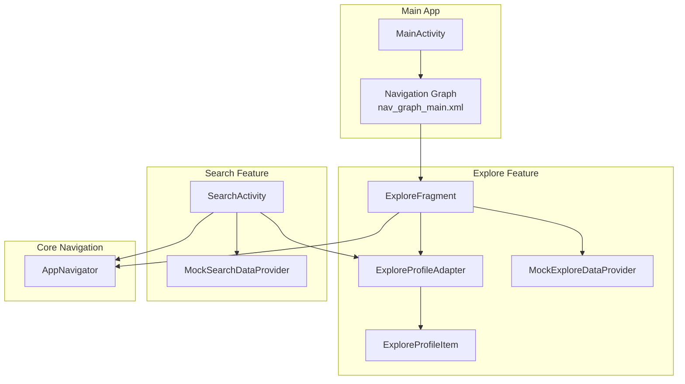
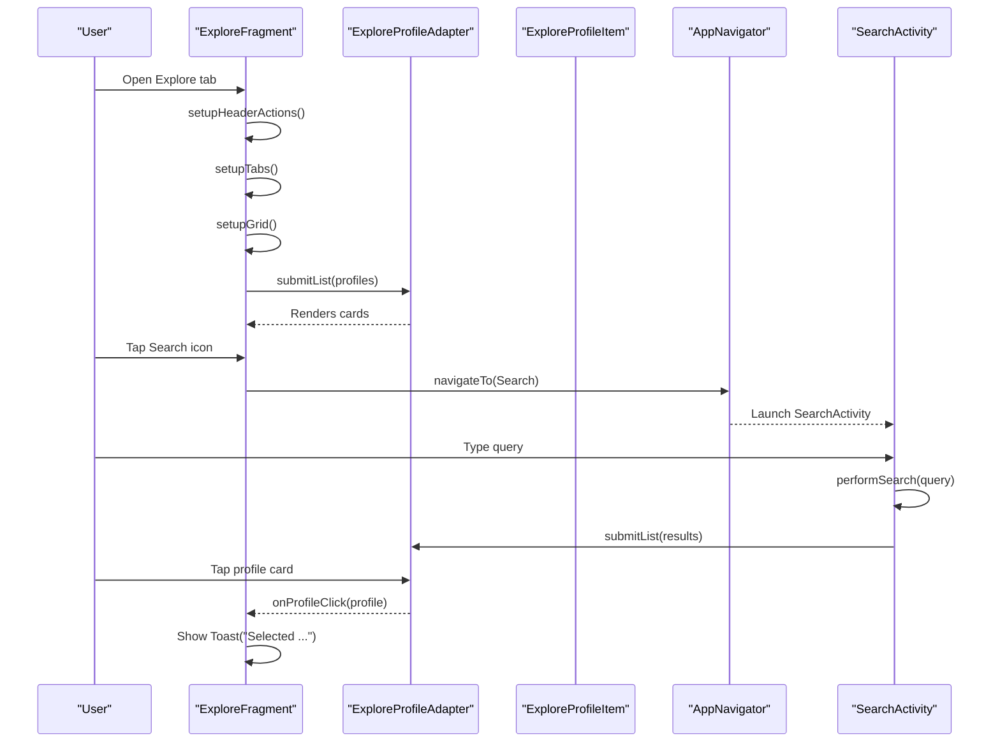
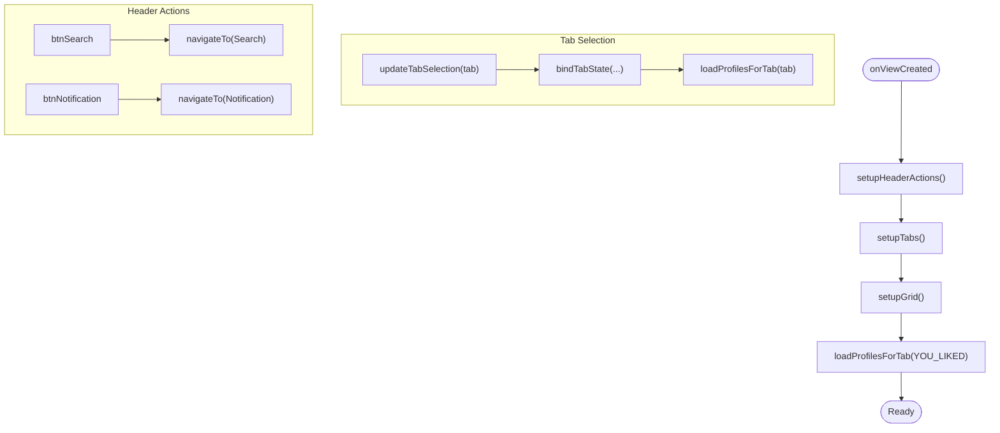
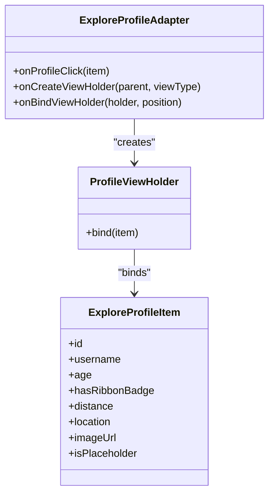
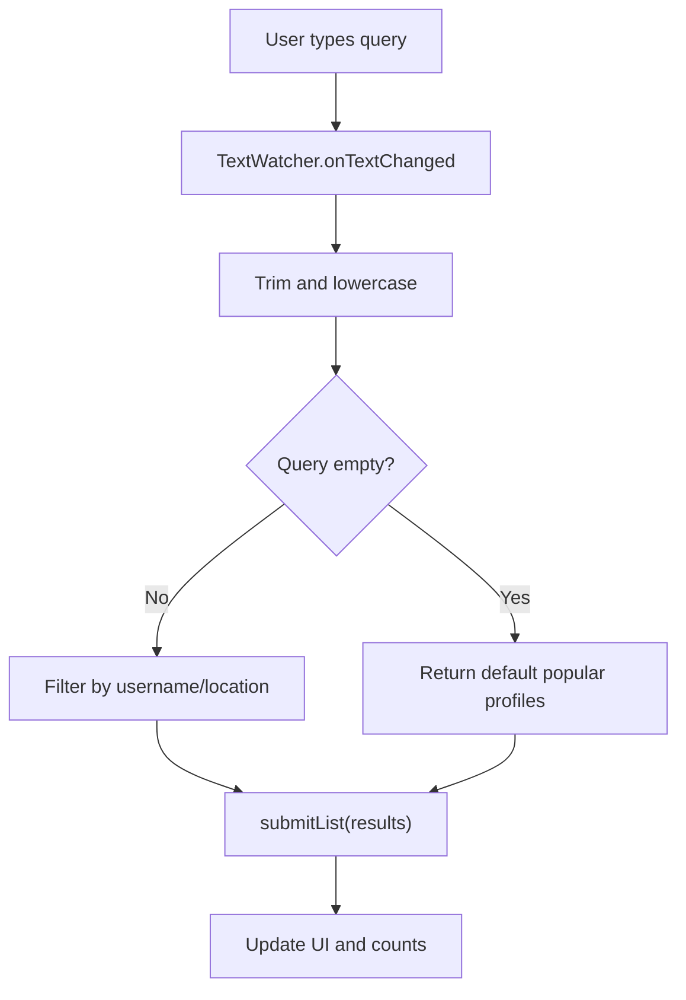
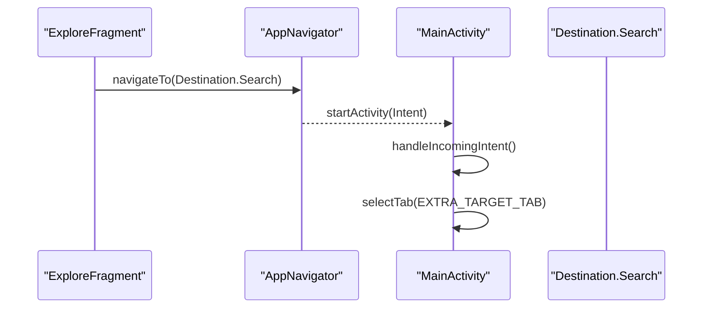
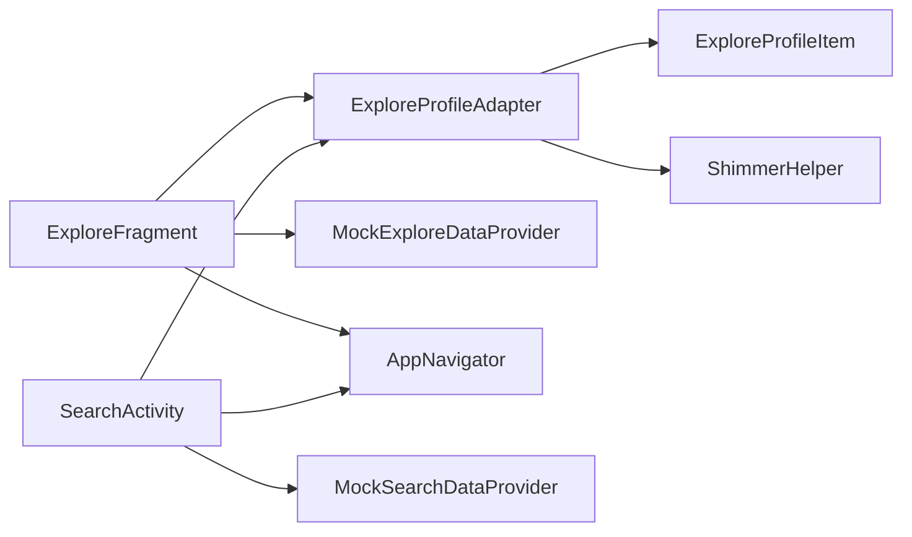

# Explore Section

<cite>
**Referenced Files in This Document**
- [ExploreFragment.kt](file://app/src/main/java/com/flirttime/feature/main/presentation/explore/ExploreFragment.kt)
- [ExploreProfileAdapter.kt](file://app/src/main/java/com/flirttime/feature/main/presentation/explore/ExploreProfileAdapter.kt)
- [ExploreProfileItem.kt](file://app/src/main/java/com/flirttime/feature/main/presentation/explore/model/ExploreProfileItem.kt)
- [MockExploreDataProvider.kt](file://app/src/main/java/com/flirttime/feature/main/presentation/explore/MockExploreDataProvider.kt)
- [AppNavigator.kt](file://app/src/main/java/com/flirttime/core/navigation/AppNavigator.kt)
- [MainActivity.kt](file://app/src/main/java/com/flirttime/MainActivity.kt)
- [SearchActivity.kt](file://app/src/main/java/com/flirttime/feature/search/presentation/SearchActivity.kt)
- [MockSearchDataProvider.kt](file://app/src/main/java/com/flirttime/feature/search/data/MockSearchDataProvider.kt)
- [fragment_explore.xml](file://app/src/main/res/layout/fragment_explore.xml)
- [item_explore_profile_card.xml](file://app/src/main/res/layout/item_explore_profile_card.xml)
- [nav_graph_main.xml](file://app/src/main/res/navigation/nav_graph_main.xml)
</cite>

## Table of Contents
1. [Introduction](#introduction)
2. [Project Structure](#project-structure)
3. [Core Components](#core-components)
4. [Architecture Overview](#architecture-overview)
5. [Detailed Component Analysis](#detailed-component-analysis)
6. [Dependency Analysis](#dependency-analysis)
7. [Performance Considerations](#performance-considerations)
8. [Troubleshooting Guide](#troubleshooting-guide)
9. [Conclusion](#conclusion)

## Introduction
This document explains the Explore section of Flirttime-Otp-Android, focusing on user discovery and browsing. It covers:
- The fragment that hosts the grid of profile cards and tab navigation
- The adapter that renders profile cards efficiently with images, badges, distance, and location
- The data model for a profile card
- Mock data providers used during development and testing
- Search and filter capabilities via the Search screen
- Integration with the main navigation system and how to navigate to specific profiles

## Project Structure
The Explore feature is organized under the main presentation layer and includes:
- A Fragment hosting UI and tab switching logic
- An adapter for RecyclerView rendering
- A data model class
- Mock data providers for Explore and Search
- Layouts defining the fragment UI and individual profile cards
- Navigation configuration wiring the Explore fragment into the app’s bottom tabs

**Diagram sources**
- [MainActivity.kt:172-184](file://app/src/main/java/com/flirttime/MainActivity.kt#L172-L184)
- [nav_graph_main.xml:1-39](file://app/src/main/res/navigation/nav_graph_main.xml#L1-L39)
- [ExploreFragment.kt:1-248](file://app/src/main/java/com/flirttime/feature/main/presentation/explore/ExploreFragment.kt#L1-L248)
- [ExploreProfileAdapter.kt:1-100](file://app/src/main/java/com/flirttime/feature/main/presentation/explore/ExploreProfileAdapter.kt#L1-L100)
- [ExploreProfileItem.kt:1-16](file://app/src/main/java/com/flirttime/feature/main/presentation/explore/model/ExploreProfileItem.kt#L1-L16)
- [MockExploreDataProvider.kt:1-72](file://app/src/main/java/com/flirttime/feature/main/presentation/explore/MockExploreDataProvider.kt#L1-L72)
- [SearchActivity.kt:1-138](file://app/src/main/java/com/flirttime/feature/search/presentation/SearchActivity.kt#L1-L138)
- [MockSearchDataProvider.kt:1-91](file://app/src/main/java/com/flirttime/feature/search/data/MockSearchDataProvider.kt#L1-L91)
- [AppNavigator.kt:1-137](file://app/src/main/java/com/flirttime/core/navigation/AppNavigator.kt#L1-L137)

**Section sources**
- [MainActivity.kt:172-184](file://app/src/main/java/com/flirttime/MainActivity.kt#L172-L184)
- [nav_graph_main.xml:1-39](file://app/src/main/res/navigation/nav_graph_main.xml#L1-L39)

## Core Components
- ExploreFragment: Hosts the header actions (search, notifications), tab bar (Likes, You Liked, Matches, Compliments), and a 2-column grid of profile cards. It loads mock data per tab and updates UI state accordingly.
- ExploreProfileAdapter: Efficiently binds ExploreProfileItem instances to card views using ListAdapter + DiffUtil. Handles image loading with shimmer placeholders, optional distance display, ribbon badge visibility, and click callbacks.
- ExploreProfileItem: Data model representing a single profile card with id, username, age, badge flag, distance, location, imageUrl, and placeholder flag.
- MockExploreDataProvider: Provides sample profiles for the Explore grid.
- SearchActivity and MockSearchDataProvider: Provide search functionality over profiles, reusing the same adapter and model.

**Section sources**
- [ExploreFragment.kt:30-248](file://app/src/main/java/com/flirttime/feature/main/presentation/explore/ExploreFragment.kt#L30-L248)
- [ExploreProfileAdapter.kt:15-99](file://app/src/main/java/com/flirttime/feature/main/presentation/explore/ExploreProfileAdapter.kt#L15-L99)
- [ExploreProfileItem.kt:6-15](file://app/src/main/java/com/flirttime/feature/main/presentation/explore/model/ExploreProfileItem.kt#L6-L15)
- [MockExploreDataProvider.kt:5-71](file://app/src/main/java/com/flirttime/feature/main/presentation/explore/MockExploreDataProvider.kt#L5-L71)
- [SearchActivity.kt:20-138](file://app/src/main/java/com/flirttime/feature/search/presentation/SearchActivity.kt#L20-L138)
- [MockSearchDataProvider.kt:5-91](file://app/src/main/java/com/flirttime/feature/search/data/MockSearchDataProvider.kt#L5-L91)

## Architecture Overview
The Explore section integrates with the main navigation as one of the bottom tabs. Users can open Search from the Explore header, which uses the same profile card UI. Clicking a profile currently triggers a toast; deep linking to a specific profile is not implemented yet.

**Diagram sources**
- [ExploreFragment.kt:55-63](file://app/src/main/java/com/flirttime/feature/main/presentation/explore/ExploreFragment.kt#L55-L63)
- [ExploreFragment.kt:83-113](file://app/src/main/java/com/flirttime/feature/main/presentation/explore/ExploreFragment.kt#L83-L113)
- [ExploreFragment.kt:187-195](file://app/src/main/java/com/flirttime/feature/main/presentation/explore/ExploreFragment.kt#L187-L195)
- [ExploreProfileAdapter.kt:37-85](file://app/src/main/java/com/flirttime/feature/main/presentation/explore/ExploreProfileAdapter.kt#L37-L85)
- [AppNavigator.kt:73-98](file://app/src/main/java/com/flirttime/core/navigation/AppNavigator.kt#L73-L98)
- [SearchActivity.kt:90-128](file://app/src/main/java/com/flirttime/feature/search/presentation/SearchActivity.kt#L90-L128)

## Detailed Component Analysis

### ExploreFragment
Responsibilities:
- Header actions: Navigate to Notifications and Search screens
- Tab management: Switch between Likes, You Liked, Matches, and Compliments
- Grid setup: Configure a 2-column GridLayoutManager with spacing and load mock data per tab
- Badge update: Expose a method to show/hide a badge count for “You Liked”

Key behaviors:
- Uses GridLayoutManager(2) and custom ItemDecoration for consistent spacing
- Loads all profiles or subsets based on active tab
- Updates tab visuals (icons, text color, font weight, underline indicator)

**Diagram sources**
- [ExploreFragment.kt:47-53](file://app/src/main/java/com/flirttime/feature/main/presentation/explore/ExploreFragment.kt#L47-L53)
- [ExploreFragment.kt:55-63](file://app/src/main/java/com/flirttime/feature/main/presentation/explore/ExploreFragment.kt#L55-L63)
- [ExploreFragment.kt:65-81](file://app/src/main/java/com/flirttime/feature/main/presentation/explore/ExploreFragment.kt#L65-L81)
- [ExploreFragment.kt:83-113](file://app/src/main/java/com/flirttime/feature/main/presentation/explore/ExploreFragment.kt#L83-L113)
- [ExploreFragment.kt:115-195](file://app/src/main/java/com/flirttime/feature/main/presentation/explore/ExploreFragment.kt#L115-L195)

**Section sources**
- [ExploreFragment.kt:30-248](file://app/src/main/java/com/flirttime/feature/main/presentation/explore/ExploreFragment.kt#L30-L248)
- [fragment_explore.xml:1-283](file://app/src/main/res/layout/fragment_explore.xml#L1-L283)

### ExploreProfileAdapter
Responsibilities:
- Bind ExploreProfileItem to card layout
- Handle image loading with shimmer placeholders
- Toggle visibility of distance and ribbon badge
- Emit click events for profile selection

Implementation highlights:
- Uses ListAdapter with DiffUtil.ItemCallback for efficient diffing by id and equality
- Shimmer helper wraps image loading for smooth transitions
- Placeholder mode shows a themed background and muted text when no photo is available

**Diagram sources**
- [ExploreProfileAdapter.kt:15-99](file://app/src/main/java/com/flirttime/feature/main/presentation/explore/ExploreProfileAdapter.kt#L15-L99)
- [ExploreProfileItem.kt:6-15](file://app/src/main/java/com/flirttime/feature/main/presentation/explore/model/ExploreProfileItem.kt#L6-L15)

**Section sources**
- [ExploreProfileAdapter.kt:15-99](file://app/src/main/java/com/flirttime/feature/main/presentation/explore/ExploreProfileAdapter.kt#L15-L99)
- [item_explore_profile_card.xml:1-136](file://app/src/main/res/layout/item_explore_profile_card.xml#L1-L136)

### ExploreProfileItem
A lightweight data class encapsulating profile card fields:
- id: Unique identifier for diffing
- username: Display name
- age: Optional numeric age
- hasRibbonBadge: Controls achievement ribbon visibility
- distance: Optional distance string
- location: City/region string
- imageUrl: Optional URL for profile photo
- isPlaceholder: Forces placeholder UI when true

Complexity: O(1) creation and comparison; suitable for large lists due to value semantics.

**Section sources**
- [ExploreProfileItem.kt:6-15](file://app/src/main/java/com/flirttime/feature/main/presentation/explore/model/ExploreProfileItem.kt#L6-L15)

### MockExploreDataProvider
Provides a static list of sample profiles for the Explore grid. Used to demonstrate UI states including:
- Profiles with photos and badges
- Profiles with distance info
- Placeholder cards without photos

Usage: Called by ExploreFragment to populate different tabs with varying subset sizes.

**Section sources**
- [MockExploreDataProvider.kt:5-71](file://app/src/main/java/com/flirttime/feature/main/presentation/explore/MockExploreDataProvider.kt#L5-L71)

### Search and Filter Capabilities
SearchActivity provides:
- Real-time filtering by username or location
- Reuses ExploreProfileAdapter for consistent card rendering
- Shows result counts and empty state handling
- Pre-populates a default query for demonstration

Filtering logic:
- Trims and lowercases input
- Filters by username or location substring match
- Returns top results when query is empty

**Diagram sources**
- [SearchActivity.kt:90-128](file://app/src/main/java/com/flirttime/feature/search/presentation/SearchActivity.kt#L90-L128)
- [MockSearchDataProvider.kt:80-89](file://app/src/main/java/com/flirttime/feature/search/data/MockSearchDataProvider.kt#L80-L89)

**Section sources**
- [SearchActivity.kt:20-138](file://app/src/main/java/com/flirttime/feature/search/presentation/SearchActivity.kt#L20-L138)
- [MockSearchDataProvider.kt:5-91](file://app/src/main/java/com/flirttime/feature/search/data/MockSearchDataProvider.kt#L5-L91)

### Location-Based Discovery and Recommendations
Current implementation:
- Distance field is present in the data model and displayed when available
- No explicit geolocation-based discovery or recommendation algorithm is implemented in the Explore module
- Filtering is limited to text matching in Search

Recommendations:
- Integrate a location service to compute distances dynamically
- Add filters for radius, city, or region
- Implement a recommendation engine scoring profiles based on interests, activity, and proximity

[No sources needed since this section provides general guidance]

### Image Loading Strategies and Smooth Scrolling
- Images are loaded via a shimmer helper that wraps an image view, providing a smooth transition while content loads
- Placeholder backgrounds and muted text improve perceived performance when images are missing
- RecyclerView uses GridLayoutManager(2) with custom spacing for consistent layout

Optimization opportunities:
- Use an image loader library with caching and resizing
- Apply bitmap scaling appropriate to card size
- Enable RecyclerView optimizations like setHasFixedSize where applicable

**Section sources**
- [ExploreProfileAdapter.kt:37-57](file://app/src/main/java/com/flirttime/feature/main/presentation/explore/ExploreProfileAdapter.kt#L37-L57)
- [item_explore_profile_card.xml:25-45](file://app/src/main/res/layout/item_explore_profile_card.xml#L25-L45)

### Navigation Integration and Deep Linking
Integration points:
- ExploreFragment navigates to Search and Notification screens via AppNavigator
- MainActivity handles incoming intents to select a target tab, including Explore
- nav_graph_main.xml registers ExploreFragment as a destination

Deep linking to specific profiles:
- Not implemented yet; profile clicks currently trigger a toast
- To implement: extend Destination with a typed Profile(id) case and handle it in MainActivity or a dedicated Profile screen

**Diagram sources**
- [ExploreFragment.kt:55-63](file://app/src/main/java/com/flirttime/feature/main/presentation/explore/ExploreFragment.kt#L55-L63)
- [AppNavigator.kt:73-98](file://app/src/main/java/com/flirttime/core/navigation/AppNavigator.kt#L73-L98)
- [MainActivity.kt:172-184](file://app/src/main/java/com/flirttime/MainActivity.kt#L172-L184)

**Section sources**
- [AppNavigator.kt:1-137](file://app/src/main/java/com/flirttime/core/navigation/AppNavigator.kt#L1-L137)
- [MainActivity.kt:172-184](file://app/src/main/java/com/flirttime/MainActivity.kt#L172-L184)
- [nav_graph_main.xml:1-39](file://app/src/main/res/navigation/nav_graph_main.xml#L1-L39)

## Dependency Analysis
- ExploreFragment depends on:
  - ExploreProfileAdapter for rendering
  - MockExploreDataProvider for test data
  - AppNavigator for navigation
- ExploreProfileAdapter depends on:
  - ExploreProfileItem data model
  - ShimmerHelper for image loading
- SearchActivity depends on:
  - ExploreProfileAdapter (reused)
  - MockSearchDataProvider for search results
  - AppNavigator for navigation

**Diagram sources**
- [ExploreFragment.kt:1-248](file://app/src/main/java/com/flirttime/feature/main/presentation/explore/ExploreFragment.kt#L1-L248)
- [ExploreProfileAdapter.kt:1-100](file://app/src/main/java/com/flirttime/feature/main/presentation/explore/ExploreProfileAdapter.kt#L1-L100)
- [SearchActivity.kt:1-138](file://app/src/main/java/com/flirttime/feature/search/presentation/SearchActivity.kt#L1-L138)
- [AppNavigator.kt:1-137](file://app/src/main/java/com/flirttime/core/navigation/AppNavigator.kt#L1-L137)

**Section sources**
- [ExploreFragment.kt:1-248](file://app/src/main/java/com/flirttime/feature/main/presentation/explore/ExploreFragment.kt#L1-L248)
- [ExploreProfileAdapter.kt:1-100](file://app/src/main/java/com/flirttime/feature/main/presentation/explore/ExploreProfileAdapter.kt#L1-L100)
- [SearchActivity.kt:1-138](file://app/src/main/java/com/flirttime/feature/search/presentation/SearchActivity.kt#L1-L138)
- [AppNavigator.kt:1-137](file://app/src/main/java/com/flirttime/core/navigation/AppNavigator.kt#L1-L137)

## Performance Considerations
- Use ListAdapter with DiffUtil to minimize unnecessary redraws; already implemented in ExploreProfileAdapter
- Prefer placeholder UI and shimmer effects to maintain smooth scrolling during image loads
- Avoid heavy operations in onBindViewHolder; keep binding logic minimal
- Consider preloading images and caching strategies for faster subsequent renders
- For large datasets, paginate or virtualize further to reduce memory pressure

[No sources needed since this section provides general guidance]

## Troubleshooting Guide
Common issues and resolutions:
- Cards not updating after data changes: Ensure you call submitList with a new list instance; DiffUtil compares by id and equality
- Images not showing: Verify imageUrl is non-null and not blank; check network permissions and image loader configuration
- Incorrect spacing in grid: Confirm ItemDecoration logic applies correct left/right/bottom offsets based on column index
- Tabs not reflecting active state: Validate bindTabState calls and ensure indicator visibility toggles correctly
- Search returns no results: Check query trimming and case-insensitive matching; verify MockSearchDataProvider contains expected entries

**Section sources**
- [ExploreProfileAdapter.kt:88-98](file://app/src/main/java/com/flirttime/feature/main/presentation/explore/ExploreProfileAdapter.kt#L88-L98)
- [ExploreFragment.kt:197-224](file://app/src/main/java/com/flirttime/feature/main/presentation/explore/ExploreFragment.kt#L197-L224)
- [SearchActivity.kt:90-128](file://app/src/main/java/com/flirttime/feature/search/presentation/SearchActivity.kt#L90-L128)

## Conclusion
The Explore section provides a clean, tabbed interface for browsing user profiles in a 2-column grid, powered by a robust adapter and simple data model. Search functionality reuses the same UI components and offers basic text-based filtering. While deep linking to specific profiles is not yet implemented, the architecture supports easy extension. Future enhancements should include location-based discovery, richer filtering, and optimized image loading for large datasets.