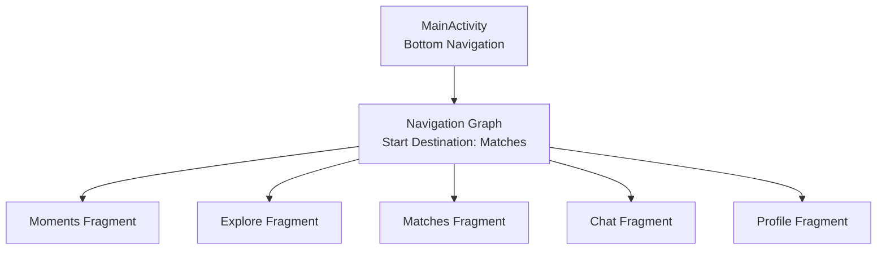
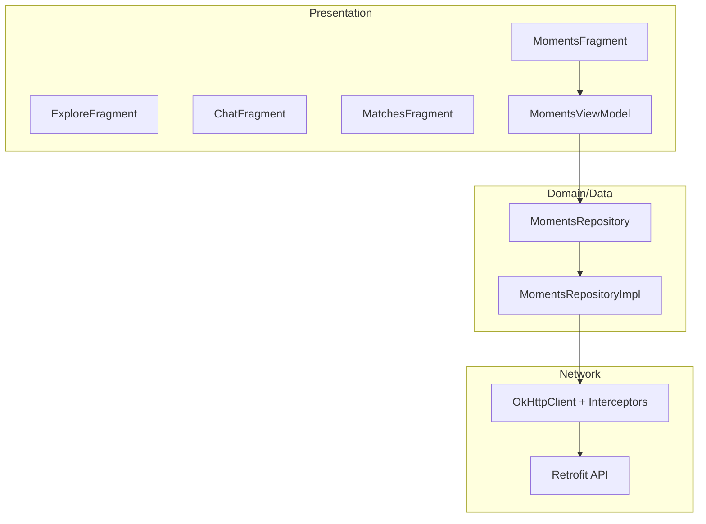
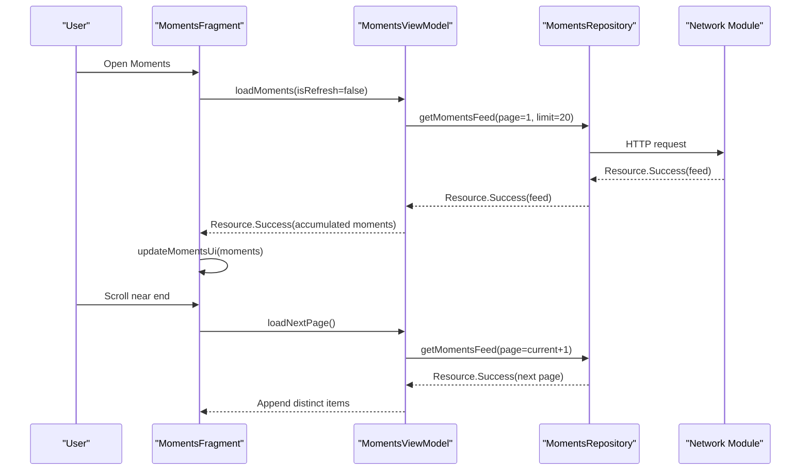
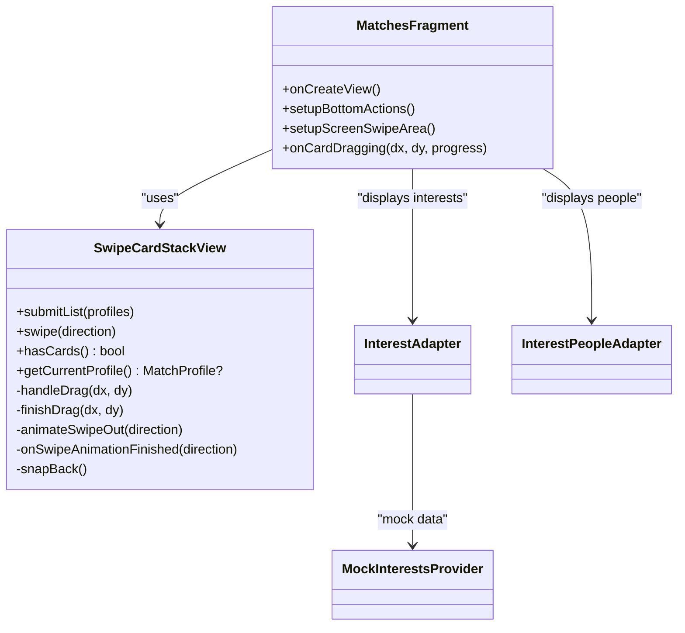
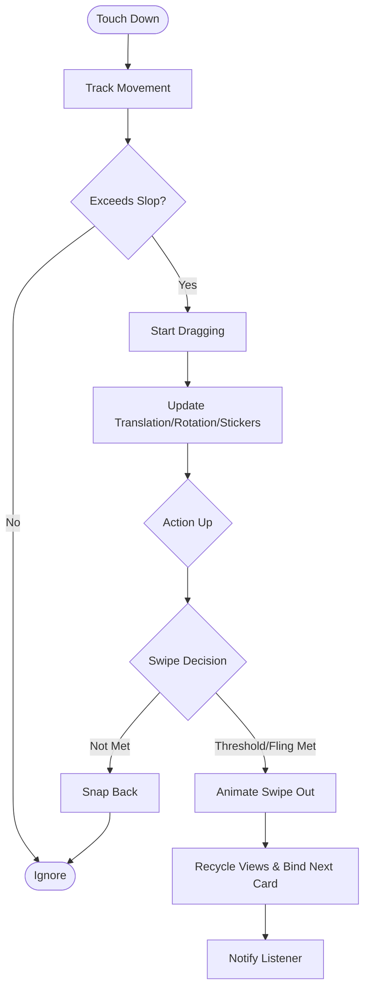
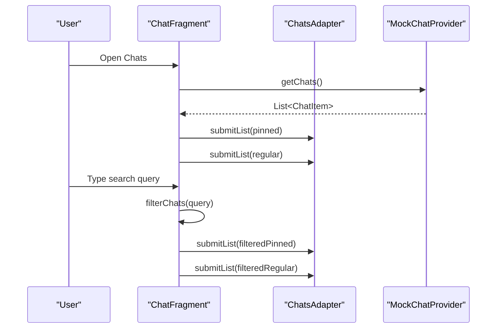
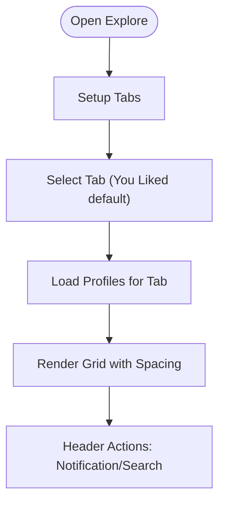
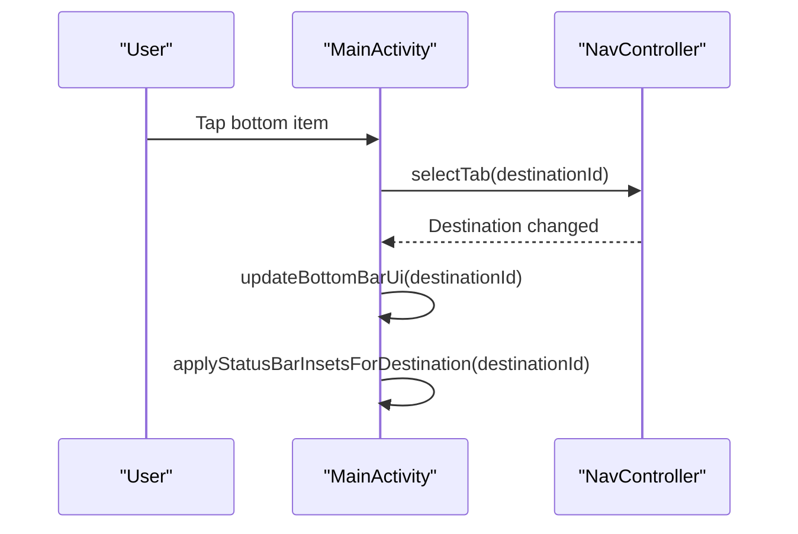
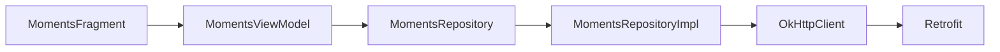

# Main App Features

<cite>
**Referenced Files in This Document**   
- [MainActivity.kt](file://app/src/main/java/com/flirttime/MainActivity.kt)
- [nav_graph_main.xml](file://app/src/main/res/navigation/nav_graph_main.xml)
- [MomentsFragment.kt](file://app/src/main/java/com/flirttime/feature/main/presentation/moments/MomentsFragment.kt)
- [MomentPost.kt](file://app/src/main/java/com/flirttime/feature/main/presentation/moments/MomentPost.kt)
- [MomentsRepository.kt](file://app/src/main/java/com/flirttime/feature/moments/domain/repository/MomentsRepository.kt)
- [MomentsRepositoryImpl.kt](file://app/src/main/java/com/flirttime/feature/moments/data/repository/MomentsRepositoryImpl.kt)
- [NetworkModuleProvider.kt](file://app/src/main/java/com/flirttime/core/network/NetworkModuleProvider.kt)
- [MultiImageGalleryView.kt](file://app/src/main/java/com/flirttime/core/ui/widget/MultiImageGalleryView.kt)
- [MatchesFragment.kt](file://app/src/main/java/com/flirttime/feature/main/presentation/matches/MatchesFragment.kt)
- [SwipeCardStackView.kt](file://app/src/main/java/com/flirttime/feature/main/presentation/matches/SwipeCardStackView.kt)
- [MockInterestsProvider.kt](file://app/src/main/java/com/flirttime/feature/main/presentation/matches/interest/MockInterestsProvider.kt)
- [ChatFragment.kt](file://app/src/main/java/com/flirttime/feature/main/presentation/chat/ChatFragment.kt)
- [ChatsAdapter.kt](file://app/src/main/java/com/flirttime/feature/main/presentation/chat/ChatsAdapter.kt)
- [ChatItem.kt](file://app/src/main/java/com/flirttime/feature/main/presentation/chat/ChatItem.kt)
- [ExploreFragment.kt](file://app/src/main/java/com/flirttime/feature/main/presentation/explore/ExploreFragment.kt)
- [MockSearchDataProvider.kt](file://app/src/main/java/com/flirttime/feature/search/data/MockSearchDataProvider.kt)
</cite>

## Table of Contents
1. [Introduction](#introduction)
2. [Project Structure](#project-structure)
3. [Core Components](#core-components)
4. [Architecture Overview](#architecture-overview)
5. [Detailed Component Analysis](#detailed-component-analysis)
6. [Dependency Analysis](#dependency-analysis)
7. [Performance Considerations](#performance-considerations)
8. [Troubleshooting Guide](#troubleshooting-guide)
9. [Conclusion](#conclusion)

## Introduction
This document explains the main application features in Flirttime-Otp-Android, focusing on:
- Moments/Posts for social content sharing with rich media support, likes, and comments
- Matching system with swipe gestures, interest-based filtering, and connection management
- Chat interface for real-time messaging with message history and user presence indicators
- Explore section for user discovery and browsing with search and filter capabilities
- Main navigation structure and bottom navigation implementation
- Real-time updates, offline support, and performance optimization for content-heavy features

The documentation is structured to be accessible to both technical and non-technical readers, with diagrams that map directly to source files where applicable.

## Project Structure
At a high level, the app uses a single host activity with a Navigation Graph defining five primary destinations: Moments, Explore, Matches, Messages (Chat), and Profile. The bottom navigation UI in MainActivity coordinates tab selection and visual state across these destinations.

**Diagram sources**
- [MainActivity.kt:54-86](file://app/src/main/java/com/flirttime/MainActivity.kt#L54-L86)
- [nav_graph_main.xml:1-39](file://app/src/main/res/navigation/nav_graph_main.xml#L1-L39)

**Section sources**
- [MainActivity.kt:24-52](file://app/src/main/java/com/flirttime/MainActivity.kt#L24-L52)
- [nav_graph_main.xml:1-39](file://app/src/main/res/navigation/nav_graph_main.xml#L1-L39)

## Core Components
- Moments/Posts: Feed of posts with multi-media support, like toggle, comments, gifts, and pagination.
- Matching: Swipeable card stack supporting four directions (like, dislike, super-like, nope), plus interest selection and filters.
- Chat: Pinned and regular chat lists with search, unread badges, last message preview, and avatar status rings.
- Explore: Tabbed profile grid (Likes, You Liked, Matches, Compliments) with navigation to Search.
- Navigation: Bottom tabs with dynamic styling and edge-to-edge handling.

**Section sources**
- [MomentsFragment.kt:22-107](file://app/src/main/java/com/flirttime/feature/main/presentation/moments/MomentsFragment.kt#L22-L107)
- [MatchesFragment.kt:21-185](file://app/src/main/java/com/flirttime/feature/main/presentation/matches/MatchesFragment.kt#L21-L185)
- [ChatFragment.kt:14-115](file://app/src/main/java/com/flirttime/feature/main/presentation/chat/ChatFragment.kt#L14-L115)
- [ExploreFragment.kt:30-113](file://app/src/main/java/com/flirttime/feature/main/presentation/explore/ExploreFragment.kt#L30-L113)
- [MainActivity.kt:115-170](file://app/src/main/java/com/flirttime/MainActivity.kt#L115-L170)

## Architecture Overview
The app follows a feature-based presentation layer with domain/data modules for specific features (e.g., Moments). Networking is centralized via Retrofit and OkHttp with caching interceptors. ViewModels coordinate data loading and UI state using Kotlin Flow and coroutines.

**Diagram sources**
- [MomentsFragment.kt:22-107](file://app/src/main/java/com/flirttime/feature/main/presentation/moments/MomentsFragment.kt#L22-L107)
- [MomentsRepository.kt:8-17](file://app/src/main/java/com/flirttime/feature/moments/domain/repository/MomentsRepository.kt#L8-L17)
- [MomentsRepositoryImpl.kt:34-66](file://app/src/main/java/com/flirttime/feature/moments/data/repository/MomentsRepositoryImpl.kt#L34-L66)
- [NetworkModuleProvider.kt:69-85](file://app/src/main/java/com/flirttime/core/network/NetworkModuleProvider.kt#L69-L85)

## Detailed Component Analysis

### Moments/Posts System
The Moments feature provides a scrollable feed of posts with rich media, likes, comments, and gift interactions. It supports pagination and optimistic UI updates.

Key responsibilities:
- Displaying a list of MomentPost items with multi-media pages
- Handling like toggles and comment/gift actions
- Loading more items as the user scrolls near the end
- Showing loading, empty, and error states

**Diagram sources**
- [MomentsFragment.kt:109-177](file://app/src/main/java/com/flirttime/feature/main/presentation/moments/MomentsFragment.kt#L109-L177)
- [MomentsRepository.kt:8-17](file://app/src/main/java/com/flirttime/feature/moments/domain/repository/MomentsRepository.kt#L8-L17)
- [MomentsRepositoryImpl.kt:34-66](file://app/src/main/java/com/flirttime/feature/moments/data/repository/MomentsRepositoryImpl.kt#L34-L66)

Data model:
- MomentPost includes identifiers, author info, location/time, caption, media URLs or resources, current media index, like count, liked state, comment count, and gift count. It also exposes a helper to resolve all media URLs.

Rich media support:
- Multi-image gallery view handles up to 5 images with adaptive layouts and Fresco integration for efficient image loading.

Like/comment/gift interactions:
- Like toggle triggers repository call; ViewModel performs background sync while UI reflects immediate state.
- Comments open a bottom sheet dialog for the selected post.
- Gifts open a send-gift bottom sheet and increment local gift count.

Pagination flow:
- RecyclerView scroll listener triggers next page when within two items from the end.
- ViewModel deduplicates new items by ID and accumulates them into the displayed list.

Error handling:
- Initial load shows empty state with guidance text.
- Errors show toast messages or empty state depending on whether any items are already present.

**Section sources**
- [MomentPost.kt:1-25](file://app/src/main/java/com/flirttime/feature/main/presentation/moments/MomentPost.kt#L1-L25)
- [MomentsFragment.kt:22-107](file://app/src/main/java/com/flirttime/feature/main/presentation/moments/MomentsFragment.kt#L22-L107)
- [MomentsFragment.kt:109-177](file://app/src/main/java/com/flirttime/feature/main/presentation/moments/MomentsFragment.kt#L109-L177)
- [MomentsRepository.kt:8-17](file://app/src/main/java/com/flirttime/feature/moments/domain/repository/MomentsRepository.kt#L8-L17)
- [MomentsRepositoryImpl.kt:34-66](file://app/src/main/java/com/flirttime/feature/moments/data/repository/MomentsRepositoryImpl.kt#L34-L66)
- [MultiImageGalleryView.kt:86-106](file://app/src/main/java/com/flirttime/core/ui/widget/MultiImageGalleryView.kt#L86-L106)

### Matching System
The Matching screen combines swipeable cards with interest selection and filters. Users can swipe in four directions or use buttons to perform actions.

Core components:
- SwipeCardStackView: Custom FrameLayout implementing gesture detection, velocity tracking, and animations for swipes.
- MatchesFragment: Hosts the card stack, interest sections, and bottom action buttons.
- Interest providers: Mock data for interests and people to demonstrate selection and display.

**Diagram sources**
- [SwipeCardStackView.kt:32-107](file://app/src/main/java/com/flirttime/feature/main/presentation/matches/SwipeCardStackView.kt#L32-L107)
- [MatchesFragment.kt:21-185](file://app/src/main/java/com/flirttime/feature/main/presentation/matches/MatchesFragment.kt#L21-L185)
- [MockInterestsProvider.kt:1-42](file://app/src/main/java/com/flirttime/feature/main/presentation/matches/interest/MockInterestsProvider.kt#L1-L42)

Swipe logic flow:
- Touch events are intercepted and tracked with VelocityTracker.
- Dragging updates translation, rotation, and sticker alpha based on dominant direction.
- Finish drag decides swipe vs snap-back using thresholds and fling velocities.
- Swipe animation moves top card out, reorders middle/bottom cards, binds new bottom card, and notifies listener.

**Diagram sources**
- [SwipeCardStackView.kt:331-418](file://app/src/main/java/com/flirttime/feature/main/presentation/matches/SwipeCardStackView.kt#L331-L418)
- [SwipeCardStackView.kt:440-540](file://app/src/main/java/com/flirttime/feature/main/presentation/matches/SwipeCardStackView.kt#L440-L540)
- [SwipeCardStackView.kt:547-662](file://app/src/main/java/com/flirttime/feature/main/presentation/matches/SwipeCardStackView.kt#L547-L662)

Interest-based filtering:
- Interest chips and people grids are shown in separate sections within MatchesFragment.
- Mock data demonstrates categories, emojis, and selection states.

Connection management:
- Swipe actions trigger callbacks for interested/not interested/super-like/nope.
- Bottom buttons programmatically invoke swipe directions.

**Section sources**
- [MatchesFragment.kt:155-185](file://app/src/main/java/com/flirttime/feature/main/presentation/matches/MatchesFragment.kt#L155-L185)
- [SwipeCardStackView.kt:32-107](file://app/src/main/java/com/flirttime/feature/main/presentation/matches/SwipeCardStackView.kt#L32-L107)
- [SwipeCardStackView.kt:440-540](file://app/src/main/java/com/flirttime/feature/main/presentation/matches/SwipeCardStackView.kt#L440-L540)
- [SwipeCardStackView.kt:547-662](file://app/src/main/java/com/flirttime/feature/main/presentation/matches/SwipeCardStackView.kt#L547-L662)
- [MockInterestsProvider.kt:1-42](file://app/src/main/java/com/flirttime/feature/main/presentation/matches/interest/MockInterestsProvider.kt#L1-L42)

### Chat Interface
The Chat screen displays pinned and regular conversations with search, unread badges, last message previews, and avatar status rings.

Key responsibilities:
- Two RecyclerViews: one for pinned chats, one for regular chats
- Search input with clear button and live filtering
- Adapter binding for avatars, verified badges, timestamps, unread counts, and click handlers

**Diagram sources**
- [ChatFragment.kt:62-105](file://app/src/main/java/com/flirttime/feature/main/presentation/chat/ChatFragment.kt#L62-L105)
- [ChatsAdapter.kt:12-101](file://app/src/main/java/com/flirttime/feature/main/presentation/chat/ChatsAdapter.kt#L12-L101)
- [ChatItem.kt:1-19](file://app/src/main/java/com/flirttime/feature/main/presentation/chat/ChatItem.kt#L1-L19)

Presence indicators:
- Story ring visibility indicates active stories/status.
- Verified badge indicates verified users.
- Unread badge shows count; bold last message indicates unread.

Message history:
- Last message preview and timestamp per conversation row.
- Double check icon indicates sent/delivered/read state for user-sent messages.

Search and filtering:
- TextWatcher filters by name or last message substring match.
- Empty state shown when no results found.

**Section sources**
- [ChatFragment.kt:14-115](file://app/src/main/java/com/flirttime/feature/main/presentation/chat/ChatFragment.kt#L14-L115)
- [ChatsAdapter.kt:12-101](file://app/src/main/java/com/flirttime/feature/main/presentation/chat/ChatsAdapter.kt#L12-L101)
- [ChatItem.kt:1-19](file://app/src/main/java/com/flirttime/feature/main/presentation/chat/ChatItem.kt#L1-L19)

### Explore Section
The Explore screen provides tabbed views for Likes, You Liked, Matches, and Compliments, displaying profiles in a grid layout. It integrates navigation to Search and Notifications.

Key responsibilities:
- Tab selection with dynamic styling (icons, labels, underlines)
- Grid adapter for profile cards
- Header actions for notifications and search

**Diagram sources**
- [ExploreFragment.kt:47-113](file://app/src/main/java/com/flirttime/feature/main/presentation/explore/ExploreFragment.kt#L47-L113)
- [ExploreFragment.kt:115-195](file://app/src/main/java/com/flirttime/feature/main/presentation/explore/ExploreFragment.kt#L115-L195)

Search integration:
- Search button navigates to Search destination.
- Mock search provider supports querying profiles by username or location.

Filtering and discovery:
- Tabs switch between different curated sets of profiles.
- Grid spacing ensures consistent layout across devices.

**Section sources**
- [ExploreFragment.kt:30-113](file://app/src/main/java/com/flirttime/feature/main/presentation/explore/ExploreFragment.kt#L30-L113)
- [ExploreFragment.kt:115-195](file://app/src/main/java/com/flirttime/feature/main/presentation/explore/ExploreFragment.kt#L115-L195)
- [MockSearchDataProvider.kt:1-90](file://app/src/main/java/com/flirttime/feature/search/data/MockSearchDataProvider.kt#L1-L90)

### Main Navigation and Bottom Navigation
MainActivity hosts the Navigation Graph and manages bottom navigation UI state. It applies edge-to-edge insets and adjusts status bar appearance per destination.

Key responsibilities:
- Setup NavHostFragment and NavController
- Handle clicks on bottom nav items
- Update bottom bar visuals based on current destination
- Apply status bar insets and light/dark mode per destination
- Handle incoming intents to navigate to specific tabs

**Diagram sources**
- [MainActivity.kt:54-86](file://app/src/main/java/com/flirttime/MainActivity.kt#L54-L86)
- [MainActivity.kt:102-113](file://app/src/main/java/com/flirttime/MainActivity.kt#L102-L113)
- [MainActivity.kt:115-170](file://app/src/main/java/com/flirttime/MainActivity.kt#L115-L170)
- [MainActivity.kt:89-100](file://app/src/main/java/com/flirttime/MainActivity.kt#L89-L100)

Edge-to-edge handling:
- Status bar insets applied to NavHostFragment for standard tabs.
- Profile tab extends cover photo behind status bar with white status icons.

Incoming intent routing:
- Extra target tab maps to specific destinations for deep linking or external navigation.

**Section sources**
- [MainActivity.kt:24-52](file://app/src/main/java/com/flirttime/MainActivity.kt#L24-L52)
- [MainActivity.kt:54-86](file://app/src/main/java/com/flirttime/MainActivity.kt#L54-L86)
- [MainActivity.kt:89-100](file://app/src/main/java/com/flirttime/MainActivity.kt#L89-L100)
- [MainActivity.kt:102-113](file://app/src/main/java/com/flirttime/MainActivity.kt#L102-L113)
- [MainActivity.kt:115-170](file://app/src/main/java/com/flirttime/MainActivity.kt#L115-L170)
- [MainActivity.kt:172-184](file://app/src/main/java/com/flirttime/MainActivity.kt#L172-L184)
- [nav_graph_main.xml:1-39](file://app/src/main/res/navigation/nav_graph_main.xml#L1-L39)

## Dependency Analysis
The Moments feature demonstrates a clean separation between presentation, domain, and data layers, with networking handled centrally.

**Diagram sources**
- [MomentsFragment.kt:22-107](file://app/src/main/java/com/flirttime/feature/main/presentation/moments/MomentsFragment.kt#L22-L107)
- [MomentsRepository.kt:8-17](file://app/src/main/java/com/flirttime/feature/moments/domain/repository/MomentsRepository.kt#L8-L17)
- [MomentsRepositoryImpl.kt:34-66](file://app/src/main/java/com/flirttime/feature/moments/data/repository/MomentsRepositoryImpl.kt#L34-L66)
- [NetworkModuleProvider.kt:69-85](file://app/src/main/java/com/flirttime/core/network/NetworkModuleProvider.kt#L69-L85)

Coupling and cohesion:
- Presentation fragments depend on ViewModels for state and business logic.
- Domain interfaces decouple repositories from implementations.
- Network module centralizes configuration and interceptors.

External dependencies:
- Retrofit and Gson for API calls.
- OkHttp with interceptors for caching, auth, and logging.

Potential circular dependencies:
- None observed in the analyzed files; dependencies flow downward from presentation to network.

**Section sources**
- [MomentsRepository.kt:8-17](file://app/src/main/java/com/flirttime/feature/moments/domain/repository/MomentsRepository.kt#L8-L17)
- [MomentsRepositoryImpl.kt:34-66](file://app/src/main/java/com/flirttime/feature/moments/data/repository/MomentsRepositoryImpl.kt#L34-L66)
- [NetworkModuleProvider.kt:69-85](file://app/src/main/java/com/flirttime/core/network/NetworkModuleProvider.kt#L69-L85)

## Performance Considerations
- Image loading: Use Fresco DraweeView with shimmer placeholders for smooth loading experiences in Moments and Chat adapters.
- RecyclerView optimizations: setHasFixedSize(true) and proper item decorations reduce layout passes.
- Pagination: Append distinct items by ID to avoid duplicates and maintain stable lists.
- Gesture handling: VelocityTracker and threshold checks minimize unnecessary animations and improve responsiveness.
- Adaptive layouts: SwipeCardStackView measures and scales cards to fit constrained heights, preventing off-screen elements.
- Offline support: OkHttp cache interceptor configured in NetworkModuleProvider enables offline caching strategies.

Recommendations:
- Continue using Flow for reactive streams to keep UI responsive.
- Debounce search inputs in Explore and Chat if integrating server-side search.
- Preload next page data proactively when nearing end of list.
- Use paging libraries for large datasets if backend pagination becomes complex.

[No sources needed since this section provides general guidance]

## Troubleshooting Guide
Common issues and resolutions:
- Moments feed not loading:
  - Check Resource.Error handling and ensure network connectivity.
  - Verify pagination flags and repository calls.
- Swipe gestures unresponsive:
  - Ensure hasCards() returns true and isAnimating is false.
  - Validate touch slop and velocity thresholds.
- Chat search not filtering:
  - Confirm TextWatcher updates and filterChats logic.
  - Verify adapter submitList calls for pinned and regular lists.
- Explore tabs not updating:
  - Check updateTabSelection and loadProfilesForTab methods.
  - Ensure mock data provider returns expected lists.

**Section sources**
- [MomentsFragment.kt:131-177](file://app/src/main/java/com/flirttime/feature/main/presentation/moments/MomentsFragment.kt#L131-L177)
- [SwipeCardStackView.kt:331-418](file://app/src/main/java/com/flirttime/feature/main/presentation/matches/SwipeCardStackView.kt#L331-L418)
- [ChatFragment.kt:62-105](file://app/src/main/java/com/flirttime/feature/main/presentation/chat/ChatFragment.kt#L62-L105)
- [ExploreFragment.kt:115-195](file://app/src/main/java/com/flirttime/feature/main/presentation/explore/ExploreFragment.kt#L115-L195)

## Conclusion
Flirttime-Otp-Android implements a robust set of core features:
- Moments/Posts with rich media, likes, comments, and pagination
- Matching with advanced swipe gestures and interest-based filtering
- Chat with presence indicators, search, and message previews
- Explore for discovery with tabbed profiles and search integration
- Centralized navigation with dynamic bottom bar and edge-to-edge support

The architecture emphasizes separation of concerns, reactive data flows, and performance-conscious UI patterns. With offline caching and optimized rendering, the app delivers a smooth experience for content-heavy interactions.

[No sources needed since this section summarizes without analyzing specific files]