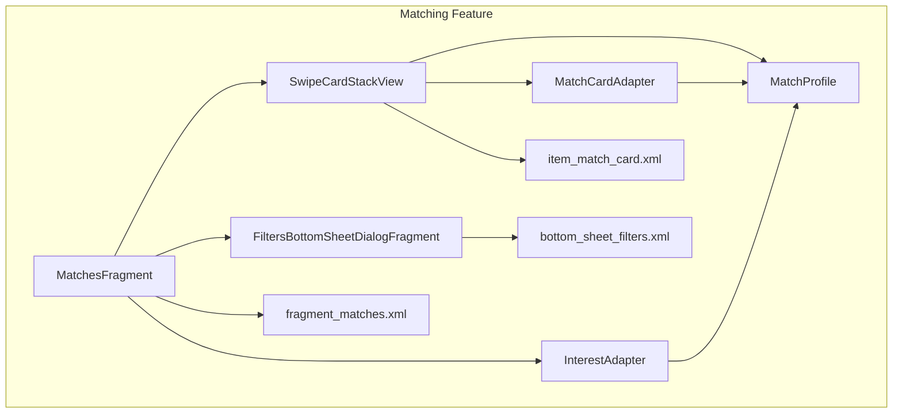
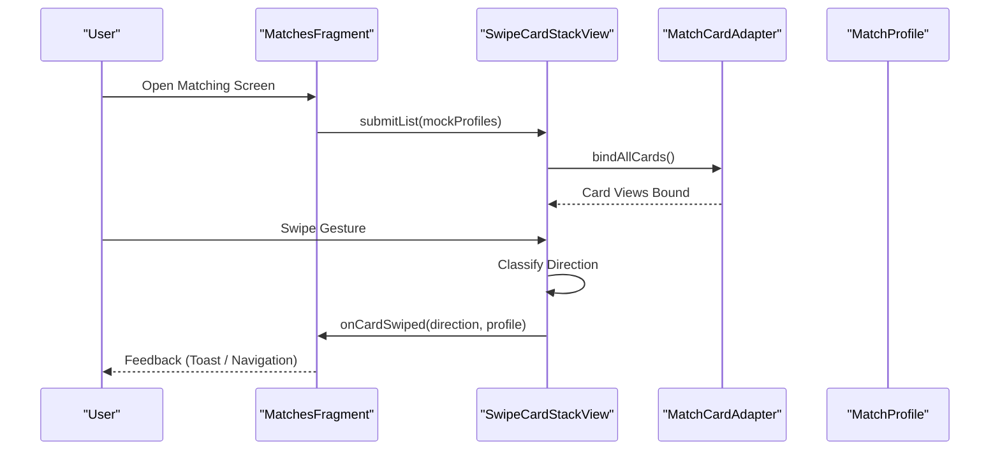
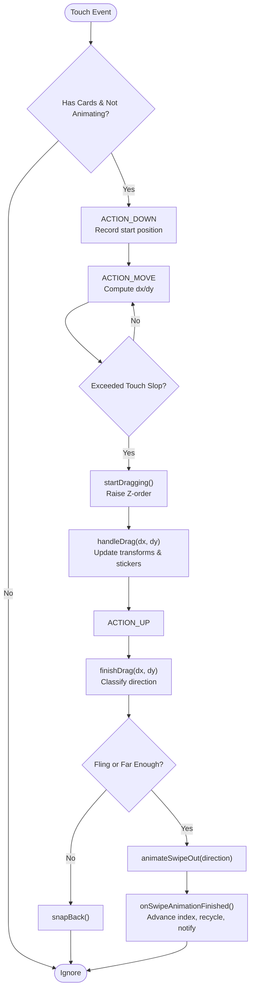
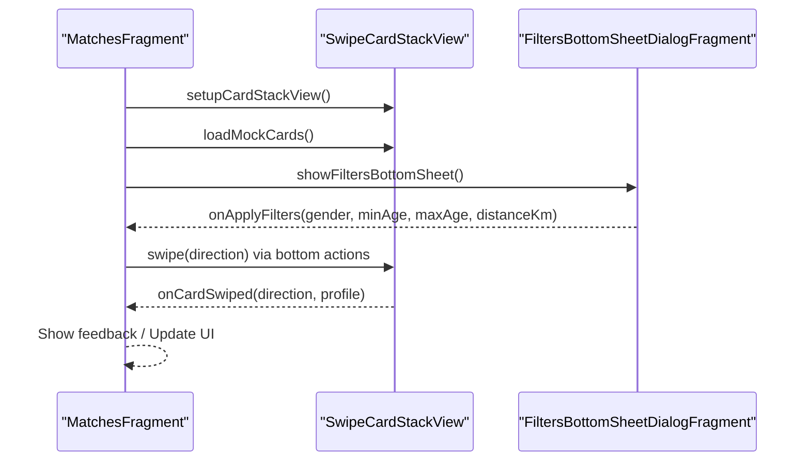
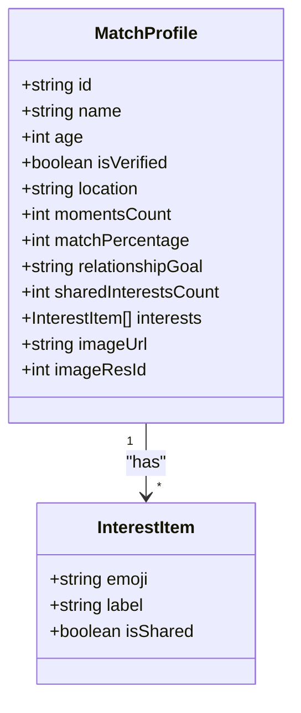
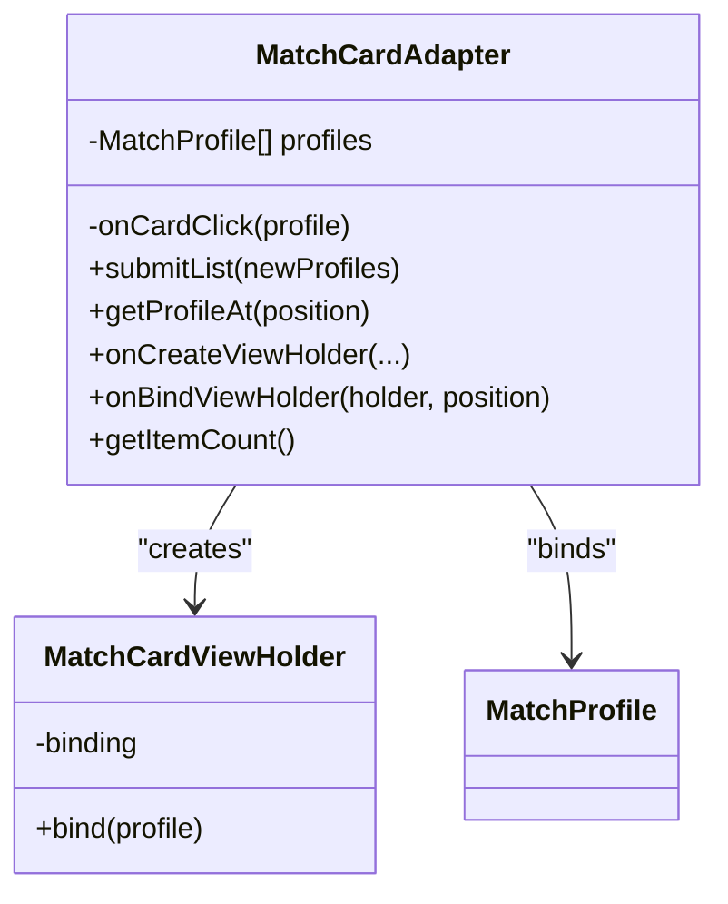
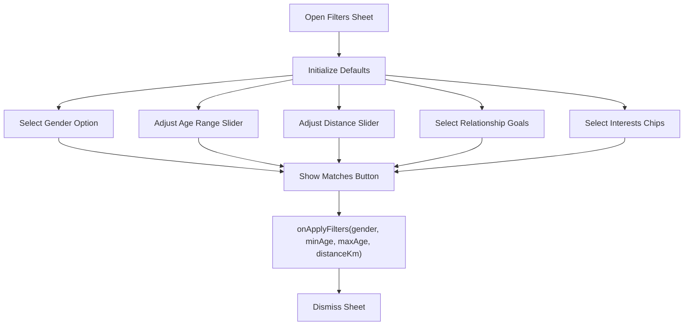
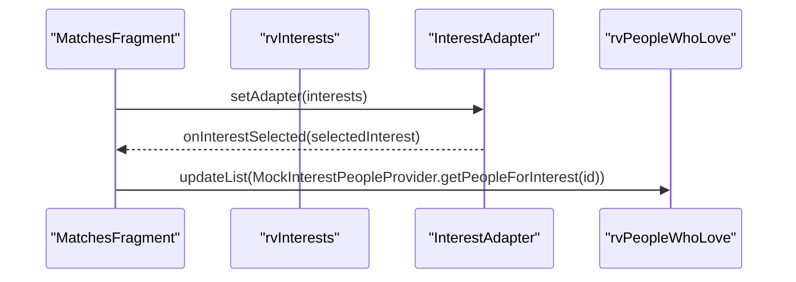
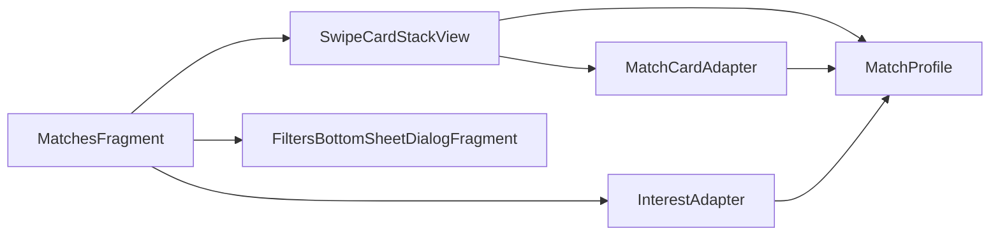

# Matching System

<cite>
**Referenced Files in This Document**   
- [MatchesFragment.kt](file://app/src/main/java/com/flirttime/feature/main/presentation/matches/MatchesFragment.kt)
- [SwipeCardStackView.kt](file://app/src/main/java/com/flirttime/feature/main/presentation/matches/SwipeCardStackView.kt)
- [MatchProfile.kt](file://app/src/main/java/com/flirttime/feature/main/presentation/matches/MatchProfile.kt)
- [MatchCardAdapter.kt](file://app/src/main/java/com/flirttime/feature/main/presentation/matches/MatchCardAdapter.kt)
- [FiltersBottomSheetDialogFragment.kt](file://app/src/main/java/com/flirttime/feature/main/presentation/matches/filter/FiltersBottomSheetDialogFragment.kt)
- [InterestAdapter.kt](file://app/src/main/java/com/flirttime/feature/main/presentation/matches/interest/InterestAdapter.kt)
- [MockMatchProfileProvider.kt](file://app/src/main/java/com/flirttime/feature/main/presentation/matches/MockMatchProfileProvider.kt)
- [fragment_matches.xml](file://app/src/main/res/layout/fragment_matches.xml)
- [item_match_card.xml](file://app/src/main/res/layout/item_match_card.xml)
- [bottom_sheet_filters.xml](file://app/src/main/res/layout/bottom_sheet_filters.xml)
</cite>

## Table of Contents
1. [Introduction](#introduction)
2. [Project Structure](#project-structure)
3. [Core Components](#core-components)
4. [Architecture Overview](#architecture-overview)
5. [Detailed Component Analysis](#detailed-component-analysis)
6. [Dependency Analysis](#dependency-analysis)
7. [Performance Considerations](#performance-considerations)
8. [Troubleshooting Guide](#troubleshooting-guide)
9. [Conclusion](#conclusion)

## Introduction
This document explains the Matching system in Flirttime-Otp-Android, focusing on the swipe-based card interface and interest-driven discovery flow. It covers:
- Swipe-based card stack using a custom view for four-direction gestures (Right, Left, Up, Down).
- MatchProfile data model representing user profiles with photos, compatibility indicators, and interests.
- MatchesFragment orchestrating the matching UI, card stack operations, gesture handling, and tabs.
- MatchCardAdapter for efficient card rendering.
- FiltersBottomSheetDialogFragment for preference-based filtering (gender, age range, distance, interests).
- InterestAdapter and related components for interest-based discovery.
- Matching algorithm logic, profile discovery mechanisms, connection management, animations, transitions, and accessibility considerations.

## Project Structure
The Matching feature is implemented under the main presentation layer:
- Presentation: MatchesFragment hosts the UI and coordinates interactions.
- Custom View: SwipeCardStackView implements gesture detection, stacking visuals, and swipe animations.
- Data Model: MatchProfile and InterestItem define profile structure and shared interests.
- Adapters: MatchCardAdapter renders cards; InterestAdapter renders interest chips.
- Filters: FiltersBottomSheetDialogFragment provides a bottom sheet for applying filters.
- Layouts: fragment_matches.xml defines the screen layout; item_match_card.xml defines the card UI; bottom_sheet_filters.xml defines filter controls.

**Diagram sources**
- [MatchesFragment.kt:21-56](file://app/src/main/java/com/flirttime/feature/main/presentation/matches/MatchesFragment.kt#L21-L56)
- [SwipeCardStackView.kt:32-55](file://app/src/main/java/com/flirttime/feature/main/presentation/matches/SwipeCardStackView.kt#L32-L55)
- [MatchCardAdapter.kt:12-19](file://app/src/main/java/com/flirttime/feature/main/presentation/matches/MatchCardAdapter.kt#L12-L19)
- [MatchProfile.kt:3-16](file://app/src/main/java/com/flirttime/feature/main/presentation/matches/MatchProfile.kt#L3-L16)
- [InterestAdapter.kt:12-15](file://app/src/main/java/com/flirttime/feature/main/presentation/matches/interest/InterestAdapter.kt#L12-L15)
- [FiltersBottomSheetDialogFragment.kt:33-43](file://app/src/main/java/com/flirttime/feature/main/presentation/matches/filter/FiltersBottomSheetDialogFragment.kt#L33-L43)
- [fragment_matches.xml:196-207](file://app/src/main/res/layout/fragment_matches.xml#L196-L207)
- [item_match_card.xml:1-13](file://app/src/main/res/layout/item_match_card.xml#L1-L13)
- [bottom_sheet_filters.xml:1-9](file://app/src/main/res/layout/bottom_sheet_filters.xml#L1-L9)

**Section sources**
- [MatchesFragment.kt:21-56](file://app/src/main/java/com/flirttime/feature/main/presentation/matches/MatchesFragment.kt#L21-L56)
- [fragment_matches.xml:196-207](file://app/src/main/res/layout/fragment_matches.xml#L196-L207)

## Core Components
- SwipeCardStackView: A custom FrameLayout that manages a stack of up to three visible cards, handles touch gestures, computes swipe direction, animates swipes, and notifies listeners when a card is swiped or the stack becomes empty.
- MatchesFragment: The host Fragment that sets up the card stack, pill tabs, interest sections, bottom actions, and screen-wide swipe area. It also shows the filters bottom sheet and reacts to swipe results.
- MatchProfile: Data class describing a potential match including identity, verification status, location, moments count, match percentage, relationship goal, shared interests, and image references.
- MatchCardAdapter: RecyclerView adapter used by the card stack to bind profile data into the card layout, including photo loading with shimmer, badges, and interest chips.
- FiltersBottomSheetDialogFragment: Bottom sheet dialog providing gender selection, age range slider, distance slider, relationship goals, and interest multi-select chips. It exposes an apply callback to return selected filters.
- InterestAdapter: RecyclerView adapter for interest chips grid, managing selection state and notifying selection changes.

**Section sources**
- [SwipeCardStackView.kt:32-55](file://app/src/main/java/com/flirttime/feature/main/presentation/matches/SwipeCardStackView.kt#L32-L55)
- [MatchesFragment.kt:21-56](file://app/src/main/java/com/flirttime/feature/main/presentation/matches/MatchesFragment.kt#L21-L56)
- [MatchProfile.kt:3-16](file://app/src/main/java/com/flirttime/feature/main/presentation/matches/MatchProfile.kt#L3-L16)
- [MatchCardAdapter.kt:12-19](file://app/src/main/java/com/flirttime/feature/main/presentation/matches/MatchCardAdapter.kt#L12-L19)
- [FiltersBottomSheetDialogFragment.kt:33-43](file://app/src/main/java/com/flirttime/feature/main/presentation/matches/filter/FiltersBottomSheetDialogFragment.kt#L33-L43)
- [InterestAdapter.kt:12-15](file://app/src/main/java/com/flirttime/feature/main/presentation/matches/interest/InterestAdapter.kt#L12-L15)

## Architecture Overview
The Matching system follows a clear separation of concerns:
- UI orchestration resides in MatchesFragment.
- Gesture and animation logic are encapsulated in SwipeCardStackView.
- Data models are plain Kotlin data classes.
- Rendering is handled by adapters bound to RecyclerViews or custom views.
- Filters are presented via a bottom sheet dialog and applied through callbacks.

**Diagram sources**
- [MatchesFragment.kt:116-119](file://app/src/main/java/com/flirttime/feature/main/presentation/matches/MatchesFragment.kt#L116-L119)
- [SwipeCardStackView.kt:97-107](file://app/src/main/java/com/flirttime/feature/main/presentation/matches/SwipeCardStackView.kt#L97-L107)
- [SwipeCardStackView.kt:637-661](file://app/src/main/java/com/flirttime/feature/main/presentation/matches/SwipeCardStackView.kt#L637-L661)
- [MatchesFragment.kt:186-207](file://app/src/main/java/com/flirttime/feature/main/presentation/matches/MatchesFragment.kt#L186-L207)

## Detailed Component Analysis

### SwipeCardStackView
SwipeCardStackView is the core interactive component enabling intuitive swiping:
- Supports four directions: Right (Interested), Left (Not Interested), Up (Super Like), Down (Nope).
- Maintains a pool of three card bindings to minimize allocations and improve performance.
- Measures and lays out cards with adaptive sizing to ensure bottom action buttons remain visible.
- Handles touch interception and event processing, including velocity tracking for fling gestures.
- Animates swipe-out transitions and snaps back if thresholds are not met.
- Updates visual stickers (Interested, Not Interested, Super Like, Nope) based on drag progress.
- Recycles card bindings after each swipe and notifies listener callbacks.

**Diagram sources**
- [SwipeCardStackView.kt:331-418](file://app/src/main/java/com/flirttime/feature/main/presentation/matches/SwipeCardStackView.kt#L331-L418)
- [SwipeCardStackView.kt:428-482](file://app/src/main/java/com/flirttime/feature/main/presentation/matches/SwipeCardStackView.kt#L428-L482)
- [SwipeCardStackView.kt:499-540](file://app/src/main/java/com/flirttime/feature/main/presentation/matches/SwipeCardStackView.kt#L499-L540)
- [SwipeCardStackView.kt:547-635](file://app/src/main/java/com/flirttime/feature/main/presentation/matches/SwipeCardStackView.kt#L547-L635)
- [SwipeCardStackView.kt:637-661](file://app/src/main/java/com/flirttime/feature/main/presentation/matches/SwipeCardStackView.kt#L637-L661)
- [SwipeCardStackView.kt:664-701](file://app/src/main/java/com/flirttime/feature/main/presentation/matches/SwipeCardStackView.kt#L664-L701)

**Section sources**
- [SwipeCardStackView.kt:32-55](file://app/src/main/java/com/flirttime/feature/main/presentation/matches/SwipeCardStackView.kt#L32-L55)
- [SwipeCardStackView.kt:119-187](file://app/src/main/java/com/flirttime/feature/main/presentation/matches/SwipeCardStackView.kt#L119-L187)
- [SwipeCardStackView.kt:331-418](file://app/src/main/java/com/flirttime/feature/main/presentation/matches/SwipeCardStackView.kt#L331-L418)
- [SwipeCardStackView.kt:499-661](file://app/src/main/java/com/flirttime/feature/main/presentation/matches/SwipeCardStackView.kt#L499-L661)

### MatchesFragment
MatchesFragment orchestrates the matching experience:
- Sets up the card stack view and binds mock profiles.
- Manages pill tabs (People, Quick Moments, Interests) and toggles content visibility.
- Initializes interest section with InterestAdapter and horizontal people list.
- Provides bottom action buttons to programmatically trigger swipes (Left, Right, Up).
- Captures screen-wide touch events to dispatch to the card stack when active.
- Shows FiltersBottomSheetDialogFragment and applies returned filters.
- Implements OnCardSwipeListener to handle swipe outcomes and reload mock data when the stack empties.

**Diagram sources**
- [MatchesFragment.kt:109-119](file://app/src/main/java/com/flirttime/feature/main/presentation/matches/MatchesFragment.kt#L109-L119)
- [MatchesFragment.kt:155-170](file://app/src/main/java/com/flirttime/feature/main/presentation/matches/MatchesFragment.kt#L155-L170)
- [MatchesFragment.kt:172-180](file://app/src/main/java/com/flirttime/feature/main/presentation/matches/MatchesFragment.kt#L172-L180)
- [MatchesFragment.kt:186-212](file://app/src/main/java/com/flirttime/feature/main/presentation/matches/MatchesFragment.kt#L186-L212)

**Section sources**
- [MatchesFragment.kt:21-56](file://app/src/main/java/com/flirttime/feature/main/presentation/matches/MatchesFragment.kt#L21-L56)
- [MatchesFragment.kt:58-95](file://app/src/main/java/com/flirttime/feature/main/presentation/matches/MatchesFragment.kt#L58-L95)
- [MatchesFragment.kt:97-107](file://app/src/main/java/com/flirttime/feature/main/presentation/matches/MatchesFragment.kt#L97-L107)
- [MatchesFragment.kt:121-153](file://app/src/main/java/com/flirttime/feature/main/presentation/matches/MatchesFragment.kt#L121-L153)
- [MatchesFragment.kt:155-212](file://app/src/main/java/com/flirttime/feature/main/presentation/matches/MatchesFragment.kt#L155-L212)

### MatchProfile Data Model
MatchProfile represents a potential match with key fields:
- Identity: id, name, age, location.
- Verification: isVerified.
- Engagement signals: momentsCount, matchPercentage, relationshipGoal.
- Compatibility: sharedInterestsCount and interests list with InterestItem entries indicating emoji, label, and whether it is shared.
- Media: imageUrl and optional imageResId fallback.

**Diagram sources**
- [MatchProfile.kt:3-16](file://app/src/main/java/com/flirttime/feature/main/presentation/matches/MatchProfile.kt#L3-L16)
- [MatchProfile.kt:18-22](file://app/src/main/java/com/flirttime/feature/main/presentation/matches/MatchProfile.kt#L18-L22)

**Section sources**
- [MatchProfile.kt:3-16](file://app/src/main/java/com/flirttime/feature/main/presentation/matches/MatchProfile.kt#L3-L16)
- [MatchProfile.kt:18-22](file://app/src/main/java/com/flirttime/feature/main/presentation/matches/MatchProfile.kt#L18-L22)

### MatchCardAdapter
MatchCardAdapter efficiently renders profile cards:
- Uses data binding to inflate ItemMatchCardBinding.
- Loads images with ShimmerHelper to provide placeholder while loading.
- Displays top badges (moments count, match percentage), name/age, verification badge, location, relationship goal, shared interests count.
- Renders up to three interest chips, hiding chip3 on narrow screens to prevent clipping.
- Exposes click callback for card interactions.

**Diagram sources**
- [MatchCardAdapter.kt:12-19](file://app/src/main/java/com/flirttime/feature/main/presentation/matches/MatchCardAdapter.kt#L12-L19)
- [MatchCardAdapter.kt:26-39](file://app/src/main/java/com/flirttime/feature/main/presentation/matches/MatchCardAdapter.kt#L26-L39)
- [MatchCardAdapter.kt:41-110](file://app/src/main/java/com/flirttime/feature/main/presentation/matches/MatchCardAdapter.kt#L41-L110)

**Section sources**
- [MatchCardAdapter.kt:12-110](file://app/src/main/java/com/flirttime/feature/main/presentation/matches/MatchCardAdapter.kt#L12-L110)
- [item_match_card.xml:1-13](file://app/src/main/res/layout/item_match_card.xml#L1-L13)

### FiltersBottomSheetDialogFragment
FiltersBottomSheetDialogFragment provides preference-based filtering:
- Gender selection with visual states.
- Age range slider with live value display.
- Distance slider with “Anywhere” representation.
- Relationship goals and interest multi-select chips.
- Applies filters via callback and resets to defaults.

**Diagram sources**
- [FiltersBottomSheetDialogFragment.kt:99-143](file://app/src/main/java/com/flirttime/feature/main/presentation/matches/filter/FiltersBottomSheetDialogFragment.kt#L99-L143)
- [FiltersBottomSheetDialogFragment.kt:145-170](file://app/src/main/java/com/flirttime/feature/main/presentation/matches/filter/FiltersBottomSheetDialogFragment.kt#L145-L170)
- [FiltersBottomSheetDialogFragment.kt:172-183](file://app/src/main/java/com/flirttime/feature/main/presentation/matches/filter/FiltersBottomSheetDialogFragment.kt#L172-L183)
- [FiltersBottomSheetDialogFragment.kt:185-218](file://app/src/main/java/com/flirttime/feature/main/presentation/matches/filter/FiltersBottomSheetDialogFragment.kt#L185-L218)

**Section sources**
- [FiltersBottomSheetDialogFragment.kt:33-43](file://app/src/main/java/com/flirttime/feature/main/presentation/matches/filter/FiltersBottomSheetDialogFragment.kt#L33-L43)
- [FiltersBottomSheetDialogFragment.kt:67-88](file://app/src/main/java/com/flirttime/feature/main/presentation/matches/filter/FiltersBottomSheetDialogFragment.kt#L67-L88)
- [FiltersBottomSheetDialogFragment.kt:99-143](file://app/src/main/java/com/flirttime/feature/main/presentation/matches/filter/FiltersBottomSheetDialogFragment.kt#L99-L143)
- [FiltersBottomSheetDialogFragment.kt:145-218](file://app/src/main/java/com/flirttime/feature/main/presentation/matches/filter/FiltersBottomSheetDialogFragment.kt#L145-L218)

### InterestAdapter and Interest-Based Discovery
InterestAdapter manages a grid of interest chips:
- Tracks selected item and updates visual state accordingly.
- Emits selection callbacks to update the people list for the chosen interest.
- Uses gradient drawable backgrounds for icons and selectable card styles.

In MatchesFragment:
- InterestAdapter populates the Discover by Interests section.
- When an interest is selected, the title updates and the horizontal list refreshes with people who love that interest.

**Diagram sources**
- [MatchesFragment.kt:58-95](file://app/src/main/java/com/flirttime/feature/main/presentation/matches/MatchesFragment.kt#L58-L95)
- [InterestAdapter.kt:12-15](file://app/src/main/java/com/flirttime/feature/main/presentation/matches/interest/InterestAdapter.kt#L12-L15)
- [InterestAdapter.kt:69-80](file://app/src/main/java/com/flirttime/feature/main/presentation/matches/interest/InterestAdapter.kt#L69-L80)

**Section sources**
- [InterestAdapter.kt:12-80](file://app/src/main/java/com/flirttime/feature/main/presentation/matches/interest/InterestAdapter.kt#L12-L80)
- [MatchesFragment.kt:58-95](file://app/src/main/java/com/flirttime/feature/main/presentation/matches/MatchesFragment.kt#L58-L95)

### Mock Data Provider
MockMatchProfileProvider supplies sample profiles for testing and demonstration:
- Returns a list of MatchProfile objects with varied attributes (name, age, location, moments, match percentage, relationship goal, interests, image URL).

**Section sources**
- [MockMatchProfileProvider.kt:3-78](file://app/src/main/java/com/flirttime/feature/main/presentation/matches/MockMatchProfileProvider.kt#L3-L78)

## Dependency Analysis
Key dependencies and relationships:
- MatchesFragment depends on SwipeCardStackView, InterestAdapter, and FiltersBottomSheetDialogFragment.
- SwipeCardStackView depends on MatchProfile and uses MatchCardAdapter internally to bind card views.
- MatchCardAdapter depends on MatchProfile and uses ShimmerHelper for image loading.
- FiltersBottomSheetDialogFragment is independent but invoked from MatchesFragment.
- InterestAdapter depends on InterestItem and is used by MatchesFragment to render interest chips.

**Diagram sources**
- [MatchesFragment.kt:21-56](file://app/src/main/java/com/flirttime/feature/main/presentation/matches/MatchesFragment.kt#L21-L56)
- [SwipeCardStackView.kt:32-55](file://app/src/main/java/com/flirttime/feature/main/presentation/matches/SwipeCardStackView.kt#L32-L55)
- [MatchCardAdapter.kt:12-19](file://app/src/main/java/com/flirttime/feature/main/presentation/matches/MatchCardAdapter.kt#L12-L19)
- [MatchProfile.kt:3-16](file://app/src/main/java/com/flirttime/feature/main/presentation/matches/MatchProfile.kt#L3-L16)
- [InterestAdapter.kt:12-15](file://app/src/main/java/com/flirttime/feature/main/presentation/matches/interest/InterestAdapter.kt#L12-L15)

**Section sources**
- [MatchesFragment.kt:21-56](file://app/src/main/java/com/flirttime/feature/main/presentation/matches/MatchesFragment.kt#L21-L56)
- [SwipeCardStackView.kt:32-55](file://app/src/main/java/com/flirttime/feature/main/presentation/matches/SwipeCardStackView.kt#L32-L55)
- [MatchCardAdapter.kt:12-19](file://app/src/main/java/com/flirttime/feature/main/presentation/matches/MatchCardAdapter.kt#L12-L19)
- [InterestAdapter.kt:12-15](file://app/src/main/java/com/flirttime/feature/main/presentation/matches/interest/InterestAdapter.kt#L12-L15)

## Performance Considerations
- Card pooling: SwipeCardStackView maintains a fixed pool of three card bindings to avoid frequent allocations during swipes.
- Adaptive measurement: SwipeCardStackView measures cards to fit within available height, ensuring bottom action buttons remain visible on constrained screens.
- Image loading: Both SwipeCardStackView and MatchCardAdapter use ShimmerHelper to provide smooth placeholders while images load.
- Animation efficiency: Swipe animations use Android property animations with interpolators; durations are tuned for responsiveness.
- RecyclerView usage: InterestAdapter and other lists leverage RecyclerView for efficient scrolling and recycling.

[No sources needed since this section provides general guidance]

## Troubleshooting Guide
Common issues and resolutions:
- Swipes not triggering: Ensure hasCards() returns true and isAnimating is false before dispatching touches. Verify that the root container allows clipChildren=false so sticker overlays are visible.
- Stickers not appearing: Confirm updateStickersAlpha is called during drag and swipe-out animations; check that sticker views are present in the card layout.
- Bottom buttons hidden: Validate measure logic in SwipeCardStackView to ensure cardHeight adapts to available space; confirm layout constraints in fragment_matches.xml.
- Filters not applied: Ensure onApplyFilters callback is set in MatchesFragment and that FiltersBottomSheetDialogFragment invokes it before dismissing.
- Interest selection not updating people list: Confirm InterestAdapter.onInterestSelected callback updates rvPeopleWhoLove with the correct provider data.

**Section sources**
- [SwipeCardStackView.kt:331-418](file://app/src/main/java/com/flirttime/feature/main/presentation/matches/SwipeCardStackView.kt#L331-L418)
- [SwipeCardStackView.kt:499-661](file://app/src/main/java/com/flirttime/feature/main/presentation/matches/SwipeCardStackView.kt#L499-L661)
- [MatchesFragment.kt:97-107](file://app/src/main/java/com/flirttime/feature/main/presentation/matches/MatchesFragment.kt#L97-L107)
- [MatchesFragment.kt:58-95](file://app/src/main/java/com/flirttime/feature/main/presentation/matches/MatchesFragment.kt#L58-L95)

## Conclusion
The Matching system in Flirttime-Otp-Android delivers an intuitive swipe-based card experience backed by a robust custom view, clean data models, and modular UI components. SwipeCardStackView centralizes gesture handling and animations, while MatchesFragment orchestrates the overall flow, including interest-based discovery and filter application. MatchCardAdapter ensures efficient rendering, and FiltersBottomSheetDialogFragment provides comprehensive preference controls. Together, these components form a cohesive, performant, and accessible matching interface suitable for modern Android devices.

[No sources needed since this section summarizes without analyzing specific files]