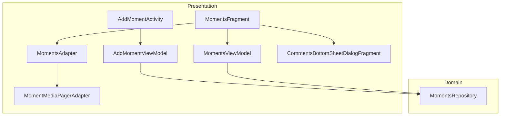
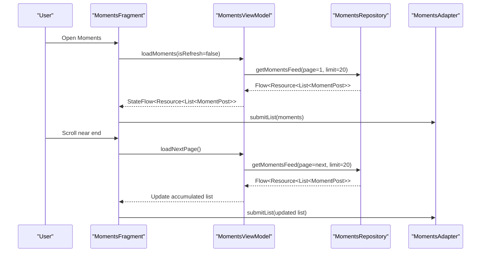
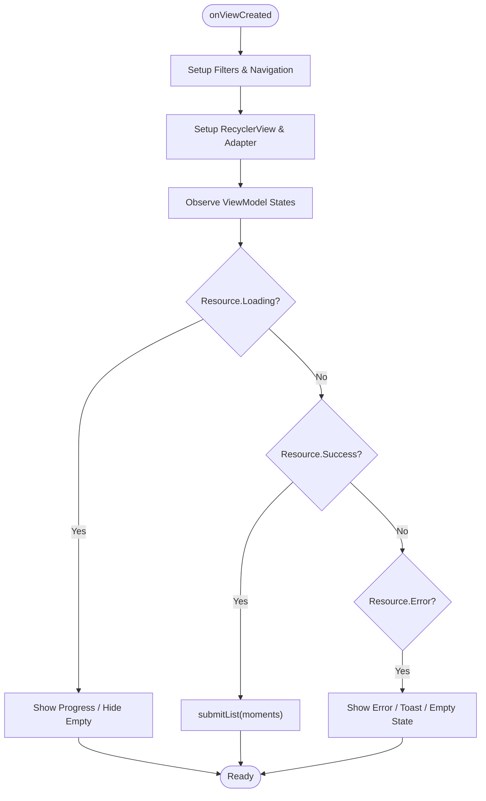
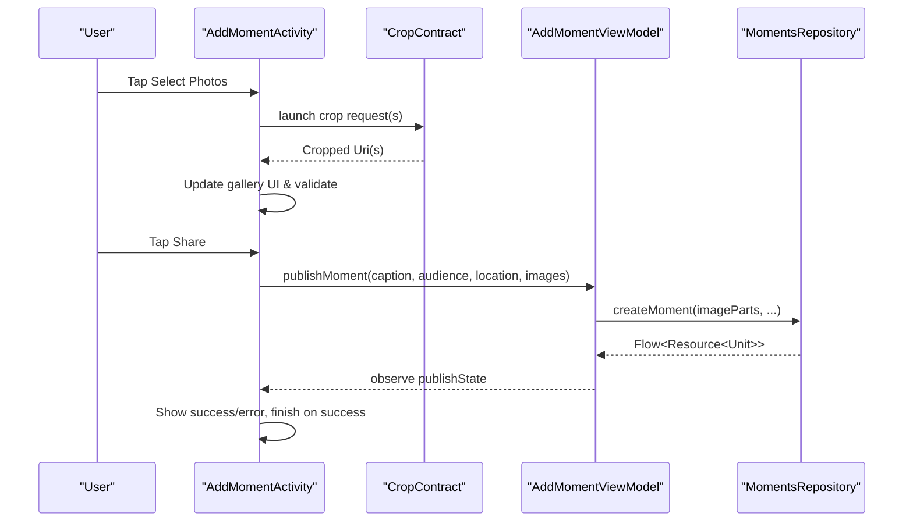
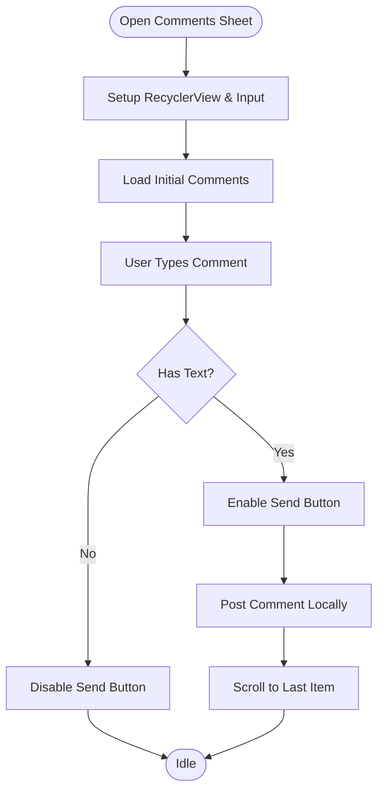
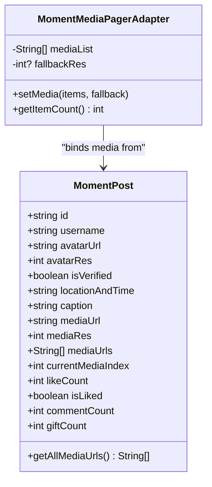
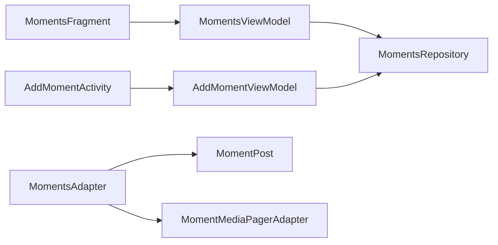

# Moments/Posts System

<cite>
**Referenced Files in This Document**
- [MomentsFragment.kt](file://app/src/main/java/com/flirttime/feature/main/presentation/moments/MomentsFragment.kt)
- [MomentsViewModel.kt](file://app/src/main/java/com/flirttime/feature/main/presentation/moments/MomentsViewModel.kt)
- [MomentsAdapter.kt](file://app/src/main/java/com/flirttime/feature/main/presentation/moments/MomentsAdapter.kt)
- [MomentPost.kt](file://app/src/main/java/com/flirttime/feature/main/presentation/moments/MomentPost.kt)
- [MomentMediaPagerAdapter.kt](file://app/src/main/java/com/flirttime/feature/main/presentation/moments/MomentMediaPagerAdapter.kt)
- [AddMomentActivity.kt](file://app/src/main/java/com/flirttime/feature/main/presentation/moments/add/AddMomentActivity.kt)
- [AddMomentViewModel.kt](file://app/src/main/java/com/flirttime/feature/main/presentation/moments/add/AddMomentViewModel.kt)
- [CommentsBottomSheetDialogFragment.kt](file://app/src/main/java/com/flirttime/feature/main/presentation/moments/comments/CommentsBottomSheetDialogFragment.kt)
- [MomentsRepository.kt](file://app/src/main/java/com/flirttime/feature/moments/domain/repository/MomentsRepository.kt)
</cite>

## Table of Contents
1. [Introduction](#introduction)
2. [Project Structure](#project-structure)
3. [Core Components](#core-components)
4. [Architecture Overview](#architecture-overview)
5. [Detailed Component Analysis](#detailed-component-analysis)
6. [Dependency Analysis](#dependency-analysis)
7. [Performance Considerations](#performance-considerations)
8. [Troubleshooting Guide](#troubleshooting-guide)
9. [Conclusion](#conclusion)

## Introduction
This document explains the Moments/Posts system that enables users to create, share, and interact with social content (photos, videos, text). It covers the feed display, post creation workflow, media handling, pagination, real-time-like interactions, and the comment bottom sheet. The documentation focuses on code-level behavior, data flow, and performance considerations for a smooth user experience.

## Project Structure
The Moments feature is organized into presentation layer components under main/presentation/moments, with domain repository contracts under moments/domain/repository. Key responsibilities:
- Presentation: Fragments, Activities, ViewModels, Adapters
- Data contract: Repository interface defining API operations
- Media: ViewPager-based multi-image support per post
- Comments: Bottom sheet for threaded comments

**Diagram sources**
- [MomentsFragment.kt:22-107](file://app/src/main/java/com/flirttime/feature/main/presentation/moments/MomentsFragment.kt#L22-L107)
- [MomentsViewModel.kt:15-39](file://app/src/main/java/com/flirttime/feature/main/presentation/moments/MomentsViewModel.kt#L15-L39)
- [MomentsAdapter.kt:16-27](file://app/src/main/java/com/flirttime/feature/main/presentation/moments/MomentsAdapter.kt#L16-L27)
- [MomentMediaPagerAdapter.kt:9-18](file://app/src/main/java/com/flirttime/feature/main/presentation/moments/MomentMediaPagerAdapter.kt#L9-L18)
- [AddMomentActivity.kt:30-120](file://app/src/main/java/com/flirttime/feature/main/presentation/moments/add/AddMomentActivity.kt#L30-L120)
- [AddMomentViewModel.kt:18-29](file://app/src/main/java/com/flirttime/feature/main/presentation/moments/add/AddMomentViewModel.kt#L18-L29)
- [CommentsBottomSheetDialogFragment.kt:23-47](file://app/src/main/java/com/flirttime/feature/main/presentation/moments/comments/CommentsBottomSheetDialogFragment.kt#L23-L47)
- [MomentsRepository.kt:8-16](file://app/src/main/java/com/flirttime/feature/moments/domain/repository/MomentsRepository.kt#L8-L16)

**Section sources**
- [MomentsFragment.kt:22-107](file://app/src/main/java/com/flirttime/feature/main/presentation/moments/MomentsFragment.kt#L22-L107)
- [MomentsViewModel.kt:15-39](file://app/src/main/java/com/flirttime/feature/main/presentation/moments/MomentsViewModel.kt#L15-L39)
- [MomentsAdapter.kt:16-27](file://app/src/main/java/com/flirttime/feature/main/presentation/moments/MomentsAdapter.kt#L16-L27)
- [MomentMediaPagerAdapter.kt:9-18](file://app/src/main/java/com/flirttime/feature/main/presentation/moments/MomentMediaPagerAdapter.kt#L9-L18)
- [AddMomentActivity.kt:30-120](file://app/src/main/java/com/flirttime/feature/main/presentation/moments/add/AddMomentActivity.kt#L30-L120)
- [AddMomentViewModel.kt:18-29](file://app/src/main/java/com/flirttime/feature/main/presentation/moments/add/AddMomentViewModel.kt#L18-L29)
- [CommentsBottomSheetDialogFragment.kt:23-47](file://app/src/main/java/com/flirttime/feature/main/presentation/moments/comments/CommentsBottomSheetDialogFragment.kt#L23-L47)
- [MomentsRepository.kt:8-16](file://app/src/main/java/com/flirttime/feature/moments/domain/repository/MomentsRepository.kt#L8-L16)

## Core Components
- MomentPost: Data model representing a single post with metadata, media URLs, and interaction counters. Includes helper to resolve all media URLs.
- MomentsFragment: UI controller for the feed; sets up filters, RecyclerView, scroll listener for pagination, and observes ViewModel state.
- MomentsViewModel: State holder for feed loading, pagination, and background like toggle; exposes flows for UI observation.
- MomentsAdapter: Efficient list rendering with multi-media ViewPager2 per item, shimmer placeholders, and action callbacks (like, comment, gift, more).
- MomentMediaPagerAdapter: Adapter for per-post image carousel using shimmer image loading.
- AddMomentActivity: Content creation screen supporting camera/gallery selection, cropping, location tagging, captioning, and publishing.
- AddMomentViewModel: Publishes posts via multipart upload and manages publish state.
- CommentsBottomSheetDialogFragment: Bottom sheet for viewing and adding comments with keyboard-aware layout.
- MomentsRepository: Domain contract for feed retrieval, like toggling, and moment creation.

**Section sources**
- [MomentPost.kt:3-25](file://app/src/main/java/com/flirttime/feature/main/presentation/moments/MomentPost.kt#L3-L25)
- [MomentsFragment.kt:22-195](file://app/src/main/java/com/flirttime/feature/main/presentation/moments/MomentsFragment.kt#L22-L195)
- [MomentsViewModel.kt:15-125](file://app/src/main/java/com/flirttime/feature/main/presentation/moments/MomentsViewModel.kt#L15-L125)
- [MomentsAdapter.kt:16-279](file://app/src/main/java/com/flirttime/feature/main/presentation/moments/MomentsAdapter.kt#L16-L279)
- [MomentMediaPagerAdapter.kt:9-43](file://app/src/main/java/com/flirttime/feature/main/presentation/moments/MomentMediaPagerAdapter.kt#L9-L43)
- [AddMomentActivity.kt:30-410](file://app/src/main/java/com/flirttime/feature/main/presentation/moments/add/AddMomentActivity.kt#L30-L410)
- [AddMomentViewModel.kt:18-71](file://app/src/main/java/com/flirttime/feature/main/presentation/moments/add/AddMomentViewModel.kt#L18-L71)
- [CommentsBottomSheetDialogFragment.kt:23-215](file://app/src/main/java/com/flirttime/feature/main/presentation/moments/comments/CommentsBottomSheetDialogFragment.kt#L23-L215)
- [MomentsRepository.kt:8-16](file://app/src/main/java/com/flirttime/feature/moments/domain/repository/MomentsRepository.kt#L8-L16)

## Architecture Overview
The Moments system follows a clean separation between presentation and domain layers. The Fragment observes ViewModel flows to render the feed and handle user actions. The ViewModel coordinates with the repository for network operations. The adapter renders each post with a media carousel and handles local UI updates for likes and counts.

**Diagram sources**
- [MomentsFragment.kt:109-177](file://app/src/main/java/com/flirttime/feature/main/presentation/moments/MomentsFragment.kt#L109-L177)
- [MomentsViewModel.kt:41-115](file://app/src/main/java/com/flirttime/feature/main/presentation/moments/MomentsViewModel.kt#L41-L115)
- [MomentsRepository.kt:9-10](file://app/src/main/java/com/flirttime/feature/moments/domain/repository/MomentsRepository.kt#L9-L10)

## Detailed Component Analysis

### Feed Display and Pagination (MomentsFragment + MomentsViewModel + MomentsAdapter)
- MomentsFragment:
  - Sets up navigation buttons and opens the add-moment screen.
  - Configures RecyclerView and attaches a scroll listener to trigger pagination when near the end.
  - Observes ViewModel states to show loading, success, or error UI and updates the empty state accordingly.
- MomentsViewModel:
  - Maintains an accumulated list of posts and page indices.
  - Exposes StateFlow for feed state and SharedFlow for error messages.
  - Handles initial load and next-page load with deduplication by post ID.
  - Provides a background toggleLike call.
- MomentsAdapter:
  - Renders posts with shimmer placeholders for avatars and media.
  - Supports multi-image carousels per post with dot indicators and count badges.
  - Handles like animation and delegates comment/gift/more options to callbacks.

**Diagram sources**
- [MomentsFragment.kt:39-177](file://app/src/main/java/com/flirttime/feature/main/presentation/moments/MomentsFragment.kt#L39-L177)
- [MomentsViewModel.kt:41-115](file://app/src/main/java/com/flirttime/feature/main/presentation/moments/MomentsViewModel.kt#L41-L115)
- [MomentsAdapter.kt:16-279](file://app/src/main/java/com/flirttime/feature/main/presentation/moments/MomentsAdapter.kt#L16-L279)

**Section sources**
- [MomentsFragment.kt:39-195](file://app/src/main/java/com/flirttime/feature/main/presentation/moments/MomentsFragment.kt#L39-L195)
- [MomentsViewModel.kt:41-125](file://app/src/main/java/com/flirttime/feature/main/presentation/moments/MomentsViewModel.kt#L41-L125)
- [MomentsAdapter.kt:16-279](file://app/src/main/java/com/flirttime/feature/main/presentation/moments/MomentsAdapter.kt#L16-L279)

### Post Creation Workflow (AddMomentActivity + AddMomentViewModel)
- AddMomentActivity:
  - Integrates camera and gallery pickers with a unified cropping flow.
  - Manages selected photos, location selection, caption input, and character counting.
  - Triggers publishMoment and observes publish state to update UI and navigate back on success.
- AddMomentViewModel:
  - Converts selected image URIs to multipart parts and calls repository.createMoment.
  - Emits Resource states for loading, success, and error during upload.

**Diagram sources**
- [AddMomentActivity.kt:39-104](file://app/src/main/java/com/flirttime/feature/main/presentation/moments/add/AddMomentActivity.kt#L39-L104)
- [AddMomentActivity.kt:354-403](file://app/src/main/java/com/flirttime/feature/main/presentation/moments/add/AddMomentActivity.kt#L354-L403)
- [AddMomentViewModel.kt:30-64](file://app/src/main/java/com/flirttime/feature/main/presentation/moments/add/AddMomentViewModel.kt#L30-L64)
- [MomentsRepository.kt:11-16](file://app/src/main/java/com/flirttime/feature/moments/domain/repository/MomentsRepository.kt#L11-L16)

**Section sources**
- [AddMomentActivity.kt:30-410](file://app/src/main/java/com/flirttime/feature/main/presentation/moments/add/AddMomentActivity.kt#L30-L410)
- [AddMomentViewModel.kt:18-71](file://app/src/main/java/com/flirttime/feature/main/presentation/moments/add/AddMomentViewModel.kt#L18-L71)

### Comment System (CommentsBottomSheetDialogFragment)
- Displays a list of comments and allows adding new ones locally.
- Adjusts bottom sheet height based on IME visibility to keep the input visible above the keyboard.
- Provides hooks for future features like reply threading and comment likes.

**Diagram sources**
- [CommentsBottomSheetDialogFragment.kt:40-105](file://app/src/main/java/com/flirttime/feature/main/presentation/moments/comments/CommentsBottomSheetDialogFragment.kt#L40-L105)
- [CommentsBottomSheetDialogFragment.kt:123-175](file://app/src/main/java/com/flirttime/feature/main/presentation/moments/comments/CommentsBottomSheetDialogFragment.kt#L123-L175)

**Section sources**
- [CommentsBottomSheetDialogFragment.kt:23-215](file://app/src/main/java/com/flirttime/feature/main/presentation/moments/comments/CommentsBottomSheetDialogFragment.kt#L23-L215)

### Data Model and Media Handling
- MomentPost encapsulates post identity, author info, media URLs, and interaction metrics. It provides getAllMediaUrls to normalize single vs multiple media.
- MomentMediaPagerAdapter loads images with shimmer placeholders and supports fallback resources.

**Diagram sources**
- [MomentPost.kt:3-25](file://app/src/main/java/com/flirttime/feature/main/presentation/moments/MomentPost.kt#L3-L25)
- [MomentMediaPagerAdapter.kt:9-43](file://app/src/main/java/com/flirttime/feature/main/presentation/moments/MomentMediaPagerAdapter.kt#L9-L43)

**Section sources**
- [MomentPost.kt:3-25](file://app/src/main/java/com/flirttime/feature/main/presentation/moments/MomentPost.kt#L3-L25)
- [MomentMediaPagerAdapter.kt:9-43](file://app/src/main/java/com/flirttime/feature/main/presentation/moments/MomentMediaPagerAdapter.kt#L9-L43)

## Dependency Analysis
- Presentation depends on domain repository contract for data operations.
- Activity/Fragment depend on their respective ViewModels for state and business logic.
- Adapter depends on data models and uses shared image loading utilities.

**Diagram sources**
- [MomentsFragment.kt:22-107](file://app/src/main/java/com/flirttime/feature/main/presentation/moments/MomentsFragment.kt#L22-L107)
- [MomentsViewModel.kt:15-39](file://app/src/main/java/com/flirttime/feature/main/presentation/moments/MomentsViewModel.kt#L15-L39)
- [AddMomentActivity.kt:30-120](file://app/src/main/java/com/flirttime/feature/main/presentation/moments/add/AddMomentActivity.kt#L30-L120)
- [AddMomentViewModel.kt:18-29](file://app/src/main/java/com/flirttime/feature/main/presentation/moments/add/AddMomentViewModel.kt#L18-L29)
- [MomentsAdapter.kt:16-279](file://app/src/main/java/com/flirttime/feature/main/presentation/moments/MomentsAdapter.kt#L16-L279)
- [MomentPost.kt:3-25](file://app/src/main/java/com/flirttime/feature/main/presentation/moments/MomentPost.kt#L3-L25)
- [MomentMediaPagerAdapter.kt:9-43](file://app/src/main/java/com/flirttime/feature/main/presentation/moments/MomentMediaPagerAdapter.kt#L9-L43)
- [MomentsRepository.kt:8-16](file://app/src/main/java/com/flirttime/feature/moments/domain/repository/MomentsRepository.kt#L8-L16)

**Section sources**
- [MomentsFragment.kt:22-107](file://app/src/main/java/com/flirttime/feature/main/presentation/moments/MomentsFragment.kt#L22-L107)
- [MomentsViewModel.kt:15-39](file://app/src/main/java/com/flirttime/feature/main/presentation/moments/MomentsViewModel.kt#L15-L39)
- [AddMomentActivity.kt:30-120](file://app/src/main/java/com/flirttime/feature/main/presentation/moments/add/AddMomentActivity.kt#L30-L120)
- [AddMomentViewModel.kt:18-29](file://app/src/main/java/com/flirttime/feature/main/presentation/moments/add/AddMomentViewModel.kt#L18-L29)
- [MomentsAdapter.kt:16-279](file://app/src/main/java/com/flirttime/feature/main/presentation/moments/MomentsAdapter.kt#L16-L279)
- [MomentPost.kt:3-25](file://app/src/main/java/com/flirttime/feature/main/presentation/moments/MomentPost.kt#L3-L25)
- [MomentMediaPagerAdapter.kt:9-43](file://app/src/main/java/com/flirttime/feature/main/presentation/moments/MomentMediaPagerAdapter.kt#L9-L43)
- [MomentsRepository.kt:8-16](file://app/src/main/java/com/flirttime/feature/moments/domain/repository/MomentsRepository.kt#L8-L16)

## Performance Considerations
- Image Loading:
  - Use shimmer placeholders for avatars and media to improve perceived performance.
  - Avoid heavy bitmap operations on the main thread; rely on efficient loaders.
- Memory Management:
  - Reuse adapters and avoid unnecessary allocations inside bind methods.
  - Unregister page change callbacks when binding to prevent leaks.
- Scrolling Smoothness:
  - Set hasFixedSize(true) on RecyclerView where appropriate.
  - Debounce rapid scroll events and guard against concurrent page fetches.
- Pagination:
  - Deduplicate items by ID before appending to the accumulated list.
  - Show a lightweight footer loader while fetching additional pages.
- UI Responsiveness:
  - Keep animations short and off-main-thread where possible.
  - Ensure keyboard interactions do not cause layout thrashing; use window insets efficiently.

[No sources needed since this section provides general guidance]

## Troubleshooting Guide
- Feed fails to load:
  - Verify ViewModel emits Resource.Error and Fragment shows error UI or toast.
  - Check repository flow emissions and network connectivity.
- Pagination not triggering:
  - Confirm scroll listener thresholds and canLoadMore flag.
  - Ensure isLoadingMore is reset after success or error.
- Like toggle not updating:
  - Ensure adapter updates local UI immediately and ViewModel invokes repository.toggleLike.
- Comments sheet overlaps keyboard:
  - Verify IME inset handling adjusts bottom sheet height appropriately.
- Publishing moments fails:
  - Validate image URI processing and multipart conversion.
  - Inspect publishState transitions and error messages.

**Section sources**
- [MomentsFragment.kt:131-177](file://app/src/main/java/com/flirttime/feature/main/presentation/moments/MomentsFragment.kt#L131-L177)
- [MomentsViewModel.kt:82-125](file://app/src/main/java/com/flirttime/feature/main/presentation/moments/MomentsViewModel.kt#L82-L125)
- [CommentsBottomSheetDialogFragment.kt:80-105](file://app/src/main/java/com/flirttime/feature/main/presentation/moments/comments/CommentsBottomSheetDialogFragment.kt#L80-L105)
- [AddMomentViewModel.kt:30-64](file://app/src/main/java/com/flirttime/feature/main/presentation/moments/add/AddMomentViewModel.kt#L30-L64)

## Conclusion
The Moments/Posts system provides a robust foundation for social content sharing with rich media, efficient list rendering, pagination, and interactive elements. The architecture cleanly separates concerns across presentation and domain layers, enabling maintainability and scalability. By following the performance recommendations and troubleshooting steps, developers can deliver a responsive and delightful user experience.

[No sources needed since this section summarizes without analyzing specific files]