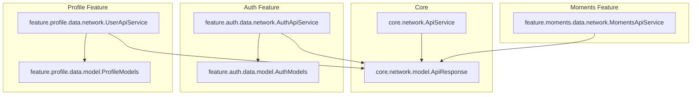
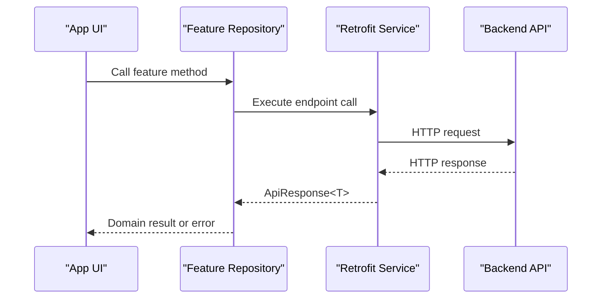
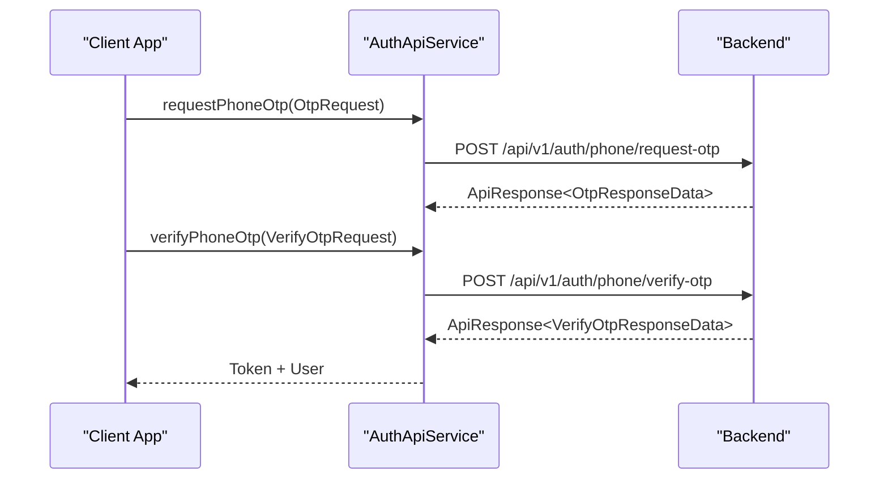
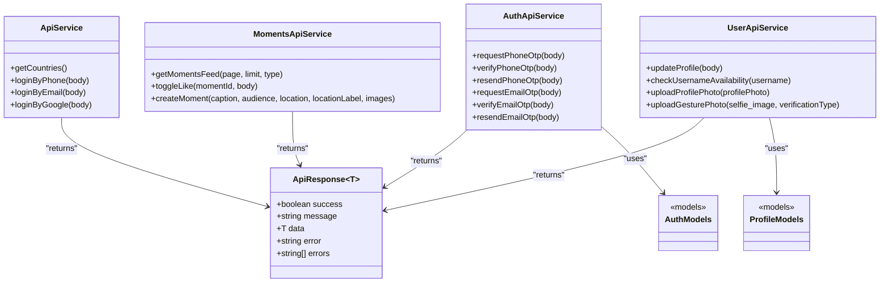

# API Reference

<cite>
**Referenced Files in This Document**
- [ApiService.kt](file://app/src/main/java/com/flirttime/core/network/ApiService.kt)
- [AuthApiService.kt](file://app/src/main/java/com/flirttime/feature/auth/data/network/AuthApiService.kt)
- [MomentsApiService.kt](file://app/src/main/java/com/flirttime/feature/moments/data/network/MomentsApiService.kt)
- [UserApiService.kt](file://app/src/main/java/com/flirttime/feature/profile/data/network/UserApiService.kt)
- [ApiResponse.kt](file://app/src/main/java/com/flirttime/core/network/model/ApiResponse.kt)
- [AuthModels.kt](file://app/src/main/java/com/flirttime/feature/auth/data/model/AuthModels.kt)
- [ProfileModels.kt](file://app/src/main/java/com/flirttime/feature/profile/data/model/ProfileModels.kt)
</cite>

## Table of Contents
1. Introduction
2. Project Structure
3. Core Components
4. Architecture Overview
5. Detailed Component Analysis
6. Dependency Analysis
7. Performance Considerations
8. Troubleshooting Guide
9. Conclusion

## Introduction
This document provides a comprehensive API reference for the RESTful endpoints used by Flirttime-Otp-Android. It covers authentication, country data retrieval, user profile management, moments/posts operations, and outlines how chat is handled within the app. For each endpoint, you will find HTTP methods, URL patterns, request/response schemas, parameter specifications, validation rules, error responses, and example payloads.

## Project Structure
The networking layer is organized into feature-specific Retrofit service interfaces that define endpoints and their request/response models:
- Core network utilities and shared response wrapper
- Authentication services (OTP-based flows and legacy login endpoints)
- Moments service (feed, like toggle, create post)
- User profile service (update profile, username availability, photo uploads)

**Diagram sources**
- [ApiService.kt:1-23](file://app/src/main/java/com/flirttime/core/network/ApiService.kt#L1-L23)
- [AuthApiService.kt:1-47](file://app/src/main/java/com/flirttime/feature/auth/data/network/AuthApiService.kt#L1-L47)
- [MomentsApiService.kt:1-41](file://app/src/main/java/com/flirttime/feature/moments/data/network/MomentsApiService.kt#L1-L41)
- [UserApiService.kt:1-42](file://app/src/main/java/com/flirttime/feature/profile/data/network/UserApiService.kt#L1-L42)
- [ApiResponse.kt:1-12](file://app/src/main/java/com/flirttime/core/network/model/ApiResponse.kt#L1-L12)
- [AuthModels.kt:1-103](file://app/src/main/java/com/flirttime/feature/auth/data/model/AuthModels.kt#L1-L103)
- [ProfileModels.kt:1-17](file://app/src/main/java/com/flirttime/feature/profile/data/model/ProfileModels.kt#L1-L17)

**Section sources**
- [ApiService.kt:1-23](file://app/src/main/java/com/flirttime/core/network/ApiService.kt#L1-L23)
- [AuthApiService.kt:1-47](file://app/src/main/java/com/flirttime/feature/auth/data/network/AuthApiService.kt#L1-L47)
- [MomentsApiService.kt:1-41](file://app/src/main/java/com/flirttime/feature/moments/data/network/MomentsApiService.kt#L1-L41)
- [UserApiService.kt:1-42](file://app/src/main/java/com/flirttime/feature/profile/data/network/UserApiService.kt#L1-L42)

## Core Components
- ApiResponse<T>: Standardized envelope for all API responses with fields success, message, data, error, errors.
- AuthModels: Data classes for OTP requests/responses, user DTOs, legacy login/country models.
- ProfileModels: Request model for updating user profile.

Key responsibilities:
- Define consistent response structure across all endpoints.
- Provide typed request/response contracts for each feature area.

**Section sources**
- [ApiResponse.kt:1-12](file://app/src/main/java/com/flirttime/core/network/model/ApiResponse.kt#L1-L12)
- [AuthModels.kt:1-103](file://app/src/main/java/com/flirttime/feature/auth/data/model/AuthModels.kt#L1-L103)
- [ProfileModels.kt:1-17](file://app/src/main/java/com/flirttime/feature/profile/data/model/ProfileModels.kt#L1-L17)

## Architecture Overview
The app uses Retrofit interfaces to declare endpoints. Each interface groups related endpoints by feature. The base URL is not defined in these files; it is configured at the network module level. All successful responses are wrapped in ApiResponse<T>.

[No sources needed since this diagram shows conceptual workflow, not actual code structure]

## Detailed Component Analysis

### Base URL, Common Headers, and Response Format
- Base URL: Not defined in the referenced service files; configure at the network module level.
- Common headers: Not explicitly set in the referenced service files; configure via OkHttp/Retrofit interceptors if required.
- Response format: All endpoints return ApiResponse<T> with fields:
  - success: Boolean
  - message: String?
  - data: T?
  - error: String?
  - errors: List<String>?

Authentication requirements:
- Endpoints do not show explicit Authorization headers in the service definitions. If token-based auth is required, configure it at the network layer (e.g., via an interceptor).

**Section sources**
- [ApiResponse.kt:1-12](file://app/src/main/java/com/flirttime/core/network/model/ApiResponse.kt#L1-L12)

### Authentication APIs

#### Legacy Login Endpoints (ApiService)
These endpoints use Map<String, String> bodies and return LoginByPhoneResponse.

- GET get-countries
  - Purpose: Retrieve supported countries list.
  - Response: CountryDataResponse containing a list of CountryItem.
  - Example response shape:
    {
      "status": "ok",
      "message": "Countries retrieved",
      "data": [
        {"country_code": "+1", "name": "United States", "flags": 1}
      ]
    }

- POST login-with-phone
  - Body keys: phone_code, phone, fcm_token, device, firebase_token
  - Response: LoginByPhoneResponse with token and UserData.
  - Example request:
    {
      "phone_code": "+1",
      "phone": "1234567890",
      "fcm_token": "FCM_TOKEN",
      "device": "android",
      "firebase_token": "FIREBASE_TOKEN"
    }
  - Example response:
    {
      "status": "ok",
      "message": "Logged in",
      "token": "JWT_OR_ACCESS_TOKEN",
      "data": {
        "id": 1,
        "username": "user123",
        "email": "user@example.com",
        "phone_code": "+1",
        "phone": "1234567890",
        "page_redirect": "/home"
      },
      "is_deleted": false
    }

- POST login-with-email
  - Body: Map<String, String> (keys inferred from usage; align with backend expectations).
  - Response: LoginByPhoneResponse.

- POST login-with-google
  - Body: Map<String, String> (keys inferred from usage; align with backend expectations).
  - Response: LoginByPhoneResponse.

Validation rules:
- Ensure phone_code and phone are valid and match your region.
- Include fcm_token and firebase_token when required by the backend.

Error responses:
- ApiResponse<T> may be returned with success=false and error/errors populated.

**Section sources**
- [ApiService.kt:11-21](file://app/src/main/java/com/flirttime/core/network/ApiService.kt#L11-L21)
- [AuthModels.kt:67-102](file://app/src/main/java/com/flirttime/feature/auth/data/model/AuthModels.kt#L67-L102)

#### OTP-Based Authentication (AuthApiService)
Endpoints wrap responses in ApiResponse<T>.

- POST api/v1/auth/phone/request-otp
  - Body: OtpRequest { countryCode, phone }
  - Response: ApiResponse<OtpResponseData> where OtpResponseData includes verificationId, expiresIn, resendAfter.

- POST api/v1/auth/phone/verify-otp
  - Body: VerifyOtpRequest { verificationId, otp }
  - Response: ApiResponse<VerifyOtpResponseData> where VerifyOtpResponseData includes token/accessToken and user info.

- POST api/v1/auth/phone/resend-otp
  - Body: ResendOtpRequest { verificationId }
  - Response: ApiResponse<OtpResponseData>

- POST api/v1/auth/email/request-otp
  - Body: EmailOtpRequest { email }
  - Response: ApiResponse<OtpResponseData>

- POST api/v1/auth/email/verify-otp
  - Body: VerifyOtpRequest { verificationId, otp }
  - Response: ApiResponse<VerifyOtpResponseData>

- POST api/v1/auth/email/resend-otp
  - Body: ResendOtpRequest { verificationId }
  - Response: ApiResponse<OtpResponseData>

Example request/response shapes:
- Phone OTP request:
  {
    "countryCode": "+1",
    "phone": "1234567890"
  }
- Phone OTP verify response:
  {
    "success": true,
    "message": "OTP verified",
    "data": {
      "token": "ACCESS_TOKEN",
      "user": {
        "id": "uid",
        "username": "user123",
        "email": "user@example.com",
        "role": "user",
        "isActive": true,
        "isProfileComplete": false
      }
    }
  }

Validation rules:
- countryCode must be a valid ISO dialing code.
- phone must be a valid number without leading zeros beyond the country code.
- otp must be numeric and within the expected length.

Error responses:
- ApiResponse<T> with success=false and error/errors populated.

**Diagram sources**
- [AuthApiService.kt:16-29](file://app/src/main/java/com/flirttime/feature/auth/data/network/AuthApiService.kt#L16-L29)
- [AuthModels.kt:6-37](file://app/src/main/java/com/flirttime/feature/auth/data/model/AuthModels.kt#L6-L37)

**Section sources**
- [AuthApiService.kt:16-45](file://app/src/main/java/com/flirttime/feature/auth/data/network/AuthApiService.kt#L16-L45)
- [AuthModels.kt:6-37](file://app/src/main/java/com/flirttime/feature/auth/data/model/AuthModels.kt#L6-L37)

### Country Data Retrieval
- GET get-countries
  - Returns CountryDataResponse with a list of CountryItem.
  - Use this to populate country selectors in onboarding/login flows.

Example response:
{
  "status": "ok",
  "message": "Countries retrieved",
  "data": [
    {"country_code": "+1", "name": "United States", "flags": 1},
    {"country_code": "+44", "name": "United Kingdom", "flags": 2}
  ]
}

**Section sources**
- [ApiService.kt:11-12](file://app/src/main/java/com/flirttime/core/network/ApiService.kt#L11-L12)
- [AuthModels.kt:67-77](file://app/src/main/java/com/flirttime/feature/auth/data/model/AuthModels.kt#L67-L77)

### User Profile Management

#### Update Profile
- PATCH api/v1/users/profile
  - Body: UpdateProfileRequest { fullName, username, dateOfBirth, gender, about }
  - Response: ApiResponse<AuthUserDto>
  - Validation:
    - fullName: non-empty string
    - username: non-empty string, unique per backend rules
    - dateOfBirth: "yyyy-MM-dd"
    - gender: one of "male", "female", "other"
    - about: optional text

Example request:
{
  "fullName": "Jane Doe",
  "username": "janedoe",
  "dateOfBirth": "1995-06-15",
  "gender": "female",
  "about": "Love traveling and photography."
}

Example response:
{
  "success": true,
  "message": "Profile updated",
  "data": {
    "id": "uid",
    "username": "janedoe",
    "email": "jane@example.com",
    "isProfileComplete": true
  }
}

#### Check Username Availability
- GET api/v1/auth/username/availability
  - Query: username (string)
  - Response: ApiResponse<JsonElement> (backend-defined JSON payload)

Example request:
GET /api/v1/auth/username/availability?username=janedoe

Example response:
{
  "success": true,
  "message": "Username available",
  "data": { "available": true }
}

#### Upload Profile Photo
- POST api/v1/onboarding/profile-photo
  - Content-Type: multipart/form-data
  - Part: profilePhoto (image file)
  - Response: ApiResponse<AuthUserDto>

#### Upload Gesture Photo (Verification)
- POST api/v1/gesture-upload
  - Content-Type: multipart/form-data
  - Parts: selfie_image (image), verification_type (string)
  - Response: ApiResponse<AuthUserDto>

**Section sources**
- [UserApiService.kt:19-40](file://app/src/main/java/com/flirttime/feature/profile/data/network/UserApiService.kt#L19-L40)
- [ProfileModels.kt:5-16](file://app/src/main/java/com/flirttime/feature/profile/data/model/ProfileModels.kt#L5-L16)
- [AuthModels.kt:39-64](file://app/src/main/java/com/flirttime/feature/auth/data/model/AuthModels.kt#L39-L64)

### Moments/Posts Operations

#### Get Moments Feed
- GET api/v1/moments
  - Query parameters:
    - page: integer (default 1)
    - limit: integer (default 20)
    - type: string (default "feed")
  - Response: ApiResponse<MomentsFeedResponseData>

Example request:
GET /api/v1/moments?page=1&limit=20&type=feed

#### Toggle Like on Moment
- POST api/v1/moments/{momentId}/like
  - Path: momentId (string)
  - Body: ToggleLikeRequest? (nullable)
  - Response: ApiResponse<Any>

Example request:
POST /api/v1/moments/abc123/like

#### Create Moment
- POST api/v1/moments
  - Content-Type: multipart/form-data
  - Parts:
    - caption: string
    - audience: string
    - location: string
    - locationLabel: string
    - images: list of image files
  - Response: ApiResponse<Any>

Example request:
multipart/form-data
- caption: "Weekend vibes"
- audience: "public"
- location: "New York, NY"
- locationLabel: "City Center"
- images: [image1.jpg, image2.jpg]

**Section sources**
- [MomentsApiService.kt:18-39](file://app/src/main/java/com/flirttime/feature/moments/data/network/MomentsApiService.kt#L18-L39)

### Chat Functionality
- The chat feature in the app currently uses local mock data providers for presentation purposes. No dedicated chat endpoints are defined in the referenced service files.
- To integrate real-time messaging, add a new service interface (e.g., ChatApiService) and corresponding endpoints for sending/receiving messages, presence, and read receipts.

[No sources needed since this section does not analyze specific files]

## Dependency Analysis
The following diagram shows how service interfaces depend on shared response types and feature models.

**Diagram sources**
- [ApiService.kt:1-23](file://app/src/main/java/com/flirttime/core/network/ApiService.kt#L1-L23)
- [AuthApiService.kt:1-47](file://app/src/main/java/com/flirttime/feature/auth/data/network/AuthApiService.kt#L1-L47)
- [MomentsApiService.kt:1-41](file://app/src/main/java/com/flirttime/feature/moments/data/network/MomentsApiService.kt#L1-L41)
- [UserApiService.kt:1-42](file://app/src/main/java/com/flirttime/feature/profile/data/network/UserApiService.kt#L1-L42)
- [ApiResponse.kt:1-12](file://app/src/main/java/com/flirttime/core/network/model/ApiResponse.kt#L1-L12)
- [AuthModels.kt:1-103](file://app/src/main/java/com/flirttime/feature/auth/data/model/AuthModels.kt#L1-L103)
- [ProfileModels.kt:1-17](file://app/src/main/java/com/flirttime/feature/profile/data/model/ProfileModels.kt#L1-L17)

**Section sources**
- [ApiService.kt:1-23](file://app/src/main/java/com/flirttime/core/network/ApiService.kt#L1-L23)
- [AuthApiService.kt:1-47](file://app/src/main/java/com/flirttime/feature/auth/data/network/AuthApiService.kt#L1-L47)
- [MomentsApiService.kt:1-41](file://app/src/main/java/com/flirttime/feature/moments/data/network/MomentsApiService.kt#L1-L41)
- [UserApiService.kt:1-42](file://app/src/main/java/com/flirttime/feature/profile/data/network/UserApiService.kt#L1-L42)

## Performance Considerations
- Pagination: Use page and limit parameters for feed endpoints to reduce payload size.
- Multipart uploads: Compress images client-side before upload to minimize bandwidth.
- Caching: Cache static data such as countries to avoid repeated network calls.
- Concurrency: Avoid parallel requests for the same resource; debounce rapid inputs (e.g., username availability checks).

[No sources needed since this section provides general guidance]

## Troubleshooting Guide
Common issues and resolutions:
- Invalid OTP:
  - Ensure verificationId matches the last issued OTP session.
  - Respect resendAfter cooldown before requesting a new OTP.
- Network errors:
  - Inspect ApiResponse.error and ApiResponse.errors for server-provided messages.
  - Validate input formats (dates, phone numbers, usernames) before sending requests.
- Upload failures:
  - Confirm content-type is multipart/form-data and parts are correctly named.
  - Validate file sizes and formats against backend constraints.

**Section sources**
- [ApiResponse.kt:1-12](file://app/src/main/java/com/flirttime/core/network/model/ApiResponse.kt#L1-L12)

## Conclusion
This API reference consolidates all endpoints exposed by Flirttime-Otp-Android’s networking layer. Authentication supports both legacy login flows and modern OTP-based flows. Country data, profile management, and moments operations are fully specified. Chat functionality is currently presented with mock data and can be extended with additional service interfaces as needed.

[No sources needed since this section summarizes without analyzing specific files]