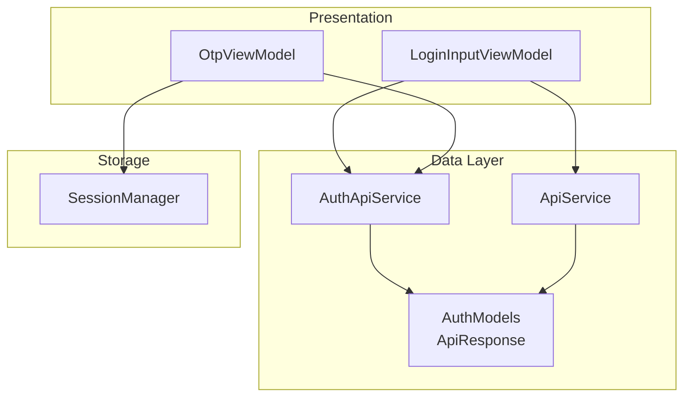
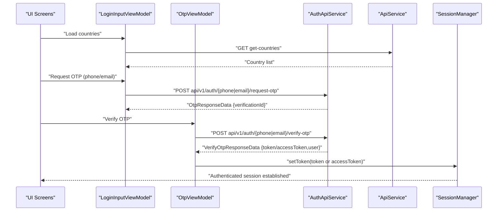
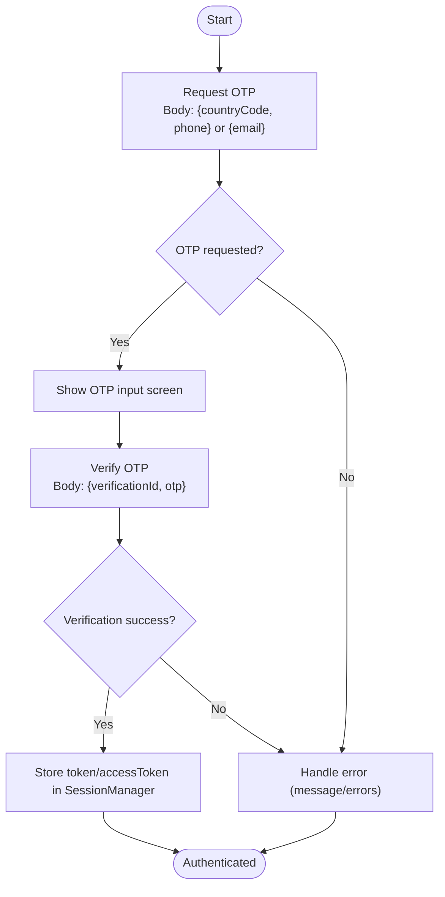
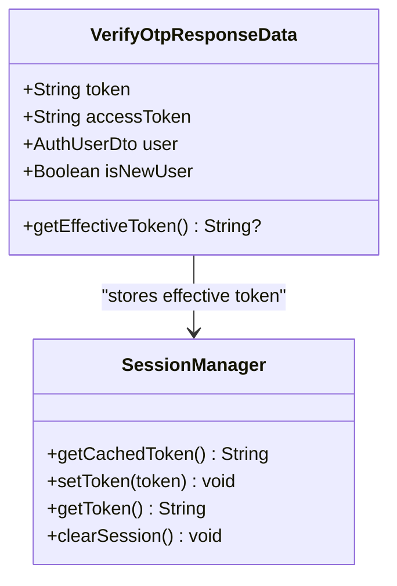
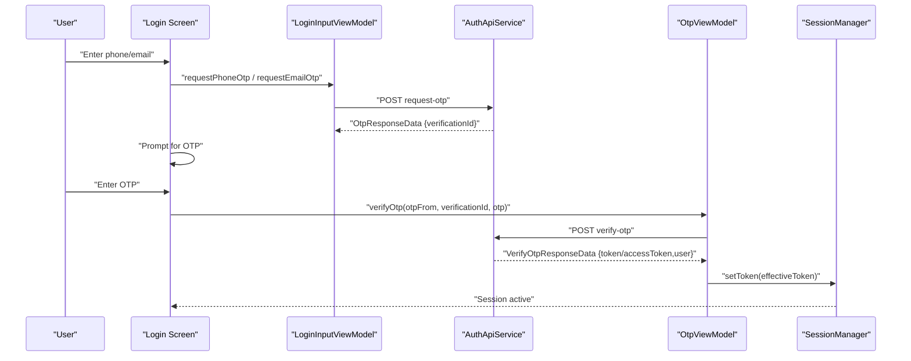
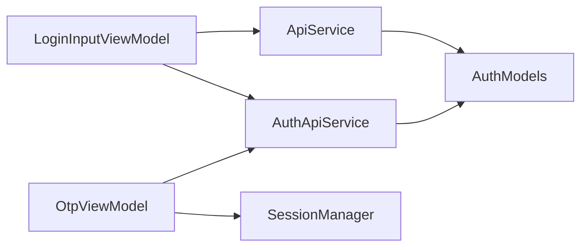

# Authentication APIs

<cite>
**Referenced Files in This Document**
- [ApiService.kt](file://app/src/main/java/com/flirttime/core/network/ApiService.kt)
- [AuthApiService.kt](file://app/src/main/java/com/flirttime/feature/auth/data/network/AuthApiService.kt)
- [AuthModels.kt](file://app/src/main/java/com/flirttime/feature/auth/data/model/AuthModels.kt)
- [ApiResponse.kt](file://app/src/main/java/com/flirttime/core/network/model/ApiResponse.kt)
- [LoginInputViewModel.kt](file://app/src/main/java/com/flirttime/feature/auth/presentation/login/LoginInputViewModel.kt)
- [OtpViewModel.kt](file://app/src/main/java/com/flirttime/feature/auth/presentation/otp/OtpViewModel.kt)
- [SessionManager.kt](file://app/src/main/java/com/flirttime/core/database/SessionManager.kt)
</cite>

## Table of Contents
1. [Introduction](#introduction)
2. [Project Structure](#project-structure)
3. [Core Components](#core-components)
4. [Architecture Overview](#architecture-overview)
5. [Detailed Component Analysis](#detailed-component-analysis)
6. [Dependency Analysis](#dependency-analysis)
7. [Performance Considerations](#performance-considerations)
8. [Troubleshooting Guide](#troubleshooting-guide)
9. [Conclusion](#conclusion)

## Introduction
This document provides detailed API documentation for authentication endpoints used by Flirttime-Otp-Android. It covers:
- Legacy login endpoints: login-with-phone, login-with-email, login-with-google
- OTP-based flows for phone and email (request OTP, verify OTP, resend OTP)
- Request/response schemas, parameters, error handling, and session token management
- End-to-end flow from initial login through OTP verification to session establishment

## Project Structure
Authentication-related code is organized into:
- Network layer: Retrofit interfaces defining HTTP endpoints
- Data models: DTOs for requests and responses
- Presentation layer: ViewModels orchestrating user interactions
- Session storage: Local persistence for tokens and user state

**Diagram sources**
- [LoginInputViewModel.kt:17-58](file://app/src/main/java/com/flirttime/feature/auth/presentation/login/LoginInputViewModel.kt#L17-L58)
- [OtpViewModel.kt:14-57](file://app/src/main/java/com/flirttime/feature/auth/presentation/otp/OtpViewModel.kt#L14-L57)
- [AuthApiService.kt:13-46](file://app/src/main/java/com/flirttime/feature/auth/data/network/AuthApiService.kt#L13-L46)
- [ApiService.kt:9-22](file://app/src/main/java/com/flirttime/core/network/ApiService.kt#L9-L22)
- [AuthModels.kt:5-64](file://app/src/main/java/com/flirttime/feature/auth/data/model/AuthModels.kt#L5-L64)
- [ApiResponse.kt:5-11](file://app/src/main/java/com/flirttime/core/network/model/ApiResponse.kt#L5-L11)
- [SessionManager.kt:22-141](file://app/src/main/java/com/flirttime/core/database/SessionManager.kt#L22-L141)

**Section sources**
- [ApiService.kt:9-22](file://app/src/main/java/com/flirttime/core/network/ApiService.kt#L9-L22)
- [AuthApiService.kt:13-46](file://app/src/main/java/com/flirttime/feature/auth/data/network/AuthApiService.kt#L13-L46)
- [AuthModels.kt:5-64](file://app/src/main/java/com/flirttime/feature/auth/data/model/AuthModels.kt#L5-L64)
- [ApiResponse.kt:5-11](file://app/src/main/java/com/flirttime/core/network/model/ApiResponse.kt#L5-L11)
- [LoginInputViewModel.kt:17-58](file://app/src/main/java/com/flirttime/feature/auth/presentation/login/LoginInputViewModel.kt#L17-L58)
- [OtpViewModel.kt:14-57](file://app/src/main/java/com/flirttime/feature/auth/presentation/otp/OtpViewModel.kt#L14-L57)
- [SessionManager.kt:22-141](file://app/src/main/java/com/flirttime/core/database/SessionManager.kt#L22-L141)

## Core Components
- ApiService: Defines legacy login endpoints and country listing.
- AuthApiService: Defines OTP endpoints for phone and email.
- AuthModels: Defines request/response DTOs for OTP flows and legacy login.
- ApiResponse: Generic envelope for API responses.
- LoginInputViewModel: Orchestrates country loading and OTP requests.
- OtpViewModel: Handles OTP verification and resend flows.
- SessionManager: Persists and exposes session tokens and user data.

Key responsibilities:
- Network calls are defined with Retrofit annotations.
- OTP flows return structured responses containing verification IDs and tokens.
- SessionManager stores the effective token for authenticated requests.

**Section sources**
- [ApiService.kt:9-22](file://app/src/main/java/com/flirttime/core/network/ApiService.kt#L9-L22)
- [AuthApiService.kt:13-46](file://app/src/main/java/com/flirttime/feature/auth/data/network/AuthApiService.kt#L13-L46)
- [AuthModels.kt:5-64](file://app/src/main/java/com/flirttime/feature/auth/data/model/AuthModels.kt#L5-L64)
- [ApiResponse.kt:5-11](file://app/src/main/java/com/flirttime/core/network/model/ApiResponse.kt#L5-L11)
- [LoginInputViewModel.kt:17-58](file://app/src/main/java/com/flirttime/feature/auth/presentation/login/LoginInputViewModel.kt#L17-L58)
- [OtpViewModel.kt:14-57](file://app/src/main/java/com/flirttime/feature/auth/presentation/otp/OtpViewModel.kt#L14-L57)
- [SessionManager.kt:22-141](file://app/src/main/java/com/flirttime/core/database/SessionManager.kt#L22-L141)

## Architecture Overview
The authentication architecture separates concerns across layers:
- Presentation: UI controllers delegate actions to ViewModels.
- Data: ViewModels call repository methods which use Retrofit services.
- Storage: Successful authentication results update SessionManager.

**Diagram sources**
- [ApiService.kt:11-21](file://app/src/main/java/com/flirttime/core/network/ApiService.kt#L11-L21)
- [AuthApiService.kt:16-45](file://app/src/main/java/com/flirttime/feature/auth/data/network/AuthApiService.kt#L16-L45)
- [AuthModels.kt:15-37](file://app/src/main/java/com/flirttime/feature/auth/data/model/AuthModels.kt#L15-L37)
- [LoginInputViewModel.kt:31-53](file://app/src/main/java/com/flirttime/feature/auth/presentation/login/LoginInputViewModel.kt#L31-L53)
- [OtpViewModel.kt:24-47](file://app/src/main/java/com/flirttime/feature/auth/presentation/otp/OtpViewModel.kt#L24-L47)
- [SessionManager.kt:136-141](file://app/src/main/java/com/flirttime/core/database/SessionManager.kt#L136-L141)

## Detailed Component Analysis

### Legacy Login Endpoints
These endpoints are defined in ApiService and accept a Map<String, String> body. They return a legacy response model.

- login-with-phone
  - Method: POST
  - URL pattern: /login-with-phone
  - Request body: Map<String, String>
  - Response: LoginByPhoneResponse
  - Notes: The request body type is generic; specific keys are not enforced by the interface.

- login-with-email
  - Method: POST
  - URL pattern: /login-with-email
  - Request body: Map<String, String>
  - Response: LoginByPhoneResponse
  - Notes: Same generic body shape as phone login.

- login-with-google
  - Method: POST
  - URL pattern: /login-with-google
  - Request body: Map<String, String>
  - Response: LoginByPhoneResponse
  - Notes: Google token should be included in the map under an appropriate key (e.g., google_token), but the exact key is not specified by the interface.

Parameter guidance based on legacy models:
- Phone login typically expects identifiers such as phone_code, phone, fcm_token, device, firebase_token.
- Email login uses similar structure but may vary by server implementation.
- Google login includes a Google token within the request map.

Example request/response patterns:
- Request examples:
  - Phone: {"phone_code": "+1", "phone": "1234567890", "fcm_token": "...", "device": "android"}
  - Email: {"email": "user@example.com", "fcm_token": "...", "device": "android"}
  - Google: {"google_token": "GOOGLE_ACCESS_TOKEN", "device": "android"}
- Response example:
  - {"status": "success", "message": "Logged in", "token": "JWT_OR_SESSION_TOKEN", "data": {...}, "is_deleted": false}

Authentication requirements:
- These endpoints perform initial login and return a token that can be stored via SessionManager.

Error handling:
- Errors are returned within the response envelope fields like status/message.

**Section sources**
- [ApiService.kt:14-21](file://app/src/main/java/com/flirttime/core/network/ApiService.kt#L14-L21)
- [AuthModels.kt:79-102](file://app/src/main/java/com/flirttime/feature/auth/data/model/AuthModels.kt#L79-L102)

### OTP-Based Authentication Flow
OTP endpoints are defined in AuthApiService and use strongly-typed request/response models.

#### Phone OTP
- request-otp
  - Method: POST
  - URL pattern: /api/v1/auth/phone/request-otp
  - Request body: OtpRequest { countryCode, phone }
  - Response: ApiResponse<OtpResponseData>
  - Success payload: verificationId, expiresIn, resendAfter

- verify-otp
  - Method: POST
  - URL pattern: /api/v1/auth/phone/verify-otp
  - Request body: VerifyOtpRequest { verificationId, otp }
  - Response: ApiResponse<VerifyOtpResponseData>
  - Success payload: token or accessToken, user, isNewUser

- resend-otp
  - Method: POST
  - URL pattern: /api/v1/auth/phone/resend-otp
  - Request body: ResendOtpRequest { verificationId }
  - Response: ApiResponse<OtpResponseData>

#### Email OTP
- request-otp
  - Method: POST
  - URL pattern: /api/v1/auth/email/request-otp
  - Request body: EmailOtpRequest { email }
  - Response: ApiResponse<OtpResponseData>

- verify-otp
  - Method: POST
  - URL pattern: /api/v1/auth/email/verify-otp
  - Request body: VerifyOtpRequest { verificationId, otp }
  - Response: ApiResponse<VerifyOtpResponseData>

- resend-otp
  - Method: POST
  - URL pattern: /api/v1/auth/email/resend-otp
  - Request body: ResendOtpRequest { verificationId }
  - Response: ApiResponse<OtpResponseData>

Common response envelope:
- success: Boolean
- message: String?
- data: T?
- error: String?
- errors: List<String>?

Parameter specifications:
- countryCode: Two-letter ISO code string (e.g., "US")
- phone: E.164-formatted number without leading plus (e.g., "1234567890")
- email: Valid email address string
- verificationId: Server-provided identifier from request-otp
- otp: Numeric code sent to user’s phone or email
- Google token: Provided by Google Sign-In SDK; include in legacy login request map

Concrete examples:
- Phone OTP request:
  - Body: { "countryCode": "US", "phone": "1234567890" }
  - Response: { "success": true, "data": { "verificationId": "v123", "expiresIn": 300, "resendAfter": 60 } }
- Email OTP request:
  - Body: { "email": "user@example.com" }
  - Response: { "success": true, "data": { "verificationId": "v456", "expiresIn": 300, "resendAfter": 60 } }
- OTP verification:
  - Body: { "verificationId": "v123", "otp": "123456" }
  - Response: { "success": true, "data": { "token": "SESSION_TOKEN", "user": {...}, "isNewUser": false } }

Authentication requirements:
- No prior auth required for OTP endpoints.
- After successful verification, store the effective token (token or accessToken) in SessionManager.

Error handling patterns:
- On failure, success will be false and either error or errors will contain details.
- Handle network exceptions at the repository/network layer and surface messages to UI.

Flowchart of OTP verification:

**Diagram sources**
- [AuthApiService.kt:16-45](file://app/src/main/java/com/flirttime/feature/auth/data/network/AuthApiService.kt#L16-L45)
- [AuthModels.kt:6-37](file://app/src/main/java/com/flirttime/feature/auth/data/model/AuthModels.kt#L6-L37)
- [ApiResponse.kt:5-11](file://app/src/main/java/com/flirttime/core/network/model/ApiResponse.kt#L5-L11)

**Section sources**
- [AuthApiService.kt:16-45](file://app/src/main/java/com/flirttime/feature/auth/data/network/AuthApiService.kt#L16-L45)
- [AuthModels.kt:6-37](file://app/src/main/java/com/flirttime/feature/auth/data/model/AuthModels.kt#L6-L37)
- [ApiResponse.kt:5-11](file://app/src/main/java/com/flirttime/core/network/model/ApiResponse.kt#L5-L11)

### Session Token Management
After successful authentication (legacy login or OTP verification):
- Extract the effective token using VerifyOtpResponseData.getEffectiveToken() which prefers token over accessToken.
- Persist the token via SessionManager.setToken().
- Retrieve token synchronously or via Flow for subsequent authenticated requests.

**Diagram sources**
- [AuthModels.kt:30-37](file://app/src/main/java/com/flirttime/feature/auth/data/model/AuthModels.kt#L30-L37)
- [SessionManager.kt:22-141](file://app/src/main/java/com/flirttime/core/database/SessionManager.kt#L22-L141)

**Section sources**
- [AuthModels.kt:30-37](file://app/src/main/java/com/flirttime/feature/auth/data/model/AuthModels.kt#L30-L37)
- [SessionManager.kt:22-141](file://app/src/main/java/com/flirttime/core/database/SessionManager.kt#L22-L141)

### End-to-End Authentication Flow
From initial login through OTP verification to session establishment:

**Diagram sources**
- [LoginInputViewModel.kt:39-53](file://app/src/main/java/com/flirttime/feature/auth/presentation/login/LoginInputViewModel.kt#L39-L53)
- [OtpViewModel.kt:24-47](file://app/src/main/java/com/flirttime/feature/auth/presentation/otp/OtpViewModel.kt#L24-L47)
- [AuthApiService.kt:16-45](file://app/src/main/java/com/flirttime/feature/auth/data/network/AuthApiService.kt#L16-L45)
- [SessionManager.kt:136-141](file://app/src/main/java/com/flirttime/core/database/SessionManager.kt#L136-L141)

## Dependency Analysis
- ApiService depends on AuthModels for legacy login responses.
- AuthApiService depends on AuthModels for OTP payloads and responses.
- ViewModels depend on repositories (not shown here) which use AuthApiService and ApiService.
- SessionManager is independent and used after successful authentication.

**Diagram sources**
- [ApiService.kt:9-22](file://app/src/main/java/com/flirttime/core/network/ApiService.kt#L9-L22)
- [AuthApiService.kt:13-46](file://app/src/main/java/com/flirttime/feature/auth/data/network/AuthApiService.kt#L13-L46)
- [AuthModels.kt:5-64](file://app/src/main/java/com/flirttime/feature/auth/data/model/AuthModels.kt#L5-L64)
- [LoginInputViewModel.kt:17-58](file://app/src/main/java/com/flirttime/feature/auth/presentation/login/LoginInputViewModel.kt#L17-L58)
- [OtpViewModel.kt:14-57](file://app/src/main/java/com/flirttime/feature/auth/presentation/otp/OtpViewModel.kt#L14-L57)
- [SessionManager.kt:22-141](file://app/src/main/java/com/flirttime/core/database/SessionManager.kt#L22-L141)

**Section sources**
- [ApiService.kt:9-22](file://app/src/main/java/com/flirttime/core/network/ApiService.kt#L9-L22)
- [AuthApiService.kt:13-46](file://app/src/main/java/com/flirttime/feature/auth/data/network/AuthApiService.kt#L13-L46)
- [AuthModels.kt:5-64](file://app/src/main/java/com/flirttime/feature/auth/data/model/AuthModels.kt#L5-L64)
- [LoginInputViewModel.kt:17-58](file://app/src/main/java/com/flirttime/feature/auth/presentation/login/LoginInputViewModel.kt#L17-L58)
- [OtpViewModel.kt:14-57](file://app/src/main/java/com/flirttime/feature/auth/presentation/otp/OtpViewModel.kt#L14-L57)
- [SessionManager.kt:22-141](file://app/src/main/java/com/flirttime/core/database/SessionManager.kt#L22-L141)

## Performance Considerations
- Use suspend functions for network calls to avoid blocking threads.
- Cache the effective token in SessionManager to minimize disk reads during interceptors.
- Debounce OTP resend requests to prevent spamming the server.
- Validate inputs locally before making network calls to reduce unnecessary requests.

[No sources needed since this section provides general guidance]

## Troubleshooting Guide
Common issues and resolutions:
- Invalid OTP: Ensure verificationId matches the last request-otp response and otp is entered correctly.
- Expired OTP: If expiresIn has elapsed, call resend-otp to obtain a new verificationId.
- Missing token: After verify-otp, ensure setToken is called with the effective token (token or accessToken).
- Country codes: Confirm countryCode is valid and corresponds to the phone number format.

Error response handling:
- Check ApiResponse.success; if false, read error or errors for details.
- Surface user-friendly messages based on error content.

**Section sources**
- [AuthApiService.kt:16-45](file://app/src/main/java/com/flirttime/feature/auth/data/network/AuthApiService.kt#L16-L45)
- [ApiResponse.kt:5-11](file://app/src/main/java/com/flirttime/core/network/model/ApiResponse.kt#L5-L11)
- [AuthModels.kt:15-37](file://app/src/main/java/com/flirttime/feature/auth/data/model/AuthModels.kt#L15-L37)

## Conclusion
Flirttime-Otp-Android supports both legacy login endpoints and modern OTP-based authentication. The OTP flow is robust, returning structured responses with verification IDs and tokens, and integrates cleanly with SessionManager for secure session management. For integration, prefer OTP endpoints for security and consistency, while legacy endpoints remain available for compatibility.