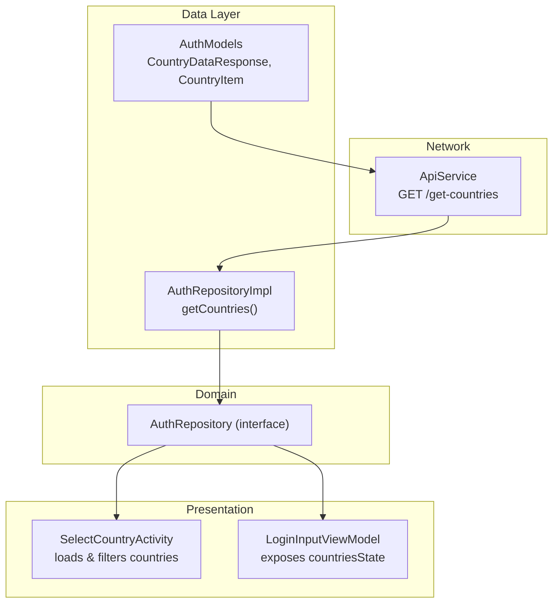
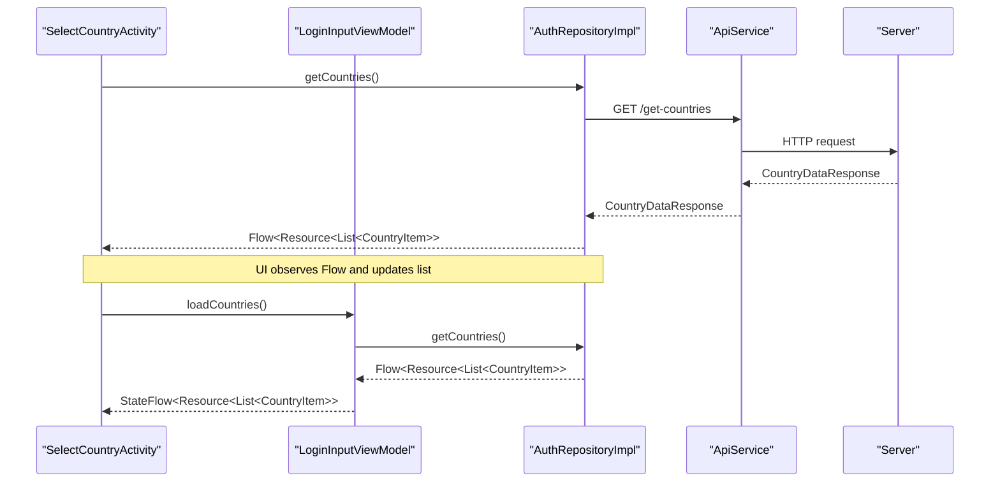
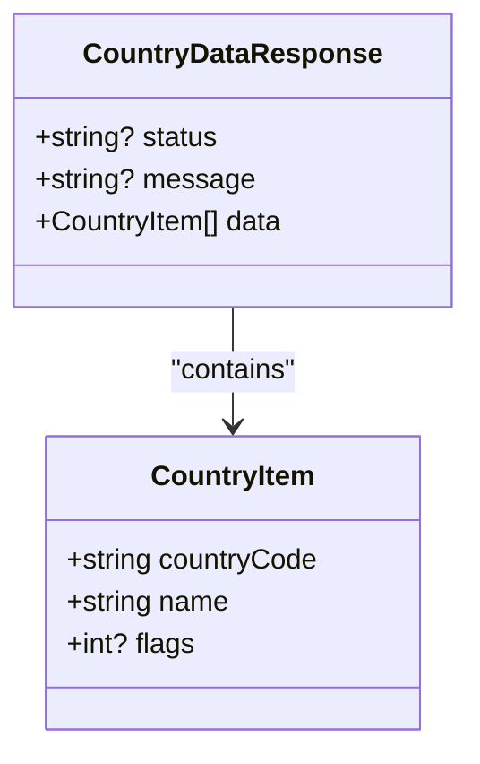
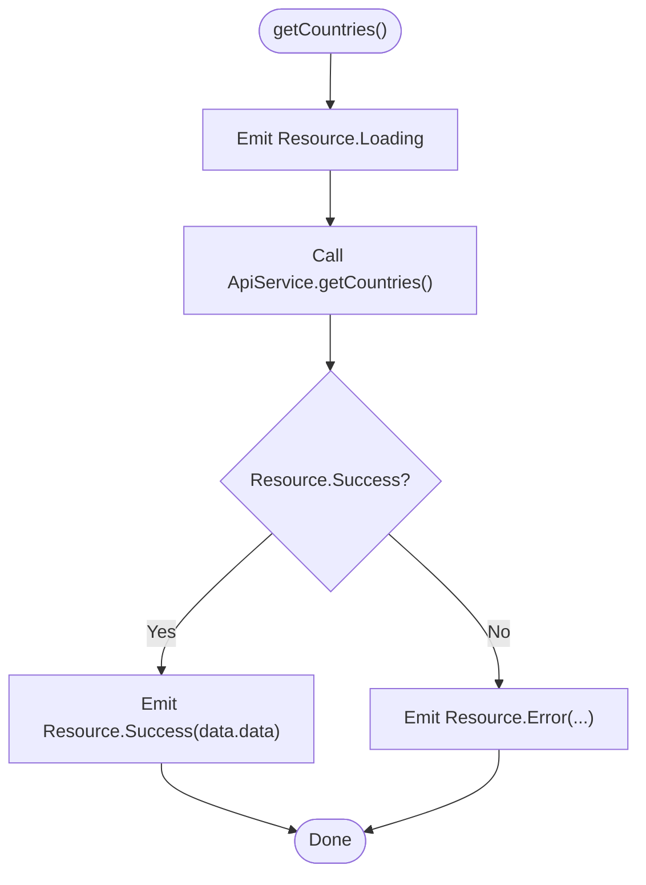
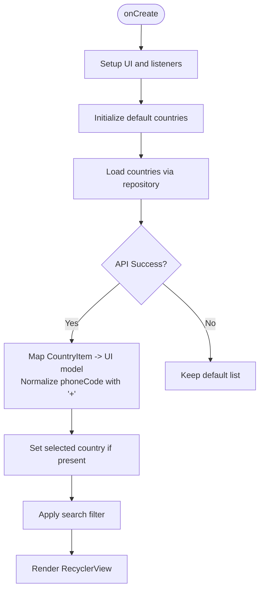
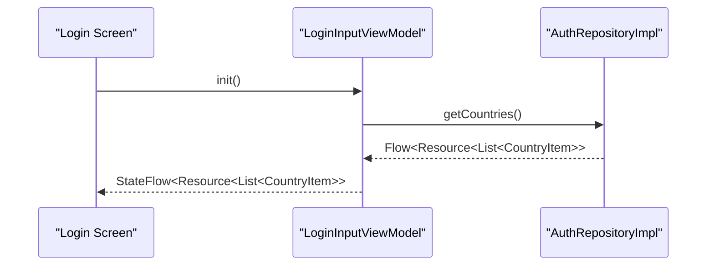
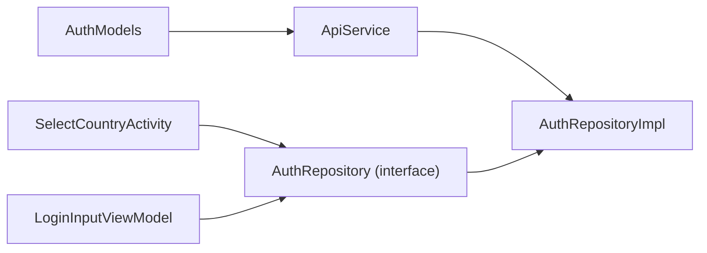

# Country Data APIs

<cite>
**Referenced Files in This Document**
- [ApiService.kt](file://app/src/main/java/com/flirttime/core/network/ApiService.kt)
- [AuthModels.kt](file://app/src/main/java/com/flirttime/feature/auth/data/model/AuthModels.kt)
- [AuthRepositoryImpl.kt](file://app/src/main/java/com/flirttime/feature/auth/data/repository/AuthRepositoryImpl.kt)
- [AuthRepository.kt](file://app/src/main/java/com/flirttime/feature/auth/domain/repository/AuthRepository.kt)
- [SelectCountryActivity.kt](file://app/src/main/java/com/flirttime/feature/auth/presentation/country/SelectCountryActivity.kt)
- [LoginInputViewModel.kt](file://app/src/main/java/com/flirttime/feature/auth/presentation/login/LoginInputViewModel.kt)
</cite>

## Table of Contents
1. [Introduction](#introduction)
2. [Project Structure](#project-structure)
3. [Core Components](#core-components)
4. [Architecture Overview](#architecture-overview)
5. [Detailed Component Analysis](#detailed-component-analysis)
6. [Dependency Analysis](#dependency-analysis)
7. [Performance Considerations](#performance-considerations)
8. [Troubleshooting Guide](#troubleshooting-guide)
9. [Conclusion](#conclusion)

## Introduction
This document provides API documentation for the country data retrieval endpoint used across the app’s authentication flows. It focuses on:
- The get-countries endpoint and its response schema
- How country codes, names, dialing codes, and flags are represented
- Usage patterns in phone number input and country selection screens
- Filtering options available to users
- Caching strategies and offline handling approaches for country information

## Project Structure
The country data retrieval spans network, repository, domain, and presentation layers:
- Network layer defines the HTTP endpoint
- Data models define the response structure
- Repository orchestrates the call and emits a Flow of results
- Presentation components consume the flow to populate UIs

**Diagram sources**
- [ApiService.kt:9-12](file://app/src/main/java/com/flirttime/core/network/ApiService.kt#L9-L12)
- [AuthRepositoryImpl.kt:144-154](file://app/src/main/java/com/flirttime/feature/auth/data/repository/AuthRepositoryImpl.kt#L144-L154)
- [AuthModels.kt:67-77](file://app/src/main/java/com/flirttime/feature/auth/data/model/AuthModels.kt#L67-L77)
- [AuthRepository.kt:40-41](file://app/src/main/java/com/flirttime/feature/auth/domain/repository/AuthRepository.kt#L40-L41)
- [SelectCountryActivity.kt:142-173](file://app/src/main/java/com/flirttime/feature/auth/presentation/country/SelectCountryActivity.kt#L142-L173)
- [LoginInputViewModel.kt:21-37](file://app/src/main/java/com/flirttime/feature/auth/presentation/login/LoginInputViewModel.kt#L21-L37)

**Section sources**
- [ApiService.kt:9-12](file://app/src/main/java/com/flirttime/core/network/ApiService.kt#L9-L12)
- [AuthRepositoryImpl.kt:144-154](file://app/src/main/java/com/flirttime/feature/auth/data/repository/AuthRepositoryImpl.kt#L144-L154)
- [AuthModels.kt:67-77](file://app/src/main/java/com/flirttime/feature/auth/data/model/AuthModels.kt#L67-L77)
- [AuthRepository.kt:40-41](file://app/src/main/java/com/flirttime/feature/auth/domain/repository/AuthRepository.kt#L40-L41)
- [SelectCountryActivity.kt:142-173](file://app/src/main/java/com/flirttime/feature/auth/presentation/country/SelectCountryActivity.kt#L142-L173)
- [LoginInputViewModel.kt:21-37](file://app/src/main/java/com/flirttime/feature/auth/presentation/login/LoginInputViewModel.kt#L21-L37)

## Core Components
- Endpoint definition: GET /get-countries returns a typed response model.
- Response model: CountryDataResponse wraps a list of CountryItem entries.
- Country item fields: country_code, name, flags (optional).
- Repository: Emits Flow<Resource<List<CountryItem>>> with Loading/Success/Error states.
- Presentation: SelectCountryActivity and LoginInputViewModel consume the flow to render and filter country lists.

Key responsibilities:
- ApiService: Declares the HTTP contract for get-countries.
- AuthModels: Defines response and item structures.
- AuthRepositoryImpl: Performs the network call and maps raw response to domain types.
- SelectCountryActivity: Loads countries, merges with defaults, supports search filtering, and returns selected country.
- LoginInputViewModel: Exposes a StateFlow of country data for the login screen.

**Section sources**
- [ApiService.kt:9-12](file://app/src/main/java/com/flirttime/core/network/ApiService.kt#L9-L12)
- [AuthModels.kt:67-77](file://app/src/main/java/com/flirttime/feature/auth/data/model/AuthModels.kt#L67-L77)
- [AuthRepositoryImpl.kt:144-154](file://app/src/main/java/com/flirttime/feature/auth/data/repository/AuthRepositoryImpl.kt#L144-L154)
- [SelectCountryActivity.kt:142-173](file://app/src/main/java/com/flirttime/feature/auth/presentation/country/SelectCountryActivity.kt#L142-L173)
- [LoginInputViewModel.kt:21-37](file://app/src/main/java/com/flirttime/feature/auth/presentation/login/LoginInputViewModel.kt#L21-L37)

## Architecture Overview
The following sequence shows how the app retrieves and displays country data:

**Diagram sources**
- [SelectCountryActivity.kt:142-173](file://app/src/main/java/com/flirttime/feature/auth/presentation/country/SelectCountryActivity.kt#L142-L173)
- [LoginInputViewModel.kt:21-37](file://app/src/main/java/com/flirttime/feature/auth/presentation/login/LoginInputViewModel.kt#L21-L37)
- [AuthRepositoryImpl.kt:144-154](file://app/src/main/java/com/flirttime/feature/auth/data/repository/AuthRepositoryImpl.kt#L144-L154)
- [ApiService.kt:9-12](file://app/src/main/java/com/flirttime/core/network/ApiService.kt#L9-L12)

## Detailed Component Analysis

### API Definition: get-countries
- Method: GET
- Path: /get-countries
- Returns: CountryDataResponse
- Notes: The endpoint is defined as a suspend function in the Retrofit interface.

Response schema:
- CountryDataResponse
  - status: string? (optional)
  - message: string? (optional)
  - data: List<CountryItem>
- CountryItem
  - country_code: string
  - name: string
  - flags: int? (optional; may be null)

Dialing code representation:
- The server may return numeric codes without a leading plus sign.
- The app normalizes them by prepending “+” when needed before display.

Example response shape (conceptual):
{
  "status": "ok",
  "message": "success",
  "data": [
    {
      "country_code": "91",
      "name": "India",
      "flags": 1
    },
    {
      "country_code": "1",
      "name": "United States",
      "flags": null
    }
  ]
}

**Section sources**
- [ApiService.kt:9-12](file://app/src/main/java/com/flirttime/core/network/ApiService.kt#L9-L12)
- [AuthModels.kt:67-77](file://app/src/main/java/com/flirttime/feature/auth/data/model/AuthModels.kt#L67-L77)
- [SelectCountryActivity.kt:146-157](file://app/src/main/java/com/flirttime/feature/auth/presentation/country/SelectCountryActivity.kt#L146-L157)

### Data Models
- CountryDataResponse: Wraps status, message, and data array.
- CountryItem: Contains country_code, name, and optional flags.

**Diagram sources**
- [AuthModels.kt:67-77](file://app/src/main/java/com/flirttime/feature/auth/data/model/AuthModels.kt#L67-L77)

**Section sources**
- [AuthModels.kt:67-77](file://app/src/main/java/com/flirttime/feature/auth/data/model/AuthModels.kt#L67-L77)

### Repository Layer
- AuthRepository.getCountries(): Emits Flow<Resource<List<CountryItem>>>
- AuthRepositoryImpl delegates to ApiService and maps the raw response to a list of CountryItem.

**Diagram sources**
- [AuthRepositoryImpl.kt:144-154](file://app/src/main/java/com/flirttime/feature/auth/data/repository/AuthRepositoryImpl.kt#L144-L154)

**Section sources**
- [AuthRepository.kt:40-41](file://app/src/main/java/com/flirttime/feature/auth/domain/repository/AuthRepository.kt#L40-L41)
- [AuthRepositoryImpl.kt:144-154](file://app/src/main/java/com/flirttime/feature/auth/data/repository/AuthRepositoryImpl.kt#L144-L154)

### Presentation: Country Selection Flow
- SelectCountryActivity initializes a default list, then loads countries from the API.
- On success, it maps API items to UI models, normalizes dialing codes, and sets an initial selection based on intent or current selection.
- Search filtering matches against both country name and phone code.

**Diagram sources**
- [SelectCountryActivity.kt:88-173](file://app/src/main/java/com/flirttime/feature/auth/presentation/country/SelectCountryActivity.kt#L88-L173)

Filtering behavior:
- Filters by country name or phone code substring match (case-insensitive).
- Hides the placeholder when no matches are found.

Usage pattern:
- The activity returns the selected country’s name, phone code, and optional flag resource/URL back to the caller via Intent extras.

**Section sources**
- [SelectCountryActivity.kt:88-173](file://app/src/main/java/com/flirttime/feature/auth/presentation/country/SelectCountryActivity.kt#L88-L173)
- [SelectCountryActivity.kt:185-206](file://app/src/main/java/com/flirttime/feature/auth/presentation/country/SelectCountryActivity.kt#L185-L206)
- [SelectCountryActivity.kt:208-221](file://app/src/main/java/com/flirttime/feature/auth/presentation/country/SelectCountryActivity.kt#L208-L221)

### Presentation: Phone Number Input Flow
- LoginInputViewModel exposes a StateFlow<Resource<List<CountryItem>>> for the login screen.
- It calls repository.getCountries() during initialization to populate the state.

**Diagram sources**
- [LoginInputViewModel.kt:21-37](file://app/src/main/java/com/flirttime/feature/auth/presentation/login/LoginInputViewModel.kt#L21-L37)
- [AuthRepositoryImpl.kt:144-154](file://app/src/main/java/com/flirttime/feature/auth/data/repository/AuthRepositoryImpl.kt#L144-L154)

**Section sources**
- [LoginInputViewModel.kt:21-37](file://app/src/main/java/com/flirttime/feature/auth/presentation/login/LoginInputViewModel.kt#L21-L37)

## Dependency Analysis

**Diagram sources**
- [ApiService.kt:9-12](file://app/src/main/java/com/flirttime/core/network/ApiService.kt#L9-L12)
- [AuthModels.kt:67-77](file://app/src/main/java/com/flirttime/feature/auth/data/model/AuthModels.kt#L67-L77)
- [AuthRepository.kt:40-41](file://app/src/main/java/com/flirttime/feature/auth/domain/repository/AuthRepository.kt#L40-L41)
- [AuthRepositoryImpl.kt:144-154](file://app/src/main/java/com/flirttime/feature/auth/data/repository/AuthRepositoryImpl.kt#L144-L154)
- [SelectCountryActivity.kt:142-173](file://app/src/main/java/com/flirttime/feature/auth/presentation/country/SelectCountryActivity.kt#L142-L173)
- [LoginInputViewModel.kt:21-37](file://app/src/main/java/com/flirttime/feature/auth/presentation/login/LoginInputViewModel.kt#L21-L37)

**Section sources**
- [ApiService.kt:9-12](file://app/src/main/java/com/flirttime/core/network/ApiService.kt#L9-L12)
- [AuthModels.kt:67-77](file://app/src/main/java/com/flirttime/feature/auth/data/model/AuthModels.kt#L67-L77)
- [AuthRepository.kt:40-41](file://app/src/main/java/com/flirttime/feature/auth/domain/repository/AuthRepository.kt#L40-L41)
- [AuthRepositoryImpl.kt:144-154](file://app/src/main/java/com/flirttime/feature/auth/data/repository/AuthRepositoryImpl.kt#L144-L154)
- [SelectCountryActivity.kt:142-173](file://app/src/main/java/com/flirttime/feature/auth/presentation/country/SelectCountryActivity.kt#L142-L173)
- [LoginInputViewModel.kt:21-37](file://app/src/main/java/com/flirttime/feature/auth/presentation/login/LoginInputViewModel.kt#L21-L37)

## Performance Considerations
- Network calls are executed on IO dispatchers within the repository to avoid blocking the main thread.
- The repository emits a Flow, enabling reactive updates and avoiding redundant requests when observed multiple times.
- UI-level filtering is performed in-memory after loading the full list, which is efficient for typical country lists.

[No sources needed since this section provides general guidance]

## Troubleshooting Guide
Common issues and resolutions:
- Dialing code formatting: If the server returns numeric codes without a leading plus sign, ensure normalization logic adds “+” before display.
- Empty or missing flags: The flags field is optional; handle null gracefully in the UI.
- No results in search: When the filtered list is empty, show a placeholder instead of an empty list.
- Initial selection: Ensure the initially selected country respects either the API-selected value or the provided intent parameter.

Operational checks:
- Verify that the repository emits Resource.Loading before making the network call.
- Confirm that Resource.Success contains a non-empty list before updating the UI.
- Validate that error states are propagated correctly to the UI for user feedback.

**Section sources**
- [SelectCountryActivity.kt:146-157](file://app/src/main/java/com/flirttime/feature/auth/presentation/country/SelectCountryActivity.kt#L146-L157)
- [SelectCountryActivity.kt:185-206](file://app/src/main/java/com/flirttime/feature/auth/presentation/country/SelectCountryActivity.kt#L185-L206)
- [AuthRepositoryImpl.kt:144-154](file://app/src/main/java/com/flirttime/feature/auth/data/repository/AuthRepositoryImpl.kt#L144-L154)

## Conclusion
The get-countries endpoint provides a simple, structured response containing country codes, names, and optional flags. The app normalizes dialing codes and integrates the data into both the country selection screen and the phone number input flow. Reactive flows enable smooth UI updates, while in-memory filtering offers responsive search. For robustness, consider adding caching and offline fallbacks at the repository level to improve reliability and performance.

[No sources needed since this section summarizes without analyzing specific files]