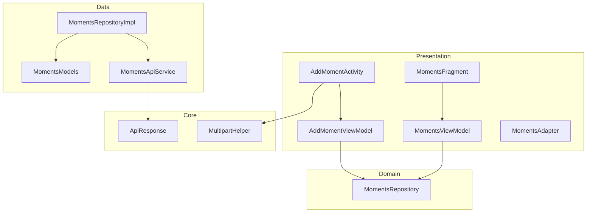
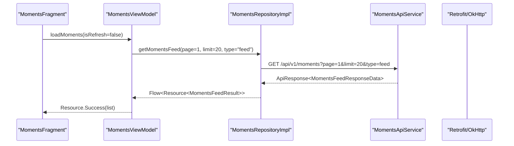
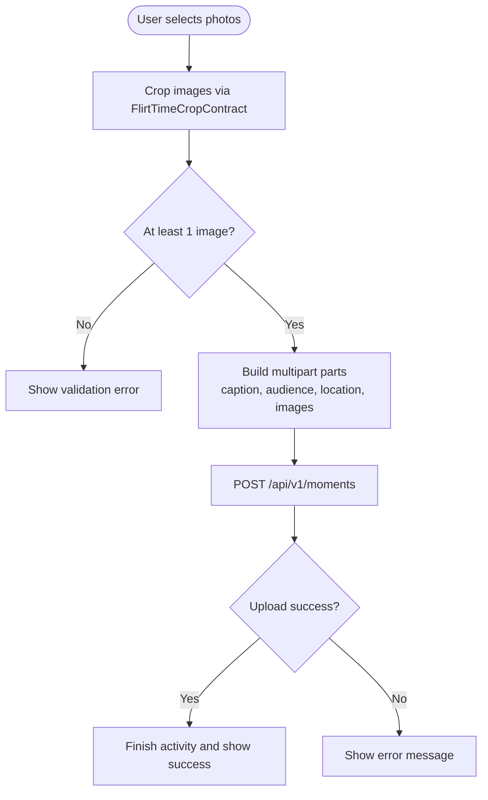
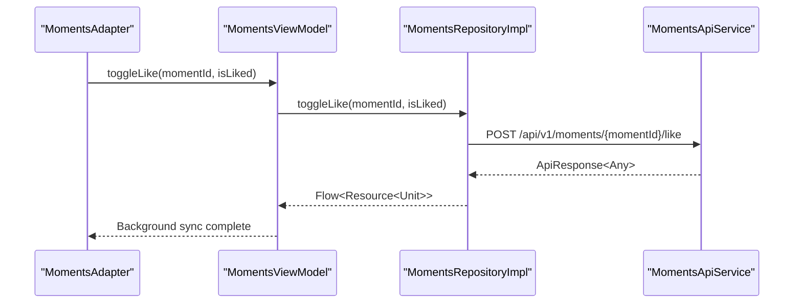
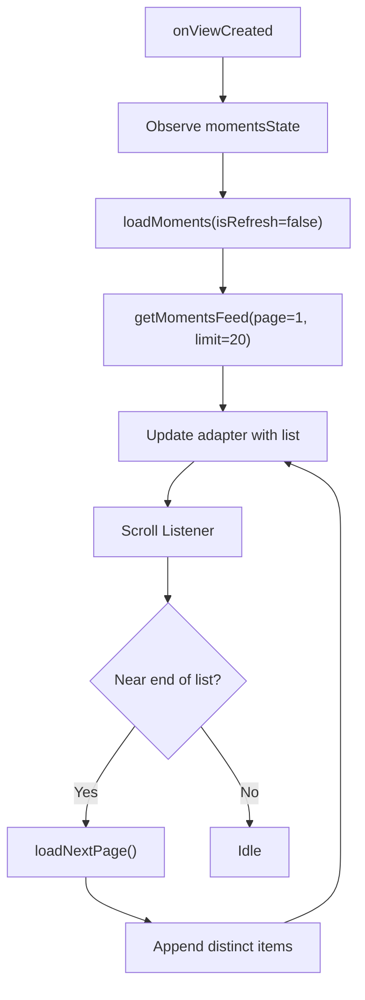
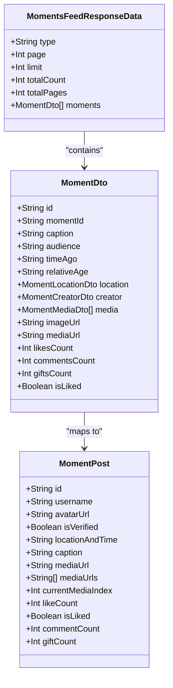
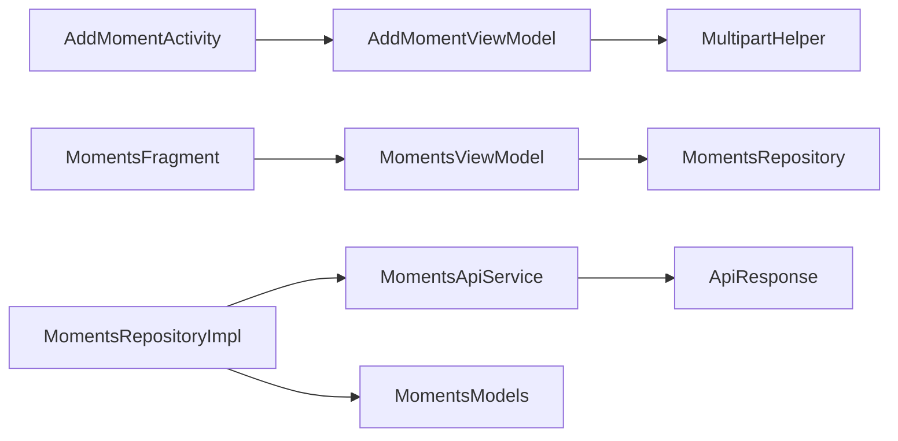

# Moments & Posts APIs

<cite>
**Referenced Files in This Document**
- [MomentsApiService.kt](file://app/src/main/java/com/flirttime/feature/moments/data/network/MomentsApiService.kt)
- [MomentsRepository.kt](file://app/src/main/java/com/flirttime/feature/moments/domain/repository/MomentsRepository.kt)
- [MomentsRepositoryImpl.kt](file://app/src/main/java/com/flirttime/feature/moments/data/repository/MomentsRepositoryImpl.kt)
- [MomentsModels.kt](file://app/src/main/java/com/flirttime/feature/moments/data/model/MomentsModels.kt)
- [MultipartHelper.kt](file://app/src/main/java/com/flirttime/core/common/MultipartHelper.kt)
- [ApiResponse.kt](file://app/src/main/java/com/flirttime/core/network/model/ApiResponse.kt)
- [AddMomentActivity.kt](file://app/src/main/java/com/flirttime/feature/main/presentation/moments/add/AddMomentActivity.kt)
- [AddMomentViewModel.kt](file://app/src/main/java/com/flirttime/feature/main/presentation/moments/add/AddMomentViewModel.kt)
- [MomentsFragment.kt](file://app/src/main/java/com/flirttime/feature/main/presentation/moments/MomentsFragment.kt)
- [MomentsViewModel.kt](file://app/src/main/java/com/flirttime/feature/main/presentation/moments/MomentsViewModel.kt)
- [MomentsAdapter.kt](file://app/src/main/java/com/flirttime/feature/main/presentation/moments/MomentsAdapter.kt)
</cite>

## Table of Contents
1. [Introduction](#introduction)
2. [Project Structure](#project-structure)
3. [Core Components](#core-components)
4. [Architecture Overview](#architecture-overview)
5. [Detailed Component Analysis](#detailed-component-analysis)
6. [Dependency Analysis](#dependency-analysis)
7. [Performance Considerations](#performance-considerations)
8. [Troubleshooting Guide](#troubleshooting-guide)
9. [Conclusion](#conclusion)

## Introduction
This document provides detailed API documentation for the Moments and social posts functionality, including endpoints for creating, updating (via like toggle), deleting (not implemented in this codebase), and retrieving moments/posts. It covers media upload capabilities, engagement interactions such as likes and comments, and feed pagination. It also includes examples of workflows, error handling strategies, rate limiting considerations, and performance optimization recommendations based on the Android client implementation.

## Project Structure
The Moments feature is organized across presentation, domain, data, and core layers:
- Presentation layer: Activities, Fragments, ViewModels, and Adapters that handle user interactions and UI state.
- Domain layer: Repository interface defining use cases for fetching feeds, toggling likes, and creating moments.
- Data layer: Retrofit API service, repository implementation, and data models mapping server responses to UI models.
- Core utilities: Multipart helper for file uploads and shared network response wrapper.

**Diagram sources**
- [AddMomentActivity.kt:106-120](file://app/src/main/java/com/flirttime/feature/main/presentation/moments/add/AddMomentActivity.kt#L106-L120)
- [AddMomentViewModel.kt:18-65](file://app/src/main/java/com/flirttime/feature/main/presentation/moments/add/AddMomentViewModel.kt#L18-L65)
- [MomentsFragment.kt:39-45](file://app/src/main/java/com/flirttime/feature/main/presentation/moments/MomentsFragment.kt#L39-L45)
- [MomentsViewModel.kt:33-124](file://app/src/main/java/com/flirttime/feature/main/presentation/moments/MomentsViewModel.kt#L33-L124)
- [MomentsRepository.kt:8-17](file://app/src/main/java/com/flirttime/feature/moments/domain/repository/MomentsRepository.kt#L8-L17)
- [MomentsRepositoryImpl.kt:17-88](file://app/src/main/java/com/flirttime/feature/moments/data/repository/MomentsRepositoryImpl.kt#L17-L88)
- [MomentsApiService.kt:16-40](file://app/src/main/java/com/flirttime/feature/moments/data/network/MomentsApiService.kt#L16-L40)
- [MomentsModels.kt:6-191](file://app/src/main/java/com/flirttime/feature/moments/data/model/MomentsModels.kt#L6-L191)
- [MultipartHelper.kt:15-60](file://app/src/main/java/com/flirttime/core/common/MultipartHelper.kt#L15-L60)
- [ApiResponse.kt:5-11](file://app/src/main/java/com/flirttime/core/network/model/ApiResponse.kt#L5-L11)

**Section sources**
- [AddMomentActivity.kt:106-120](file://app/src/main/java/com/flirttime/feature/main/presentation/moments/add/AddMomentActivity.kt#L106-L120)
- [MomentsFragment.kt:39-45](file://app/src/main/java/com/flirttime/feature/main/presentation/moments/MomentsFragment.kt#L39-L45)
- [MomentsRepository.kt:8-17](file://app/src/main/java/com/flirttime/feature/moments/domain/repository/MomentsRepository.kt#L8-L17)
- [MomentsApiService.kt:16-40](file://app/src/main/java/com/flirttime/feature/moments/data/network/MomentsApiService.kt#L16-L40)

## Core Components
- MomentsApiService: Defines REST endpoints for feed retrieval, like toggling, and moment creation with multipart media upload.
- MomentsRepository: Domain interface exposing flows for feed loading, like toggling, and moment creation.
- MomentsRepositoryImpl: Implements repository methods using safe API calls, maps DTOs to UI models, and handles resource states.
- MomentsModels: Data transfer objects for server payloads and UI model mapping.
- MultipartHelper: Utility to convert URIs/files into multipart parts and text parts for requests.
- ApiResponse: Standardized response envelope used by the network layer.

Key responsibilities:
- Feed retrieval with pagination parameters.
- Like toggle endpoint with optional request body.
- Moment creation with caption, audience, location, and multiple images.
- Resource flow emission for Loading/Success/Error states.

**Section sources**
- [MomentsApiService.kt:16-40](file://app/src/main/java/com/flirttime/feature/moments/data/network/MomentsApiService.kt#L16-L40)
- [MomentsRepository.kt:8-17](file://app/src/main/java/com/flirttime/feature/moments/domain/repository/MomentsRepository.kt#L8-L17)
- [MomentsRepositoryImpl.kt:21-88](file://app/src/main/java/com/flirttime/feature/moments/data/repository/MomentsRepositoryImpl.kt#L21-L88)
- [MomentsModels.kt:6-191](file://app/src/main/java/com/flirttime/feature/moments/data/model/MomentsModels.kt#L6-L191)
- [MultipartHelper.kt:15-60](file://app/src/main/java/com/flirttime/core/common/MultipartHelper.kt#L15-L60)
- [ApiResponse.kt:5-11](file://app/src/main/java/com/flirttime/core/network/model/ApiResponse.kt#L5-L11)

## Architecture Overview
The architecture follows a layered approach:
- Presentation layer triggers actions (e.g., load feed, create moment, toggle like).
- ViewModel coordinates business logic and exposes StateFlow for UI.
- Repository abstracts data source access and emits Resource flows.
- Data layer uses Retrofit to call backend endpoints and maps responses to UI models.
- Core utilities provide multipart handling and standardized API responses.

**Diagram sources**
- [MomentsFragment.kt:131-176](file://app/src/main/java/com/flirttime/feature/main/presentation/moments/MomentsFragment.kt#L131-L176)
- [MomentsViewModel.kt:41-79](file://app/src/main/java/com/flirttime/feature/main/presentation/moments/MomentsViewModel.kt#L41-L79)
- [MomentsRepositoryImpl.kt:21-47](file://app/src/main/java/com/flirttime/feature/moments/data/repository/MomentsRepositoryImpl.kt#L21-L47)
- [MomentsApiService.kt:18-23](file://app/src/main/java/com/flirttime/feature/moments/data/network/MomentsApiService.kt#L18-L23)

## Detailed Component Analysis

### API Endpoints
- Get Moments Feed
  - Method: GET
  - Path: /api/v1/moments
  - Query Parameters:
    - page: Int (default 1)
    - limit: Int (default 20)
    - type: String (default "feed")
  - Response: ApiResponse<MomentsFeedResponseData>
  - Notes: Used for initial feed load and pagination.

- Toggle Like
  - Method: POST
  - Path: /api/v1/moments/{momentId}/like
  - Path Parameter:
    - momentId: String
  - Request Body: ToggleLikeRequest? (optional; contains isLiked boolean)
  - Response: ApiResponse<Any>

- Create Moment
  - Method: POST
  - Path: /api/v1/moments
  - Content-Type: multipart/form-data
  - Parts:
    - caption: text/plain (optional)
    - audience: text/plain (required)
    - location: text/plain (optional)
    - locationLabel: text/plain (optional; mirrors location value when present)
    - images: List of binary parts (required; at least one image expected by client validation)
  - Response: ApiResponse<Any>

Error Handling:
- Network errors and server errors are wrapped in Resource.Error with message, code, cause, and errorBody.
- Client-side validation ensures at least one image is selected before uploading.

Rate Limiting:
- No explicit rate limiting is implemented in the client. The UI prevents concurrent fetches via flags and disables repeated loads until completion.

Performance Optimization:
- Pagination with default limit of 20 items.
- Distinct item deduplication during append operations.
- IO dispatchers for network and file processing.

**Section sources**
- [MomentsApiService.kt:18-39](file://app/src/main/java/com/flirttime/feature/moments/data/network/MomentsApiService.kt#L18-L39)
- [MomentsRepositoryImpl.kt:21-88](file://app/src/main/java/com/flirttime/feature/moments/data/repository/MomentsRepositoryImpl.kt#L21-L88)
- [MomentsViewModel.kt:82-115](file://app/src/main/java/com/flirttime/feature/main/presentation/moments/MomentsViewModel.kt#L82-L115)
- [AddMomentViewModel.kt:30-65](file://app/src/main/java/com/flirttime/feature/main/presentation/moments/add/AddMomentViewModel.kt#L30-L65)

### Media Upload Workflow
The media upload workflow involves selecting images, cropping, converting to multipart parts, and sending them with metadata.

**Diagram sources**
- [AddMomentActivity.kt:39-104](file://app/src/main/java/com/flirttime/feature/main/presentation/moments/add/AddMomentActivity.kt#L39-L104)
- [AddMomentActivity.kt:354-371](file://app/src/main/java/com/flirttime/feature/main/presentation/moments/add/AddMomentActivity.kt#L354-L371)
- [AddMomentViewModel.kt:30-65](file://app/src/main/java/com/flirttime/feature/main/presentation/moments/add/AddMomentViewModel.kt#L30-L65)
- [MomentsRepositoryImpl.kt:61-87](file://app/src/main/java/com/flirttime/feature/moments/data/repository/MomentsRepositoryImpl.kt#L61-L87)
- [MultipartHelper.kt:23-30](file://app/src/main/java/com/flirttime/core/common/MultipartHelper.kt#L23-L30)

**Section sources**
- [AddMomentActivity.kt:39-104](file://app/src/main/java/com/flirttime/feature/main/presentation/moments/add/AddMomentActivity.kt#L39-L104)
- [AddMomentActivity.kt:354-371](file://app/src/main/java/com/flirttime/feature/main/presentation/moments/add/AddMomentActivity.kt#L354-L371)
- [AddMomentViewModel.kt:30-65](file://app/src/main/java/com/flirttime/feature/main/presentation/moments/add/AddMomentViewModel.kt#L30-L65)
- [MomentsRepositoryImpl.kt:61-87](file://app/src/main/java/com/flirttime/feature/moments/data/repository/MomentsRepositoryImpl.kt#L61-L87)
- [MultipartHelper.kt:23-30](file://app/src/main/java/com/flirttime/core/common/MultipartHelper.kt#L23-L30)

### Engagement Interactions (Likes and Comments)
- Likes:
  - UI toggles like state optimistically and calls the toggle endpoint in the background.
  - Adapter updates like count and icon state.
  - ViewModel invokes repository method to sync with server.

- Comments:
  - UI opens a bottom sheet dialog for comments per post.
  - Comment submission is not wired to an API in the provided files; it is presented as a UI interaction.

**Diagram sources**
- [MomentsAdapter.kt:176-198](file://app/src/main/java/com/flirttime/feature/main/presentation/moments/MomentsAdapter.kt#L176-L198)
- [MomentsViewModel.kt:117-124](file://app/src/main/java/com/flirttime/feature/main/presentation/moments/MomentsViewModel.kt#L117-L124)
- [MomentsRepositoryImpl.kt:49-59](file://app/src/main/java/com/flirttime/feature/moments/data/repository/MomentsRepositoryImpl.kt#L49-L59)
- [MomentsApiService.kt:25-29](file://app/src/main/java/com/flirttime/feature/moments/data/network/MomentsApiService.kt#L25-L29)

**Section sources**
- [MomentsAdapter.kt:176-198](file://app/src/main/java/com/flirttime/feature/main/presentation/moments/MomentsAdapter.kt#L176-L198)
- [MomentsViewModel.kt:117-124](file://app/src/main/java/com/flirttime/feature/main/presentation/moments/MomentsViewModel.kt#L117-L124)
- [MomentsRepositoryImpl.kt:49-59](file://app/src/main/java/com/flirttime/feature/moments/data/repository/MomentsRepositoryImpl.kt#L49-L59)

### Feed Pagination
- Initial Load:
  - Fragment observes ViewModel state and shows loading or empty UI accordingly.
  - ViewModel calls repository with page=1 and limit=20.

- Infinite Scroll:
  - RecyclerView scroll listener triggers loadNextPage when near the end.
  - ViewModel appends distinct items and manages isLoadingMore state.

**Diagram sources**
- [MomentsFragment.kt:109-129](file://app/src/main/java/com/flirttime/feature/main/presentation/moments/MomentsFragment.kt#L109-L129)
- [MomentsViewModel.kt:82-115](file://app/src/main/java/com/flirttime/feature/main/presentation/moments/MomentsViewModel.kt#L82-L115)
- [MomentsRepositoryImpl.kt:21-47](file://app/src/main/java/com/flirttime/feature/moments/data/repository/MomentsRepositoryImpl.kt#L21-L47)

**Section sources**
- [MomentsFragment.kt:109-129](file://app/src/main/java/com/flirttime/feature/main/presentation/moments/MomentsFragment.kt#L109-L129)
- [MomentsViewModel.kt:82-115](file://app/src/main/java/com/flirttime/feature/main/presentation/moments/MomentsViewModel.kt#L82-L115)

### Data Models and Mapping
- Server response structure includes pagination fields and a list of moments.
- Each moment contains creator info, media URLs, counts, and like state.
- Mapping converts DTOs to UI models, resolving fallback fields and sorting media.

**Diagram sources**
- [MomentsModels.kt:6-68](file://app/src/main/java/com/flirttime/feature/moments/data/model/MomentsModels.kt#L6-L68)
- [MomentsModels.kt:131-191](file://app/src/main/java/com/flirttime/feature/moments/data/model/MomentsModels.kt#L131-L191)
- [MomentsModels.kt:138-191](file://app/src/main/java/com/flirttime/feature/moments/data/model/MomentsModels.kt#L138-L191)

**Section sources**
- [MomentsModels.kt:6-68](file://app/src/main/java/com/flirttime/feature/moments/data/model/MomentsModels.kt#L6-L68)
- [MomentsModels.kt:131-191](file://app/src/main/java/com/flirttime/feature/moments/data/model/MomentsModels.kt#L131-L191)

## Dependency Analysis
- Presentation depends on Domain through ViewModels and Repository interfaces.
- Domain defines contracts but does not depend on data implementations.
- Data layer implements repository and depends on Retrofit API service and models.
- Core utilities are independent and reused across features.

**Diagram sources**
- [AddMomentActivity.kt:106-120](file://app/src/main/java/com/flirttime/feature/main/presentation/moments/add/AddMomentActivity.kt#L106-L120)
- [MomentsFragment.kt:39-45](file://app/src/main/java/com/flirttime/feature/main/presentation/moments/MomentsFragment.kt#L39-L45)
- [MomentsViewModel.kt:33-124](file://app/src/main/java/com/flirttime/feature/main/presentation/moments/MomentsViewModel.kt#L33-L124)
- [MomentsRepository.kt:8-17](file://app/src/main/java/com/flirttime/feature/moments/domain/repository/MomentsRepository.kt#L8-L17)
- [MomentsRepositoryImpl.kt:17-88](file://app/src/main/java/com/flirttime/feature/moments/data/repository/MomentsRepositoryImpl.kt#L17-L88)
- [MomentsApiService.kt:16-40](file://app/src/main/java/com/flirttime/feature/moments/data/network/MomentsApiService.kt#L16-L40)
- [MomentsModels.kt:6-191](file://app/src/main/java/com/flirttime/feature/moments/data/model/MomentsModels.kt#L6-L191)
- [MultipartHelper.kt:15-60](file://app/src/main/java/com/flirttime/core/common/MultipartHelper.kt#L15-L60)
- [ApiResponse.kt:5-11](file://app/src/main/java/com/flirttime/core/network/model/ApiResponse.kt#L5-L11)

**Section sources**
- [MomentsRepository.kt:8-17](file://app/src/main/java/com/flirttime/feature/moments/domain/repository/MomentsRepository.kt#L8-L17)
- [MomentsRepositoryImpl.kt:17-88](file://app/src/main/java/com/flirttime/feature/moments/data/repository/MomentsRepositoryImpl.kt#L17-L88)
- [MomentsApiService.kt:16-40](file://app/src/main/java/com/flirttime/feature/moments/data/network/MomentsApiService.kt#L16-L40)

## Performance Considerations
- Pagination: Default limit of 20 items reduces payload size and improves initial load time.
- Deduplication: Appending only new items avoids duplicate entries and unnecessary re-renders.
- Concurrency Control: Flags prevent overlapping requests during feed loading and pagination.
- IO Dispatchers: Network and file operations run off the main thread to keep UI responsive.
- Image Handling: Cropping and temporary file creation are performed on IO threads; ensure cleanup to avoid memory leaks.

[No sources needed since this section provides general guidance]

## Troubleshooting Guide
Common issues and resolutions:
- Media Processing Failures:
  - Ensure at least one image is selected; client validation blocks upload otherwise.
  - Check URI resolution and temp file creation; exceptions are caught and logged.

- Content Validation:
  - Caption length is tracked; share button disabled if no photos selected.
  - Audience is required; location is optional.

- Social Interactions:
  - Like toggle sends optional isLiked flag; ensure consistent optimistic UI updates.
  - Comments UI is present; comment submission is not wired to an API in the provided files.

- Network Errors:
  - Resource.Error surfaces message, code, cause, and errorBody; display appropriate messages to users.

- Rate Limiting:
  - No explicit client-side rate limiting; consider adding retry policies and backoff strategies on the server side.

**Section sources**
- [AddMomentViewModel.kt:30-65](file://app/src/main/java/com/flirttime/feature/main/presentation/moments/add/AddMomentViewModel.kt#L30-L65)
- [MomentsRepositoryImpl.kt:21-88](file://app/src/main/java/com/flirttime/feature/moments/data/repository/MomentsRepositoryImpl.kt#L21-L88)
- [MomentsFragment.kt:131-176](file://app/src/main/java/com/flirttime/feature/main/presentation/moments/MomentsFragment.kt#L131-L176)

## Conclusion
The Moments and social posts functionality is implemented with a clear separation of concerns, leveraging Retrofit for networking, Flow for reactive state management, and robust multipart handling for media uploads. The API surface supports feed retrieval with pagination, like toggling, and moment creation. While deletion endpoints are not present in this codebase, the existing structure can be extended to support additional social features. Proper error handling, validation, and performance optimizations are in place to ensure a smooth user experience.

[No sources needed since this section summarizes without analyzing specific files]