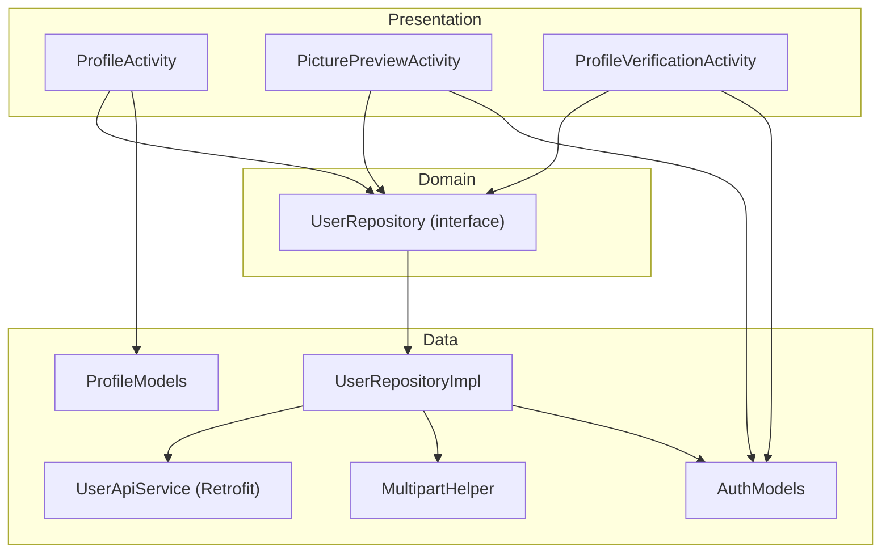
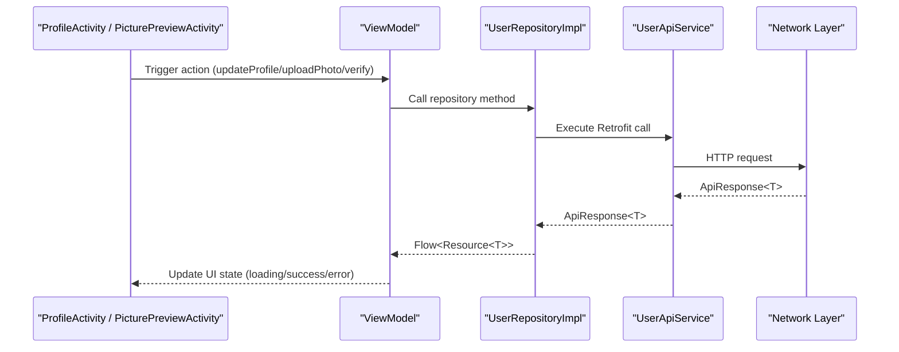
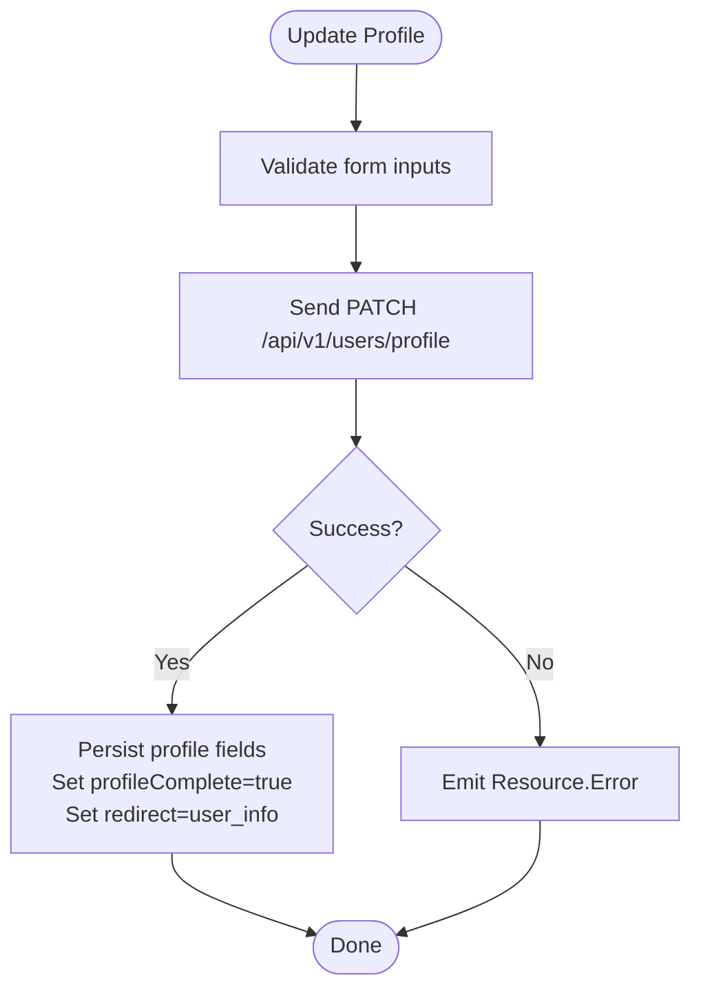
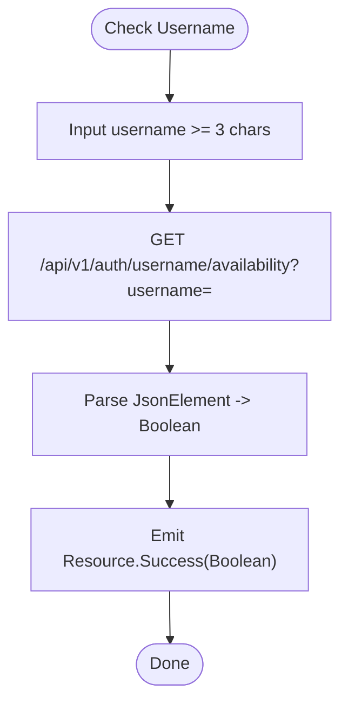
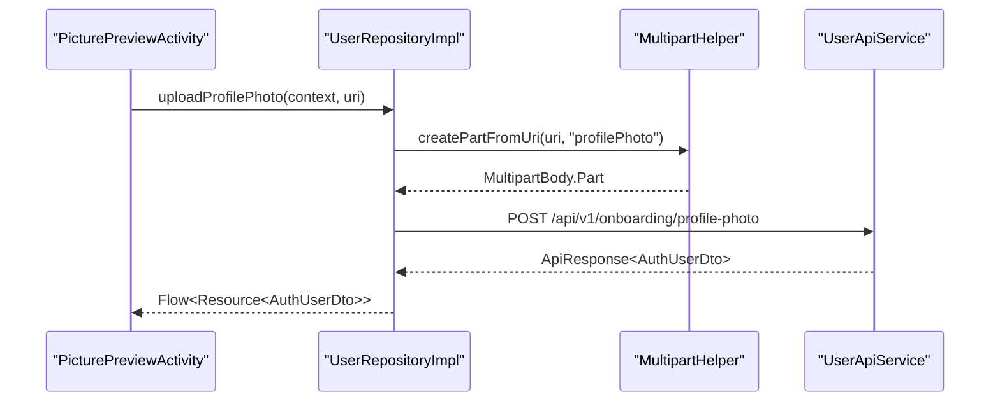
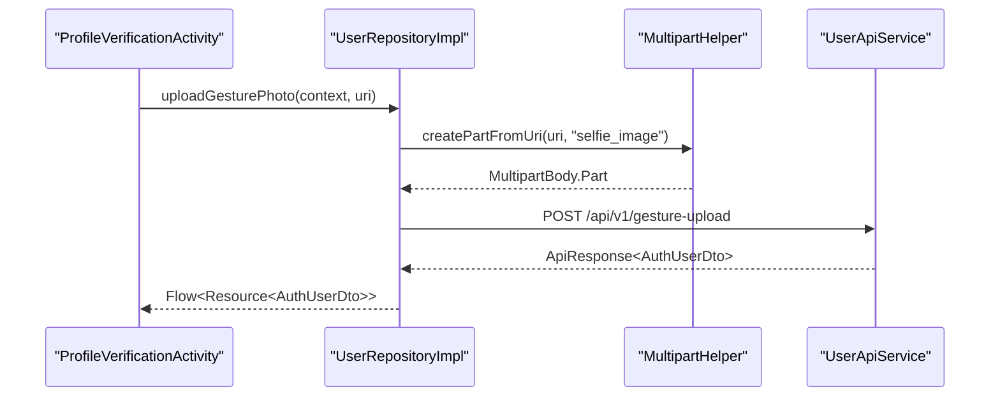
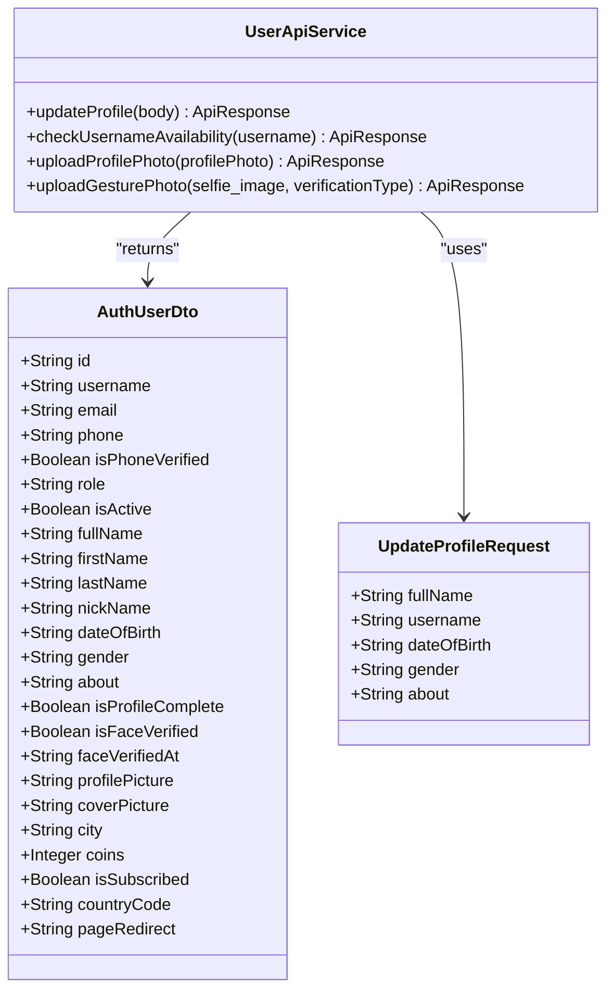
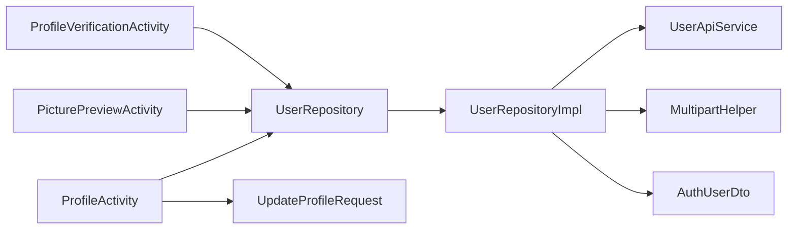

# User Profile APIs

<cite>
**Referenced Files in This Document**
- [UserApiService.kt](file://app/src/main/java/com/flirttime/feature/profile/data/network/UserApiService.kt)
- [ProfileModels.kt](file://app/src/main/java/com/flirttime/feature/profile/data/model/ProfileModels.kt)
- [AuthModels.kt](file://app/src/main/java/com/flirttime/feature/auth/data/model/AuthModels.kt)
- [UserRepository.kt](file://app/src/main/java/com/flirttime/feature/profile/domain/repository/UserRepository.kt)
- [UserRepositoryImpl.kt](file://app/src/main/java/com/flirttime/feature/profile/data/repository/UserRepositoryImpl.kt)
- [MultipartHelper.kt](file://app/src/main/java/com/flirttime/core/common/MultipartHelper.kt)
- [ProfileActivity.kt](file://app/src/main/java/com/flirttime/feature/profile/presentation/intro/ProfileActivity.kt)
- [PicturePreviewActivity.kt](file://app/src/main/java/com/flirttime/feature/profile/presentation/preview/PicturePreviewActivity.kt)
- [ProfileVerificationActivity.kt](file://app/src/main/java/com/flirttime/feature/profile/presentation/verification/ProfileVerificationActivity.kt)
</cite>

## Table of Contents
1. [Introduction](#introduction)
2. [Project Structure](#project-structure)
3. [Core Components](#core-components)
4. [Architecture Overview](#architecture-overview)
5. [Detailed Component Analysis](#detailed-component-analysis)
6. [Dependency Analysis](#dependency-analysis)
7. [Performance Considerations](#performance-considerations)
8. [Troubleshooting Guide](#troubleshooting-guide)
9. [Conclusion](#conclusion)

## Introduction
This document provides comprehensive API documentation for user profile management endpoints exposed by the Android application. It covers profile creation and updates, username availability checks, profile photo uploads, gesture-based verification uploads, and profile data retrieval patterns. The focus is on request/response schemas, image handling, verification status fields, and error handling strategies implemented in the app’s network layer and presentation flows.

## Project Structure
The profile feature follows a layered architecture:
- Presentation layer: Activities and ViewModels orchestrate user interactions and UI state.
- Domain layer: Repository interfaces define use-case contracts.
- Data layer: Retrofit service definitions, model classes, repository implementations, and multipart utilities.

**Diagram sources**
- [ProfileActivity.kt:215-230](file://app/src/main/java/com/flirttime/feature/profile/presentation/intro/ProfileActivity.kt#L215-L230)
- [PicturePreviewActivity.kt:150-160](file://app/src/main/java/com/flirttime/feature/profile/presentation/preview/PicturePreviewActivity.kt#L150-L160)
- [ProfileVerificationActivity.kt:177-189](file://app/src/main/java/com/flirttime/feature/profile/presentation/verification/ProfileVerificationActivity.kt#L177-L189)
- [UserRepository.kt:10-20](file://app/src/main/java/com/flirttime/feature/profile/domain/repository/UserRepository.kt#L10-L20)
- [UserRepositoryImpl.kt:25-46](file://app/src/main/java/com/flirttime/feature/profile/data/repository/UserRepositoryImpl.kt#L25-L46)
- [UserApiService.kt:17-41](file://app/src/main/java/com/flirttime/feature/profile/data/network/UserApiService.kt#L17-L41)
- [ProfileModels.kt:10-16](file://app/src/main/java/com/flirttime/feature/profile/data/model/ProfileModels.kt#L10-L16)
- [AuthModels.kt:39-64](file://app/src/main/java/com/flirttime/feature/auth/data/model/AuthModels.kt#L39-L64)
- [MultipartHelper.kt:23-26](file://app/src/main/java/com/flirttime/core/common/MultipartHelper.kt#L23-L26)

**Section sources**
- [ProfileActivity.kt:35-62](file://app/src/main/java/com/flirttime/feature/profile/presentation/intro/ProfileActivity.kt#L35-L62)
- [UserRepository.kt:10-20](file://app/src/main/java/com/flirttime/feature/profile/domain/repository/UserRepository.kt#L10-L20)
- [UserApiService.kt:17-41](file://app/src/main/java/com/flirttime/feature/profile/data/network/UserApiService.kt#L17-L41)

## Core Components
- UserApiService: Retrofit interface defining REST endpoints for profile update, username availability check, profile photo upload, and gesture verification upload.
- UpdateProfileRequest: Request body schema for updating profile information.
- AuthUserDto: Response model representing user profile data including verification flags and media URLs.
- UserRepository and UserRepositoryImpl: Domain contract and implementation coordinating API calls, local session updates, and Flow-based resource states.
- MultipartHelper: Utility to convert Uri/File into multipart parts for image uploads.

Key responsibilities:
- Build and send requests with correct payloads and multipart parts.
- Handle success/error states via Resource wrappers.
- Persist relevant profile metadata and redirect hints locally after successful operations.

**Section sources**
- [UserApiService.kt:17-41](file://app/src/main/java/com/flirttime/feature/profile/data/network/UserApiService.kt#L17-L41)
- [ProfileModels.kt:10-16](file://app/src/main/java/com/flirttime/feature/profile/data/model/ProfileModels.kt#L10-L16)
- [AuthModels.kt:39-64](file://app/src/main/java/com/flirttime/feature/auth/data/model/AuthModels.kt#L39-L64)
- [UserRepository.kt:10-20](file://app/src/main/java/com/flirttime/feature/profile/domain/repository/UserRepository.kt#L10-L20)
- [UserRepositoryImpl.kt:25-125](file://app/src/main/java/com/flirttime/feature/profile/data/repository/UserRepositoryImpl.kt#L25-L125)
- [MultipartHelper.kt:17-59](file://app/src/main/java/com/flirttime/core/common/MultipartHelper.kt#L17-L59)

## Architecture Overview
The profile workflow spans multiple layers:
- Presentation triggers actions (update profile, upload photo, verify).
- Domain exposes Flow<Resource<T>> for reactive state.
- Data layer performs network calls and persists results.

**Diagram sources**
- [ProfileActivity.kt:215-230](file://app/src/main/java/com/flirttime/feature/profile/presentation/intro/ProfileActivity.kt#L215-L230)
- [PicturePreviewActivity.kt:150-160](file://app/src/main/java/com/flirttime/feature/profile/presentation/preview/PicturePreviewActivity.kt#L150-L160)
- [UserRepositoryImpl.kt:25-46](file://app/src/main/java/com/flirttime/feature/profile/data/repository/UserRepositoryImpl.kt#L25-L46)
- [UserApiService.kt:17-41](file://app/src/main/java/com/flirttime/feature/profile/data/network/UserApiService.kt#L17-L41)

## Detailed Component Analysis

### Profile Update Endpoint
- Method: PATCH
- Path: api/v1/users/profile
- Request Body: UpdateProfileRequest
  - fullName: string (required)
  - username: string (required)
  - dateOfBirth: string (format yyyy-MM-dd)
  - gender: string (values: male | female | other)
  - about: string
- Response: ApiResponse<AuthUserDto>
  - AuthUserDto includes profile fields such as fullName, username, dateOfBirth, gender, about, isProfileComplete, isFaceVerified, faceVerifiedAt, profilePicture, coverPicture, city, coins, isSubscribed, countryCode, pageRedirect.

Processing behavior:
- On success, the repository extracts name parts and persists firstName, lastName, nickName, dob, gender, bio to SessionManager.
- Sets profile complete flag and redirects hint to "user_info".

**Diagram sources**
- [ProfileModels.kt:10-16](file://app/src/main/java/com/flirttime/feature/profile/data/model/ProfileModels.kt#L10-L16)
- [UserApiService.kt:19-22](file://app/src/main/java/com/flirttime/feature/profile/data/network/UserApiService.kt#L19-L22)
- [UserRepositoryImpl.kt:25-46](file://app/src/main/java/com/flirttime/feature/profile/data/repository/UserRepositoryImpl.kt#L25-L46)

**Section sources**
- [ProfileModels.kt:10-16](file://app/src/main/java/com/flirttime/feature/profile/data/model/ProfileModels.kt#L10-L16)
- [UserApiService.kt:19-22](file://app/src/main/java/com/flirttime/feature/profile/data/network/UserApiService.kt#L19-L22)
- [UserRepositoryImpl.kt:25-46](file://app/src/main/java/com/flirttime/feature/profile/data/repository/UserRepositoryImpl.kt#L25-L46)
- [AuthModels.kt:39-64](file://app/src/main/java/com/flirttime/feature/auth/data/model/AuthModels.kt#L39-L64)

### Username Availability Check
- Method: GET
- Path: api/v1/auth/username/availability
- Query Parameter: username (string)
- Response: ApiResponse<JsonElement>
  - Flexible parsing supports boolean or object with keys like available/isAvailable/is_available or taken/exists/isTaken (inverse semantics).

Behavior:
- Emits Resource.Loading while checking.
- Parses response into boolean availability.
- Emits Resource.Success(available) or Resource.Error(message).

**Diagram sources**
- [UserApiService.kt:24-27](file://app/src/main/java/com/flirttime/feature/profile/data/network/UserApiService.kt#L24-L27)
- [UserRepositoryImpl.kt:48-78](file://app/src/main/java/com/flirttime/feature/profile/data/repository/UserRepositoryImpl.kt#L48-L78)

**Section sources**
- [UserApiService.kt:24-27](file://app/src/main/java/com/flirttime/feature/profile/data/network/UserApiService.kt#L24-L27)
- [UserRepositoryImpl.kt:48-78](file://app/src/main/java/com/flirttime/feature/profile/data/repository/UserRepositoryImpl.kt#L48-L78)

### Profile Photo Upload
- Method: POST
- Path: api/v1/onboarding/profile-photo
- Content-Type: multipart/form-data
- Part: profilePhoto (image file)
- Response: ApiResponse<AuthUserDto>

Behavior:
- Converts Uri to multipart part using MultipartHelper.
- On success, stores profile picture URL and sets redirect hint to "avatar".

**Diagram sources**
- [PicturePreviewActivity.kt:150-160](file://app/src/main/java/com/flirttime/feature/profile/presentation/preview/PicturePreviewActivity.kt#L150-L160)
- [UserRepositoryImpl.kt:90-107](file://app/src/main/java/com/flirttime/feature/profile/data/repository/UserRepositoryImpl.kt#L90-L107)
- [MultipartHelper.kt:23-26](file://app/src/main/java/com/flirttime/core/common/MultipartHelper.kt#L23-L26)
- [UserApiService.kt:29-33](file://app/src/main/java/com/flirttime/feature/profile/data/network/UserApiService.kt#L29-L33)

**Section sources**
- [UserApiService.kt:29-33](file://app/src/main/java/com/flirttime/feature/profile/data/network/UserApiService.kt#L29-L33)
- [UserRepositoryImpl.kt:90-107](file://app/src/main/java/com/flirttime/feature/profile/data/repository/UserRepositoryImpl.kt#L90-L107)
- [MultipartHelper.kt:23-59](file://app/src/main/java/com/flirttime/core/common/MultipartHelper.kt#L23-L59)

### Gesture Verification Upload
- Method: POST
- Path: api/v1/gesture-upload
- Content-Type: multipart/form-data
- Parts:
  - selfie_image (image file)
  - verification_type (text/plain; value used in implementation is "gesture")
- Response: ApiResponse<AuthUserDto>

Behavior:
- Creates selfie_image part from Uri.
- Adds text part with verification type.
- On success, marks user verified and sets redirect hint to "gesture".

**Diagram sources**
- [ProfileVerificationActivity.kt:177-189](file://app/src/main/java/com/flirttime/feature/profile/presentation/verification/ProfileVerificationActivity.kt#L177-L189)
- [UserRepositoryImpl.kt:109-125](file://app/src/main/java/com/flirttime/feature/profile/data/repository/UserRepositoryImpl.kt#L109-L125)
- [UserApiService.kt:35-40](file://app/src/main/java/com/flirttime/feature/profile/data/network/UserApiService.kt#L35-L40)

**Section sources**
- [UserApiService.kt:35-40](file://app/src/main/java/com/flirttime/feature/profile/data/network/UserApiService.kt#L35-L40)
- [UserRepositoryImpl.kt:109-125](file://app/src/main/java/com/flirttime/feature/profile/data/repository/UserRepositoryImpl.kt#L109-L125)

### Profile Data Retrieval Patterns
While there is no dedicated GET endpoint defined in the profile module, profile data retrieval is represented through:
- AuthUserDto returned by update and upload endpoints.
- Local persistence via SessionManager after successful operations.
- UI components observe Flow<Resource<T>> to reflect current state.

**Diagram sources**
- [AuthModels.kt:39-64](file://app/src/main/java/com/flirttime/feature/auth/data/model/AuthModels.kt#L39-L64)
- [ProfileModels.kt:10-16](file://app/src/main/java/com/flirttime/feature/profile/data/model/ProfileModels.kt#L10-L16)
- [UserApiService.kt:17-41](file://app/src/main/java/com/flirttime/feature/profile/data/network/UserApiService.kt#L17-L41)

**Section sources**
- [AuthModels.kt:39-64](file://app/src/main/java/com/flirttime/feature/auth/data/model/AuthModels.kt#L39-L64)
- [UserApiService.kt:17-41](file://app/src/main/java/com/flirttime/feature/profile/data/network/UserApiService.kt#L17-L41)

## Dependency Analysis
- Presentation depends on domain repository interfaces for decoupling.
- Repository implementation depends on:
  - UserApiService for network calls.
  - MultipartHelper for image processing.
  - SessionManager for local persistence (not shown here but referenced in repository).
- Models are shared across layers:
  - UpdateProfileRequest for request bodies.
  - AuthUserDto for responses.

**Diagram sources**
- [ProfileActivity.kt:215-230](file://app/src/main/java/com/flirttime/feature/profile/presentation/intro/ProfileActivity.kt#L215-L230)
- [PicturePreviewActivity.kt:150-160](file://app/src/main/java/com/flirttime/feature/profile/presentation/preview/PicturePreviewActivity.kt#L150-L160)
- [ProfileVerificationActivity.kt:177-189](file://app/src/main/java/com/flirttime/feature/profile/presentation/verification/ProfileVerificationActivity.kt#L177-L189)
- [UserRepository.kt:10-20](file://app/src/main/java/com/flirttime/feature/profile/domain/repository/UserRepository.kt#L10-L20)
- [UserRepositoryImpl.kt:25-125](file://app/src/main/java/com/flirttime/feature/profile/data/repository/UserRepositoryImpl.kt#L25-L125)
- [UserApiService.kt:17-41](file://app/src/main/java/com/flirttime/feature/profile/data/network/UserApiService.kt#L17-L41)
- [ProfileModels.kt:10-16](file://app/src/main/java/com/flirttime/feature/profile/data/model/ProfileModels.kt#L10-L16)
- [AuthModels.kt:39-64](file://app/src/main/java/com/flirttime/feature/auth/data/model/AuthModels.kt#L39-L64)

**Section sources**
- [UserRepositoryImpl.kt:25-125](file://app/src/main/java/com/flirttime/feature/profile/data/repository/UserRepositoryImpl.kt#L25-L125)
- [UserApiService.kt:17-41](file://app/src/main/java/com/flirttime/feature/profile/data/network/UserApiService.kt#L17-L41)

## Performance Considerations
- Network calls are executed on IO dispatcher within repository methods to avoid blocking UI threads.
- Multipart conversion writes temporary files to cache directory; ensure adequate storage space and consider cleanup strategies for large images.
- Avoid redundant API calls by debouncing username checks at the presentation layer (already handled by canceling pending checks when input changes).

[No sources needed since this section provides general guidance]

## Troubleshooting Guide
Common issues and handling:
- Validation failures:
  - Username length < 3 characters prevents API call and shows an error message.
  - Empty required fields disable the continue button until all inputs are valid.
- Network issues:
  - Errors from safeApiCall propagate as Resource.Error with messages displayed to users.
- Permission denials:
  - Camera permission denied shows a dialog guiding users to settings to allow camera access.
- Image processing errors:
  - If MultipartHelper cannot process the Uri, it returns null and emits Resource.Error with a descriptive message.

Operational tips:
- Ensure device has sufficient storage for temporary image files.
- Verify that FileProvider is configured correctly for camera capture URIs.
- Use toast messages to inform users of success/failure outcomes during uploads.

**Section sources**
- [ProfileActivity.kt:173-191](file://app/src/main/java/com/flirttime/feature/profile/presentation/intro/ProfileActivity.kt#L173-L191)
- [ProfileActivity.kt:264-286](file://app/src/main/java/com/flirttime/feature/profile/presentation/intro/ProfileActivity.kt#L264-L286)
- [PicturePreviewActivity.kt:164-194](file://app/src/main/java/com/flirttime/feature/profile/presentation/preview/PicturePreviewActivity.kt#L164-L194)
- [ProfileVerificationActivity.kt:146-162](file://app/src/main/java/com/flirttime/feature/profile/presentation/verification/ProfileVerificationActivity.kt#L146-L162)
- [UserRepositoryImpl.kt:90-107](file://app/src/main/java/com/flirttime/feature/profile/data/repository/UserRepositoryImpl.kt#L90-L107)
- [UserRepositoryImpl.kt:109-125](file://app/src/main/java/com/flirttime/feature/profile/data/repository/UserRepositoryImpl.kt#L109-L125)

## Conclusion
The user profile management APIs in this application provide robust mechanisms for updating profile information, verifying usernames, uploading profile photos, and performing gesture-based verification. The layered architecture ensures clear separation of concerns, reactive state handling, and resilient error management. Following the documented request/response schemas and workflows will help maintain consistency and reliability across profile-related features.

[No sources needed since this section summarizes without analyzing specific files]