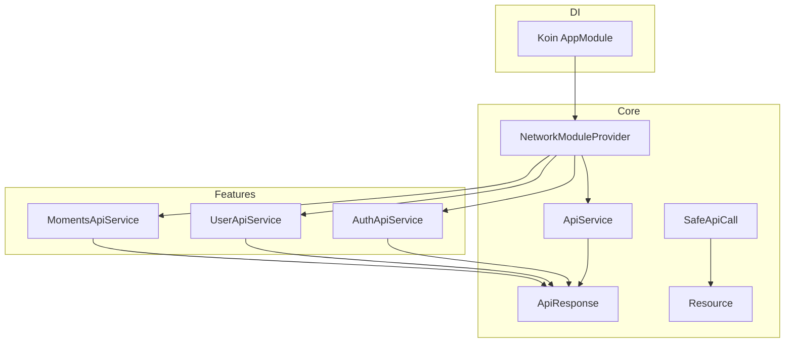
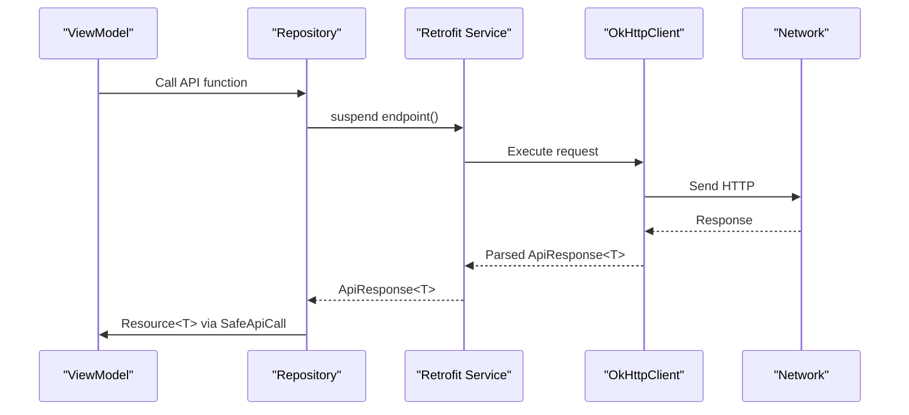
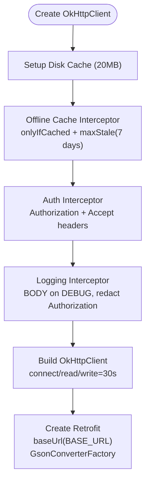
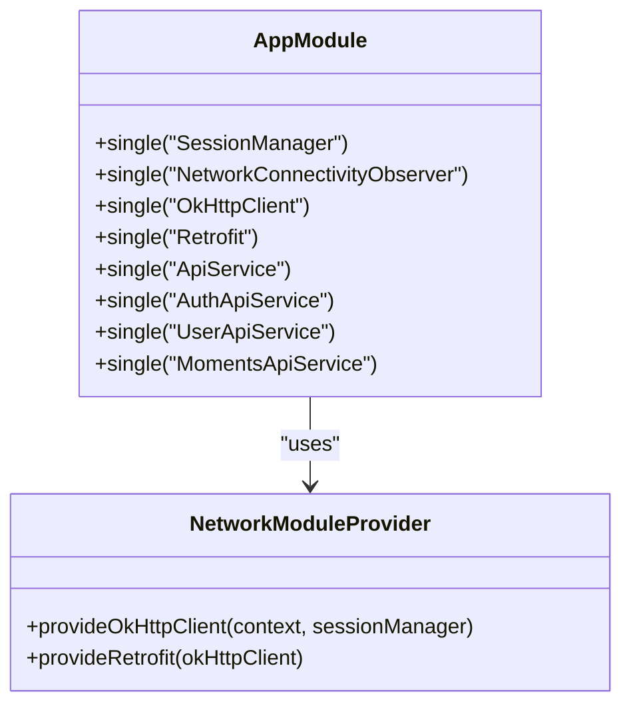
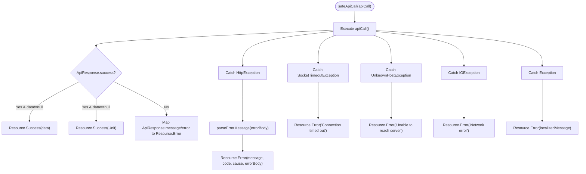
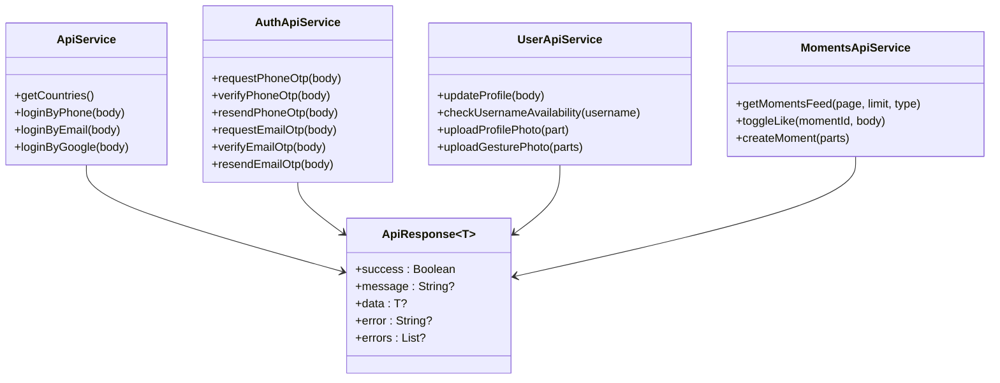
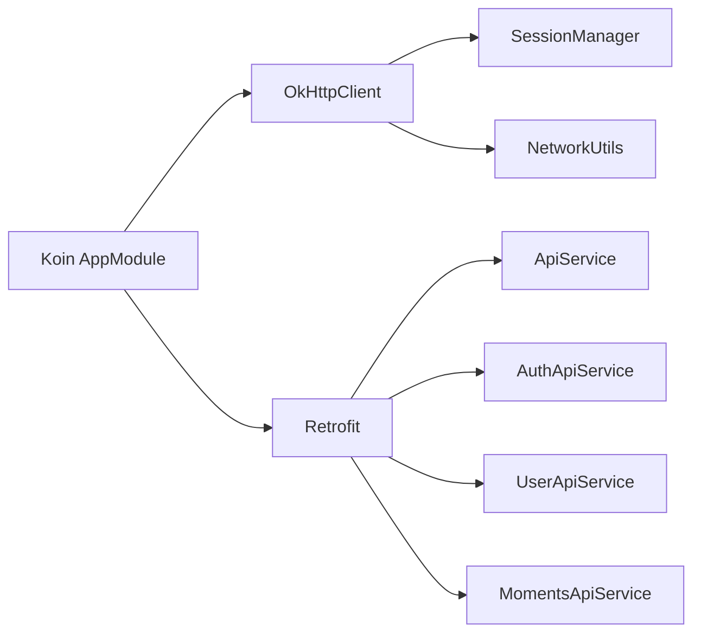

# Network Configuration

<cite>
**Referenced Files in This Document**
- [NetworkModuleProvider.kt](file://app/src/main/java/com/flirttime/core/network/NetworkModuleProvider.kt)
- [SafeApiCall.kt](file://app/src/main/java/com/flirttime/core/network/SafeApiCall.kt)
- [ApiService.kt](file://app/src/main/java/com/flirttime/core/network/ApiService.kt)
- [AppModule.kt](file://app/src/main/java/com/flirttime/di/AppModule.kt)
- [Resource.kt](file://app/src/main/java/com/flirttime/Resource.kt)
- [ApiResponse.kt](file://app/src/main/java/com/flirttime/core/network/model/ApiResponse.kt)
- [AuthApiService.kt](file://app/src/main/java/com/flirttime/feature/auth/data/network/AuthApiService.kt)
- [UserApiService.kt](file://app/src/main/java/com/flirttime/feature/profile/data/network/UserApiService.kt)
- [MomentsApiService.kt](file://app/src/main/java/com/flirttime/feature/moments/data/network/MomentsApiService.kt)
</cite>

## Table of Contents
1. [Introduction](#introduction)
2. [Project Structure](#project-structure)
3. [Core Components](#core-components)
4. [Architecture Overview](#architecture-overview)
5. [Detailed Component Analysis](#detailed-component-analysis)
6. [Dependency Analysis](#dependency-analysis)
7. [Performance Considerations](#performance-considerations)
8. [Troubleshooting Guide](#troubleshooting-guide)
9. [Conclusion](#conclusion)

## Introduction
This document explains the network configuration and setup in Flirttime-Otp-Android. It covers Retrofit and OkHttp configuration (base URL, interceptors chain, timeouts), dependency injection with Koin, and the SafeApiCall wrapper for centralized error handling, response transformation, and loading state management. It also provides examples for configuring network modules, adding custom interceptors, and extending the network layer for new features.

## Project Structure
The networking stack is organized under core.network and feature-specific API services:
- Core network module: OkHttpClient and Retrofit creation, interceptors, base URL, Gson converter
- DI wiring: Koin modules that provide OkHttpClient, Retrofit, and API service instances
- API interfaces: Feature-scoped Retrofit endpoints returning a common ApiResponse envelope
- Error/state wrappers: Resource sealed class and SafeApiCall suspend functions

**Diagram sources**
- [NetworkModuleProvider.kt:17-85](file://app/src/main/java/com/flirttime/core/network/NetworkModuleProvider.kt#L17-L85)
- [AppModule.kt:27-40](file://app/src/main/java/com/flirttime/di/AppModule.kt#L27-L40)
- [ApiService.kt:9-22](file://app/src/main/java/com/flirttime/core/network/ApiService.kt#L9-L22)
- [AuthApiService.kt:13-46](file://app/src/main/java/com/flirttime/feature/auth/data/network/AuthApiService.kt#L13-L46)
- [UserApiService.kt:17-41](file://app/src/main/java/com/flirttime/feature/profile/data/network/UserApiService.kt#L17-L41)
- [MomentsApiService.kt:16-40](file://app/src/main/java/com/flirttime/feature/moments/data/network/MomentsApiService.kt#L16-L40)
- [ApiResponse.kt:5-11](file://app/src/main/java/com/flirttime/core/network/model/ApiResponse.kt#L5-L11)
- [Resource.kt:3-19](file://app/src/main/java/com/flirttime/Resource.kt#L3-L19)

**Section sources**
- [NetworkModuleProvider.kt:17-85](file://app/src/main/java/com/flirttime/core/network/NetworkModuleProvider.kt#L17-L85)
- [AppModule.kt:27-40](file://app/src/main/java/com/flirttime/di/AppModule.kt#L27-L40)

## Core Components
- NetworkModuleProvider: Creates OkHttpClient with cache, interceptors, timeouts; creates Retrofit with base URL and Gson converter.
- ApiService and feature API services: Define Retrofit endpoints returning ApiResponse envelopes.
- ApiResponse: Common JSON envelope with success flag, message, data, and error fields.
- Resource: Sealed class representing Success, Error, and Loading states used by SafeApiCall.
- SafeApiCall: Suspend wrapper that executes API calls, transforms ApiResponse into Resource, and centralizes error parsing and handling.

**Section sources**
- [NetworkModuleProvider.kt:17-85](file://app/src/main/java/com/flirttime/core/network/NetworkModuleProvider.kt#L17-L85)
- [ApiService.kt:9-22](file://app/src/main/java/com/flirttime/core/network/ApiService.kt#L9-L22)
- [ApiResponse.kt:5-11](file://app/src/main/java/com/flirttime/core/network/model/ApiResponse.kt#L5-L11)
- [Resource.kt:3-19](file://app/src/main/java/com/flirttime/Resource.kt#L3-L19)
- [SafeApiCall.kt:14-65](file://app/src/main/java/com/flirttime/core/network/SafeApiCall.kt#L14-L65)

## Architecture Overview
The application uses a layered architecture:
- Presentation/ViewModels call repository or use SafeApiCall directly to execute API calls.
- API services are Retrofit-generated interfaces bound via Koin.
- OkHttp handles HTTP transport, caching, logging, and authentication.
- Retrofit maps JSON to Kotlin models using Gson.
- SafeApiCall normalizes responses and errors into Resource states.

**Diagram sources**
- [AppModule.kt:34-40](file://app/src/main/java/com/flirttime/di/AppModule.kt#L34-L40)
- [NetworkModuleProvider.kt:67-84](file://app/src/main/java/com/flirttime/core/network/NetworkModuleProvider.kt#L67-L84)
- [SafeApiCall.kt:14-65](file://app/src/main/java/com/flirttime/core/network/SafeApiCall.kt#L14-L65)

## Detailed Component Analysis

### Retrofit and OkHttp Configuration
Key aspects:
- Base URL: Configured from BuildConfig.BASE_URL.
- Interceptors chain order:
  1) Offline cache interceptor: Forces cached-only requests when offline with max stale 7 days.
  2) Auth interceptor: Adds Authorization header if token exists and ensures Accept: application/json.
  3) Logging interceptor: Logs request/response bodies in debug builds; redacts Authorization header.
- Timeouts: Connect, read, and write timeouts set to 30 seconds.
- Caching: 20 MB disk cache under app cache directory.
- Serialization: GsonConverterFactory for JSON mapping.

**Diagram sources**
- [NetworkModuleProvider.kt:22-84](file://app/src/main/java/com/flirttime/core/network/NetworkModuleProvider.kt#L22-L84)

**Section sources**
- [NetworkModuleProvider.kt:17-85](file://app/src/main/java/com/flirttime/core/network/NetworkModuleProvider.kt#L17-L85)

### Dependency Injection with Koin
Koin wires network components:
- Provides OkHttpClient and Retrofit singletons.
- Creates Retrofit-generated API services for core and feature modules.
- Injects SessionManager and Context where needed.

**Diagram sources**
- [AppModule.kt:27-40](file://app/src/main/java/com/flirttime/di/AppModule.kt#L27-L40)
- [NetworkModuleProvider.kt:22-84](file://app/src/main/java/com/flirttime/core/network/NetworkModuleProvider.kt#L22-L84)

**Section sources**
- [AppModule.kt:27-40](file://app/src/main/java/com/flirttime/di/AppModule.kt#L27-L40)

### SafeApiCall Wrapper
Purpose:
- Centralized error handling across all network calls.
- Transforms ApiResponse<T> into Resource<T>.
- Parses server error messages from HttpException bodies.
- Supports both typed responses and raw responses.

Behavior summary:
- On success with data: Resource.Success(data).
- On success without data: Resource.Success(Unit cast to T).
- On failure: Resource.Error with parsed message, optional code, cause, and errorBody.
- Network exceptions: SocketTimeoutException, UnknownHostException, IOException mapped to user-friendly messages.
- Fallback: Generic exception handling with localized message.

**Diagram sources**
- [SafeApiCall.kt:14-65](file://app/src/main/java/com/flirttime/core/network/SafeApiCall.kt#L14-L65)
- [SafeApiCall.kt:109-143](file://app/src/main/java/com/flirttime/core/network/SafeApiCall.kt#L109-L143)

**Section sources**
- [SafeApiCall.kt:14-65](file://app/src/main/java/com/flirttime/core/network/SafeApiCall.kt#L14-L65)
- [SafeApiCall.kt:67-107](file://app/src/main/java/com/flirttime/core/network/SafeApiCall.kt#L67-L107)
- [SafeApiCall.kt:109-143](file://app/src/main/java/com/flirttime/core/network/SafeApiCall.kt#L109-L143)
- [Resource.kt:3-19](file://app/src/main/java/com/flirttime/Resource.kt#L3-L19)
- [ApiResponse.kt:5-11](file://app/src/main/java/com/flirttime/core/network/model/ApiResponse.kt#L5-L11)

### API Services and Envelope Usage
All API services return ApiResponse<T>, enabling uniform handling:
- Core: ApiService defines basic endpoints.
- Auth: AuthApiService defines OTP flows for phone/email.
- Profile: UserApiService defines profile updates, username checks, and file uploads.
- Moments: MomentsApiService defines feed retrieval, like toggling, and media upload.

**Diagram sources**
- [ApiService.kt:9-22](file://app/src/main/java/com/flirttime/core/network/ApiService.kt#L9-L22)
- [AuthApiService.kt:13-46](file://app/src/main/java/com/flirttime/feature/auth/data/network/AuthApiService.kt#L13-L46)
- [UserApiService.kt:17-41](file://app/src/main/java/com/flirttime/feature/profile/data/network/UserApiService.kt#L17-L41)
- [MomentsApiService.kt:16-40](file://app/src/main/java/com/flirttime/feature/moments/data/network/MomentsApiService.kt#L16-L40)
- [ApiResponse.kt:5-11](file://app/src/main/java/com/flirttime/core/network/model/ApiResponse.kt#L5-L11)

**Section sources**
- [ApiService.kt:9-22](file://app/src/main/java/com/flirttime/core/network/ApiService.kt#L9-L22)
- [AuthApiService.kt:13-46](file://app/src/main/java/com/flirttime/feature/auth/data/network/AuthApiService.kt#L13-L46)
- [UserApiService.kt:17-41](file://app/src/main/java/com/flirttime/feature/profile/data/network/UserApiService.kt#L17-L41)
- [MomentsApiService.kt:16-40](file://app/src/main/java/com/flirttime/feature/moments/data/network/MomentsApiService.kt#L16-L40)

## Dependency Analysis
- Koin provides a single OkHttpClient and Retrofit instance shared across all API services.
- Each feature’s API service is created from the same Retrofit instance, ensuring consistent base URL, client, and converters.
- SessionManager is injected into OkHttpClient to attach Authorization headers.
- NetworkUtils is used by the offline cache interceptor to decide whether to force cached responses.

**Diagram sources**
- [AppModule.kt:27-40](file://app/src/main/java/com/flirttime/di/AppModule.kt#L27-L40)
- [NetworkModuleProvider.kt:22-84](file://app/src/main/java/com/flirttime/core/network/NetworkModuleProvider.kt#L22-L84)

**Section sources**
- [AppModule.kt:27-40](file://app/src/main/java/com/flirttime/di/AppModule.kt#L27-L40)
- [NetworkModuleProvider.kt:22-84](file://app/src/main/java/com/flirttime/core/network/NetworkModuleProvider.kt#L22-L84)

## Performance Considerations
- Caching: 20 MB disk cache improves performance and supports offline reads.
- Timeouts: 30-second connect/read/write timeouts balance responsiveness and reliability.
- Logging: Body-level logging enabled only in debug builds to avoid overhead in production.
- Interceptor order: Offline cache first ensures minimal network usage when offline.

[No sources needed since this section provides general guidance]

## Troubleshooting Guide
Common issues and resolutions:
- Authentication failures: Ensure SessionManager holds a valid token; verify Authorization header is added by auth interceptor.
- Offline behavior: When offline, only cached responses up to 7 days old are served; clear stale cache if necessary.
- Timeouts: If frequent timeouts occur, consider increasing timeout values or optimizing payload sizes.
- Error messages: SafeApiCall parses server error bodies; check server response format for message/errors fields.

**Section sources**
- [NetworkModuleProvider.kt:35-50](file://app/src/main/java/com/flirttime/core/network/NetworkModuleProvider.kt#L35-L50)
- [NetworkModuleProvider.kt:52-65](file://app/src/main/java/com/flirttime/core/network/NetworkModuleProvider.kt#L52-L65)
- [SafeApiCall.kt:33-63](file://app/src/main/java/com/flirttime/core/network/SafeApiCall.kt#L33-L63)
- [SafeApiCall.kt:109-143](file://app/src/main/java/com/flirttime/core/network/SafeApiCall.kt#L109-L143)

## Conclusion
Flirttime-Otp-Android’s network layer is built around a well-configured OkHttpClient and Retrofit instance, wired through Koin. The interceptors handle offline caching, authentication, and logging. All API endpoints return a standardized ApiResponse envelope, which SafeApiCall converts into a Resource state for consistent UI handling. This design simplifies adding new features and maintaining robust error handling across the app.

[No sources needed since this section summarizes without analyzing specific files]