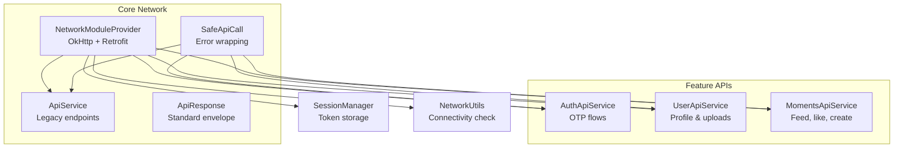
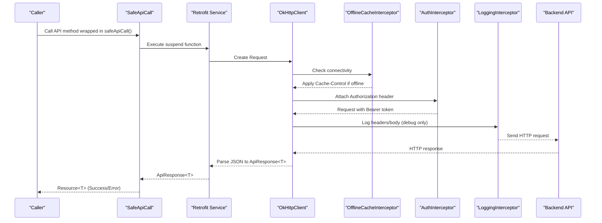
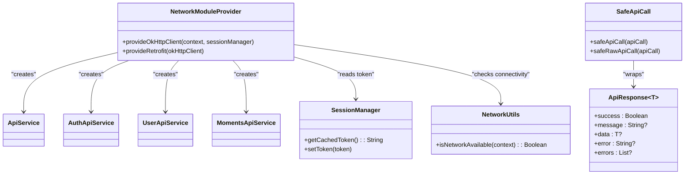
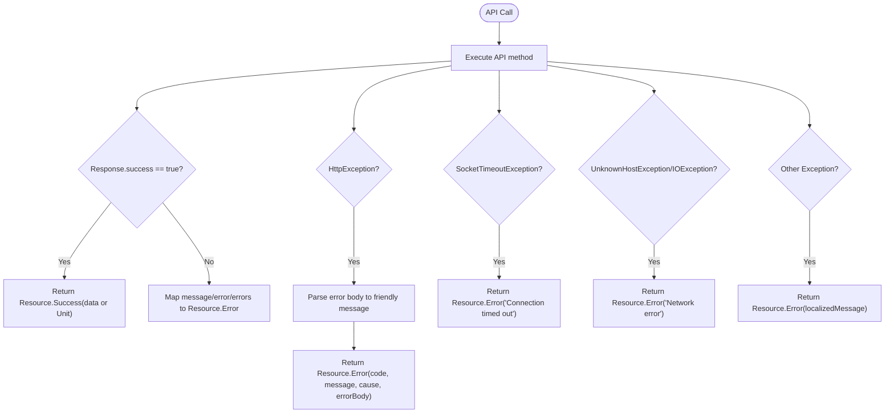

# Network Layer

<cite>
**Referenced Files in This Document**
- [ApiService.kt](file://app/src/main/java/com/flirttime/core/network/ApiService.kt)
- [NetworkModuleProvider.kt](file://app/src/main/java/com/flirttime/core/network/NetworkModuleProvider.kt)
- [SafeApiCall.kt](file://app/src/main/java/com/flirttime/core/network/SafeApiCall.kt)
- [ApiResponse.kt](file://app/src/main/java/com/flirttime/core/network/model/ApiResponse.kt)
- [AuthApiService.kt](file://app/src/main/java/com/flirttime/feature/auth/data/network/AuthApiService.kt)
- [UserApiService.kt](file://app/src/main/java/com/flirttime/feature/profile/data/network/UserApiService.kt)
- [MomentsApiService.kt](file://app/src/main/java/com/flirttime/feature/moments/data/network/MomentsApiService.kt)
- [SessionManager.kt](file://app/src/main/java/com/flirttime/core/database/SessionManager.kt)
- [NetworkUtils.kt](file://app/src/main/java/com/flirttime/core/common/NetworkUtils.kt)
</cite>

## Table of Contents
1. [Introduction](#introduction)
2. [Project Structure](#project-structure)
3. [Core Components](#core-components)
4. [Architecture Overview](#architecture-overview)
5. [Detailed Component Analysis](#detailed-component-analysis)
6. [Dependency Analysis](#dependency-analysis)
7. [Performance Considerations](#performance-considerations)
8. [Troubleshooting Guide](#troubleshooting-guide)
9. [Conclusion](#conclusion)

## Introduction
This document provides comprehensive API documentation for the network layer in Flirttime-Otp-Android. It covers:
- RESTful endpoints for authentication, user profiles, moments/posts, and notes on chat and matches
- HTTP methods, URL patterns, request/response schemas, and authentication requirements
- Error handling strategies, retry mechanisms, offline support, interceptor chain, rate limiting considerations, caching strategies, and performance optimizations
- Practical examples of making API calls, handling responses, and managing errors

## Project Structure
The network layer is organized into core infrastructure and feature-specific API services:
- Core infrastructure: Retrofit client setup, OkHttp interceptors, base response wrapper, and safe call wrappers
- Feature APIs: Authentication, User Profile, Moments; Chat and Matches are currently UI-only with mock data

**Diagram sources**
- [NetworkModuleProvider.kt:17-85](file://app/src/main/java/com/flirttime/core/network/NetworkModuleProvider.kt#L17-L85)
- [ApiService.kt:9-22](file://app/src/main/java/com/flirttime/core/network/ApiService.kt#L9-L22)
- [SafeApiCall.kt:14-107](file://app/src/main/java/com/flirttime/core/network/SafeApiCall.kt#L14-L107)
- [ApiResponse.kt:5-11](file://app/src/main/java/com/flirttime/core/network/model/ApiResponse.kt#L5-L11)
- [AuthApiService.kt:13-46](file://app/src/main/java/com/flirttime/feature/auth/data/network/AuthApiService.kt#L13-L46)
- [UserApiService.kt:17-41](file://app/src/main/java/com/flirttime/feature/profile/data/network/UserApiService.kt#L17-L41)
- [MomentsApiService.kt:16-40](file://app/src/main/java/com/flirttime/feature/moments/data/network/MomentsApiService.kt#L16-L40)
- [SessionManager.kt:22-40](file://app/src/main/java/com/flirttime/core/database/SessionManager.kt#L22-L40)
- [NetworkUtils.kt:7-15](file://app/src/main/java/com/flirttime/core/common/NetworkUtils.kt#L7-L15)

**Section sources**
- [NetworkModuleProvider.kt:17-85](file://app/src/main/java/com/flirttime/core/network/NetworkModuleProvider.kt#L17-L85)
- [ApiService.kt:9-22](file://app/src/main/java/com/flirttime/core/network/ApiService.kt#L9-L22)
- [AuthApiService.kt:13-46](file://app/src/main/java/com/flirttime/feature/auth/data/network/AuthApiService.kt#L13-L46)
- [UserApiService.kt:17-41](file://app/src/main/java/com/flirttime/feature/profile/data/network/UserApiService.kt#L17-L41)
- [MomentsApiService.kt:16-40](file://app/src/main/java/com/flirttime/feature/moments/data/network/MomentsApiService.kt#L16-L40)

## Core Components
- NetworkModuleProvider: Builds OkHttpClient with cache, timeouts, and interceptors; builds Retrofit instance with Gson converter and base URL from BuildConfig.
- SafeApiCall: Wraps suspend API calls to return a unified Resource type, parsing error bodies and mapping exceptions to user-friendly messages.
- ApiResponse: Standardized JSON envelope with success flag, message, data payload, and error fields.
- SessionManager: Stores JWT token and other session state using DataStore; exposes a non-blocking cached token for interceptors.
- NetworkUtils: Checks device connectivity to enable offline caching behavior.

Key responsibilities:
- Interceptor chain order: Offline cache -> Auth -> Logging
- Token injection via Authorization header (Bearer)
- Consistent error handling across all API calls

**Section sources**
- [NetworkModuleProvider.kt:22-84](file://app/src/main/java/com/flirttime/core/network/NetworkModuleProvider.kt#L22-L84)
- [SafeApiCall.kt:14-107](file://app/src/main/java/com/flirttime/core/network/SafeApiCall.kt#L14-L107)
- [ApiResponse.kt:5-11](file://app/src/main/java/com/flirttime/core/network/model/ApiResponse.kt#L5-L11)
- [SessionManager.kt:22-40](file://app/src/main/java/com/flirttime/core/database/SessionManager.kt#L22-L40)
- [NetworkUtils.kt:7-15](file://app/src/main/java/com/flirttime/core/common/NetworkUtils.kt#L7-L15)

## Architecture Overview
The network architecture uses Retrofit over OkHttp with a standardized response envelope and safe wrappers.

**Diagram sources**
- [NetworkModuleProvider.kt:22-84](file://app/src/main/java/com/flirttime/core/network/NetworkModuleProvider.kt#L22-L84)
- [SafeApiCall.kt:14-65](file://app/src/main/java/com/flirttime/core/network/SafeApiCall.kt#L14-L65)

## Detailed Component Analysis

### Authentication Endpoints
Base path: api/v1/auth

| Method | Endpoint | Description | Request Schema | Response Schema | Auth Required |
|--------|----------|-------------|----------------|-----------------|---------------|
| POST | /api/v1/auth/phone/request-otp | Request OTP via phone | OtpRequest | ApiResponse<OtpResponseData> | No |
| POST | /api/v1/auth/phone/verify-otp | Verify OTP via phone | VerifyOtpRequest | ApiResponse<VerifyOtpResponseData> | No |
| POST | /api/v1/auth/phone/resend-otp | Resend OTP via phone | ResendOtpRequest | ApiResponse<OtpResponseData> | No |
| POST | /api/v1/auth/email/request-otp | Request OTP via email | EmailOtpRequest | ApiResponse<OtpResponseData> | No |
| POST | /api/v1/auth/email/verify-otp | Verify OTP via email | VerifyOtpRequest | ApiResponse<VerifyOtpResponseData> | No |
| POST | /api/v1/auth/email/resend-otp | Resend OTP via email | ResendOtpRequest | ApiResponse<OtpResponseData> | No |

Notes:
- All endpoints return ApiResponse<T>.
- Successful login flows typically set a JWT token stored by SessionManager; subsequent requests will include Authorization: Bearer <token>.

Example usage pattern:
- Wrap the call in safeApiCall to receive Resource<T>.
- On success, handle data or Unit payloads.
- On error, display message from Resource.Error.message.

**Section sources**
- [AuthApiService.kt:13-46](file://app/src/main/java/com/flirttime/feature/auth/data/network/AuthApiService.kt#L13-L46)
- [SafeApiCall.kt:14-65](file://app/src/main/java/com/flirttime/core/network/SafeApiCall.kt#L14-L65)

### User Profile Endpoints
Base path: api/v1

| Method | Endpoint | Description | Request Schema | Response Schema | Auth Required |
|--------|----------|-------------|----------------|-----------------|---------------|
| PATCH | /api/v1/users/profile | Update profile details | UpdateProfileRequest | ApiResponse<AuthUserDto> | Yes |
| GET | /api/v1/auth/username/availability | Check username availability | Query: username | ApiResponse<JsonElement> | No |
| POST | /api/v1/onboarding/profile-photo | Upload profile photo | Multipart: profilePhoto | ApiResponse<AuthUserDto> | Yes |
| POST | /api/v1/gesture-upload | Upload gesture verification image | Multipart: selfie_image, verification_type | ApiResponse<AuthUserDto> | Yes |

Notes:
- Multipart endpoints require proper Part definitions.
- Username availability returns a generic JsonElement; callers should parse according to server contract.

Example usage pattern:
- For file uploads, construct MultipartBody.Part and pass to the service method.
- Use safeRawApiCall when you need raw types not wrapped in ApiResponse.

**Section sources**
- [UserApiService.kt:17-41](file://app/src/main/java/com/flirttime/feature/profile/data/network/UserApiService.kt#L17-L41)
- [SafeApiCall.kt:67-107](file://app/src/main/java/com/flirttime/core/network/SafeApiCall.kt#L67-L107)

### Moments/Posts Endpoints
Base path: api/v1

| Method | Endpoint | Description | Request Schema | Response Schema | Auth Required |
|--------|----------|-------------|----------------|-----------------|---------------|
| GET | /api/v1/moments | Fetch moments feed | Query: page, limit, type | ApiResponse<MomentsFeedResponseData> | Yes |
| POST | /api/v1/moments/{momentId}/like | Toggle like on a moment | Path: momentId; Body: ToggleLikeRequest? | ApiResponse<Any> | Yes |
| POST | /api/v1/moments | Create a new moment | Multipart: caption, audience, location, locationLabel, images | ApiResponse<Any> | Yes |

Notes:
- Pagination parameters default to page=1, limit=20, type="feed".
- Like toggle accepts an optional body; ensure null is handled by the caller.

Example usage pattern:
- For creating moments, build a list of MultipartBody.Part for images and attach text parts for metadata.

**Section sources**
- [MomentsApiService.kt:16-40](file://app/src/main/java/com/flirttime/feature/moments/data/network/MomentsApiService.kt#L16-L40)

### Chat Functionality
Current implementation:
- The chat feature is UI-only with mock data providers. There is no backend API integration yet.

Implications:
- No network endpoints to document at this time.
- When integrating real chat, follow the same patterns: define Retrofit interface, use SafeApiCall wrappers, and store tokens via SessionManager.

**Section sources**
- [MockChatProvider.kt:1-79](file://app/src/main/java/com/flirttime/feature/main/presentation/chat/MockChatProvider.kt#L1-L79)

### Matches Functionality
Current implementation:
- The matches screen uses mock data providers. There is no backend API integration yet.

Implications:
- No network endpoints to document at this time.
- Future integration should mirror the patterns used in Auth, User, and Moments services.

**Section sources**
- [MockMatchProfileProvider.kt:1-34](file://app/src/main/java/com/flirttime/feature/main/presentation/matches/MockMatchProfileProvider.kt#L1-L34)

### Legacy/Core Endpoints
Base path: root (no version prefix)

| Method | Endpoint | Description | Request Schema | Response Schema | Auth Required |
|--------|----------|-------------|----------------|-----------------|---------------|
| GET | /get-countries | Get country list | None | CountryDataResponse | No |
| POST | /login-with-phone | Login with phone | Map<String,String> | LoginByPhoneResponse | No |
| POST | /login-with-email | Login with email | Map<String,String> | LoginByPhoneResponse | No |
| POST | /login-with-google | Login with Google | Map<String,String> | LoginByPhoneResponse | No |

Notes:
- These endpoints do not use ApiResponse envelope and are separate from the v1 API surface.
- They may be legacy or alternative auth flows.

**Section sources**
- [ApiService.kt:9-22](file://app/src/main/java/com/flirttime/core/network/ApiService.kt#L9-L22)

## Dependency Analysis
Interactions between components:

**Diagram sources**
- [NetworkModuleProvider.kt:17-85](file://app/src/main/java/com/flirttime/core/network/NetworkModuleProvider.kt#L17-L85)
- [ApiService.kt:9-22](file://app/src/main/java/com/flirttime/core/network/ApiService.kt#L9-L22)
- [AuthApiService.kt:13-46](file://app/src/main/java/com/flirttime/feature/auth/data/network/AuthApiService.kt#L13-L46)
- [UserApiService.kt:17-41](file://app/src/main/java/com/flirttime/feature/profile/data/network/UserApiService.kt#L17-L41)
- [MomentsApiService.kt:16-40](file://app/src/main/java/com/flirttime/feature/moments/data/network/MomentsApiService.kt#L16-L40)
- [SafeApiCall.kt:14-107](file://app/src/main/java/com/flirttime/core/network/SafeApiCall.kt#L14-L107)
- [ApiResponse.kt:5-11](file://app/src/main/java/com/flirttime/core/network/model/ApiResponse.kt#L5-L11)
- [SessionManager.kt:22-40](file://app/src/main/java/com/flirttime/core/database/SessionManager.kt#L22-L40)
- [NetworkUtils.kt:7-15](file://app/src/main/java/com/flirttime/core/common/NetworkUtils.kt#L7-L15)

**Section sources**
- [NetworkModuleProvider.kt:17-85](file://app/src/main/java/com/flirttime/core/network/NetworkModuleProvider.kt#L17-L85)
- [SafeApiCall.kt:14-107](file://app/src/main/java/com/flirttime/core/network/SafeApiCall.kt#L14-L107)
- [ApiResponse.kt:5-11](file://app/src/main/java/com/flirttime/core/network/model/ApiResponse.kt#L5-L11)
- [SessionManager.kt:22-40](file://app/src/main/java/com/flirttime/core/database/SessionManager.kt#L22-L40)
- [NetworkUtils.kt:7-15](file://app/src/main/java/com/flirttime/core/common/NetworkUtils.kt#L7-L15)

## Performance Considerations
- Caching strategy:
  - OkHttp disk cache enabled with a 20 MB limit.
  - Offline mode forces max-stale up to 7 days when no internet is available.
- Timeouts:
  - Connect, read, and write timeouts set to 30 seconds.
- Interceptors:
  - Logging disabled in release builds; sensitive Authorization header redacted.
- Rate limiting:
  - No explicit client-side rate limiter is implemented. If the server enforces rate limits, consider adding a RetryWithBackoff interceptor or a semaphore-based limiter around critical endpoints.
- Concurrency:
  - Retrofit calls are suspend functions; SafeApiCall runs on Dispatchers.IO by default.
- Memory:
  - Avoid large multipart payloads; compress images before upload where possible.

Recommendations:
- Add exponential backoff and jitter for retries on transient errors (e.g., 5xx).
- Introduce a circuit breaker for unstable endpoints.
- Use pagination consistently to avoid large payloads.

[No sources needed since this section provides general guidance]

## Troubleshooting Guide
Common issues and resolutions:
- Unauthorized (401):
  - Ensure SessionManager has a valid token; verify Authorization header is present.
  - Re-authenticate if token expired; clear session and restart flow.
- Network errors:
  - UnknownHostException or IOException: Check device connectivity and DNS.
  - SocketTimeoutException: Increase timeout or optimize payload size.
- Parsing errors:
  - ApiResponse envelope mismatch: Validate server response structure.
  - Generic JsonElement: Inspect server contract and parse accordingly.

Error handling flow:

**Diagram sources**
- [SafeApiCall.kt:14-107](file://app/src/main/java/com/flirttime/core/network/SafeApiCall.kt#L14-L107)

Practical tips:
- Always wrap API calls with safeApiCall or safeRawApiCall to normalize results.
- Display user-friendly messages from Resource.Error.message.
- For file uploads, validate file sizes and formats before constructing MultipartBody.Part.

**Section sources**
- [SafeApiCall.kt:14-107](file://app/src/main/java/com/flirttime/core/network/SafeApiCall.kt#L14-L107)

## Conclusion
The network layer in Flirttime-Otp-Android provides a robust foundation with:
- Clear separation of concerns via feature-specific API services
- Centralized configuration through NetworkModuleProvider
- Consistent error handling and response normalization via SafeApiCall and ApiResponse
- Offline support through OkHttp caching and connectivity checks

For features like chat and matches that currently rely on mock data, integrate real endpoints following the established patterns: define Retrofit interfaces, use SafeApiCall wrappers, and manage tokens via SessionManager.

[No sources needed since this section summarizes without analyzing specific files]