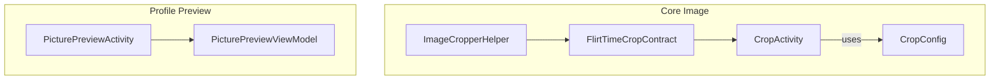
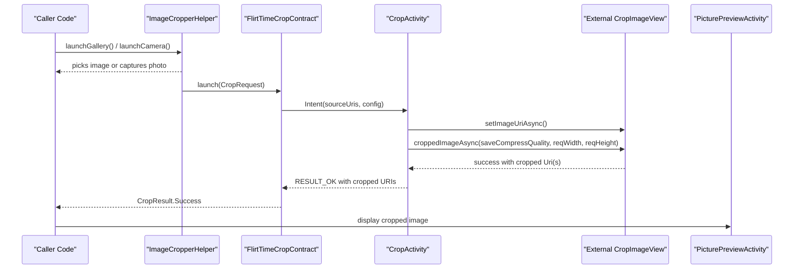
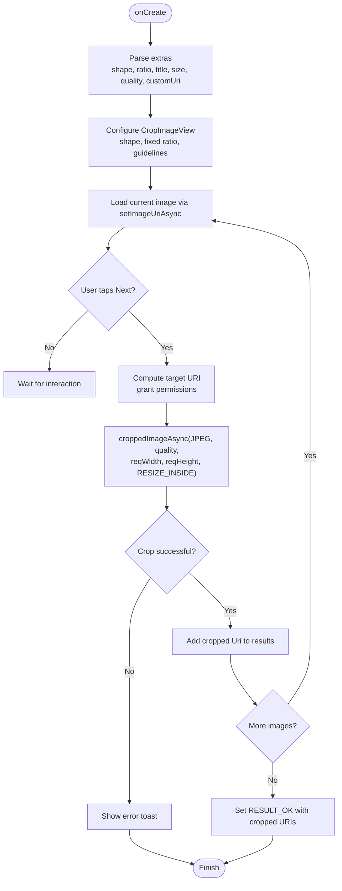
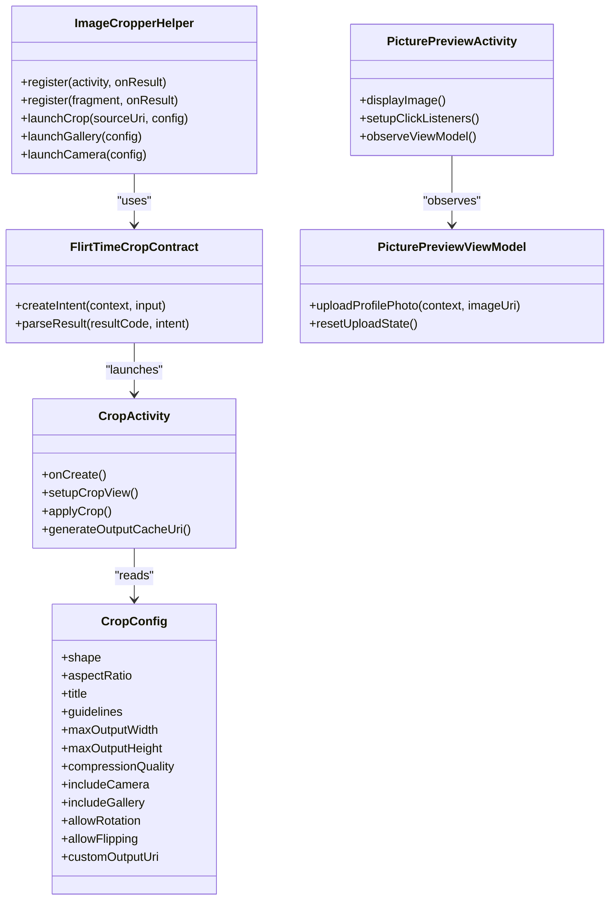

# Photo Upload and Processing

<cite>
**Referenced Files in This Document**
- [CropActivity.kt](file://app/src/main/java/com/flirttime/core/image/CropActivity.kt)
- [CropConfig.kt](file://app/src/main/java/com/flirttime/core/image/CropConfig.kt)
- [FlirtTimeCropContract.kt](file://app/src/main/java/com/flirttime/core/image/FlirtTimeCropContract.kt)
- [ImageCropperHelper.kt](file://app/src/main/java/com/flirttime/core/image/ImageCropperHelper.kt)
- [activity_crop.xml](file://app/src/main/res/layout/activity_crop.xml)
- [PicturePreviewActivity.kt](file://app/src/main/java/com/flirttime/feature/profile/presentation/preview/PicturePreviewActivity.kt)
- [PicturePreviewViewModel.kt](file://app/src/main/java/com/flirttime/feature/profile/presentation/preview/PicturePreviewViewModel.kt)
- [activity_picture_preview.xml](file://app/src/main/res/layout/activity_picture_preview.xml)
</cite>

## Table of Contents
1. [Introduction](#introduction)
2. [Project Structure](#project-structure)
3. [Core Components](#core-components)
4. [Architecture Overview](#architecture-overview)
5. [Detailed Component Analysis](#detailed-component-analysis)
6. [Dependency Analysis](#dependency-analysis)
7. [Performance Considerations](#performance-considerations)
8. [Troubleshooting Guide](#troubleshooting-guide)
9. [Conclusion](#conclusion)

## Introduction
This document explains the photo upload and processing system, focusing on image cropping, preview, configuration, external library integration, performance, file formats, quality settings, and storage management. The implementation provides:
- A dedicated cropping UI with customizable shapes, aspect ratios, and compression.
- A helper that orchestrates gallery/camera selection and routes images into the cropper.
- A contract-based result model for safe consumption by callers.
- A picture preview screen to confirm the selected image before uploading.

## Project Structure
The relevant code is organized under core image utilities and a profile preview feature:
- Core image module: Cropping activity, configuration, ActivityResultContract, and lifecycle-safe helper.
- Profile preview feature: Preview activity and ViewModel used after cropping to confirm and upload.

**Diagram sources**
- [CropActivity.kt:1-293](file://app/src/main/java/com/flirttime/core/image/CropActivity.kt#L1-L293)
- [CropConfig.kt:1-117](file://app/src/main/java/com/flirttime/core/image/CropConfig.kt#L1-L117)
- [FlirtTimeCropContract.kt:1-55](file://app/src/main/java/com/flirttime/core/image/FlirtTimeCropContract.kt#L1-L55)
- [ImageCropperHelper.kt:1-173](file://app/src/main/java/com/flirttime/core/image/ImageCropperHelper.kt#L1-L173)
- [PicturePreviewActivity.kt:1-197](file://app/src/main/java/com/flirttime/feature/profile/presentation/preview/PicturePreviewActivity.kt#L1-L197)
- [PicturePreviewViewModel.kt:1-34](file://app/src/main/java/com/flirttime/feature/profile/presentation/preview/PicturePreviewViewModel.kt#L1-L34)

**Section sources**
- [CropActivity.kt:1-293](file://app/src/main/java/com/flirttime/core/image/CropActivity.kt#L1-L293)
- [CropConfig.kt:1-117](file://app/src/main/java/com/flirttime/core/image/CropConfig.kt#L1-L117)
- [FlirtTimeCropContract.kt:1-55](file://app/src/main/java/com/flirttime/core/image/FlirtTimeCropContract.kt#L1-L55)
- [ImageCropperHelper.kt:1-173](file://app/src/main/java/com/flirttime/core/image/ImageCropperHelper.kt#L1-L173)
- [PicturePreviewActivity.kt:1-197](file://app/src/main/java/com/flirttime/feature/profile/presentation/preview/PicturePreviewActivity.kt#L1-L197)
- [PicturePreviewViewModel.kt:1-34](file://app/src/main/java/com/flirttime/feature/profile/presentation/preview/PicturePreviewViewModel.kt#L1-L34)

## Core Components
- CropActivity: Dedicated cropping UI using an external crop view. Supports single or multiple images, configurable shape, aspect ratio, output size, and compression.
- CropConfig: Configuration data class with presets for common use cases (profile avatar, moments post, verification photo). Defines supported shapes and aspect ratios.
- FlirtTimeCropContract: ActivityResultContract bridging caller code to CropActivity and parsing results into a typed CropResult.
- ImageCropperHelper: Lifecycle-safe helper registering launchers for gallery, camera, and crop; manages pending configuration and camera capture URIs.
- PicturePreviewActivity + ViewModel: Displays the cropped image, allows retake or continue, and triggers profile photo upload via repository.

Key responsibilities:
- Input handling: Single or multiple source URIs.
- Cropping: External library-backed cropping with grid, guidelines, zoom, and rotation/flipping toggles.
- Output: JPEG with configurable quality and max dimensions; optional custom output URI.
- Preview: Confirmation screen with navigation and upload flow.

**Section sources**
- [CropActivity.kt:30-87](file://app/src/main/java/com/flirttime/core/image/CropActivity.kt#L30-L87)
- [CropConfig.kt:28-88](file://app/src/main/java/com/flirttime/core/image/CropConfig.kt#L28-L88)
- [FlirtTimeCropContract.kt:13-53](file://app/src/main/java/com/flirttime/core/image/FlirtTimeCropContract.kt#L13-L53)
- [ImageCropperHelper.kt:21-77](file://app/src/main/java/com/flirttime/core/image/ImageCropperHelper.kt#L21-L77)
- [PicturePreviewActivity.kt:32-51](file://app/src/main/java/com/flirttime/feature/profile/presentation/preview/PicturePreviewActivity.kt#L32-L51)
- [PicturePreviewViewModel.kt:15-33](file://app/src/main/java/com/flirttime/feature/profile/presentation/preview/PicturePreviewViewModel.kt#L15-L33)

## Architecture Overview
The system composes a clean separation between UI, orchestration, and configuration:
- Callers use ImageCropperHelper to pick from gallery or camera, then route to CropActivity via FlirtTimeCropContract.
- CropActivity renders the crop UI, applies configured constraints, and writes the cropped image to a cache or custom URI.
- After cropping, the caller may show PicturePreviewActivity to confirm the image and optionally upload it.

**Diagram sources**
- [ImageCropperHelper.kt:130-171](file://app/src/main/java/com/flirttime/core/image/ImageCropperHelper.kt#L130-L171)
- [FlirtTimeCropContract.kt:15-53](file://app/src/main/java/com/flirttime/core/image/FlirtTimeCropContract.kt#L15-L53)
- [CropActivity.kt:157-193](file://app/src/main/java/com/flirttime/core/image/CropActivity.kt#L157-L193)
- [CropActivity.kt:238-273](file://app/src/main/java/com/flirttime/core/image/CropActivity.kt#L238-L273)
- [PicturePreviewActivity.kt:85-98](file://app/src/main/java/com/flirttime/feature/profile/presentation/preview/PicturePreviewActivity.kt#L85-L98)

## Detailed Component Analysis

### Cropping Configuration Model
CropConfig centralizes all user-facing options:
- Shape: Rectangle or Oval.
- Aspect Ratio: Freeform, Square, Portrait 4:5, Portrait 3:4, Landscape 16:9, or Custom X:Y.
- Output sizing: maxOutputWidth and maxOutputHeight.
- Compression: compressionQuality.
- Optional: title, guidelines toggle, includeCamera/includeGallery flags, allowRotation/allowFlipping, customOutputUri.

Presets:
- profileAvatar(circular): square with oval when circular is true.
- momentPost: rectangle with custom 4:3 ratio.
- verificationPhoto: portrait 3:4.
- freeform: unconstrained rectangle.

Complexity: O(1) creation and usage.

**Section sources**
- [CropConfig.kt:8-23](file://app/src/main/java/com/flirttime/core/image/CropConfig.kt#L8-L23)
- [CropConfig.kt:28-88](file://app/src/main/java/com/flirttime/core/image/CropConfig.kt#L28-L88)

### CropActivity Implementation
Responsibilities:
- Parse intent extras for shape, aspect ratio, title, max width/height, quality, and optional custom output URI.
- Configure CropImageView with fixed aspect ratio, guidelines, and shape.
- Handle sequential cropping for multiple images.
- On confirmation, compute target output URI (custom or generated cache), grant permissions, and invoke asynchronous crop with JPEG format, quality, and resize-inside strategy.

Key behaviors:
- Multi-image support: iterates through pending URIs and accumulates cropped results.
- Error handling: shows toast on crop failure and continues gracefully.
- Output generation: creates a timestamped JPG in app cache directory if no custom output URI is provided.

**Diagram sources**
- [CropActivity.kt:99-141](file://app/src/main/java/com/flirttime/core/image/CropActivity.kt#L99-L141)
- [CropActivity.kt:157-193](file://app/src/main/java/com/flirttime/core/image/CropActivity.kt#L157-L193)
- [CropActivity.kt:238-273](file://app/src/main/java/com/flirttime/core/image/CropActivity.kt#L238-L273)
- [CropActivity.kt:275-291](file://app/src/main/java/com/flirttime/core/image/CropActivity.kt#L275-L291)

**Section sources**
- [CropActivity.kt:30-87](file://app/src/main/java/com/flirttime/core/image/CropActivity.kt#L30-L87)
- [CropActivity.kt:157-193](file://app/src/main/java/com/flirttime/core/image/CropActivity.kt#L157-L193)
- [CropActivity.kt:238-291](file://app/src/main/java/com/flirttime/core/image/CropActivity.kt#L238-L291)

### Activity Result Contract
FlirtTimeCropContract converts CropRequest into an Intent for CropActivity and parses the result into CropResult:
- Validates non-empty source URIs.
- Returns Cancelled on cancellation or null intent.
- Extracts either a single cropped URI or a list of cropped URIs.

Complexity: O(n) where n is number of cropped URIs returned.

**Section sources**
- [FlirtTimeCropContract.kt:13-53](file://app/src/main/java/com/flirttime/core/image/FlirtTimeCropContract.kt#L13-L53)

### Image Cropper Helper
Provides unified APIs:
- register(activity/fragment): registers three launchers (crop, gallery, camera) and wires callbacks.
- launchCrop(sourceUri, config): directly opens cropper with a preselected image.
- launchGallery(config): uses system picker and routes to cropper.
- launchCamera(config): creates a temp file in cache, obtains a FileProvider URI, launches camera, then routes to cropper.

Lifecycle safety:
- Uses ActivityResultLauncher instances bound to component lifecycle.
- Stores pending configuration and camera URI safely until needed.

Error handling:
- Catches exceptions during camera URI creation and shows a toast.

**Section sources**
- [ImageCropperHelper.kt:21-77](file://app/src/main/java/com/flirttime/core/image/ImageCropperHelper.kt#L21-L77)
- [ImageCropperHelper.kt:130-171](file://app/src/main/java/com/flirttime/core/image/ImageCropperHelper.kt#L130-L171)

### Picture Preview System
Purpose:
- Display the cropped image for user confirmation.
- Allow retaking or continuing to upload.
- Integrate with navigation and upload state.

Behavior:
- Reads image URI from navigation extras and sets it into the preview ImageView.
- Retake navigates back; Continue triggers upload via ViewModel.
- Observes upload state and navigates to gesture verification on success or shows errors.

Layout:
- Includes a header, scrollable content area, and bottom action buttons.

**Section sources**
- [PicturePreviewActivity.kt:32-51](file://app/src/main/java/com/flirttime/feature/profile/presentation/preview/PicturePreviewActivity.kt#L32-L51)
- [PicturePreviewActivity.kt:85-98](file://app/src/main/java/com/flirttime/feature/profile/presentation/preview/PicturePreviewActivity.kt#L85-L98)
- [PicturePreviewActivity.kt:145-161](file://app/src/main/java/com/flirttime/feature/profile/presentation/preview/PicturePreviewActivity.kt#L145-L161)
- [PicturePreviewActivity.kt:164-195](file://app/src/main/java/com/flirttime/feature/profile/presentation/preview/PicturePreviewActivity.kt#L164-L195)
- [activity_picture_preview.xml:1-191](file://app/src/main/res/layout/activity_picture_preview.xml#L1-L191)

### External Library Integration
- CropActivity uses an external CropImageView for rendering and cropping.
- Cropping is performed asynchronously with JPEG format, configurable quality, and resizing strategy.
- The helper integrates with Android’s system picker and camera APIs.

Integration points:
- CropImageView properties: shape, guidelines, scale type, auto-zoom.
- Asynchronous crop API with custom output URI support.

**Section sources**
- [CropActivity.kt:157-193](file://app/src/main/java/com/flirttime/core/image/CropActivity.kt#L157-L193)
- [CropActivity.kt:238-273](file://app/src/main/java/com/flirttime/core/image/CropActivity.kt#L238-L273)
- [activity_crop.xml:57-79](file://app/src/main/res/layout/activity_crop.xml#L57-L79)

## Dependency Analysis

**Diagram sources**
- [CropConfig.kt:28-88](file://app/src/main/java/com/flirttime/core/image/CropConfig.kt#L28-L88)
- [FlirtTimeCropContract.kt:13-53](file://app/src/main/java/com/flirttime/core/image/FlirtTimeCropContract.kt#L13-L53)
- [ImageCropperHelper.kt:21-77](file://app/src/main/java/com/flirttime/core/image/ImageCropperHelper.kt#L21-L77)
- [CropActivity.kt:99-193](file://app/src/main/java/com/flirttime/core/image/CropActivity.kt#L99-L193)
- [PicturePreviewActivity.kt:32-51](file://app/src/main/java/com/flirttime/feature/profile/presentation/preview/PicturePreviewActivity.kt#L32-L51)
- [PicturePreviewViewModel.kt:15-33](file://app/src/main/java/com/flirttime/feature/profile/presentation/preview/PicturePreviewViewModel.kt#L15-L33)

**Section sources**
- [CropConfig.kt:28-88](file://app/src/main/java/com/flirttime/core/image/CropConfig.kt#L28-L88)
- [FlirtTimeCropContract.kt:13-53](file://app/src/main/java/com/flirttime/core/image/FlirtTimeCropContract.kt#L13-L53)
- [ImageCropperHelper.kt:21-77](file://app/src/main/java/com/flirttime/core/image/ImageCropperHelper.kt#L21-L77)
- [CropActivity.kt:99-193](file://app/src/main/java/com/flirttime/core/image/CropActivity.kt#L99-L193)
- [PicturePreviewActivity.kt:32-51](file://app/src/main/java/com/flirttime/feature/profile/presentation/preview/PicturePreviewActivity.kt#L32-L51)
- [PicturePreviewViewModel.kt:15-33](file://app/src/main/java/com/flirttime/feature/profile/presentation/preview/PicturePreviewViewModel.kt#L15-L33)

## Performance Considerations
- Asynchronous operations: Cropping is performed asynchronously to avoid blocking the UI thread.
- Resize strategy: Uses a resize-inside strategy to constrain output dimensions while preserving aspect ratio.
- Memory management:
  - Generated cropped files are stored in the app cache directory, which the OS can reclaim when space is low.
  - Camera captures are also written to cache to minimize persistent storage pressure.
- Quality vs. size: Compression quality is configurable; lower values reduce file size at the cost of visual fidelity.
- Sequential cropping: For multiple images, results are accumulated in memory; consider clearing intermediate references if many images are processed.

Recommendations:
- Tune maxOutputWidth/maxOutputHeight based on downstream display sizes to avoid unnecessary large bitmaps.
- Adjust compressionQuality according to network and storage constraints.
- Monitor memory usage when cropping very large images; consider downsampling before cropping if needed.

[No sources needed since this section provides general guidance]

## Troubleshooting Guide
Common issues and resolutions:
- No image provided: CropActivity validates input and cancels early if no source URIs are present. Ensure callers pass valid URIs.
- Crop failure: If cropping fails, a toast is shown. Check device storage permissions and available space.
- Camera launch failure: Exceptions during camera URI creation are caught and reported via toast. Verify FileProvider setup and storage permissions.
- Missing preview image: PicturePreviewActivity falls back to a default drawable if the provided URI cannot be loaded.

Operational checks:
- Confirm that CropConfig includes non-empty source URIs.
- Validate that customOutputUri is writable when provided.
- Ensure the app has appropriate permissions for camera and storage access.

**Section sources**
- [CropActivity.kt:130-135](file://app/src/main/java/com/flirttime/core/image/CropActivity.kt#L130-L135)
- [CropActivity.kt:181-193](file://app/src/main/java/com/flirttime/core/image/CropActivity.kt#L181-L193)
- [ImageCropperHelper.kt:151-171](file://app/src/main/java/com/flirttime/core/image/ImageCropperHelper.kt#L151-L171)
- [PicturePreviewActivity.kt:85-98](file://app/src/main/java/com/flirttime/feature/profile/presentation/preview/PicturePreviewActivity.kt#L85-L98)

## Conclusion
The photo upload and processing system offers a robust, configurable cropping pipeline backed by an external library, a lifecycle-safe helper for media selection, and a clear preview-and-upload flow. It supports multiple images, flexible aspect ratios, and adjustable compression, with outputs stored in cache for efficient memory and storage usage. By tuning configuration parameters and following the troubleshooting guidance, teams can optimize performance and reliability across diverse devices and image sizes.

[No sources needed since this section summarizes without analyzing specific files]