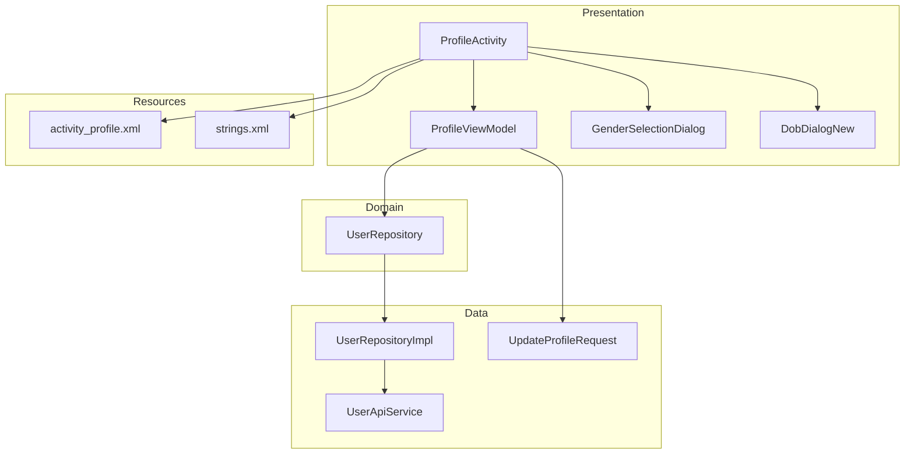
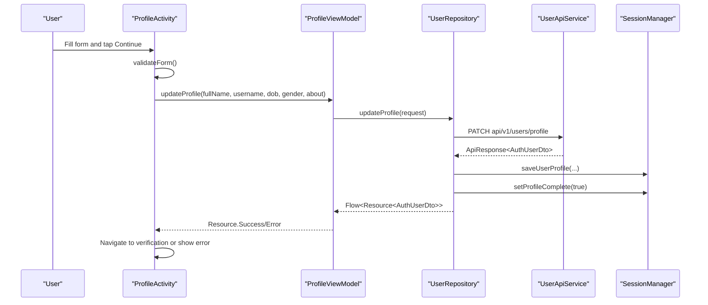
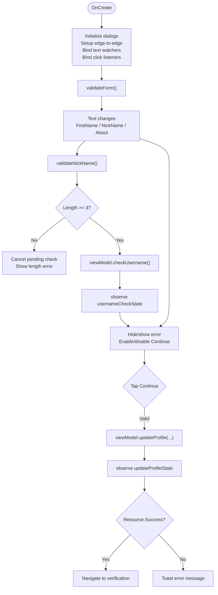
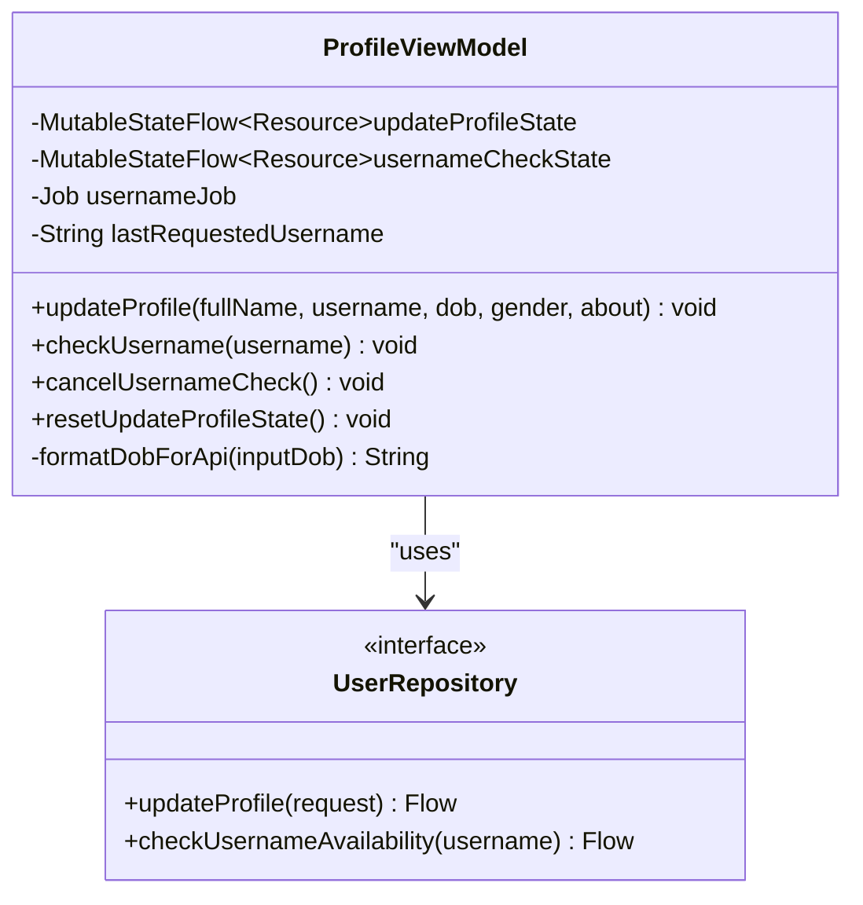
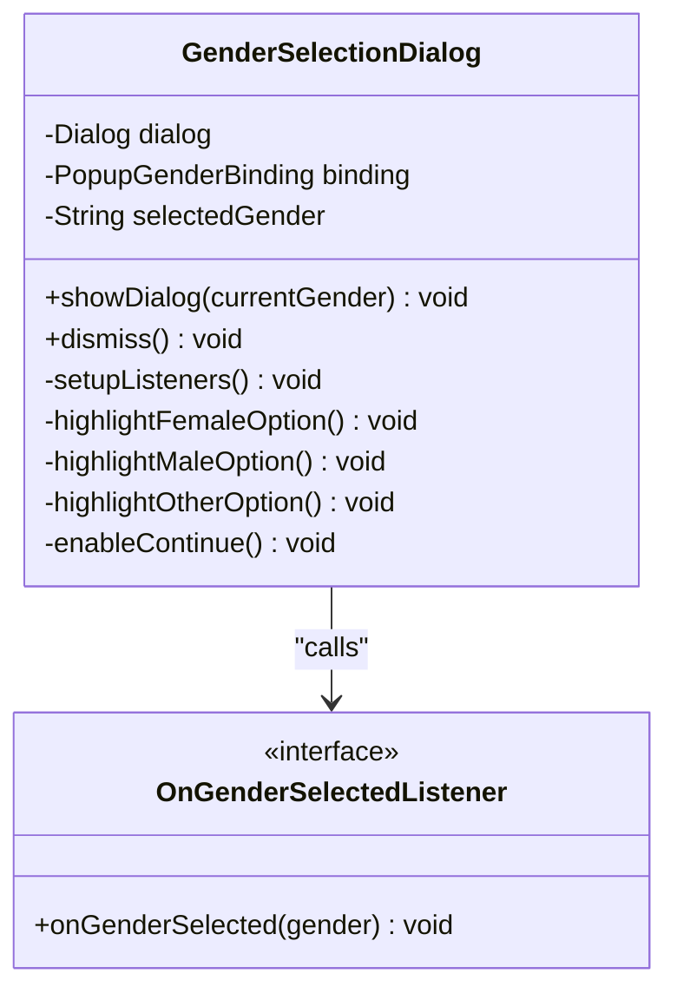
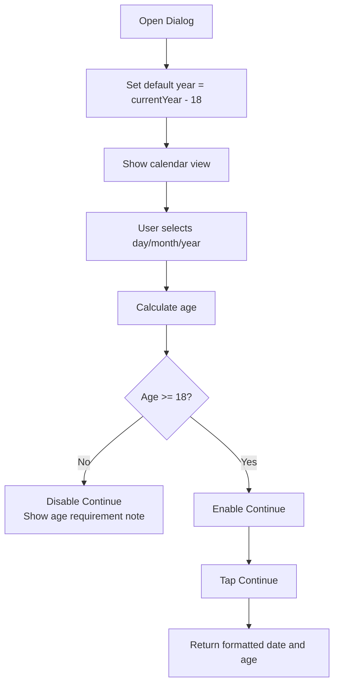
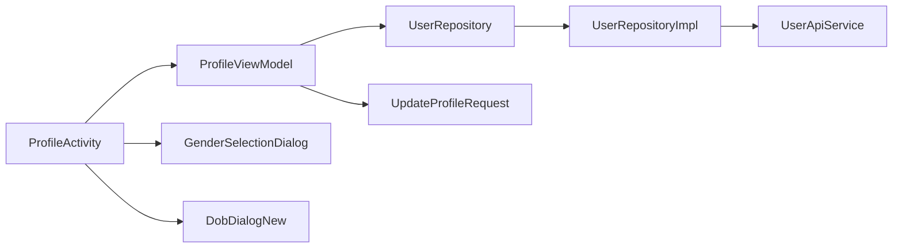

# Profile Creation Workflow

<cite>
**Referenced Files in This Document**
- [ProfileActivity.kt](file://app/src/main/java/com/flirttime/feature/profile/presentation/intro/ProfileActivity.kt)
- [ProfileViewModel.kt](file://app/src/main/java/com/flirttime/feature/profile/presentation/intro/ProfileViewModel.kt)
- [GenderSelectionDialog.kt](file://app/src/main/java/com/flirttime/feature/profile/presentation/dialog/GenderSelectionDialog.kt)
- [DobDialogNew.kt](file://app/src/main/java/com/flirttime/feature/profile/presentation/dialog/DobDialogNew.kt)
- [ProfileModels.kt](file://app/src/main/java/com/flirttime/feature/profile/data/model/ProfileModels.kt)
- [UserRepository.kt](file://app/src/main/java/com/flirttime/feature/profile/domain/repository/UserRepository.kt)
- [UserRepositoryImpl.kt](file://app/src/main/java/com/flirttime/feature/profile/data/repository/UserRepositoryImpl.kt)
- [UserApiService.kt](file://app/src/main/java/com/flirttime/feature/profile/data/network/UserApiService.kt)
- [activity_profile.xml](file://app/src/main/res/layout/activity_profile.xml)
- [strings.xml](file://app/src/main/res/values/strings.xml)
</cite>

## Table of Contents
1. [Introduction](#introduction)
2. [Project Structure](#project-structure)
3. [Core Components](#core-components)
4. [Architecture Overview](#architecture-overview)
5. [Detailed Component Analysis](#detailed-component-analysis)
6. [Dependency Analysis](#dependency-analysis)
7. [Performance Considerations](#performance-considerations)
8. [Troubleshooting Guide](#troubleshooting-guide)
9. [Conclusion](#conclusion)

## Introduction
This document explains the profile creation workflow in Flirttime-Otp-Android. It covers the multi-step onboarding screen where users provide personal information, select a date of birth, choose gender preferences, and write a short bio. It also documents the dialog-based UI components for date picker and gender selection, the ViewModel architecture for state management, validation rules, error handling, data persistence, and user experience considerations that make the onboarding flow smooth and progressive.

## Project Structure
The profile creation feature is implemented under the profile feature module with a clean separation between presentation, domain, and data layers:
- Presentation layer: Activity and ViewModel for the “Introduce Yourself” form, plus reusable dialogs for date-of-birth and gender selection.
- Domain layer: Repository interface defining profile update and username availability checks.
- Data layer: Repository implementation, Retrofit API service, and request model.
- Resources: Layouts and strings used by the form and dialogs.

**Diagram sources**
- [ProfileActivity.kt:39-62](file://app/src/main/java/com/flirttime/feature/profile/presentation/intro/ProfileActivity.kt#L39-L62)
- [ProfileViewModel.kt:18-54](file://app/src/main/java/com/flirttime/feature/profile/presentation/intro/ProfileViewModel.kt#L18-L54)
- [GenderSelectionDialog.kt:23-41](file://app/src/main/java/com/flirttime/feature/profile/presentation/dialog/GenderSelectionDialog.kt#L23-L41)
- [DobDialogNew.kt:19-46](file://app/src/main/java/com/flirttime/feature/profile/presentation/dialog/DobDialogNew.kt#L19-L46)
- [UserRepository.kt:10-16](file://app/src/main/java/com/flirttime/feature/profile/domain/repository/UserRepository.kt#L10-L16)
- [UserRepositoryImpl.kt:20-46](file://app/src/main/java/com/flirttime/feature/profile/data/repository/UserRepositoryImpl.kt#L20-L46)
- [UserApiService.kt:17-27](file://app/src/main/java/com/flirttime/feature/profile/data/network/UserApiService.kt#L17-L27)
- [ProfileModels.kt:10-16](file://app/src/main/java/com/flirttime/feature/profile/data/model/ProfileModels.kt#L10-L16)
- [activity_profile.xml:1-415](file://app/src/main/res/layout/activity_profile.xml#L1-L415)
- [strings.xml:52-66](file://app/src/main/res/values/strings.xml#L52-L66)

**Section sources**
- [ProfileActivity.kt:39-62](file://app/src/main/java/com/flirttime/feature/profile/presentation/intro/ProfileActivity.kt#L39-L62)
- [activity_profile.xml:1-415](file://app/src/main/res/layout/activity_profile.xml#L1-L415)
- [strings.xml:52-66](file://app/src/main/res/values/strings.xml#L52-L66)

## Core Components
- ProfileActivity: Hosts the “Introduce Yourself” form, wires input fields, handles keyboard and edge-to-edge layout, shows dialogs, validates inputs, and triggers profile submission.
- ProfileViewModel: Manages UI state for username availability and profile update, debounces availability checks, formats dates for the backend, and exposes StateFlow streams.
- GenderSelectionDialog: Dialog for selecting gender from predefined options and returning the selected value to the Activity.
- DobDialogNew: Calendar-based dialog for selecting date of birth, enforcing minimum age, and returning formatted date and computed age.
- UpdateProfileRequest: Request model matching the backend’s expected JSON structure.
- UserRepository and UserRepositoryImpl: Define and implement repository operations for updating profile and checking username availability, including local session persistence after successful updates.
- UserApiService: Retrofit interface for network calls.
- activity_profile.xml: Defines the form fields, labels, notes, and Continue button.
- strings.xml: Localized labels and validation messages.

**Section sources**
- [ProfileActivity.kt:39-332](file://app/src/main/java/com/flirttime/feature/profile/presentation/intro/ProfileActivity.kt#L39-L332)
- [ProfileViewModel.kt:18-116](file://app/src/main/java/com/flirttime/feature/profile/presentation/intro/ProfileViewModel.kt#L18-L116)
- [GenderSelectionDialog.kt:13-126](file://app/src/main/java/com/flirttime/feature/profile/presentation/dialog/GenderSelectionDialog.kt#L13-L126)
- [DobDialogNew.kt:19-237](file://app/src/main/java/com/flirttime/feature/profile/presentation/dialog/DobDialogNew.kt#L19-L237)
- [ProfileModels.kt:10-16](file://app/src/main/java/com/flirttime/feature/profile/data/model/ProfileModels.kt#L10-L16)
- [UserRepository.kt:10-16](file://app/src/main/java/com/flirttime/feature/profile/domain/repository/UserRepository.kt#L10-L16)
- [UserRepositoryImpl.kt:25-59](file://app/src/main/java/com/flirttime/feature/profile/data/repository/UserRepositoryImpl.kt#L25-L59)
- [UserApiService.kt:17-27](file://app/src/main/java/com/flirttime/feature/profile/data/network/UserApiService.kt#L17-L27)
- [activity_profile.xml:36-410](file://app/src/main/res/layout/activity_profile.xml#L36-L410)
- [strings.xml:52-66](file://app/src/main/res/values/strings.xml#L52-L66)

## Architecture Overview
The profile creation workflow follows a layered architecture:
- The Activity observes ViewModel flows and updates the UI accordingly.
- The ViewModel orchestrates business logic (debouncing, formatting) and delegates to the repository.
- The repository performs network requests via Retrofit and persists user profile data locally upon success.
- Dialogs are decoupled UI components that communicate back through listeners.

**Diagram sources**
- [ProfileActivity.kt:215-231](file://app/src/main/java/com/flirttime/feature/profile/presentation/intro/ProfileActivity.kt#L215-L231)
- [ProfileViewModel.kt:31-54](file://app/src/main/java/com/flirttime/feature/profile/presentation/intro/ProfileViewModel.kt#L31-L54)
- [UserRepositoryImpl.kt:25-46](file://app/src/main/java/com/flirttime/feature/profile/data/repository/UserRepositoryImpl.kt#L25-L46)
- [UserApiService.kt:19-22](file://app/src/main/java/com/flirttime/feature/profile/data/network/UserApiService.kt#L19-L22)

## Detailed Component Analysis

### ProfileActivity: Multi-step Form and UX
ProfileActivity implements the “Introduce Yourself” step, collecting:
- Full name
- Display name (with live availability check)
- Date of birth (via dialog)
- Gender (via dialog)
- About you (bio)

Key responsibilities:
- Edge-to-edge setup and keyboard handling to keep content visible.
- Text watchers for real-time validation and counter updates.
- Click listeners to open dialogs and submit the form.
- Validation logic enabling the Continue button only when all fields are filled and the display name is available.
- Observing ViewModel flows to handle loading, success, and error states.

Validation rules enforced here:
- All fields must be non-empty.
- Display name length must be at least 3 characters before triggering availability checks.
- Username availability must be confirmed before enabling Continue.

UX highlights:
- Floating “About you” title appears while editing or when there is content.
- Character counter updates dynamically.
- Keyboard dismissal and smooth scrolling when focusing the bio field.

**Diagram sources**
- [ProfileActivity.kt:50-62](file://app/src/main/java/com/flirttime/feature/profile/presentation/intro/ProfileActivity.kt#L50-L62)
- [ProfileActivity.kt:126-162](file://app/src/main/java/com/flirttime/feature/profile/presentation/intro/ProfileActivity.kt#L126-L162)
- [ProfileActivity.kt:173-192](file://app/src/main/java/com/flirttime/feature/profile/presentation/intro/ProfileActivity.kt#L173-L192)
- [ProfileActivity.kt:203-231](file://app/src/main/java/com/flirttime/feature/profile/presentation/intro/ProfileActivity.kt#L203-L231)
- [ProfileActivity.kt:235-289](file://app/src/main/java/com/flirttime/feature/profile/presentation/intro/ProfileActivity.kt#L235-L289)
- [ProfileActivity.kt:305-328](file://app/src/main/java/com/flirttime/feature/profile/presentation/intro/ProfileActivity.kt#L305-L328)

**Section sources**
- [ProfileActivity.kt:50-62](file://app/src/main/java/com/flirttime/feature/profile/presentation/intro/ProfileActivity.kt#L50-L62)
- [ProfileActivity.kt:126-162](file://app/src/main/java/com/flirttime/feature/profile/presentation/intro/ProfileActivity.kt#L126-L162)
- [ProfileActivity.kt:173-192](file://app/src/main/java/com/flirttime/feature/profile/presentation/intro/ProfileActivity.kt#L173-L192)
- [ProfileActivity.kt:203-231](file://app/src/main/java/com/flirttime/feature/profile/presentation/intro/ProfileActivity.kt#L203-L231)
- [ProfileActivity.kt:235-289](file://app/src/main/java/com/flirttime/feature/profile/presentation/intro/ProfileActivity.kt#L235-L289)
- [ProfileActivity.kt:305-328](file://app/src/main/java/com/flirttime/feature/profile/presentation/intro/ProfileActivity.kt#L305-L328)
- [activity_profile.xml:36-410](file://app/src/main/res/layout/activity_profile.xml#L36-L410)
- [strings.xml:52-66](file://app/src/main/res/values/strings.xml#L52-L66)

### ProfileViewModel: State Management and Business Logic
ProfileViewModel manages:
- Username availability checks with debouncing and cancellation of previous requests.
- Profile update orchestration, including date formatting and gender normalization.
- Exposing StateFlow streams for UI observation.

Important behaviors:
- Debounce interval of 500ms prevents excessive network calls during typing.
- Only the latest requested username result is applied to avoid race conditions.
- Date formatting converts UI format to strict backend-required format.
- Gender is normalized to lowercase for consistent backend expectations.

**Diagram sources**
- [ProfileViewModel.kt:18-116](file://app/src/main/java/com/flirttime/feature/profile/presentation/intro/ProfileViewModel.kt#L18-L116)
- [UserRepository.kt:10-16](file://app/src/main/java/com/flirttime/feature/profile/domain/repository/UserRepository.kt#L10-L16)

**Section sources**
- [ProfileViewModel.kt:18-116](file://app/src/main/java/com/flirttime/feature/profile/presentation/intro/ProfileViewModel.kt#L18-L116)

### GenderSelectionDialog: Dialog-Based Gender Selection
GenderSelectionDialog provides:
- A modal dialog with selectable options: Male, Female, Other.
- Visual feedback highlighting the selected option.
- Continuation callback via OnGenderSelectedListener.

UX characteristics:
- Transparent background and width scaled to 85% of screen width.
- Cancel button dismisses the dialog without changes.
- Continue button becomes enabled only after an option is selected.

**Diagram sources**
- [GenderSelectionDialog.kt:23-126](file://app/src/main/java/com/flirttime/feature/profile/presentation/dialog/GenderSelectionDialog.kt#L23-L126)
- [GenderSelectionDialog.kt:19-21](file://app/src/main/java/com/flirttime/feature/profile/presentation/dialog/GenderSelectionDialog.kt#L19-L21)

**Section sources**
- [GenderSelectionDialog.kt:13-126](file://app/src/main/java/com/flirttime/feature/profile/presentation/dialog/GenderSelectionDialog.kt#L13-L126)

### DobDialogNew: Dialog-Based Date Picker
DobDialogNew provides:
- A calendar view for selecting day/month/year.
- Year picker grid toggle for faster navigation.
- Age calculation ensuring the user is at least 18 years old.
- Formatting the selected date into dd/MM/yyyy and returning it along with computed age.

UX characteristics:
- Default year set to 18 years prior to current year.
- Month names displayed using three-letter abbreviations.
- Continue button disabled until a valid date (age >= 18) is selected.

**Diagram sources**
- [DobDialogNew.kt:48-109](file://app/src/main/java/com/flirttime/feature/profile/presentation/dialog/DobDialogNew.kt#L48-L109)
- [DobDialogNew.kt:163-195](file://app/src/main/java/com/flirttime/feature/profile/presentation/dialog/DobDialogNew.kt#L163-L195)
- [DobDialogNew.kt:197-229](file://app/src/main/java/com/flirttime/feature/profile/presentation/dialog/DobDialogNew.kt#L197-L229)

**Section sources**
- [DobDialogNew.kt:19-237](file://app/src/main/java/com/flirttime/feature/profile/presentation/dialog/DobDialogNew.kt#L19-L237)

### Data Model and Persistence Strategy
- UpdateProfileRequest maps directly to the backend’s expected JSON payload, including fullName, username, dateOfBirth, gender, and about.
- Upon successful profile update, UserRepositoryImpl persists user profile details (first name, last name, nick name, DOB, gender, bio) and marks the profile as complete. It also sets a redirect page to guide subsequent onboarding steps.

Persistence strategy:
- Uses SessionManager to store profile fields and completion flags.
- Sets pageRedirect to ensure proper navigation flow after profile creation.

**Section sources**
- [ProfileModels.kt:10-16](file://app/src/main/java/com/flirttime/feature/profile/data/model/ProfileModels.kt#L10-L16)
- [UserRepositoryImpl.kt:25-46](file://app/src/main/java/com/flirttime/feature/profile/data/repository/UserRepositoryImpl.kt#L25-L46)

## Dependency Analysis
The following diagram illustrates dependencies among core components involved in profile creation:

**Diagram sources**
- [ProfileActivity.kt:39-62](file://app/src/main/java/com/flirttime/feature/profile/presentation/intro/ProfileActivity.kt#L39-L62)
- [ProfileViewModel.kt:18-54](file://app/src/main/java/com/flirttime/feature/profile/presentation/intro/ProfileViewModel.kt#L18-L54)
- [UserRepository.kt:10-16](file://app/src/main/java/com/flirttime/feature/profile/domain/repository/UserRepository.kt#L10-L16)
- [UserRepositoryImpl.kt:20-46](file://app/src/main/java/com/flirttime/feature/profile/data/repository/UserRepositoryImpl.kt#L20-L46)
- [UserApiService.kt:17-27](file://app/src/main/java/com/flirttime/feature/profile/data/network/UserApiService.kt#L17-L27)
- [ProfileModels.kt:10-16](file://app/src/main/java/com/flirttime/feature/profile/data/model/ProfileModels.kt#L10-L16)
- [GenderSelectionDialog.kt:23-41](file://app/src/main/java/com/flirttime/feature/profile/presentation/dialog/GenderSelectionDialog.kt#L23-L41)
- [DobDialogNew.kt:19-46](file://app/src/main/java/com/flirttime/feature/profile/presentation/dialog/DobDialogNew.kt#L19-L46)

**Section sources**
- [ProfileActivity.kt:39-62](file://app/src/main/java/com/flirttime/feature/profile/presentation/intro/ProfileActivity.kt#L39-L62)
- [ProfileViewModel.kt:18-54](file://app/src/main/java/com/flirttime/feature/profile/presentation/intro/ProfileViewModel.kt#L18-L54)
- [UserRepository.kt:10-16](file://app/src/main/java/com/flirttime/feature/profile/domain/repository/UserRepository.kt#L10-L16)
- [UserRepositoryImpl.kt:20-46](file://app/src/main/java/com/flirttime/feature/profile/data/repository/UserRepositoryImpl.kt#L20-L46)
- [UserApiService.kt:17-27](file://app/src/main/java/com/flirttime/feature/profile/data/network/UserApiService.kt#L17-L27)
- [ProfileModels.kt:10-16](file://app/src/main/java/com/flirttime/feature/profile/data/model/ProfileModels.kt#L10-L16)
- [GenderSelectionDialog.kt:23-41](file://app/src/main/java/com/flirttime/feature/profile/presentation/dialog/GenderSelectionDialog.kt#L23-L41)
- [DobDialogNew.kt:19-46](file://app/src/main/java/com/flirttime/feature/profile/presentation/dialog/DobDialogNew.kt#L19-L46)

## Performance Considerations
- Debounced username availability checks reduce unnecessary network calls during rapid typing.
- Cancellation of previous availability jobs prevents stale responses from overwriting newer results.
- IO-bound operations (network and file processing) are executed off the main thread using Dispatchers.IO in the repository.
- UI state is exposed via StateFlow, allowing efficient recomposition and minimal overhead.

[No sources needed since this section provides general guidance]

## Troubleshooting Guide
Common issues and resolutions:
- Display name too short: Ensure the display name has at least 3 characters; otherwise, the availability check is canceled and an error is shown.
- Display name already taken: The UI displays an error and disables Continue until a unique name is provided.
- Network errors during availability check: The UI shows a generic error message and resets availability status.
- Profile update failure: The UI disables Continue temporarily and shows a toast with the error message.
- Date selection not allowed: Users cannot proceed if they are under 18; the dialog disables Continue and shows an age requirement notice.

Operational tips:
- Verify that the date format matches either yyyy-MM-dd or dd/MM/yyyy; the ViewModel will normalize it for the backend.
- Confirm that gender values are normalized to lowercase before sending to the backend.
- After a successful profile update, the app navigates to the verification screen; ensure navigation configuration is correct.

**Section sources**
- [ProfileActivity.kt:173-192](file://app/src/main/java/com/flirttime/feature/profile/presentation/intro/ProfileActivity.kt#L173-L192)
- [ProfileActivity.kt:235-289](file://app/src/main/java/com/flirttime/feature/profile/presentation/intro/ProfileActivity.kt#L235-L289)
- [DobDialogNew.kt:163-195](file://app/src/main/java/com/flirttime/feature/profile/presentation/dialog/DobDialogNew.kt#L163-L195)
- [ProfileViewModel.kt:83-111](file://app/src/main/java/com/flirttime/feature/profile/presentation/intro/ProfileViewModel.kt#L83-L111)

## Conclusion
The profile creation workflow in Flirttime-Otp-Android is structured around a clear separation of concerns:
- The Activity manages UI interactions and validation.
- The ViewModel encapsulates business logic and state.
- The repository abstracts network and persistence concerns.
- Dialogs provide focused, reusable UI experiences for date and gender selection.

This design supports a smooth onboarding experience with progressive disclosure of fields, robust validation, and resilient error handling. The use of debounced availability checks, strict date formatting, and local session persistence ensures both performance and reliability.

[No sources needed since this section summarizes without analyzing specific files]