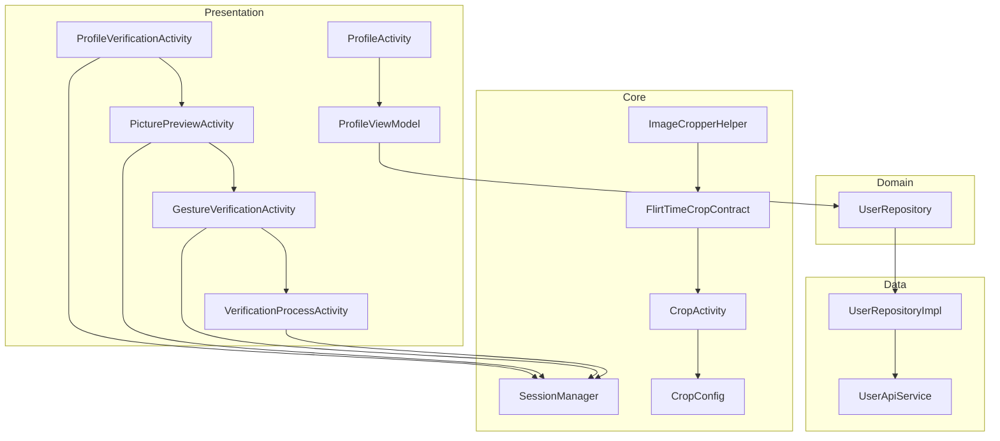
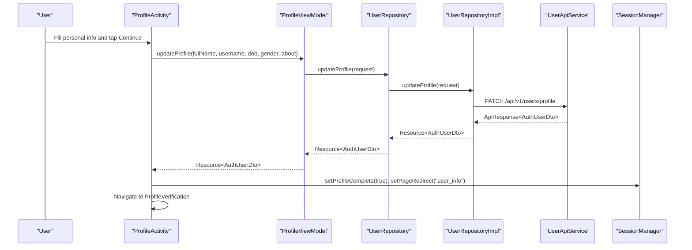
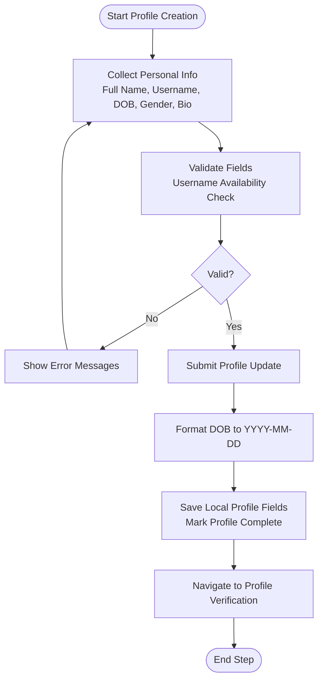
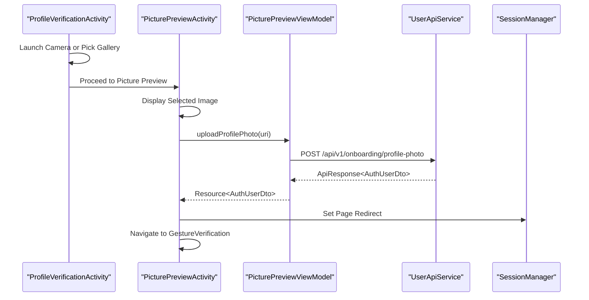
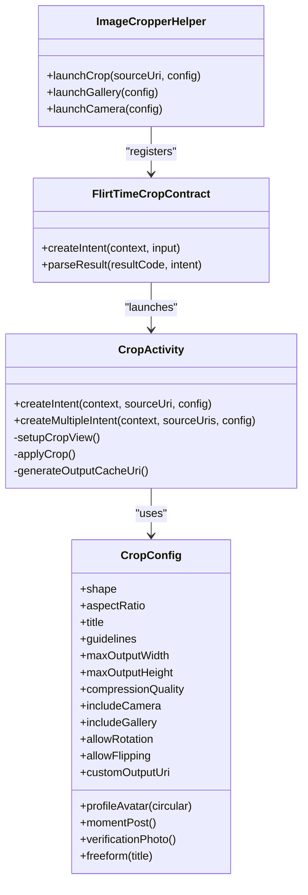
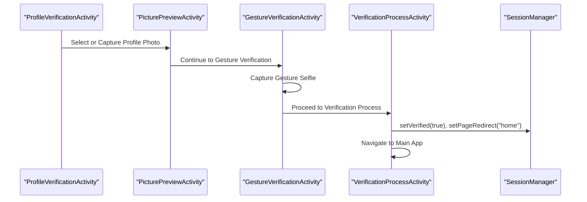
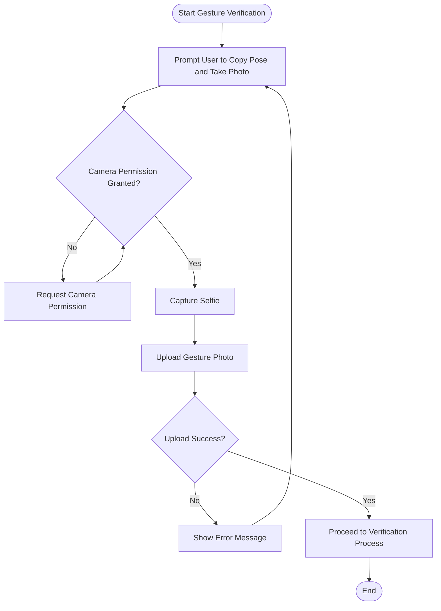
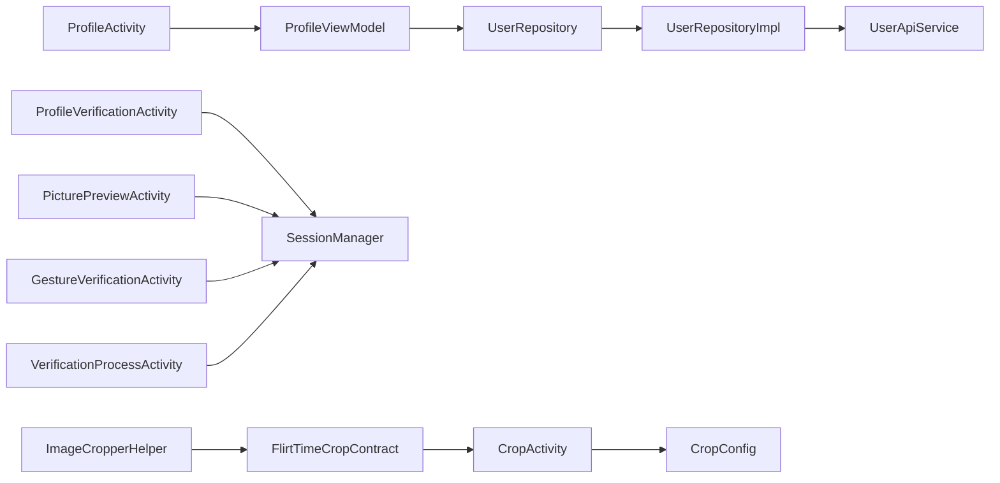

# Profile Management

<cite>
**Referenced Files in This Document**
- [ProfileActivity.kt](file://app/src/main/java/com/flirttime/feature/profile/presentation/intro/ProfileActivity.kt)
- [ProfileViewModel.kt](file://app/src/main/java/com/flirttime/feature/profile/presentation/intro/ProfileViewModel.kt)
- [UserRepository.kt](file://app/src/main/java/com/flirttime/feature/profile/domain/repository/UserRepository.kt)
- [UserRepositoryImpl.kt](file://app/src/main/java/com/flirttime/feature/profile/data/repository/UserRepositoryImpl.kt)
- [UserApiService.kt](file://app/src/main/java/com/flirttime/feature/profile/data/network/UserApiService.kt)
- [SessionManager.kt](file://app/src/main/java/com/flirttime/core/database/SessionManager.kt)
- [CropActivity.kt](file://app/src/main/java/com/flirttime/core/image/CropActivity.kt)
- [CropConfig.kt](file://app/src/main/java/com/flirttime/core/image/CropConfig.kt)
- [ImageCropperHelper.kt](file://app/src/main/java/com/flirttime/core/image/ImageCropperHelper.kt)
- [FlirtTimeCropContract.kt](file://app/src/main/java/com/flirttime/core/image/FlirtTimeCropContract.kt)
- [ProfileVerificationActivity.kt](file://app/src/main/java/com/flirttime/feature/profile/presentation/verification/ProfileVerificationActivity.kt)
- [PicturePreviewActivity.kt](file://app/src/main/java/com/flirttime/feature/profile/presentation/preview/PicturePreviewActivity.kt)
- [GestureVerificationActivity.kt](file://app/src/main/java/com/flirttime/feature/profile/presentation/gesture/GestureVerificationActivity.kt)
- [VerificationProcessActivity.kt](file://app/src/main/java/com/flirttime/feature/profile/presentation/process/VerificationProcessActivity.kt)
</cite>

## Table of Contents
1. [Introduction](#introduction)
2. [Project Structure](#project-structure)
3. [Core Components](#core-components)
4. [Architecture Overview](#architecture-overview)
5. [Detailed Component Analysis](#detailed-component-analysis)
6. [Dependency Analysis](#dependency-analysis)
7. [Performance Considerations](#performance-considerations)
8. [Troubleshooting Guide](#troubleshooting-guide)
9. [Conclusion](#conclusion)

## Introduction
This document explains the profile management system in Flirttime-Otp-Android. It covers the multi-step profile creation workflow, photo upload and processing pipeline with cropping and compression, profile verification including document and gesture flows, gesture/biometric security setup, profile editing capabilities, avatar management, privacy controls, image optimization, storage strategies, and performance considerations for large media files.

## Project Structure
The profile feature is organized by domain layers:
- Presentation layer: Activities and ViewModels for onboarding steps, preview, verification, and process screens.
- Domain layer: Repository interface defining profile operations.
- Data layer: Repository implementation, API service, and models.
- Core utilities: Image cropping, session storage, navigation, and common helpers.

**Diagram sources**
- [ProfileActivity.kt:35-62](file://app/src/main/java/com/flirttime/feature/profile/presentation/intro/ProfileActivity.kt#L35-L62)
- [ProfileViewModel.kt:18-54](file://app/src/main/java/com/flirttime/feature/profile/presentation/intro/ProfileViewModel.kt#L18-L54)
- [UserRepository.kt:10-14](file://app/src/main/java/com/flirttime/feature/profile/domain/repository/UserRepository.kt#L10-L14)
- [UserRepositoryImpl.kt:32-46](file://app/src/main/java/com/flirttime/feature/profile/data/repository/UserRepositoryImpl.kt#L32-L46)
- [UserApiService.kt:17-33](file://app/src/main/java/com/flirttime/feature/profile/data/network/UserApiService.kt#L17-L33)
- [SessionManager.kt:161-195](file://app/src/main/java/com/flirttime/core/database/SessionManager.kt#L161-L195)
- [CropActivity.kt:19-87](file://app/src/main/java/com/flirttime/core/image/CropActivity.kt#L19-L87)
- [CropConfig.kt:28-88](file://app/src/main/java/com/flirttime/core/image/CropConfig.kt#L28-L88)
- [ImageCropperHelper.kt:14-26](file://app/src/main/java/com/flirttime/core/image/ImageCropperHelper.kt#L14-L26)
- [FlirtTimeCropContract.kt:9-24](file://app/src/main/java/com/flirttime/core/image/FlirtTimeCropContract.kt#L9-L24)

**Section sources**
- [ProfileActivity.kt:35-62](file://app/src/main/java/com/flirttime/feature/profile/presentation/intro/ProfileActivity.kt#L35-L62)
- [ProfileViewModel.kt:18-54](file://app/src/main/java/com/flirttime/feature/profile/presentation/intro/ProfileViewModel.kt#L18-L54)
- [UserRepository.kt:10-14](file://app/src/main/java/com/flirttime/feature/profile/domain/repository/UserRepository.kt#L10-L14)
- [UserRepositoryImpl.kt:32-46](file://app/src/main/java/com/flirttime/feature/profile/data/repository/UserRepositoryImpl.kt#L32-L46)
- [UserApiService.kt:17-33](file://app/src/main/java/com/flirttime/feature/profile/data/network/UserApiService.kt#L17-L33)
- [SessionManager.kt:161-195](file://app/src/main/java/com/flirttime/core/database/SessionManager.kt#L161-L195)
- [CropActivity.kt:19-87](file://app/src/main/java/com/flirttime/core/image/CropActivity.kt#L19-L87)
- [CropConfig.kt:28-88](file://app/src/main/java/com/flirttime/core/image/CropConfig.kt#L28-L88)
- [ImageCropperHelper.kt:14-26](file://app/src/main/java/com/flirttime/core/image/ImageCropperHelper.kt#L14-L26)
- [FlirtTimeCropContract.kt:9-24](file://app/src/main/java/com/flirttime/core/image/FlirtTimeCropContract.kt#L9-L24)

## Core Components
- Profile onboarding screen collects personal information (full name, username, date of birth, gender, bio), validates inputs, checks username availability, and persists profile data.
- Photo capture and preview flow allows users to take or select a profile picture, preview it, and upload it.
- Gesture verification captures a pose selfie for identity verification.
- Verification process screen finalizes the verification state and navigates to the main app.
- Image cropping utility supports multiple aspect ratios, compression, and sequential cropping.
- Session manager stores profile fields, image URI, verification status, and page redirect hints.

Key responsibilities:
- UI orchestration and user interactions: ProfileActivity, PicturePreviewActivity, ProfileVerificationActivity, GestureVerificationActivity, VerificationProcessActivity.
- Business logic and state: ProfileViewModel, GestureVerificationViewModel (referenced by GestureVerificationActivity).
- Data access: UserRepository, UserRepositoryImpl, UserApiService.
- Media handling: CropActivity, CropConfig, ImageCropperHelper, FlirtTimeCropContract.
- Local persistence: SessionManager.

**Section sources**
- [ProfileActivity.kt:35-62](file://app/src/main/java/com/flirttime/feature/profile/presentation/intro/ProfileActivity.kt#L35-L62)
- [ProfileViewModel.kt:18-54](file://app/src/main/java/com/flirttime/feature/profile/presentation/intro/ProfileViewModel.kt#L18-L54)
- [UserRepository.kt:10-14](file://app/src/main/java/com/flirttime/feature/profile/domain/repository/UserRepository.kt#L10-L14)
- [UserRepositoryImpl.kt:32-46](file://app/src/main/java/com/flirttime/feature/profile/data/repository/UserRepositoryImpl.kt#L32-L46)
- [UserApiService.kt:17-33](file://app/src/main/java/com/flirttime/feature/profile/data/network/UserApiService.kt#L17-L33)
- [CropActivity.kt:19-87](file://app/src/main/java/com/flirttime/core/image/CropActivity.kt#L19-L87)
- [CropConfig.kt:28-88](file://app/src/main/java/com/flirttime/core/image/CropConfig.kt#L28-L88)
- [ImageCropperHelper.kt:14-26](file://app/src/main/java/com/flirttime/core/image/ImageCropperHelper.kt#L14-L26)
- [FlirtTimeCropContract.kt:9-24](file://app/src/main/java/com/flirttime/core/image/FlirtTimeCropContract.kt#L9-L24)
- [SessionManager.kt:161-195](file://app/src/main/java/com/flirttime/core/database/SessionManager.kt#L161-L195)

## Architecture Overview
The profile management follows a layered architecture:
- Presentation layer coordinates user input and navigation.
- Domain layer exposes repository interfaces for profile operations.
- Data layer implements repository logic and network calls.
- Core utilities provide reusable image processing and session storage.

**Diagram sources**
- [ProfileActivity.kt:215-287](file://app/src/main/java/com/flirttime/feature/profile/presentation/intro/ProfileActivity.kt#L215-L287)
- [ProfileViewModel.kt:31-54](file://app/src/main/java/com/flirttime/feature/profile/presentation/intro/ProfileViewModel.kt#L31-L54)
- [UserRepository.kt:10-14](file://app/src/main/java/com/flirttime/feature/profile/domain/repository/UserRepository.kt#L10-L14)
- [UserRepositoryImpl.kt:32-46](file://app/src/main/java/com/flirttime/feature/profile/data/repository/UserRepositoryImpl.kt#L32-L46)
- [UserApiService.kt:17-22](file://app/src/main/java/com/flirttime/feature/profile/data/network/UserApiService.kt#L17-L22)
- [SessionManager.kt:161-195](file://app/src/main/java/com/flirttime/core/database/SessionManager.kt#L161-L195)

## Detailed Component Analysis

### Multi-Step Profile Creation Workflow
The first step is the “Introduce Yourself” screen that gathers:
- Full name
- Username (display name) with live availability check
- Date of birth via a picker dialog
- Gender via a selection dialog
- Bio (“About you”) with character counter and title visibility behavior

Validation rules:
- All fields must be filled.
- Username must be at least 3 characters and available.
- Debounced availability check cancels previous requests when typing continues.

On success:
- The ViewModel formats DOB to backend-required format.
- The repository saves local profile fields and marks profile complete.
- Navigation proceeds to profile verification.

**Diagram sources**
- [ProfileActivity.kt:126-192](file://app/src/main/java/com/flirttime/feature/profile/presentation/intro/ProfileActivity.kt#L126-L192)
- [ProfileActivity.kt:215-287](file://app/src/main/java/com/flirttime/feature/profile/presentation/intro/ProfileActivity.kt#L215-L287)
- [ProfileViewModel.kt:31-54](file://app/src/main/java/com/flirttime/feature/profile/presentation/intro/ProfileViewModel.kt#L31-L54)
- [ProfileViewModel.kt:80-111](file://app/src/main/java/com/flirttime/feature/profile/presentation/intro/ProfileViewModel.kt#L80-L111)
- [UserRepositoryImpl.kt:32-46](file://app/src/main/java/com/flirttime/feature/profile/data/repository/UserRepositoryImpl.kt#L32-L46)

**Section sources**
- [ProfileActivity.kt:126-192](file://app/src/main/java/com/flirttime/feature/profile/presentation/intro/ProfileActivity.kt#L126-L192)
- [ProfileActivity.kt:215-287](file://app/src/main/java/com/flirttime/feature/profile/presentation/intro/ProfileActivity.kt#L215-L287)
- [ProfileViewModel.kt:31-54](file://app/src/main/java/com/flirttime/feature/profile/presentation/intro/ProfileViewModel.kt#L31-L54)
- [ProfileViewModel.kt:80-111](file://app/src/main/java/com/flirttime/feature/profile/presentation/intro/ProfileViewModel.kt#L80-L111)
- [UserRepositoryImpl.kt:32-46](file://app/src/main/java/com/flirttime/feature/profile/data/repository/UserRepositoryImpl.kt#L32-L46)

### Photo Upload and Processing Pipeline
The pipeline includes:
- Selecting or capturing a photo.
- Previewing the selected image.
- Uploading the profile photo.
- Optional cropping via dedicated cropper.

Key behaviors:
- Camera permission is requested before launching camera.
- Selected images are stored temporarily in cache directories.
- Preview activity displays the image and offers retake or continue options.
- On continue, the profile photo is uploaded; if no image is provided, the flow proceeds to gesture verification.

**Diagram sources**
- [ProfileVerificationActivity.kt:104-144](file://app/src/main/java/com/flirttime/feature/profile/presentation/verification/ProfileVerificationActivity.kt#L104-L144)
- [ProfileVerificationActivity.kt:177-189](file://app/src/main/java/com/flirttime/feature/profile/presentation/verification/ProfileVerificationActivity.kt#L177-L189)
- [PicturePreviewActivity.kt:85-98](file://app/src/main/java/com/flirttime/feature/profile/presentation/preview/PicturePreviewActivity.kt#L85-L98)
- [PicturePreviewActivity.kt:145-161](file://app/src/main/java/com/flirttime/feature/profile/presentation/preview/PicturePreviewActivity.kt#L145-L161)
- [UserApiService.kt:29-33](file://app/src/main/java/com/flirttime/feature/profile/data/network/UserApiService.kt#L29-L33)
- [SessionManager.kt:179-195](file://app/src/main/java/com/flirttime/core/database/SessionManager.kt#L179-L195)

**Section sources**
- [ProfileVerificationActivity.kt:104-144](file://app/src/main/java/com/flirttime/feature/profile/presentation/verification/ProfileVerificationActivity.kt#L104-L144)
- [ProfileVerificationActivity.kt:177-189](file://app/src/main/java/com/flirttime/feature/profile/presentation/verification/ProfileVerificationActivity.kt#L177-L189)
- [PicturePreviewActivity.kt:85-98](file://app/src/main/java/com/flirttime/feature/profile/presentation/preview/PicturePreviewActivity.kt#L85-L98)
- [PicturePreviewActivity.kt:145-161](file://app/src/main/java/com/flirttime/feature/profile/presentation/preview/PicturePreviewActivity.kt#L145-L161)
- [UserApiService.kt:29-33](file://app/src/main/java/com/flirttime/feature/profile/data/network/UserApiService.kt#L29-L33)
- [SessionManager.kt:179-195](file://app/src/main/java/com/flirttime/core/database/SessionManager.kt#L179-L195)

### Cropping Capabilities and Compression
The cropping subsystem provides:
- A dedicated cropping Activity with black background, cancel/next actions, and grid guidelines.
- Support for multiple source URIs and sequential cropping.
- Configurable shape (rectangle or oval), aspect ratios (square, portrait, landscape, custom), output dimensions, and JPEG compression quality.
- Helper classes to register lifecycle-safe launchers for gallery and camera, then route into cropping.

Configuration presets include:
- Profile avatar: square with optional oval overlay.
- Moments post: 4:3 rectangle.
- Verification photo: 3:4 portrait.
- Freeform crop.

**Diagram sources**
- [CropActivity.kt:19-87](file://app/src/main/java/com/flirttime/core/image/CropActivity.kt#L19-L87)
- [CropActivity.kt:157-193](file://app/src/main/java/com/flirttime/core/image/CropActivity.kt#L157-L193)
- [CropActivity.kt:238-291](file://app/src/main/java/com/flirttime/core/image/CropActivity.kt#L238-L291)
- [CropConfig.kt:28-88](file://app/src/main/java/com/flirttime/core/image/CropConfig.kt#L28-L88)
- [ImageCropperHelper.kt:14-26](file://app/src/main/java/com/flirttime/core/image/ImageCropperHelper.kt#L14-L26)
- [FlirtTimeCropContract.kt:9-24](file://app/src/main/java/com/flirttime/core/image/FlirtTimeCropContract.kt#L9-L24)

**Section sources**
- [CropActivity.kt:19-87](file://app/src/main/java/com/flirttime/core/image/CropActivity.kt#L19-L87)
- [CropActivity.kt:157-193](file://app/src/main/java/com/flirttime/core/image/CropActivity.kt#L157-L193)
- [CropActivity.kt:238-291](file://app/src/main/java/com/flirttime/core/image/CropActivity.kt#L238-L291)
- [CropConfig.kt:28-88](file://app/src/main/java/com/flirttime/core/image/CropConfig.kt#L28-L88)
- [ImageCropperHelper.kt:14-26](file://app/src/main/java/com/flirttime/core/image/ImageCropperHelper.kt#L14-L26)
- [FlirtTimeCropContract.kt:9-24](file://app/src/main/java/com/flirttime/core/image/FlirtTimeCropContract.kt#L9-L24)

### Profile Verification Process
The verification process includes:
- Profile photo capture or selection.
- Preview and confirmation.
- Gesture verification selfie capture.
- Final verification process screen marking the user as verified and navigating to the main app.

Document verification:
- The codebase includes presentation flows for profile verification and gesture verification but does not implement explicit document upload endpoints in the analyzed files. The profile photo and gesture selfie serve as verification assets.

Manual review workflows:
- The application sets a verification flag locally and navigates to the main app after completion. Backend-side manual review is not visible in the analyzed code.

**Diagram sources**
- [ProfileVerificationActivity.kt:177-189](file://app/src/main/java/com/flirttime/feature/profile/presentation/verification/ProfileVerificationActivity.kt#L177-L189)
- [PicturePreviewActivity.kt:145-161](file://app/src/main/java/com/flirttime/feature/profile/presentation/preview/PicturePreviewActivity.kt#L145-L161)
- [GestureVerificationActivity.kt:236-245](file://app/src/main/java/com/flirttime/feature/profile/presentation/gesture/GestureVerificationActivity.kt#L236-L245)
- [VerificationProcessActivity.kt:64-77](file://app/src/main/java/com/flirttime/feature/profile/presentation/process/VerificationProcessActivity.kt#L64-L77)
- [SessionManager.kt:185-195](file://app/src/main/java/com/flirttime/core/database/SessionManager.kt#L185-L195)

**Section sources**
- [ProfileVerificationActivity.kt:177-189](file://app/src/main/java/com/flirttime/feature/profile/presentation/verification/ProfileVerificationActivity.kt#L177-L189)
- [PicturePreviewActivity.kt:145-161](file://app/src/main/java/com/flirttime/feature/profile/presentation/preview/PicturePreviewActivity.kt#L145-L161)
- [GestureVerificationActivity.kt:236-245](file://app/src/main/java/com/flirttime/feature/profile/presentation/gesture/GestureVerificationActivity.kt#L236-L245)
- [VerificationProcessActivity.kt:64-77](file://app/src/main/java/com/flirttime/feature/profile/presentation/process/VerificationProcessActivity.kt#L64-L77)
- [SessionManager.kt:185-195](file://app/src/main/java/com/flirttime/core/database/SessionManager.kt#L185-L195)

### Gesture/Biometric Security Setup
Gesture verification:
- Users are prompted to copy a pose and take a selfie.
- Camera permission is requested if not granted.
- The captured selfie is uploaded through the gesture verification flow.
- After successful upload, the user proceeds to the verification process screen.

Biometric security:
- No biometric authentication implementation is present in the analyzed files. The gesture selfie serves as an additional verification step rather than device-level biometrics.

**Diagram sources**
- [GestureVerificationActivity.kt:157-189](file://app/src/main/java/com/flirttime/feature/profile/presentation/gesture/GestureVerificationActivity.kt#L157-L189)
- [GestureVerificationActivity.kt:209-233](file://app/src/main/java/com/flirttime/feature/profile/presentation/gesture/GestureVerificationActivity.kt#L209-L233)
- [GestureVerificationActivity.kt:236-245](file://app/src/main/java/com/flirttime/feature/profile/presentation/gesture/GestureVerificationActivity.kt#L236-L245)

**Section sources**
- [GestureVerificationActivity.kt:157-189](file://app/src/main/java/com/flirttime/feature/profile/presentation/gesture/GestureVerificationActivity.kt#L157-L189)
- [GestureVerificationActivity.kt:209-233](file://app/src/main/java/com/flirttime/feature/profile/presentation/gesture/GestureVerificationActivity.kt#L209-L233)
- [GestureVerificationActivity.kt:236-245](file://app/src/main/java/com/flirttime/feature/profile/presentation/gesture/GestureVerificationActivity.kt#L236-L245)

### Profile Editing Features, Avatar Management, and Privacy Controls
Profile editing:
- The profile creation flow updates personal information and bio.
- Username availability is checked in real time.
- Local profile fields are saved and marked complete.

Avatar management:
- Users can select or capture a profile photo, preview it, and upload it.
- Cropping utilities support different shapes and aspect ratios for avatars.

Privacy controls:
- Both preview and gesture verification screens include clickable links to the privacy policy.
- No explicit privacy toggles are implemented in the analyzed files.

**Section sources**
- [ProfileActivity.kt:126-192](file://app/src/main/java/com/flirttime/feature/profile/presentation/intro/ProfileActivity.kt#L126-L192)
- [ProfileActivity.kt:215-287](file://app/src/main/java/com/flirttime/feature/profile/presentation/intro/ProfileActivity.kt#L215-L287)
- [PicturePreviewActivity.kt:105-143](file://app/src/main/java/com/flirttime/feature/profile/presentation/preview/PicturePreviewActivity.kt#L105-L143)
- [GestureVerificationActivity.kt:119-155](file://app/src/main/java/com/flirttime/feature/profile/presentation/gesture/GestureVerificationActivity.kt#L119-L155)
- [CropConfig.kt:42-53](file://app/src/main/java/com/flirttime/core/image/CropConfig.kt#L42-L53)

### Image Optimization, Storage Strategies, and Performance Considerations
Image optimization:
- Cropping uses JPEG compression with configurable quality (default around 85–90).
- Output dimensions are constrained (e.g., 1024x1024 for avatars, 1200x1200 for moments, 1200x1600 for verification photos).
- Sequential cropping supports multiple images efficiently.

Storage strategies:
- Temporary images are stored in app cache directories under specific folders (camera_photos, cropped_images, camera_captures).
- FileProvider URIs are used for secure sharing across components.
- SessionManager persists profile fields, profile image URI, verification status, and page redirect hints.

Performance considerations:
- Debounced username availability checks reduce unnecessary network calls.
- Asynchronous image loading and cropping avoid blocking the UI thread.
- Edge-to-edge insets are handled to prevent layout thrashing during keyboard and navigation bar changes.

Recommendations:
- Implement background workers for heavy image resizing and compression.
- Use efficient image loading libraries with caching.
- Clean up temporary cache files periodically to free storage.
- Add progress indicators for long-running uploads.

**Section sources**
- [CropActivity.kt:265-272](file://app/src/main/java/com/flirttime/core/image/CropActivity.kt#L265-L272)
- [CropConfig.kt:42-88](file://app/src/main/java/com/flirttime/core/image/CropConfig.kt#L42-L88)
- [ImageCropperHelper.kt:151-171](file://app/src/main/java/com/flirttime/core/image/ImageCropperHelper.kt#L151-L171)
- [SessionManager.kt:161-195](file://app/src/main/java/com/flirttime/core/database/SessionManager.kt#L161-L195)
- [ProfileViewModel.kt:56-78](file://app/src/main/java/com/flirttime/feature/profile/presentation/intro/ProfileViewModel.kt#L56-L78)

## Dependency Analysis
The profile feature depends on:
- Network layer for profile updates and photo uploads.
- Session storage for local profile state and verification flags.
- Image cropping utilities for media processing.
- Navigation utilities for moving between onboarding steps.

**Diagram sources**
- [ProfileActivity.kt:35-62](file://app/src/main/java/com/flirttime/feature/profile/presentation/intro/ProfileActivity.kt#L35-L62)
- [ProfileViewModel.kt:18-54](file://app/src/main/java/com/flirttime/feature/profile/presentation/intro/ProfileViewModel.kt#L18-L54)
- [UserRepository.kt:10-14](file://app/src/main/java/com/flirttime/feature/profile/domain/repository/UserRepository.kt#L10-L14)
- [UserRepositoryImpl.kt:32-46](file://app/src/main/java/com/flirttime/feature/profile/data/repository/UserRepositoryImpl.kt#L32-L46)
- [UserApiService.kt:17-33](file://app/src/main/java/com/flirttime/feature/profile/data/network/UserApiService.kt#L17-L33)
- [ProfileVerificationActivity.kt:177-189](file://app/src/main/java/com/flirttime/feature/profile/presentation/verification/ProfileVerificationActivity.kt#L177-L189)
- [PicturePreviewActivity.kt:145-161](file://app/src/main/java/com/flirttime/feature/profile/presentation/preview/PicturePreviewActivity.kt#L145-L161)
- [GestureVerificationActivity.kt:236-245](file://app/src/main/java/com/flirttime/feature/profile/presentation/gesture/GestureVerificationActivity.kt#L236-L245)
- [VerificationProcessActivity.kt:64-77](file://app/src/main/java/com/flirttime/feature/profile/presentation/process/VerificationProcessActivity.kt#L64-L77)
- [ImageCropperHelper.kt:14-26](file://app/src/main/java/com/flirttime/core/image/ImageCropperHelper.kt#L14-L26)
- [FlirtTimeCropContract.kt:9-24](file://app/src/main/java/com/flirttime/core/image/FlirtTimeCropContract.kt#L9-L24)
- [CropActivity.kt:19-87](file://app/src/main/java/com/flirttime/core/image/CropActivity.kt#L19-L87)
- [CropConfig.kt:28-88](file://app/src/main/java/com/flirttime/core/image/CropConfig.kt#L28-L88)

**Section sources**
- [ProfileActivity.kt:35-62](file://app/src/main/java/com/flirttime/feature/profile/presentation/intro/ProfileActivity.kt#L35-L62)
- [ProfileViewModel.kt:18-54](file://app/src/main/java/com/flirttime/feature/profile/presentation/intro/ProfileViewModel.kt#L18-L54)
- [UserRepository.kt:10-14](file://app/src/main/java/com/flirttime/feature/profile/domain/repository/UserRepository.kt#L10-L14)
- [UserRepositoryImpl.kt:32-46](file://app/src/main/java/com/flirttime/feature/profile/data/repository/UserRepositoryImpl.kt#L32-L46)
- [UserApiService.kt:17-33](file://app/src/main/java/com/flirttime/feature/profile/data/network/UserApiService.kt#L17-L33)
- [ProfileVerificationActivity.kt:177-189](file://app/src/main/java/com/flirttime/feature/profile/presentation/verification/ProfileVerificationActivity.kt#L177-L189)
- [PicturePreviewActivity.kt:145-161](file://app/src/main/java/com/flirttime/feature/profile/presentation/preview/PicturePreviewActivity.kt#L145-L161)
- [GestureVerificationActivity.kt:236-245](file://app/src/main/java/com/flirttime/feature/profile/presentation/gesture/GestureVerificationActivity.kt#L236-L245)
- [VerificationProcessActivity.kt:64-77](file://app/src/main/java/com/flirttime/feature/profile/presentation/process/VerificationProcessActivity.kt#L64-L77)
- [ImageCropperHelper.kt:14-26](file://app/src/main/java/com/flirttime/core/image/ImageCropperHelper.kt#L14-L26)
- [FlirtTimeCropContract.kt:9-24](file://app/src/main/java/com/flirttime/core/image/FlirtTimeCropContract.kt#L9-L24)
- [CropActivity.kt:19-87](file://app/src/main/java/com/flirttime/core/image/CropActivity.kt#L19-L87)
- [CropConfig.kt:28-88](file://app/src/main/java/com/flirttime/core/image/CropConfig.kt#L28-L88)

## Performance Considerations
- Debounce username checks to minimize network overhead.
- Use asynchronous operations for image loading and cropping.
- Constrain output dimensions and compression quality to balance quality and file size.
- Handle edge-to-edge insets carefully to avoid layout recalculations.
- Cache temporary images in app-specific directories and clean them up regularly.

[No sources needed since this section provides general guidance]

## Troubleshooting Guide
Common issues and resolutions:
- Camera permission denied:
  - The app requests camera permission before launching the camera. If denied, a dialog directs users to settings to allow permission.
- Unable to launch camera:
  - Exceptions are caught and displayed as toast messages. Ensure proper FileProvider configuration and cache directory permissions.
- Username availability errors:
  - Errors from the availability check are shown to the user; ensure network connectivity and retry logic.
- Cropping failures:
  - Cropping errors are reported via toast messages; verify source URIs and output URIs.

**Section sources**
- [ProfileVerificationActivity.kt:146-162](file://app/src/main/java/com/flirttime/feature/profile/presentation/verification/ProfileVerificationActivity.kt#L146-L162)
- [GestureVerificationActivity.kt:191-207](file://app/src/main/java/com/flirttime/feature/profile/presentation/gesture/GestureVerificationActivity.kt#L191-L207)
- [ProfileActivity.kt:235-287](file://app/src/main/java/com/flirttime/feature/profile/presentation/intro/ProfileActivity.kt#L235-L287)
- [CropActivity.kt:181-192](file://app/src/main/java/com/flirttime/core/image/CropActivity.kt#L181-L192)

## Conclusion
The profile management system in Flirttime-Otp-Android provides a comprehensive multi-step onboarding experience. It handles personal information collection, username validation, profile photo capture and upload, gesture verification, and final verification completion. The image processing pipeline supports flexible cropping and compression, while session storage maintains local profile state and verification flags. For enhanced performance and reliability, consider implementing background workers for media processing, robust error handling, and periodic cache cleanup.

[No sources needed since this section summarizes without analyzing specific files]