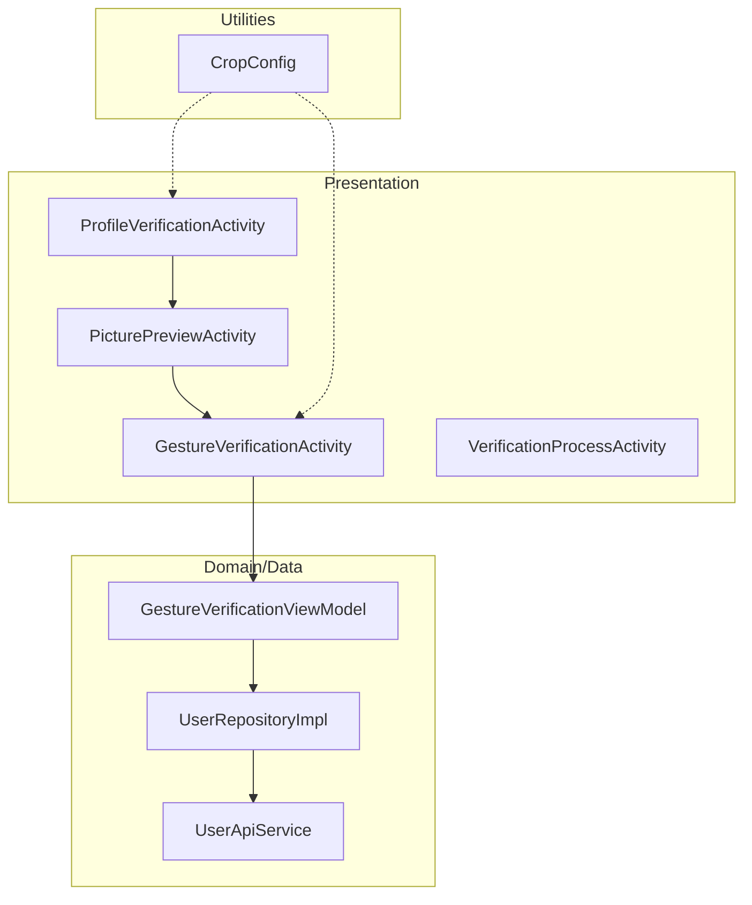
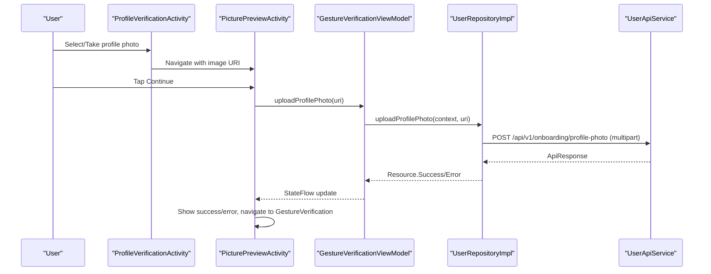
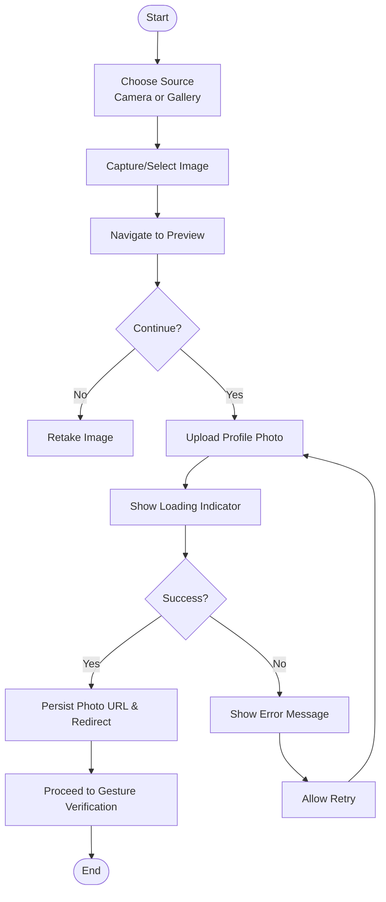
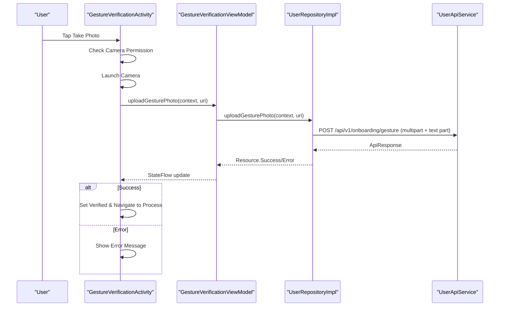
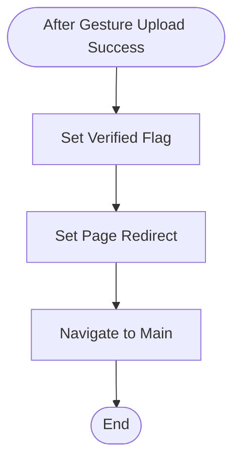
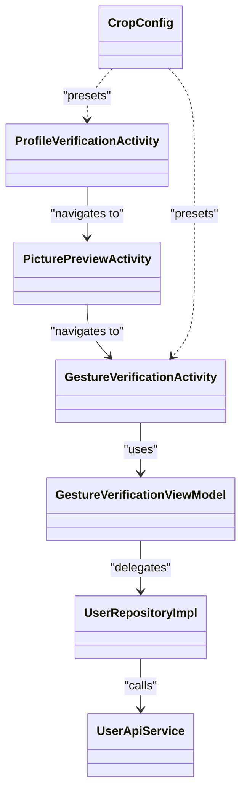

# Profile Verification System

<cite>
**Referenced Files in This Document**
- [ProfileVerificationActivity.kt](file://app/src/main/java/com/flirttime/feature/profile/presentation/verification/ProfileVerificationActivity.kt)
- [activity_profile_verification.xml](file://app/src/main/res/layout/activity_profile_verification.xml)
- [PicturePreviewActivity.kt](file://app/src/main/java/com/flirttime/feature/profile/presentation/preview/PicturePreviewActivity.kt)
- [GestureVerificationActivity.kt](file://app/src/main/java/com/flirttime/feature/profile/presentation/gesture/GestureVerificationActivity.kt)
- [GestureVerificationViewModel.kt](file://app/src/main/java/com/flirttime/feature/profile/presentation/gesture/GestureVerificationViewModel.kt)
- [VerificationProcessActivity.kt](file://app/src/main/java/com/flirttime/feature/profile/presentation/process/VerificationProcessActivity.kt)
- [UserApiService.kt](file://app/src/main/java/com/flirttime/feature/profile/data/network/UserApiService.kt)
- [UserRepositoryImpl.kt](file://app/src/main/java/com/flirttime/feature/profile/data/repository/UserRepositoryImpl.kt)
- [CropConfig.kt](file://app/src/main/java/com/flirttime/core/image/CropConfig.kt)
</cite>

## Table of Contents
1. [Introduction](#introduction)
2. [Project Structure](#project-structure)
3. [Core Components](#core-components)
4. [Architecture Overview](#architecture-overview)
5. [Detailed Component Analysis](#detailed-component-analysis)
6. [Dependency Analysis](#dependency-analysis)
7. [Performance Considerations](#performance-considerations)
8. [Troubleshooting Guide](#troubleshooting-guide)
9. [Conclusion](#conclusion)

## Introduction
This document explains the profile verification system for identity and gesture verification, focusing on:
- Document upload flow for identity verification (profile photo capture, preview, and submission)
- File format requirements and size limitations
- Verification status tracking and progress indicators
- Backend integration points for submission and status updates
- Error handling and retry mechanisms
- Privacy considerations for sensitive documents and secure transmission

The system is implemented as a multi-step Android UI flow with clear separation between presentation (Activities), business logic (ViewModels), data layer (Repositories and API services), and shared utilities (image cropping configuration).

## Project Structure
The verification feature spans several modules:
- Presentation layer: Activities for capturing images, previewing them, performing gesture verification, and showing completion
- Data layer: Repository and Retrofit service for uploading photos and updating user state
- Shared image utilities: Cropping presets that define accepted formats and dimensions

**Diagram sources**
- [ProfileVerificationActivity.kt:27-191](file://app/src/main/java/com/flirttime/feature/profile/presentation/verification/ProfileVerificationActivity.kt#L27-L191)
- [PicturePreviewActivity.kt:32-197](file://app/src/main/java/com/flirttime/feature/profile/presentation/preview/PicturePreviewActivity.kt#L32-L197)
- [GestureVerificationActivity.kt:38-248](file://app/src/main/java/com/flirttime/feature/profile/presentation/gesture/GestureVerificationActivity.kt#L38-L248)
- [GestureVerificationViewModel.kt:15-34](file://app/src/main/java/com/flirttime/feature/profile/presentation/gesture/GestureVerificationViewModel.kt#L15-L34)
- [UserRepositoryImpl.kt:20-127](file://app/src/main/java/com/flirttime/feature/profile/data/repository/UserRepositoryImpl.kt#L20-L127)
- [UserApiService.kt:17-33](file://app/src/main/java/com/flirttime/feature/profile/data/network/UserApiService.kt#L17-L33)
- [CropConfig.kt:28-88](file://app/src/main/java/com/flirttime/core/image/CropConfig.kt#L28-L88)

**Section sources**
- [ProfileVerificationActivity.kt:27-191](file://app/src/main/java/com/flirttime/feature/profile/presentation/verification/ProfileVerificationActivity.kt#L27-L191)
- [PicturePreviewActivity.kt:32-197](file://app/src/main/java/com/flirttime/feature/profile/presentation/preview/PicturePreviewActivity.kt#L32-L197)
- [GestureVerificationActivity.kt:38-248](file://app/src/main/java/com/flirttime/feature/profile/presentation/gesture/GestureVerificationActivity.kt#L38-L248)
- [VerificationProcessActivity.kt:18-80](file://app/src/main/java/com/flirttime/feature/profile/presentation/process/VerificationProcessActivity.kt#L18-L80)
- [UserApiService.kt:17-33](file://app/src/main/java/com/flirttime/feature/profile/data/network/UserApiService.kt#L17-L33)
- [UserRepositoryImpl.kt:20-127](file://app/src/main/java/com/flirttime/feature/profile/data/repository/UserRepositoryImpl.kt#L20-L127)
- [CropConfig.kt:28-88](file://app/src/main/java/com/flirttime/core/image/CropConfig.kt#L28-L88)

## Core Components
- ProfileVerificationActivity: Captures or selects a profile photo, stores it temporarily, and navigates to the preview screen.
- PicturePreviewActivity: Displays the selected photo, allows retake or continue, and uploads the photo via ViewModel and Repository.
- GestureVerificationActivity: Guides users to take a gesture selfie, handles permissions, and triggers upload through its ViewModel.
- GestureVerificationViewModel: Exposes upload state and delegates upload calls to UserRepository.
- UserRepositoryImpl: Converts Uri to multipart parts, calls UserApiService endpoints, persists success states, and emits Resource flows.
- UserApiService: Retrofit interface defining endpoints for profile photo and gesture uploads.
- CropConfig: Defines cropping presets including aspect ratios and maximum output dimensions for verification photos.

Key responsibilities:
- Input capture and validation (camera/gallery permissions, file creation)
- Image processing and sizing constraints
- Network upload with multipart/form-data
- State management and navigation
- Success/error feedback to the user

**Section sources**
- [ProfileVerificationActivity.kt:27-191](file://app/src/main/java/com/flirttime/feature/profile/presentation/verification/ProfileVerificationActivity.kt#L27-L191)
- [PicturePreviewActivity.kt:32-197](file://app/src/main/java/com/flirttime/feature/profile/presentation/preview/PicturePreviewActivity.kt#L32-L197)
- [GestureVerificationActivity.kt:38-248](file://app/src/main/java/com/flirttime/feature/profile/presentation/gesture/GestureVerificationActivity.kt#L38-L248)
- [GestureVerificationViewModel.kt:15-34](file://app/src/main/java/com/flirttime/feature/profile/presentation/gesture/GestureVerificationViewModel.kt#L15-L34)
- [UserRepositoryImpl.kt:90-125](file://app/src/main/java/com/flirttime/feature/profile/data/repository/UserRepositoryImpl.kt#L90-L125)
- [UserApiService.kt:29-33](file://app/src/main/java/com/flirttime/feature/profile/data/network/UserApiService.kt#L29-L33)
- [CropConfig.kt:67-77](file://app/src/main/java/com/flirttime/core/image/CropConfig.kt#L67-L77)

## Architecture Overview
The verification flow follows a layered architecture:
- UI layer orchestrates user interactions and displays progress
- ViewModel manages upload state and coordinates repository calls
- Repository transforms inputs into network requests and persists results
- API service performs HTTP calls using Retrofit

**Diagram sources**
- [ProfileVerificationActivity.kt:177-191](file://app/src/main/java/com/flirttime/feature/profile/presentation/verification/ProfileVerificationActivity.kt#L177-L191)
- [PicturePreviewActivity.kt:150-197](file://app/src/main/java/com/flirttime/feature/profile/presentation/preview/PicturePreviewActivity.kt#L150-L197)
- [GestureVerificationViewModel.kt:22-32](file://app/src/main/java/com/flirttime/feature/profile/presentation/gesture/GestureVerificationViewModel.kt#L22-L32)
- [UserRepositoryImpl.kt:90-107](file://app/src/main/java/com/flirttime/feature/profile/data/repository/UserRepositoryImpl.kt#L90-L107)
- [UserApiService.kt:29-33](file://app/src/main/java/com/flirttime/feature/profile/data/network/UserApiService.kt#L29-L33)

## Detailed Component Analysis

### Profile Photo Upload Flow
- Capture or select an image from camera/gallery
- Store temporary URI and navigate to preview
- On continue, upload the image via ViewModel and Repository
- Persist uploaded photo URL and redirect page metadata on success
- Display loading indicator during upload and enable/disable controls accordingly

**Diagram sources**
- [ProfileVerificationActivity.kt:104-144](file://app/src/main/java/com/flirttime/feature/profile/presentation/verification/ProfileVerificationActivity.kt#L104-L144)
- [PicturePreviewActivity.kt:145-197](file://app/src/main/java/com/flirttime/feature/profile/presentation/preview/PicturePreviewActivity.kt#L145-L197)
- [UserRepositoryImpl.kt:90-107](file://app/src/main/java/com/flirttime/feature/profile/data/repository/UserRepositoryImpl.kt#L90-L107)

**Section sources**
- [ProfileVerificationActivity.kt:104-191](file://app/src/main/java/com/flirttime/feature/profile/presentation/verification/ProfileVerificationActivity.kt#L104-L191)
- [PicturePreviewActivity.kt:145-197](file://app/src/main/java/com/flirttime/feature/profile/presentation/preview/PicturePreviewActivity.kt#L145-L197)
- [UserRepositoryImpl.kt:90-107](file://app/src/main/java/com/flirttime/feature/profile/data/repository/UserRepositoryImpl.kt#L90-L107)

### Gesture Verification Flow
- Prompt user to take a selfie following a pose
- Handle camera permission and errors gracefully
- Upload selfie with type parameter "gesture"
- On success, mark user as verified and navigate to process completion screen

**Diagram sources**
- [GestureVerificationActivity.kt:157-248](file://app/src/main/java/com/flirttime/feature/profile/presentation/gesture/GestureVerificationActivity.kt#L157-L248)
- [GestureVerificationViewModel.kt:22-32](file://app/src/main/java/com/flirttime/feature/profile/presentation/gesture/GestureVerificationViewModel.kt#L22-L32)
- [UserRepositoryImpl.kt:109-125](file://app/src/main/java/com/flirttime/feature/profile/data/repository/UserRepositoryImpl.kt#L109-L125)
- [UserApiService.kt:29-33](file://app/src/main/java/com/flirttime/feature/profile/data/network/UserApiService.kt#L29-L33)

**Section sources**
- [GestureVerificationActivity.kt:157-248](file://app/src/main/java/com/flirttime/feature/profile/presentation/gesture/GestureVerificationActivity.kt#L157-L248)
- [GestureVerificationViewModel.kt:22-32](file://app/src/main/java/com/flirttime/feature/profile/presentation/gesture/GestureVerificationViewModel.kt#L22-L32)
- [UserRepositoryImpl.kt:109-125](file://app/src/main/java/com/flirttime/feature/profile/data/repository/UserRepositoryImpl.kt#L109-L125)

### Verification Completion
- After successful gesture upload, set verification flag and redirect metadata
- Navigate to main app flow

**Diagram sources**
- [VerificationProcessActivity.kt:64-78](file://app/src/main/java/com/flirttime/feature/profile/presentation/process/VerificationProcessActivity.kt#L64-L78)
- [UserRepositoryImpl.kt:120-124](file://app/src/main/java/com/flirttime/feature/profile/data/repository/UserRepositoryImpl.kt#L120-L124)

**Section sources**
- [VerificationProcessActivity.kt:64-78](file://app/src/main/java/com/flirttime/feature/profile/presentation/process/VerificationProcessActivity.kt#L64-L78)
- [UserRepositoryImpl.kt:120-124](file://app/src/main/java/com/flirttime/feature/profile/data/repository/UserRepositoryImpl.kt#L120-L124)

## Dependency Analysis
- Activities depend on SessionManager for persisting user state and AppNavigator for routing
- ViewModel depends on UserRepository for business operations
- Repository depends on UserApiService for network calls and MultipartHelper for file conversion
- CropConfig provides reusable presets for image cropping constraints

**Diagram sources**
- [ProfileVerificationActivity.kt:27-191](file://app/src/main/java/com/flirttime/feature/profile/presentation/verification/ProfileVerificationActivity.kt#L27-L191)
- [PicturePreviewActivity.kt:32-197](file://app/src/main/java/com/flirttime/feature/profile/presentation/preview/PicturePreviewActivity.kt#L32-L197)
- [GestureVerificationActivity.kt:38-248](file://app/src/main/java/com/flirttime/feature/profile/presentation/gesture/GestureVerificationActivity.kt#L38-L248)
- [GestureVerificationViewModel.kt:15-34](file://app/src/main/java/com/flirttime/feature/profile/presentation/gesture/GestureVerificationViewModel.kt#L15-L34)
- [UserRepositoryImpl.kt:20-127](file://app/src/main/java/com/flirttime/feature/profile/data/repository/UserRepositoryImpl.kt#L20-L127)
- [UserApiService.kt:17-33](file://app/src/main/java/com/flirttime/feature/profile/data/network/UserApiService.kt#L17-L33)
- [CropConfig.kt:28-88](file://app/src/main/java/com/flirttime/core/image/CropConfig.kt#L28-L88)

**Section sources**
- [ProfileVerificationActivity.kt:27-191](file://app/src/main/java/com/flirttime/feature/profile/presentation/verification/ProfileVerificationActivity.kt#L27-L191)
- [PicturePreviewActivity.kt:32-197](file://app/src/main/java/com/flirttime/feature/profile/presentation/preview/PicturePreviewActivity.kt#L32-L197)
- [GestureVerificationActivity.kt:38-248](file://app/src/main/java/com/flirttime/feature/profile/presentation/gesture/GestureVerificationActivity.kt#L38-L248)
- [GestureVerificationViewModel.kt:15-34](file://app/src/main/java/com/flirttime/feature/profile/presentation/gesture/GestureVerificationViewModel.kt#L15-L34)
- [UserRepositoryImpl.kt:20-127](file://app/src/main/java/com/flirttime/feature/profile/data/repository/UserRepositoryImpl.kt#L20-L127)
- [UserApiService.kt:17-33](file://app/src/main/java/com/flirttime/feature/profile/data/network/UserApiService.kt#L17-L33)
- [CropConfig.kt:28-88](file://app/src/main/java/com/flirttime/core/image/CropConfig.kt#L28-L88)

## Performance Considerations
- Image compression: JPEG at quality 90 is used when saving bitmaps; cropping presets also apply compression quality 90
- Output dimensions:
  - Profile avatar preset: max 1024x1024
  - Moments post preset: max 1200x1200
  - Verification photo preset: max 1200x1600 with portrait 3:4 aspect ratio
- Network I/O runs on Dispatchers.IO to avoid blocking UI threads
- Avoid unnecessary recomposition by collecting StateFlow only when lifecycle is STARTED

[No sources needed since this section provides general guidance]

## Troubleshooting Guide
Common issues and resolutions:
- Camera permission denied:
  - The app prompts the user to allow camera access; if denied, directs to system settings to grant permission
  - If unable to launch camera, shows a toast with error details
- Image processing failure:
  - When converting Uri to multipart fails, the repository emits an error message indicating inability to process the selected image
- Network errors:
  - Errors from safeApiCall are propagated as Resource.Error; UI disables continue button and shows error messages
- Retry mechanism:
  - For profile photo upload, the UI re-enables the continue button on error so users can retry
  - For gesture upload, the UI re-enables the take photo button and shows the error message

Operational notes:
- Temporary files are stored in cache directories with unique names to avoid collisions
- On success, the app persists relevant state (profile image URL, verification flag, redirect page) before navigation

**Section sources**
- [ProfileVerificationActivity.kt:126-162](file://app/src/main/java/com/flirttime/feature/profile/presentation/verification/ProfileVerificationActivity.kt#L126-L162)
- [GestureVerificationActivity.kt:171-207](file://app/src/main/java/com/flirttime/feature/profile/presentation/gesture/GestureVerificationActivity.kt#L171-L207)
- [UserRepositoryImpl.kt:90-125](file://app/src/main/java/com/flirttime/feature/profile/data/repository/UserRepositoryImpl.kt#L90-L125)
- [PicturePreviewActivity.kt:164-197](file://app/src/main/java/com/flirttime/feature/profile/presentation/preview/PicturePreviewActivity.kt#L164-L197)

## Conclusion
The profile verification system provides a robust, user-friendly flow for identity and gesture verification:
- Clear capture and preview steps with well-defined image constraints
- Reliable backend integration via Retrofit and multipart uploads
- Comprehensive error handling and retry support
- Privacy-focused design with explicit privacy policy links and secure transmission practices

By adhering to the documented constraints and leveraging the provided components, developers can maintain consistency, security, and performance across the verification experience.

[No sources needed since this section summarizes without analyzing specific files]