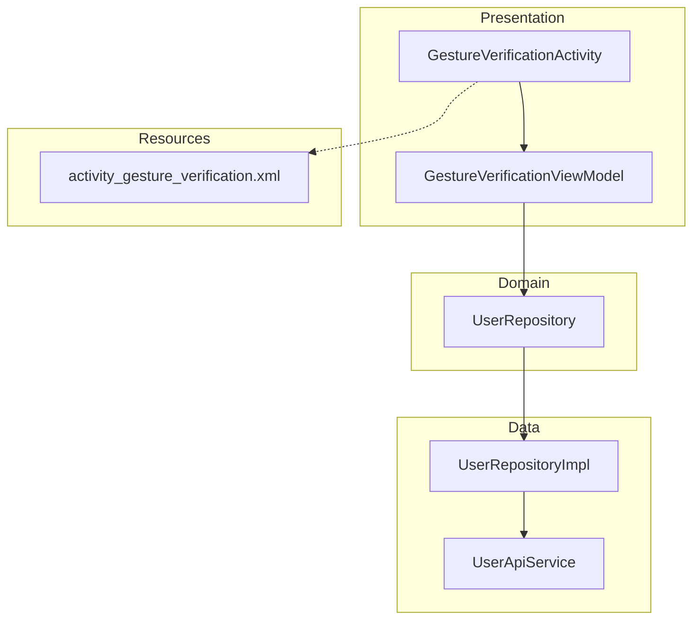
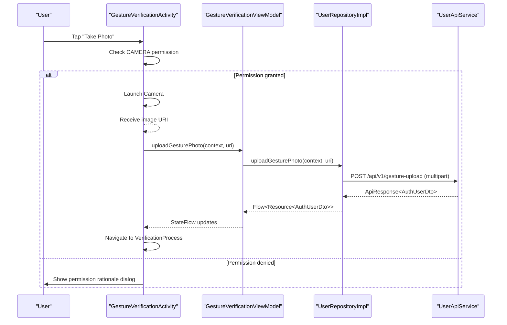
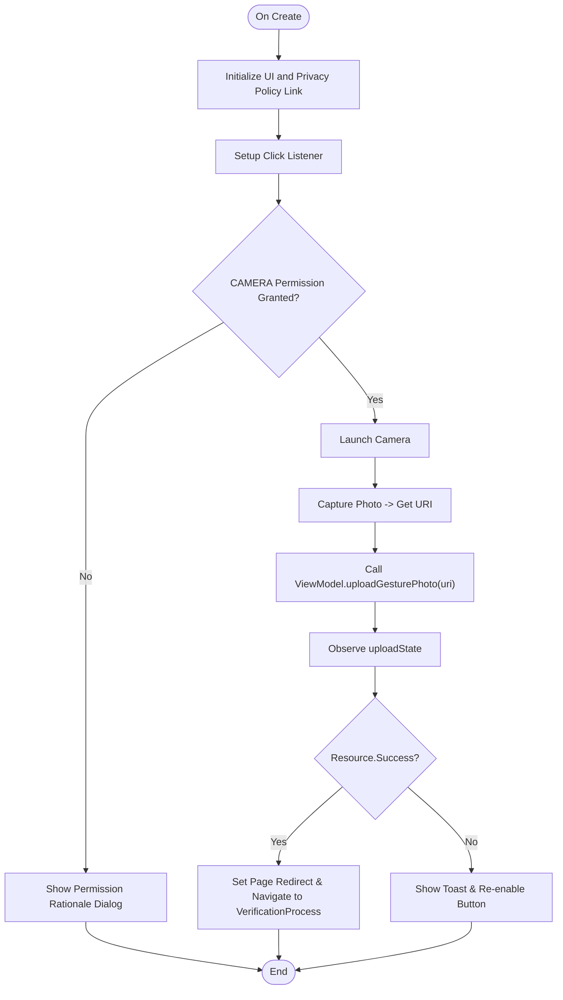
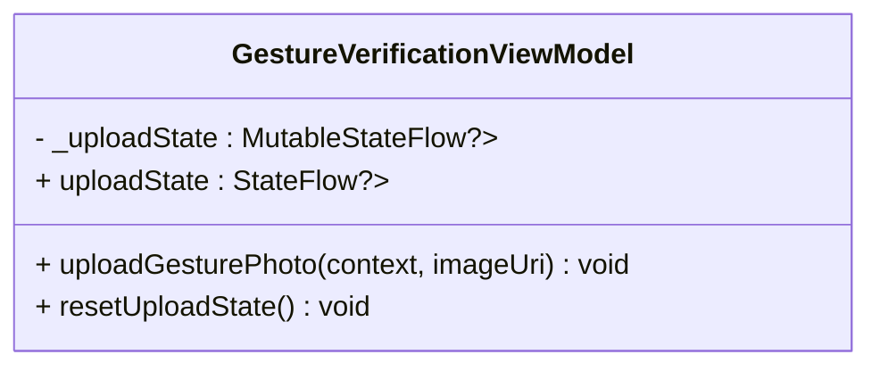
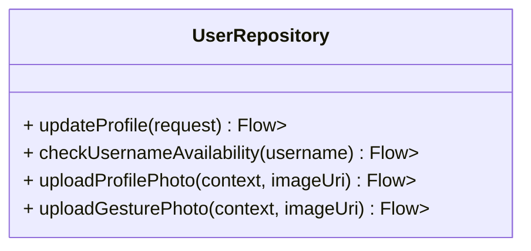
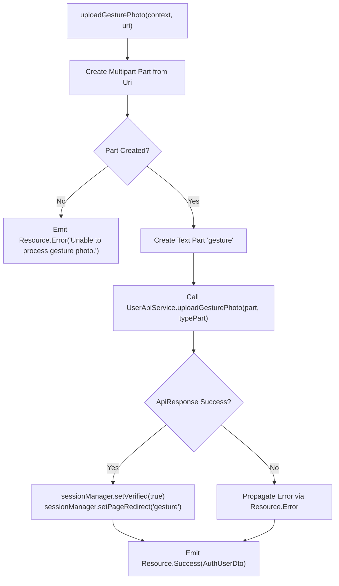
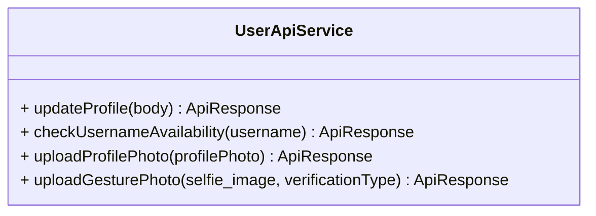
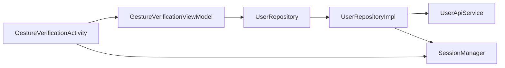

# Security and Biometric Setup

<cite>
**Referenced Files in This Document**
- [GestureVerificationActivity.kt](file://app/src/main/java/com/flirttime/feature/profile/presentation/gesture/GestureVerificationActivity.kt)
- [GestureVerificationViewModel.kt](file://app/src/main/java/com/flirttime/feature/profile/presentation/gesture/GestureVerificationViewModel.kt)
- [UserRepository.kt](file://app/src/main/java/com/flirttime/feature/profile/domain/repository/UserRepository.kt)
- [UserRepositoryImpl.kt](file://app/src/main/java/com/flirttime/feature/profile/data/repository/UserRepositoryImpl.kt)
- [UserApiService.kt](file://app/src/main/java/com/flirttime/feature/profile/data/network/UserApiService.kt)
- [activity_gesture_verification.xml](file://app/src/main/res/layout/activity_gesture_verification.xml)
</cite>

## Table of Contents
1. Introduction
2. Project Structure
3. Core Components
4. Architecture Overview
5. Detailed Component Analysis
6. Dependency Analysis
7. Performance Considerations
8. Troubleshooting Guide
9. Conclusion

## Introduction
This document explains the security and biometric setup features implemented in the application, focusing on the gesture verification flow for enhanced account protection. It covers how users capture a gesture photo, how it is securely uploaded to the backend, and how the app transitions to subsequent verification steps. It also clarifies that this implementation uses a gesture photo rather than Android’s biometric APIs (fingerprint or face recognition), and provides guidance on consent flows, permission handling, and security best practices for sensitive authentication data.

## Project Structure
The gesture verification feature resides under the profile feature module and follows a layered architecture:
- Presentation layer: Activity and ViewModel handle UI interactions and state.
- Domain layer: Repository interface defines contracts for uploading gesture photos.
- Data layer: Repository implementation orchestrates multipart upload via Retrofit API service.
- Resources: Layout defines the gesture verification screen.

**Diagram sources**
- [GestureVerificationActivity.kt:38-80](file://app/src/main/java/com/flirttime/feature/profile/presentation/gesture/GestureVerificationActivity.kt#L38-L80)
- [GestureVerificationViewModel.kt:15-33](file://app/src/main/java/com/flirttime/feature/profile/presentation/gesture/GestureVerificationViewModel.kt#L15-L33)
- [UserRepository.kt:10-20](file://app/src/main/java/com/flirttime/feature/profile/domain/repository/UserRepository.kt#L10-L20)
- [UserRepositoryImpl.kt:20-23](file://app/src/main/java/com/flirttime/feature/profile/data/repository/UserRepositoryImpl.kt#L20-L23)
- [UserApiService.kt:17-41](file://app/src/main/java/com/flirttime/feature/profile/data/network/UserApiService.kt#L17-L41)
- [activity_gesture_verification.xml:1-35](file://app/src/main/res/layout/activity_gesture_verification.xml#L1-L35)

**Section sources**
- [GestureVerificationActivity.kt:38-80](file://app/src/main/java/com/flirttime/feature/profile/presentation/gesture/GestureVerificationActivity.kt#L38-L80)
- [activity_gesture_verification.xml:1-35](file://app/src/main/res/layout/activity_gesture_verification.xml#L1-L35)

## Core Components
- GestureVerificationActivity: Manages user consent for camera access, launches the camera, handles permission denial, and navigates to the next step after successful upload.
- GestureVerificationViewModel: Exposes an uploadState StateFlow and delegates the actual upload to the repository.
- UserRepository (interface): Declares uploadProfilePhoto and uploadGesturePhoto methods.
- UserRepositoryImpl: Implements multipart upload logic, sets session flags upon success, and emits Resource states.
- UserApiService: Retrofit interface defining the gesture upload endpoint with multipart parts.

Key responsibilities:
- Permission handling and consent dialog for camera access.
- Securely capturing and temporarily storing the image URI.
- Uploading the gesture photo as multipart/form-data.
- Updating local session state to mark verification progress.

**Section sources**
- [GestureVerificationActivity.kt:45-66](file://app/src/main/java/com/flirttime/feature/profile/presentation/gesture/GestureVerificationActivity.kt#L45-L66)
- [GestureVerificationViewModel.kt:19-28](file://app/src/main/java/com/flirttime/feature/profile/presentation/gesture/GestureVerificationViewModel.kt#L19-L28)
- [UserRepository.kt:18-20](file://app/src/main/java/com/flirttime/feature/profile/domain/repository/UserRepository.kt#L18-L20)
- [UserRepositoryImpl.kt:109-125](file://app/src/main/java/com/flirttime/feature/profile/data/repository/UserRepositoryImpl.kt#L109-L125)
- [UserApiService.kt:35-40](file://app/src/main/java/com/flirttime/feature/profile/data/network/UserApiService.kt#L35-L40)

## Architecture Overview
The gesture verification flow integrates presentation, domain, and data layers to capture, validate, and upload a gesture photo. The Activity coordinates UI and permissions; the ViewModel manages state; the Repository performs network operations; and the API Service defines the endpoint contract.

**Diagram sources**
- [GestureVerificationActivity.kt:157-189](file://app/src/main/java/com/flirttime/feature/profile/presentation/gesture/GestureVerificationActivity.kt#L157-L189)
- [GestureVerificationViewModel.kt:22-28](file://app/src/main/java/com/flirttime/feature/profile/presentation/gesture/GestureVerificationViewModel.kt#L22-L28)
- [UserRepositoryImpl.kt:109-125](file://app/src/main/java/com/flirttime/feature/profile/data/repository/UserRepositoryImpl.kt#L109-L125)
- [UserApiService.kt:35-40](file://app/src/main/java/com/flirttime/feature/profile/data/network/UserApiService.kt#L35-L40)

## Detailed Component Analysis

### GestureVerificationActivity
Responsibilities:
- Initialize UI and edge-to-edge layout.
- Provide privacy policy link navigation.
- Handle camera permission request and denial.
- Capture a selfie using the system camera and pass the URI to the ViewModel.
- Observe upload state and navigate to the verification process upon success.

Permission and consent flow:
- Checks CAMERA permission before launching the camera.
- If denied, shows a dialog explaining importance and directs the user to app settings to grant permission.

Upload state observation:
- Disables the button during loading.
- On success, resets state and proceeds to the next step.
- On error, re-enables the button and displays a toast message.

Navigation:
- Sets page redirect to "gesture" and navigates to Destination.VerificationProcess.

**Diagram sources**
- [GestureVerificationActivity.kt:68-80](file://app/src/main/java/com/flirttime/feature/profile/presentation/gesture/GestureVerificationActivity.kt#L68-L80)
- [GestureVerificationActivity.kt:157-189](file://app/src/main/java/com/flirttime/feature/profile/presentation/gesture/GestureVerificationActivity.kt#L157-L189)
- [GestureVerificationActivity.kt:209-246](file://app/src/main/java/com/flirttime/feature/profile/presentation/gesture/GestureVerificationActivity.kt#L209-L246)

**Section sources**
- [GestureVerificationActivity.kt:68-80](file://app/src/main/java/com/flirttime/feature/profile/presentation/gesture/GestureVerificationActivity.kt#L68-L80)
- [GestureVerificationActivity.kt:157-189](file://app/src/main/java/com/flirttime/feature/profile/presentation/gesture/GestureVerificationActivity.kt#L157-L189)
- [GestureVerificationActivity.kt:209-246](file://app/src/main/java/com/flirttime/feature/profile/presentation/gesture/GestureVerificationActivity.kt#L209-L246)

### GestureVerificationViewModel
Responsibilities:
- Expose uploadState as a StateFlow<Resource<AuthUserDto>?>.
- Delegate uploadGesturePhoto to the repository within viewModelScope.
- Provide resetUploadState to clear state after processing.

**Diagram sources**
- [GestureVerificationViewModel.kt:15-33](file://app/src/main/java/com/flirttime/feature/profile/presentation/gesture/GestureVerificationViewModel.kt#L15-L33)

**Section sources**
- [GestureVerificationViewModel.kt:15-33](file://app/src/main/java/com/flirttime/feature/profile/presentation/gesture/GestureVerificationViewModel.kt#L15-L33)

### UserRepository Interface
Defines the contract for profile-related operations including gesture photo upload.

**Diagram sources**
- [UserRepository.kt:10-20](file://app/src/main/java/com/flirttime/feature/profile/domain/repository/UserRepository.kt#L10-L20)

**Section sources**
- [UserRepository.kt:10-20](file://app/src/main/java/com/flirttime/feature/profile/domain/repository/UserRepository.kt#L10-L20)

### UserRepositoryImpl
Implements gesture photo upload by:
- Creating a multipart part from the provided Uri.
- Adding a text part specifying verification type ("gesture").
- Calling the API service and emitting Resource states.
- On success, updating session flags to mark verification progress.

**Diagram sources**
- [UserRepositoryImpl.kt:109-125](file://app/src/main/java/com/flirttime/feature/profile/data/repository/UserRepositoryImpl.kt#L109-L125)

**Section sources**
- [UserRepositoryImpl.kt:109-125](file://app/src/main/java/com/flirttime/feature/profile/data/repository/UserRepositoryImpl.kt#L109-L125)

### UserApiService
Retrofit interface declaring the gesture upload endpoint:
- Endpoint: POST /api/v1/gesture-upload
- Multipart parts: selfie_image and verification_type set to "gesture".

**Diagram sources**
- [UserApiService.kt:17-41](file://app/src/main/java/com/flirttime/feature/profile/data/network/UserApiService.kt#L17-L41)

**Section sources**
- [UserApiService.kt:17-41](file://app/src/main/java/com/flirttime/feature/profile/data/network/UserApiService.kt#L17-L41)

## Dependency Analysis
The gesture verification feature depends on:
- Android framework components for camera access and file provider.
- Koin for dependency injection of SessionManager and ViewModel.
- Coroutines and StateFlow for asynchronous operations and UI state management.
- Retrofit and OkHttp for multipart uploads.
- SessionManager for persisting verification state and navigation redirects.

**Diagram sources**
- [GestureVerificationActivity.kt:40-43](file://app/src/main/java/com/flirttime/feature/profile/presentation/gesture/GestureVerificationActivity.kt#L40-L43)
- [GestureVerificationViewModel.kt:15-17](file://app/src/main/java/com/flirttime/feature/profile/presentation/gesture/GestureVerificationViewModel.kt#L15-L17)
- [UserRepositoryImpl.kt:20-23](file://app/src/main/java/com/flirttime/feature/profile/data/repository/UserRepositoryImpl.kt#L20-L23)

**Section sources**
- [GestureVerificationActivity.kt:40-43](file://app/src/main/java/com/flirttime/feature/profile/presentation/gesture/GestureVerificationActivity.kt#L40-L43)
- [UserRepositoryImpl.kt:20-23](file://app/src/main/java/com/flirttime/feature/profile/data/repository/UserRepositoryImpl.kt#L20-L23)

## Performance Considerations
- Use background threads for network and IO operations (already handled via Dispatchers.IO in repository).
- Avoid holding large images in memory; rely on Uri-based multipart creation.
- Debounce repeated uploads if necessary to prevent duplicate requests.
- Minimize UI work on main thread; only update lightweight UI elements like button enabled state and toasts.

[No sources needed since this section provides general guidance]

## Troubleshooting Guide
Common issues and resolutions:
- Camera permission denied:
  - Ensure the app requests CAMERA permission before launching the camera.
  - If denied, guide users to app settings to enable the permission.
- Image capture failure:
  - Validate FileProvider configuration and ensure the generated Uri is valid.
  - Handle exceptions when launching the camera and show user-friendly messages.
- Upload errors:
  - Inspect Resource.Error messages emitted by the repository.
  - Verify server endpoint availability and multipart field names match expectations.

**Section sources**
- [GestureVerificationActivity.kt:191-207](file://app/src/main/java/com/flirttime/feature/profile/presentation/gesture/GestureVerificationActivity.kt#L191-L207)
- [UserRepositoryImpl.kt:111-114](file://app/src/main/java/com/flirttime/feature/profile/data/repository/UserRepositoryImpl.kt#L111-L114)

## Conclusion
The gesture verification feature implements a secure, user-consented flow for capturing and uploading a gesture photo to strengthen account protection. It leverages a clean layered architecture, robust permission handling, and asynchronous state management. While this implementation does not use Android’s biometric APIs, it establishes a foundation for future integration of fingerprint or face recognition alongside gesture verification. Adhering to the outlined security best practices ensures sensitive authentication data remains protected throughout the process.

[No sources needed since this section summarizes without analyzing specific files]