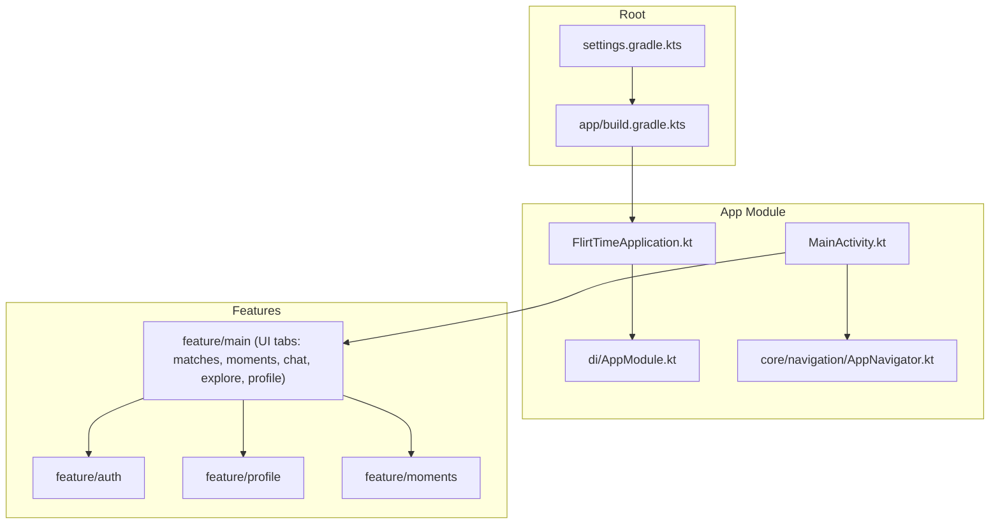
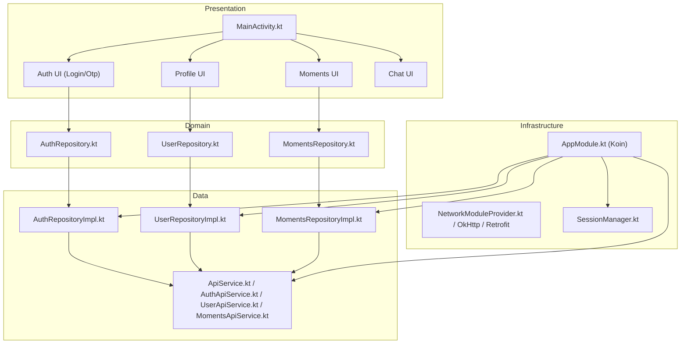
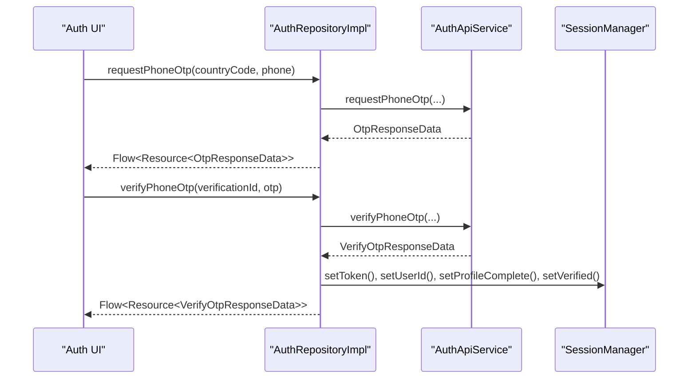
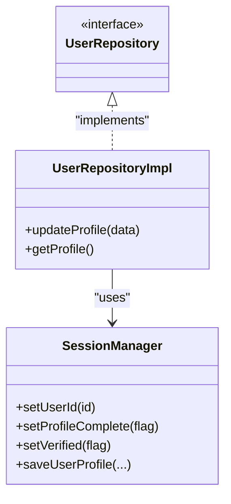
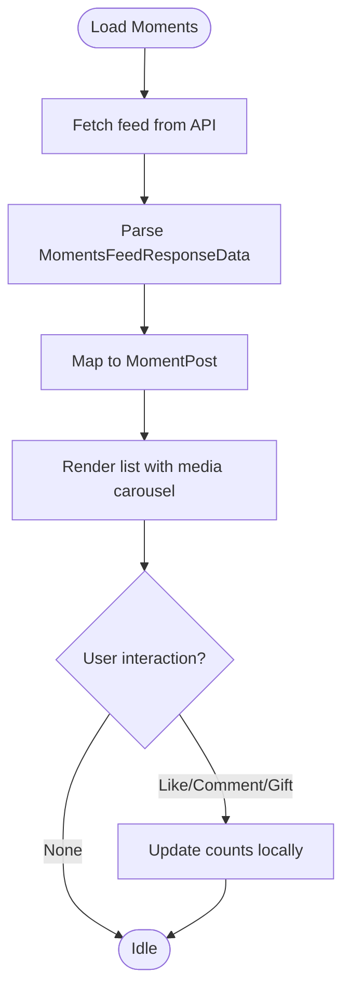
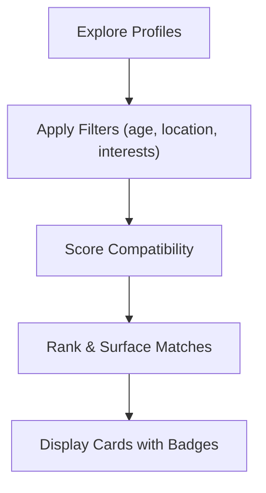
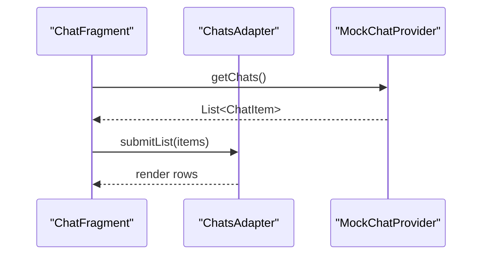
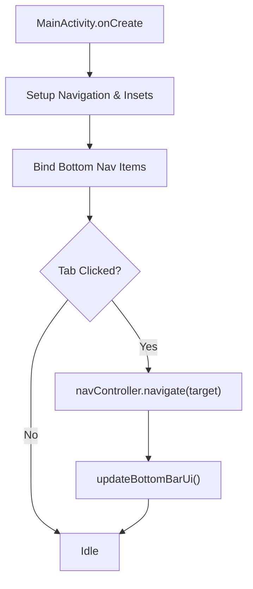
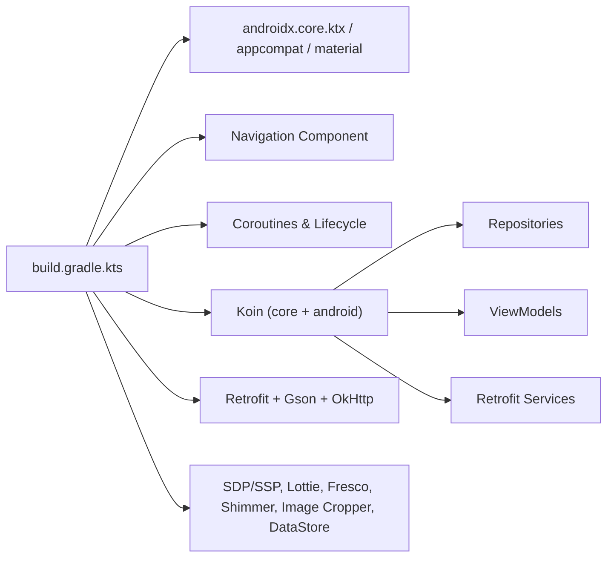

# Project Overview

<cite>
**Referenced Files in This Document**
- [FlirtTimeApplication.kt](file://app/src/main/java/com/flirttime/FlirtTimeApplication.kt)
- [MainActivity.kt](file://app/src/main/java/com/flirttime/MainActivity.kt)
- [AppModule.kt](file://app/src/main/java/com/flirttime/di/AppModule.kt)
- [AppNavigator.kt](file://app/src/main/java/com/flirttime/core/navigation/AppNavigator.kt)
- [build.gradle.kts](file://app/build.gradle.kts)
- [settings.gradle.kts](file://settings.gradle.kts)
- [AuthRepositoryImpl.kt](file://app/src/main/java/com/flirttime/feature/auth/data/repository/AuthRepositoryImpl.kt)
- [MockChatProvider.kt](file://app/src/main/java/com/flirttime/feature/main/presentation/chat/MockChatProvider.kt)
- [MomentsModels.kt](file://app/src/main/java/com/flirttime/feature/moments/data/model/MomentsModels.kt)
- [MomentPost.kt](file://app/src/main/java/com/flirttime/feature/main/presentation/moments/MomentPost.kt)
</cite>

## Table of Contents
1. [Introduction](#introduction)
2. [Project Structure](#project-structure)
3. [Core Components](#core-components)
4. [Architecture Overview](#architecture-overview)
5. [Detailed Component Analysis](#detailed-component-analysis)
6. [Dependency Analysis](#dependency-analysis)
7. [Performance Considerations](#performance-considerations)
8. [Troubleshooting Guide](#troubleshooting-guide)
9. [Conclusion](#conclusion)

## Introduction
Flirttime-Otp-Android is a modern Android dating platform that helps users discover, connect, and communicate with potential matches. The app provides secure phone/email OTP authentication, rich profile management, a social “moments” feed for posts and interactions, matching discovery, and chat capabilities. It follows Clean Architecture principles with MVVM UI, uses Koin for dependency injection, Retrofit for networking, and Material Design components for a polished user experience.

Target audience:
- Dating app users seeking meaningful connections through profiles, shared interests, and real-time communication.

Key differentiators:
- Phone and email OTP-based authentication for fast, secure onboarding.
- Moments/posts system to share experiences and spark conversations.
- Matching algorithms surfaced via the matches tab to streamline discovery.
- Real-time chat interface to maintain ongoing conversations.

## Project Structure
The project is organized by features under com.flirttime.feature, with shared infrastructure under core and dependency wiring in di. The root module includes app and Gradle configuration.

**Diagram sources**
- [settings.gradle.kts:1-26](file://settings.gradle.kts#L1-L26)
- [build.gradle.kts:1-92](file://app/build.gradle.kts#L1-L92)
- [FlirtTimeApplication.kt:10-23](file://app/src/main/java/com/flirttime/FlirtTimeApplication.kt#L10-L23)
- [MainActivity.kt:18-185](file://app/src/main/java/com/flirttime/MainActivity.kt#L18-L185)
- [AppModule.kt:27-57](file://app/src/main/java/com/flirttime/di/AppModule.kt#L27-L57)
- [AppNavigator.kt:19-56](file://app/src/main/java/com/flirttime/core/navigation/AppNavigator.kt#L19-L56)

**Section sources**
- [settings.gradle.kts:1-26](file://settings.gradle.kts#L1-L26)
- [build.gradle.kts:1-92](file://app/build.gradle.kts#L1-L92)

## Core Components
- Application bootstrap and DI initialization:
  - Initializes Koin modules and Fresco image pipeline at app startup.
- Main navigation shell:
  - Hosts bottom navigation for Moments, Explore, Matches, Chat, and Profile.
  - Manages edge-to-edge insets and dynamic status bar appearance per destination.
- Dependency Injection (Koin):
  - Provides repositories, API services, network clients, and ViewModels.
- Navigation router:
  - Type-safe sealed destinations with centralized Intent extras handling.

**Section sources**
- [FlirtTimeApplication.kt:10-23](file://app/src/main/java/com/flirttime/FlirtTimeApplication.kt#L10-L23)
- [MainActivity.kt:18-185](file://app/src/main/java/com/flirttime/MainActivity.kt#L18-L185)
- [AppModule.kt:27-57](file://app/src/main/java/com/flirttime/di/AppModule.kt#L27-L57)
- [AppNavigator.kt:19-137](file://app/src/main/java/com/flirttime/core/navigation/AppNavigator.kt#L19-L137)

## Architecture Overview
The app implements Clean Architecture with feature boundaries:
- Presentation layer (Activities/Fragments + ViewModels) observes state and drives UI.
- Domain layer defines repository interfaces and business rules.
- Data layer implements repositories using Retrofit APIs and local storage.

**Diagram sources**
- [MainActivity.kt:18-185](file://app/src/main/java/com/flirttime/MainActivity.kt#L18-L185)
- [AppModule.kt:27-57](file://app/src/main/java/com/flirttime/di/AppModule.kt#L27-L57)
- [AuthRepositoryImpl.kt:30-97](file://app/src/main/java/com/flirttime/feature/auth/data/repository/AuthRepositoryImpl.kt#L30-L97)

## Detailed Component Analysis

### Authentication (Phone/Email OTP)
- Supports phone OTP and email OTP flows.
- Repository orchestrates API calls and persists session data (token, user info, verification flags).
- UI flows are navigated via AppNavigator with typed parameters.

**Diagram sources**
- [AuthRepositoryImpl.kt:30-97](file://app/src/main/java/com/flirttime/feature/auth/data/repository/AuthRepositoryImpl.kt#L30-L97)

**Section sources**
- [AuthRepositoryImpl.kt:30-97](file://app/src/main/java/com/flirttime/feature/auth/data/repository/AuthRepositoryImpl.kt#L30-L97)
- [AppNavigator.kt:27-37](file://app/src/main/java/com/flirttime/core/navigation/AppNavigator.kt#L27-L37)

### Profile Management
- User profile domain repository and implementation manage profile data and verification states.
- UI supports intro, preview, gesture verification, and verification process screens.
- Session manager stores user identity and profile completeness.

**Diagram sources**
- [AppModule.kt:47-51](file://app/src/main/java/com/flirttime/di/AppModule.kt#L47-L51)

**Section sources**
- [AppModule.kt:47-51](file://app/src/main/java/com/flirttime/di/AppModule.kt#L47-L51)

### Moments/Posts System
- Presents a feed of user-generated moments with media, captions, likes, comments, and gifts.
- Data models include pagination metadata and moment details.

**Diagram sources**
- [MomentsModels.kt:6-43](file://app/src/main/java/com/flirttime/feature/moments/data/model/MomentsModels.kt#L6-L43)
- [MomentPost.kt:3-25](file://app/src/main/java/com/flirttime/feature/main/presentation/moments/MomentPost.kt#L3-L25)

**Section sources**
- [MomentsModels.kt:6-43](file://app/src/main/java/com/flirttime/feature/moments/data/model/MomentsModels.kt#L6-L43)
- [MomentPost.kt:3-25](file://app/src/main/java/com/flirttime/feature/main/presentation/moments/MomentPost.kt#L3-L25)

### Matching Algorithms and Discovery
- The Matches tab surfaces potential matches with compatibility indicators and shared interests.
- Mock data demonstrates match cards, interest tags, and verification badges.

[No sources needed since this diagram shows conceptual workflow, not actual code structure]

**Section sources**
- [MockMatchProfileProvider.kt:32-63](file://app/src/main/java/com/flirttime/feature/main/presentation/matches/MockMatchProfileProvider.kt#L32-L63)

### Real-Time Chat
- Chat UI displays conversation lists with avatars, last messages, timestamps, and unread counts.
- Uses mock provider for demonstration; can be wired to real-time backend later.

**Diagram sources**
- [MockChatProvider.kt:1-39](file://app/src/main/java/com/flirttime/feature/main/presentation/chat/MockChatProvider.kt#L1-L39)

**Section sources**
- [MockChatProvider.kt:1-39](file://app/src/main/java/com/flirttime/feature/main/presentation/chat/MockChatProvider.kt#L1-L39)

### Navigation Shell and Tabs
- MainActivity hosts five primary tabs: Moments, Explore, Matches, Chat, Profile.
- Handles window insets, bottom navigation selection, and incoming intents to open specific tabs.

**Diagram sources**
- [MainActivity.kt:24-185](file://app/src/main/java/com/flirttime/MainActivity.kt#L24-L185)

**Section sources**
- [MainActivity.kt:24-185](file://app/src/main/java/com/flirttime/MainActivity.kt#L24-L185)

## Dependency Analysis
The app’s runtime dependencies are declared in Gradle and wired via Koin.

**Diagram sources**
- [build.gradle.kts:43-92](file://app/build.gradle.kts#L43-L92)
- [AppModule.kt:27-57](file://app/src/main/java/com/flirttime/di/AppModule.kt#L27-L57)

**Section sources**
- [build.gradle.kts:43-92](file://app/build.gradle.kts#L43-L92)
- [AppModule.kt:27-57](file://app/src/main/java/com/flirttime/di/AppModule.kt#L27-L57)

## Performance Considerations
- Use Fresco for efficient image loading and caching.
- Leverage coroutines for background work and UI updates.
- Keep network requests minimal and cache where appropriate.
- Avoid heavy computations on the main thread; offload to IO dispatcher.
- Optimize list rendering with stable IDs and view recycling.

[No sources needed since this section provides general guidance]

## Troubleshooting Guide
- Authentication failures:
  - Validate OTP request payloads and ensure correct country codes and identifiers.
  - Check session persistence after successful verification.
- Network issues:
  - Confirm base URL and OkHttp/Retrofit configuration.
  - Inspect logs via OkHttp logging interceptor.
- Navigation problems:
  - Ensure AppNavigator destinations and extras match Activity expectations.
- UI glitches:
  - Verify edge-to-edge insets handling in MainActivity.

**Section sources**
- [AuthRepositoryImpl.kt:30-97](file://app/src/main/java/com/flirttime/feature/auth/data/repository/AuthRepositoryImpl.kt#L30-L97)
- [MainActivity.kt:24-100](file://app/src/main/java/com/flirttime/MainActivity.kt#L24-L100)
- [AppNavigator.kt:73-137](file://app/src/main/java/com/flirttime/core/navigation/AppNavigator.kt#L73-L137)

## Conclusion
Flirttime-Otp-Android delivers a modern, secure, and engaging dating experience through OTP authentication, robust profile management, a social moments feed, intelligent matching, and chat. Its Clean Architecture and MVVM approach, combined with Koin and Retrofit, provide a scalable foundation for future enhancements and integrations.

[No sources needed since this section summarizes without analyzing specific files]