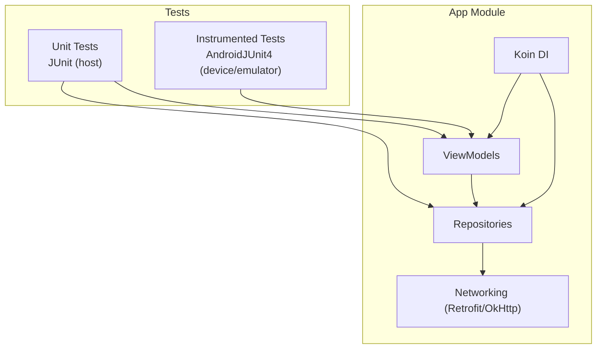
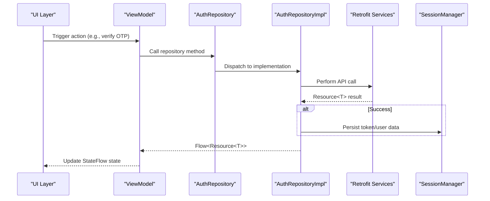
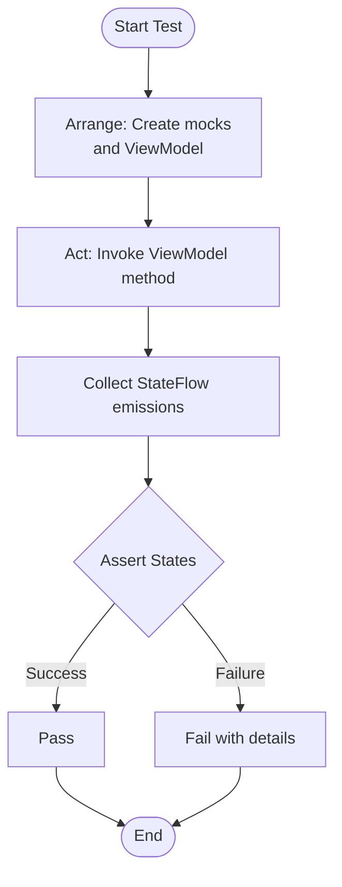
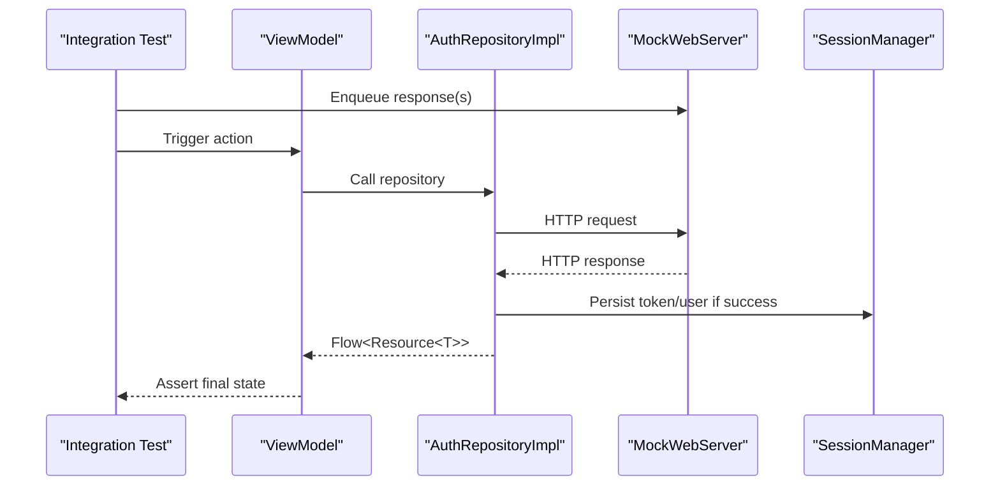
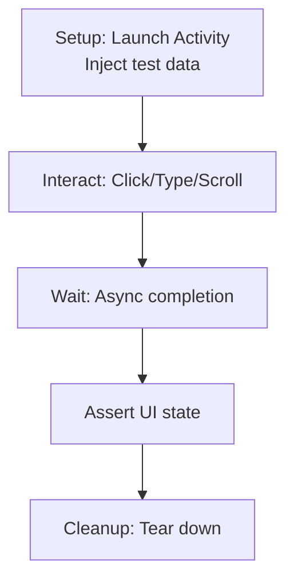
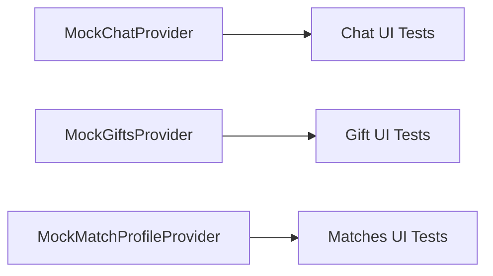
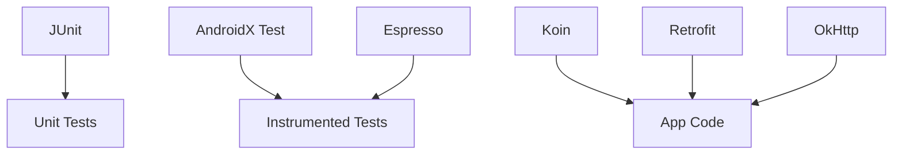

# Testing Strategy

<cite>
**Referenced Files in This Document**
- [app/build.gradle.kts](file://app/build.gradle.kts)
- [ExampleUnitTest.kt](file://app/src/test/java/com/flirttime/ExampleUnitTest.kt)
- [ExampleInstrumentedTest.kt](file://app/src/androidTest/java/com/flirttime/ExampleInstrumentedTest.kt)
- [LoginInputViewModel.kt](file://app/src/main/java/com/flirttime/feature/auth/presentation/login/LoginInputViewModel.kt)
- [OtpViewModel.kt](file://app/src/main/java/com/flirttime/feature/auth/presentation/otp/OtpViewModel.kt)
- [AuthRepository.kt](file://app/src/main/java/com/flirttime/feature/auth/domain/repository/AuthRepository.kt)
- [AuthRepositoryImpl.kt](file://app/src/main/java/com/flirttime/feature/auth/data/repository/AuthRepositoryImpl.kt)
- [AppModule.kt](file://app/src/main/java/com/flirttime/di/AppModule.kt)
- [NetworkModuleProvider.kt](file://app/src/main/java/com/flirttime/core/network/NetworkModuleProvider.kt)
- [SafeApiCall.kt](file://app/src/main/java/com/flirttime/core/network/SafeApiCall.kt)
- [MockChatProvider.kt](file://app/src/main/java/com/flirttime/feature/main/presentation/chat/MockChatProvider.kt)
- [MockGiftsProvider.kt](file://app/src/main/java/com/flirttime/feature/main/presentation/moments/gift/MockGiftsProvider.kt)
- [MockMatchProfileProvider.kt](file://app/src/main/java/com/flirttime/feature/main/presentation/matches/MockMatchProfileProvider.kt)
- [NotificationRepository.kt](file://app/src/main/java/com/flirttime/feature/notification/data/repository/NotificationRepository.kt)
- [TestActivity.kt](file://app/src/main/java/com/flirttime/TestActivity.kt)
</cite>

## Table of Contents
1. [Introduction](#introduction)
2. [Project Structure](#project-structure)
3. [Core Components](#core-components)
4. [Architecture Overview](#architecture-overview)
5. [Detailed Component Analysis](#detailed-component-analysis)
6. [Dependency Analysis](#dependency-analysis)
7. [Performance Considerations](#performance-considerations)
8. [Troubleshooting Guide](#troubleshooting-guide)
9. [Conclusion](#conclusion)

## Introduction
This document defines the testing strategy for the Flirttime-Otp-Android application. It covers unit testing with JUnit and Mockito, integration testing for API and database interactions, UI testing with Espresso, mock data strategies, test data management, continuous integration setup, best practices, code coverage requirements, debugging techniques, performance testing, memory leak detection, and test optimization.

## Project Structure
The project uses a standard Android module layout:
- Unit tests under app/src/test
- Instrumented tests under app/src/androidTest
- Feature-based architecture with ViewModels, repositories, and DI via Koin
- Networking via Retrofit and OkHttp
- Coroutines and StateFlow for reactive state

**Diagram sources**
- [app/build.gradle.kts:89-91](file://app/build.gradle.kts#L89-L91)
- [ExampleUnitTest.kt:1-17](file://app/src/test/java/com/flirttime/ExampleUnitTest.kt#L1-L17)
- [ExampleInstrumentedTest.kt:1-24](file://app/src/androidTest/java/com/flirttime/ExampleInstrumentedTest.kt#L1-L24)

**Section sources**
- [app/build.gradle.kts:1-92](file://app/build.gradle.kts#L1-L92)
- [ExampleUnitTest.kt:1-17](file://app/src/test/java/com/flirttime/ExampleUnitTest.kt#L1-L17)
- [ExampleInstrumentedTest.kt:1-24](file://app/src/androidTest/java/com/flirttime/ExampleInstrumentedTest.kt#L1-L24)

## Core Components
Key components to test:
- ViewModels: LoginInputViewModel, OtpViewModel
- Repositories: AuthRepository interface and AuthRepositoryImpl implementation
- Networking: SafeApiCall error handling and NetworkModuleProvider configuration
- DI: AppModule wiring for ViewModels and repositories
- Mock data providers for UI features

Testing focus areas:
- ViewModel state transitions and coroutine flows
- Repository flow emissions and side effects (token/session persistence)
- Error mapping from network layer
- UI rendering using mock data

**Section sources**
- [LoginInputViewModel.kt:1-59](file://app/src/main/java/com/flirttime/feature/auth/presentation/login/LoginInputViewModel.kt#L1-L59)
- [OtpViewModel.kt:1-57](file://app/src/main/java/com/flirttime/feature/auth/presentation/otp/OtpViewModel.kt#L1-L57)
- [AuthRepository.kt:1-53](file://app/src/main/java/com/flirttime/feature/auth/domain/repository/AuthRepository.kt#L1-L53)
- [AuthRepositoryImpl.kt:1-218](file://app/src/main/java/com/flirttime/feature/auth/data/repository/AuthRepositoryImpl.kt#L1-L218)
- [SafeApiCall.kt:33-102](file://app/src/main/java/com/flirttime/core/network/SafeApiCall.kt#L33-L102)
- [NetworkModuleProvider.kt:69-85](file://app/src/main/java/com/flirttime/core/network/NetworkModuleProvider.kt#L69-L85)
- [AppModule.kt:22-61](file://app/src/main/java/com/flirttime/di/AppModule.kt#L22-L61)

## Architecture Overview
The authentication feature follows a layered approach:
- Presentation: ViewModels expose StateFlow states
- Domain: Repository interfaces define contracts
- Data: Repository implementations call APIs and persist session data
- Network: Retrofit services wrapped by safeApiCall utilities

**Diagram sources**
- [OtpViewModel.kt:24-48](file://app/src/main/java/com/flirttime/feature/auth/presentation/otp/OtpViewModel.kt#L24-L48)
- [AuthRepository.kt:10-52](file://app/src/main/java/com/flirttime/feature/auth/domain/repository/AuthRepository.kt#L10-L52)
- [AuthRepositoryImpl.kt:40-75](file://app/src/main/java/com/flirttime/feature/auth/data/repository/AuthRepositoryImpl.kt#L40-L75)

## Detailed Component Analysis

### Unit Testing Strategy (JUnit + Mockito)
Goals:
- Verify ViewModel state changes based on repository flows
- Validate repository behavior without real network calls
- Test error mapping and edge cases

Approach:
- Use JUnit 4 or JUnit 5 with kotlinx-coroutines-test for coroutines
- Use Mockito to mock repository methods returning Flow<Resource<T>>
- Assert StateFlow values and emission order
- For repository tests, mock ApiService/AuthApiService and verify calls and side effects

Recommended test categories:
- LoginInputViewModel: countries loading, request OTP success/error, reset state
- OtpViewModel: verify OTP and resend OTP flows, state resets
- AuthRepositoryImpl: verify correct API calls, token/session persistence, error mapping

**Diagram sources**
- [LoginInputViewModel.kt:31-57](file://app/src/main/java/com/flirttime/feature/auth/presentation/login/LoginInputViewModel.kt#L31-L57)
- [OtpViewModel.kt:24-56](file://app/src/main/java/com/flirttime/feature/auth/presentation/otp/OtpViewModel.kt#L24-L56)

**Section sources**
- [app/build.gradle.kts:89-91](file://app/build.gradle.kts#L89-L91)
- [ExampleUnitTest.kt:1-17](file://app/src/test/java/com/flirttime/ExampleUnitTest.kt#L1-L17)

### Integration Testing Strategy (API and Database)
Goals:
- Validate end-to-end flows between ViewModels, repositories, and network layer
- Ensure session persistence after successful auth
- Confirm error handling paths

Approach:
- Use MockWebServer to simulate API responses for success, failure, timeout, and unknown host scenarios
- Inject mocked Retrofit services into repository via Koin test modules or constructor injection in tests
- Verify that SessionManager is called with expected values on success
- Validate Resource.Error messages and codes from SafeApiCall

**Diagram sources**
- [AuthRepositoryImpl.kt:40-75](file://app/src/main/java/com/flirttime/feature/auth/data/repository/AuthRepositoryImpl.kt#L40-L75)
- [SafeApiCall.kt:33-102](file://app/src/main/java/com/flirttime/core/network/SafeApiCall.kt#L33-L102)

**Section sources**
- [AuthRepositoryImpl.kt:1-218](file://app/src/main/java/com/flirttime/feature/auth/data/repository/AuthRepositoryImpl.kt#L1-L218)
- [SafeApiCall.kt:33-102](file://app/src/main/java/com/flirttime/core/network/SafeApiCall.kt#L33-L102)

### UI Testing Strategy (Espresso)
Goals:
- Automate user interactions across key screens
- Validate UI state changes and navigation outcomes
- Ensure robustness against flakiness

Approach:
- Use AndroidJUnit4 runner and Espresso for view assertions and actions
- Leverage TestActivity to isolate layouts during development
- Use IdlingResources or WorkManager rules where needed for async operations
- Provide stable test data via mock providers

**Diagram sources**
- [ExampleInstrumentedTest.kt:16-23](file://app/src/androidTest/java/com/flirttime/ExampleInstrumentedTest.kt#L16-L23)
- [TestActivity.kt:18-35](file://app/src/main/java/com/flirttime/TestActivity.kt#L18-L35)

**Section sources**
- [ExampleInstrumentedTest.kt:1-24](file://app/src/androidTest/java/com/flirttime/ExampleInstrumentedTest.kt#L1-L24)
- [TestActivity.kt:18-35](file://app/src/main/java/com/flirttime/TestActivity.kt#L18-L35)

### Mock Data Strategies and Test Data Management
- Use dedicated mock providers for UI features to avoid coupling tests to production data
- Centralize mock data objects for consistent assertions
- Keep mock data small and deterministic

Examples:
- Chat list mock data
- Gift catalog mock data
- Match profiles mock data

**Diagram sources**
- [MockChatProvider.kt:1-39](file://app/src/main/java/com/flirttime/feature/main/presentation/chat/MockChatProvider.kt#L1-L39)
- [MockGiftsProvider.kt:1-55](file://app/src/main/java/com/flirttime/feature/main/presentation/moments/gift/MockGiftsProvider.kt#L1-L55)
- [MockMatchProfileProvider.kt:1-34](file://app/src/main/java/com/flirttime/feature/main/presentation/matches/MockMatchProfileProvider.kt#L1-L34)

**Section sources**
- [MockChatProvider.kt:1-39](file://app/src/main/java/com/flirttime/feature/main/presentation/chat/MockChatProvider.kt#L1-L39)
- [MockGiftsProvider.kt:1-55](file://app/src/main/java/com/flirttime/feature/main/presentation/moments/gift/MockGiftsProvider.kt#L1-L55)
- [MockMatchProfileProvider.kt:1-34](file://app/src/main/java/com/flirttime/feature/main/presentation/matches/MockMatchProfileProvider.kt#L1-L34)

## Dependency Analysis
Key dependencies for testing:
- JUnit for unit tests
- AndroidX Test and Espresso for instrumented tests
- Koin for dependency injection (use test modules to override dependencies)
- Retrofit/OkHttp for networking (mock via MockWebServer)

**Diagram sources**
- [app/build.gradle.kts:89-91](file://app/build.gradle.kts#L89-L91)
- [AppModule.kt:22-61](file://app/src/main/java/com/flirttime/di/AppModule.kt#L22-L61)
- [NetworkModuleProvider.kt:69-85](file://app/src/main/java/com/flirttime/core/network/NetworkModuleProvider.kt#L69-L85)

**Section sources**
- [app/build.gradle.kts:89-91](file://app/build.gradle.kts#L89-L91)
- [AppModule.kt:22-61](file://app/src/main/java/com/flirttime/di/AppModule.kt#L22-L61)

## Performance Considerations
- Prefer unit tests over instrumented tests for speed; run instrumented tests selectively
- Use coroutines-test to control time and dispatchers in tests
- Avoid heavy UI operations in unit tests; keep them isolated
- For integration tests, use MockWebServer to eliminate network latency
- Minimize test data size to reduce serialization overhead
- Parallelize independent tests where possible
- Profile long-running tests and refactor to reduce I/O

[No sources needed since this section provides general guidance]

## Troubleshooting Guide
Common issues and resolutions:
- Flaky UI tests: Add explicit waits or IdlingResources; stabilize asynchronous operations
- Network errors in integration tests: Ensure MockWebServer responses are correctly enqueued and match endpoints
- Coroutine timing issues: Use advanceUntilIdle or testDispatcher rules
- DI conflicts in tests: Override Koin modules to inject test doubles
- Memory leaks: Check for retained contexts in ViewModels; ensure lifecycle-aware cleanup

Debugging tips:
- Log StateFlow emissions during tests to trace state transitions
- Inspect Resource.Error payloads from SafeApiCall to validate error mapping
- Use Android Studio’s debugger with breakpoints in repository and ViewModel layers
- For UI failures, capture screenshots and logs at assertion points

**Section sources**
- [SafeApiCall.kt:33-102](file://app/src/main/java/com/flirttime/core/network/SafeApiCall.kt#L33-L102)
- [LoginInputViewModel.kt:31-57](file://app/src/main/java/com/flirttime/feature/auth/presentation/login/LoginInputViewModel.kt#L31-L57)
- [OtpViewModel.kt:24-56](file://app/src/main/java/com/flirttime/feature/auth/presentation/otp/OtpViewModel.kt#L24-L56)

## Conclusion
Adopting a layered testing strategy—unit tests for business logic, integration tests for API and persistence, and UI tests for user flows—ensures reliability and maintainability. Use mock data providers to decouple UI tests from backend variability, leverage MockWebServer for deterministic network behavior, and integrate these tests into CI pipelines with coverage thresholds. Continuously refine test suites for performance and stability to support rapid development cycles.

[No sources needed since this section summarizes without analyzing specific files]