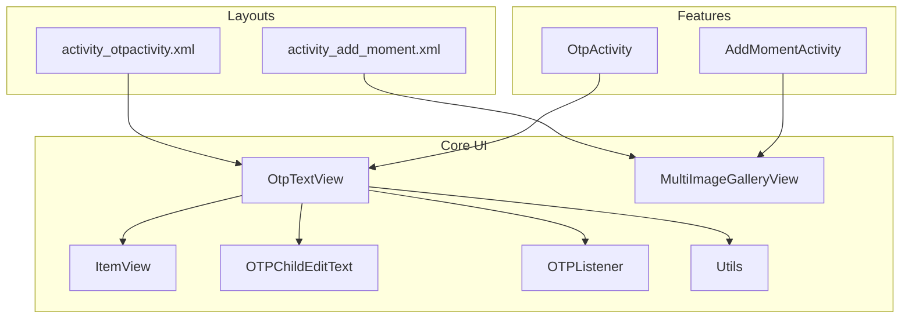
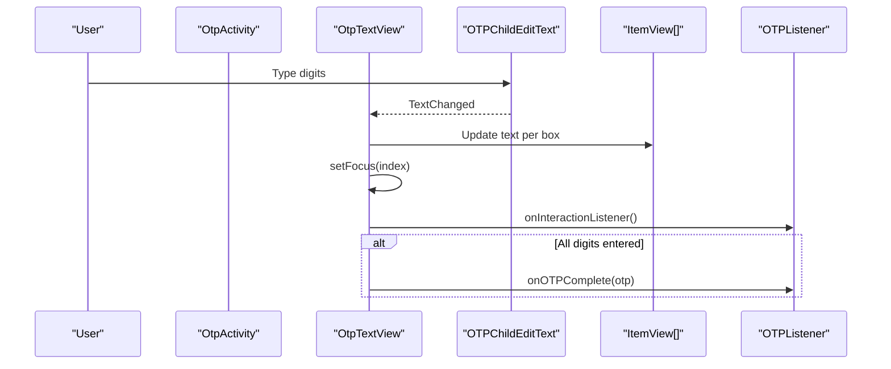
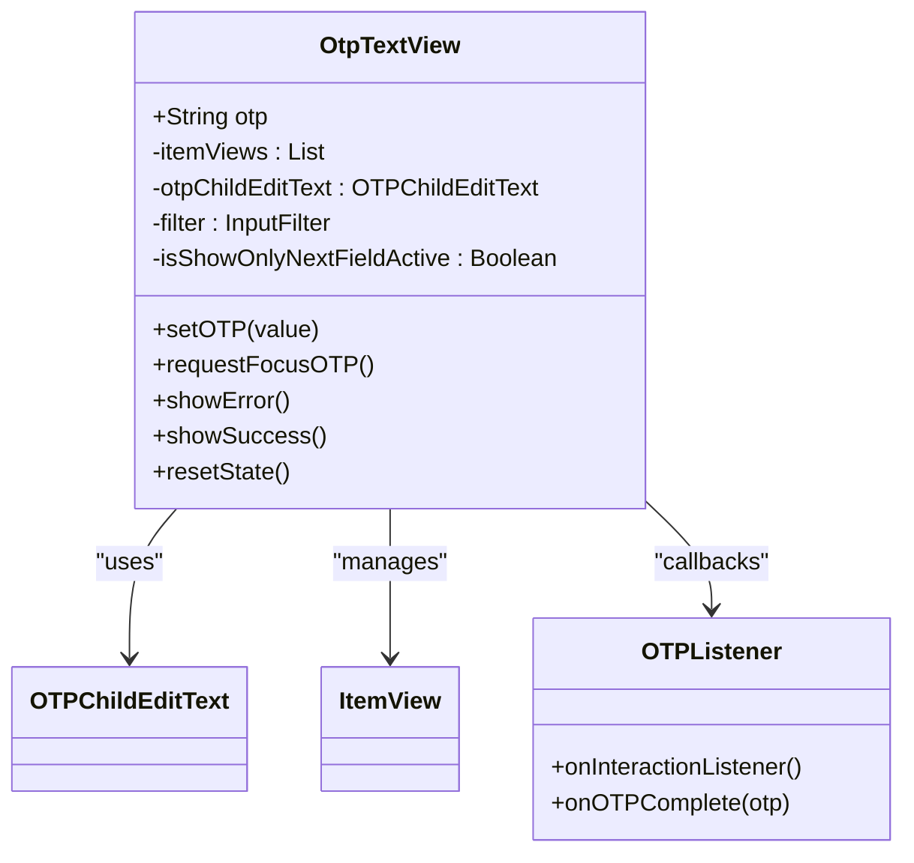
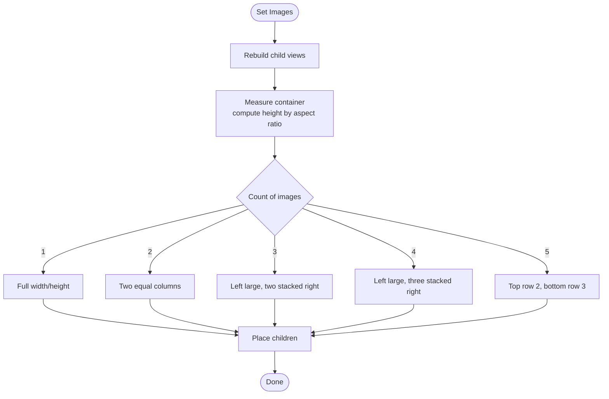
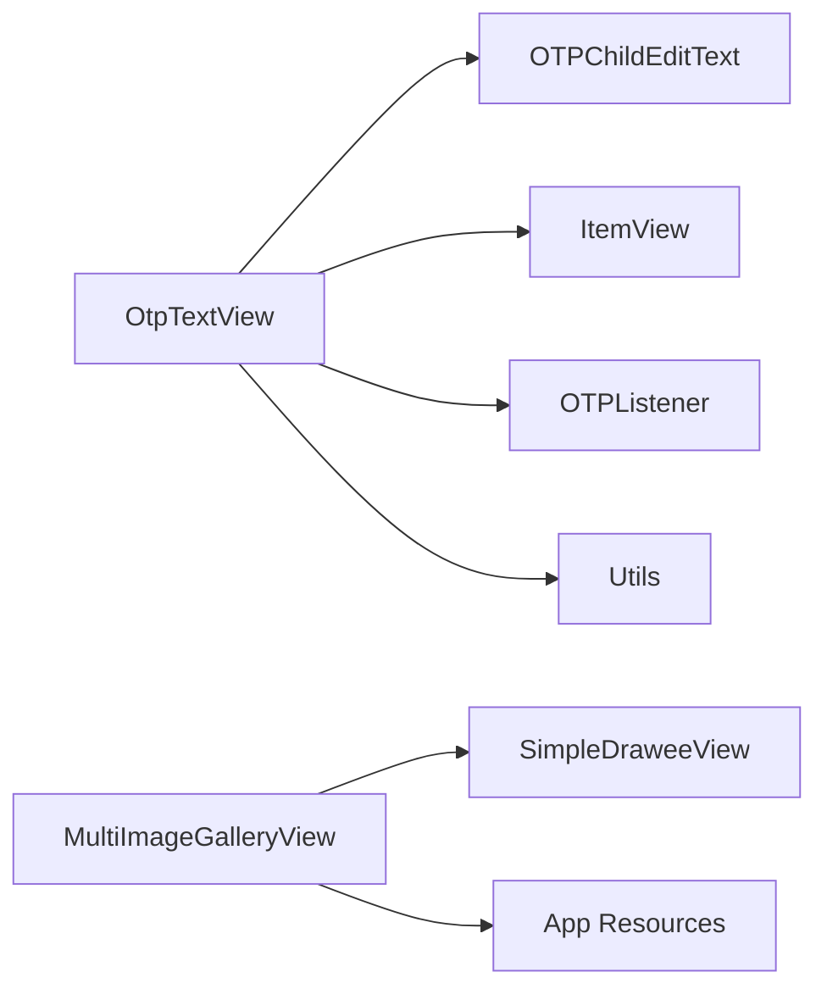

# UI Components

<cite>
**Referenced Files in This Document**
- [OtpTextView.kt](file://app/src/main/java/com/flirttime/core/ui/otpview/OtpTextView.kt)
- [OTPChildEditText.kt](file://app/src/main/java/com/flirttime/core/ui/otpview/OTPChildEditText.kt)
- [ItemView.kt](file://app/src/main/java/com/flirttime/core/ui/otpview/ItemView.kt)
- [OTPListener.kt](file://app/src/main/java/com/flirttime/core/ui/otpview/OTPListener.kt)
- [Utils.kt](file://app/src/main/java/com/flirttime/core/ui/otpview/Utils.kt)
- [attrs.xml](file://app/src/main/res/values/attrs.xml)
- [activity_otpactivity.xml](file://app/src/main/res/layout/activity_otpactivity.xml)
- [MultiImageGalleryView.kt](file://app/src/main/java/com/flirttime/core/ui/widget/MultiImageGalleryView.kt)
- [activity_add_moment.xml](file://app/src/main/res/layout/activity_add_moment.xml)
- [AddMomentActivity.kt](file://app/src/main/java/com/flirttime/feature/main/presentation/moments/add/AddMomentActivity.kt)
</cite>

## Table of Contents
1. [Introduction](#introduction)
2. [Project Structure](#project-structure)
3. [Core Components](#core-components)
4. [Architecture Overview](#architecture-overview)
5. [Detailed Component Analysis](#detailed-component-analysis)
6. [Dependency Analysis](#dependency-analysis)
7. [Performance Considerations](#performance-considerations)
8. [Troubleshooting Guide](#troubleshooting-guide)
9. [Conclusion](#conclusion)
10. [Appendices](#appendices)

## Introduction
This document explains the custom UI components used across Flirttime-Otp-Android, focusing on:
- OTP input view for secure code entry
- Multi-image gallery for dynamic media selection and preview
- Custom widgets and styling patterns that power these components

It covers component props (attributes), events/callbacks, customization options, usage examples, theme integration, accessibility considerations, animation support, performance optimization, and guidelines for creating new custom components following established patterns.

## Project Structure
The UI components are organized under core UI packages:
- OTP input view: com.flirttime.core.ui.otpview
- Multi-image gallery: com.flirttime.core.ui.widget
- Layouts and attributes: res/layout and res/values

**Diagram sources**
- [OtpTextView.kt:19-309](file://app/src/main/java/com/flirttime/core/ui/otpview/OtpTextView.kt#L19-L309)
- [ItemView.kt:16-231](file://app/src/main/java/com/flirttime/core/ui/otpview/ItemView.kt#L16-L231)
- [OTPChildEditText.kt:8-47](file://app/src/main/java/com/flirttime/core/ui/otpview/OTPChildEditText.kt#L8-L47)
- [OTPListener.kt:3-14](file://app/src/main/java/com/flirttime/core/ui/otpview/OTPListener.kt#L3-L14)
- [Utils.kt:6-30](file://app/src/main/java/com/flirttime/core/ui/otpview/Utils.kt#L6-L30)
- [MultiImageGalleryView.kt:33-313](file://app/src/main/java/com/flirttime/core/ui/widget/MultiImageGalleryView.kt#L33-L313)
- [activity_otpactivity.xml:79-105](file://app/src/main/res/layout/activity_otpactivity.xml#L79-L105)
- [activity_add_moment.xml:384-387](file://app/src/main/res/layout/activity_add_moment.xml#L384-L387)

**Section sources**
- [OtpTextView.kt:19-309](file://app/src/main/java/com/flirttime/core/ui/otpview/OtpTextView.kt#L19-L309)
- [MultiImageGalleryView.kt:33-313](file://app/src/main/java/com/flirttime/core/ui/widget/MultiImageGalleryView.kt#L33-L313)
- [activity_otpactivity.xml:79-105](file://app/src/main/res/layout/activity_otpactivity.xml#L79-L105)
- [activity_add_moment.xml:384-387](file://app/src/main/res/layout/activity_add_moment.xml#L384-L387)

## Core Components
- OtpTextView: A reusable OTP/PIN input with customizable boxes, underline bars, masking, and state feedback.
- MultiImageGalleryView: A dynamic gallery supporting 1–5 images with strict layout rules, replace/remove actions, and rounded clipping.

Key responsibilities:
- Input validation and formatting
- Visual state management (active/inactive/error/success)
- Event callbacks to host screens
- Theming via XML attributes and resources

**Section sources**
- [OtpTextView.kt:19-309](file://app/src/main/java/com/flirttime/core/ui/otpview/OtpTextView.kt#L19-L309)
- [MultiImageGalleryView.kt:20-313](file://app/src/main/java/com/flirttime/core/ui/widget/MultiImageGalleryView.kt#L20-L313)

## Architecture Overview
The OTP flow integrates a custom view with an activity and ViewModel:

**Diagram sources**
- [OtpTextView.kt:153-186](file://app/src/main/java/com/flirttime/core/ui/otpview/OtpTextView.kt#L153-L186)
- [OTPChildEditText.kt:26-46](file://app/src/main/java/com/flirttime/core/ui/otpview/OTPChildEditText.kt#L26-L46)
- [OTPListener.kt:3-14](file://app/src/main/java/com/flirttime/core/ui/otpview/OTPListener.kt#L3-L14)

## Detailed Component Analysis

### OtpTextView (OTP Input View)
Purpose:
- Renders a row of OTP boxes with optional underline bar indicators
- Accepts numeric input, masks content if configured, and exposes completion callback

Props and attributes:
- length: Number of OTP digits
- otp: Initial value
- hide_otp: Mask mode (shows placeholder drawable instead of text)
- hide_otp_drawable: Drawable when masked
- width, height: Box dimensions
- box_margin[_left|_right|_top|_bottom]: Spacing between boxes
- otp_box_match_parent: Distribute boxes evenly
- bar_height, bar_enabled: Underline bar settings
- bar_margin[_left|_right|_top|_bottom]: Bar margins
- otp_text_size: Font size
- bar_active_color, bar_inactive_color, bar_error_color, bar_success_color: Bar colors
- otp_box_background[_active|_inactive|_success|_error]: Box backgrounds
- text_typeface: Optional font path

Events:
- OTPListener.onInteractionListener(): Fired on any interaction
- OTPListener.onOTPComplete(otp): Fired when all digits are filled

Public API:
- otp: Current value
- setOTP(value): Programmatic update
- requestFocusOTP(): Focus the hidden input
- showError()/showSuccess()/resetState(): Visual states

Styling and theming:
- All visual aspects are configurable via attrs.xml and resource references
- Supports custom fonts and color tokens

Accessibility:
- Uses standard Android input mechanisms; ensure content descriptions at host level where needed

Animation:
- No built-in animations; state changes are immediate

Usage example (layout):
- See [activity_otpactivity.xml:79-105](file://app/src/main/res/layout/activity_otpactivity.xml#L79-L105)

Implementation highlights:
- Numeric filter and length enforcement
- Focus-aware active box highlighting
- Optional “only next field active” behavior

**Diagram sources**
- [OtpTextView.kt:19-309](file://app/src/main/java/com/flirttime/core/ui/otpview/OtpTextView.kt#L19-L309)
- [OTPChildEditText.kt:8-47](file://app/src/main/java/com/flirttime/core/ui/otpview/OTPChildEditText.kt#L8-L47)
- [ItemView.kt:16-231](file://app/src/main/java/com/flirttime/core/ui/otpview/ItemView.kt#L16-L231)
- [OTPListener.kt:3-14](file://app/src/main/java/com/flirttime/core/ui/otpview/OTPListener.kt#L3-L14)

**Section sources**
- [OtpTextView.kt:19-309](file://app/src/main/java/com/flirttime/core/ui/otpview/OtpTextView.kt#L19-L309)
- [OTPChildEditText.kt:8-47](file://app/src/main/java/com/flirttime/core/ui/otpview/OTPChildEditText.kt#L8-L47)
- [ItemView.kt:16-231](file://app/src/main/java/com/flirttime/core/ui/otpview/ItemView.kt#L16-L231)
- [OTPListener.kt:3-14](file://app/src/main/java/com/flirttime/core/ui/otpview/OTPListener.kt#L3-L14)
- [attrs.xml:3-35](file://app/src/main/res/values/attrs.xml#L3-L35)
- [activity_otpactivity.xml:79-105](file://app/src/main/res/layout/activity_otpactivity.xml#L79-L105)

### MultiImageGalleryView (Dynamic Image Gallery)
Purpose:
- Displays 1–5 images with strict layout rules
- Provides Replace action on the first image and supports click handling
- Applies rounded corner clipping and centerCrop scaling

Props and attributes:
- gapPx: Spacing between cells
- cornerRadiusPx: Rounded corners for the entire gallery
- aspectRatio: Height computed from width when not explicitly sized
- isEditable: Toggle Replace button visibility
- onReplaceClickListener(index, item): Handle replace action
- onRemoveClickListener(index, item): Handle remove action (hook point)
- onPhotoClickListener(index, item): Handle photo tap

Data binding:
- setImages(items: List<Any>): Accepts Uri or String paths
- getImages(): Returns current list

Layout rules:
- 1 image: full width/height
- 2 images: two equal columns
- 3 images: one large left, two stacked right
- 4 images: one large left, three stacked right
- 5 images: top row 2 images (~58% height), bottom row 3 images (~42% height)

Styling and theming:
- Uses app resources for icons and fonts
- CenterCrop scaling via Fresco SimpleDraweeView

Accessibility:
- Ensure content descriptions at host level for screen readers

Animation:
- No built-in animations; layout updates are immediate

Usage example (layout):
- See [activity_add_moment.xml:384-387](file://app/src/main/res/layout/activity_add_moment.xml#L384-L387)

Usage example (code):
- See [AddMomentActivity.kt:311-347](file://app/src/main/java/com/flirttime/feature/main/presentation/moments/add/AddMomentActivity.kt#L311-L347)

**Diagram sources**
- [MultiImageGalleryView.kt:86-106](file://app/src/main/java/com/flirttime/core/ui/widget/MultiImageGalleryView.kt#L86-L106)
- [MultiImageGalleryView.kt:198-235](file://app/src/main/java/com/flirttime/core/ui/widget/MultiImageGalleryView.kt#L198-L235)
- [MultiImageGalleryView.kt:237-297](file://app/src/main/java/com/flirttime/core/ui/widget/MultiImageGalleryView.kt#L237-L297)

**Section sources**
- [MultiImageGalleryView.kt:20-313](file://app/src/main/java/com/flirttime/core/ui/widget/MultiImageGalleryView.kt#L20-L313)
- [activity_add_moment.xml:384-387](file://app/src/main/res/layout/activity_add_moment.xml#L384-L387)
- [AddMomentActivity.kt:311-347](file://app/src/main/java/com/flirttime/feature/main/presentation/moments/add/AddMomentActivity.kt#L311-L347)

## Dependency Analysis
- OtpTextView depends on:
  - OTPChildEditText for input capture
  - ItemView for per-digit visuals
  - OTPListener for event propagation
  - Utils for dp/sp conversions
- MultiImageGalleryView depends on:
  - Fresco SimpleDraweeView for image loading
  - App resources for icons and fonts

**Diagram sources**
- [OtpTextView.kt:19-309](file://app/src/main/java/com/flirttime/core/ui/otpview/OtpTextView.kt#L19-L309)
- [MultiImageGalleryView.kt:113-131](file://app/src/main/java/com/flirttime/core/ui/widget/MultiImageGalleryView.kt#L113-L131)

**Section sources**
- [OtpTextView.kt:19-309](file://app/src/main/java/com/flirttime/core/ui/otpview/OtpTextView.kt#L19-L309)
- [MultiImageGalleryView.kt:113-131](file://app/src/main/java/com/flirttime/core/ui/widget/MultiImageGalleryView.kt#L113-L131)

## Performance Considerations
- OtpTextView:
  - Uses a single hidden EditText to capture input; avoids per-box focus overhead
  - Applies InputFilter to restrict characters and enforce length
  - Avoids heavy operations in TextWatcher; delegates to lightweight state updates
- MultiImageGalleryView:
  - Pre-allocates childRects array to reduce allocations during layout
  - Uses SimpleDraweeView with CENTER_CROP for efficient image rendering
  - Computes layout once per data change; avoid frequent setImages calls

Recommendations:
- Batch updates to setImages rather than incremental changes
- Reuse lists and avoid unnecessary object creation in hot paths
- Keep aspectRatio stable to minimize re-layout churn

[No sources needed since this section provides general guidance]

## Troubleshooting Guide
Common issues and resolutions:
- OTP view throws error about missing length:
  - Ensure length attribute is set in XML or programmatically before initialization
  - Reference: [OtpTextView.kt:148-150](file://app/src/main/java/com/flirttime/core/ui/otpview/OtpTextView.kt#L148-L150)
- Cursor not visible in OTP fields:
  - Expected behavior; cursor is hidden intentionally
  - Reference: [OTPChildEditText.kt:26-33](file://app/src/main/java/com/flirttime/core/ui/otpview/OTPChildEditText.kt#L26-L33)
- Replace button not showing:
  - Verify isEditable is true and it’s the first image
  - Reference: [MultiImageGalleryView.kt:189-196](file://app/src/main/java/com/flirttime/core/ui/widget/MultiImageGalleryView.kt#L189-L196)
- Gallery height not matching expectations:
  - Confirm aspectRatio and whether height is measured exactly or computed
  - Reference: [MultiImageGalleryView.kt:198-209](file://app/src/main/java/com/flirttime/core/ui/widget/MultiImageGalleryView.kt#L198-L209)

**Section sources**
- [OtpTextView.kt:148-150](file://app/src/main/java/com/flirttime/core/ui/otpview/OtpTextView.kt#L148-L150)
- [OTPChildEditText.kt:26-33](file://app/src/main/java/com/flirttime/core/ui/otpview/OTPChildEditText.kt#L26-L33)
- [MultiImageGalleryView.kt:189-209](file://app/src/main/java/com/flirttime/core/ui/widget/MultiImageGalleryView.kt#L189-L209)

## Conclusion
Flirttime-Otp-Android’s custom UI components provide robust, themeable building blocks for secure OTP entry and flexible multi-image galleries. By leveraging XML attributes, clear APIs, and well-defined layouts, developers can integrate these components consistently across features while maintaining performance and accessibility.

[No sources needed since this section summarizes without analyzing specific files]

## Appendices

### Styling and Theme Integration
- Define or override colors and drawables in resources to match your theme
- Use attrs.xml to expose additional customization points for new components
- Apply typefaces via text_typeface or default font resources

**Section sources**
- [attrs.xml:3-35](file://app/src/main/res/values/attrs.xml#L3-L35)

### Accessibility Guidelines
- Provide meaningful content descriptions at the host screen level for interactive elements
- Ensure sufficient contrast for bar and box states
- Support keyboard navigation for OTP input via standard EditText behaviors

[No sources needed since this section provides general guidance]

### Animation Support
- Built-in components do not include animations; add transitions at the host layer if needed
- For state changes (error/success), consider animating background or bar color in the host

[No sources needed since this section provides general guidance]

### Creating New Custom Components
Follow these patterns:
- Expose configuration via XML attributes in a declare-styleable block
- Provide sensible defaults and validate required attributes early
- Use lightweight internal views for composition (like ItemView)
- Emit events through interfaces (like OTPListener)
- Keep layout logic deterministic and memoized where possible
- Integrate with existing resources (colors, fonts, drawables)

**Section sources**
- [attrs.xml:3-35](file://app/src/main/res/values/attrs.xml#L3-L35)
- [OTPListener.kt:3-14](file://app/src/main/java/com/flirttime/core/ui/otpview/OTPListener.kt#L3-L14)