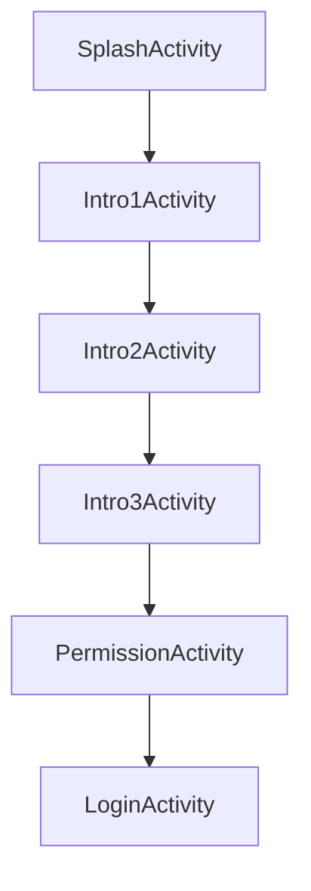
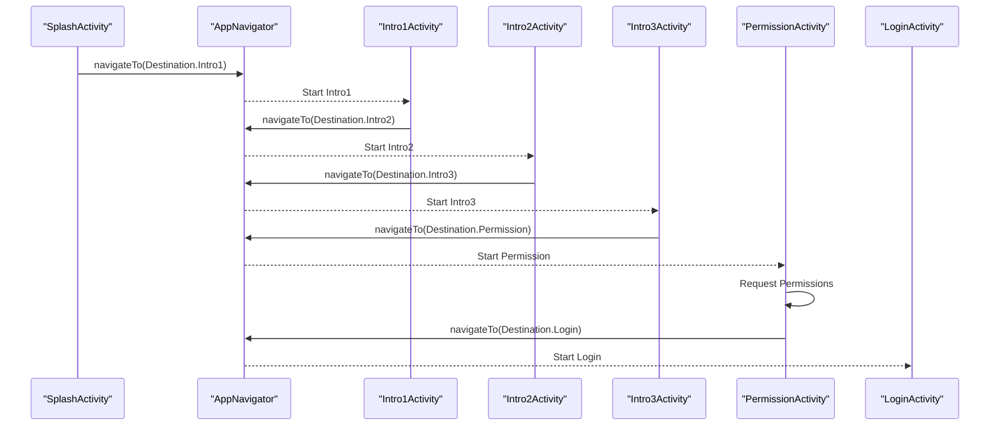
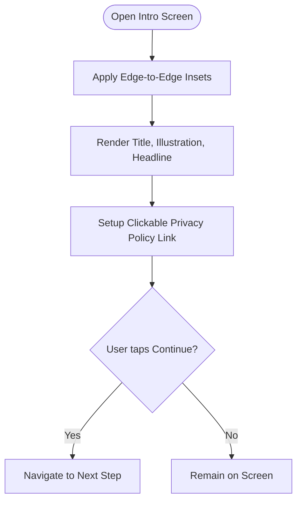
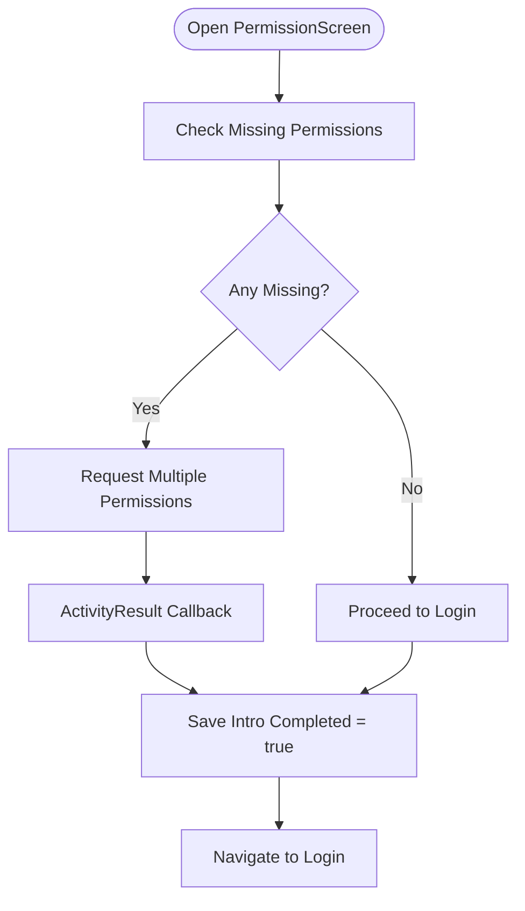
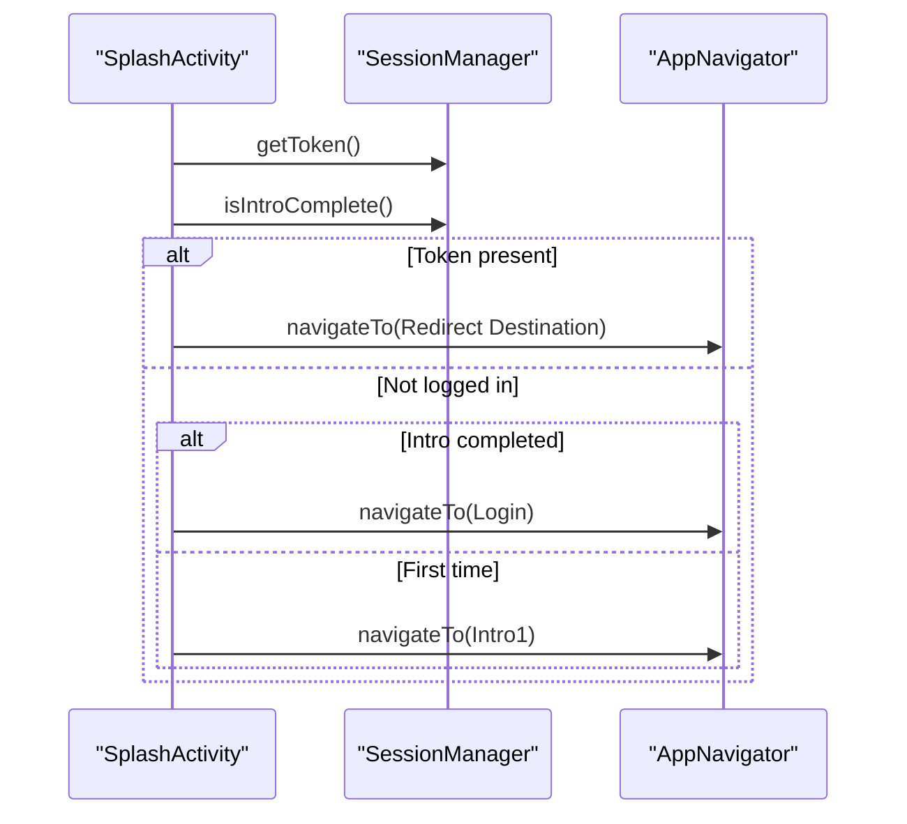
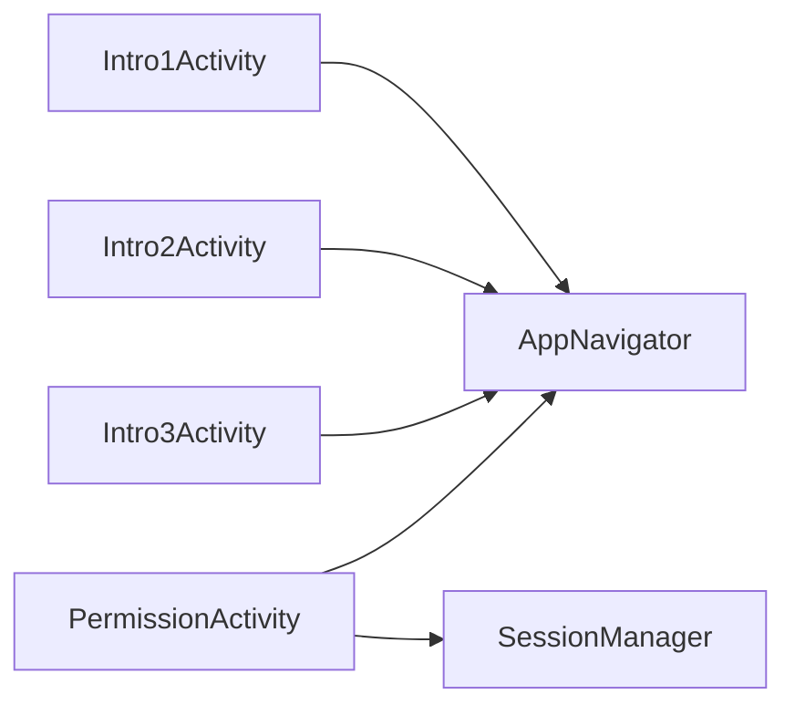

# User Onboarding

<cite>
**Referenced Files in This Document**
- [Intro1Activity.kt](file://app/src/main/java/com/flirttime/feature/onboarding/presentation/Intro1Activity.kt)
- [Intro2Activity.kt](file://app/src/main/java/com/flirttime/feature/onboarding/presentation/Intro2Activity.kt)
- [Intro3Activity.kt](file://app/src/main/java/com/flirttime/feature/onboarding/presentation/Intro3Activity.kt)
- [PermissionActivity.kt](file://app/src/main/java/com/flirttime/feature/onboarding/presentation/PermissionActivity.kt)
- [AppNavigator.kt](file://app/src/main/java/com/flirttime/core/navigation/AppNavigator.kt)
- [SplashActivity.kt](file://app/src/main/java/com/flirttime/feature/splash/presentation/SplashActivity.kt)
- [activity_intro1.xml](file://app/src/main/res/layout/activity_intro1.xml)
- [activity_intro2.xml](file://app/src/main/res/layout/activity_intro2.xml)
- [activity_intro3.xml](file://app/src/main/res/layout/activity_intro3.xml)
- [activity_permission.xml](file://app/src/main/res/layout/activity_permission.xml)
- [strings.xml](file://app/src/main/res/values/strings.xml)
</cite>

## Table of Contents
1. [Introduction](#introduction)
2. [Project Structure](#project-structure)
3. [Core Components](#core-components)
4. [Architecture Overview](#architecture-overview)
5. [Detailed Component Analysis](#detailed-component-analysis)
6. [Dependency Analysis](#dependency-analysis)
7. [Performance Considerations](#performance-considerations)
8. [Troubleshooting Guide](#troubleshooting-guide)
9. [Conclusion](#conclusion)

## Introduction
This document explains the user onboarding experience in Flirttime-Otp-Android. It covers:
- The multi-step intro screen flow with consistent UI and navigation
- Permission handling for camera, location, and notifications
- Initial setup flow that guides new users through essential app configuration
- UX design principles applied to ensure a smooth onboarding journey
- Customization options for intro content and permission prompts
- Accessibility considerations and internationalization support

The onboarding is designed to be simple, engaging, and safe, leading users from first launch to login while explaining why permissions are needed.

## Project Structure
Onboarding is implemented as a sequence of Activities under the onboarding feature package, with a dedicated permission screen followed by the login flow. Navigation is centralized via a type-safe navigator.

**Diagram sources**
- [SplashActivity.kt:66-107](file://app/src/main/java/com/flirttime/feature/splash/presentation/SplashActivity.kt#L66-L107)
- [AppNavigator.kt:73-135](file://app/src/main/java/com/flirttime/core/navigation/AppNavigator.kt#L73-L135)
- [Intro1Activity.kt:122-126](file://app/src/main/java/com/flirttime/feature/onboarding/presentation/Intro1Activity.kt#L122-L126)
- [Intro2Activity.kt:120-124](file://app/src/main/java/com/flirttime/feature/onboarding/presentation/Intro2Activity.kt#L120-L124)
- [Intro3Activity.kt:120-124](file://app/src/main/java/com/flirttime/feature/onboarding/presentation/Intro3Activity.kt#L120-L124)
- [PermissionActivity.kt:106-117](file://app/src/main/java/com/flirttime/feature/onboarding/presentation/PermissionActivity.kt#L106-L117)

**Section sources**
- [SplashActivity.kt:66-107](file://app/src/main/java/com/flirttime/feature/splash/presentation/SplashActivity.kt#L66-L107)
- [AppNavigator.kt:73-135](file://app/src/main/java/com/flirttime/core/navigation/AppNavigator.kt#L73-L135)

## Core Components
- Intro screens (Intro1, Intro2, Intro3): Present introductory messaging and privacy policy acknowledgment, then navigate forward.
- Permission screen (PermissionActivity): Requests required permissions and proceeds to login.
- AppNavigator: Centralized, type-safe routing between destinations.
- SplashActivity: Determines whether to start onboarding or skip based on session state.

Key responsibilities:
- Consistent edge-to-edge layout across devices
- Spannable text for privacy policy links
- Permission request orchestration
- State persistence marking onboarding completion

**Section sources**
- [Intro1Activity.kt:29-39](file://app/src/main/java/com/flirttime/feature/onboarding/presentation/Intro1Activity.kt#L29-L39)
- [Intro2Activity.kt:29-39](file://app/src/main/java/com/flirttime/feature/onboarding/presentation/Intro2Activity.kt#L29-L39)
- [Intro3Activity.kt:29-39](file://app/src/main/java/com/flirttime/feature/onboarding/presentation/Intro3Activity.kt#L29-L39)
- [PermissionActivity.kt:34-44](file://app/src/main/java/com/flirttime/feature/onboarding/presentation/PermissionActivity.kt#L34-L44)
- [AppNavigator.kt:73-135](file://app/src/main/java/com/flirttime/core/navigation/AppNavigator.kt#L73-L135)

## Architecture Overview
The onboarding architecture follows a linear flow controlled by the splash screen and navigated via a central router. Each intro screen is self-contained and delegates navigation to AppNavigator.

**Diagram sources**
- [SplashActivity.kt:76-104](file://app/src/main/java/com/flirttime/feature/splash/presentation/SplashActivity.kt#L76-L104)
- [AppNavigator.kt:73-135](file://app/src/main/java/com/flirttime/core/navigation/AppNavigator.kt#L73-L135)
- [Intro1Activity.kt:122-126](file://app/src/main/java/com/flirttime/feature/onboarding/presentation/Intro1Activity.kt#L122-L126)
- [Intro2Activity.kt:120-124](file://app/src/main/java/com/flirttime/feature/onboarding/presentation/Intro2Activity.kt#L120-L124)
- [Intro3Activity.kt:120-124](file://app/src/main/java/com/flirttime/feature/onboarding/presentation/Intro3Activity.kt#L120-L124)
- [PermissionActivity.kt:106-117](file://app/src/main/java/com/flirttime/feature/onboarding/presentation/PermissionActivity.kt#L106-L117)

## Detailed Component Analysis

### Multi-Step Intro Screens (Intro1, Intro2, Intro3)
Each intro screen:
- Applies edge-to-edge insets for status and navigation bars
- Displays an app title, illustration, headline text, and continue button
- Renders a clickable privacy policy link using spannable text
- Navigates to the next step via AppNavigator

UI structure per intro screen:
- Top app logo positioned below system bar/cutout
- Center illustration scaled to fit
- Headline text styled with two colors
- Bottom action area with Continue button and privacy policy text

Customization points:
- Headline text is set programmatically; update the corresponding method in each activity to change messaging
- Privacy policy URL is hardcoded; modify the destination to point to your policy page
- Illustration resources can be swapped per screen

Accessibility:
- App title has content description for accessibility
- Buttons and text use readable sizes and contrast
- Focusable elements are standard Android views

Internationalization:
- Strings such as Continue and privacy policy notice are defined in strings.xml
- Headlines are currently set programmatically; consider moving them to strings.xml for localization

**Diagram sources**
- [Intro1Activity.kt:47-69](file://app/src/main/java/com/flirttime/feature/onboarding/presentation/Intro1Activity.kt#L47-L69)
- [Intro1Activity.kt:72-120](file://app/src/main/java/com/flirttime/feature/onboarding/presentation/Intro1Activity.kt#L72-L120)
- [Intro1Activity.kt:122-126](file://app/src/main/java/com/flirttime/feature/onboarding/presentation/Intro1Activity.kt#L122-L126)

**Section sources**
- [Intro1Activity.kt:29-126](file://app/src/main/java/com/flirttime/feature/onboarding/presentation/Intro1Activity.kt#L29-L126)
- [Intro2Activity.kt:29-126](file://app/src/main/java/com/flirttime/feature/onboarding/presentation/Intro2Activity.kt#L29-L126)
- [Intro3Activity.kt:29-126](file://app/src/main/java/com/flirttime/feature/onboarding/presentation/Intro3Activity.kt#L29-L126)
- [activity_intro1.xml:1-98](file://app/src/main/res/layout/activity_intro1.xml#L1-L98)
- [activity_intro2.xml:1-98](file://app/src/main/res/layout/activity_intro2.xml#L1-L98)
- [activity_intro3.xml:1-98](file://app/src/main/res/layout/activity_intro3.xml#L1-L98)
- [strings.xml:3-7](file://app/src/main/res/values/strings.xml#L3-L7)

### Permission Handling System (PermissionActivity)
PermissionActivity orchestrates permission requests and proceeds to login regardless of allow/deny outcome, matching legacy behavior.

Permissions requested:
- Camera
- Location (fine and coarse)
- Notifications (Android 13+)

Flow:
- Build a list of missing permissions
- Launch a multiple-permission request
- After result, mark onboarding complete and navigate to login

**Diagram sources**
- [PermissionActivity.kt:78-104](file://app/src/main/java/com/flirttime/feature/onboarding/presentation/PermissionActivity.kt#L78-L104)
- [PermissionActivity.kt:106-117](file://app/src/main/java/com/flirttime/feature/onboarding/presentation/PermissionActivity.kt#L106-L117)

Notes:
- The permission prompt UI lists categories like SMS & Calls, Location, Media and Gallery, but the code requests Camera, Location, and Notifications. Ensure the UI copy aligns with actual permissions if you intend to request those specific capabilities.
- Notification permission is only requested on Android 13+ (TIRAMISU).

**Section sources**
- [PermissionActivity.kt:34-44](file://app/src/main/java/com/flirttime/feature/onboarding/presentation/PermissionActivity.kt#L34-L44)
- [PermissionActivity.kt:78-117](file://app/src/main/java/com/flirttime/feature/onboarding/presentation/PermissionActivity.kt#L78-L117)
- [activity_permission.xml:1-262](file://app/src/main/res/layout/activity_permission.xml#L1-L262)
- [strings.xml:17-26](file://app/src/main/res/values/strings.xml#L17-L26)

### Initial Setup Flow and Entry Points
SplashActivity determines the initial destination:
- If token exists, redirect based on saved pageRedirect
- If onboarding already completed, go to Login
- Otherwise, start Intro1

**Diagram sources**
- [SplashActivity.kt:76-104](file://app/src/main/java/com/flirttime/feature/splash/presentation/SplashActivity.kt#L76-L104)

**Section sources**
- [SplashActivity.kt:66-107](file://app/src/main/java/com/flirttime/feature/splash/presentation/SplashActivity.kt#L66-L107)

### User Experience Design Principles Applied
- Clarity: Simple, focused screens with clear next actions
- Trust: Explicit privacy policy acknowledgment before continuing
- Safety-first messaging: Permission screen emphasizes safety and purpose
- Consistency: Uniform layout, typography, and spacing across intro screens
- Device compatibility: Edge-to-edge handling ensures proper placement on modern devices

[No sources needed since this section provides general guidance]

### Customization Options for Intro Content and Permission Prompts
- Headline messaging: Update the programmatic text in each intro activity’s headline setup method
- Privacy policy link: Change the URL passed to the webview destination
- Illustrations: Replace drawable resources referenced by each intro layout
- Permission UI copy: Edit strings in strings.xml and adjust the permission cards in activity_permission.xml
- Permission logic: Modify the permission check and request list in PermissionActivity to match product requirements

**Section sources**
- [Intro1Activity.kt:72-78](file://app/src/main/java/com/flirttime/feature/onboarding/presentation/Intro1Activity.kt#L72-L78)
- [Intro2Activity.kt:70-77](file://app/src/main/java/com/flirttime/feature/onboarding/presentation/Intro2Activity.kt#L70-L77)
- [Intro3Activity.kt:70-77](file://app/src/main/java/com/flirttime/feature/onboarding/presentation/Intro3Activity.kt#L70-L77)
- [activity_intro1.xml:29-42](file://app/src/main/res/layout/activity_intro1.xml#L29-L42)
- [activity_intro2.xml:29-42](file://app/src/main/res/layout/activity_intro2.xml#L29-L42)
- [activity_intro3.xml:29-42](file://app/src/main/res/layout/activity_intro3.xml#L29-L42)
- [activity_permission.xml:55-226](file://app/src/main/res/layout/activity_permission.xml#L55-L226)
- [strings.xml:17-26](file://app/src/main/res/values/strings.xml#L17-L26)

### Accessibility Considerations
- Content descriptions: App title images include contentDescription for screen readers
- Contrast and readability: Text uses high-contrast colors and adequate font sizes
- Focus management: Standard buttons and text views provide natural focus order
- Edge-to-edge: Ensures content is not hidden behind system bars on all devices

Recommendations:
- Add meaningful content descriptions to illustrative images where appropriate
- Ensure tap targets meet minimum size guidelines
- Test with TalkBack and explore color-blind modes

**Section sources**
- [activity_intro1.xml:17-27](file://app/src/main/res/layout/activity_intro1.xml#L17-L27)
- [activity_intro2.xml:17-27](file://app/src/main/res/layout/activity_intro2.xml#L17-L27)
- [activity_intro3.xml:17-27](file://app/src/main/res/layout/activity_intro3.xml#L17-L27)

### Internationalization Support
- Static strings: Continue, privacy policy notice, and permission-related messages are localized via strings.xml
- Programmatic headlines: Currently not localized; move to strings.xml for full i18n support
- Dynamic URLs: Privacy policy URL is hardcoded; consider externalizing for regional policies

**Section sources**
- [strings.xml:3-7](file://app/src/main/res/values/strings.xml#L3-L7)
- [strings.xml:17-26](file://app/src/main/res/values/strings.xml#L17-L26)
- [Intro1Activity.kt:72-78](file://app/src/main/java/com/flirttime/feature/onboarding/presentation/Intro1Activity.kt#L72-L78)
- [Intro2Activity.kt:70-77](file://app/src/main/java/com/flirttime/feature/onboarding/presentation/Intro2Activity.kt#L70-L77)
- [Intro3Activity.kt:70-77](file://app/src/main/java/com/flirttime/feature/onboarding/presentation/Intro3Activity.kt#L70-L77)

## Dependency Analysis
Onboarding components depend on:
- AppNavigator for routing
- SessionManager for persisting onboarding completion
- AndroidX core utilities for window insets and binding
- Resources for strings and drawables

**Diagram sources**
- [Intro1Activity.kt:122-126](file://app/src/main/java/com/flirttime/feature/onboarding/presentation/Intro1Activity.kt#L122-L126)
- [Intro2Activity.kt:120-124](file://app/src/main/java/com/flirttime/feature/onboarding/presentation/Intro2Activity.kt#L120-L124)
- [Intro3Activity.kt:120-124](file://app/src/main/java/com/flirttime/feature/onboarding/presentation/Intro3Activity.kt#L120-L124)
- [PermissionActivity.kt:106-117](file://app/src/main/java/com/flirttime/feature/onboarding/presentation/PermissionActivity.kt#L106-L117)
- [AppNavigator.kt:73-135](file://app/src/main/java/com/flirttime/core/navigation/AppNavigator.kt#L73-L135)

**Section sources**
- [AppNavigator.kt:19-56](file://app/src/main/java/com/flirttime/core/navigation/AppNavigator.kt#L19-L56)
- [PermissionActivity.kt:22-26](file://app/src/main/java/com/flirttime/feature/onboarding/presentation/PermissionActivity.kt#L22-L26)

## Performance Considerations
- Lightweight activities: Intro screens are simple layouts with minimal logic
- No heavy animations: Transitions are handled by Activity navigation without custom animation code
- Efficient permission checks: Only request missing permissions to reduce overhead
- Avoid repeated work: Edge-to-edge insets are applied once per screen

[No sources needed since this section provides general guidance]

## Troubleshooting Guide
Common issues and resolutions:
- Privacy policy link not opening: Verify the URL in the webview destination and ensure network access is allowed
- Permission UI mismatch: Align the permission cards’ text with the actual permissions being requested
- Layout overlap on devices with cutouts: Confirm edge-to-edge setup is active and insets are applied correctly
- Skipping onboarding unexpectedly: Check session flags and intro completion state in SplashActivity

Debugging tips:
- Log the permissions being requested and their results
- Validate string resources for typos or missing entries
- Test on Android 13+ to confirm notification permission behavior

**Section sources**
- [Intro1Activity.kt:91-118](file://app/src/main/java/com/flirttime/feature/onboarding/presentation/Intro1Activity.kt#L91-L118)
- [PermissionActivity.kt:78-104](file://app/src/main/java/com/flirttime/feature/onboarding/presentation/PermissionActivity.kt#L78-L104)
- [SplashActivity.kt:76-104](file://app/src/main/java/com/flirttime/feature/splash/presentation/SplashActivity.kt#L76-L104)

## Conclusion
Flirttime-Otp-Android’s onboarding provides a clear, accessible path from first launch to login. The three-step intro screens communicate value and trust, while the permission screen prepares the app for core features. The architecture is straightforward, leveraging a centralized navigator and consistent UI patterns. To extend or customize, update the intro content, permission UI copy, and permission request logic as needed, ensuring alignment with product goals and platform requirements.

[No sources needed since this section summarizes without analyzing specific files]